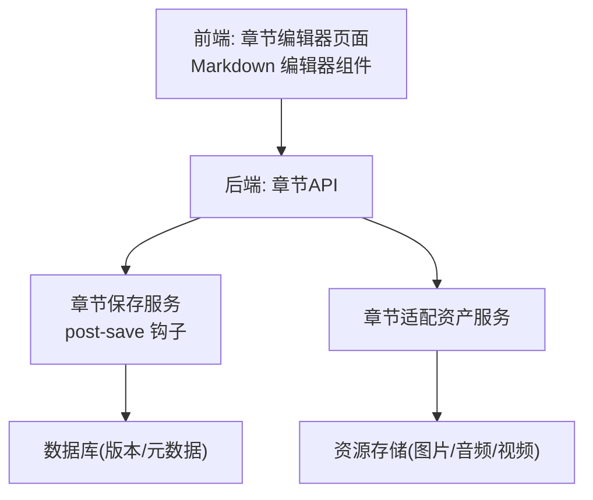
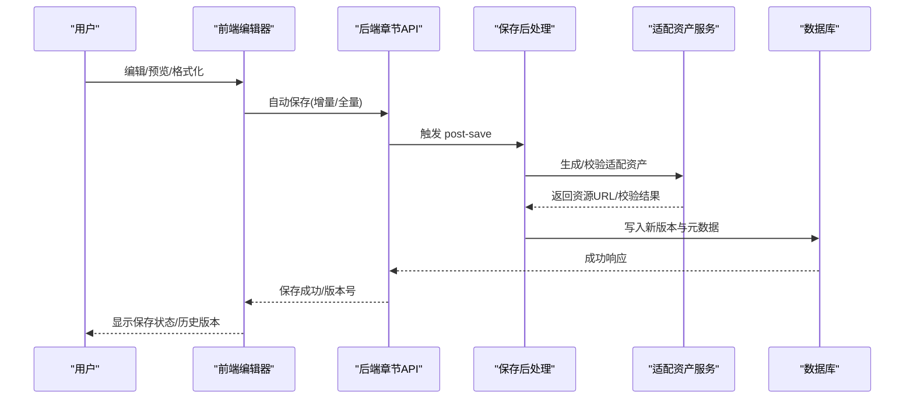
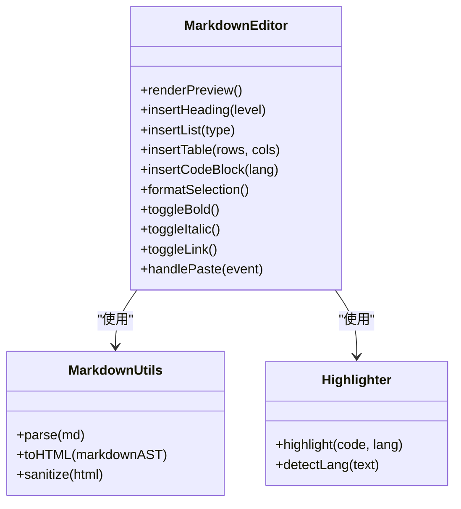
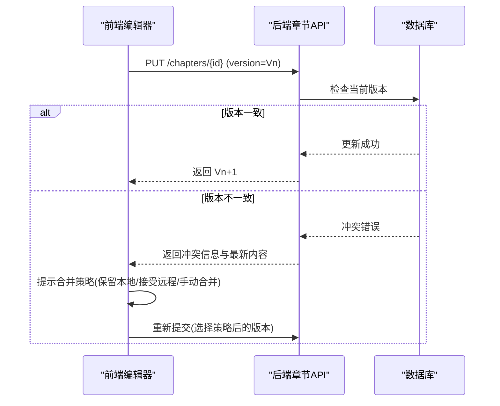
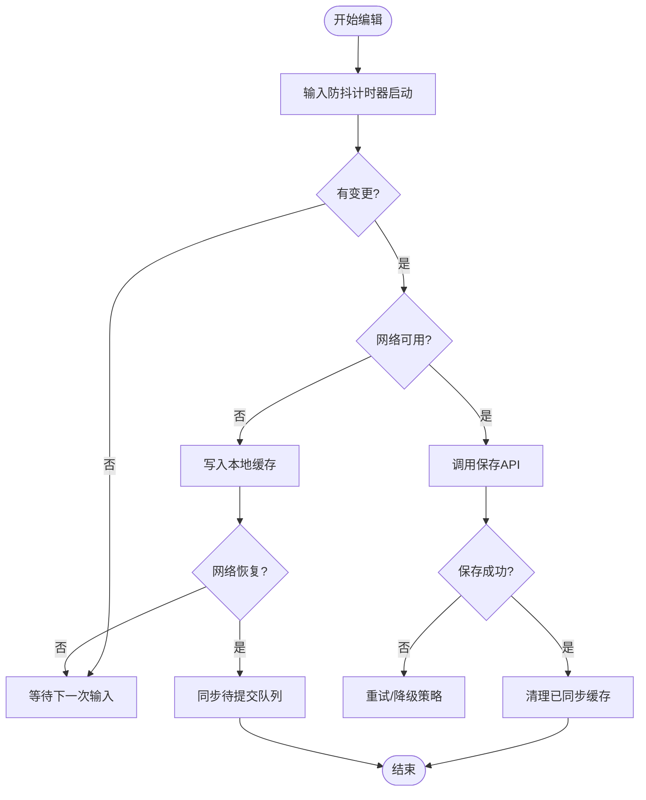
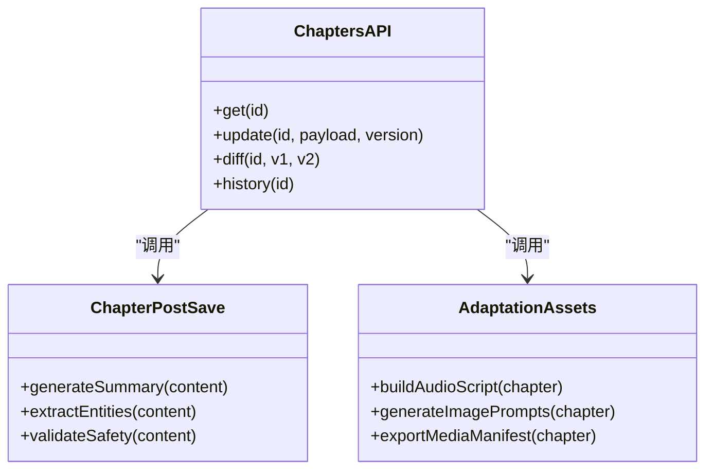
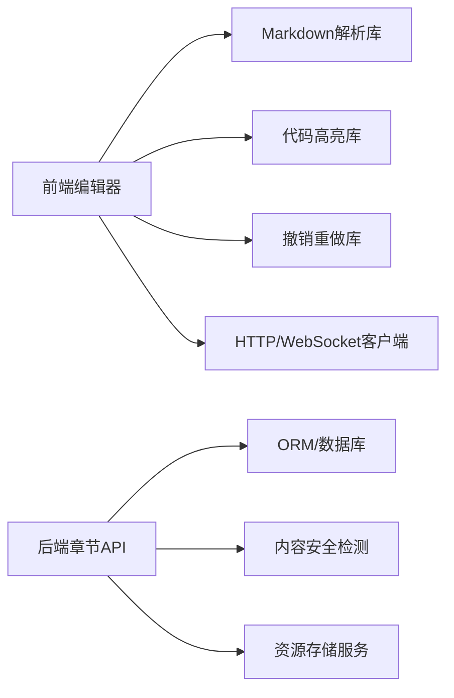

# 章节编辑器

<cite>
**本文引用的文件**   
- [README.md](file://README.md)
- [backend/app/api/v1/chapters.py](file://backend/app/api/v1/chapters.py)
- [backend/app/services/chapter_post_save.py](file://backend/app/services/chapter_post_save.py)
- [backend/app/services/chapter_adaptation_assets.py](file://backend/app/services/chapter_adaptation_assets.py)
- [frontend/src/pages/ChapterEditor.tsx](file://frontend/src/pages/ChapterEditor.tsx)
- [frontend/src/components/editor/MarkdownEditor.tsx](file://frontend/src/components/editor/MarkdownEditor.tsx)
- [frontend/src/hooks/useChapterSave.ts](file://frontend/src/hooks/useChapterSave.ts)
- [frontend/src/utils/markdown.ts](file://frontend/src/utils/markdown.ts)
- [frontend/src/utils/highlight.ts](file://frontend/src/utils/highlight.ts)
- [frontend/src/utils/undoRedo.ts](file://frontend/src/utils/undoRedo.ts)
- [frontend/src/utils/collab.ts](file://frontend/src/utils/collab.ts)
- [frontend/src/utils/offline.ts](file://frontend/src/utils/offline.ts)
- [frontend/package.json](file://frontend/package.json)
</cite>

## 目录
1. [简介](#简介)
2. [项目结构](#项目结构)
3. [核心组件](#核心组件)
4. [架构总览](#架构总览)
5. [详细组件分析](#详细组件分析)
6. [依赖分析](#依赖分析)
7. [性能考虑](#性能考虑)
8. [故障排查指南](#故障排查指南)
9. [结论](#结论)
10. [附录](#附录)

## 简介
本文件为“章节编辑器”的功能文档，面向作者与开发者，系统性说明富文本编辑能力、结构化编辑、协作机制、数据同步与离线支持、快捷键与模板、批量编辑以及性能优化与常见问题。该编辑器基于 Markdown 语法，提供实时预览、代码高亮与格式化工具，并支持与后端 API 的自动保存、版本控制与冲突检测，确保多人协作时的数据一致性与可追溯性。

## 项目结构
章节编辑器由前端编辑器界面与后端章节服务组成：
- 前端负责渲染 Markdown、实时预览、代码高亮、撤销重做、协作状态与离线缓存。
- 后端提供章节读写、自动保存、版本化存储、内容后处理（如摘要生成、适配资产）等能力。

图表来源
- [frontend/src/pages/ChapterEditor.tsx](file://frontend/src/pages/ChapterEditor.tsx)
- [frontend/src/components/editor/MarkdownEditor.tsx](file://frontend/src/components/editor/MarkdownEditor.tsx)
- [backend/app/api/v1/chapters.py](file://backend/app/api/v1/chapters.py)
- [backend/app/services/chapter_post_save.py](file://backend/app/services/chapter_post_save.py)
- [backend/app/services/chapter_adaptation_assets.py](file://backend/app/services/chapter_adaptation_assets.py)

章节来源
- [README.md](file://README.md)

## 核心组件
- 富文本编辑器（Markdown）：支持标题层级、段落管理、列表、表格、引用、链接、图片、数学公式与代码块。
- 实时预览：将 Markdown 转换为 HTML 并在侧边或分屏中展示。
- 代码高亮与格式化：对代码块进行语法高亮与缩进格式化。
- 结构化编辑：标题层级导航、段落拆分/合并、列表与表格插入、锚点跳转。
- 协作编辑：冲突检测、版本控制、撤销重做、光标共享与在线状态。
- 数据同步：自动保存、增量更新、离线缓存与断网恢复。
- 快捷键与模板：常用操作快捷键、章节模板快速插入、批量替换与样式统一。

章节来源
- [frontend/src/components/editor/MarkdownEditor.tsx](file://frontend/src/components/editor/MarkdownEditor.tsx)
- [frontend/src/utils/markdown.ts](file://frontend/src/utils/markdown.ts)
- [frontend/src/utils/highlight.ts](file://frontend/src/utils/highlight.ts)
- [frontend/src/utils/undoRedo.ts](file://frontend/src/utils/undoRedo.ts)
- [frontend/src/utils/collab.ts](file://frontend/src/utils/collab.ts)
- [frontend/src/utils/offline.ts](file://frontend/src/utils/offline.ts)

## 架构总览
章节编辑器采用前后端分离架构，前端通过 REST/WebSocket 与后端交互；后端在保存时触发后处理流程，生成摘要、适配资源并持久化版本信息。

图表来源
- [backend/app/api/v1/chapters.py](file://backend/app/api/v1/chapters.py)
- [backend/app/services/chapter_post_save.py](file://backend/app/services/chapter_post_save.py)
- [backend/app/services/chapter_adaptation_assets.py](file://backend/app/services/chapter_adaptation_assets.py)

## 详细组件分析

### 富文本编辑器（Markdown）
- 功能要点
  - 标题层级：H1-H6，自动生成目录与锚点。
  - 段落管理：智能分段、合并、换行与空行处理。
  - 列表与表格：有序/无序列表、嵌套列表、表格插入与对齐。
  - 代码块：多语言高亮、复制、折叠与行号。
  - 媒体：图片上传、预览与懒加载；音视频嵌入。
  - 数学公式：LaTeX 渲染。
- 实现要点
  - Markdown 解析与转换：使用专用工具函数进行安全转换与扩展语法支持。
  - 代码高亮：按语言识别并注入高亮样式。
  - 实时预览：防抖渲染，避免频繁重排。
  - 快捷键：Ctrl/Cmd + B/I/U/L/S/T/K 等。

章节来源
- [frontend/src/components/editor/MarkdownEditor.tsx](file://frontend/src/components/editor/MarkdownEditor.tsx)
- [frontend/src/utils/markdown.ts](file://frontend/src/utils/markdown.ts)
- [frontend/src/utils/highlight.ts](file://frontend/src/utils/highlight.ts)

#### 类图（编辑器相关）

图表来源
- [frontend/src/components/editor/MarkdownEditor.tsx](file://frontend/src/components/editor/MarkdownEditor.tsx)
- [frontend/src/utils/markdown.ts](file://frontend/src/utils/markdown.ts)
- [frontend/src/utils/highlight.ts](file://frontend/src/utils/highlight.ts)

### 结构化编辑
- 标题层级与目录：自动生成目录树，点击跳转至对应锚点。
- 段落管理：段落拆分/合并、缩进与对齐、首行缩进。
- 列表与表格：支持嵌套列表、表格列宽调整、排序与筛选。
- 锚点与书签：为段落与标题生成唯一标识，便于定位与引用。

章节来源
- [frontend/src/components/editor/MarkdownEditor.tsx](file://frontend/src/components/editor/MarkdownEditor.tsx)

### 协作编辑
- 冲突检测：基于版本号的乐观锁，检测到冲突时提示合并策略。
- 版本控制：每次保存生成新版本，支持回滚与差异对比。
- 撤销重做：本地操作栈与远程变更合并，保证一致性。
- 在线状态：显示协作者光标与选区，实时同步。

章节来源
- [frontend/src/utils/collab.ts](file://frontend/src/utils/collab.ts)
- [frontend/src/utils/undoRedo.ts](file://frontend/src/utils/undoRedo.ts)

#### 序列图（协作保存与冲突处理）

图表来源
- [backend/app/api/v1/chapters.py](file://backend/app/api/v1/chapters.py)

### 数据同步、自动保存与离线编辑
- 自动保存：输入防抖触发增量保存，减少网络开销。
- 离线编辑：本地缓存草稿，网络恢复后自动同步。
- 断线恢复：记录未提交变更队列，连接恢复后重试。
- 幂等性：重复请求不产生副作用，保障稳定性。

章节来源
- [frontend/src/hooks/useChapterSave.ts](file://frontend/src/hooks/useChapterSave.ts)
- [frontend/src/utils/offline.ts](file://frontend/src/utils/offline.ts)

#### 流程图（自动保存与离线缓存）

图表来源
- [frontend/src/hooks/useChapterSave.ts](file://frontend/src/hooks/useChapterSave.ts)
- [frontend/src/utils/offline.ts](file://frontend/src/utils/offline.ts)

### 快捷键、模板与批量编辑
- 快捷键：加粗、斜体、删除线、插入链接/图片、代码块、标题、列表、表格、撤销/重做、保存。
- 模板：章节模板（场景、对话、旁白）、角色设定模板、世界观条目模板。
- 批量编辑：全文替换、样式统一、批量插入/删除段落、导出为多种格式。

章节来源
- [frontend/src/components/editor/MarkdownEditor.tsx](file://frontend/src/components/editor/MarkdownEditor.tsx)

### 后端章节服务与后处理
- 章节API：提供读取、更新、版本查询与差异对比接口。
- 保存后处理：生成章节摘要、提取关键实体、校验内容安全。
- 适配资产：为章节生成适配不同媒介的资源（如音频脚本、图片描述）。

章节来源
- [backend/app/api/v1/chapters.py](file://backend/app/api/v1/chapters.py)
- [backend/app/services/chapter_post_save.py](file://backend/app/services/chapter_post_save.py)
- [backend/app/services/chapter_adaptation_assets.py](file://backend/app/services/chapter_adaptation_assets.py)

#### 类图（后端服务）

图表来源
- [backend/app/api/v1/chapters.py](file://backend/app/api/v1/chapters.py)
- [backend/app/services/chapter_post_save.py](file://backend/app/services/chapter_post_save.py)
- [backend/app/services/chapter_adaptation_assets.py](file://backend/app/services/chapter_adaptation_assets.py)

## 依赖分析
- 前端依赖
  - Markdown 解析与渲染库（用于解析与转换）。
  - 代码高亮库（用于语法着色）。
  - 撤销重做库（用于操作栈管理）。
  - WebSocket/HTTP 客户端（用于实时协作与保存）。
- 后端依赖
  - ORM/数据库驱动（用于版本与元数据持久化）。
  - 内容安全检测（用于敏感内容过滤）。
  - 资源存储服务（用于图片/音视频托管）。

图表来源
- [frontend/package.json](file://frontend/package.json)
- [backend/app/api/v1/chapters.py](file://backend/app/api/v1/chapters.py)

章节来源
- [frontend/package.json](file://frontend/package.json)

## 性能考虑
- 渲染优化
  - 防抖与节流：预览渲染与保存请求均进行防抖，降低重排与网络压力。
  - 虚拟滚动：长文档分页渲染，仅渲染可视区域。
  - 增量更新：只更新变更节点，避免整页重绘。
- 网络优化
  - 增量保存：仅提交变更片段，减少带宽占用。
  - 压缩与缓存：启用 Gzip/Brotli，浏览器缓存静态资源。
  - 重试与退避：失败请求指数退避重试，避免雪崩。
- 内存与CPU
  - 大文档分片处理：避免一次性解析与渲染。
  - 异步任务：耗时操作（摘要生成、资源处理）放入后台任务。
- 协作与冲突
  - 版本快照：定期生成快照，缩短冲突恢复时间。
  - 差异计算：使用高效 diff 算法，减少计算开销。

[本节为通用指导，无需特定文件来源]

## 故障排查指南
- 常见问题
  - 预览不更新：检查 Markdown 解析是否异常，确认防抖定时器状态。
  - 代码高亮失效：确认语言识别与高亮库初始化。
  - 保存失败：查看网络状态、版本冲突提示与错误码。
  - 离线模式：检查本地缓存是否写入，网络恢复后是否触发同步。
  - 协作冲突：根据提示选择合并策略，必要时手动合并差异。
- 调试建议
  - 打开控制台日志，捕获解析与渲染错误。
  - 使用网络面板查看请求/响应，确认版本字段正确。
  - 检查本地存储键值，确认缓存与队列正常。

章节来源
- [frontend/src/utils/markdown.ts](file://frontend/src/utils/markdown.ts)
- [frontend/src/utils/highlight.ts](file://frontend/src/utils/highlight.ts)
- [frontend/src/hooks/useChapterSave.ts](file://frontend/src/hooks/useChapterSave.ts)
- [frontend/src/utils/offline.ts](file://frontend/src/utils/offline.ts)
- [frontend/src/utils/collab.ts](file://frontend/src/utils/collab.ts)

## 结论
章节编辑器以 Markdown 为核心，结合实时预览、代码高亮、结构化编辑与协作机制，提供高效稳定的创作体验。通过自动保存、离线缓存与版本控制，确保数据安全与一致性。配合快捷键、模板与批量编辑，显著提升写作效率。建议在大规模文档与多人协作场景中，进一步优化渲染与网络策略，提升整体性能与用户体验。

[本节为总结性内容，无需特定文件来源]

## 附录
- 快捷键参考
  - 加粗：Ctrl/Cmd + B
  - 斜体：Ctrl/Cmd + I
  - 删除线：Ctrl/Cmd + Shift + S
  - 插入链接：Ctrl/Cmd + K
  - 插入图片：Ctrl/Cmd + Shift + I
  - 代码块：Ctrl/Cmd + Alt + C
  - 标题：Ctrl/Cmd + Alt + [1-6]
  - 列表：Ctrl/Cmd + Shift + L
  - 表格：Ctrl/Cmd + Alt + T
  - 撤销：Ctrl/Cmd + Z
  - 重做：Ctrl/Cmd + Shift + Z
  - 保存：Ctrl/Cmd + S
- 模板示例
  - 章节模板：场景描述、对话、旁白、内心独白。
  - 角色模板：姓名、年龄、性格、背景、关系。
  - 世界观模板：地理、势力、规则、历史。
- 批量编辑
  - 全文替换：正则匹配与替换。
  - 样式统一：标题层级修正、段落间距统一。
  - 导出格式：PDF、EPUB、HTML、Markdown。

[本节为补充信息，无需特定文件来源]