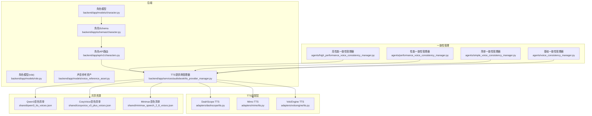
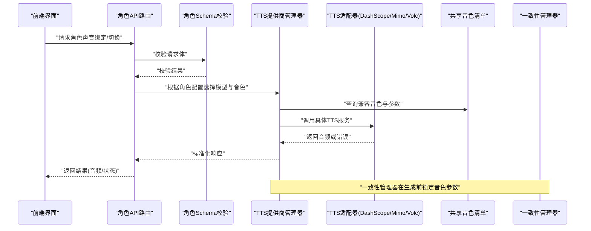
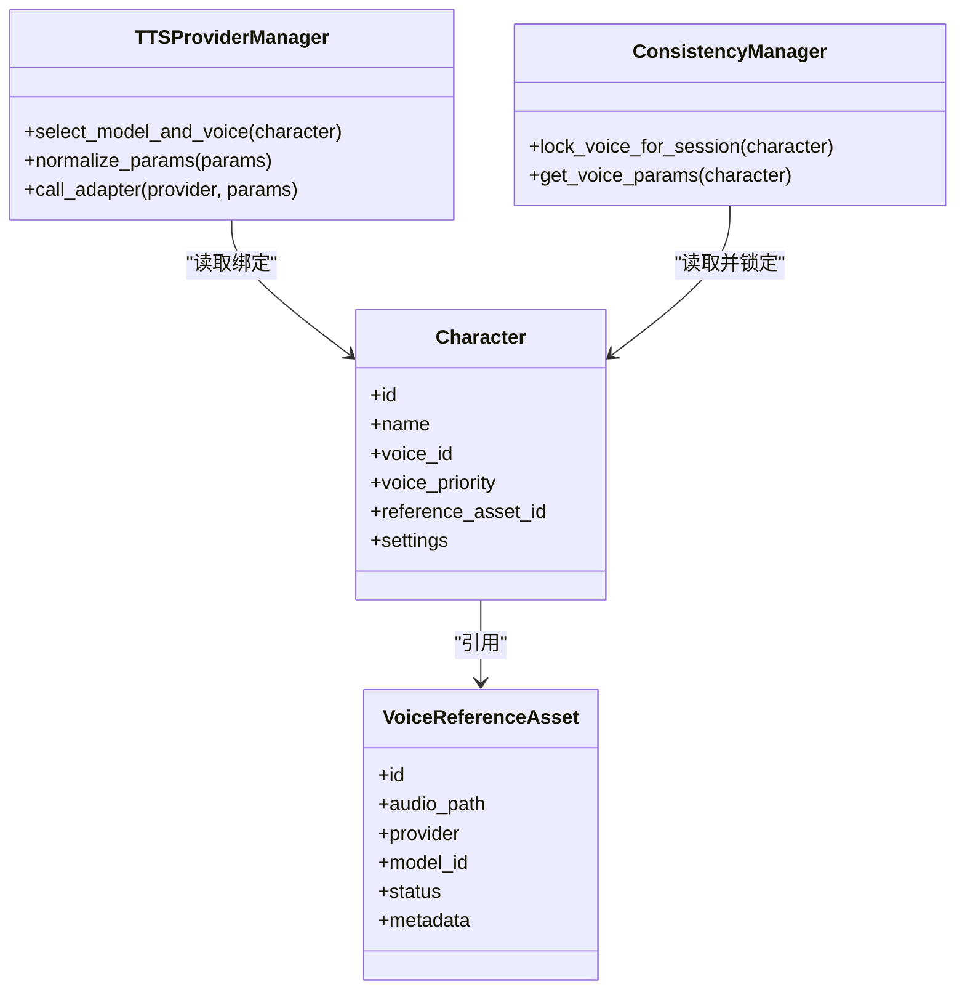
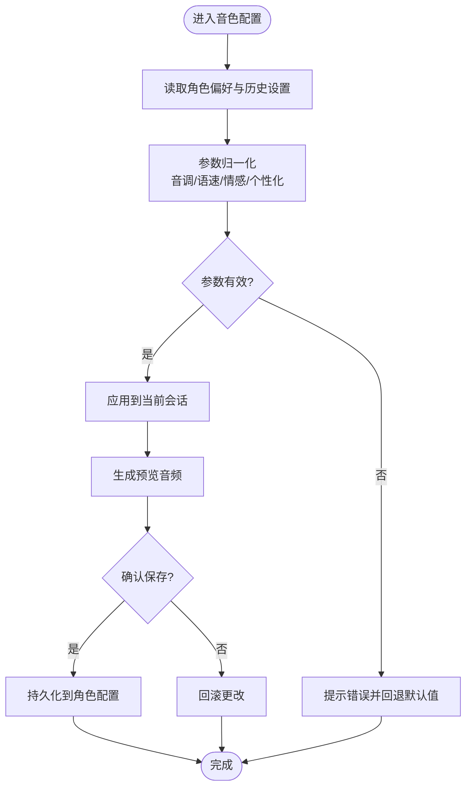
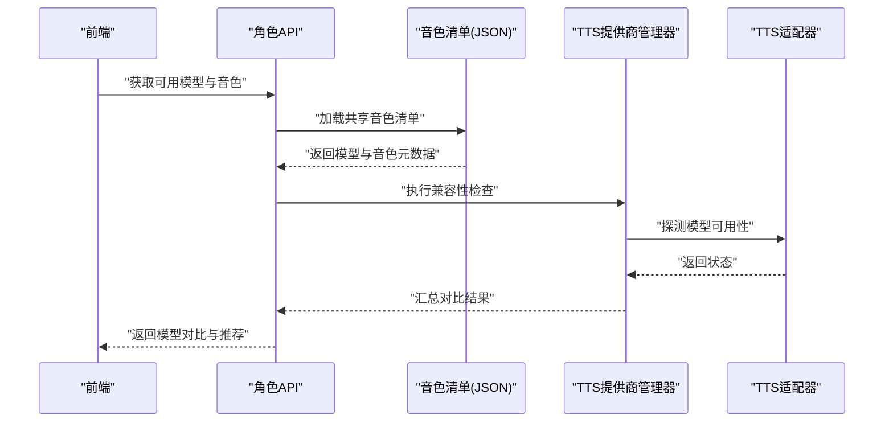
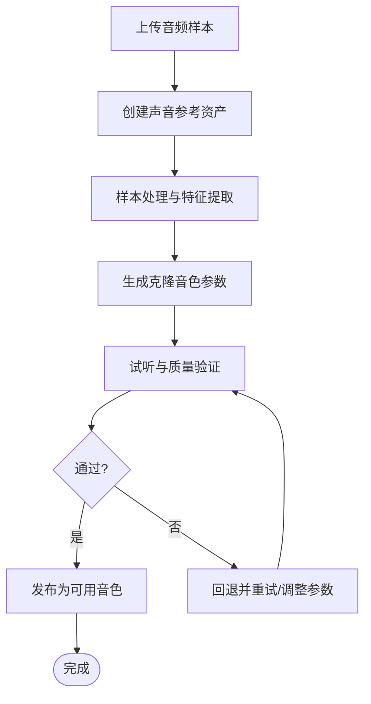
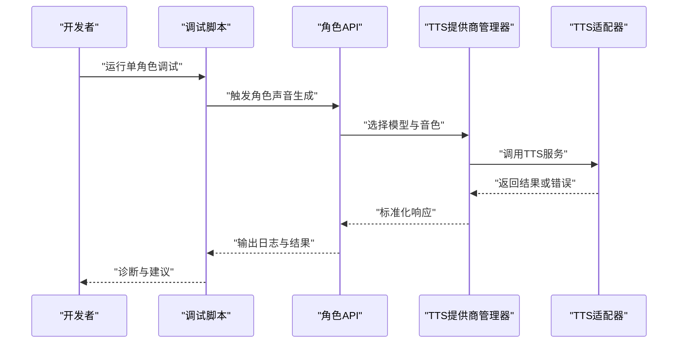
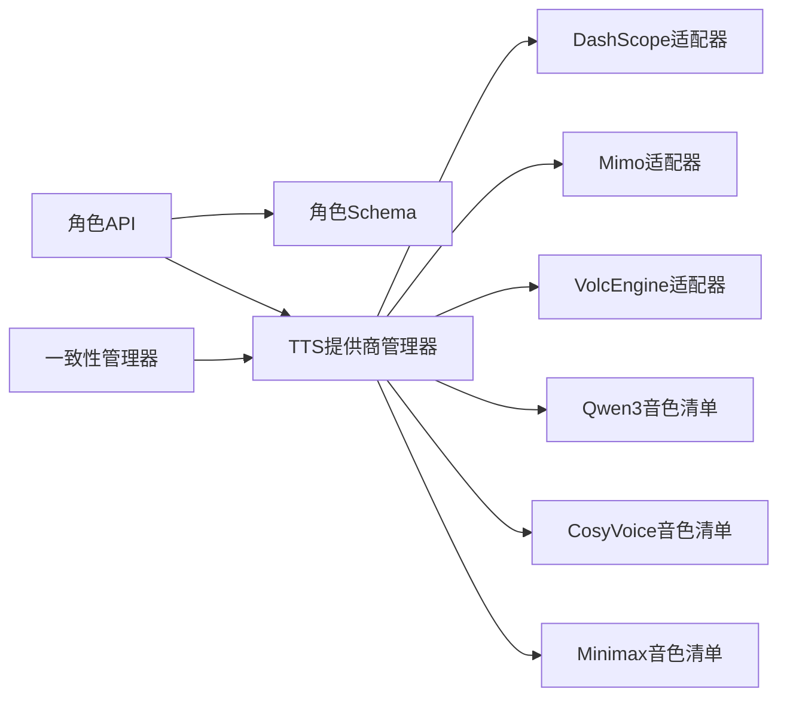

# 角色声音管理

<cite>
**本文引用的文件**   
- [backend/app/models/character.py](file://backend/app/models/character.py)
- [backend/app/models/role.py](file://backend/app/models/role.py)
- [backend/app/models/voice_reference_asset.py](file://backend/app/models/voice_reference_asset.py)
- [backend/app/schemas/character.py](file://backend/app/schemas/character.py)
- [backend/app/api/v1/characters.py](file://backend/app/api/v1/characters.py)
- [backend/app/services/audiobook/tts_provider_manager.py](file://backend/app/services/audiobook/tts_provider_manager.py)
- [adapters/dashscope/tts.py](file://adapters/dashscope/tts.py)
- [adapters/mimo/tts.py](file://adapters/mimo/tts.py)
- [adapters/volcengine/tts.py](file://adapters/volcengine/tts.py)
- [shared/qwen3_tts_voices.json](file://shared/qwen3_tts_voices.json)
- [shared/cosyvoice_v3_plus_voices.json](file://shared/cosyvoice_v3_plus_voices.json)
- [shared/minimax_speech_2_8_voices.json](file://shared/minimax_speech_2_8_voices.json)
- [agents/high_performance_voice_consistency_manager.py](file://agents/high_performance_voice_consistency_manager.py)
- [agents/performance_voice_consistency_manager.py](file://agents/performance_voice_consistency_manager.py)
- [agents/simple_voice_consistency_manager.py](file://agents/simple_voice_consistency_manager.py)
- [agents/voice_consistency_manager.py](file://agents/voice_consistency_manager.py)
- [backend/app/services/audiobook/seed_scene_engine_mixin.py](file://backend/app/services/audiobook/seed_scene_engine_mixin.py)
- [backend/app/services/audiobook/tts_param_normalizer.py](file://backend/app/services/audiobook/tts_param_normalizer.py)
- [scripts/debug_single_voice.py](file://scripts/debug_single_voice.py)
- [scripts/verify_seed_tts_websocket.py](file://scripts/verify_seed_tts_websocket.py)
</cite>

## 目录
1. [简介](#简介)
2. [项目结构](#项目结构)
3. [核心组件](#核心组件)
4. [架构总览](#架构总览)
5. [详细组件分析](#详细组件分析)
6. [依赖关系分析](#依赖关系分析)
7. [性能考量](#性能考量)
8. [故障排除指南](#故障排除指南)
9. [结论](#结论)
10. [附录](#附录)

## 简介
本文件面向“角色声音管理系统”的功能文档，覆盖以下关键能力：
- 角色与声音的绑定关系：多角色分配、声音切换、优先级策略
- 音色配置面板：音调调整、语速控制、情感表达、个性化参数
- TTS模型选择界面：模型对比、质量评估、兼容性检查
- 语音克隆：音频上传、样本处理、效果验证
- 批量操作、预设管理与声音库集成
- 调试工具、测试方法与故障排除

本系统通过统一的角色/声音数据模型、TTS提供商适配层、一致性管理器以及前后端API共同实现端到端的声音管理能力。

## 项目结构
围绕角色声音管理的代码主要分布在以下位置：
- 后端模型与Schema：角色、声音参考资产等数据定义
- API路由：角色与声音相关接口
- TTS提供商适配器：对接不同TTS服务（如DashScope、Mimo、VolcEngine）
- 共享音色清单：各模型的可用音色元数据
- 一致性管理器：保障跨场景/批次的角色声音一致性
- 脚本与测试：调试与验证工具

图表来源 
- [backend/app/models/character.py](file://backend/app/models/character.py)
- [backend/app/models/role.py](file://backend/app/models/role.py)
- [backend/app/models/voice_reference_asset.py](file://backend/app/models/voice_reference_asset.py)
- [backend/app/schemas/character.py](file://backend/app/schemas/character.py)
- [backend/app/api/v1/characters.py](file://backend/app/api/v1/characters.py)
- [backend/app/services/audiobook/tts_provider_manager.py](file://backend/app/services/audiobook/tts_provider_manager.py)
- [adapters/dashscope/tts.py](file://adapters/dashscope/tts.py)
- [adapters/mimo/tts.py](file://adapters/mimo/tts.py)
- [adapters/volcengine/tts.py](file://adapters/volcengine/tts.py)
- [shared/qwen3_tts_voices.json](file://shared/qwen3_tts_voices.json)
- [shared/cosyvoice_v3_plus_voices.json](file://shared/cosyvoice_v3_plus_voices.json)
- [shared/minimax_speech_2_8_voices.json](file://shared/minimax_speech_2_8_voices.json)
- [agents/high_performance_voice_consistency_manager.py](file://agents/high_performance_voice_consistency_manager.py)
- [agents/performance_voice_consistency_manager.py](file://agents/performance_voice_consistency_manager.py)
- [agents/simple_voice_consistency_manager.py](file://agents/simple_voice_consistency_manager.py)
- [agents/voice_consistency_manager.py](file://agents/voice_consistency_manager.py)

章节来源
- [backend/app/models/character.py](file://backend/app/models/character.py)
- [backend/app/models/role.py](file://backend/app/models/role.py)
- [backend/app/models/voice_reference_asset.py](file://backend/app/models/voice_reference_asset.py)
- [backend/app/schemas/character.py](file://backend/app/schemas/character.py)
- [backend/app/api/v1/characters.py](file://backend/app/api/v1/characters.py)
- [backend/app/services/audiobook/tts_provider_manager.py](file://backend/app/services/audiobook/tts_provider_manager.py)
- [adapters/dashscope/tts.py](file://adapters/dashscope/tts.py)
- [adapters/mimo/tts.py](file://adapters/mimo/tts.py)
- [adapters/volcengine/tts.py](file://adapters/volcengine/tts.py)
- [shared/qwen3_tts_voices.json](file://shared/qwen3_tts_voices.json)
- [shared/cosyvoice_v3_plus_voices.json](file://shared/cosyvoice_v3_plus_voices.json)
- [shared/minimax_speech_2_8_voices.json](file://shared/minimax_speech_2_8_voices.json)
- [agents/high_performance_voice_consistency_manager.py](file://agents/high_performance_voice_consistency_manager.py)
- [agents/performance_voice_consistency_manager.py](file://agents/performance_voice_consistency_manager.py)
- [agents/simple_voice_consistency_manager.py](file://agents/simple_voice_consistency_manager.py)
- [agents/voice_consistency_manager.py](file://agents/voice_consistency_manager.py)

## 核心组件
- 角色与声音数据模型
  - 角色实体用于承载角色基本信息及声音绑定配置
  - 声音参考资产用于存储音色样本、克隆结果与元数据
- 角色API路由
  - 提供角色的增删改查、声音绑定与切换接口
- TTS提供商管理器
  - 统一封装不同TTS服务的调用、参数归一化与错误处理
- 一致性管理器族
  - 在不同运行模式下保证同一角色在多段生成中声音一致
- 共享音色清单
  - 维护各TTS模型的可用音色ID、名称、风格等元信息

章节来源
- [backend/app/models/character.py](file://backend/app/models/character.py)
- [backend/app/models/voice_reference_asset.py](file://backend/app/models/voice_reference_asset.py)
- [backend/app/api/v1/characters.py](file://backend/app/api/v1/characters.py)
- [backend/app/services/audiobook/tts_provider_manager.py](file://backend/app/services/audiobook/tts_provider_manager.py)
- [agents/voice_consistency_manager.py](file://agents/voice_consistency_manager.py)
- [agents/simple_voice_consistency_manager.py](file://agents/simple_voice_consistency_manager.py)
- [agents/performance_voice_consistency_manager.py](file://agents/performance_voice_consistency_manager.py)
- [agents/high_performance_voice_consistency_manager.py](file://agents/high_performance_voice_consistency_manager.py)
- [shared/qwen3_tts_voices.json](file://shared/qwen3_tts_voices.json)
- [shared/cosyvoice_v3_plus_voices.json](file://shared/cosyvoice_v3_plus_voices.json)
- [shared/minimax_speech_2_8_voices.json](file://shared/minimax_speech_2_8_voices.json)

## 架构总览
下图展示从前端到TTS后端的整体流程，包括角色声音绑定、TTS模型选择与参数归一化、以及一致性管理器的介入。

图表来源 
- [backend/app/api/v1/characters.py](file://backend/app/api/v1/characters.py)
- [backend/app/schemas/character.py](file://backend/app/schemas/character.py)
- [backend/app/services/audiobook/tts_provider_manager.py](file://backend/app/services/audiobook/tts_provider_manager.py)
- [adapters/dashscope/tts.py](file://adapters/dashscope/tts.py)
- [adapters/mimo/tts.py](file://adapters/mimo/tts.py)
- [adapters/volcengine/tts.py](file://adapters/volcengine/tts.py)
- [shared/qwen3_tts_voices.json](file://shared/qwen3_tts_voices.json)
- [agents/voice_consistency_manager.py](file://agents/voice_consistency_manager.py)

## 详细组件分析

### 角色与声音绑定关系
- 多角色分配
  - 支持为多个角色分别绑定不同音色或参考样本
  - 通过角色模型与声音参考资产建立关联
- 声音切换
  - 运行时可基于上下文或用户选择动态切换音色
  - 切换逻辑由TTS提供商管理器与一致性管理器协同完成
- 优先级设置
  - 当存在多个候选音色时，依据优先级规则选择最终音色
  - 优先级可由用户配置或系统默认策略决定

图表来源 
- [backend/app/models/character.py](file://backend/app/models/character.py)
- [backend/app/models/voice_reference_asset.py](file://backend/app/models/voice_reference_asset.py)
- [backend/app/services/audiobook/tts_provider_manager.py](file://backend/app/services/audiobook/tts_provider_manager.py)
- [agents/voice_consistency_manager.py](file://agents/voice_consistency_manager.py)

章节来源
- [backend/app/models/character.py](file://backend/app/models/character.py)
- [backend/app/models/voice_reference_asset.py](file://backend/app/models/voice_reference_asset.py)
- [backend/app/services/audiobook/tts_provider_manager.py](file://backend/app/services/audiobook/tts_provider_manager.py)
- [agents/voice_consistency_manager.py](file://agents/voice_consistency_manager.py)

### 音色配置面板
- 音调调整
  - 通过参数归一化将用户输入映射到各TTS模型的音调参数
- 语速控制
  - 统一语速参数，适配不同提供商的速率范围
- 情感表达
  - 使用情感标签或风格参数驱动不同情绪输出
- 个性化参数
  - 支持额外自定义字段，便于扩展新特性

图表来源 
- [backend/app/services/audiobook/tts_param_normalizer.py](file://backend/app/services/audiobook/tts_param_normalizer.py)
- [backend/app/services/audiobook/seed_scene_engine_mixin.py](file://backend/app/services/audiobook/seed_scene_engine_mixin.py)

章节来源
- [backend/app/services/audiobook/tts_param_normalizer.py](file://backend/app/services/audiobook/tts_param_normalizer.py)
- [backend/app/services/audiobook/seed_scene_engine_mixin.py](file://backend/app/services/audiobook/seed_scene_engine_mixin.py)

### TTS模型选择界面
- 模型对比
  - 基于音色质量、延迟、稳定性等指标进行对比
- 质量评估
  - 自动或人工评分，结合试听反馈优化选择
- 兼容性检查
  - 校验角色音色ID与目标模型是否兼容，避免运行时错误

图表来源 
- [shared/qwen3_tts_voices.json](file://shared/qwen3_tts_voices.json)
- [shared/cosyvoice_v3_plus_voices.json](file://shared/cosyvoice_v3_plus_voices.json)
- [shared/minimax_speech_2_8_voices.json](file://shared/minimax_speech_2_8_voices.json)
- [backend/app/services/audiobook/tts_provider_manager.py](file://backend/app/services/audiobook/tts_provider_manager.py)
- [adapters/dashscope/tts.py](file://adapters/dashscope/tts.py)
- [adapters/mimo/tts.py](file://adapters/mimo/tts.py)
- [adapters/volcengine/tts.py](file://adapters/volcengine/tts.py)

章节来源
- [shared/qwen3_tts_voices.json](file://shared/qwen3_tts_voices.json)
- [shared/cosyvoice_v3_plus_voices.json](file://shared/cosyvoice_v3_plus_voices.json)
- [shared/minimax_speech_2_8_voices.json](file://shared/minimax_speech_2_8_voices.json)
- [backend/app/services/audiobook/tts_provider_manager.py](file://backend/app/services/audiobook/tts_provider_manager.py)
- [adapters/dashscope/tts.py](file://adapters/dashscope/tts.py)
- [adapters/mimo/tts.py](file://adapters/mimo/tts.py)
- [adapters/volcengine/tts.py](file://adapters/volcengine/tts.py)

### 语音克隆功能
- 音频上传
  - 支持上传样本音频，建立声音参考资产记录
- 样本处理
  - 对上传音频进行预处理与特征提取，生成可用于克隆的参数
- 效果验证
  - 生成试听片段并进行质量评估，必要时回退或重新训练

图表来源 
- [backend/app/models/voice_reference_asset.py](file://backend/app/models/voice_reference_asset.py)
- [backend/app/services/audiobook/tts_provider_manager.py](file://backend/app/services/audiobook/tts_provider_manager.py)

章节来源
- [backend/app/models/voice_reference_asset.py](file://backend/app/models/voice_reference_asset.py)
- [backend/app/services/audiobook/tts_provider_manager.py](file://backend/app/services/audiobook/tts_provider_manager.py)

### 批量操作、预设管理与声音库集成
- 批量操作
  - 支持对多个角色批量绑定/切换音色，提升效率
- 预设管理
  - 提供常用音色配置模板，快速应用
- 声音库集成
  - 与共享音色清单和外部声音库对接，统一管理可用音色

章节来源
- [shared/qwen3_tts_voices.json](file://shared/qwen3_tts_voices.json)
- [shared/cosyvoice_v3_plus_voices.json](file://shared/cosyvoice_v3_plus_voices.json)
- [shared/minimax_speech_2_8_voices.json](file://shared/minimax_speech_2_8_voices.json)
- [backend/app/services/audiobook/tts_provider_manager.py](file://backend/app/services/audiobook/tts_provider_manager.py)

### 调试工具、测试方法与故障排除
- 调试工具
  - 单角色声音调试脚本，便于定位问题
  - WebSocket验证脚本，确保实时交互正常
- 测试方法
  - 针对TTS参数归一化、提供商兼容性等进行单元测试
- 故障排除
  - 常见错误包括音色不兼容、参数越界、网络超时等
  - 建议优先检查音色清单与提供商状态，再排查参数映射

图表来源 
- [scripts/debug_single_voice.py](file://scripts/debug_single_voice.py)
- [scripts/verify_seed_tts_websocket.py](file://scripts/verify_seed_tts_websocket.py)
- [backend/app/api/v1/characters.py](file://backend/app/api/v1/characters.py)
- [backend/app/services/audiobook/tts_provider_manager.py](file://backend/app/services/audiobook/tts_provider_manager.py)
- [adapters/dashscope/tts.py](file://adapters/dashscope/tts.py)
- [adapters/mimo/tts.py](file://adapters/mimo/tts.py)
- [adapters/volcengine/tts.py](file://adapters/volcengine/tts.py)

章节来源
- [scripts/debug_single_voice.py](file://scripts/debug_single_voice.py)
- [scripts/verify_seed_tts_websocket.py](file://scripts/verify_seed_tts_websocket.py)
- [backend/app/api/v1/characters.py](file://backend/app/api/v1/characters.py)
- [backend/app/services/audiobook/tts_provider_manager.py](file://backend/app/services/audiobook/tts_provider_manager.py)
- [adapters/dashscope/tts.py](file://adapters/dashscope/tts.py)
- [adapters/mimo/tts.py](file://adapters/mimo/tts.py)
- [adapters/volcengine/tts.py](file://adapters/volcengine/tts.py)

## 依赖关系分析
- 组件耦合
  - 角色API依赖Schema校验与TTS提供商管理器
  - 提供商管理器依赖各TTS适配器与共享音色清单
  - 一致性管理器依赖角色模型与会话上下文
- 外部依赖
  - DashScope、Mimo、VolcEngine等TTS服务
  - 共享音色清单JSON文件作为元数据来源

图表来源 
- [backend/app/api/v1/characters.py](file://backend/app/api/v1/characters.py)
- [backend/app/schemas/character.py](file://backend/app/schemas/character.py)
- [backend/app/services/audiobook/tts_provider_manager.py](file://backend/app/services/audiobook/tts_provider_manager.py)
- [adapters/dashscope/tts.py](file://adapters/dashscope/tts.py)
- [adapters/mimo/tts.py](file://adapters/mimo/tts.py)
- [adapters/volcengine/tts.py](file://adapters/volcengine/tts.py)
- [shared/qwen3_tts_voices.json](file://shared/qwen3_tts_voices.json)
- [shared/cosyvoice_v3_plus_voices.json](file://shared/cosyvoice_v3_plus_voices.json)
- [shared/minimax_speech_2_8_voices.json](file://shared/minimax_speech_2_8_voices.json)
- [agents/voice_consistency_manager.py](file://agents/voice_consistency_manager.py)

章节来源
- [backend/app/api/v1/characters.py](file://backend/app/api/v1/characters.py)
- [backend/app/schemas/character.py](file://backend/app/schemas/character.py)
- [backend/app/services/audiobook/tts_provider_manager.py](file://backend/app/services/audiobook/tts_provider_manager.py)
- [adapters/dashscope/tts.py](file://adapters/dashscope/tts.py)
- [adapters/mimo/tts.py](file://adapters/mimo/tts.py)
- [adapters/volcengine/tts.py](file://adapters/volcengine/tts.py)
- [shared/qwen3_tts_voices.json](file://shared/qwen3_tts_voices.json)
- [shared/cosyvoice_v3_plus_voices.json](file://shared/cosyvoice_v3_plus_voices.json)
- [shared/minimax_speech_2_8_voices.json](file://shared/minimax_speech_2_8_voices.json)
- [agents/voice_consistency_manager.py](file://agents/voice_consistency_manager.py)

## 性能考量
- 参数归一化开销
  - 合理缓存常用参数映射，减少重复计算
- 模型选择策略
  - 基于权重与可用性快速决策，避免频繁探测
- 一致性管理
  - 在高并发场景下采用轻量级锁机制，降低竞争
- 批量生成
  - 合并请求与异步任务队列，提高吞吐

[本节为通用指导，无需特定文件来源]

## 故障排除指南
- 常见问题
  - 音色ID不匹配：检查共享音色清单与角色绑定
  - 参数越界：核对归一化范围与提供商限制
  - 网络超时：重试与降级策略
- 调试步骤
  - 使用单角色调试脚本定位问题
  - 查看WebSocket验证结果确认实时链路
  - 检查提供商适配器日志与状态

章节来源
- [scripts/debug_single_voice.py](file://scripts/debug_single_voice.py)
- [scripts/verify_seed_tts_websocket.py](file://scripts/verify_seed_tts_websocket.py)
- [backend/app/services/audiobook/tts_provider_manager.py](file://backend/app/services/audiobook/tts_provider_manager.py)
- [adapters/dashscope/tts.py](file://adapters/dashscope/tts.py)
- [adapters/mimo/tts.py](file://adapters/mimo/tts.py)
- [adapters/volcengine/tts.py](file://adapters/volcengine/tts.py)

## 结论
本系统通过清晰的数据模型、统一的TTS适配层与一致性管理器，实现了灵活可靠的“角色声音管理”。未来可在音色质量评估、自动化预设推荐与更细粒度的权限控制方面持续演进。

[本节为总结性内容，无需特定文件来源]

## 附录
- 术语表
  - 角色：文本中的说话者实体
  - 声音参考资产：用于克隆或复现音色的音频样本与元数据
  - TTS提供商：提供文本转语音能力的第三方服务
  - 一致性管理器：保障同一角色在多段生成中声音一致的组件
- 参考文件
  - 角色模型与Schema：[backend/app/models/character.py](file://backend/app/models/character.py)、[backend/app/schemas/character.py](file://backend/app/schemas/character.py)
  - 声音参考资产：[backend/app/models/voice_reference_asset.py](file://backend/app/models/voice_reference_asset.py)
  - TTS提供商管理器：[backend/app/services/audiobook/tts_provider_manager.py](file://backend/app/services/audiobook/tts_provider_manager.py)
  - 共享音色清单：[shared/qwen3_tts_voices.json](file://shared/qwen3_tts_voices.json)、[shared/cosyvoice_v3_plus_voices.json](file://shared/cosyvoice_v3_plus_voices.json)、[shared/minimax_speech_2_8_voices.json](file://shared/minimax_speech_2_8_voices.json)
  - 一致性管理器：[agents/voice_consistency_manager.py](file://agents/voice_consistency_manager.py)、[agents/simple_voice_consistency_manager.py](file://agents/simple_voice_consistency_manager.py)、[agents/performance_voice_consistency_manager.py](file://agents/performance_voice_consistency_manager.py)、[agents/high_performance_voice_consistency_manager.py](file://agents/high_performance_voice_consistency_manager.py)