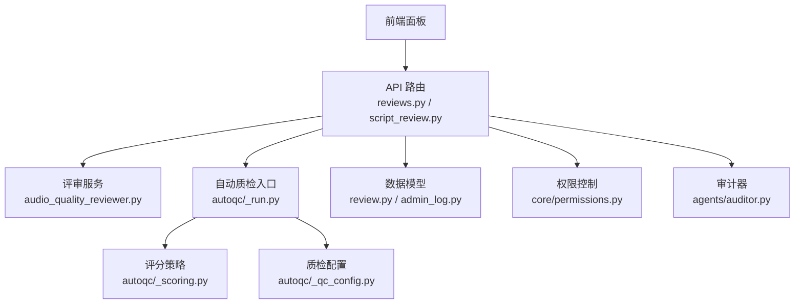
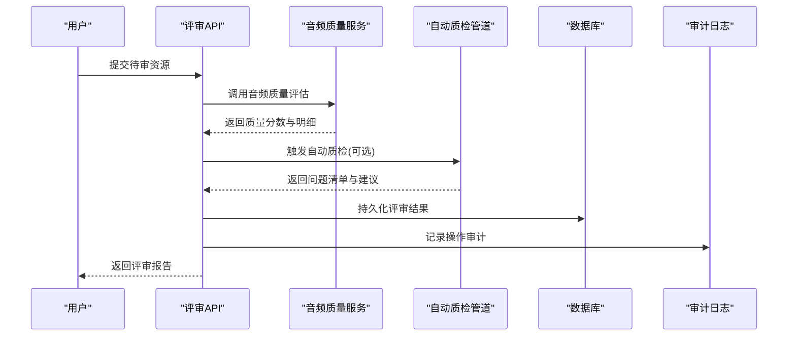
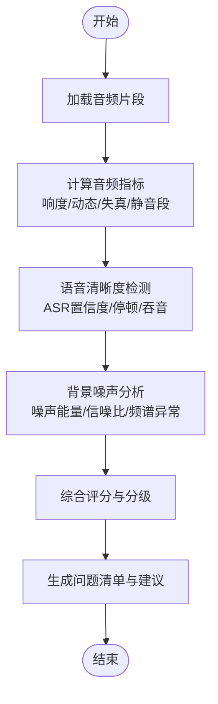
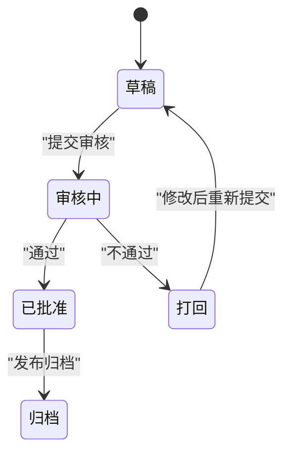
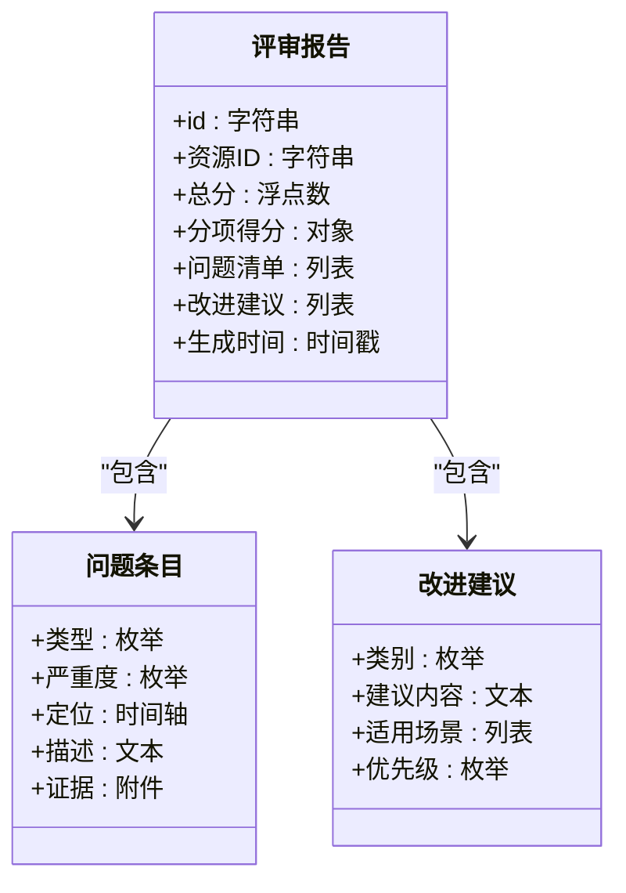
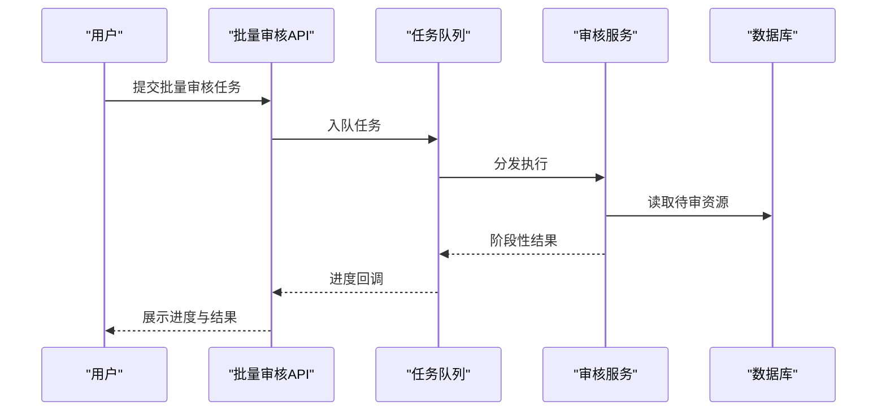
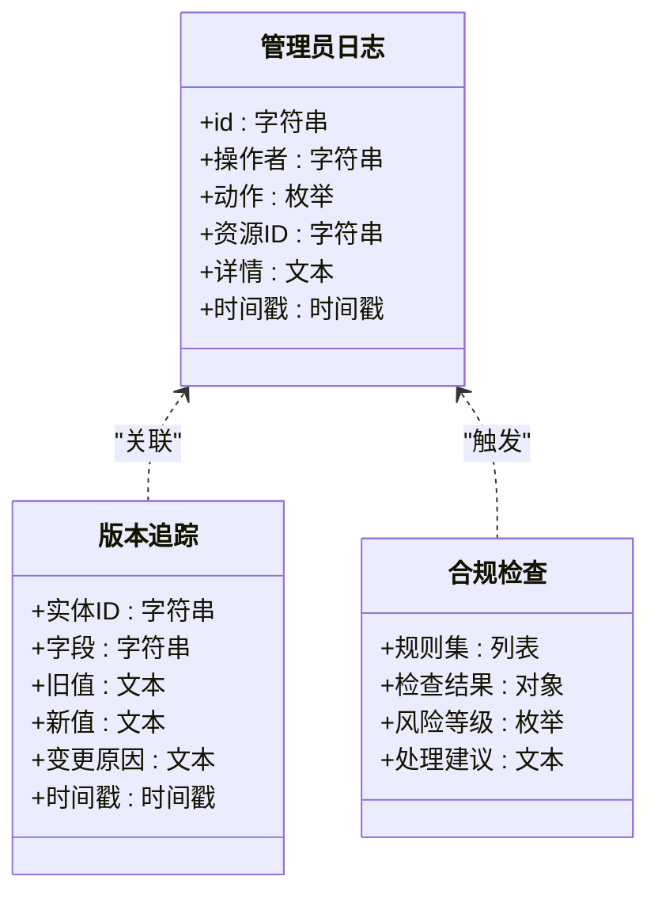
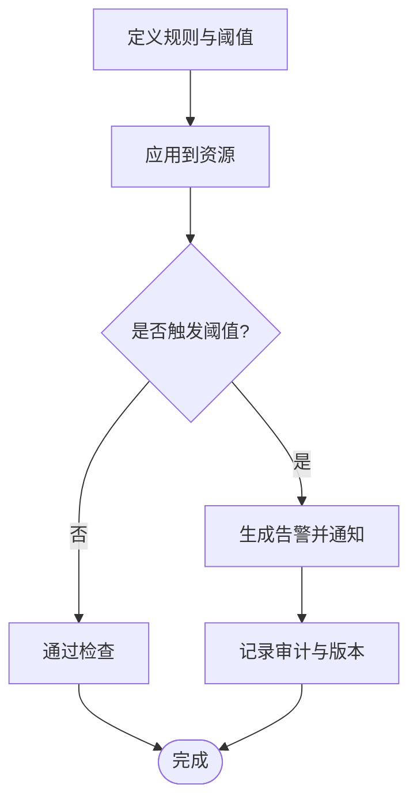
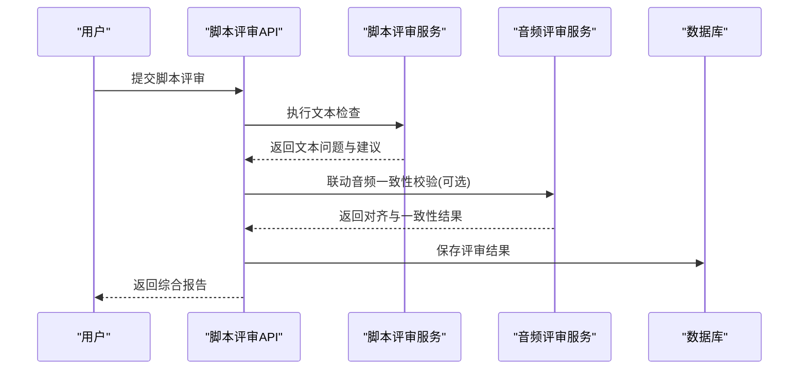
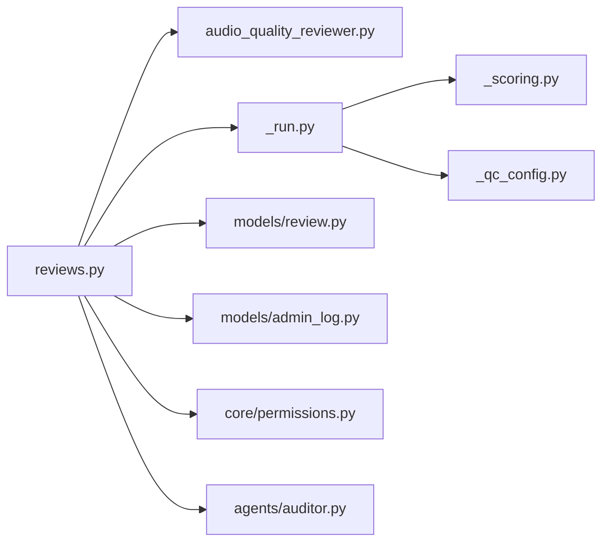

# 质量审查面板

<cite>
**本文引用的文件**   
- [README.md](file://README.md)
- [backend/app/api/v1/reviews.py](file://backend/app/api/v1/reviews.py)
- [backend/app/schemas/review.py](file://backend/app/schemas/review.py)
- [backend/app/models/review.py](file://backend/app/models/review.py)
- [backend/app/services/audiobook/audio_quality_reviewer.py](file://backend/app/services/audiobook/audio_quality_reviewer.py)
- [pipeline/autoqc_pkg/_run.py](file://pipeline/autoqc_pkg/_run.py)
- [pipeline/autoqc_pkg/_scoring.py](file://pipeline/autoqc_pkg/_scoring.py)
- [pipeline/autoqc_pkg/_qc_config.py](file://pipeline/autoqc_pkg/_qc_config.py)
- [agents/auditor.py](file://agents/auditor.py)
- [backend/app/api/v1/script_review.py](file://backend/app/api/v1/script_review.py)
- [backend/app/api/v1/admin/__init__.py](file://backend/app/api/v1/admin/__init__.py)
- [backend/app/models/admin_log.py](file://backend/app/models/admin_log.py)
- [backend/app/core/permissions.py](file://backend/app/core/permissions.py)
</cite>

## 目录
1. [简介](#简介)
2. [项目结构](#项目结构)
3. [核心组件](#核心组件)
4. [架构总览](#架构总览)
5. [详细组件分析](#详细组件分析)
6. [依赖关系分析](#依赖关系分析)
7. [性能考量](#性能考量)
8. [故障排查指南](#故障排查指南)
9. [结论](#结论)
10. [附录](#附录)

## 简介
本文件为“质量审查面板”的完整功能文档，覆盖自动质量检查、人工审核界面、报告生成、批量审核、审计日志与版本追踪、合规性检查、自定义规则与阈值配置、告警通知机制等。面向产品、研发与运营人员，提供从系统架构到实现细节的全景说明，帮助快速理解并高效使用质量审查能力。

## 项目结构
质量审查相关能力分布在后端 API、领域服务、自动化质检管道、模型与数据定义以及权限与审计模块中：
- API 层：暴露评审、脚本评审、管理端点
- 领域服务：音频质量评测、自动质检编排与评分
- 数据模型与模式：评审记录、管理员日志、权限控制
- 自动化质检管道：统一入口、评分策略、配置项
- 代理与工具：通用审计器、脚本评审辅助

**图表来源** 
- [backend/app/api/v1/reviews.py](file://backend/app/api/v1/reviews.py)
- [backend/app/services/audiobook/audio_quality_reviewer.py](file://backend/app/services/audiobook/audio_quality_reviewer.py)
- [pipeline/autoqc_pkg/_run.py](file://pipeline/autoqc_pkg/_run.py)
- [pipeline/autoqc_pkg/_scoring.py](file://pipeline/autoqc_pkg/_scoring.py)
- [pipeline/autoqc_pkg/_qc_config.py](file://pipeline/autoqc_pkg/_qc_config.py)
- [backend/app/models/review.py](file://backend/app/models/review.py)
- [backend/app/models/admin_log.py](file://backend/app/models/admin_log.py)
- [backend/app/core/permissions.py](file://backend/app/core/permissions.py)
- [agents/auditor.py](file://agents/auditor.py)

**章节来源**
- [README.md](file://README.md)

## 核心组件
- 自动质量检查
  - 音频质量评估：基于信号指标与可听感知维度进行打分
  - 语音清晰度检测：通过 ASR 或声学特征估计清晰度
  - 背景噪声分析：噪声能量、信噪比、频谱异常检测
- 人工审核界面
  - 问题标注：支持时间轴定位、标签分类、严重等级
  - 修改建议：结构化建议模板、一键应用
  - 审批流程：草稿-审核-批准-归档状态机
- 报告生成系统
  - 质量评分：多维度加权汇总
  - 问题清单：按类型/严重度排序
  - 改进建议：规则驱动与 LLM 辅助生成
- 批量审核
  - 快速批注：模板化批注、批量状态更新
  - 状态跟踪：任务队列与进度可视化
- 审计日志与版本追踪
  - 操作审计：谁在何时做了什么
  - 版本追踪：评审结果与配置变更历史
- 合规性检查
  - 内容安全校验、版权与敏感词过滤
- 自定义规则与阈值配置
  - 规则引擎：条件表达式、权重、阈值
  - 告警通知：阈值触发、多渠道通知

**章节来源**
- [backend/app/api/v1/reviews.py](file://backend/app/api/v1/reviews.py)
- [backend/app/schemas/review.py](file://backend/app/schemas/review.py)
- [backend/app/models/review.py](file://backend/app/models/review.py)
- [backend/app/services/audiobook/audio_quality_reviewer.py](file://backend/app/services/audiobook/audio_quality_reviewer.py)
- [pipeline/autoqc_pkg/_run.py](file://pipeline/autoqc_pkg/_run.py)
- [pipeline/autoqc_pkg/_scoring.py](file://pipeline/autoqc_pkg/_scoring.py)
- [pipeline/autoqc_pkg/_qc_config.py](file://pipeline/autoqc_pkg/_qc_config.py)
- [agents/auditor.py](file://agents/auditor.py)
- [backend/app/api/v1/script_review.py](file://backend/app/api/v1/script_review.py)
- [backend/app/models/admin_log.py](file://backend/app/models/admin_log.py)
- [backend/app/core/permissions.py](file://backend/app/core/permissions.py)

## 架构总览
质量审查面板采用“API + 服务 + 管道 + 数据模型 + 权限审计”的分层架构。API 层负责请求路由与鉴权；服务层封装业务逻辑（如音频质量评测）；自动质检管道提供统一的自动化检查入口与评分策略；数据模型与模式确保数据结构一致；权限与审计保障合规与安全。

**图表来源** 
- [backend/app/api/v1/reviews.py](file://backend/app/api/v1/reviews.py)
- [backend/app/services/audiobook/audio_quality_reviewer.py](file://backend/app/services/audiobook/audio_quality_reviewer.py)
- [pipeline/autoqc_pkg/_run.py](file://pipeline/autoqc_pkg/_run.py)
- [backend/app/models/review.py](file://backend/app/models/review.py)
- [backend/app/models/admin_log.py](file://backend/app/models/admin_log.py)

## 详细组件分析

### 自动质量检查（音频质量评估、语音清晰度检测、背景噪声分析）
- 音频质量评估
  - 指标维度：响度、动态范围、失真、爆音、静音段比例
  - 评分方法：多指标加权聚合，输出总分与分项得分
- 语音清晰度检测
  - 方法：ASR 转写置信度、音节清晰度、停顿与吞音检测
  - 输出：清晰度分数与问题片段定位
- 背景噪声分析
  - 指标：噪声能量、信噪比、频谱平坦度、突发噪声
  - 输出：噪声等级、影响区间与降噪建议

**图表来源** 
- [backend/app/services/audiobook/audio_quality_reviewer.py](file://backend/app/services/audiobook/audio_quality_reviewer.py)
- [pipeline/autoqc_pkg/_scoring.py](file://pipeline/autoqc_pkg/_scoring.py)
- [pipeline/autoqc_pkg/_qc_config.py](file://pipeline/autoqc_pkg/_qc_config.py)

**章节来源**
- [backend/app/services/audiobook/audio_quality_reviewer.py](file://backend/app/services/audiobook/audio_quality_reviewer.py)
- [pipeline/autoqc_pkg/_scoring.py](file://pipeline/autoqc_pkg/_scoring.py)
- [pipeline/autoqc_pkg/_qc_config.py](file://pipeline/autoqc_pkg/_qc_config.py)

### 人工审核界面（问题标注、修改建议、审批流程）
- 问题标注
  - 支持时间轴定位、标签分类、严重等级、备注
- 修改建议
  - 模板化建议、一键应用、差异对比
- 审批流程
  - 状态机：草稿 → 审核中 → 已批准/打回 → 归档
  - 角色权限：编辑、审核、批准、归档

**图表来源** 
- [backend/app/api/v1/reviews.py](file://backend/app/api/v1/reviews.py)
- [backend/app/schemas/review.py](file://backend/app/schemas/review.py)
- [backend/app/models/review.py](file://backend/app/models/review.py)

**章节来源**
- [backend/app/api/v1/reviews.py](file://backend/app/api/v1/reviews.py)
- [backend/app/schemas/review.py](file://backend/app/schemas/review.py)
- [backend/app/models/review.py](file://backend/app/models/review.py)

### 报告生成系统（质量评分、问题清单、改进建议）
- 质量评分：多维度加权汇总，支持按项目/章节/片段粒度
- 问题清单：按类型与严重度排序，附带定位与证据
- 改进建议：规则驱动与 LLM 辅助生成，支持模板复用

**图表来源** 
- [backend/app/schemas/review.py](file://backend/app/schemas/review.py)
- [backend/app/models/review.py](file://backend/app/models/review.py)

**章节来源**
- [backend/app/schemas/review.py](file://backend/app/schemas/review.py)
- [backend/app/models/review.py](file://backend/app/models/review.py)

### 批量审核（快速批注、模板回复、状态跟踪）
- 快速批注：选择多条资源，应用模板批注，批量设置状态
- 模板回复：预设回复模板，支持变量替换
- 状态跟踪：任务队列、进度条、失败重试

**图表来源** 
- [backend/app/api/v1/reviews.py](file://backend/app/api/v1/reviews.py)
- [backend/app/services/audiobook/audio_quality_reviewer.py](file://backend/app/services/audiobook/audio_quality_reviewer.py)

**章节来源**
- [backend/app/api/v1/reviews.py](file://backend/app/api/v1/reviews.py)
- [backend/app/services/audiobook/audio_quality_reviewer.py](file://backend/app/services/audiobook/audio_quality_reviewer.py)

### 审计日志、版本追踪与合规性检查
- 审计日志：记录操作主体、时间、动作、资源标识与结果
- 版本追踪：评审结果、规则配置、阈值的变更历史
- 合规性检查：内容安全、版权与敏感词过滤、导出合规

**图表来源** 
- [backend/app/models/admin_log.py](file://backend/app/models/admin_log.py)
- [backend/app/models/review.py](file://backend/app/models/review.py)

**章节来源**
- [backend/app/models/admin_log.py](file://backend/app/models/admin_log.py)
- [backend/app/models/review.py](file://backend/app/models/review.py)

### 自定义规则、阈值配置与告警通知
- 自定义规则：条件表达式、权重、阈值、作用域（项目/章节/片段）
- 阈值配置：全局与局部覆盖，灰度发布与回滚
- 告警通知：阈值触发、多渠道（站内、邮件、IM）、去重与抑制

**图表来源** 
- [pipeline/autoqc_pkg/_qc_config.py](file://pipeline/autoqc_pkg/_qc_config.py)
- [pipeline/autoqc_pkg/_scoring.py](file://pipeline/autoqc_pkg/_scoring.py)
- [backend/app/core/permissions.py](file://backend/app/core/permissions.py)

**章节来源**
- [pipeline/autoqc_pkg/_qc_config.py](file://pipeline/autoqc_pkg/_qc_config.py)
- [pipeline/autoqc_pkg/_scoring.py](file://pipeline/autoqc_pkg/_scoring.py)
- [backend/app/core/permissions.py](file://backend/app/core/permissions.py)

### 脚本评审（文本侧质量检查）
- 脚本评审接口：语法、风格、一致性、可读性检查
- 与音频评审联动：文本-音频对齐、语义一致性校验

**图表来源** 
- [backend/app/api/v1/script_review.py](file://backend/app/api/v1/script_review.py)
- [backend/app/services/audiobook/audio_quality_reviewer.py](file://backend/app/services/audiobook/audio_quality_reviewer.py)

**章节来源**
- [backend/app/api/v1/script_review.py](file://backend/app/api/v1/script_review.py)
- [backend/app/services/audiobook/audio_quality_reviewer.py](file://backend/app/services/audiobook/audio_quality_reviewer.py)

## 依赖关系分析
- API 层依赖评审服务与自动质检管道
- 评审服务依赖音频质量评测与评分策略
- 自动质检管道依赖配置与评分模块
- 数据模型与权限控制贯穿各层
- 审计器用于记录关键操作与变更

**图表来源** 
- [backend/app/api/v1/reviews.py](file://backend/app/api/v1/reviews.py)
- [backend/app/services/audiobook/audio_quality_reviewer.py](file://backend/app/services/audiobook/audio_quality_reviewer.py)
- [pipeline/autoqc_pkg/_run.py](file://pipeline/autoqc_pkg/_run.py)
- [pipeline/autoqc_pkg/_scoring.py](file://pipeline/autoqc_pkg/_scoring.py)
- [pipeline/autoqc_pkg/_qc_config.py](file://pipeline/autoqc_pkg/_qc_config.py)
- [backend/app/models/review.py](file://backend/app/models/review.py)
- [backend/app/models/admin_log.py](file://backend/app/models/admin_log.py)
- [backend/app/core/permissions.py](file://backend/app/core/permissions.py)
- [agents/auditor.py](file://agents/auditor.py)

**章节来源**
- [backend/app/api/v1/reviews.py](file://backend/app/api/v1/reviews.py)
- [backend/app/services/audiobook/audio_quality_reviewer.py](file://backend/app/services/audiobook/audio_quality_reviewer.py)
- [pipeline/autoqc_pkg/_run.py](file://pipeline/autoqc_pkg/_run.py)
- [pipeline/autoqc_pkg/_scoring.py](file://pipeline/autoqc_pkg/_scoring.py)
- [pipeline/autoqc_pkg/_qc_config.py](file://pipeline/autoqc_pkg/_qc_config.py)
- [backend/app/models/review.py](file://backend/app/models/review.py)
- [backend/app/models/admin_log.py](file://backend/app/models/admin_log.py)
- [backend/app/core/permissions.py](file://backend/app/core/permissions.py)
- [agents/auditor.py](file://agents/auditor.py)

## 性能考量
- 异步处理：批量审核与自动质检采用任务队列，避免阻塞主线程
- 缓存策略：中间结果与评分缓存，减少重复计算
- 流式处理：长音频分块处理，降低内存占用
- 并发控制：限流与熔断保护外部依赖（ASR、LLM）
- 监控与观测：关键指标上报与错误率统计

[本节为通用指导，无需特定文件引用]

## 故障排查指南
- 常见问题
  - 音频解析失败：检查文件格式、采样率、编码参数
  - ASR 识别失败：网络超时、模型不可用、输入过长
  - 评分异常：阈值配置错误、权重不合理、缺失指标
  - 权限不足：RBAC 配置不正确、角色未授权
  - 审计缺失：日志写入失败、权限不足、存储异常
- 排查步骤
  - 查看 API 响应码与错误信息
  - 检查任务队列与消费者状态
  - 核对配置与阈值设置
  - 检索审计日志与版本变更记录
  - 验证外部依赖健康状态

**章节来源**
- [backend/app/api/v1/reviews.py](file://backend/app/api/v1/reviews.py)
- [backend/app/models/admin_log.py](file://backend/app/models/admin_log.py)
- [backend/app/core/permissions.py](file://backend/app/core/permissions.py)

## 结论
质量审查面板以分层架构与模块化设计，将自动质量检查、人工审核、报告生成、批量审核、审计与合规能力有机整合。通过灵活的规则与阈值配置、完善的权限与审计机制，满足生产环境对质量与合规的高标准要求。建议在生产部署时结合监控与告警，持续优化评分策略与用户体验。

[本节为总结，无需特定文件引用]

## 附录
- 术语表
  - 自动质量检查：基于算法与规则的自动化质量评估
  - 人工审核：由人对内容进行标注、建议与审批
  - 报告生成：汇总评分、问题与建议的结构化输出
  - 批量审核：对多条资源进行统一批注与状态管理
  - 审计日志：记录关键操作的不可变日志
  - 版本追踪：记录实体与配置的变更历史
  - 合规性检查：内容安全与法规遵循的校验
  - 自定义规则：用户定义的评分与判定条件
  - 阈值配置：触发告警或动作的数值边界
  - 告警通知：阈值触发后的多渠道通知机制

[本节为概念性内容，无需特定文件引用]