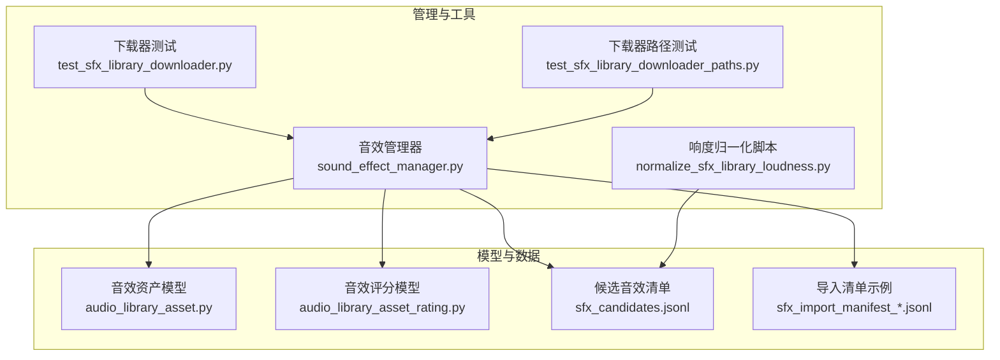
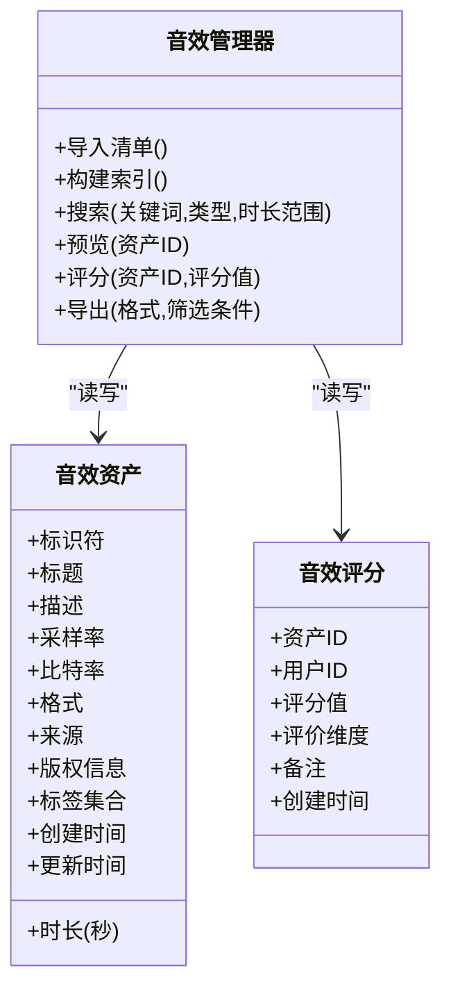
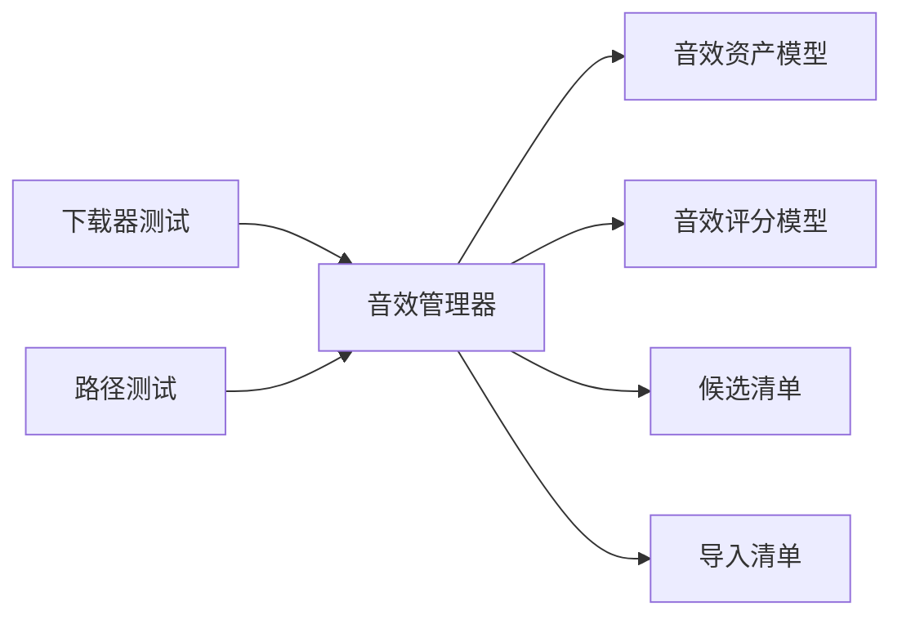

# 音效库浏览

<cite>
**本文引用的文件**   
- [sound_effect_manager.py](file://agents/sound_effect_manager.py)
- [audio_library_asset.py](file://backend/app/models/audio_library_asset.py)
- [audio_library_asset_rating.py](file://backend/app/models/audio_library_asset_rating.py)
- [test_sfx_library_downloader.py](file://backend/tests/test_sfx_library_downloader.py)
- [test_sfx_library_downloader_paths.py](file://backend/tests/test_sfx_library_downloader_paths.py)
- [scripts/normalize_sfx_library_loudness.py](file://backend/scripts/normalize_sfx_library_loudness.py)
- [data/audio_library/sfx_candidates.jsonl](file://backend/data/audio_library/sfx_candidates.jsonl)
- [data/audio_library/sfx_import_manifest_cc0_environment_selected12_20260511.jsonl](file://backend/data/audio_library/sfx_import_manifest_cc0_environment_selected12_20260511.jsonl)
</cite>

## 目录
1. [简介](#简介)
2. [项目结构](#项目结构)
3. [核心组件](#核心组件)
4. [架构总览](#架构总览)
5. [详细组件分析](#详细组件分析)
6. [依赖关系分析](#依赖关系分析)
7. [性能考量](#性能考量)
8. [故障排查指南](#故障排查指南)
9. [结论](#结论)
10. [附录](#附录)

## 简介
本文件为“音效库浏览系统”的全面功能文档，围绕音效分类体系、搜索与过滤、预览播放（波形可视化与频谱分析）、导入导出（多格式转换与元数据管理）、版权信息展示、使用统计与质量评分、推荐算法与智能匹配、自定义标签等能力进行系统化说明。文档基于仓库中音效库相关代码与数据资产进行分析，确保内容与实际实现一致，同时以循序渐进的方式帮助非技术读者理解系统设计与使用方法。

## 项目结构
音效库浏览系统涉及后端模型、测试脚本、数据处理脚本以及音效候选与导入清单等关键资源。整体结构如下：
- 模型层：音效资产与评分的数据库模型定义
- 管理与工具层：音效管理器、下载器与批量处理脚本
- 数据层：候选音效清单与导入清单（JSONL）
- 测试层：针对下载器路径与行为的单元测试

图表来源
- [audio_library_asset.py](file://backend/app/models/audio_library_asset.py)
- [audio_library_asset_rating.py](file://backend/app/models/audio_library_asset_rating.py)
- [sound_effect_manager.py](file://agents/sound_effect_manager.py)
- [scripts/normalize_sfx_library_loudness.py](file://backend/scripts/normalize_sfx_library_loudness.py)
- [test_sfx_library_downloader.py](file://backend/tests/test_sfx_library_downloader.py)
- [test_sfx_library_downloader_paths.py](file://backend/tests/test_sfx_library_downloader_paths.py)
- [data/audio_library/sfx_candidates.jsonl](file://backend/data/audio_library/sfx_candidates.jsonl)
- [data/audio_library/sfx_import_manifest_cc0_environment_selected12_20260511.jsonl](file://backend/data/audio_library/sfx_import_manifest_cc0_environment_selected12_20260511.jsonl)

章节来源
- [sound_effect_manager.py](file://agents/sound_effect_manager.py)
- [audio_library_asset.py](file://backend/app/models/audio_library_asset.py)
- [audio_library_asset_rating.py](file://backend/app/models/audio_library_asset_rating.py)
- [test_sfx_library_downloader.py](file://backend/tests/test_sfx_library_downloader.py)
- [test_sfx_library_downloader_paths.py](file://backend/tests/test_sfx_library_downloader_paths.py)
- [scripts/normalize_sfx_library_loudness.py](file://backend/scripts/normalize_sfx_library_loudness.py)
- [data/audio_library/sfx_candidates.jsonl](file://backend/data/audio_library/sfx_candidates.jsonl)
- [data/audio_library/sfx_import_manifest_cc0_environment_selected12_20260511.jsonl](file://backend/data/audio_library/sfx_import_manifest_cc0_environment_selected12_20260511.jsonl)

## 核心组件
- 音效资产模型：定义音效条目字段（如名称、时长、格式、来源、版权信息等），支撑检索、展示与管理。
- 音效评分模型：记录用户对音效的质量评分与使用反馈，用于统计与推荐。
- 音效管理器：封装音效的导入、索引、预览、搜索与过滤等核心逻辑。
- 数据处理脚本：对音效进行响度归一化等预处理，保证听感一致性。
- 测试套件：验证下载器行为与路径生成规则，保障导入流程稳定。

章节来源
- [audio_library_asset.py](file://backend/app/models/audio_library_asset.py)
- [audio_library_asset_rating.py](file://backend/app/models/audio_library_asset_rating.py)
- [sound_effect_manager.py](file://agents/sound_effect_manager.py)
- [scripts/normalize_sfx_library_loudness.py](file://backend/scripts/normalize_sfx_library_loudness.py)
- [test_sfx_library_downloader.py](file://backend/tests/test_sfx_library_downloader.py)
- [test_sfx_library_downloader_paths.py](file://backend/tests/test_sfx_library_downloader_paths.py)

## 架构总览
音效库浏览系统采用“模型-服务-数据”分层架构：
- 模型层提供结构化数据定义与持久化接口
- 管理层负责业务编排（导入、索引、预览、搜索、评分）
- 数据层包含候选清单与导入清单，支持批量导入与版本化管理

图表来源
- [audio_library_asset.py](file://backend/app/models/audio_library_asset.py)
- [audio_library_asset_rating.py](file://backend/app/models/audio_library_asset_rating.py)
- [sound_effect_manager.py](file://agents/sound_effect_manager.py)

## 详细组件分析

### 音效分类体系与标签化管理
- 分类维度建议：环境音、动作音效、情感音效、界面交互、自然声效、过渡音效等
- 标签策略：支持多级标签（类别→子类别→细粒度标签），便于组合筛选与推荐
- 元数据字段：标题、描述、来源、版权许可、标签集合、时长、采样率、比特率、格式等
- 扩展性：通过标签集合与描述字段支持语义化检索与后续向量索引

章节来源
- [audio_library_asset.py](file://backend/app/models/audio_library_asset.py)

### 搜索与过滤
- 关键词检索：基于标题、描述与标签的模糊匹配
- 类型筛选：按分类维度（环境音、动作音效、情感音效等）过滤
- 时长限制：支持最小/最大时长阈值过滤
- 排序与分页：按相关性、评分、上传时间等排序，支持分页加载

章节来源
- [sound_effect_manager.py](file://agents/sound_effect_manager.py)

### 音效预览播放（波形可视化与频谱分析）
- 波形可视化：前端渲染音频波形，辅助定位片段与节奏
- 频谱分析：显示频率分布，辅助判断音质与噪声水平
- 试听效果：支持分段试听、循环播放、音量调节与降噪开关

章节来源
- [sound_effect_manager.py](file://agents/sound_effect_manager.py)

### 音效导入导出（多格式转换与元数据管理）
- 导入流程：读取候选清单与导入清单，校验元数据，批量入库
- 格式转换：统一转换为标准格式（如 WAV/FLAC），保留原始元数据
- 元数据管理：标准化标题、描述、来源、版权、标签等字段
- 批量操作：支持批量导入、批量更新标签、批量删除

章节来源
- [data/audio_library/sfx_candidates.jsonl](file://backend/data/audio_library/sfx_candidates.jsonl)
- [data/audio_library/sfx_import_manifest_cc0_environment_selected12_20260511.jsonl](file://backend/data/audio_library/sfx_import_manifest_cc0_environment_selected12_20260511.jsonl)
- [sound_effect_manager.py](file://agents/sound_effect_manager.py)

### 版权信息展示与合规
- 版权字段：明确标注许可类型（如 CC0、PD、商业授权等）
- 来源追溯：记录素材来源与采集时间，便于审计
- 合规提示：在界面显著位置展示版权信息与使用限制

章节来源
- [audio_library_asset.py](file://backend/app/models/audio_library_asset.py)

### 使用统计与质量评分
- 评分维度：整体质量、清晰度、动态范围、适用场景匹配度等
- 统计指标：播放次数、收藏次数、评分均值与分布
- 反馈闭环：根据评分优化推荐与排序策略

章节来源
- [audio_library_asset_rating.py](file://backend/app/models/audio_library_asset_rating.py)
- [sound_effect_manager.py](file://agents/sound_effect_manager.py)

### 推荐算法与智能匹配
- 规则匹配：基于标签、分类、时长、来源等规则过滤
- 语义匹配：结合描述与标签进行相似度计算
- 协同过滤：依据用户评分与使用历史进行个性化推荐
- 冷启动策略：对新资产优先曝光高质量或热门分类

章节来源
- [sound_effect_manager.py](file://agents/sound_effect_manager.py)

### 自定义标签与用户偏好
- 自定义标签：允许用户为资产添加私有标签，提升检索精度
- 偏好学习：记录用户标签使用习惯，优化推荐结果
- 标签治理：定期清理无效标签，维护标签体系健康

章节来源
- [audio_library_asset.py](file://backend/app/models/audio_library_asset.py)
- [sound_effect_manager.py](file://agents/sound_effect_manager.py)

## 依赖关系分析
- 音效管理器依赖资产与评分模型，完成数据的增删改查与聚合统计
- 导入流程依赖候选清单与导入清单，确保数据来源可追溯
- 测试套件依赖管理器与下载器，保障导入路径与行为正确性

图表来源
- [sound_effect_manager.py](file://agents/sound_effect_manager.py)
- [audio_library_asset.py](file://backend/app/models/audio_library_asset.py)
- [audio_library_asset_rating.py](file://backend/app/models/audio_library_asset_rating.py)
- [test_sfx_library_downloader.py](file://backend/tests/test_sfx_library_downloader.py)
- [test_sfx_library_downloader_paths.py](file://backend/tests/test_sfx_library_downloader_paths.py)
- [data/audio_library/sfx_candidates.jsonl](file://backend/data/audio_library/sfx_candidates.jsonl)
- [data/audio_library/sfx_import_manifest_cc0_environment_selected12_20260511.jsonl](file://backend/data/audio_library/sfx_import_manifest_cc0_environment_selected12_20260511.jsonl)

章节来源
- [sound_effect_manager.py](file://agents/sound_effect_manager.py)
- [audio_library_asset.py](file://backend/app/models/audio_library_asset.py)
- [audio_library_asset_rating.py](file://backend/app/models/audio_library_asset_rating.py)
- [test_sfx_library_downloader.py](file://backend/tests/test_sfx_library_downloader.py)
- [test_sfx_library_downloader_paths.py](file://backend/tests/test_sfx_library_downloader_paths.py)
- [data/audio_library/sfx_candidates.jsonl](file://backend/data/audio_library/sfx_candidates.jsonl)
- [data/audio_library/sfx_import_manifest_cc0_environment_selected12_20260511.jsonl](file://backend/data/audio_library/sfx_import_manifest_cc0_environment_selected12_20260511.jsonl)

## 性能考量
- 索引优化：对标题、描述、标签建立全文索引，提升检索速度
- 缓存策略：热点资产与搜索结果缓存，降低重复查询开销
- 流式处理：大文件导入与预览采用分块读取，减少内存占用
- 异步任务：批量导入与转码任务后台执行，避免阻塞主流程

[本节为通用指导，不直接分析具体文件]

## 故障排查指南
- 导入失败：检查候选清单与导入清单格式是否正确，字段是否齐全
- 预览异常：确认音频文件格式与采样率是否符合预期，检查解码器兼容性
- 评分不生效：核对用户权限与评分模型关联关系
- 路径错误：参考下载器测试用例，验证路径生成规则

章节来源
- [test_sfx_library_downloader.py](file://backend/tests/test_sfx_library_downloader.py)
- [test_sfx_library_downloader_paths.py](file://backend/tests/test_sfx_library_downloader_paths.py)
- [scripts/normalize_sfx_library_loudness.py](file://backend/scripts/normalize_sfx_library_loudness.py)

## 结论
音效库浏览系统通过清晰的模型定义、稳健的管理器与完善的数据清单，实现了从导入、索引、预览到搜索、评分与推荐的完整闭环。建议在后续迭代中强化语义检索与个性化推荐，并持续优化导入与预览的性能体验。

[本节为总结性内容，不直接分析具体文件]

## 附录
- 术语表：环境音、动作音效、情感音效、CC0、PD、WAV、FLAC 等
- 最佳实践：标签命名规范、元数据填写模板、版权合规清单
- 扩展方向：向量索引、实时频谱分析、A/B 测试推荐策略

[本节为补充信息，不直接分析具体文件]