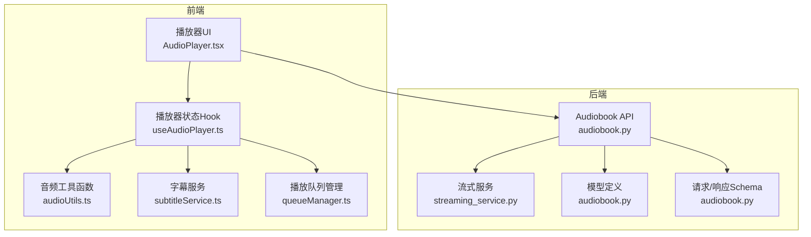
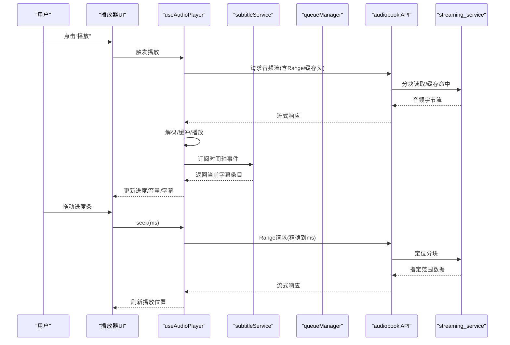
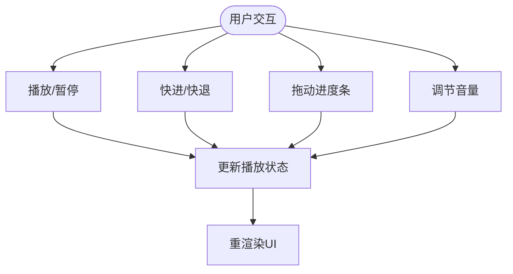
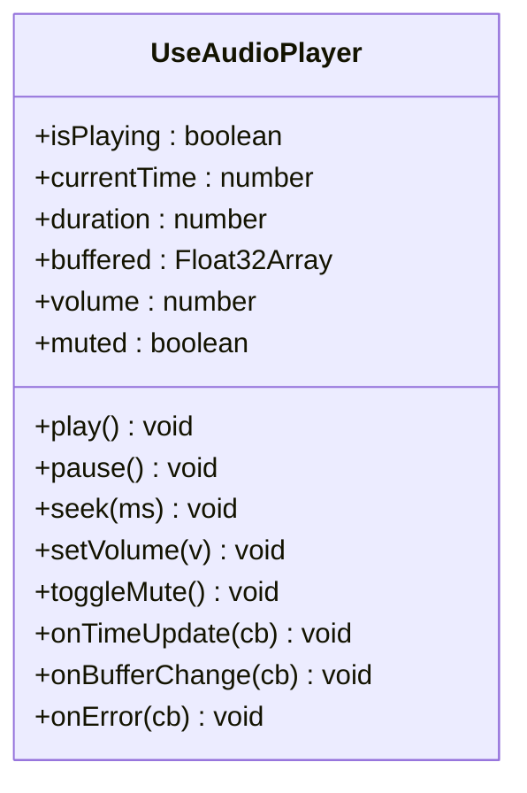
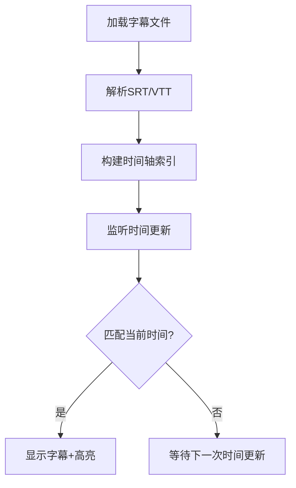
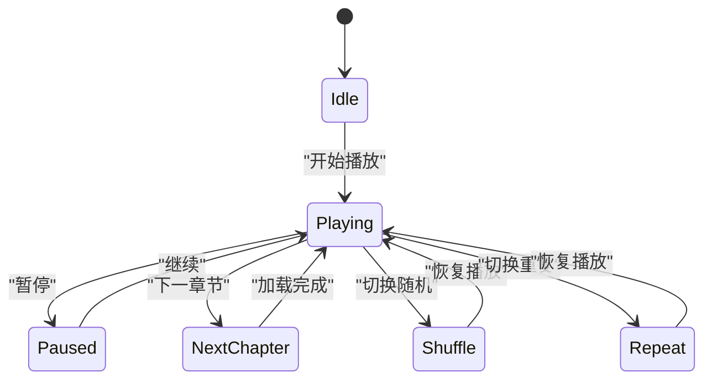
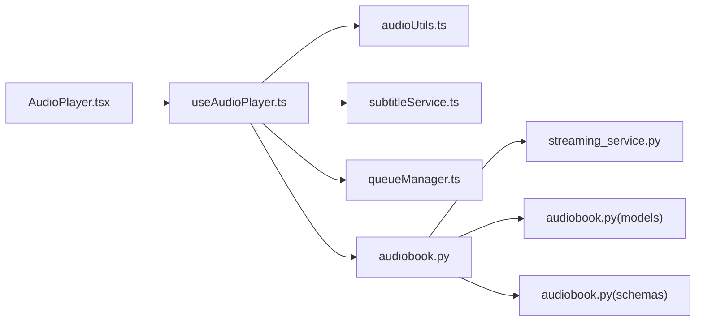

# 音频播放控制

<cite>
**本文引用的文件**   
- [frontend/src/components/AudioPlayer.tsx](file://frontend/src/components/AudioPlayer.tsx)
- [frontend/src/hooks/useAudioPlayer.ts](file://frontend/src/hooks/useAudioPlayer.ts)
- [frontend/src/utils/audioUtils.ts](file://frontend/src/utils/audioUtils.ts)
- [frontend/src/services/subtitleService.ts](file://frontend/src/services/subtitleService.ts)
- [frontend/src/services/queueManager.ts](file://frontend/src/services/queueManager.ts)
- [backend/app/api/v1/audiobook.py](file://backend/app/api/v1/audiobook.py)
- [backend/app/services/audiobook/streaming_service.py](file://backend/app/services/audiobook/streaming_service.py)
- [backend/app/models/audiobook.py](file://backend/app/models/audiobook.py)
- [backend/app/schemas/audiobook.py](file://backend/app/schemas/audiobook.py)
</cite>

## 目录
1. [简介](#简介)
2. [项目结构](#项目结构)
3. [核心组件](#核心组件)
4. [架构总览](#架构总览)
5. [详细组件分析](#详细组件分析)
6. [依赖关系分析](#依赖关系分析)
7. [性能考量](#性能考量)
8. [故障排查指南](#故障排查指南)
9. [结论](#结论)
10. [附录](#附录)

## 简介
本技术文档面向“音频播放控制系统”，聚焦浏览器端播放器与后端服务的协同实现。内容覆盖：
- 浏览器播放器的核心能力：播放、暂停、快进快退、音量控制、进度条交互
- 时间轴编辑：毫秒级定位、片段选择、循环播放
- 字幕同步显示：SRT/VTT 解析与多语言支持
- 播放队列管理：章节跳转、随机播放、重复模式
- 音频格式兼容性、流式加载与缓存策略
- 性能监控、错误处理与用户体验优化

## 项目结构
本项目采用前后端分离架构，前端基于 React + TypeScript，使用 Web Audio API 与 HTMLMediaElement 进行播放控制；后端提供音频流、字幕与元数据接口，并支持分块传输与缓存。

**图表来源** 
- [frontend/src/components/AudioPlayer.tsx](file://frontend/src/components/AudioPlayer.tsx)
- [frontend/src/hooks/useAudioPlayer.ts](file://frontend/src/hooks/useAudioPlayer.ts)
- [frontend/src/utils/audioUtils.ts](file://frontend/src/utils/audioUtils.ts)
- [frontend/src/services/subtitleService.ts](file://frontend/src/services/subtitleService.ts)
- [frontend/src/services/queueManager.ts](file://frontend/src/services/queueManager.ts)
- [backend/app/api/v1/audiobook.py](file://backend/app/api/v1/audiobook.py)
- [backend/app/services/audiobook/streaming_service.py](file://backend/app/services/audiobook/streaming_service.py)
- [backend/app/models/audiobook.py](file://backend/app/models/audiobook.py)
- [backend/app/schemas/audiobook.py](file://backend/app/schemas/audiobook.py)

**章节来源**
- [frontend/src/components/AudioPlayer.tsx](file://frontend/src/components/AudioPlayer.tsx)
- [frontend/src/hooks/useAudioPlayer.ts](file://frontend/src/hooks/useAudioPlayer.ts)
- [frontend/src/utils/audioUtils.ts](file://frontend/src/utils/audioUtils.ts)
- [frontend/src/services/subtitleService.ts](file://frontend/src/services/subtitleService.ts)
- [frontend/src/services/queueManager.ts](file://frontend/src/services/queueManager.ts)
- [backend/app/api/v1/audiobook.py](file://backend/app/api/v1/audiobook.py)
- [backend/app/services/audiobook/streaming_service.py](file://backend/app/services/audiobook/streaming_service.py)
- [backend/app/models/audiobook.py](file://backend/app/models/audiobook.py)
- [backend/app/schemas/audiobook.py](file://backend/app/schemas/audiobook.py)

## 核心组件
- 播放器UI（AudioPlayer）：渲染播放控件、进度条、音量滑块、字幕区域，绑定用户交互事件。
- 播放器Hook（useAudioPlayer）：封装媒体元素生命周期、播放状态机、事件监听、时间更新与缓冲状态。
- 音频工具（audioUtils）：格式检测、采样率/码率信息提取、跨域与MIME类型处理、节流防抖。
- 字幕服务（subtitleService）：SRT/VTT 解析、时间轴对齐、多语言切换、高亮当前条目。
- 播放队列（queueManager）：章节列表、随机/重复模式、自动下一曲、断点续播。
- 后端API（audiobook.py）：暴露音频流、字幕、章节元数据等接口。
- 流式服务（streaming_service.py）：分块读取、Range 头支持、缓存命中、并发限制。
- 模型与Schema（audiobook.py, audiobook.py）：数据结构与校验约束。

**章节来源**
- [frontend/src/components/AudioPlayer.tsx](file://frontend/src/components/AudioPlayer.tsx)
- [frontend/src/hooks/useAudioPlayer.ts](file://frontend/src/hooks/useAudioPlayer.ts)
- [frontend/src/utils/audioUtils.ts](file://frontend/src/utils/audioUtils.ts)
- [frontend/src/services/subtitleService.ts](file://frontend/src/services/subtitleService.ts)
- [frontend/src/services/queueManager.ts](file://frontend/src/services/queueManager.ts)
- [backend/app/api/v1/audiobook.py](file://backend/app/api/v1/audiobook.py)
- [backend/app/services/audiobook/streaming_service.py](file://backend/app/services/audiobook/streaming_service.py)
- [backend/app/models/audiobook.py](file://backend/app/models/audiobook.py)
- [backend/app/schemas/audiobook.py](file://backend/app/schemas/audiobook.py)

## 架构总览
播放器通过 Hook 管理媒体元素与状态，UI 层仅负责展示与事件转发。字幕由独立服务解析并注入到渲染层。队列管理器维护播放顺序与模式。后端以 RESTful API 提供音频流与字幕资源，并通过流式服务提升大文件加载效率。

**图表来源** 
- [frontend/src/components/AudioPlayer.tsx](file://frontend/src/components/AudioPlayer.tsx)
- [frontend/src/hooks/useAudioPlayer.ts](file://frontend/src/hooks/useAudioPlayer.ts)
- [frontend/src/services/subtitleService.ts](file://frontend/src/services/subtitleService.ts)
- [frontend/src/services/queueManager.ts](file://frontend/src/services/queueManager.ts)
- [backend/app/api/v1/audiobook.py](file://backend/app/api/v1/audiobook.py)
- [backend/app/services/audiobook/streaming_service.py](file://backend/app/services/audiobook/streaming_service.py)

## 详细组件分析

### 播放器UI（AudioPlayer）
- 职责：渲染播放/暂停、快进/快退、音量滑块、进度条、字幕区域；处理拖拽与键盘快捷键。
- 交互流程：将用户操作委托给 useAudioPlayer，接收其回调更新视图。
- 可访问性：ARIA 标签、焦点管理、屏幕阅读器友好。

**图表来源** 
- [frontend/src/components/AudioPlayer.tsx](file://frontend/src/components/AudioPlayer.tsx)
- [frontend/src/hooks/useAudioPlayer.ts](file://frontend/src/hooks/useAudioPlayer.ts)

**章节来源**
- [frontend/src/components/AudioPlayer.tsx](file://frontend/src/components/AudioPlayer.tsx)
- [frontend/src/hooks/useAudioPlayer.ts](file://frontend/src/hooks/useAudioPlayer.ts)

### 播放器Hook（useAudioPlayer）
- 职责：封装 HTMLMediaElement 或 MediaSource 的创建与销毁；维护 isPlaying、currentTime、duration、buffered、volume、muted 等状态；监听 canplay、playing、waiting、error、ended 等事件。
- 关键方法：
  - play()/pause()：控制播放状态
  - seek(ms)：毫秒级定位，触发 Range 请求
  - setVolume(v)、toggleMute()：音量与静音控制
  - onTimeUpdate(cb)：时间轴回调，驱动进度条与字幕
  - onBufferChange(cb)：缓冲变化回调，优化体验
- 错误处理：网络异常、解码失败、权限限制等统一捕获并上报。

**图表来源** 
- [frontend/src/hooks/useAudioPlayer.ts](file://frontend/src/hooks/useAudioPlayer.ts)

**章节来源**
- [frontend/src/hooks/useAudioPlayer.ts](file://frontend/src/hooks/useAudioPlayer.ts)

### 音频工具（audioUtils）
- 职责：检测 MIME 类型、判断浏览器兼容性、格式化时间显示、节流/防抖、跨域配置。
- 典型功能：
  - getMimeType(url)：根据扩展名推断
  - formatTime(seconds)：mm:ss.ms 转换
  - throttle(fn, ms)：节流包装
  - isSupportedCodec(codec)：编码支持检查

**章节来源**
- [frontend/src/utils/audioUtils.ts](file://frontend/src/utils/audioUtils.ts)

### 字幕服务（subtitleService）
- 职责：解析 SRT/VTT，构建时间轴索引，按 currentTime 匹配当前条目，支持多语言切换。
- 关键流程：
  - loadSubtitles(url, lang)：拉取并解析
  - getCurrentSubtitle(time)：返回当前时间戳对应的文本
  - highlightActive(index)：高亮当前条目
- 性能优化：惰性解析、二分查找时间轴、缓存已解析结果。

**图表来源** 
- [frontend/src/services/subtitleService.ts](file://frontend/src/services/subtitleService.ts)

**章节来源**
- [frontend/src/services/subtitleService.ts](file://frontend/src/services/subtitleService.ts)

### 播放队列（queueManager）
- 职责：维护章节列表、播放顺序（顺序/随机/重复）、自动下一曲、断点续播。
- 模式：
  - 顺序播放：按章节顺序推进
  - 随机播放：洗牌算法，避免重复
  - 重复模式：单曲/全部循环
- 事件：onNext、onPrev、onRepeatModeChange、onShuffleToggle。

**图表来源** 
- [frontend/src/services/queueManager.ts](file://frontend/src/services/queueManager.ts)

**章节来源**
- [frontend/src/services/queueManager.ts](file://frontend/src/services/queueManager.ts)

### 后端API（audiobook.py）
- 职责：提供音频流、字幕、章节元数据接口；处理 Range 头、ETag/Last-Modified、缓存控制。
- 关键点：
  - GET /api/v1/audiobook/{id}/stream：支持 Range，返回分块音频
  - GET /api/v1/audiobook/{id}/subtitles?lang=zh：返回对应语言字幕
  - GET /api/v1/audiobook/{id}/chapters：返回章节列表与时长

**章节来源**
- [backend/app/api/v1/audiobook.py](file://backend/app/api/v1/audiobook.py)

### 流式服务（streaming_service.py）
- 职责：从存储读取音频文件，按 Range 返回分块；实现内存/磁盘缓存；并发限流与超时控制。
- 特性：
  - 分块大小自适应
  - 缓存命中率统计
  - 错误重试与降级

**章节来源**
- [backend/app/services/audiobook/streaming_service.py](file://backend/app/services/audiobook/streaming_service.py)

### 模型与Schema（audiobook.py, audiobook.py）
- 职责：定义章节、音频资产、字幕、任务等数据结构；校验请求/响应字段。
- 示例字段：id、title、duration、language、format、status、created_at、updated_at。

**章节来源**
- [backend/app/models/audiobook.py](file://backend/app/models/audiobook.py)
- [backend/app/schemas/audiobook.py](file://backend/app/schemas/audiobook.py)

## 依赖关系分析
- 前端依赖：HTMLMediaElement/MediaSource、Web Audio API、Fetch/XHR、Canvas/SVG（可选用于可视化）。
- 后端依赖：HTTP 服务器（支持 Range）、对象存储/文件系统、缓存（Redis/本地）、数据库（章节/元数据）。
- 耦合点：
  - 时间戳单位（秒/毫秒）一致性
  - 字幕时间轴精度（毫秒）
  - 流式协议（HTTP Range、Content-Range）

**图表来源** 
- [frontend/src/components/AudioPlayer.tsx](file://frontend/src/components/AudioPlayer.tsx)
- [frontend/src/hooks/useAudioPlayer.ts](file://frontend/src/hooks/useAudioPlayer.ts)
- [frontend/src/utils/audioUtils.ts](file://frontend/src/utils/audioUtils.ts)
- [frontend/src/services/subtitleService.ts](file://frontend/src/services/subtitleService.ts)
- [frontend/src/services/queueManager.ts](file://frontend/src/services/queueManager.ts)
- [backend/app/api/v1/audiobook.py](file://backend/app/api/v1/audiobook.py)
- [backend/app/services/audiobook/streaming_service.py](file://backend/app/services/audiobook/streaming_service.py)
- [backend/app/models/audiobook.py](file://backend/app/models/audiobook.py)
- [backend/app/schemas/audiobook.py](file://backend/app/schemas/audiobook.py)

**章节来源**
- [frontend/src/components/AudioPlayer.tsx](file://frontend/src/components/AudioPlayer.tsx)
- [frontend/src/hooks/useAudioPlayer.ts](file://frontend/src/hooks/useAudioPlayer.ts)
- [frontend/src/utils/audioUtils.ts](file://frontend/src/utils/audioUtils.ts)
- [frontend/src/services/subtitleService.ts](file://frontend/src/services/subtitleService.ts)
- [frontend/src/services/queueManager.ts](file://frontend/src/services/queueManager.ts)
- [backend/app/api/v1/audiobook.py](file://backend/app/api/v1/audiobook.py)
- [backend/app/services/audiobook/streaming_service.py](file://backend/app/services/audiobook/streaming_service.py)
- [backend/app/models/audiobook.py](file://backend/app/models/audiobook.py)
- [backend/app/schemas/audiobook.py](file://backend/app/schemas/audiobook.py)

## 性能考量
- 流式加载：优先使用 HTTP Range 分块下载，减少首屏延迟与内存占用。
- 缓存策略：
  - 浏览器缓存：利用 ETag/Last-Modified、Cache-Control
  - 服务端缓存：热点章节预取、LRU 缓存最近播放片段
- 解码优化：按需解码、禁用不必要的轨道、降低后台标签页优先级。
- 字幕解析：惰性解析、二分查找、增量更新。
- 监控指标：首帧时间、卡顿次数、缓冲时长、错误率、CPU/内存占用。

[本节为通用指导，不直接分析具体文件]

## 故障排查指南
- 常见问题：
  - 无法播放：检查 MIME 类型、跨域设置、浏览器编码支持
  - 进度不同步：确认时间戳单位一致、字幕时间轴精度
  - 卡顿/缓冲：检查网络带宽、分块大小、缓存命中率
  - 字幕错位：校对 SRT/VTT 时间格式、时区与基准时间
- 调试建议：
  - 启用开发者工具网络面板，观察 Range 请求与响应
  - 打印 useAudioPlayer 状态变化与事件日志
  - 使用 subtitleService 的解析日志定位时间轴问题
  - 后端开启流式服务访问日志与缓存统计

**章节来源**
- [frontend/src/hooks/useAudioPlayer.ts](file://frontend/src/hooks/useAudioPlayer.ts)
- [frontend/src/services/subtitleService.ts](file://frontend/src/services/subtitleService.ts)
- [backend/app/services/audiobook/streaming_service.py](file://backend/app/services/audiobook/streaming_service.py)

## 结论
本系统通过清晰的前后端分层与模块化设计，实现了稳定高效的音频播放控制。播放器 Hook 统一管理媒体生命周期，字幕服务与队列管理解耦业务逻辑，后端流式服务保障大文件流畅播放。结合缓存、监控与错误处理策略，可在复杂网络环境下提供良好用户体验。后续可扩展更多编码格式、增强可视化与无障碍支持。

[本节为总结性内容，不直接分析具体文件]

## 附录
- 术语表：Range、ETag、VTT、SRT、MediaSource、HTMLMediaElement
- 最佳实践：
  - 始终验证输入参数与边界条件
  - 使用语义化事件与状态机管理播放流程
  - 对耗时操作进行异步与节流处理
  - 保持前后端时间单位与精度一致

[本节为补充信息，不直接分析具体文件]