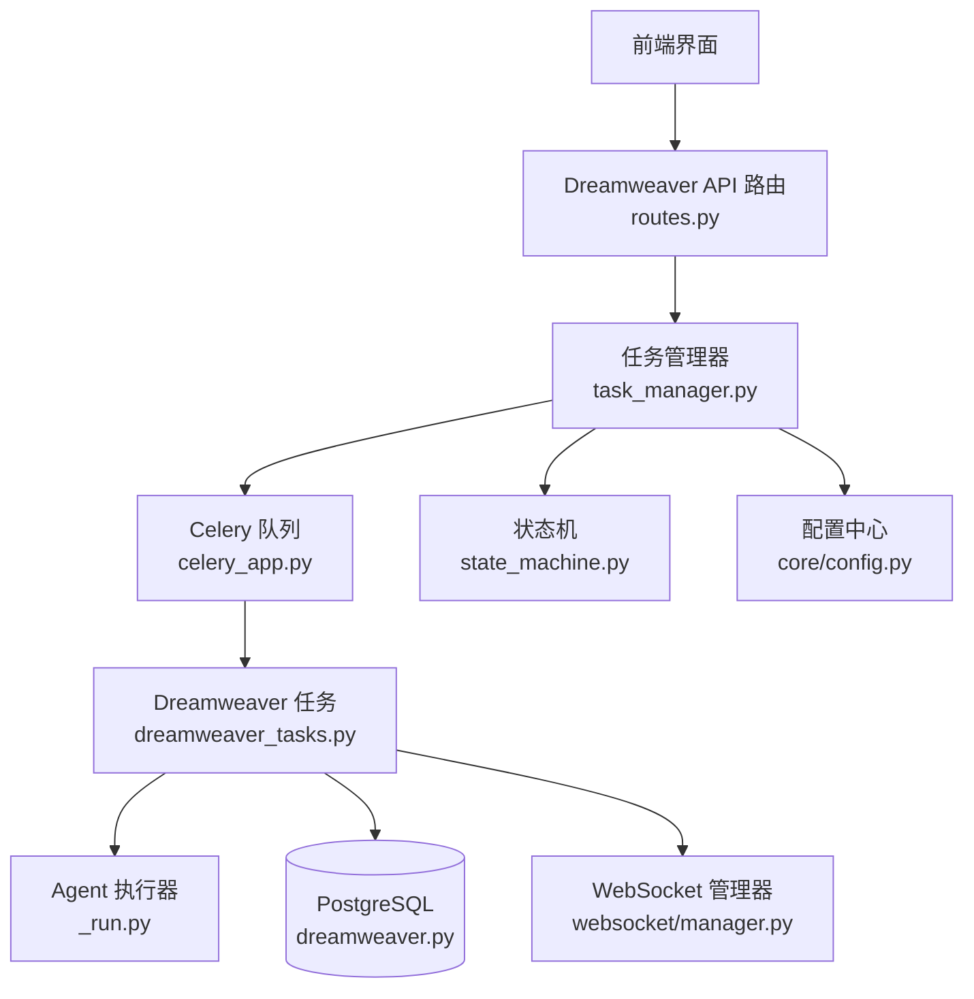
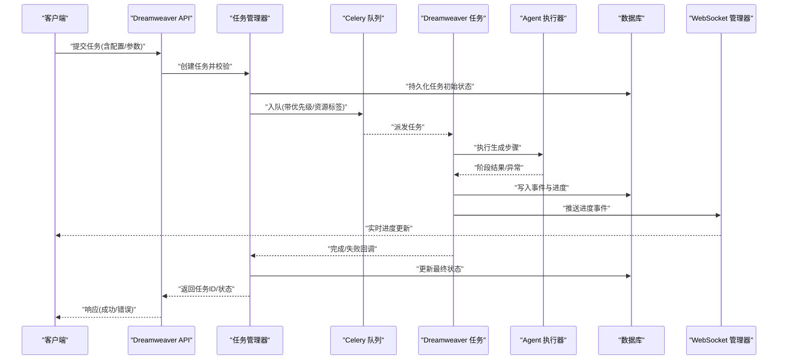
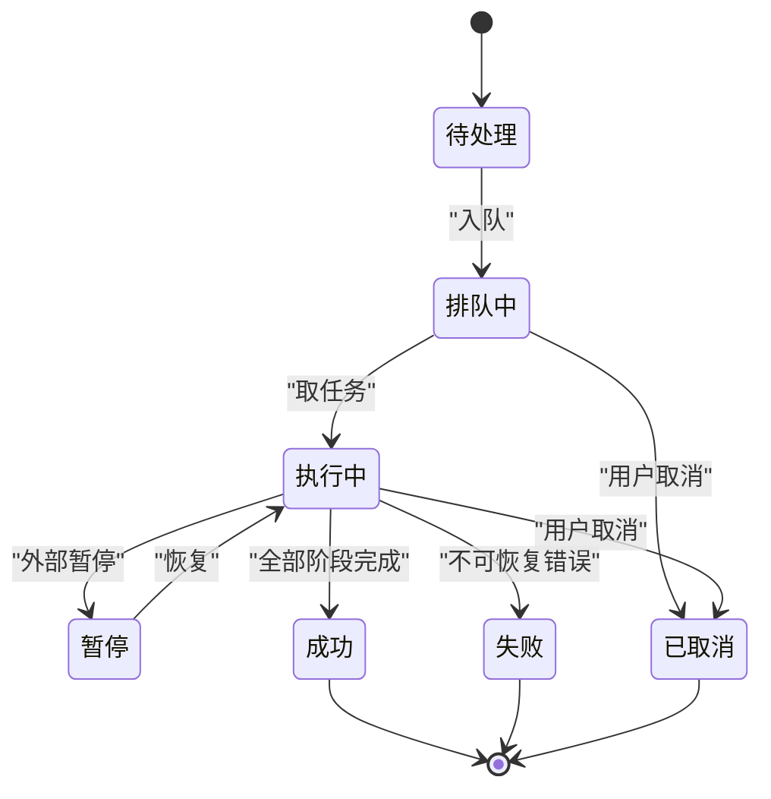
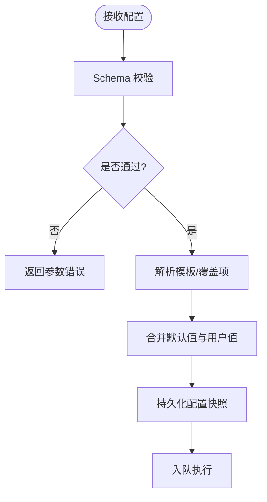
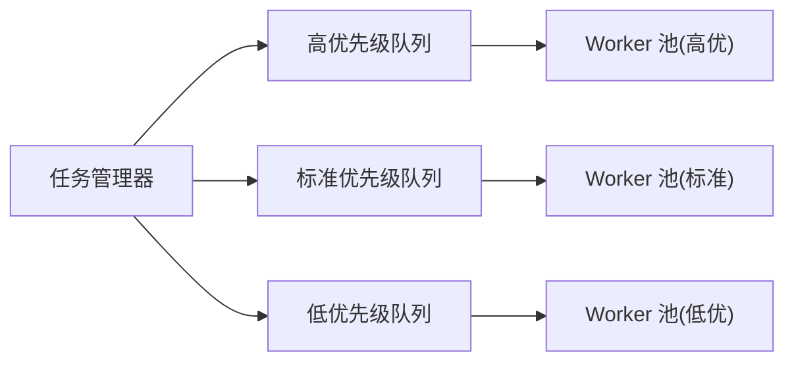
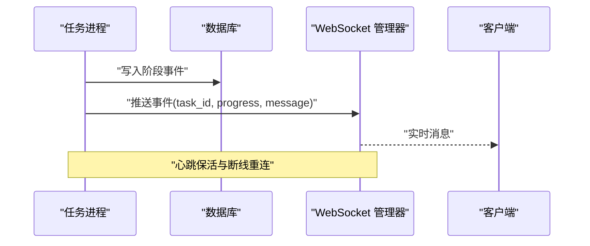
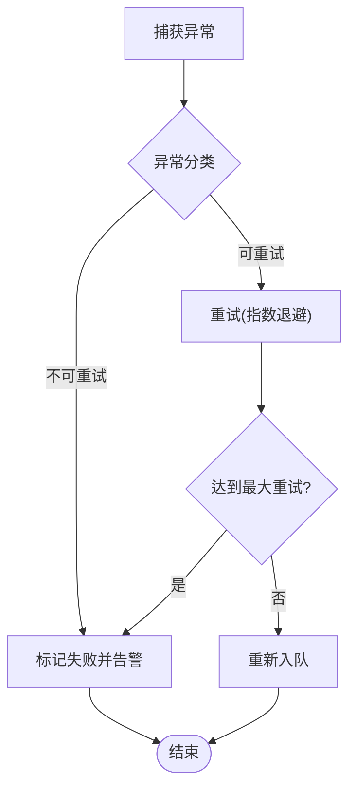
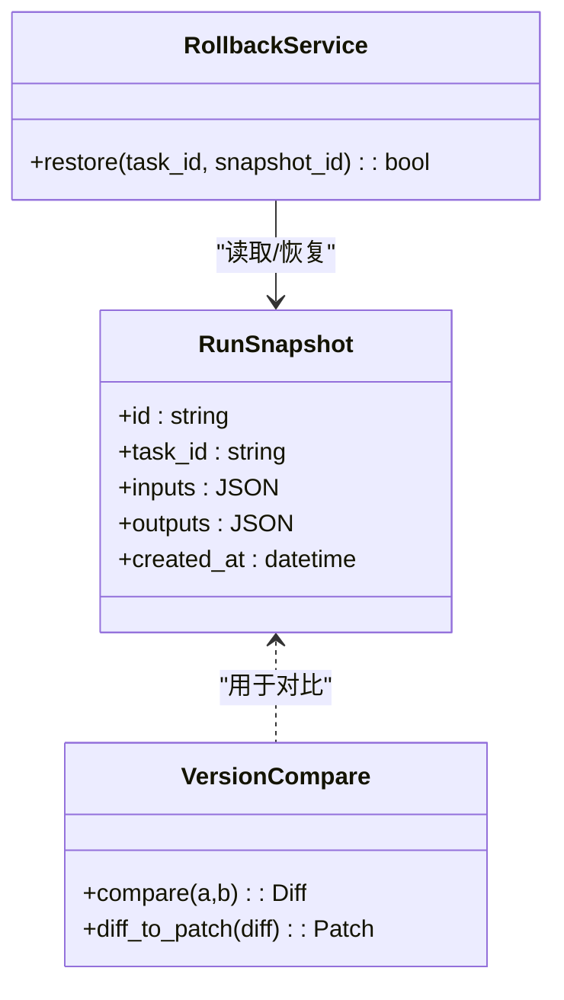
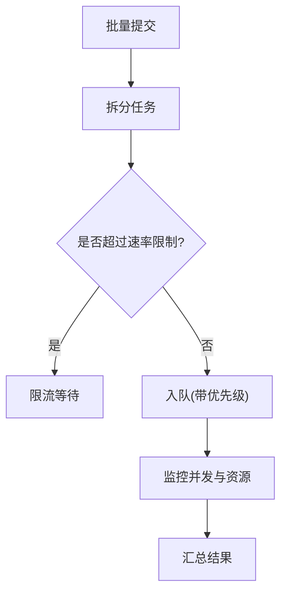
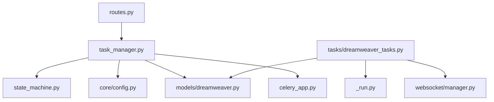

# 任务运行管理

<cite>
**本文引用的文件**   
- [backend/app/api/v1/dreamweaver_api/routes.py](file://backend/app/api/v1/dreamweaver_api/routes.py)
- [backend/app/services/dreamweaver/task_manager.py](file://backend/app/services/dreamweaver/task_manager.py)
- [backend/app/tasks/dreamweaver_tasks.py](file://backend/app/tasks/dreamweaver_tasks.py)
- [backend/app/websocket/manager.py](file://backend/app/websocket/manager.py)
- [backend/app/models/dreamweaver.py](file://backend/app/models/dreamweaver.py)
- [backend/app/schemas/dreamweaver_contract.py](file://backend/app/schemas/dreamweaver_contract.py)
- [backend/app/core/config.py](file://backend/app/core/config.py)
- [backend/app/celery_app.py](file://backend/app/celery_app.py)
- [backend/alembic/versions/add_dreamweaver_run_events.py](file://backend/alembic/versions/add_dreamweaver_run_events.py)
- [agents/dreamweaver_agent_pkg/_run.py](file://agents/dreamweaver_agent_pkg/_run.py)
- [pipeline/state_machine.py](file://pipeline/state_machine.py)
- [backend/app/services/batch_processor.py](file://backend/app/services/batch_processor.py)
</cite>

## 目录
1. [简介](#简介)
2. [项目结构](#项目结构)
3. [核心组件](#核心组件)
4. [架构总览](#架构总览)
5. [详细组件分析](#详细组件分析)
6. [依赖关系分析](#依赖关系分析)
7. [性能考量](#性能考量)
8. [故障排查指南](#故障排查指南)
9. [结论](#结论)
10. [附录](#附录)

## 简介
本文件为“梦境编织者”任务运行管理的功能文档，聚焦以下能力：
- 任务生命周期管理、状态监控与进度跟踪
- 任务配置界面、参数校验与模板管理
- 任务队列管理、优先级设置与资源分配
- 实时进度更新、WebSocket 通信与错误处理
- 任务历史查看、结果对比与版本回滚
- 批量任务执行、并发控制与资源限制

该文档面向产品、研发与运维人员，既提供高层概览，也给出代码级定位与可视化图示，帮助快速理解与落地。

## 项目结构
围绕“任务运行管理”，后端采用分层设计：API 路由层暴露接口，服务层编排任务，Celery 异步任务执行器驱动工作进程，WebSocket 推送实时状态，数据库持久化任务与事件，模型与 Schema 定义数据契约，Alembic 管理迁移。

**图表来源** 
- [backend/app/api/v1/dreamweaver_api/routes.py](file://backend/app/api/v1/dreamweaver_api/routes.py)
- [backend/app/services/dreamweaver/task_manager.py](file://backend/app/services/dreamweaver/task_manager.py)
- [backend/app/celery_app.py](file://backend/app/celery_app.py)
- [backend/app/tasks/dreamweaver_tasks.py](file://backend/app/tasks/dreamweaver_tasks.py)
- [agents/dreamweaver_agent_pkg/_run.py](file://agents/dreamweaver_agent_pkg/_run.py)
- [backend/app/models/dreamweaver.py](file://backend/app/models/dreamweaver.py)
- [backend/app/websocket/manager.py](file://backend/app/websocket/manager.py)
- [pipeline/state_machine.py](file://pipeline/state_machine.py)
- [backend/app/core/config.py](file://backend/app/core/config.py)

**章节来源**
- [backend/app/api/v1/dreamweaver_api/routes.py](file://backend/app/api/v1/dreamweaver_api/routes.py)
- [backend/app/services/dreamweaver/task_manager.py](file://backend/app/services/dreamweaver/task_manager.py)
- [backend/app/tasks/dreamweaver_tasks.py](file://backend/app/tasks/dreamweaver_tasks.py)
- [backend/app/websocket/manager.py](file://backend/app/websocket/manager.py)
- [backend/app/models/dreamweaver.py](file://backend/app/models/dreamweaver.py)
- [backend/app/schemas/dreamweaver_contract.py](file://backend/app/schemas/dreamweaver_contract.py)
- [backend/app/core/config.py](file://backend/app/core/config.py)
- [backend/app/celery_app.py](file://backend/app/celery_app.py)
- [backend/alembic/versions/add_dreamweaver_run_events.py](file://backend/alembic/versions/add_dreamweaver_run_events.py)
- [agents/dreamweaver_agent_pkg/_run.py](file://agents/dreamweaver_agent_pkg/_run.py)
- [pipeline/state_machine.py](file://pipeline/state_machine.py)
- [backend/app/services/batch_processor.py](file://backend/app/services/batch_processor.py)

## 核心组件
- Dreamweaver API 路由：统一入口，负责鉴权、参数校验、调用服务层并返回标准化响应。
- 任务管理器：编排任务创建、入队、状态流转、进度聚合、重试与取消。
- Celery 任务：异步执行具体生成流程，持久化事件与结果，触发 WebSocket 推送。
- WebSocket 管理器：维护连接与会话，按任务维度广播进度与事件。
- 数据模型与 Schema：定义任务、事件、配置等数据结构与校验规则。
- 状态机：定义任务生命周期状态与转换约束。
- 配置中心：集中管理运行时参数、限流与并发策略。
- 批量处理器：支持批量任务提交、并发控制与资源配额。

**章节来源**
- [backend/app/api/v1/dreamweaver_api/routes.py](file://backend/app/api/v1/dreamweaver_api/routes.py)
- [backend/app/services/dreamweaver/task_manager.py](file://backend/app/services/dreamweaver/task_manager.py)
- [backend/app/tasks/dreamweaver_tasks.py](file://backend/app/tasks/dreamweaver_tasks.py)
- [backend/app/websocket/manager.py](file://backend/app/websocket/manager.py)
- [backend/app/models/dreamweaver.py](file://backend/app/models/dreamweaver.py)
- [backend/app/schemas/dreamweaver_contract.py](file://backend/app/schemas/dreamweaver_contract.py)
- [pipeline/state_machine.py](file://pipeline/state_machine.py)
- [backend/app/core/config.py](file://backend/app/core/config.py)
- [backend/app/services/batch_processor.py](file://backend/app/services/batch_processor.py)

## 架构总览
下图展示从请求到执行的端到端流程，包括状态推进、事件记录与实时推送。

**图表来源** 
- [backend/app/api/v1/dreamweaver_api/routes.py](file://backend/app/api/v1/dreamweaver_api/routes.py)
- [backend/app/services/dreamweaver/task_manager.py](file://backend/app/services/dreamweaver/task_manager.py)
- [backend/app/tasks/dreamweaver_tasks.py](file://backend/app/tasks/dreamweaver_tasks.py)
- [agents/dreamweaver_agent_pkg/_run.py](file://agents/dreamweaver_agent_pkg/_run.py)
- [backend/app/websocket/manager.py](file://backend/app/websocket/manager.py)
- [backend/app/models/dreamweaver.py](file://backend/app/models/dreamweaver.py)

## 详细组件分析

### 任务生命周期与状态机
- 生命周期阶段：待处理、排队中、执行中、暂停、成功、失败、已取消。
- 状态转换由状态机约束，确保非法跳转被拒绝；关键节点（开始、阶段完成、结束）均记录事件。
- 支持重试策略（指数退避/最大次数），失败可进入人工干预或自动恢复流程。

**图表来源** 
- [pipeline/state_machine.py](file://pipeline/state_machine.py)
- [backend/app/models/dreamweaver.py](file://backend/app/models/dreamweaver.py)

**章节来源**
- [pipeline/state_machine.py](file://pipeline/state_machine.py)
- [backend/app/models/dreamweaver.py](file://backend/app/models/dreamweaver.py)

### 任务配置、参数校验与模板管理
- 配置项涵盖模型选择、分辨率、时长、采样率、安全策略、重试策略等。
- 参数校验在 Schema 层进行强类型检查与业务规则校验，不合法请求直接拒绝。
- 模板管理支持预设模板与项目级覆盖，便于批量复用与一致性控制。

**图表来源** 
- [backend/app/schemas/dreamweaver_contract.py](file://backend/app/schemas/dreamweaver_contract.py)
- [backend/app/services/dreamweaver/task_manager.py](file://backend/app/services/dreamweaver/task_manager.py)

**章节来源**
- [backend/app/schemas/dreamweaver_contract.py](file://backend/app/schemas/dreamweaver_contract.py)
- [backend/app/services/dreamweaver/task_manager.py](file://backend/app/services/dreamweaver/task_manager.py)

### 任务队列、优先级与资源分配
- 使用 Celery 队列承载任务，支持多队列隔离（如高/中/低优先级）。
- 任务入队时携带优先级与资源标签（GPU/CPU/内存），调度器据此分配 Worker。
- 支持动态扩缩容与队列权重调整，避免热点任务阻塞。

**图表来源** 
- [backend/app/celery_app.py](file://backend/app/celery_app.py)
- [backend/app/tasks/dreamweaver_tasks.py](file://backend/app/tasks/dreamweaver_tasks.py)

**章节来源**
- [backend/app/celery_app.py](file://backend/app/celery_app.py)
- [backend/app/tasks/dreamweaver_tasks.py](file://backend/app/tasks/dreamweaver_tasks.py)

### 实时进度更新与 WebSocket 通信
- 任务各阶段完成后，任务进程将事件写入数据库并通过 WebSocket 管理器广播。
- 客户端订阅任务 ID，服务端按会话推送进度、日志与告警。
- 断线重连与消息去抖机制保障稳定性。

**图表来源** 
- [backend/app/tasks/dreamweaver_tasks.py](file://backend/app/tasks/dreamweaver_tasks.py)
- [backend/app/websocket/manager.py](file://backend/app/websocket/manager.py)

**章节来源**
- [backend/app/tasks/dreamweaver_tasks.py](file://backend/app/tasks/dreamweaver_tasks.py)
- [backend/app/websocket/manager.py](file://backend/app/websocket/manager.py)

### 错误处理与可观测性
- 任务异常分类：可重试（网络抖动、临时限流）、不可重试（参数错误、资源不足）。
- 错误事件持久化，支持回溯与告警；对关键路径增加埋点与指标采集。
- 支持失败重试、降级策略与熔断保护。

**图表来源** 
- [backend/app/tasks/dreamweaver_tasks.py](file://backend/app/tasks/dreamweaver_tasks.py)
- [backend/app/services/dreamweaver/task_manager.py](file://backend/app/services/dreamweaver/task_manager.py)

**章节来源**
- [backend/app/tasks/dreamweaver_tasks.py](file://backend/app/tasks/dreamweaver_tasks.py)
- [backend/app/services/dreamweaver/task_manager.py](file://backend/app/services/dreamweaver/task_manager.py)

### 任务历史、结果对比与版本回滚
- 每次任务执行生成唯一快照，包含输入参数、中间产物与输出结果索引。
- 支持按时间线查看历史、对比不同版本的差异（如提示词、模型、参数）。
- 版本回滚可将项目或任务恢复到指定快照，保证一致性。

**图表来源** 
- [backend/app/models/dreamweaver.py](file://backend/app/models/dreamweaver.py)
- [backend/app/services/dreamweaver/task_manager.py](file://backend/app/services/dreamweaver/task_manager.py)

**章节来源**
- [backend/app/models/dreamweaver.py](file://backend/app/models/dreamweaver.py)
- [backend/app/services/dreamweaver/task_manager.py](file://backend/app/services/dreamweaver/task_manager.py)

### 批量任务执行、并发控制与资源限制
- 批量提交接口支持数组参数，内部拆分为独立任务并统一追踪。
- 并发控制基于令牌桶/信号量，结合 Worker 池大小与资源标签限制。
- 资源限制包括 GPU/CPU 配额、内存上限与速率限制，防止过载。

**图表来源** 
- [backend/app/services/batch_processor.py](file://backend/app/services/batch_processor.py)
- [backend/app/services/dreamweaver/task_manager.py](file://backend/app/services/dreamweaver/task_manager.py)

**章节来源**
- [backend/app/services/batch_processor.py](file://backend/app/services/batch_processor.py)
- [backend/app/services/dreamweaver/task_manager.py](file://backend/app/services/dreamweaver/task_manager.py)

## 依赖关系分析
- API 路由依赖任务管理器与 Schema 校验，解耦业务逻辑与接口实现。
- 任务管理器依赖状态机、配置中心与数据库访问，屏蔽底层细节。
- Celery 任务依赖 Agent 执行器与 WebSocket 管理器，完成计算与通知。
- 数据模型与 Alembic 迁移确保结构演进与兼容性。

**图表来源** 
- [backend/app/api/v1/dreamweaver_api/routes.py](file://backend/app/api/v1/dreamweaver_api/routes.py)
- [backend/app/services/dreamweaver/task_manager.py](file://backend/app/services/dreamweaver/task_manager.py)
- [pipeline/state_machine.py](file://pipeline/state_machine.py)
- [backend/app/core/config.py](file://backend/app/core/config.py)
- [backend/app/models/dreamweaver.py](file://backend/app/models/dreamweaver.py)
- [backend/app/tasks/dreamweaver_tasks.py](file://backend/app/tasks/dreamweaver_tasks.py)
- [agents/dreamweaver_agent_pkg/_run.py](file://agents/dreamweaver_agent_pkg/_run.py)
- [backend/app/websocket/manager.py](file://backend/app/websocket/manager.py)
- [backend/app/celery_app.py](file://backend/app/celery_app.py)

**章节来源**
- [backend/app/api/v1/dreamweaver_api/routes.py](file://backend/app/api/v1/dreamweaver_api/routes.py)
- [backend/app/services/dreamweaver/task_manager.py](file://backend/app/services/dreamweaver/task_manager.py)
- [backend/app/tasks/dreamweaver_tasks.py](file://backend/app/tasks/dreamweaver_tasks.py)
- [backend/app/websocket/manager.py](file://backend/app/websocket/manager.py)
- [backend/app/models/dreamweaver.py](file://backend/app/models/dreamweaver.py)
- [backend/app/schemas/dreamweaver_contract.py](file://backend/app/schemas/dreamweaver_contract.py)
- [backend/app/core/config.py](file://backend/app/core/config.py)
- [backend/app/celery_app.py](file://backend/app/celery_app.py)
- [backend/alembic/versions/add_dreamweaver_run_events.py](file://backend/alembic/versions/add_dreamweaver_run_events.py)
- [agents/dreamweaver_agent_pkg/_run.py](file://agents/dreamweaver_agent_pkg/_run.py)
- [pipeline/state_machine.py](file://pipeline/state_machine.py)
- [backend/app/services/batch_processor.py](file://backend/app/services/batch_processor.py)

## 性能考量
- 队列与 Worker：合理设置队列数量与 Worker 并发度，避免 CPU/GPU 争用。
- 批处理与节流：批量任务启用分片与限速，降低瞬时峰值压力。
- 缓存与预取：对常用模板与模型元数据进行缓存，减少冷启动延迟。
- 事件压缩：WebSocket 推送合并高频事件，降低带宽占用。
- 存储优化：事件表分区与归档，查询走索引与投影列。

## 故障排查指南
- 任务卡住：检查队列堆积、Worker 健康与资源配额；查看最近事件与日志。
- 进度不更新：确认 WebSocket 连接状态与订阅通道；检查事件写入与推送链路。
- 参数错误：核对 Schema 校验规则与模板覆盖项；查看请求体与默认值合并结果。
- 失败重试：观察重试计数与退避策略；必要时手动重置任务状态。
- 资源不足：扩容 Worker 或调整优先级；检查 GPU/CPU 利用率与内存水位。

**章节来源**
- [backend/app/tasks/dreamweaver_tasks.py](file://backend/app/tasks/dreamweaver_tasks.py)
- [backend/app/websocket/manager.py](file://backend/app/websocket/manager.py)
- [backend/app/schemas/dreamweaver_contract.py](file://backend/app/schemas/dreamweaver_contract.py)
- [backend/app/services/dreamweaver/task_manager.py](file://backend/app/services/dreamweaver/task_manager.py)

## 结论
“梦境编织者”任务运行管理以清晰的分层架构与严格的契约定义，实现了从配置到执行的全链路可控与可观测。通过状态机、队列与 WebSocket 的协同，系统具备高吞吐、低延迟与强一致性的能力，同时提供批量执行、并发控制与资源限制以满足生产环境需求。建议在生产部署中关注队列容量、Worker 规模与事件归档策略，以获得更稳定的运行表现。

## 附录
- 术语说明
  - 任务：一次完整的生成流程，包含多个阶段与产物。
  - 事件：任务生命周期中的关键节点记录，用于追踪与回放。
  - 快照：任务的输入/输出与上下文的一次完整保存。
  - 模板：可复用的任务配置集合，支持覆盖与继承。
- 相关迁移
  - 新增运行事件表，支撑历史与对比能力。

**章节来源**
- [backend/alembic/versions/add_dreamweaver_run_events.py](file://backend/alembic/versions/add_dreamweaver_run_events.py)