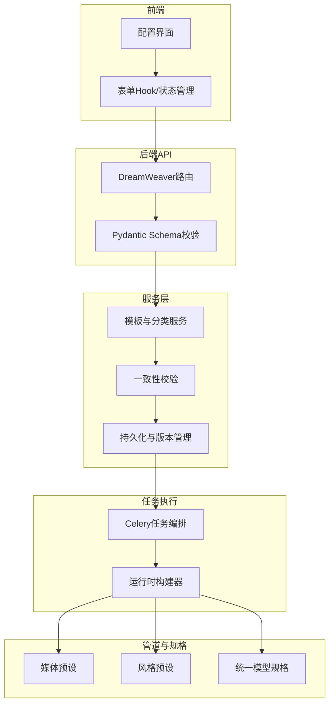
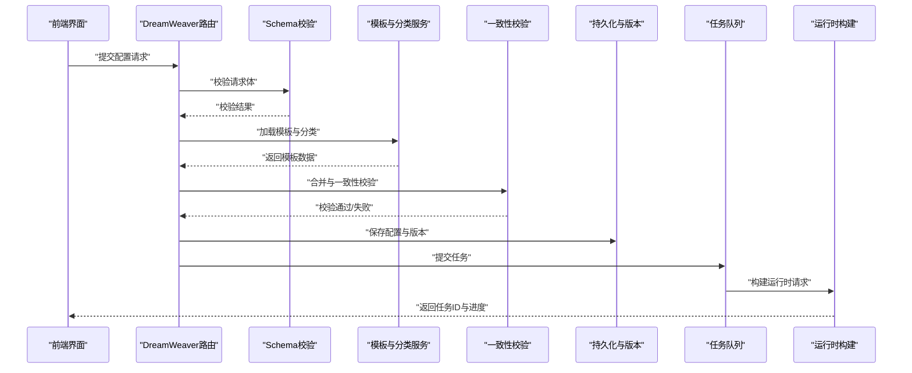
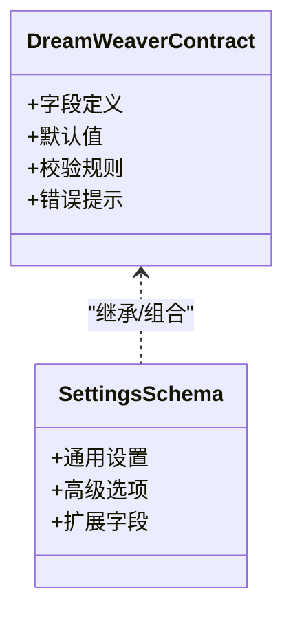
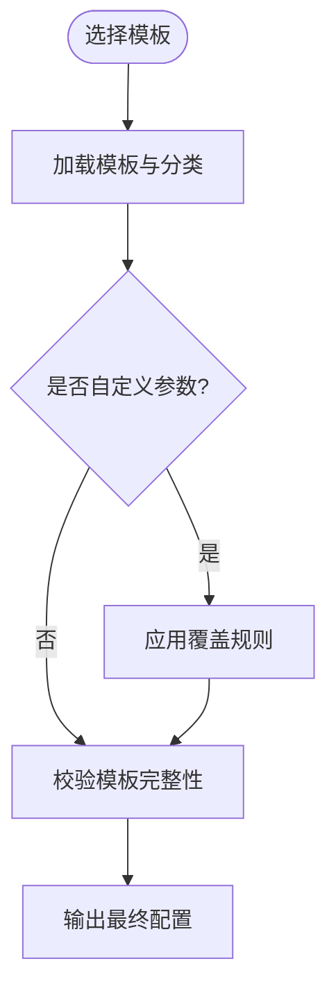
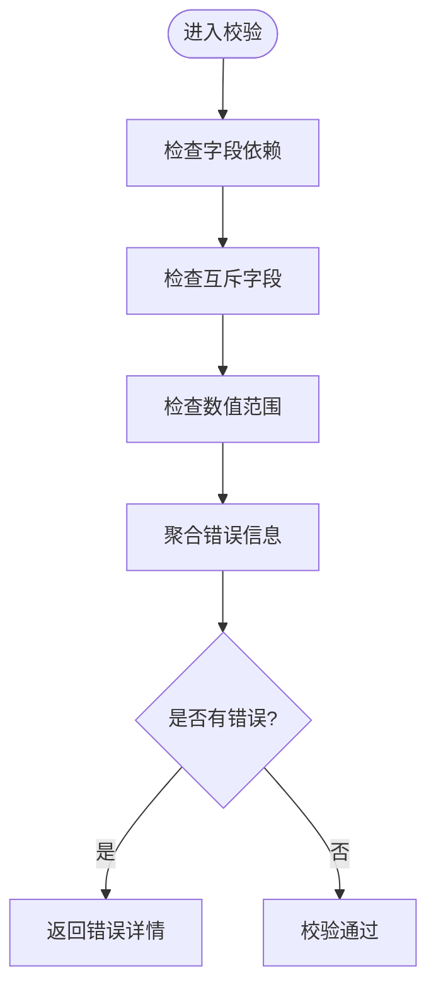
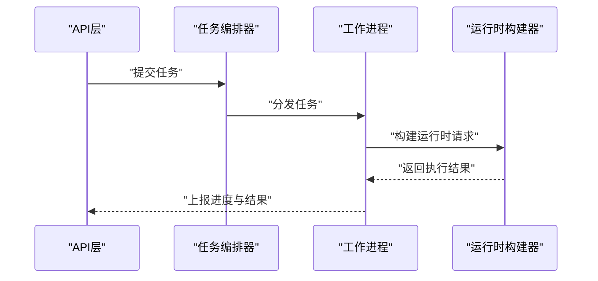
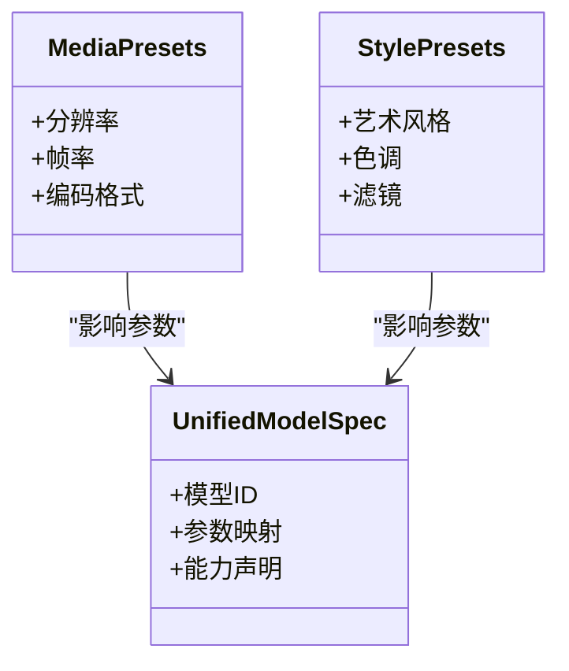
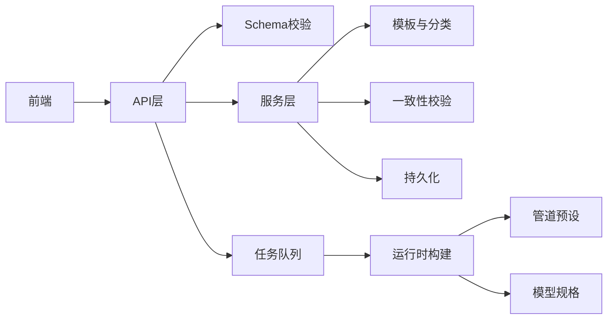

# 任务配置管理

<cite>
**本文引用的文件**   
- [dreamweaver.py](file://agents/dreamweaver.py)
- [_run.py](file://agents/dreamweaver_agent_pkg/_run.py)
- [_video_prompts.py](file://agents/dreamweaver_agent_pkg/_video_prompts.py)
- [_ensure_prompts.py](file://agents/dreamweaver_agent_pkg/_ensure_prompts.py)
- [dreamweaver_contract.py](file://backend/app/schemas/dreamweaver_contract.py)
- [settings.py](file://backend/app/schemas/settings.py)
- [setting_templates.py](file://backend/app/services/setting_templates.py)
- [setting_categories.py](file://backend/app/services/setting_categories.py)
- [setting_consistency.py](file://backend/app/services/setting_consistency.py)
- [dreamweaver_api/__init__.py](file://backend/app/api/v1/dreamweaver_api/__init__.py)
- [dreamweaver_api/routes.py](file://backend/app/api/v1/dreamweaver_api/routes.py)
- [dreamweaver_tasks.py](file://backend/app/tasks/dreamweaver_tasks.py)
- [tasks_pkg/__init__.py](file://backend/app/tasks/dreamweaver_tasks_pkg/__init__.py)
- [task_spec.py](file://schemas/task_spec.py)
- [model_spec.py](file://schemas/model_spec.py)
- [unified_model_spec.py](file://schemas/unified_model_spec.py)
- [config.py](file://core/config.py)
- [validators.py](file://core/validators.py)
- [media_presets.py](file://pipeline/media_presets.py)
- [style_presets.py](file://pipeline/style_presets.py)
- [dreamweaver.py](file://backend/app/models/dreamweaver.py)
- [test_dreamweaver_schemas.py](file://backend/tests/test_dreamweaver_schemas.py)
- [test_dreamweaver_request_build.py](file://backend/tests/test_dreamweaver_request_build.py)
</cite>

## 目录
1. [简介](#简介)
2. [项目结构](#项目结构)
3. [核心组件](#核心组件)
4. [架构总览](#架构总览)
5. [详细组件分析](#详细组件分析)
6. [依赖关系分析](#依赖关系分析)
7. [性能考量](#性能考量)
8. [故障排查指南](#故障排查指南)
9. [结论](#结论)
10. [附录](#附录)

## 简介
本文件面向“梦境编织者”（DreamWeaver）任务配置管理，聚焦以下目标：
- 任务参数配置界面、表单验证与数据绑定机制
- 配置模板系统、预设选项与自定义参数设置
- 配置的持久化、版本管理与导入导出
- 配置校验规则、错误提示与用户交互反馈
- 最佳实践与常见配置模式示例

该文档以代码仓库中的后端服务、Schema 定义、任务执行与管道预设为基础，提供从前端到后端的端到端说明，帮助读者快速理解并正确使用 DreamWeaver 的任务配置能力。

## 项目结构
DreamWeaver 任务配置相关的关键位置包括：
- 前端页面与服务层：负责展示配置界面、收集表单数据、调用 API
- 后端 API：接收配置请求、进行 Schema 校验、路由到服务层
- 服务层：模板解析、预设合并、一致性校验、持久化与版本管理
- 任务执行层：将最终配置转换为运行时请求，提交到 Celery 队列
- 管道与模型规格：媒体与风格预设、统一模型规格映射

图表来源
- [dreamweaver_api/routes.py](file://backend/app/api/v1/dreamweaver_api/routes.py)
- [dreamweaver_contract.py](file://backend/app/schemas/dreamweaver_contract.py)
- [setting_templates.py](file://backend/app/services/setting_templates.py)
- [setting_categories.py](file://backend/app/services/setting_categories.py)
- [setting_consistency.py](file://backend/app/services/setting_consistency.py)
- [dreamweaver_tasks.py](file://backend/app/tasks/dreamweaver_tasks.py)
- [media_presets.py](file://pipeline/media_presets.py)
- [style_presets.py](file://pipeline/style_presets.py)
- [unified_model_spec.py](file://schemas/unified_model_spec.py)

章节来源
- [dreamweaver_contract.py](file://backend/app/schemas/dreamweaver_contract.py)
- [dreamweaver_api/routes.py](file://backend/app/api/v1/dreamweaver_api/routes.py)
- [setting_templates.py](file://backend/app/services/setting_templates.py)
- [setting_categories.py](file://backend/app/services/setting_categories.py)
- [setting_consistency.py](file://backend/app/services/setting_consistency.py)
- [dreamweaver_tasks.py](file://backend/app/tasks/dreamweaver_tasks.py)
- [media_presets.py](file://pipeline/media_presets.py)
- [style_presets.py](file://pipeline/style_presets.py)
- [unified_model_spec.py](file://schemas/unified_model_spec.py)

## 核心组件
- 配置 Schema 与契约：集中定义任务参数的必填项、类型、默认值与约束
- 模板与分类服务：提供可复用的配置模板、分类分组与覆盖策略
- 一致性校验：确保模板、预设与用户自定义参数之间无冲突
- 任务执行编排：将配置转换为运行期请求，支持异步执行与进度追踪
- 管道预设：媒体与风格预设作为基础配置，供模板与任务使用
- 统一模型规格：抽象不同模型的参数映射，保证跨模型一致性

章节来源
- [dreamweaver_contract.py](file://backend/app/schemas/dreamweaver_contract.py)
- [setting_templates.py](file://backend/app/services/setting_templates.py)
- [setting_categories.py](file://backend/app/services/setting_categories.py)
- [setting_consistency.py](file://backend/app/services/setting_consistency.py)
- [dreamweaver_tasks.py](file://backend/app/tasks/dreamweaver_tasks.py)
- [media_presets.py](file://pipeline/media_presets.py)
- [style_presets.py](file://pipeline/style_presets.py)
- [unified_model_spec.py](file://schemas/unified_model_spec.py)

## 架构总览
DreamWeaver 配置管理的整体流程如下：
- 前端通过表单收集用户输入，并进行本地校验
- 调用后端 API，由 Pydantic Schema 进行严格校验
- 服务层加载模板与分类，合并用户自定义参数，执行一致性校验
- 生成最终配置，持久化存储并记录版本信息
- 提交任务到 Celery，任务编排器根据配置构建运行时请求
- 管道预设与统一模型规格在运行时生效，驱动具体生成过程

图表来源
- [dreamweaver_api/routes.py](file://backend/app/api/v1/dreamweaver_api/routes.py)
- [dreamweaver_contract.py](file://backend/app/schemas/dreamweaver_contract.py)
- [setting_templates.py](file://backend/app/services/setting_templates.py)
- [setting_consistency.py](file://backend/app/services/setting_consistency.py)
- [dreamweaver_tasks.py](file://backend/app/tasks/dreamweaver_tasks.py)

## 详细组件分析

### 配置 Schema 与契约
- 职责：定义任务参数的字段、类型、默认值、枚举与约束条件
- 关键点：
  - 必填字段与可选字段的区分
  - 数值范围、字符串长度、枚举值的边界检查
  - 嵌套对象与数组结构的合法性校验
  - 错误消息的本地化与可读性

图表来源
- [dreamweaver_contract.py](file://backend/app/schemas/dreamweaver_contract.py)
- [settings.py](file://backend/app/schemas/settings.py)

章节来源
- [dreamweaver_contract.py](file://backend/app/schemas/dreamweaver_contract.py)
- [settings.py](file://backend/app/schemas/settings.py)
- [test_dreamweaver_schemas.py](file://backend/tests/test_dreamweaver_schemas.py)

### 模板系统与分类
- 职责：提供可复用的配置模板，按分类组织，支持覆盖与合并
- 关键点：
  - 模板版本控制与兼容性
  - 分类标签与筛选
  - 模板优先级与覆盖策略
  - 动态字段注入与条件渲染

图表来源
- [setting_templates.py](file://backend/app/services/setting_templates.py)
- [setting_categories.py](file://backend/app/services/setting_categories.py)

章节来源
- [setting_templates.py](file://backend/app/services/setting_templates.py)
- [setting_categories.py](file://backend/app/services/setting_categories.py)

### 一致性校验与错误处理
- 职责：确保模板、预设与用户自定义参数之间无冲突
- 关键点：
  - 字段依赖关系的检查
  - 互斥字段的冲突检测
  - 数值范围的交叉验证
  - 错误信息的聚合与定位

图表来源
- [setting_consistency.py](file://backend/app/services/setting_consistency.py)

章节来源
- [setting_consistency.py](file://backend/app/services/setting_consistency.py)

### 任务执行与运行时构建
- 职责：将最终配置转换为运行时请求，支持异步执行与进度追踪
- 关键点：
  - 配置到运行时对象的映射
  - 任务队列的调度与重试
  - 进度事件的上报与回调
  - 异常捕获与恢复策略

图表来源
- [dreamweaver_tasks.py](file://backend/app/tasks/dreamweaver_tasks.py)
- [tasks_pkg/__init__.py](file://backend/app/tasks/dreamweaver_tasks_pkg/__init__.py)

章节来源
- [dreamweaver_tasks.py](file://backend/app/tasks/dreamweaver_tasks.py)
- [tasks_pkg/__init__.py](file://backend/app/tasks/dreamweaver_tasks_pkg/__init__.py)
- [test_dreamweaver_request_build.py](file://backend/tests/test_dreamweaver_request_build.py)

### 管道预设与模型规格
- 职责：提供媒体与风格预设，以及统一模型规格映射
- 关键点：
  - 预设的层次结构与继承
  - 模型规格的抽象与适配
  - 运行时参数的动态替换
  - 预设的测试与回归保障

图表来源
- [media_presets.py](file://pipeline/media_presets.py)
- [style_presets.py](file://pipeline/style_presets.py)
- [unified_model_spec.py](file://schemas/unified_model_spec.py)

章节来源
- [media_presets.py](file://pipeline/media_presets.py)
- [style_presets.py](file://pipeline/style_presets.py)
- [unified_model_spec.py](file://schemas/unified_model_spec.py)

## 依赖关系分析
DreamWeaver 配置管理涉及多层依赖：
- 前端依赖后端 API 接口契约
- 后端 API 依赖 Schema 校验与服务层逻辑
- 服务层依赖模板、分类与一致性校验
- 任务执行依赖队列与运行时构建器
- 管道预设与模型规格为运行时提供基础数据

图表来源
- [dreamweaver_api/routes.py](file://backend/app/api/v1/dreamweaver_api/routes.py)
- [dreamweaver_contract.py](file://backend/app/schemas/dreamweaver_contract.py)
- [setting_templates.py](file://backend/app/services/setting_templates.py)
- [setting_consistency.py](file://backend/app/services/setting_consistency.py)
- [dreamweaver_tasks.py](file://backend/app/tasks/dreamweaver_tasks.py)
- [media_presets.py](file://pipeline/media_presets.py)
- [unified_model_spec.py](file://schemas/unified_model_spec.py)

章节来源
- [dreamweaver_api/routes.py](file://backend/app/api/v1/dreamweaver_api/routes.py)
- [dreamweaver_contract.py](file://backend/app/schemas/dreamweaver_contract.py)
- [setting_templates.py](file://backend/app/services/setting_templates.py)
- [setting_consistency.py](file://backend/app/services/setting_consistency.py)
- [dreamweaver_tasks.py](file://backend/app/tasks/dreamweaver_tasks.py)
- [media_presets.py](file://pipeline/media_presets.py)
- [unified_model_spec.py](file://schemas/unified_model_spec.py)

## 性能考量
- 模板缓存：避免重复加载与解析，提升响应速度
- 批量校验：合并多个字段的校验逻辑，减少往返次数
- 异步任务：长耗时操作放入队列，避免阻塞主线程
- 增量更新：仅更新变更的配置项，减少数据库写入压力
- 预设复用：最大化利用预设，减少运行时计算开销

[本节为通用指导，不直接分析具体文件]

## 故障排查指南
- 表单验证失败：检查前端输入是否符合 Schema 约束，查看错误消息定位问题字段
- 模板加载失败：确认模板版本与分类是否正确，检查模板文件的完整性
- 一致性校验错误：检查字段依赖与互斥关系，调整参数以避免冲突
- 任务执行异常：查看任务日志与运行时报错，确认模型规格与管道预设的有效性
- 持久化失败：检查数据库连接与权限，确认版本冲突与回滚策略

章节来源
- [dreamweaver_contract.py](file://backend/app/schemas/dreamweaver_contract.py)
- [setting_templates.py](file://backend/app/services/setting_templates.py)
- [setting_consistency.py](file://backend/app/services/setting_consistency.py)
- [dreamweaver_tasks.py](file://backend/app/tasks/dreamweaver_tasks.py)

## 结论
DreamWeaver 任务配置管理通过清晰的 Schema 定义、灵活的模板系统、严格的校验机制与高效的异步执行，为用户提供了强大而易用的配置能力。遵循本文档的最佳实践与常见模式，可以显著提升配置效率与系统稳定性。

[本节为总结性内容，不直接分析具体文件]

## 附录
- 最佳实践：
  - 优先使用模板与预设，减少重复配置
  - 合理划分必填与可选字段，提升用户体验
  - 使用版本化管理，确保配置的可追溯性
  - 实施渐进式校验，及时反馈用户输入问题
- 常见配置模式：
  - 标准视频生成：选择媒体预设与风格预设，指定模型规格
  - 自定义参数覆盖：在模板基础上微调关键参数
  - 多模型实验：切换模型规格，对比生成效果
  - 批量任务：复用同一配置，批量提交任务

[本节为补充信息，不直接分析具体文件]