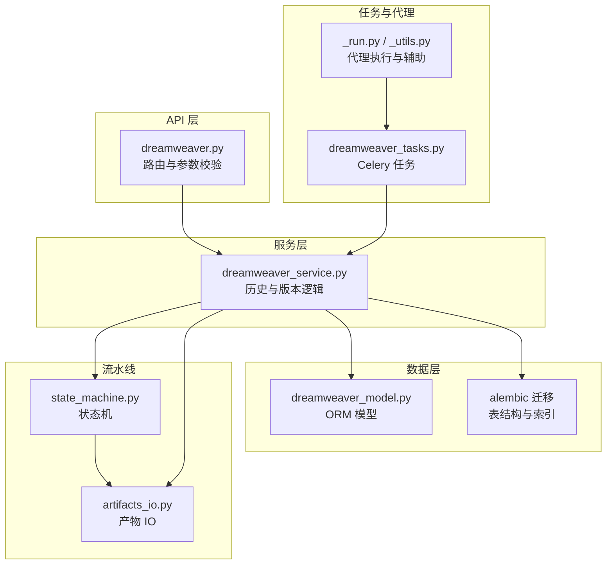
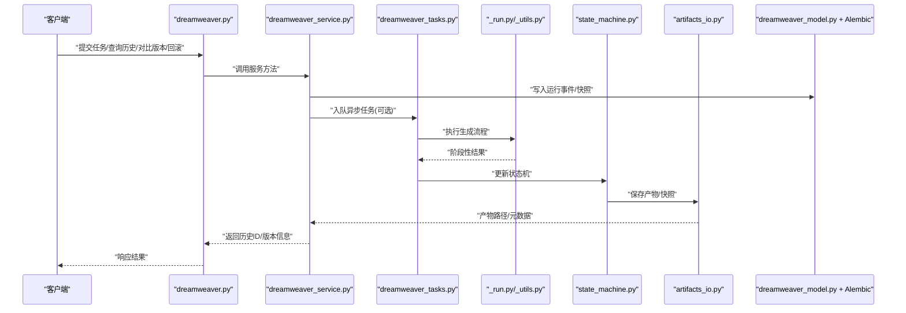
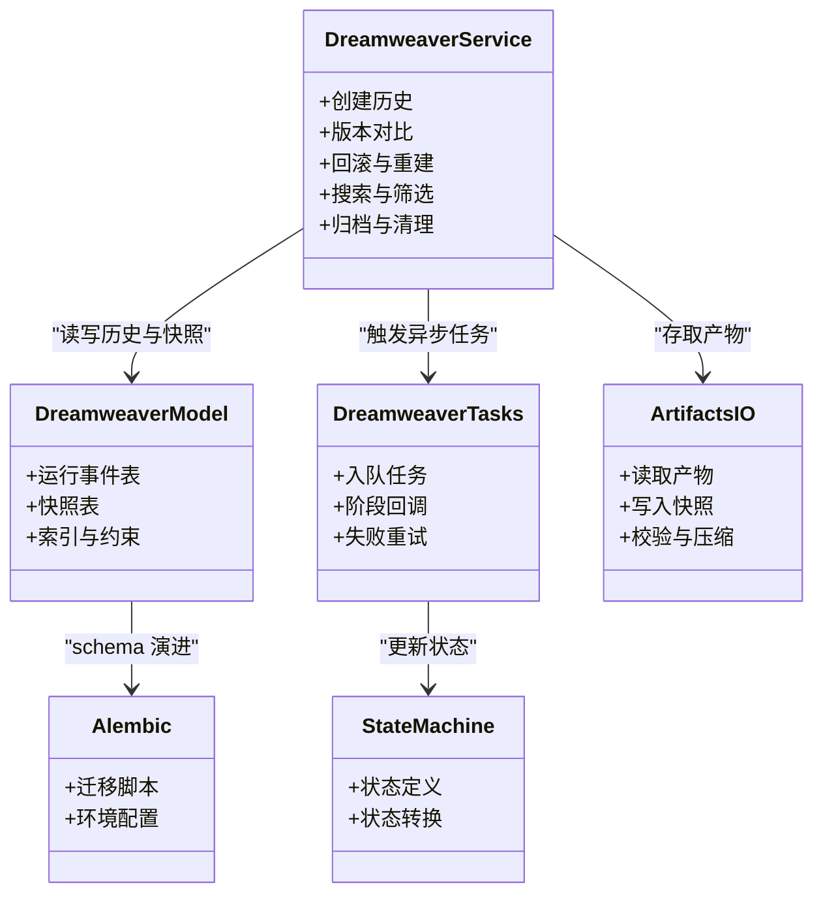

# 历史记录与版本管理

<cite>
**本文引用的文件**   
- [dreamweaver.py](file://backend/app/api/v1/dreamweaver_api/dreamweaver.py)
- [dreamweaver_service.py](file://backend/app/services/dreamweaver/dreamweaver_service.py)
- [dreamweaver_model.py](file://backend/app/models/dreamweaver.py)
- [alembic_env.py](file://backend/alembic/env.py)
- [initial_migration.py](file://backend/alembic/versions/initial.py)
- [add_dreamweaver_run_events.py](file://backend/alembic/versions/add_dreamweaver_run_events.py)
- [dreamweaver_tasks.py](file://backend/app/tasks/dreamweaver_tasks.py)
- [dreamweaver_agent_pkg__run.py](file://agents/dreamweaver_agent_pkg/_run.py)
- [dreamweaver_agent_pkg__utils.py](file://agents/dreamweaver_agent_pkg/_utils.py)
- [state_machine.py](file://pipeline/state_machine.py)
- [artifacts_io.py](file://pipeline/artifacts_io.py)
</cite>

## 目录
1. [简介](#简介)
2. [项目结构](#项目结构)
3. [核心组件](#核心组件)
4. [架构总览](#架构总览)
5. [详细组件分析](#详细组件分析)
6. [依赖关系分析](#依赖关系分析)
7. [性能考量](#性能考量)
8. [故障排查指南](#故障排查指南)
9. [结论](#结论)
10. [附录](#附录)

## 简介
本文件面向“梦境编织者”任务的历史记录与版本管理能力，覆盖以下关键主题：
- 历史数据持久化、存储策略与查询优化
- 版本对比、差异展示与变更追踪机制
- 任务回滚操作、数据恢复与状态重建流程
- 历史搜索、筛选排序与批量操作能力
- 数据清理、归档策略与存储空间管理

文档以代码级为依据，结合数据库迁移、服务层、任务队列与流水线产物等模块，给出端到端的设计说明与实现要点。

## 项目结构
围绕“历史记录与版本管理”，相关代码主要分布在以下位置：
- API 路由层：对外暴露历史与版本相关接口
- 服务层：封装历史写入、版本对比、回滚与重建逻辑
- 模型与迁移：定义运行事件、快照表结构与索引
- 任务与代理：异步执行生成任务并落盘历史与产物
- 流水线：状态机驱动与产物 IO，支撑版本快照与回溯

图表来源
- [dreamweaver.py](file://backend/app/api/v1/dreamweaver_api/dreamweaver.py)
- [dreamweaver_service.py](file://backend/app/services/dreamweaver/dreamweaver_service.py)
- [dreamweaver_model.py](file://backend/app/models/dreamweaver.py)
- [alembic_env.py](file://backend/alembic/env.py)
- [initial_migration.py](file://backend/alembic/versions/initial.py)
- [add_dreamweaver_run_events.py](file://backend/alembic/versions/add_dreamweaver_run_events.py)
- [dreamweaver_tasks.py](file://backend/app/tasks/dreamweaver_tasks.py)
- [dreamweaver_agent_pkg__run.py](file://agents/dreamweaver_agent_pkg/_run.py)
- [dreamweaver_agent_pkg__utils.py](file://agents/dreamweaver_agent_pkg/_utils.py)
- [state_machine.py](file://pipeline/state_machine.py)
- [artifacts_io.py](file://pipeline/artifacts_io.py)

章节来源
- [dreamweaver.py](file://backend/app/api/v1/dreamweaver_api/dreamweaver.py)
- [dreamweaver_service.py](file://backend/app/services/dreamweaver/dreamweaver_service.py)
- [dreamweaver_model.py](file://backend/app/models/dreamweaver.py)
- [alembic_env.py](file://backend/alembic/env.py)
- [initial_migration.py](file://backend/alembic/versions/initial.py)
- [add_dreamweaver_run_events.py](file://backend/alembic/versions/add_dreamweaver_run_events.py)
- [dreamweaver_tasks.py](file://backend/app/tasks/dreamweaver_tasks.py)
- [dreamweaver_agent_pkg__run.py](file://agents/dreamweaver_agent_pkg/_run.py)
- [dreamweaver_agent_pkg__utils.py](file://agents/dreamweaver_agent_pkg/_utils.py)
- [state_machine.py](file://pipeline/state_machine.py)
- [artifacts_io.py](file://pipeline/artifacts_io.py)

## 核心组件
- 运行事件与快照模型：用于记录每次运行的元数据、输入输出摘要、状态与时间戳，作为历史与版本的基石
- 历史服务：提供创建历史、列出历史、按条件筛选、版本对比、回滚与重建等能力
- 任务编排：通过 Celery 任务触发生成流程，并在关键阶段落盘历史与产物
- 流水线状态机：驱动任务生命周期，配合产物 IO 完成快照与归档
- 迁移脚本：维护数据库 schema 演进，确保历史与版本字段稳定可用

章节来源
- [dreamweaver_model.py](file://backend/app/models/dreamweaver.py)
- [dreamweaver_service.py](file://backend/app/services/dreamweaver/dreamweaver_service.py)
- [dreamweaver_tasks.py](file://backend/app/tasks/dreamweaver_tasks.py)
- [state_machine.py](file://pipeline/state_machine.py)
- [artifacts_io.py](file://pipeline/artifacts_io.py)
- [add_dreamweaver_run_events.py](file://backend/alembic/versions/add_dreamweaver_run_events.py)

## 架构总览
下图展示了从请求到历史落盘、版本快照与回滚重建的整体链路。

图表来源
- [dreamweaver.py](file://backend/app/api/v1/dreamweaver_api/dreamweaver.py)
- [dreamweaver_service.py](file://backend/app/services/dreamweaver/dreamweaver_service.py)
- [dreamweaver_tasks.py](file://backend/app/tasks/dreamweaver_tasks.py)
- [dreamweaver_agent_pkg__run.py](file://agents/dreamweaver_agent_pkg/_run.py)
- [dreamweaver_agent_pkg__utils.py](file://agents/dreamweaver_agent_pkg/_utils.py)
- [state_machine.py](file://pipeline/state_machine.py)
- [artifacts_io.py](file://pipeline/artifacts_io.py)
- [dreamweaver_model.py](file://backend/app/models/dreamweaver.py)

## 详细组件分析

### 历史数据持久化与存储策略
- 运行事件表：记录任务 ID、用户/项目上下文、输入摘要、状态、耗时、错误信息等，便于审计与检索
- 快照表：对关键阶段或最终产物建立快照，包含版本号、内容指纹（如哈希）、产物路径、元数据
- 存储策略：
  - 结构化元数据存于关系型数据库，保证事务性与一致性
  - 大对象（视频/图像/音频）走对象存储或本地磁盘，数据库仅保留路径与元数据
  - 增量快照：仅记录差异或新增产物，减少冗余
- 查询优化：
  - 为常用过滤字段建立索引（如任务 ID、用户 ID、项目 ID、状态、时间范围）
  - 分页与游标式查询，避免全表扫描
  - 热点字段物化视图或聚合表（如最近 N 条历史）

章节来源
- [dreamweaver_model.py](file://backend/app/models/dreamweaver.py)
- [add_dreamweaver_run_events.py](file://backend/alembic/versions/add_dreamweaver_run_events.py)
- [initial_migration.py](file://backend/alembic/versions/initial.py)
- [alembic_env.py](file://backend/alembic/env.py)

### 版本对比、差异展示与变更追踪
- 版本标识：基于语义化版本或自增序号，结合内容指纹确保唯一性
- 差异计算：
  - 文本/配置类：基于行级 diff 算法
  - 媒体类：基于元数据与关键帧/缩略图对比，必要时进行视觉相似度评估
- 变更追踪：
  - 记录字段级变更（新增/修改/删除），附带操作人、时间与原因
  - 支持按字段维度筛选变更历史
- 展示方式：
  - 结构化差异面板（左右对照、高亮变更）
  - 媒体预览（缩略图/片段对比）

章节来源
- [dreamweaver_service.py](file://backend/app/services/dreamweaver/dreamweaver_service.py)
- [dreamweaver_model.py](file://backend/app/models/dreamweaver.py)

### 任务回滚、数据恢复与状态重建
- 回滚目标：选择指定版本快照作为目标状态
- 恢复步骤：
  - 校验目标版本存在且未被标记为废弃
  - 将当前运行事件置为“已回滚”，记录回滚来源版本
  - 重建产物：优先从快照路径恢复；缺失时触发重建任务
  - 重建完成后更新状态机与索引
- 一致性保障：
  - 使用事务包裹元数据更新，确保状态一致
  - 重建失败可重试，并提供失败原因与日志

章节来源
- [dreamweaver_service.py](file://backend/app/services/dreamweaver/dreamweaver_service.py)
- [dreamweaver_tasks.py](file://backend/app/tasks/dreamweaver_tasks.py)
- [state_machine.py](file://pipeline/state_machine.py)
- [artifacts_io.py](file://pipeline/artifacts_io.py)

### 历史搜索、筛选排序与批量操作
- 搜索能力：
  - 全文检索：对提示词、备注、错误消息等文本字段进行模糊匹配
  - 精确匹配：任务 ID、用户/项目 ID、状态、版本等
- 筛选与排序：
  - 时间范围、状态、标签、来源模型等维度组合筛选
  - 支持按时间、版本、评分等多字段排序
- 批量操作：
  - 批量导出历史与产物清单
  - 批量归档/清理过期历史
  - 批量打标签或设置可见性

章节来源
- [dreamweaver_service.py](file://backend/app/services/dreamweaver/dreamweaver_service.py)
- [dreamweaver_model.py](file://backend/app/models/dreamweaver.py)

### 数据清理、归档策略与存储空间管理
- 清理策略：
  - 基于时间的软删除（标记 deleted_at）与硬删除分离
  - 冷数据自动归档至低成本存储，热数据保留在高性能介质
- 归档规则：
  - 超过阈值的历史进入归档，压缩并移至归档桶
  - 归档后仍可通过元数据索引快速定位与恢复
- 空间管理：
  - 监控存储用量与增长趋势
  - 定期清理无效产物与临时文件
  - 配额限制与告警

章节来源
- [dreamweaver_service.py](file://backend/app/services/dreamweaver/dreamweaver_service.py)
- [artifacts_io.py](file://pipeline/artifacts_io.py)

### 流水线状态机与产物 IO
- 状态机：
  - 定义任务生命周期（待处理、进行中、成功、失败、回滚中、已回滚等）
  - 状态转换需满足前置条件，防止非法跳转
- 产物 IO：
  - 统一读写接口，屏蔽底层存储差异
  - 支持断点续传与并发安全
  - 产物校验（完整性、类型、大小）

章节来源
- [state_machine.py](file://pipeline/state_machine.py)
- [artifacts_io.py](file://pipeline/artifacts_io.py)

### 任务编排与代理执行
- 任务编排：
  - 通过 Celery 任务分发生成工作，支持重试与超时控制
  - 任务内分阶段回调，持续更新运行事件
- 代理执行：
  - 调用具体模型适配器，组装输入与参数
  - 捕获异常并记录错误上下文，便于诊断

章节来源
- [dreamweaver_tasks.py](file://backend/app/tasks/dreamweaver_tasks.py)
- [dreamweaver_agent_pkg__run.py](file://agents/dreamweaver_agent_pkg/_run.py)
- [dreamweaver_agent_pkg__utils.py](file://agents/dreamweaver_agent_pkg/_utils.py)

## 依赖关系分析
历史与版本管理的依赖关系如下：

图表来源
- [dreamweaver_model.py](file://backend/app/models/dreamweaver.py)
- [dreamweaver_service.py](file://backend/app/services/dreamweaver/dreamweaver_service.py)
- [dreamweaver_tasks.py](file://backend/app/tasks/dreamweaver_tasks.py)
- [state_machine.py](file://pipeline/state_machine.py)
- [artifacts_io.py](file://pipeline/artifacts_io.py)
- [alembic_env.py](file://backend/alembic/env.py)
- [initial_migration.py](file://backend/alembic/versions/initial.py)
- [add_dreamweaver_run_events.py](file://backend/alembic/versions/add_dreamweaver_run_events.py)

章节来源
- [dreamweaver_model.py](file://backend/app/models/dreamweaver.py)
- [dreamweaver_service.py](file://backend/app/services/dreamweaver/dreamweaver_service.py)
- [dreamweaver_tasks.py](file://backend/app/tasks/dreamweaver_tasks.py)
- [state_machine.py](file://pipeline/state_machine.py)
- [artifacts_io.py](file://pipeline/artifacts_io.py)
- [alembic_env.py](file://backend/alembic/env.py)
- [initial_migration.py](file://backend/alembic/versions/initial.py)
- [add_dreamweaver_run_events.py](file://backend/alembic/versions/add_dreamweaver_run_events.py)

## 性能考量
- 数据库层面：
  - 合理索引设计，避免 N+1 查询
  - 分页与只读副本分担查询压力
  - 大字段外置存储，减少主库体积
- 任务与 I/O：
  - 异步任务并行度调优，避免资源争用
  - 产物写入采用流式与分片上传
- 缓存策略：
  - 热门历史与版本元数据缓存
  - 差异计算结果短期缓存

[本节为通用指导，不直接分析具体文件]

## 故障排查指南
- 常见问题：
  - 历史未落盘：检查事务是否提交、事件写入是否被拦截
  - 版本不一致：核对内容指纹与快照路径
  - 回滚失败：确认目标版本存在、产物可访问、重建任务正常
- 诊断手段：
  - 查看运行事件与状态机日志
  - 检查任务队列消费与重试情况
  - 验证产物完整性与权限

章节来源
- [dreamweaver_service.py](file://backend/app/services/dreamweaver/dreamweaver_service.py)
- [dreamweaver_tasks.py](file://backend/app/tasks/dreamweaver_tasks.py)
- [state_machine.py](file://pipeline/state_machine.py)
- [artifacts_io.py](file://pipeline/artifacts_io.py)

## 结论
通过运行事件与快照双轨机制、任务异步编排与流水线状态机协同，系统实现了完整的“历史记录与版本管理”。在此基础上，结合索引优化、差异计算与归档清理策略，既保证了可追溯性与可恢复性，也兼顾了性能与成本。建议在生产环境中持续监控存储与任务队列健康，定期评估索引与归档策略的有效性。

[本节为总结性内容，不直接分析具体文件]

## 附录
- 术语说明：
  - 运行事件：一次任务执行的元数据记录
  - 快照：关键阶段的产物与元数据集合
  - 版本：带唯一标识的快照集合
  - 回滚：恢复到指定版本的操作
- 最佳实践：
  - 始终记录内容指纹，便于快速比对
  - 严格区分热/冷数据，降低存储成本
  - 回滚前进行影响面评估与备份

[本节为补充说明，不直接分析具体文件]