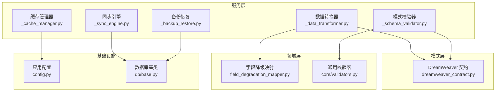
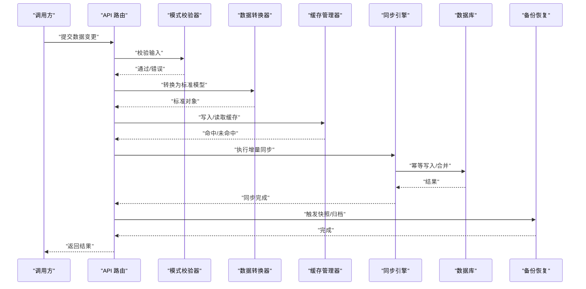
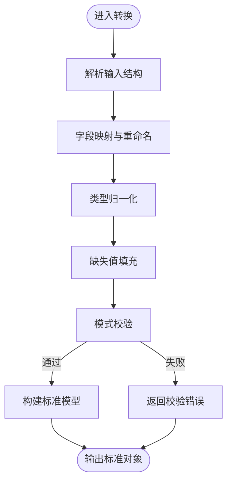
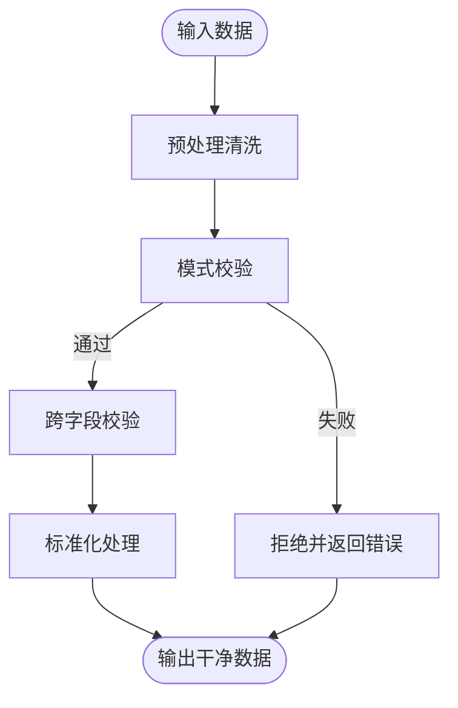
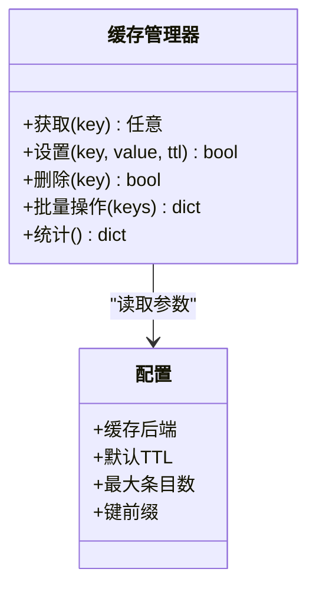
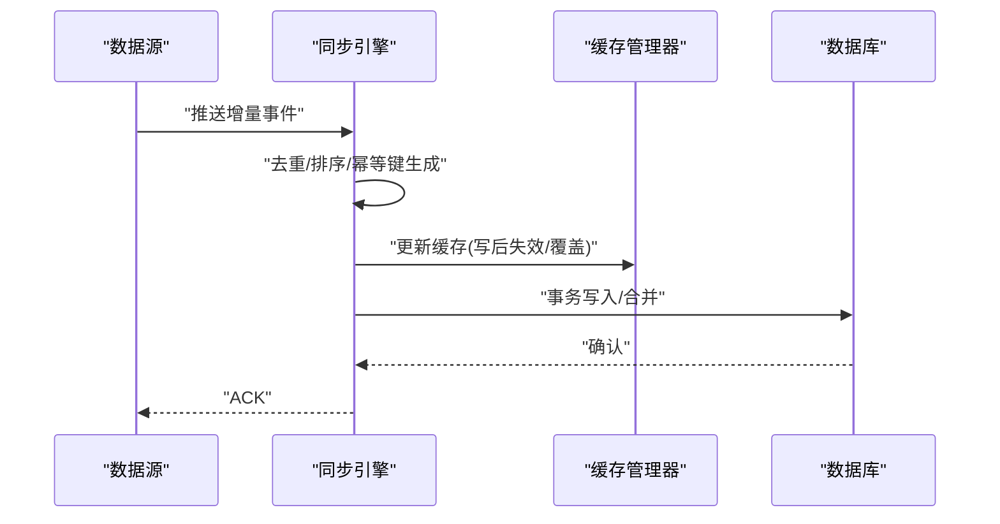
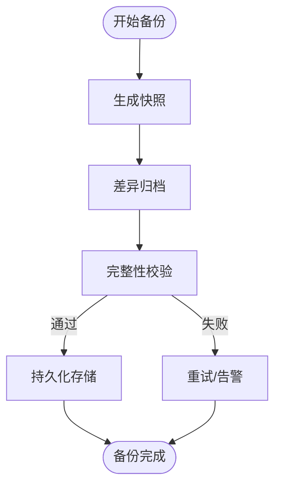
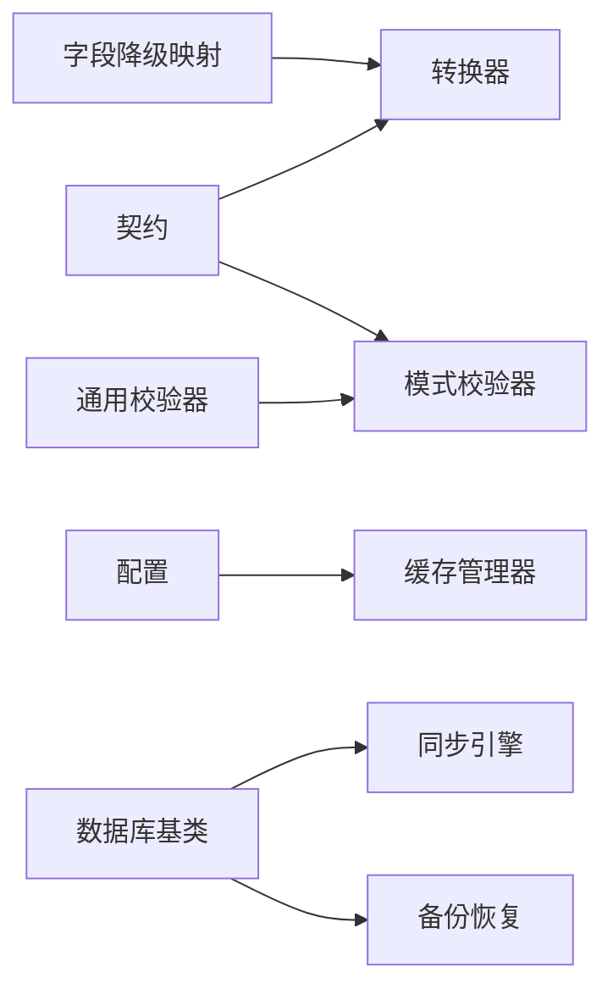

# 数据处理与转换

<cite>
**本文引用的文件**   
- [backend/app/services/dreamweaver/_data_transformer.py](file://backend/app/services/dreamweaver/_data_transformer.py)
- [backend/app/services/dreamweaver/_schema_validator.py](file://backend/app/services/dreamweaver/_schema_validator.py)
- [backend/app/services/dreamweaver/_cache_manager.py](file://backend/app/services/dreamweaver/_cache_manager.py)
- [backend/app/services/dreamweaver/_sync_engine.py](file://backend/app/services/dreamweaver/_sync_engine.py)
- [backend/app/services/dreamweaver/_backup_restore.py](file://backend/app/services/dreamweaver/_backup_restore.py)
- [backend/app/schemas/dreamweaver_contract.py](file://backend/app/schemas/dreamweaver_contract.py)
- [core/mappers/field_degradation_mapper.py](file://core/mappers/field_degradation_mapper.py)
- [core/validators.py](file://core/validators.py)
- [backend/app/core/config.py](file://backend/app/core/config.py)
- [backend/app/db/base.py](file://backend/app/db/base.py)
</cite>

## 目录
1. [简介](#简介)
2. [项目结构](#项目结构)
3. [核心组件](#核心组件)
4. [架构总览](#架构总览)
5. [详细组件分析](#详细组件分析)
6. [依赖关系分析](#依赖关系分析)
7. [性能考量](#性能考量)
8. [故障排查指南](#故障排查指南)
9. [结论](#结论)
10. [附录](#附录)

## 简介
本文件面向“梦境编织者”的数据处理与转换子系统，聚焦以下能力：
- 数据格式转换、类型映射与序列化机制
- 数据验证规则、清洗流程与标准化处理
- 缓存策略、内存管理与性能优化技术
- 数据同步、增量更新与冲突解决算法
- 数据备份、恢复与迁移工具

该子系统贯穿后端服务层（services）、模式定义（schemas）、领域映射（mappers）与校验器（validators），为梦境编织者的多模态生成任务提供稳定、可观测、可扩展的数据管道。

## 项目结构
围绕数据处理与转换的关键代码主要分布在以下位置：
- 服务层：dreamweaver 子模块中的转换器、校验器、缓存管理器、同步引擎、备份恢复等
- 模式层：统一契约与请求/响应模型定义
- 领域层：字段降级映射与通用校验器
- 配置与持久化：应用配置、数据库基类

图表来源
- [backend/app/services/dreamweaver/_data_transformer.py](file://backend/app/services/dreamweaver/_data_transformer.py)
- [backend/app/services/dreamweaver/_schema_validator.py](file://backend/app/services/dreamweaver/_schema_validator.py)
- [backend/app/services/dreamweaver/_cache_manager.py](file://backend/app/services/dreamweaver/_cache_manager.py)
- [backend/app/services/dreamweaver/_sync_engine.py](file://backend/app/services/dreamweaver/_sync_engine.py)
- [backend/app/services/dreamweaver/_backup_restore.py](file://backend/app/services/dreamweaver/_backup_restore.py)
- [backend/app/schemas/dreamweaver_contract.py](file://backend/app/schemas/dreamweaver_contract.py)
- [core/mappers/field_degradation_mapper.py](file://core/mappers/field_degradation_mapper.py)
- [core/validators.py](file://core/validators.py)
- [backend/app/core/config.py](file://backend/app/core/config.py)
- [backend/app/db/base.py](file://backend/app/db/base.py)

章节来源
- [backend/app/services/dreamweaver/_data_transformer.py](file://backend/app/services/dreamweaver/_data_transformer.py)
- [backend/app/schemas/dreamweaver_contract.py](file://backend/app/schemas/dreamweaver_contract.py)
- [core/mappers/field_degradation_mapper.py](file://core/mappers/field_degradation_mapper.py)
- [core/validators.py](file://core/validators.py)
- [backend/app/core/config.py](file://backend/app/core/config.py)
- [backend/app/db/base.py](file://backend/app/db/base.py)

## 核心组件
- 数据转换器：负责不同版本/来源的输入到内部标准模型的转换，包含字段映射、类型归一化、缺失值填充与默认值注入。
- 模式校验器：基于统一契约对输入进行强校验，支持可选字段、枚举约束、范围检查与自定义规则。
- 缓存管理器：提供多级缓存（内存/外部存储）与键空间隔离，支持过期策略、命中率统计与回退路径。
- 同步引擎：实现增量更新、幂等写入、冲突检测与合并策略，保障多源数据一致性。
- 备份恢复：提供快照导出、差异归档、校验与恢复流程，支持断点续传与回滚。

章节来源
- [backend/app/services/dreamweaver/_data_transformer.py](file://backend/app/services/dreamweaver/_data_transformer.py)
- [backend/app/services/dreamweaver/_schema_validator.py](file://backend/app/services/dreamweaver/_schema_validator.py)
- [backend/app/services/dreamweaver/_cache_manager.py](file://backend/app/services/dreamweaver/_cache_manager.py)
- [backend/app/services/dreamweaver/_sync_engine.py](file://backend/app/services/dreamweaver/_sync_engine.py)
- [backend/app/services/dreamweaver/_backup_restore.py](file://backend/app/services/dreamweaver/_backup_restore.py)

## 架构总览
下图展示从输入到落库的全链路流转，强调转换、校验、缓存、同步与备份恢复的协作关系。

图表来源
- [backend/app/services/dreamweaver/_schema_validator.py](file://backend/app/services/dreamweaver/_schema_validator.py)
- [backend/app/services/dreamweaver/_data_transformer.py](file://backend/app/services/dreamweaver/_data_transformer.py)
- [backend/app/services/dreamweaver/_cache_manager.py](file://backend/app/services/dreamweaver/_cache_manager.py)
- [backend/app/services/dreamweaver/_sync_engine.py](file://backend/app/services/dreamweaver/_sync_engine.py)
- [backend/app/services/dreamweaver/_backup_restore.py](file://backend/app/services/dreamweaver/_backup_restore.py)
- [backend/app/db/base.py](file://backend/app/db/base.py)

## 详细组件分析

### 数据格式转换与类型映射
- 目标：将异构输入（不同版本、不同来源）转换为内部标准模型，确保下游一致消费。
- 关键点：
  - 字段级映射：旧字段到新字段的命名与语义对齐，支持别名与复合字段拆分。
  - 类型归一化：字符串转数值、时间戳规范化、布尔值容错解析。
  - 缺失值处理：默认值注入、占位符替换、空集合初始化。
  - 向后兼容：保留历史字段并做降级映射，避免破坏性变更。

图表来源
- [backend/app/services/dreamweaver/_data_transformer.py](file://backend/app/services/dreamweaver/_data_transformer.py)
- [core/mappers/field_degradation_mapper.py](file://core/mappers/field_degradation_mapper.py)
- [backend/app/schemas/dreamweaver_contract.py](file://backend/app/schemas/dreamweaver_contract.py)

章节来源
- [backend/app/services/dreamweaver/_data_transformer.py](file://backend/app/services/dreamweaver/_data_transformer.py)
- [core/mappers/field_degradation_mapper.py](file://core/mappers/field_degradation_mapper.py)
- [backend/app/schemas/dreamweaver_contract.py](file://backend/app/schemas/dreamweaver_contract.py)

### 数据验证规则与清洗标准化
- 目标：在转换前后实施严格校验，保证数据质量与一致性。
- 关键点：
  - 必填项、枚举、范围、长度、格式等基础约束。
  - 跨字段联合校验（如开始时间不得晚于结束时间）。
  - 清洗规则：去空白、编码统一、非法字符过滤、重复项去重。
  - 标准化：单位换算、时区统一、ID 规范化。

图表来源
- [backend/app/services/dreamweaver/_schema_validator.py](file://backend/app/services/dreamweaver/_schema_validator.py)
- [core/validators.py](file://core/validators.py)
- [backend/app/schemas/dreamweaver_contract.py](file://backend/app/schemas/dreamweaver_contract.py)

章节来源
- [backend/app/services/dreamweaver/_schema_validator.py](file://backend/app/services/dreamweaver/_schema_validator.py)
- [core/validators.py](file://core/validators.py)
- [backend/app/schemas/dreamweaver_contract.py](file://backend/app/schemas/dreamweaver_contract.py)

### 序列化机制
- 目标：在接口层与持久化层之间进行高效、安全的序列化和反序列化。
- 关键点：
  - 使用统一契约作为序列化边界，避免隐式依赖。
  - 支持部分字段序列化（按需裁剪），减少网络传输开销。
  - 兼容历史版本：新增字段默认值、废弃字段兼容读取。
  - 安全校验：防止反序列化攻击与畸形负载。

章节来源
- [backend/app/schemas/dreamweaver_contract.py](file://backend/app/schemas/dreamweaver_contract.py)
- [core/validators.py](file://core/validators.py)

### 缓存策略、内存管理与性能优化
- 目标：降低重复计算与 I/O 成本，提升吞吐与延迟表现。
- 关键点：
  - 多级缓存：进程内字典 + 外部缓存（如 Redis），按业务域划分键空间。
  - 过期策略：TTL、LRU/LFU 淘汰、热点保护。
  - 写路径：先写缓存再异步落库，或写后失效；读路径优先缓存，未命中回源。
  - 内存管理：限制单条记录大小、批量操作、流式处理大对象。
  - 监控指标：命中率、延迟分位、内存占用、GC 压力。

图表来源
- [backend/app/services/dreamweaver/_cache_manager.py](file://backend/app/services/dreamweaver/_cache_manager.py)
- [backend/app/core/config.py](file://backend/app/core/config.py)

章节来源
- [backend/app/services/dreamweaver/_cache_manager.py](file://backend/app/services/dreamweaver/_cache_manager.py)
- [backend/app/core/config.py](file://backend/app/core/config.py)

### 数据同步、增量更新与冲突解决
- 目标：在多源或多副本场景下保持最终一致性，支持增量更新与冲突合并。
- 关键点：
  - 增量识别：基于时间戳、版本号或变更日志（CDC）捕获差异。
  - 幂等写入：以唯一键为准，避免重复与乱序影响。
  - 冲突检测：字段级对比、哈希校验、逻辑冲突判定。
  - 合并策略：最后写入胜出、字段级合并、人工介入标记。

图表来源
- [backend/app/services/dreamweaver/_sync_engine.py](file://backend/app/services/dreamweaver/_sync_engine.py)
- [backend/app/services/dreamweaver/_cache_manager.py](file://backend/app/services/dreamweaver/_cache_manager.py)
- [backend/app/db/base.py](file://backend/app/db/base.py)

章节来源
- [backend/app/services/dreamweaver/_sync_engine.py](file://backend/app/services/dreamweaver/_sync_engine.py)
- [backend/app/services/dreamweaver/_cache_manager.py](file://backend/app/services/dreamweaver/_cache_manager.py)
- [backend/app/db/base.py](file://backend/app/db/base.py)

### 数据备份、恢复与迁移工具
- 目标：提供可靠的数据保护与迁移能力，支持全量与增量备份、校验与恢复。
- 关键点：
  - 快照导出：结构化导出元数据与关联资源索引。
  - 差异归档：仅记录变更片段，降低存储与带宽消耗。
  - 完整性校验：哈希校验、行数比对、抽样还原验证。
  - 恢复流程：预检、回滚点创建、分批导入、异常重试。
  - 迁移脚本：版本间字段演进、数据回填与兼容性修复。

图表来源
- [backend/app/services/dreamweaver/_backup_restore.py](file://backend/app/services/dreamweaver/_backup_restore.py)

章节来源
- [backend/app/services/dreamweaver/_backup_restore.py](file://backend/app/services/dreamweaver/_backup_restore.py)

## 依赖关系分析
- 低耦合高内聚：各组件职责清晰，通过明确接口交互，避免循环依赖。
- 关键依赖链：
  - 转换器依赖模式契约与字段降级映射，确保兼容性与稳定性。
  - 校验器依赖通用校验器与契约，形成统一的规则体系。
  - 缓存管理器依赖配置，控制行为与资源上限。
  - 同步引擎依赖数据库基类，保障事务与一致性。
  - 备份恢复依赖数据库与文件系统，确保可恢复性。

图表来源
- [backend/app/schemas/dreamweaver_contract.py](file://backend/app/schemas/dreamweaver_contract.py)
- [core/mappers/field_degradation_mapper.py](file://core/mappers/field_degradation_mapper.py)
- [core/validators.py](file://core/validators.py)
- [backend/app/services/dreamweaver/_data_transformer.py](file://backend/app/services/dreamweaver/_data_transformer.py)
- [backend/app/services/dreamweaver/_schema_validator.py](file://backend/app/services/dreamweaver/_schema_validator.py)
- [backend/app/services/dreamweaver/_cache_manager.py](file://backend/app/services/dreamweaver/_cache_manager.py)
- [backend/app/services/dreamweaver/_sync_engine.py](file://backend/app/services/dreamweaver/_sync_engine.py)
- [backend/app/services/dreamweaver/_backup_restore.py](file://backend/app/services/dreamweaver/_backup_restore.py)
- [backend/app/db/base.py](file://backend/app/db/base.py)
- [backend/app/core/config.py](file://backend/app/core/config.py)

章节来源
- [backend/app/schemas/dreamweaver_contract.py](file://backend/app/schemas/dreamweaver_contract.py)
- [core/mappers/field_degradation_mapper.py](file://core/mappers/field_degradation_mapper.py)
- [core/validators.py](file://core/validators.py)
- [backend/app/services/dreamweaver/_data_transformer.py](file://backend/app/services/dreamweaver/_data_transformer.py)
- [backend/app/services/dreamweaver/_schema_validator.py](file://backend/app/services/dreamweaver/_schema_validator.py)
- [backend/app/services/dreamweaver/_cache_manager.py](file://backend/app/services/dreamweaver/_cache_manager.py)
- [backend/app/services/dreamweaver/_sync_engine.py](file://backend/app/services/dreamweaver/_sync_engine.py)
- [backend/app/services/dreamweaver/_backup_restore.py](file://backend/app/services/dreamweaver/_backup_restore.py)
- [backend/app/db/base.py](file://backend/app/db/base.py)
- [backend/app/core/config.py](file://backend/app/core/config.py)

## 性能考量
- 转换阶段：
  - 批量转换与流式处理，避免一次性加载大对象。
  - 复用映射表与正则表达式，减少重复编译与查找。
- 校验阶段：
  - 短路校验，尽早失败；复杂规则异步化或延迟执行。
- 缓存阶段：
  - 合理设置 TTL 与容量上限，避免内存膨胀。
  - 热点键保护与本地缓存预热。
- 同步阶段：
  - 批写入与事务合并，减少锁竞争。
  - 冲突检测采用轻量哈希与增量比较。
- 监控与调优：
  - 埋点关键指标（QPS、延迟、命中率、错误率）。
  - 定期压测与容量规划，动态扩缩容。

[本节为通用指导，不直接分析具体文件]

## 故障排查指南
- 常见错误定位：
  - 校验失败：检查字段类型、必填项、枚举值与范围约束。
  - 转换异常：核对字段映射表与默认值策略，确认历史兼容。
  - 缓存问题：查看命中率、键冲突、过期策略与后端连通性。
  - 同步冲突：分析冲突检测规则与合并策略，必要时人工介入。
  - 备份恢复：校验完整性、回滚点与恢复顺序。
- 诊断手段：
  - 启用详细日志与追踪 ID，串联上下游调用。
  - 使用最小复现用例与测试集快速定位。
  - 结合监控面板观察资源水位与瓶颈点。

章节来源
- [backend/app/services/dreamweaver/_schema_validator.py](file://backend/app/services/dreamweaver/_schema_validator.py)
- [backend/app/services/dreamweaver/_data_transformer.py](file://backend/app/services/dreamweaver/_data_transformer.py)
- [backend/app/services/dreamweaver/_cache_manager.py](file://backend/app/services/dreamweaver/_cache_manager.py)
- [backend/app/services/dreamweaver/_sync_engine.py](file://backend/app/services/dreamweaver/_sync_engine.py)
- [backend/app/services/dreamweaver/_backup_restore.py](file://backend/app/services/dreamweaver/_backup_restore.py)

## 结论
“梦境编织者”数据处理与转换子系统通过清晰的职责划分与稳健的机制设计，实现了从输入到落库的高质量数据流水线。其核心价值在于：
- 强大的格式转换与类型映射能力，保障多源异构数据的统一消费
- 严格的校验与清洗标准化，提升数据质量与一致性
- 高效的缓存与内存管理，优化系统性能与资源利用率
- 可靠的同步与冲突解决，确保多副本最终一致
- 完善的备份恢复与迁移工具，保障数据安全与可演进性

建议在生产环境中持续完善监控与自动化测试，结合压测与容量规划，进一步提升系统的稳定性与扩展性。

[本节为总结性内容，不直接分析具体文件]

## 附录
- 术语说明：
  - 标准模型：内部统一的数据表示形式
  - 幂等写入：多次执行与一次执行效果相同
  - CDC：变更数据捕获
  - TTL：存活时间
- 参考实践：
  - 字段降级映射用于平滑版本升级
  - 写后失效与读写穿透策略选择
  - 增量同步中冲突检测与合并策略权衡

[本节为补充信息，不直接分析具体文件]