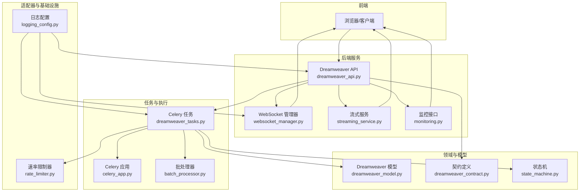
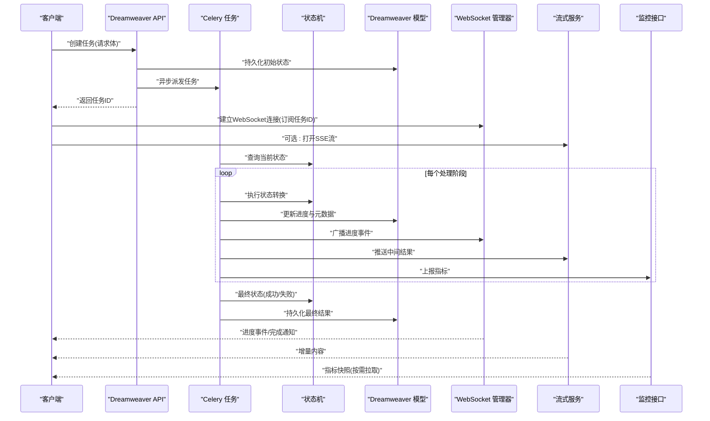
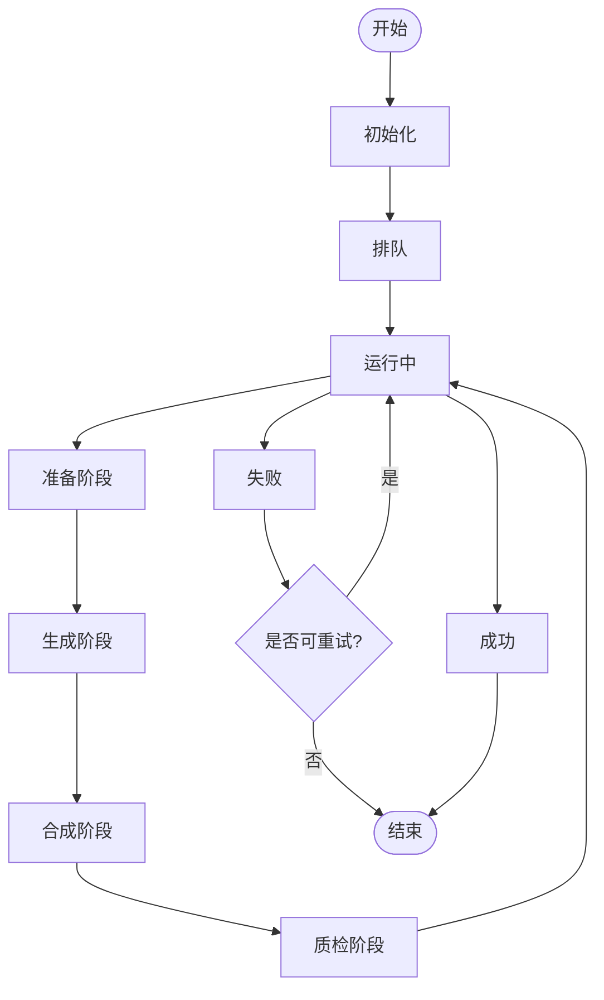
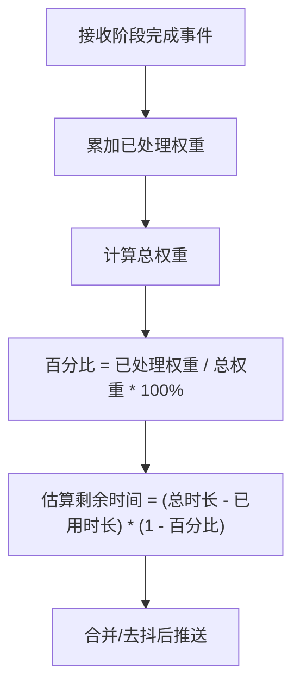
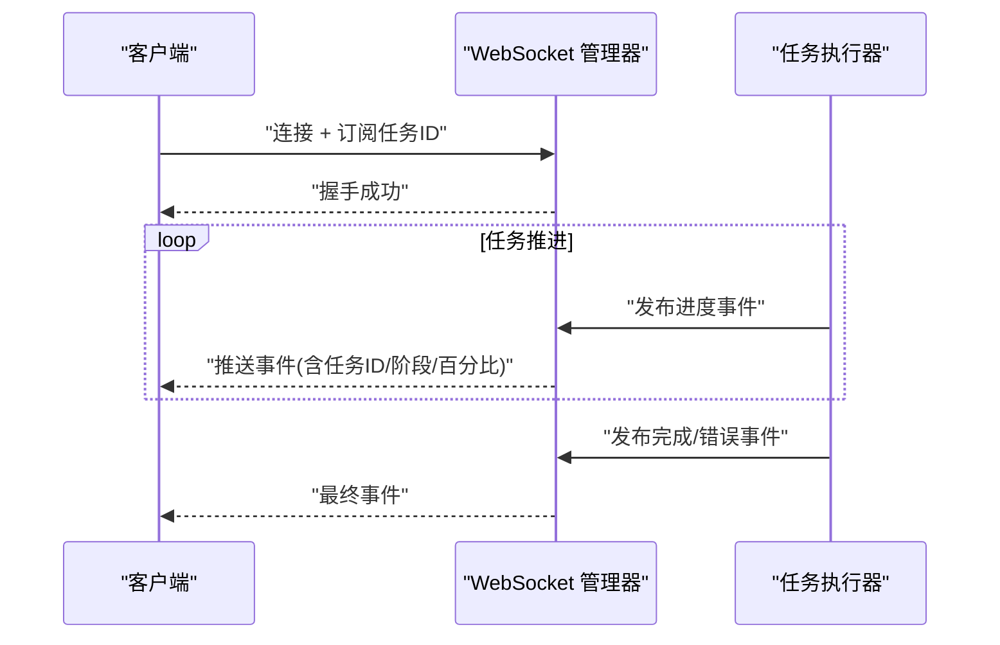
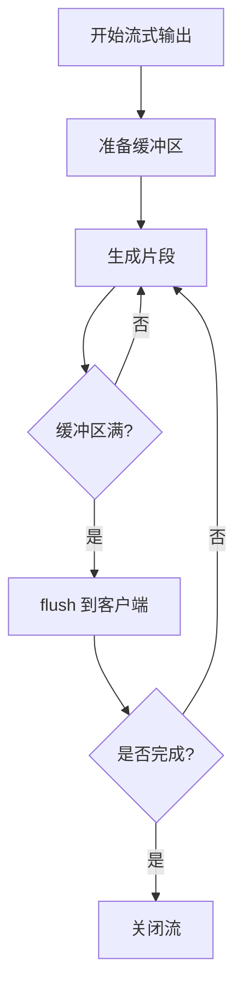
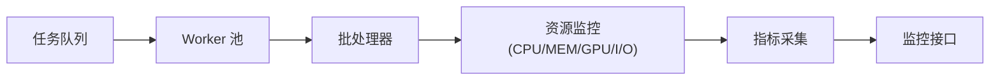
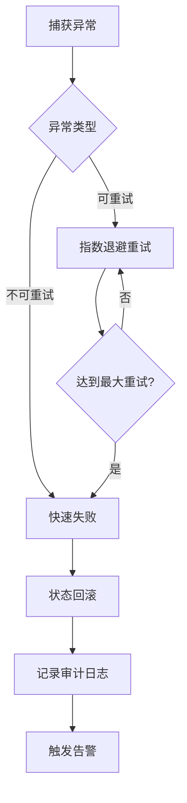
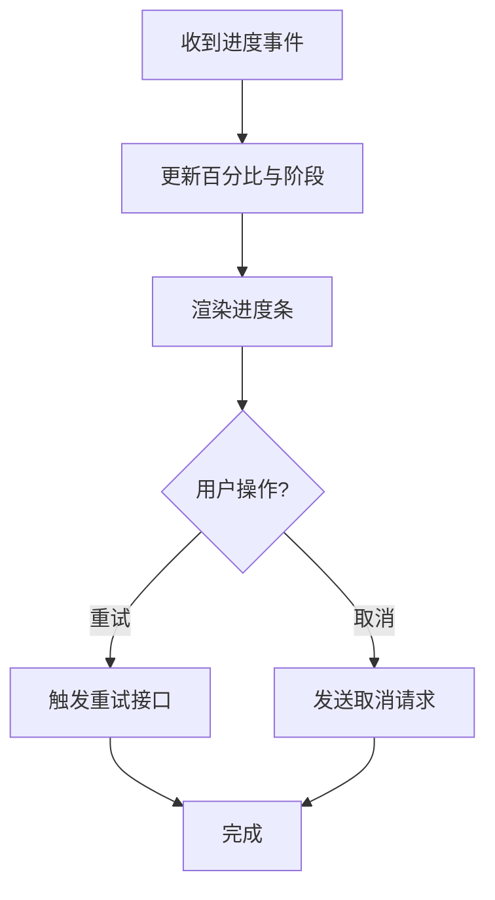
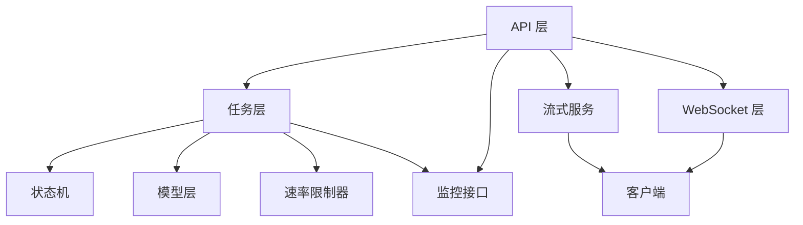

# 进度监控与状态管理

<cite>
**本文档引用的文件**   
- [dreamweaver.py](file://agents/dreamweaver.py)
- [dreamweaver_tasks.py](file://backend/app/tasks/dreamweaver_tasks.py)
- [dreamweaver_api.py](file://backend/app/api/v1/dreamweaver_api/dreamweaver.py)
- [dreamweaver_contract.py](file://backend/app/schemas/dreamweaver_contract.py)
- [dreamweaver_model.py](file://backend/app/models/dreamweaver.py)
- [websocket_manager.py](file://backend/app/websocket/manager.py)
- [state_machine.py](file://pipeline/state_machine.py)
- [monitoring.py](file://backend/app/api/v1/monitoring.py)
- [celery_app.py](file://backend/app/celery_app.py)
- [streaming_service.py](file://backend/app/services/streaming_service.py)
- [batch_processor.py](file://backend/app/services/batch_processor.py)
- [rate_limiter.py](file://adapters/rate_limiter.py)
- [logging_config.py](file://core/logging_config.py)
</cite>

## 目录
1. [简介](#简介)
2. [项目结构](#项目结构)
3. [核心组件](#核心组件)
4. [架构总览](#架构总览)
5. [详细组件分析](#详细组件分析)
6. [依赖关系分析](#依赖关系分析)
7. [性能考量](#性能考量)
8. [故障排查指南](#故障排查指南)
9. [结论](#结论)
10. [附录](#附录)

## 简介
本文件面向“梦境编织者”任务的进度监控与状态管理，覆盖以下关键能力：
- 实时进度跟踪与状态更新机制
- WebSocket 通信协议与事件推送
- 任务状态机设计与状态转换规则
- 异常处理策略与错误诊断
- 进度条显示、百分比计算与时间预估算法
- 并发任务管理、资源监控与性能指标采集
- 日志查看与问题定位工具

## 项目结构
围绕进度监控与状态管理的代码主要分布在后端服务、任务调度、WebSocket 通道、状态机与监控接口等模块中。下图展示了与“梦境编织者”任务进度相关的关键文件及其职责。

图表来源
- [dreamweaver_api.py](file://backend/app/api/v1/dreamweaver_api/dreamweaver.py)
- [websocket_manager.py](file://backend/app/websocket/manager.py)
- [streaming_service.py](file://backend/app/services/streaming_service.py)
- [monitoring.py](file://backend/app/api/v1/monitoring.py)
- [dreamweaver_tasks.py](file://backend/app/tasks/dreamweaver_tasks.py)
- [celery_app.py](file://backend/app/celery_app.py)
- [batch_processor.py](file://backend/app/services/batch_processor.py)
- [dreamweaver_model.py](file://backend/app/models/dreamweaver.py)
- [dreamweaver_contract.py](file://backend/app/schemas/dreamweaver_contract.py)
- [state_machine.py](file://pipeline/state_machine.py)
- [rate_limiter.py](file://adapters/rate_limiter.py)
- [logging_config.py](file://core/logging_config.py)

章节来源
- [dreamweaver_api.py](file://backend/app/api/v1/dreamweaver_api/dreamweaver.py)
- [dreamweaver_tasks.py](file://backend/app/tasks/dreamweaver_tasks.py)
- [websocket_manager.py](file://backend/app/websocket/manager.py)
- [streaming_service.py](file://backend/app/services/streaming_service.py)
- [monitoring.py](file://backend/app/api/v1/monitoring.py)
- [celery_app.py](file://backend/app/celery_app.py)
- [batch_processor.py](file://backend/app/services/batch_processor.py)
- [dreamweaver_model.py](file://backend/app/models/dreamweaver.py)
- [dreamweaver_contract.py](file://backend/app/schemas/dreamweaver_contract.py)
- [state_machine.py](file://pipeline/state_machine.py)
- [rate_limiter.py](file://adapters/rate_limiter.py)
- [logging_config.py](file://core/logging_config.py)

## 核心组件
- Dreamweaver 任务编排与执行：负责创建、调度与追踪“梦境编织者”任务的生命周期，驱动状态机推进并持久化进度。
- WebSocket 管理器：维护连接与会话，按任务维度广播进度事件，支持断线重连与消息去抖。
- 流式服务：提供 SSE/WS 流式输出，将长耗时步骤的中间结果增量推送至前端。
- 监控接口：暴露系统级与任务级指标（队列长度、吞吐、延迟、错误率），供仪表盘展示。
- 状态机：定义任务阶段、状态集合与合法转换规则，确保一致性。
- 契约与模型：统一前后端数据结构与数据库映射，保证进度字段与事件格式一致。
- 批处理器与速率限制器：控制并发度与外部调用限流，保障稳定性。
- 日志配置：集中化日志输出，便于问题定位与审计。

章节来源
- [dreamweaver_tasks.py](file://backend/app/tasks/dreamweaver_tasks.py)
- [websocket_manager.py](file://backend/app/websocket/manager.py)
- [streaming_service.py](file://backend/app/services/streaming_service.py)
- [monitoring.py](file://backend/app/api/v1/monitoring.py)
- [state_machine.py](file://pipeline/state_machine.py)
- [dreamweaver_contract.py](file://backend/app/schemas/dreamweaver_contract.py)
- [dreamweaver_model.py](file://backend/app/models/dreamweaver.py)
- [batch_processor.py](file://backend/app/services/batch_processor.py)
- [rate_limiter.py](file://adapters/rate_limiter.py)
- [logging_config.py](file://core/logging_config.py)

## 架构总览
下图展示了从前端发起任务到实时进度更新的端到端流程，包括 API 路由、任务调度、状态机推进、WebSocket/SSE 推送以及监控数据采集。

图表来源
- [dreamweaver_api.py](file://backend/app/api/v1/dreamweaver_api/dreamweaver.py)
- [dreamweaver_tasks.py](file://backend/app/tasks/dreamweaver_tasks.py)
- [celery_app.py](file://backend/app/celery_app.py)
- [state_machine.py](file://pipeline/state_machine.py)
- [dreamweaver_model.py](file://backend/app/models/dreamweaver.py)
- [websocket_manager.py](file://backend/app/websocket/manager.py)
- [streaming_service.py](file://backend/app/services/streaming_service.py)
- [monitoring.py](file://backend/app/api/v1/monitoring.py)

## 详细组件分析

### 任务状态机设计
- 状态集合：包含初始化、排队、运行中、子阶段（如准备、生成、合成、质检）、成功、失败、取消等。
- 转换规则：仅允许在预定义的合法路径上切换，例如运行中→子阶段→运行中→成功/失败；失败可回退到可重试子阶段。
- 幂等性：同一任务的状态变更需基于版本号或事务锁，避免重复推进。
- 可观测性：每次转换记录原因、耗时与上下文，便于审计与回溯。

图表来源
- [state_machine.py](file://pipeline/state_machine.py)

章节来源
- [state_machine.py](file://pipeline/state_machine.py)

### 进度跟踪与百分比计算
- 进度粒度：以阶段为单位，结合子步骤权重计算整体百分比。
- 权重分配：根据阶段复杂度与耗时历史动态调整权重，提高预估准确性。
- 平滑更新：对高频事件进行去抖与合并，降低前端渲染压力。
- 时间预估：基于历史平均耗时与剩余工作量估算剩余时间，并在阶段切换时刷新。

图表来源
- [dreamweaver_tasks.py](file://backend/app/tasks/dreamweaver_tasks.py)
- [streaming_service.py](file://backend/app/services/streaming_service.py)

章节来源
- [dreamweaver_tasks.py](file://backend/app/tasks/dreamweaver_tasks.py)
- [streaming_service.py](file://backend/app/services/streaming_service.py)

### WebSocket 通信协议
- 连接建立：客户端通过任务ID建立连接，服务端登记会话与订阅列表。
- 事件类型：进度更新、阶段切换、错误告警、完成通知、心跳保活。
- 可靠性：支持断线重连、消息序号与去重、背压与限流。
- 订阅过滤：按任务ID与事件类型过滤，减少无关流量。

图表来源
- [websocket_manager.py](file://backend/app/websocket/manager.py)
- [dreamweaver_tasks.py](file://backend/app/tasks/dreamweaver_tasks.py)

章节来源
- [websocket_manager.py](file://backend/app/websocket/manager.py)
- [dreamweaver_tasks.py](file://backend/app/tasks/dreamweaver_tasks.py)

### 流式服务与中间结果推送
- 增量输出：将长耗时步骤的中间产物分片推送，提升用户体验。
- 缓冲策略：内存缓冲与落盘策略结合，防止大对象阻塞。
- 错误恢复：流中断时支持断点续传与重试。

图表来源
- [streaming_service.py](file://backend/app/services/streaming_service.py)

章节来源
- [streaming_service.py](file://backend/app/services/streaming_service.py)

### 并发任务管理与资源监控
- 并发控制：通过 Celery Worker 池与批处理器限制并行度，避免资源争用。
- 资源监控：采集 CPU、内存、GPU、I/O 与外部 API 调用指标。
- 指标上报：定时上报至监控系统，支持告警与容量规划。

图表来源
- [celery_app.py](file://backend/app/celery_app.py)
- [batch_processor.py](file://backend/app/services/batch_processor.py)
- [monitoring.py](file://backend/app/api/v1/monitoring.py)

章节来源
- [celery_app.py](file://backend/app/celery_app.py)
- [batch_processor.py](file://backend/app/services/batch_processor.py)
- [monitoring.py](file://backend/app/api/v1/monitoring.py)

### 异常处理策略
- 分类处理：网络超时、外部服务限流、资源不足、业务校验失败等分别处理。
- 重试与降级：指数退避重试、熔断与降级策略，保障可用性。
- 状态回滚：失败时回滚到最近稳定状态，保留可恢复上下文。
- 告警与审计：关键异常触发告警，记录审计日志。

图表来源
- [dreamweaver_tasks.py](file://backend/app/tasks/dreamweaver_tasks.py)
- [rate_limiter.py](file://adapters/rate_limiter.py)

章节来源
- [dreamweaver_tasks.py](file://backend/app/tasks/dreamweaver_tasks.py)
- [rate_limiter.py](file://adapters/rate_limiter.py)

### 进度条显示与前端集成建议
- 进度条：基于百分比与阶段名称渲染，支持分段颜色区分。
- 实时更新：WebSocket 事件驱动，SSE 作为备选。
- 交互反馈：失败时显示错误原因与重试按钮，成功时提供下载入口。

图表来源
- [websocket_manager.py](file://backend/app/websocket/manager.py)
- [streaming_service.py](file://backend/app/services/streaming_service.py)

章节来源
- [websocket_manager.py](file://backend/app/websocket/manager.py)
- [streaming_service.py](file://backend/app/services/streaming_service.py)

## 依赖关系分析
- API 层依赖任务调度、WebSocket 与流式服务，同时读取契约与模型定义。
- 任务层依赖状态机、模型持久化、速率限制器与监控上报。
- WebSocket 与流式服务依赖连接管理与事件分发。
- 监控接口聚合系统级与任务级指标。

图表来源
- [dreamweaver_api.py](file://backend/app/api/v1/dreamweaver_api/dreamweaver.py)
- [dreamweaver_tasks.py](file://backend/app/tasks/dreamweaver_tasks.py)
- [websocket_manager.py](file://backend/app/websocket/manager.py)
- [streaming_service.py](file://backend/app/services/streaming_service.py)
- [monitoring.py](file://backend/app/api/v1/monitoring.py)
- [state_machine.py](file://pipeline/state_machine.py)
- [dreamweaver_model.py](file://backend/app/models/dreamweaver.py)
- [rate_limiter.py](file://adapters/rate_limiter.py)

章节来源
- [dreamweaver_api.py](file://backend/app/api/v1/dreamweaver_api/dreamweaver.py)
- [dreamweaver_tasks.py](file://backend/app/tasks/dreamweaver_tasks.py)
- [websocket_manager.py](file://backend/app/websocket/manager.py)
- [streaming_service.py](file://backend/app/services/streaming_service.py)
- [monitoring.py](file://backend/app/api/v1/monitoring.py)
- [state_machine.py](file://pipeline/state_machine.py)
- [dreamweaver_model.py](file://backend/app/models/dreamweaver.py)
- [rate_limiter.py](file://adapters/rate_limiter.py)

## 性能考量
- 事件合并与去抖：减少高频推送对前端的压力。
- 批量写入：进度与指标批量持久化，降低 I/O 开销。
- 缓存热点：常用配置与模型信息缓存，缩短冷启动时间。
- 限流与熔断：保护外部服务与内部资源，避免雪崩。
- 水平扩展：Celery Worker 与 WebSocket 节点弹性扩容。

[本节为通用指导，不直接分析具体文件]

## 故障排查指南
- 常见问题
  - WebSocket 断连：检查心跳与重连逻辑，确认订阅列表与权限。
  - 进度停滞：核对状态机转换合法性与幂等锁，查看任务日志。
  - 指标缺失：确认监控上报链路是否正常，检查采样频率。
- 日志查看
  - 集中日志：通过日志配置查看任务、API、WebSocket 与监控相关日志。
  - 审计日志：关注状态转换与异常事件的审计记录。
- 诊断工具
  - 监控接口：拉取系统指标与任务指标，辅助定位瓶颈。
  - 测试脚本：使用现有验证脚本复现问题，收集证据。

章节来源
- [logging_config.py](file://core/logging_config.py)
- [monitoring.py](file://backend/app/api/v1/monitoring.py)
- [dreamweaver_tasks.py](file://backend/app/tasks/dreamweaver_tasks.py)
- [websocket_manager.py](file://backend/app/websocket/manager.py)

## 结论
“梦境编织者”任务的进度监控与状态管理通过状态机、WebSocket/SSE 流式推送、监控接口与批处理限流等组件协同工作，实现了高可靠、可观测与可扩展的任务执行体验。建议在后续迭代中持续优化事件去抖、时间预估与资源利用率，完善告警与自愈能力。

[本节为总结，不直接分析具体文件]

## 附录
- 术语表
  - 状态机：定义任务状态与转换规则的有限状态自动机。
  - WebSocket：全双工通信协议，用于实时事件推送。
  - SSE：服务器发送事件，用于单向流式推送。
  - 批处理：将多个操作合并执行以提升吞吐。
  - 限流：控制请求速率以避免过载。
- 参考实现路径
  - 任务编排与执行：[dreamweaver_tasks.py](file://backend/app/tasks/dreamweaver_tasks.py)
  - WebSocket 管理器：[websocket_manager.py](file://backend/app/websocket/manager.py)
  - 流式服务：[streaming_service.py](file://backend/app/services/streaming_service.py)
  - 监控接口：[monitoring.py](file://backend/app/api/v1/monitoring.py)
  - 状态机：[state_machine.py](file://pipeline/state_machine.py)
  - 契约与模型：[dreamweaver_contract.py](file://backend/app/schemas/dreamweaver_contract.py), [dreamweaver_model.py](file://backend/app/models/dreamweaver.py)
  - 批处理与限流：[batch_processor.py](file://backend/app/services/batch_processor.py), [rate_limiter.py](file://adapters/rate_limiter.py)
  - 日志配置：[logging_config.py](file://core/logging_config.py)

[本节为附录，不直接分析具体文件]