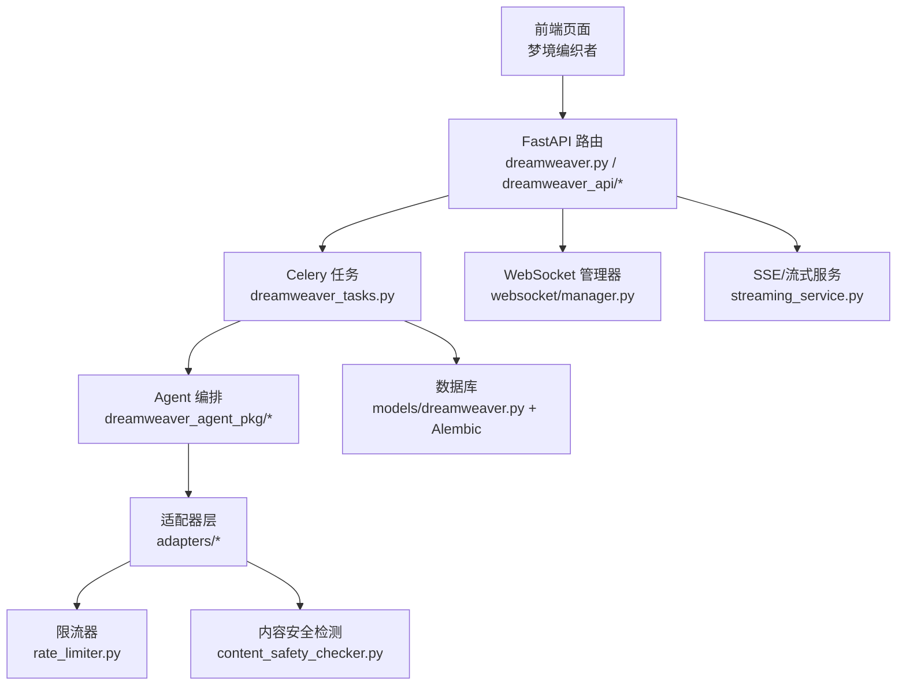
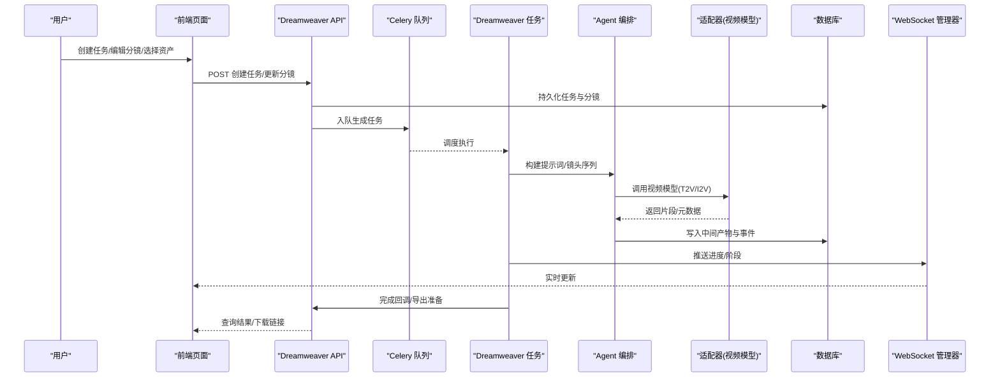
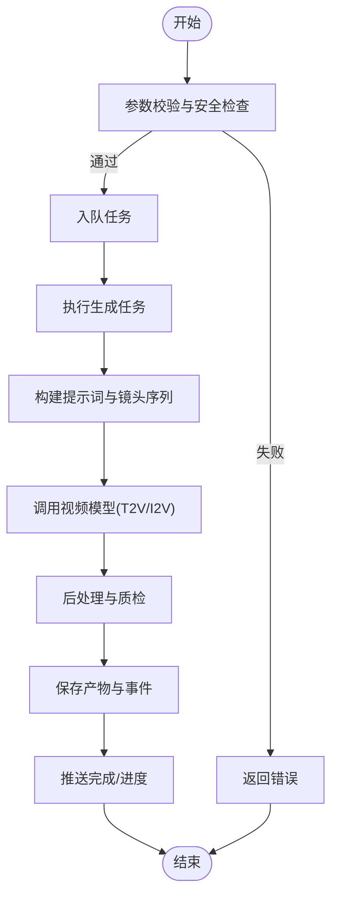
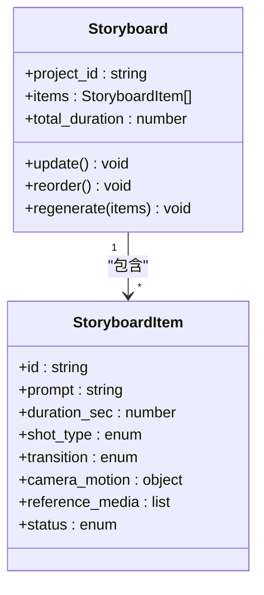
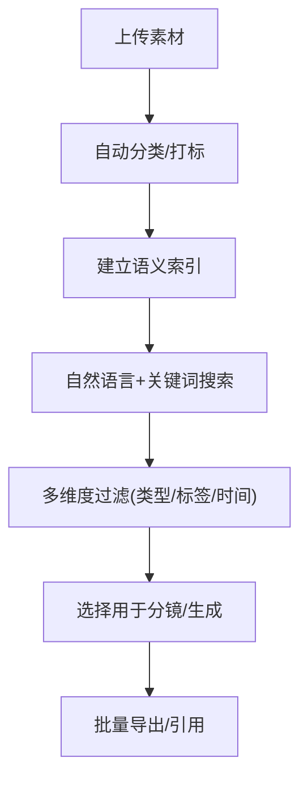
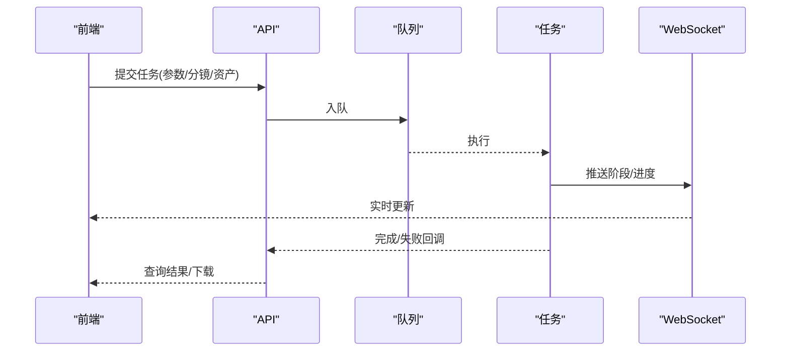
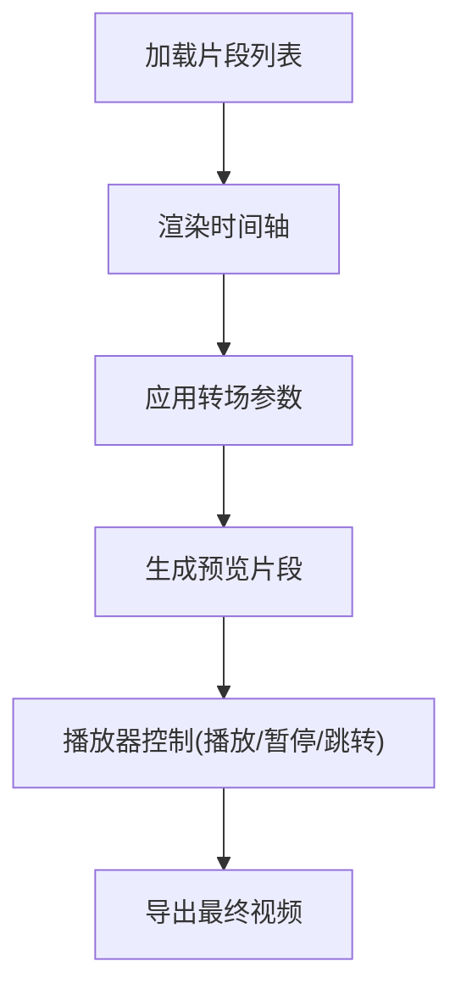
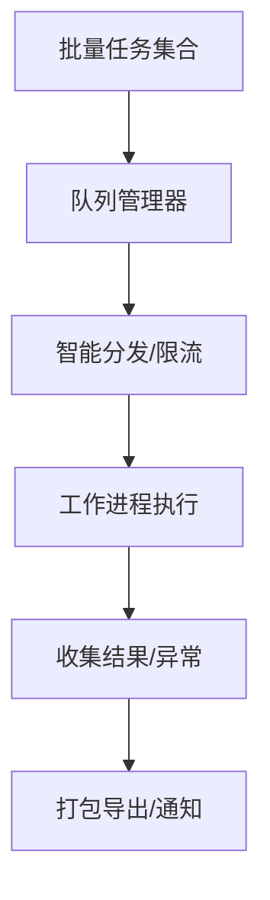
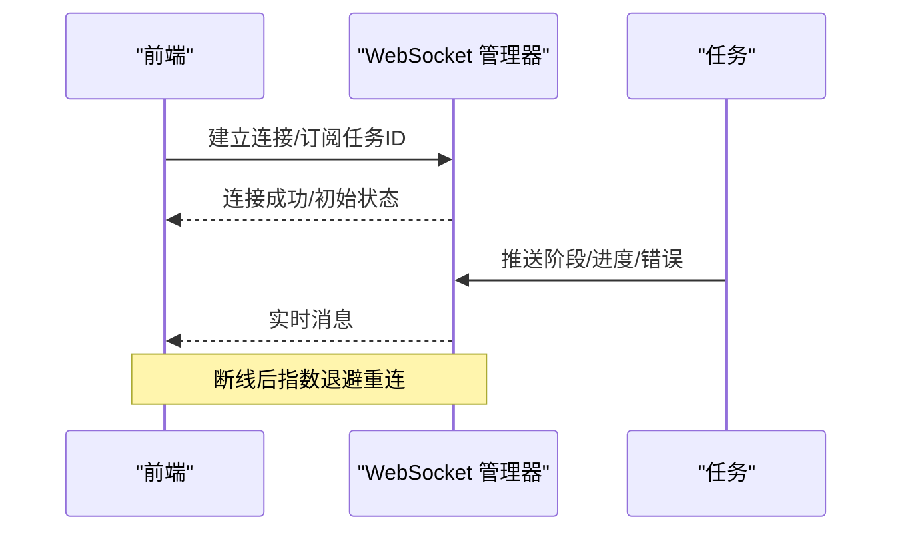
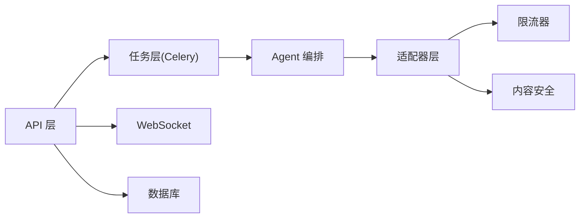

# 梦境编织者页面

<cite>
**本文引用的文件**   
- [dreamweaver.py](file://backend/app/api/v1/dreamweaver.py)
- [dreamweaver_api/__init__.py](file://backend/app/api/v1/dreamweaver_api/__init__.py)
- [dreamweaver_tasks.py](file://backend/app/tasks/dreamweaver_tasks.py)
- [dreamweaver_contract.py](file://backend/app/schemas/dreamweaver_contract.py)
- [dreamweaver.py](file://backend/app/models/dreamweaver.py)
- [dreamweaver_agent_pkg/_run.py](file://agents/dreamweaver_agent_pkg/_run.py)
- [dreamweaver_agent_pkg/_t2v_gen.py](file://agents/dreamweaver_agent_pkg/_t2v_gen.py)
- [dreamweaver_agent_pkg/_i2v_gen.py](file://agents/dreamweaver_agent_pkg/_i2v_gen.py)
- [storyboarder.py](file://agents/storyboarder.py)
- [storyboarder_pkg/_run.py](file://agents/storyboarder_pkg/_run.py)
- [asset_library.py](file://agents/asset_library.py)
- [semantic_asset_index.py](file://agents/semantic_asset_index.py)
- [batch_processor.py](file://backend/app/services/batch_processor.py)
- [streaming_service.py](file://backend/app/services/streaming_service.py)
- [websocket/manager.py](file://backend/app/websocket/manager.py)
- [rate_limiter.py](file://adapters/rate_limiter.py)
- [content_safety_checker.py](file://adapters/content_safety_checker.py)
- [celery_app.py](file://backend/app/celery_app.py)
- [main.py](file://backend/app/main.py)
</cite>

## 目录
1. [简介](#简介)
2. [项目结构](#项目结构)
3. [核心组件](#核心组件)
4. [架构总览](#架构总览)
5. [详细组件分析](#详细组件分析)
6. [依赖关系分析](#依赖关系分析)
7. [性能考量](#性能考量)
8. [故障排查指南](#故障排查指南)
9. [结论](#结论)
10. [附录](#附录)

## 简介
本文件为“梦境编织者”页面的功能文档，面向前端使用者与后端集成开发者。内容覆盖：
- 视频生成工作流（文本到视频、图像到视频）
- 分镜脚本编辑与镜头控制
- 资产库管理（分类、标签、搜索过滤）
- 任务创建界面、参数配置与进度监控
- 视频预览、帧间过渡效果与播放控制
- 批量处理、任务队列管理与结果导出
- 实时通信（WebSocket）、错误重试机制

## 项目结构
“梦境编织者”由前后端协同实现：
- 前端页面负责交互、参数配置、预览与状态展示
- 后端通过 FastAPI 暴露 API，Celery 驱动异步任务，WebSocket 推送进度
- Agent 层编排分镜、提示词优化与媒体生成
- 适配器层对接多种视频模型与外部服务
- 数据库持久化任务、资产元数据与运行事件

**图表来源** 
- [dreamweaver.py](file://backend/app/api/v1/dreamweaver.py)
- [dreamweaver_tasks.py](file://backend/app/tasks/dreamweaver_tasks.py)
- [dreamweaver_agent_pkg/_run.py](file://agents/dreamweaver_agent_pkg/_run.py)
- [websocket/manager.py](file://backend/app/websocket/manager.py)
- [streaming_service.py](file://backend/app/services/streaming_service.py)
- [rate_limiter.py](file://adapters/rate_limiter.py)
- [content_safety_checker.py](file://adapters/content_safety_checker.py)

**章节来源**
- [main.py](file://backend/app/main.py)
- [celery_app.py](file://backend/app/celery_app.py)

## 核心组件
- 视频生成工作流：支持文本到视频（T2V）与图像到视频（I2V），由 Agent 编排提示词、镜头与素材，调用适配器生成片段并合成。
- 分镜脚本编辑：结构化分镜项（镜头时长、景别、转场、提示词），可增量修改并重新生成。
- 资产库管理：按类型/场景/角色等维度组织素材，支持标签与语义索引检索。
- 任务与队列：通过 Celery 任务队列承载长耗时生成，提供进度查询与断点续跑。
- 预览与过渡：基于 FFmpeg 的帧间过渡与剪辑，支持多片段拼接与导出。
- 实时通信：WebSocket/SSE 推送任务阶段、进度与错误信息。
- 质量与安全：内容安全校验、速率限制与失败重试策略。

**章节来源**
- [dreamweaver_contract.py](file://backend/app/schemas/dreamweaver_contract.py)
- [dreamweaver.py](file://backend/app/models/dreamweaver.py)
- [dreamweaver_agent_pkg/_run.py](file://agents/dreamweaver_agent_pkg/_run.py)
- [dreamweaver_agent_pkg/_t2v_gen.py](file://agents/dreamweaver_agent_pkg/_t2v_gen.py)
- [dreamweaver_agent_pkg/_i2v_gen.py](file://agents/dreamweaver_agent_pkg/_i2v_gen.py)
- [storyboarder.py](file://agents/storyboarder.py)
- [storyboarder_pkg/_run.py](file://agents/storyboarder_pkg/_run.py)
- [asset_library.py](file://agents/asset_library.py)
- [semantic_asset_index.py](file://agents/semantic_asset_index.py)
- [batch_processor.py](file://backend/app/services/batch_processor.py)
- [streaming_service.py](file://backend/app/services/streaming_service.py)
- [websocket/manager.py](file://backend/app/websocket/manager.py)
- [rate_limiter.py](file://adapters/rate_limiter.py)
- [content_safety_checker.py](file://adapters/content_safety_checker.py)

## 架构总览
下图展示了从用户操作到最终导出的端到端流程，包括任务入队、Agent 编排、适配器调用、结果回写与实时通知。

**图表来源** 
- [dreamweaver.py](file://backend/app/api/v1/dreamweaver.py)
- [dreamweaver_tasks.py](file://backend/app/tasks/dreamweaver_tasks.py)
- [dreamweaver_agent_pkg/_run.py](file://agents/dreamweaver_agent_pkg/_run.py)
- [websocket/manager.py](file://backend/app/websocket/manager.py)
- [dreamweaver.py](file://backend/app/models/dreamweaver.py)

## 详细组件分析

### 视频生成工作流（T2V/I2V）
- 入口：API 接收任务请求，校验参数与配额，落库并入队。
- 编排：Agent 根据分镜与资产生成提示词，选择模型与参数，调用适配器。
- 适配：适配器封装不同厂商的视频模型接口，统一输入输出格式。
- 合成：将生成的片段按时间线拼接，应用转场与字幕/音频同步。
- 结果：产出视频文件与元数据，记录运行事件，供导出与回放。

**图表来源** 
- [dreamweaver_tasks.py](file://backend/app/tasks/dreamweaver_tasks.py)
- [dreamweaver_agent_pkg/_run.py](file://agents/dreamweaver_agent_pkg/_run.py)
- [dreamweaver_agent_pkg/_t2v_gen.py](file://agents/dreamweaver_agent_pkg/_t2v_gen.py)
- [dreamweaver_agent_pkg/_i2v_gen.py](file://agents/dreamweaver_agent_pkg/_i2v_gen.py)
- [content_safety_checker.py](file://adapters/content_safety_checker.py)

**章节来源**
- [dreamweaver_contract.py](file://backend/app/schemas/dreamweaver_contract.py)
- [dreamweaver_tasks.py](file://backend/app/tasks/dreamweaver_tasks.py)
- [dreamweaver_agent_pkg/_run.py](file://agents/dreamweaver_agent_pkg/_run.py)
- [dreamweaver_agent_pkg/_t2v_gen.py](file://agents/dreamweaver_agent_pkg/_t2v_gen.py)
- [dreamweaver_agent_pkg/_i2v_gen.py](file://agents/dreamweaver_agent_pkg/_i2v_gen.py)

### 分镜脚本编辑与镜头控制
- 数据结构：分镜项包含镜头描述、时长、景别、转场、参考图/视频、提示词等。
- 编辑能力：新增/删除/排序/合并分镜，动态调整时长与转场参数。
- 预览联动：分镜变更触发局部重生成，保持时间轴一致性。
- 镜头控制：支持推拉摇移等镜头运动指令，影响提示词与生成参数。

**图表来源** 
- [storyboarder.py](file://agents/storyboarder.py)
- [storyboarder_pkg/_run.py](file://agents/storyboarder_pkg/_run.py)

**章节来源**
- [storyboarder.py](file://agents/storyboarder.py)
- [storyboarder_pkg/_run.py](file://agents/storyboarder_pkg/_run.py)

### 资产库管理与搜索过滤
- 分类体系：按类型（角色/场景/道具/音效等）、主题、风格进行层级分类。
- 标签系统：多维标签（人物、情绪、环境、动作等），支持自定义扩展。
- 语义索引：向量索引加速自然语言检索，结合关键词过滤。
- 操作：上传、审核、打标、分组、批量导入/导出。

**图表来源** 
- [asset_library.py](file://agents/asset_library.py)
- [semantic_asset_index.py](file://agents/semantic_asset_index.py)

**章节来源**
- [asset_library.py](file://agents/asset_library.py)
- [semantic_asset_index.py](file://agents/semantic_asset_index.py)

### 任务创建界面、参数配置与进度监控
- 参数配置：分辨率、时长、帧率、模型选择、提示词权重、随机种子、并发数等。
- 进度监控：阶段化进度（排队、生成中、后处理、完成/失败），支持暂停/重试。
- 结果查看：预览播放器、下载链接、元数据详情、版本对比。

**图表来源** 
- [dreamweaver.py](file://backend/app/api/v1/dreamweaver.py)
- [dreamweaver_tasks.py](file://backend/app/tasks/dreamweaver_tasks.py)
- [websocket/manager.py](file://backend/app/websocket/manager.py)

**章节来源**
- [dreamweaver_contract.py](file://backend/app/schemas/dreamweaver_contract.py)
- [dreamweaver.py](file://backend/app/models/dreamweaver.py)

### 视频预览、帧间过渡与播放控制
- 预览：在线播放器支持倍速、循环、关键帧跳转。
- 过渡：基于 FFmpeg 的淡入淡出、滑动、缩放等转场效果。
- 控制：时间轴拖动、分段裁剪、静音/音轨切换。

**图表来源** 
- [dreamweaver_agent_pkg/_slideshow.py](file://agents/dreamweaver_agent_pkg/_slideshow.py)
- [pipeline/ffmpeg_runner.py](file://pipeline/ffmpeg_runner.py)

**章节来源**
- [pipeline/ffmpeg_runner.py](file://pipeline/ffmpeg_runner.py)

### 批量处理、任务队列管理与结果导出
- 批量处理：支持批量创建任务、批量替换资产、批量导出。
- 队列管理：优先级、并发限制、失败重试、死信队列。
- 结果导出：打包下载、分片导出、元数据导出（JSON/CSV）。

**图表来源** 
- [batch_processor.py](file://backend/app/services/batch_processor.py)
- [celery_app.py](file://backend/app/celery_app.py)
- [rate_limiter.py](file://adapters/rate_limiter.py)

**章节来源**
- [batch_processor.py](file://backend/app/services/batch_processor.py)
- [celery_app.py](file://backend/app/celery_app.py)
- [rate_limiter.py](file://adapters/rate_limiter.py)

### 实时通信、WebSocket 连接与错误重试
- WebSocket：建立连接后订阅任务通道，接收阶段、进度、错误消息。
- 重连策略：指数退避、心跳保活、断线恢复。
- 错误重试：对网络超时、模型限流、资源不足等场景进行可配置重试。

**图表来源** 
- [websocket/manager.py](file://backend/app/websocket/manager.py)
- [dreamweaver_tasks.py](file://backend/app/tasks/dreamweaver_tasks.py)

**章节来源**
- [websocket/manager.py](file://backend/app/websocket/manager.py)
- [dreamweaver_tasks.py](file://backend/app/tasks/dreamweaver_tasks.py)

## 依赖关系分析
- API 层依赖任务调度、WebSocket、数据库与适配器。
- Agent 层依赖分镜、资产、提示词与媒体运行时。
- 适配器层依赖限流、内容安全与外部模型服务。
- 任务层依赖 Celery、存储与事件总线。

**图表来源** 
- [dreamweaver.py](file://backend/app/api/v1/dreamweaver.py)
- [dreamweaver_tasks.py](file://backend/app/tasks/dreamweaver_tasks.py)
- [dreamweaver_agent_pkg/_run.py](file://agents/dreamweaver_agent_pkg/_run.py)
- [rate_limiter.py](file://adapters/rate_limiter.py)
- [content_safety_checker.py](file://adapters/content_safety_checker.py)

**章节来源**
- [dreamweaver.py](file://backend/app/api/v1/dreamweaver.py)
- [dreamweaver_tasks.py](file://backend/app/tasks/dreamweaver_tasks.py)
- [dreamweaver_agent_pkg/_run.py](file://agents/dreamweaver_agent_pkg/_run.py)

## 性能考量
- 并发与限流：通过 Celery 并发与适配器限流避免过载，保障稳定性。
- 缓存与复用：提示词与中间产物缓存，减少重复计算。
- 流式处理：大文件分块传输与边生成边预览，降低延迟。
- 资源隔离：任务隔离与资源配额，防止单任务占用过多资源。
- 存储优化：产物压缩与冷热分层，提升 I/O 效率。

[本节为通用指导，不直接分析具体文件]

## 故障排查指南
- 常见问题：
  - 任务卡住：检查队列堆积、Worker 健康、资源配额。
  - 生成失败：查看适配器日志、限流与内容安全拦截。
  - 预览异常：确认 FFmpeg 路径、转场参数与片段完整性。
  - 连接断开：检查 WebSocket 心跳、网络与代理设置。
- 定位手段：
  - 查看任务事件与运行日志
  - 检查数据库中的任务状态与中间产物
  - 使用调试工具验证适配器连通性

**章节来源**
- [dreamweaver_tasks.py](file://backend/app/tasks/dreamweaver_tasks.py)
- [dreamweaver.py](file://backend/app/models/dreamweaver.py)
- [content_safety_checker.py](file://adapters/content_safety_checker.py)
- [rate_limiter.py](file://adapters/rate_limiter.py)

## 结论
“梦境编织者”页面以清晰的职责划分与模块化设计，实现了从分镜编辑、资产管理到视频生成与导出的完整闭环。通过 Celery 任务队列、WebSocket 实时通信与适配器抽象，系统在可扩展性与稳定性方面具备良好基础。建议在生产环境中完善监控告警、审计追踪与容量规划，进一步提升用户体验与系统韧性。

[本节为总结，不直接分析具体文件]

## 附录
- 术语表：
  - T2V：文本到视频
  - I2V：图像到视频
  - 分镜：视频镜头的结构化描述
  - 资产：角色、场景、道具、音效等素材
- 相关文档：
  - 适配器接入指南
  - FFmpeg 视频编辑指南
  - WebSocket 实时通信说明

[本节为补充信息，不直接分析具体文件]