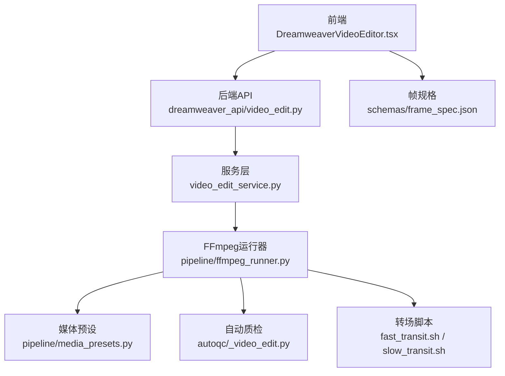
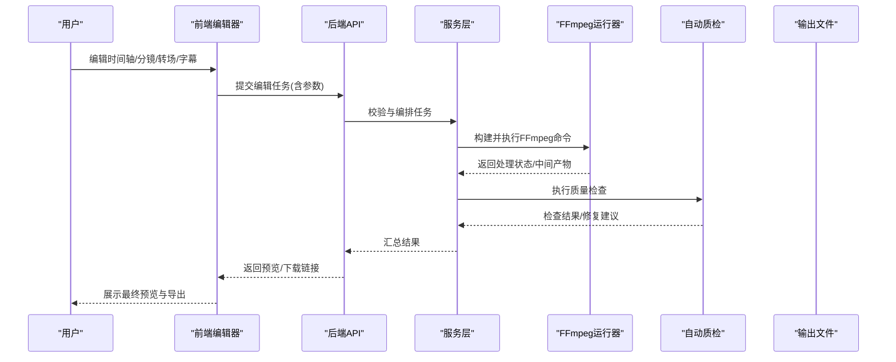
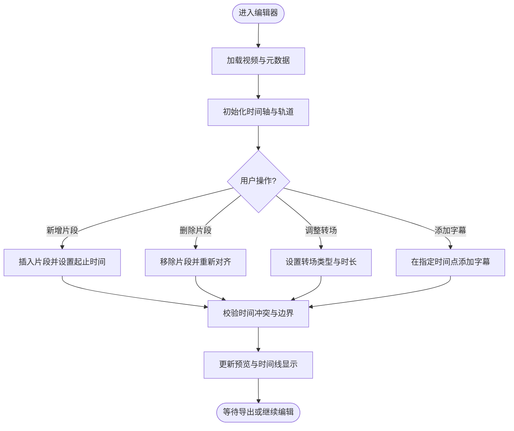
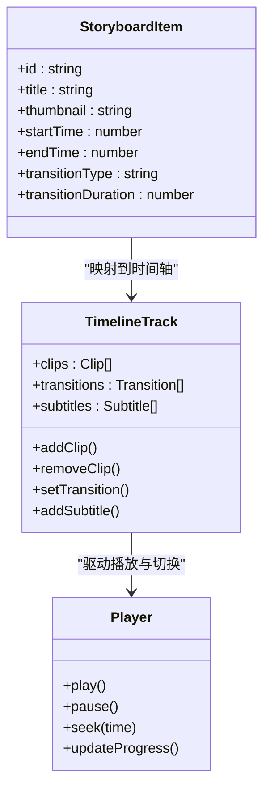
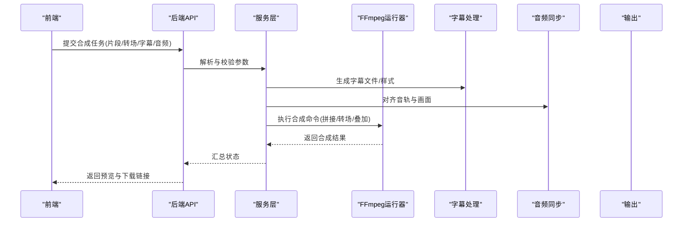
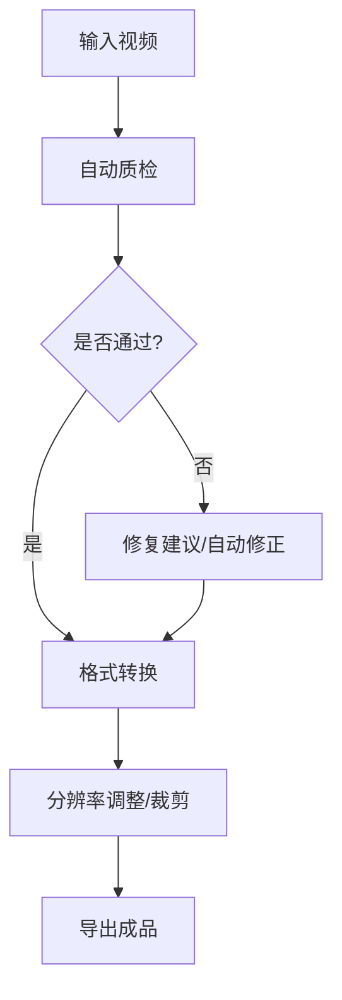
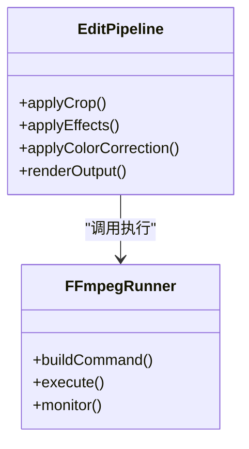
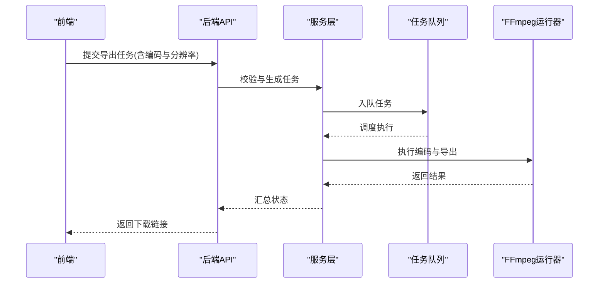
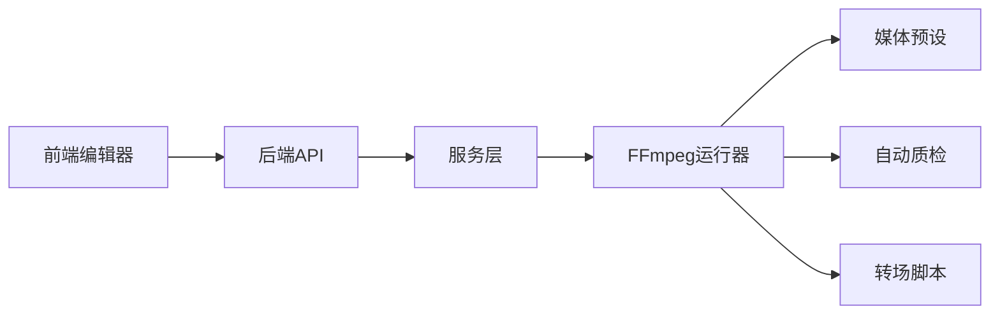

# 视频预览与编辑

<cite>
**本文引用的文件**   
- [README.md](file://README.md)
- [FFMPEG_VIDEO_EDIT_GUIDE.md](file://FFMPEG_VIDEO_EDIT_GUIDE.md)
- [backend/app/main.py](file://backend/app/main.py)
- [backend/app/api/v1/dreamweaver_api/video_edit.py](file://backend/app/api/v1/dreamweaver_api/video_edit.py)
- [backend/app/services/dreamweaver/video_edit_service.py](file://backend/app/services/dreamweaver/video_edit_service.py)
- [pipeline/ffmpeg_runner.py](file://pipeline/ffmpeg_runner.py)
- [pipeline/media_presets.py](file://pipeline/media_presets.py)
- [pipeline/autoqc/_video_edit.py](file://pipeline/autoqc/_video_edit.py)
- [agents/editor.py](file://agents/editor.py)
- [agents/painter_pkg/_edit_pipeline.py](file://agents/painter_pkg/_edit_pipeline.py)
- [scripts/ffmpeg/fast_transit.sh](file://scripts/ffmpeg/fast_transit.sh)
- [scripts/ffmpeg/slow_transit.sh](file://scripts/ffmpeg/slow_transit.sh)
- [frontend/src/pages/DreamweaverVideoEditor.tsx](file://frontend/src/pages/DreamweaverVideoEditor.tsx)
- [frontend/src/components/VideoPlayer.tsx](file://frontend/src/components/VideoPlayer.tsx)
- [frontend/src/hooks/useTimelineEdit.ts](file://frontend/src/hooks/useTimelineEdit.ts)
- [schemas/frame_spec.json](file://schemas/frame_spec.json)
</cite>

## 目录
1. [简介](#简介)
2. [项目结构](#项目结构)
3. [核心组件](#核心组件)
4. [架构总览](#架构总览)
5. [详细组件分析](#详细组件分析)
6. [依赖关系分析](#依赖关系分析)
7. [性能考量](#性能考量)
8. [故障排查指南](#故障排查指南)
9. [结论](#结论)
10. [附录](#附录)

## 简介
本文件为“梦境编织者”项目的视频预览与编辑功能提供系统化文档，覆盖以下能力：
- 视频播放器与时间轴编辑
- 分镜脚本预览、镜头切换与转场动画
- 帧间过渡效果（快速/慢速转场）
- 视频合成、音频同步与字幕添加
- 质量检查、格式转换与分辨率调整
- 视频裁剪、特效应用与颜色校正
- 导出设置、编码选项与批量处理

该功能由前端编辑器、后端API与服务层、以及基于FFmpeg的媒体处理管线协同实现。

## 项目结构
围绕视频预览与编辑的关键目录与文件如下：
- 前端：页面与组件负责播放器、时间轴、分镜预览与用户交互
- 后端：API路由与服务层编排编辑任务、调用媒体处理
- 媒体处理：FFmpeg封装、预设、自动质检与转场脚本
- 数据模型：帧规格与任务规范用于描述剪辑与转场参数

**图表来源** 
- [backend/app/api/v1/dreamweaver_api/video_edit.py](file://backend/app/api/v1/dreamweaver_api/video_edit.py)
- [backend/app/services/dreamweaver/video_edit_service.py](file://backend/app/services/dreamweaver/video_edit_service.py)
- [pipeline/ffmpeg_runner.py](file://pipeline/ffmpeg_runner.py)
- [pipeline/media_presets.py](file://pipeline/media_presets.py)
- [pipeline/autoqc/_video_edit.py](file://pipeline/autoqc/_video_edit.py)
- [scripts/ffmpeg/fast_transit.sh](file://scripts/ffmpeg/fast_transit.sh)
- [scripts/ffmpeg/slow_transit.sh](file://scripts/ffmpeg/slow_transit.sh)
- [frontend/src/pages/DreamweaverVideoEditor.tsx](file://frontend/src/pages/DreamweaverVideoEditor.tsx)
- [schemas/frame_spec.json](file://schemas/frame_spec.json)

**章节来源**
- [README.md](file://README.md)
- [FFMPEG_VIDEO_EDIT_GUIDE.md](file://FFMPEG_VIDEO_EDIT_GUIDE.md)

## 核心组件
- 前端播放器与时间轴
  - 播放器组件负责渲染视频流、播放控制与进度同步
  - 时间轴Hook管理片段、关键帧、转场与字幕轨道
- 后端API与服务层
  - 接收编辑请求，校验参数，调度媒体处理任务
  - 编排合成、转场、字幕、质量检查与导出
- FFmpeg运行器与预设
  - 统一封装FFmpeg命令构建与执行
  - 提供常用编码、分辨率、码率等预设
- 自动质检
  - 对输出进行基础质量检查（时长、分辨率、音画同步等）
- 转场脚本
  - 快速/慢速转场脚本，支持淡入淡出、交叉溶解等常见效果

**章节来源**
- [frontend/src/components/VideoPlayer.tsx](file://frontend/src/components/VideoPlayer.tsx)
- [frontend/src/hooks/useTimelineEdit.ts](file://frontend/src/hooks/useTimelineEdit.ts)
- [backend/app/api/v1/dreamweaver_api/video_edit.py](file://backend/app/api/v1/dreamweaver_api/video_edit.py)
- [backend/app/services/dreamweaver/video_edit_service.py](file://backend/app/services/dreamweaver/video_edit_service.py)
- [pipeline/ffmpeg_runner.py](file://pipeline/ffmpeg_runner.py)
- [pipeline/media_presets.py](file://pipeline/media_presets.py)
- [pipeline/autoqc/_video_edit.py](file://pipeline/autoqc/_video_edit.py)
- [scripts/ffmpeg/fast_transit.sh](file://scripts/ffmpeg/fast_transit.sh)
- [scripts/ffmpeg/slow_transit.sh](file://scripts/ffmpeg/slow_transit.sh)

## 架构总览
视频预览与编辑的整体流程如下：
- 用户在编辑器中操作时间轴与分镜预览
- 前端将编辑指令（片段、转场、字幕、导出参数）提交到后端API
- 服务层校验并生成处理计划，调用FFmpeg运行器执行
- 媒体处理阶段完成合成、转场、字幕叠加、质量检查与导出
- 结果回传前端，更新预览与下载链接

**图表来源** 
- [backend/app/api/v1/dreamweaver_api/video_edit.py](file://backend/app/api/v1/dreamweaver_api/video_edit.py)
- [backend/app/services/dreamweaver/video_edit_service.py](file://backend/app/services/dreamweaver/video_edit_service.py)
- [pipeline/ffmpeg_runner.py](file://pipeline/ffmpeg_runner.py)
- [pipeline/autoqc/_video_edit.py](file://pipeline/autoqc/_video_edit.py)

## 详细组件分析

### 视频播放器与时间轴编辑
- 播放器组件
  - 负责加载视频源、播放控制、音量与全屏
  - 与时间轴保持进度同步，响应拖拽与跳转
- 时间轴编辑Hook
  - 管理片段列表、关键帧标记、转场配置与字幕轨道
  - 提供增删改查、排序、合并与拆分等操作
  - 计算总时长、重叠区域与转场持续时间

**图表来源** 
- [frontend/src/components/VideoPlayer.tsx](file://frontend/src/components/VideoPlayer.tsx)
- [frontend/src/hooks/useTimelineEdit.ts](file://frontend/src/hooks/useTimelineEdit.ts)

**章节来源**
- [frontend/src/components/VideoPlayer.tsx](file://frontend/src/components/VideoPlayer.tsx)
- [frontend/src/hooks/useTimelineEdit.ts](file://frontend/src/hooks/useTimelineEdit.ts)

### 分镜脚本预览、镜头切换与转场动画
- 分镜脚本预览
  - 根据分镜条目生成缩略图与时间映射，支持点击跳转到对应片段
- 镜头切换
  - 通过时间轴上的片段顺序与转场配置实现切换逻辑
- 转场动画
  - 支持快速/慢速转场脚本，可配置淡入淡出、交叉溶解等

**图表来源** 
- [schemas/frame_spec.json](file://schemas/frame_spec.json)
- [frontend/src/hooks/useTimelineEdit.ts](file://frontend/src/hooks/useTimelineEdit.ts)
- [frontend/src/components/VideoPlayer.tsx](file://frontend/src/components/VideoPlayer.tsx)

**章节来源**
- [schemas/frame_spec.json](file://schemas/frame_spec.json)
- [frontend/src/hooks/useTimelineEdit.ts](file://frontend/src/hooks/useTimelineEdit.ts)
- [frontend/src/components/VideoPlayer.tsx](file://frontend/src/components/VideoPlayer.tsx)

### 视频合成、音频同步与字幕添加
- 视频合成
  - 按时间轴顺序拼接片段，应用转场与特效
- 音频同步
  - 对齐音轨与画面，支持多音轨混合与音量调节
- 字幕添加
  - 在指定时间点叠加字幕轨道，支持样式与位置配置

**图表来源** 
- [backend/app/api/v1/dreamweaver_api/video_edit.py](file://backend/app/api/v1/dreamweaver_api/video_edit.py)
- [backend/app/services/dreamweaver/video_edit_service.py](file://backend/app/services/dreamweaver/video_edit_service.py)
- [pipeline/ffmpeg_runner.py](file://pipeline/ffmpeg_runner.py)

**章节来源**
- [backend/app/api/v1/dreamweaver_api/video_edit.py](file://backend/app/api/v1/dreamweaver_api/video_edit.py)
- [backend/app/services/dreamweaver/video_edit_service.py](file://backend/app/services/dreamweaver/video_edit_service.py)
- [pipeline/ffmpeg_runner.py](file://pipeline/ffmpeg_runner.py)

### 质量检查、格式转换与分辨率调整
- 质量检查
  - 自动检测时长、分辨率、音画同步、黑帧/静音等
- 格式转换
  - 支持多种容器与编码格式的互转
- 分辨率调整
  - 按预设或自定义参数缩放与裁剪

**图表来源** 
- [pipeline/autoqc/_video_edit.py](file://pipeline/autoqc/_video_edit.py)
- [pipeline/media_presets.py](file://pipeline/media_presets.py)
- [pipeline/ffmpeg_runner.py](file://pipeline/ffmpeg_runner.py)

**章节来源**
- [pipeline/autoqc/_video_edit.py](file://pipeline/autoqc/_video_edit.py)
- [pipeline/media_presets.py](file://pipeline/media_presets.py)
- [pipeline/ffmpeg_runner.py](file://pipeline/ffmpeg_runner.py)

### 视频裁剪、特效应用与颜色校正
- 视频裁剪
  - 按时间范围或像素坐标裁剪片段
- 特效应用
  - 叠加滤镜、水印、画中画等
- 颜色校正
  - 调整亮度、对比度、饱和度与色温

**图表来源** 
- [agents/editor.py](file://agents/editor.py)
- [agents/painter_pkg/_edit_pipeline.py](file://agents/painter_pkg/_edit_pipeline.py)
- [pipeline/ffmpeg_runner.py](file://pipeline/ffmpeg_runner.py)

**章节来源**
- [agents/editor.py](file://agents/editor.py)
- [agents/painter_pkg/_edit_pipeline.py](file://agents/painter_pkg/_edit_pipeline.py)
- [pipeline/ffmpeg_runner.py](file://pipeline/ffmpeg_runner.py)

### 导出设置、编码选项与批量处理
- 导出设置
  - 选择容器格式、编码参数、码率、分辨率与帧率
- 编码选项
  - 支持H.264/H.265、AAC、MP4/MKV等组合
- 批量处理
  - 队列化多个编辑任务，并行或串行执行

**图表来源** 
- [backend/app/api/v1/dreamweaver_api/video_edit.py](file://backend/app/api/v1/dreamweaver_api/video_edit.py)
- [backend/app/services/dreamweaver/video_edit_service.py](file://backend/app/services/dreamweaver/video_edit_service.py)
- [pipeline/ffmpeg_runner.py](file://pipeline/ffmpeg_runner.py)

**章节来源**
- [backend/app/api/v1/dreamweaver_api/video_edit.py](file://backend/app/api/v1/dreamweaver_api/video_edit.py)
- [backend/app/services/dreamweaver/video_edit_service.py](file://backend/app/services/dreamweaver/video_edit_service.py)
- [pipeline/ffmpeg_runner.py](file://pipeline/ffmpeg_runner.py)

## 依赖关系分析
- 前端依赖播放器组件与时间轴Hook，向API提交编辑指令
- 后端API依赖服务层进行参数校验与任务编排
- 服务层依赖FFmpeg运行器与媒体预设执行具体处理
- 自动质检模块对输出进行质量验证
- 转场脚本作为外部工具被调用以生成过渡效果

**图表来源** 
- [backend/app/main.py](file://backend/app/main.py)
- [backend/app/api/v1/dreamweaver_api/video_edit.py](file://backend/app/api/v1/dreamweaver_api/video_edit.py)
- [backend/app/services/dreamweaver/video_edit_service.py](file://backend/app/services/dreamweaver/video_edit_service.py)
- [pipeline/ffmpeg_runner.py](file://pipeline/ffmpeg_runner.py)
- [pipeline/media_presets.py](file://pipeline/media_presets.py)
- [pipeline/autoqc/_video_edit.py](file://pipeline/autoqc/_video_edit.py)
- [scripts/ffmpeg/fast_transit.sh](file://scripts/ffmpeg/fast_transit.sh)
- [scripts/ffmpeg/slow_transit.sh](file://scripts/ffmpeg/slow_transit.sh)

**章节来源**
- [backend/app/main.py](file://backend/app/main.py)
- [backend/app/api/v1/dreamweaver_api/video_edit.py](file://backend/app/api/v1/dreamweaver_api/video_edit.py)
- [backend/app/services/dreamweaver/video_edit_service.py](file://backend/app/services/dreamweaver/video_edit_service.py)
- [pipeline/ffmpeg_runner.py](file://pipeline/ffmpeg_runner.py)
- [pipeline/media_presets.py](file://pipeline/media_presets.py)
- [pipeline/autoqc/_video_edit.py](file://pipeline/autoqc/_video_edit.py)
- [scripts/ffmpeg/fast_transit.sh](file://scripts/ffmpeg/fast_transit.sh)
- [scripts/ffmpeg/slow_transit.sh](file://scripts/ffmpeg/slow_transit.sh)

## 性能考量
- 使用FFmpeg硬件加速（如GPU编码）提升导出速度
- 合理设置码率与分辨率平衡画质与体积
- 批量任务采用队列与并发控制避免资源争用
- 预处理与缓存常用转场模板减少重复计算
- 自动质检提前发现问题，降低返工成本

[本节为通用指导，不直接分析具体文件]

## 故障排查指南
- 常见问题
  - 转场失败：检查转场脚本路径与权限
  - 音画不同步：确认音频采样率与视频帧率匹配
  - 导出失败：查看FFmpeg日志与错误码
- 定位方法
  - 启用详细日志，记录命令与参数
  - 分段测试：先合成再转场最后叠加字幕
  - 使用自动质检报告定位问题片段

**章节来源**
- [pipeline/ffmpeg_runner.py](file://pipeline/ffmpeg_runner.py)
- [pipeline/autoqc/_video_edit.py](file://pipeline/autoqc/_video_edit.py)
- [FFMPEG_VIDEO_EDIT_GUIDE.md](file://FFMPEG_VIDEO_EDIT_GUIDE.md)

## 结论
“梦境编织者”的视频预览与编辑功能通过前后端协作与FFmpeg管线实现了完整的剪辑、转场、字幕、质量检查与导出能力。建议在大规模使用时引入硬件加速与任务队列优化，并结合自动质检提升稳定性与效率。

[本节为总结性内容，不直接分析具体文件]

## 附录
- 相关文档
  - [README.md](file://README.md)
  - [FFMPEG_VIDEO_EDIT_GUIDE.md](file://FFMPEG_VIDEO_EDIT_GUIDE.md)
- 关键文件路径
  - 前端编辑器：[frontend/src/pages/DreamweaverVideoEditor.tsx](file://frontend/src/pages/DreamweaverVideoEditor.tsx)
  - 播放器组件：[frontend/src/components/VideoPlayer.tsx](file://frontend/src/components/VideoPlayer.tsx)
  - 时间轴Hook：[frontend/src/hooks/useTimelineEdit.ts](file://frontend/src/hooks/useTimelineEdit.ts)
  - 后端API：[backend/app/api/v1/dreamweaver_api/video_edit.py](file://backend/app/api/v1/dreamweaver_api/video_edit.py)
  - 服务层：[backend/app/services/dreamweaver/video_edit_service.py](file://backend/app/services/dreamweaver/video_edit_service.py)
  - FFmpeg运行器：[pipeline/ffmpeg_runner.py](file://pipeline/ffmpeg_runner.py)
  - 媒体预设：[pipeline/media_presets.py](file://pipeline/media_presets.py)
  - 自动质检：[pipeline/autoqc/_video_edit.py](file://pipeline/autoqc/_video_edit.py)
  - 转场脚本：[scripts/ffmpeg/fast_transit.sh](file://scripts/ffmpeg/fast_transit.sh), [scripts/ffmpeg/slow_transit.sh](file://scripts/ffmpeg/slow_transit.sh)
  - 帧规格：[schemas/frame_spec.json](file://schemas/frame_spec.json)