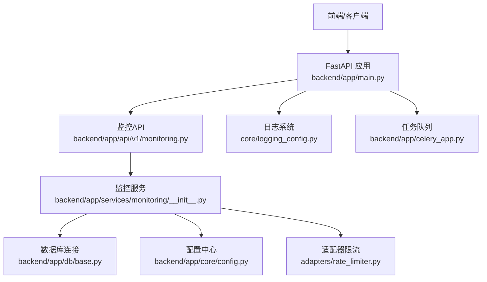
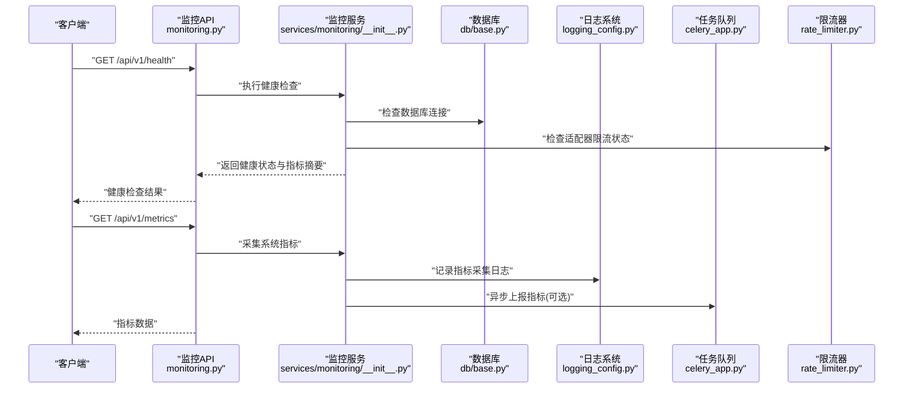
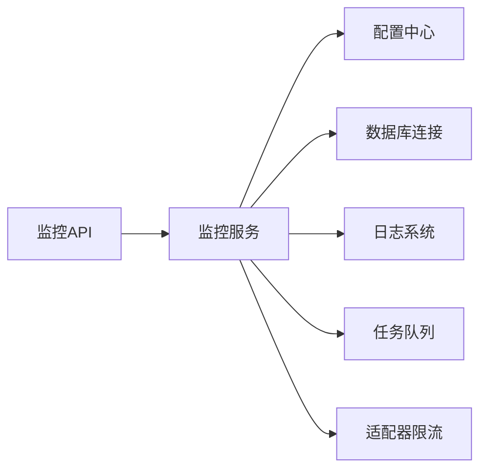

# 诊断与调试

<cite>
**本文引用的文件**   
- [backend/app/api/v1/monitoring.py](file://backend/app/api/v1/monitoring.py)
- [backend/app/services/monitoring/__init__.py](file://backend/app/services/monitoring/__init__.py)
- [core/logging_config.py](file://core/logging_config.py)
- [backend/app/celery_app.py](file://backend/app/celery_app.py)
- [backend/app/main.py](file://backend/app/main.py)
- [backend/app/core/config.py](file://backend/app/core/config.py)
- [backend/app/db/base.py](file://backend/app/db/base.py)
- [adapters/rate_limiter.py](file://adapters/rate_limiter.py)
- [scripts/check_all_models_status.py](file://scripts/check_all_models_status.py)
- [scripts/test_all_models.py](file://scripts/test_all_models.py)
</cite>

## 目录
1. [简介](#简介)
2. [项目结构](#项目结构)
3. [核心组件](#核心组件)
4. [架构总览](#架构总览)
5. [详细组件分析](#详细组件分析)
6. [依赖关系分析](#依赖关系分析)
7. [性能考量](#性能考量)
8. [故障排除指南](#故障排除指南)
9. [结论](#结论)
10. [附录](#附录)

## 简介
本文件面向“梦境编织者”系统的诊断与调试能力，覆盖系统健康检查、性能监控、资源使用、错误日志收集、异常追踪、问题定位工具、网络请求监控、API调用分析与响应时间统计、内存/CPU/磁盘检查、调试信息导出、问题报告生成、实时监控面板、告警配置与自动化修复等主题。文档以代码级为依据，提供可视化图示与可操作的排障步骤，帮助运维与研发快速定位并解决问题。

## 项目结构
与诊断与调试相关的关键位置：
- API层：监控与健康检查接口位于 backend/app/api/v1/monitoring.py
- 服务层：监控服务实现位于 backend/app/services/monitoring/
- 应用入口：FastAPI主应用注册路由与中间件在 backend/app/main.py
- 配置：运行时配置与开关在 backend/app/core/config.py
- 数据库：连接与迁移基类在 backend/app/db/base.py
- 日志：统一日志配置在 core/logging_config.py
- 任务队列：Celery应用与任务在 backend/app/celery_app.py
- 适配器限流：外部模型调用限流在 adapters/rate_limiter.py
- 脚本：模型状态检查与测试脚本在 scripts/ 下

图表来源 
- [backend/app/main.py](file://backend/app/main.py)
- [backend/app/api/v1/monitoring.py](file://backend/app/api/v1/monitoring.py)
- [backend/app/services/monitoring/__init__.py](file://backend/app/services/monitoring/__init__.py)
- [backend/app/db/base.py](file://backend/app/db/base.py)
- [backend/app/core/config.py](file://backend/app/core/config.py)
- [core/logging_config.py](file://core/logging_config.py)
- [backend/app/celery_app.py](file://backend/app/celery_app.py)
- [adapters/rate_limiter.py](file://adapters/rate_limiter.py)

章节来源
- [backend/app/main.py](file://backend/app/main.py)
- [backend/app/api/v1/monitoring.py](file://backend/app/api/v1/monitoring.py)
- [backend/app/services/monitoring/__init__.py](file://backend/app/services/monitoring/__init__.py)
- [backend/app/core/config.py](file://backend/app/core/config.py)
- [backend/app/db/base.py](file://backend/app/db/base.py)
- [core/logging_config.py](file://core/logging_config.py)
- [backend/app/celery_app.py](file://backend/app/celery_app.py)
- [adapters/rate_limiter.py](file://adapters/rate_limiter.py)

## 核心组件
- 监控API：暴露健康检查、指标采集、诊断数据查询等HTTP端点，供前端或监控系统拉取。
- 监控服务：聚合系统指标（进程、数据库、缓存、外部适配器）、计算延迟与错误率、输出结构化诊断结果。
- 日志系统：集中化日志配置，支持分级、格式化、异步写入与采样策略，便于问题回溯。
- 任务队列：异步执行耗时任务（如批量诊断、指标上报、清理），避免阻塞请求链路。
- 配置中心：集中管理监控开关、阈值、采样率、存储路径等运行参数。
- 数据库连接：提供连接池、慢查询检测、事务与回滚策略，支撑监控数据的持久化。
- 适配器限流：保护外部模型与服务，防止雪崩，记录限流事件用于诊断。

章节来源
- [backend/app/api/v1/monitoring.py](file://backend/app/api/v1/monitoring.py)
- [backend/app/services/monitoring/__init__.py](file://backend/app/services/monitoring/__init__.py)
- [core/logging_config.py](file://core/logging_config.py)
- [backend/app/celery_app.py](file://backend/app/celery_app.py)
- [backend/app/core/config.py](file://backend/app/core/config.py)
- [backend/app/db/base.py](file://backend/app/db/base.py)
- [adapters/rate_limiter.py](file://adapters/rate_limiter.py)

## 架构总览
下图展示从请求到监控数据采集、处理与输出的整体流程，包括健康检查、指标采集、日志与任务队列的协作。

图表来源 
- [backend/app/api/v1/monitoring.py](file://backend/app/api/v1/monitoring.py)
- [backend/app/services/monitoring/__init__.py](file://backend/app/services/monitoring/__init__.py)
- [backend/app/db/base.py](file://backend/app/db/base.py)
- [core/logging_config.py](file://core/logging_config.py)
- [backend/app/celery_app.py](file://backend/app/celery_app.py)
- [adapters/rate_limiter.py](file://adapters/rate_limiter.py)

## 详细组件分析

### 监控API（健康检查与指标）
- 功能要点
  - 健康检查：验证服务可用性、数据库连通性、关键依赖状态。
  - 指标采集：CPU、内存、磁盘、网络、请求速率、错误率、延迟分位。
  - 诊断快照：导出当前上下文、线程栈、锁状态、适配器配额与限流计数。
  - 告警触发：基于阈值判断是否触发告警事件。
- 典型调用序列
  - 健康检查：客户端请求 -> API路由 -> 监控服务 -> 数据库/适配器检查 -> 返回结果
  - 指标采集：客户端请求 -> API路由 -> 监控服务 -> 读取系统指标 -> 可选异步上报 -> 返回数据
- 建议优化
  - 对重指标采集进行采样与缓存，降低开销
  - 将敏感信息脱敏后输出
  - 增加幂等与超时控制

章节来源
- [backend/app/api/v1/monitoring.py](file://backend/app/api/v1/monitoring.py)
- [backend/app/services/monitoring/__init__.py](file://backend/app/services/monitoring/__init__.py)

### 监控服务（指标聚合与诊断）
- 功能要点
  - 聚合进程与系统指标（psutil/os模块）
  - 数据库连接池状态与慢查询统计
  - 外部适配器调用成功率、延迟、限流与重试次数
  - 结构化诊断结果生成（JSON/YAML）
- 数据处理
  - 指标归一化、去噪、窗口聚合
  - 异常检测（阈值、同比/环比）
- 错误处理
  - 捕获子系统异常，降级为部分可用状态
  - 记录详细错误上下文，便于定位

章节来源
- [backend/app/services/monitoring/__init__.py](file://backend/app/services/monitoring/__init__.py)

### 日志系统（统一日志配置）
- 功能要点
  - 分级日志（DEBUG/INFO/WARNING/ERROR/CRITICAL）
  - 结构化字段（trace_id、span_id、用户ID、请求ID）
  - 异步写入与轮转策略
  - 采样与过滤，减少噪声
- 集成点
  - FastAPI中间件注入请求上下文
  - 监控服务与任务队列统一输出

章节来源
- [core/logging_config.py](file://core/logging_config.py)

### 任务队列（Celery）
- 功能要点
  - 异步执行耗时诊断任务（全量指标采集、报告生成、清理）
  - 失败重试与死信队列
  - 任务状态与进度上报
- 监控集成
  - 任务执行耗时、失败率、队列长度
  - 与日志系统关联，便于追踪

章节来源
- [backend/app/celery_app.py](file://backend/app/celery_app.py)

### 配置中心（监控开关与阈值）
- 功能要点
  - 监控开关、采样率、阈值、存储路径、上报地址
  - 动态重载与热更新
- 安全与权限
  - 敏感配置加密存储
  - 访问控制与审计

章节来源
- [backend/app/core/config.py](file://backend/app/core/config.py)

### 数据库连接（监控与诊断）
- 功能要点
  - 连接池大小、活跃连接数、等待队列
  - 慢查询日志与SQL审计
  - 事务隔离级别与锁等待检测
- 诊断辅助
  - 表空间与索引使用情况
  - 备份与恢复状态

章节来源
- [backend/app/db/base.py](file://backend/app/db/base.py)

### 适配器限流（外部依赖保护）
- 功能要点
  - 令牌桶/漏桶算法实现
  - 配额管理与熔断
  - 限流事件记录与告警
- 监控集成
  - 限流计数、拒绝率、平均排队时间

章节来源
- [adapters/rate_limiter.py](file://adapters/rate_limiter.py)

### 模型状态检查与测试脚本
- 功能要点
  - 批量检查模型可用性、延迟、错误率
  - 端到端测试用例，模拟真实调用
- 使用场景
  - 部署前验证
  - 定期巡检与回归测试

章节来源
- [scripts/check_all_models_status.py](file://scripts/check_all_models_status.py)
- [scripts/test_all_models.py](file://scripts/test_all_models.py)

## 依赖关系分析
监控API依赖监控服务；监控服务依赖配置、数据库、日志、任务队列与适配器限流。任务队列独立于请求链路，但共享日志与配置。

图表来源 
- [backend/app/api/v1/monitoring.py](file://backend/app/api/v1/monitoring.py)
- [backend/app/services/monitoring/__init__.py](file://backend/app/services/monitoring/__init__.py)
- [backend/app/core/config.py](file://backend/app/core/config.py)
- [backend/app/db/base.py](file://backend/app/db/base.py)
- [core/logging_config.py](file://core/logging_config.py)
- [backend/app/celery_app.py](file://backend/app/celery_app.py)
- [adapters/rate_limiter.py](file://adapters/rate_limiter.py)

章节来源
- [backend/app/api/v1/monitoring.py](file://backend/app/api/v1/monitoring.py)
- [backend/app/services/monitoring/__init__.py](file://backend/app/services/monitoring/__init__.py)
- [backend/app/core/config.py](file://backend/app/core/config.py)
- [backend/app/db/base.py](file://backend/app/db/base.py)
- [core/logging_config.py](file://core/logging_config.py)
- [backend/app/celery_app.py](file://backend/app/celery_app.py)
- [adapters/rate_limiter.py](file://adapters/rate_limiter.py)

## 性能考量
- 指标采集开销控制：采样、缓存、批处理、异步上报
- 日志写入优化：异步、轮转、采样、脱敏
- 数据库压力：只读副本、慢查询限制、连接池调优
- 任务队列背压：队列长度监控、消费者扩容、失败重试退避
- 外部依赖保护：限流、熔断、超时、重试策略

## 故障排除指南
- 健康检查失败
  - 检查数据库连接与权限
  - 查看适配器限流与配额
  - 核对配置项与密钥
- 指标缺失或异常
  - 确认监控服务进程存活
  - 检查日志是否有异常堆栈
  - 验证任务队列消费正常
- 高延迟或错误率上升
  - 查看适配器调用链路与重试次数
  - 检查数据库慢查询与锁等待
  - 评估CPU/内存/磁盘使用率
- 日志无法定位问题
  - 启用更细粒度日志与Trace ID
  - 导出诊断快照与上下文
  - 使用脚本进行模型状态检查与端到端测试

章节来源
- [backend/app/api/v1/monitoring.py](file://backend/app/api/v1/monitoring.py)
- [backend/app/services/monitoring/__init__.py](file://backend/app/services/monitoring/__init__.py)
- [core/logging_config.py](file://core/logging_config.py)
- [backend/app/celery_app.py](file://backend/app/celery_app.py)
- [backend/app/core/config.py](file://backend/app/core/config.py)
- [backend/app/db/base.py](file://backend/app/db/base.py)
- [adapters/rate_limiter.py](file://adapters/rate_limiter.py)
- [scripts/check_all_models_status.py](file://scripts/check_all_models_status.py)
- [scripts/test_all_models.py](file://scripts/test_all_models.py)

## 结论
通过统一的监控API、健壮的监控服务、集中化的日志与任务队列、严格的配置与数据库管理、以及适配器限流保护，“梦境编织者”具备完善的诊断与调试能力。结合脚本化工具与可视化面板，可实现实时监控、告警与自动化修复，显著提升系统稳定性与可维护性。

## 附录
- 常用命令与脚本
  - 模型状态检查：scripts/check_all_models_status.py
  - 端到端测试：scripts/test_all_models.py
- 监控端点示例
  - 健康检查：/api/v1/health
  - 指标采集：/api/v1/metrics
  - 诊断快照：/api/v1/diagnostics/snapshot
- 告警阈值建议
  - CPU使用率 > 80% 持续5分钟
  - 内存使用率 > 85% 持续5分钟
  - 错误率 > 5% 持续3分钟
  - 数据库连接池使用率 > 90%
  - 适配器限流拒绝率 > 10%