# 资产库管理

<cite>
**本文引用的文件**   
- [asset_library.py](file://agents/asset_library.py)
- [user_assets.py](file://backend/app/api/v1/user_assets.py)
- [user_asset.py](file://backend/app/schemas/user_asset.py)
- [user_asset_record.py](file://backend/app/models/user_asset_record.py)
- [asset_studio_api/__init__.py](file://backend/app/api/v1/asset_studio_api/__init__.py)
- [asset_studio_model_catalog.py](file://backend/app/services/asset_studio_model_catalog.py)
- [library_regenerate_roles.py](file://pipeline/library_regenerate_roles.py)
- [media_presets.py](file://pipeline/media_presets.py)
- [USER_ASSET_LOCAL_STORAGE_METADATA_CONTRACT.md](file://docs/contracts/USER_ASSET_LOCAL_STORAGE_METADATA_CONTRACT.md)
- [USER_ASSET_SOURCE_PAYLOAD_SHAPES.md](file://docs/contracts/USER_ASSET_SOURCE_PAYLOAD_SHAPES.md)
</cite>

## 目录
1. [简介](#简介)
2. [项目结构](#项目结构)
3. [核心组件](#核心组件)
4. [架构总览](#架构总览)
5. [详细组件分析](#详细组件分析)
6. [依赖关系分析](#依赖关系分析)
7. [性能考量](#性能考量)
8. [故障排查指南](#故障排查指南)
9. [结论](#结论)
10. [附录](#附录)

## 简介
本文件为“梦境编织者”资产库管理的功能文档，面向角色、场景、道具等资产的分类、卡片网格展示与详情查看；涵盖提供者参考对话框、资产再生成对话框、批量操作、搜索过滤与标签管理、元数据编辑；说明预览与缩略图生成、格式支持；并覆盖导入导出、版本控制与协作共享；最后给出健康检查、损坏修复与数据备份机制。

## 项目结构
资产库相关能力由后端 API、领域模型、服务层与管线工具共同实现：
- 领域模型与数据库迁移：用户资产记录、评分、语音参考资产等
- API 路由：用户资产接口、资产工作室接口
- 服务层：模型目录同步与投影、任务编排
- 管线工具：媒体预设、角色再生成脚本
- 前端：页面、组件、Hook、类型与服务调用（位于 frontend/src）
- 契约文档：本地存储元数据与来源载荷形状

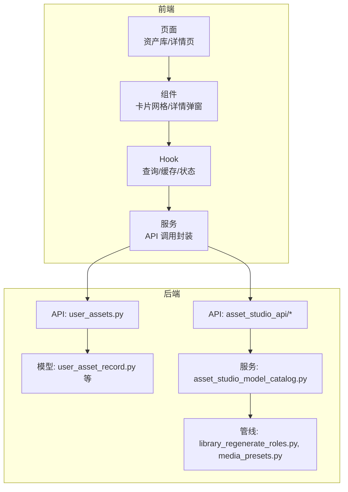

**图表来源**
- [user_assets.py](file://backend/app/api/v1/user_assets.py)
- [asset_studio_api/__init__.py](file://backend/app/api/v1/asset_studio_api/__init__.py)
- [user_asset_record.py](file://backend/app/models/user_asset_record.py)
- [asset_studio_model_catalog.py](file://backend/app/services/asset_studio_model_catalog.py)
- [library_regenerate_roles.py](file://pipeline/library_regenerate_roles.py)
- [media_presets.py](file://pipeline/media_presets.py)

**章节来源**
- [user_assets.py](file://backend/app/api/v1/user_assets.py)
- [asset_studio_api/__init__.py](file://backend/app/api/v1/asset_studio_api/__init__.py)
- [user_asset_record.py](file://backend/app/models/user_asset_record.py)
- [asset_studio_model_catalog.py](file://backend/app/services/asset_studio_model_catalog.py)
- [library_regenerate_roles.py](file://pipeline/library_regenerate_roles.py)
- [media_presets.py](file://pipeline/media_presets.py)

## 核心组件
- 资产分类系统
  - 类别：角色、场景、道具等，通过类型字段与标签体系组织
  - 标签：自由标签与受控标签并存，支持多标签组合筛选
- 卡片网格布局与详情查看
  - 网格分页、排序、筛选、收藏/星标
  - 详情面板：预览、元数据编辑、版本历史、关联引用
- 提供者参考对话框
  - 选择外部或内部提供者生成的参考素材，绑定到当前资产
- 资产再生成对话框
  - 基于现有资产参数与提示词，触发重新生成并保留版本
- 批量操作
  - 批量移动、重命名、打标签、删除、导出
- 搜索与过滤
  - 全文检索、按类型/标签/时间/质量分筛选
- 元数据编辑
  - 标题、描述、作者、来源、许可证、尺寸、时长、分辨率等
- 预览与缩略图
  - 图片/视频/音频的缩略图与帧抽取，格式转码与压缩
- 导入导出
  - 批量导入清单、导出 ZIP/JSON 清单与媒体文件
- 版本控制与协作共享
  - 版本快照、变更日志、权限与分享链接
- 健康检查、损坏修复与备份
  - 完整性校验、坏件修复、定时备份与恢复

**章节来源**
- [user_asset.py](file://backend/app/schemas/user_asset.py)
- [user_asset_record.py](file://backend/app/models/user_asset_record.py)
- [USER_ASSET_LOCAL_STORAGE_METADATA_CONTRACT.md](file://docs/contracts/USER_ASSET_LOCAL_STORAGE_METADATA_CONTRACT.md)
- [USER_ASSET_SOURCE_PAYLOAD_SHAPES.md](file://docs/contracts/USER_ASSET_SOURCE_PAYLOAD_SHAPES.md)

## 架构总览
资产库采用前后端分离架构，前端通过 API 服务层与后端交互；后端以 FastAPI 暴露 RESTful 接口，结合数据库持久化与对象存储（本地/云盘）管理媒体文件。关键流程包括：
- 资产列表与详情：分页查询、过滤、排序、详情加载
- 元数据编辑：更新资产属性与标签
- 预览与缩略图：异步生成与缓存
- 再生成：提交任务、进度回调、版本归档
- 导入导出：清单解析、批量写入/读取、并发处理

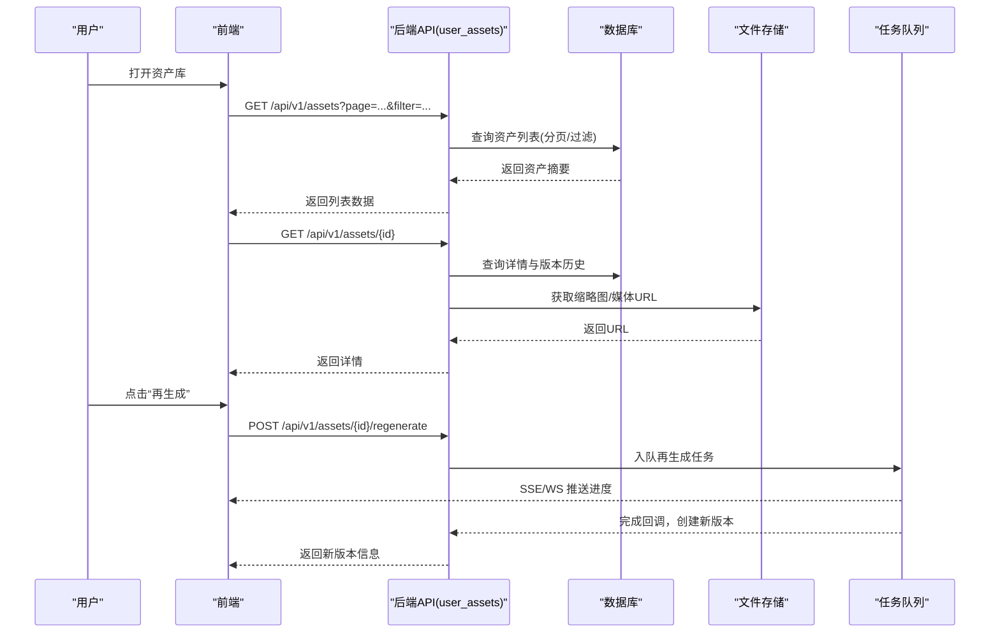

**图表来源**
- [user_assets.py](file://backend/app/api/v1/user_assets.py)
- [user_asset_record.py](file://backend/app/models/user_asset_record.py)
- [asset_studio_model_catalog.py](file://backend/app/services/asset_studio_model_catalog.py)

## 详细组件分析

### 资产分类系统与标签管理
- 分类维度
  - 类型：角色、场景、道具、音效、音乐、文本等
  - 来源：AI 生成、用户上传、第三方导入
  - 质量：评分、审核状态、可用标记
- 标签体系
  - 受控标签：系统预定义，保证一致性
  - 自由标签：用户自定义，便于灵活归类
- 筛选与索引
  - 基于类型、标签、时间范围、质量分构建查询条件
  - 可选全文索引用于标题/描述检索

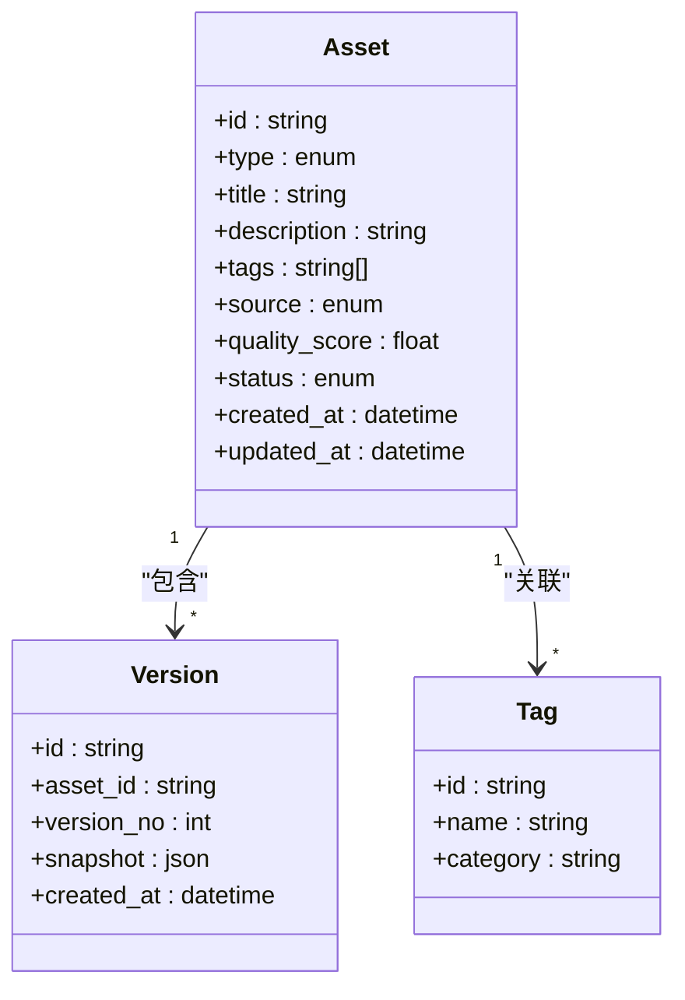

**图表来源**
- [user_asset_record.py](file://backend/app/models/user_asset_record.py)
- [user_asset.py](file://backend/app/schemas/user_asset.py)

**章节来源**
- [user_asset_record.py](file://backend/app/models/user_asset_record.py)
- [user_asset.py](file://backend/app/schemas/user_asset.py)

### 卡片网格布局与详情查看
- 网格布局
  - 响应式栅格，支持不同屏幕密度
  - 卡片显示缩略图、标题、类型、标签、质量分
- 详情面板
  - 大图/视频预览、音频播放
  - 元数据编辑表单、版本历史切换
  - 操作按钮：再生成、复制、下载、分享、删除

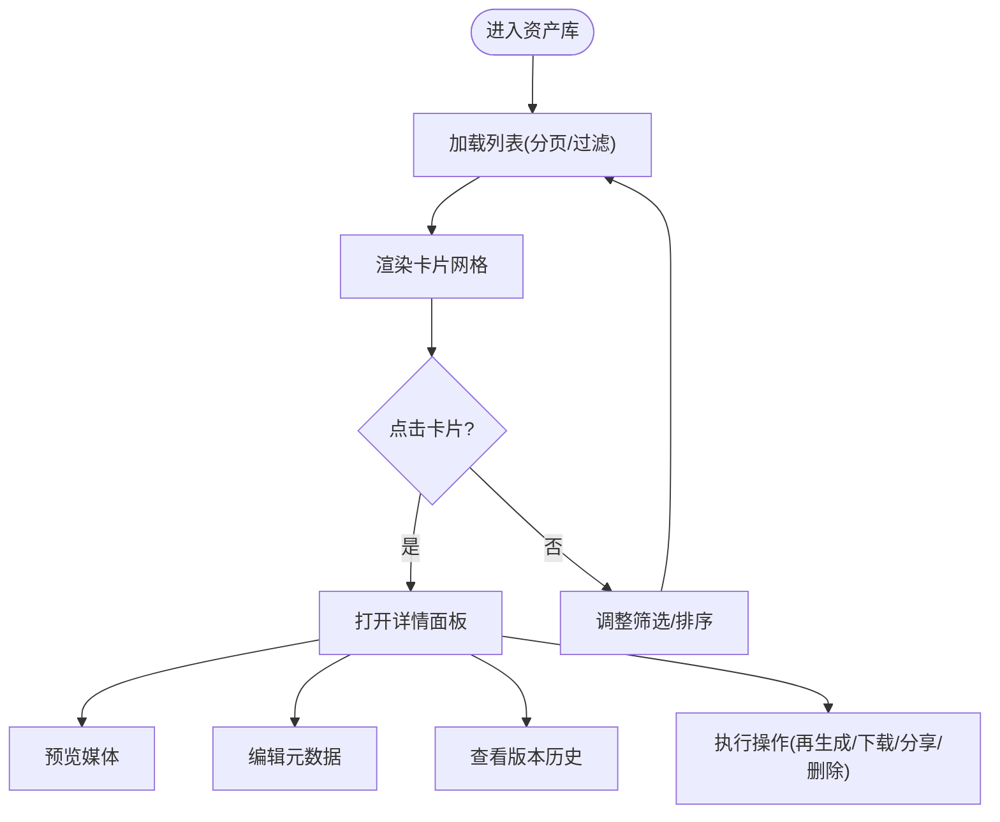

**图表来源**
- [user_assets.py](file://backend/app/api/v1/user_assets.py)
- [user_asset.py](file://backend/app/schemas/user_asset.py)

**章节来源**
- [user_assets.py](file://backend/app/api/v1/user_assets.py)
- [user_asset.py](file://backend/app/schemas/user_asset.py)

### 提供者参考对话框
- 作用：为当前资产选择参考素材（图像/音频/视频），用于再生成或风格一致化
- 数据来源：内部资产库、外部提供者（如模型目录、云端库）
- 交互：搜索、预览、勾选、确认绑定

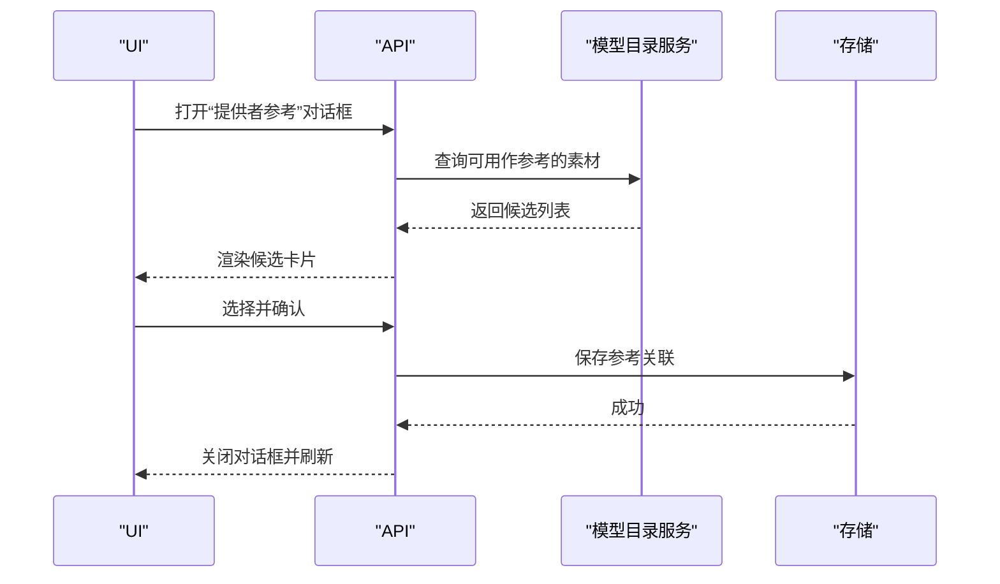

**图表来源**
- [asset_studio_model_catalog.py](file://backend/app/services/asset_studio_model_catalog.py)
- [user_assets.py](file://backend/app/api/v1/user_assets.py)

**章节来源**
- [asset_studio_model_catalog.py](file://backend/app/services/asset_studio_model_catalog.py)
- [user_assets.py](file://backend/app/api/v1/user_assets.py)

### 资产再生成对话框
- 输入：提示词、参数、参考素材、目标格式
- 处理：任务入队、进度回调、失败重试
- 输出：新版本资产，保留旧版本作为历史

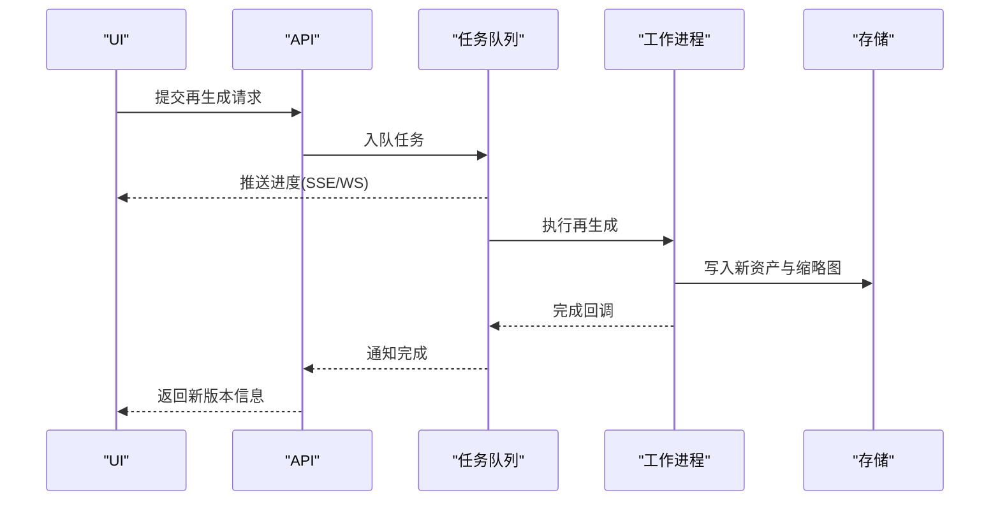

**图表来源**
- [user_assets.py](file://backend/app/api/v1/user_assets.py)
- [asset_studio_model_catalog.py](file://backend/app/services/asset_studio_model_catalog.py)

**章节来源**
- [user_assets.py](file://backend/app/api/v1/user_assets.py)
- [asset_studio_model_catalog.py](file://backend/app/services/asset_studio_model_catalog.py)

### 批量操作
- 支持：批量移动、重命名、打标签、删除、导出
- 策略：分批处理、事务回滚、错误隔离、进度反馈

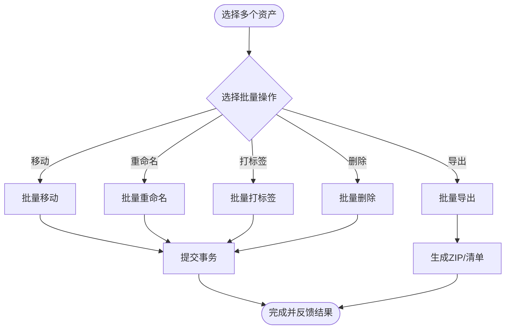

**图表来源**
- [user_assets.py](file://backend/app/api/v1/user_assets.py)

**章节来源**
- [user_assets.py](file://backend/app/api/v1/user_assets.py)

### 搜索过滤与标签管理
- 搜索：关键词匹配标题/描述/标签
- 过滤：类型、来源、质量分、时间范围、审核状态
- 标签：新增、编辑、删除、合并重复项

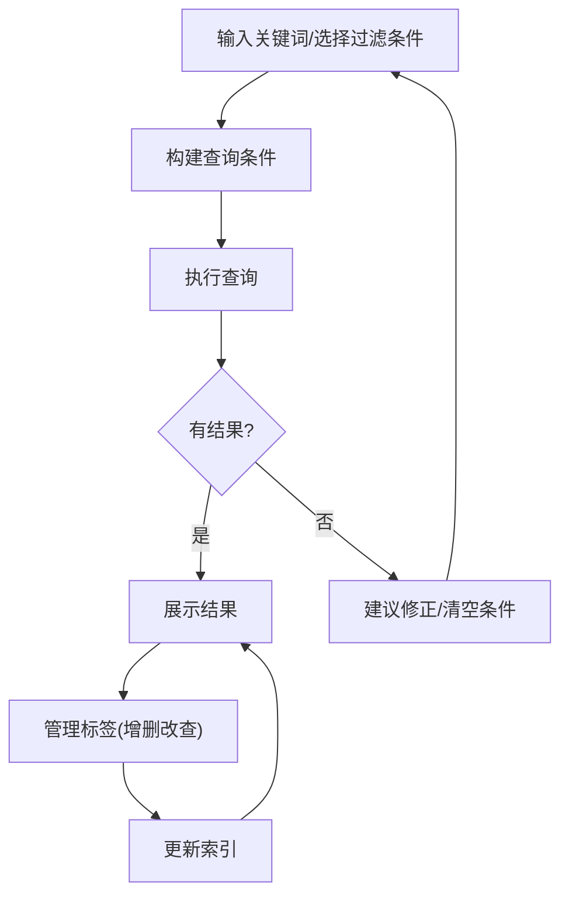

**图表来源**
- [user_assets.py](file://backend/app/api/v1/user_assets.py)
- [user_asset.py](file://backend/app/schemas/user_asset.py)

**章节来源**
- [user_assets.py](file://backend/app/api/v1/user_assets.py)
- [user_asset.py](file://backend/app/schemas/user_asset.py)

### 元数据编辑
- 字段：标题、描述、作者、来源、许可证、尺寸、时长、分辨率、质量分、状态
- 校验：必填项、格式校验、唯一性约束
- 审计：变更记录、操作人、时间戳

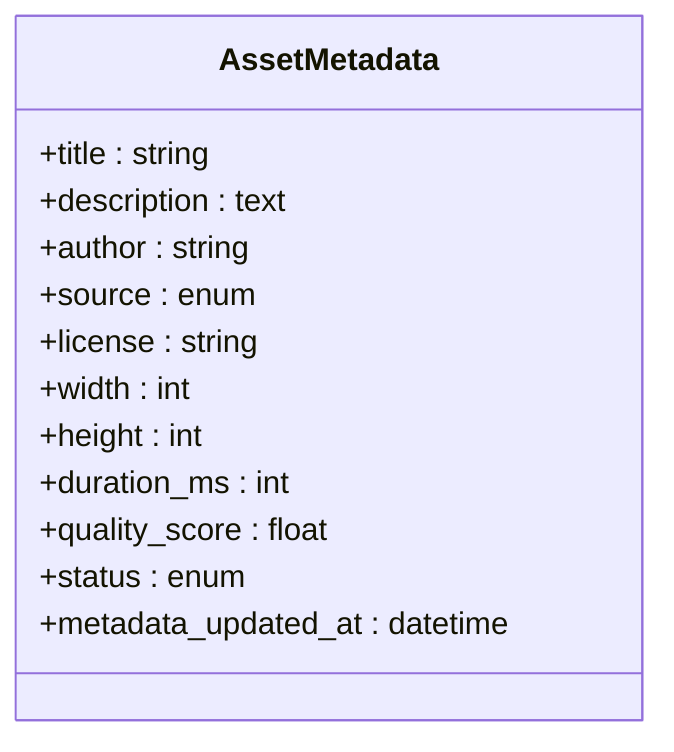

**图表来源**
- [user_asset.py](file://backend/app/schemas/user_asset.py)

**章节来源**
- [user_asset.py](file://backend/app/schemas/user_asset.py)

### 预览与缩略图生成、格式支持
- 预览：图片直接展示，视频首帧/抽帧，音频波形/时长
- 缩略图：统一尺寸、格式转换、压缩优化
- 格式支持：常见图片/视频/音频格式，扩展名白名单校验

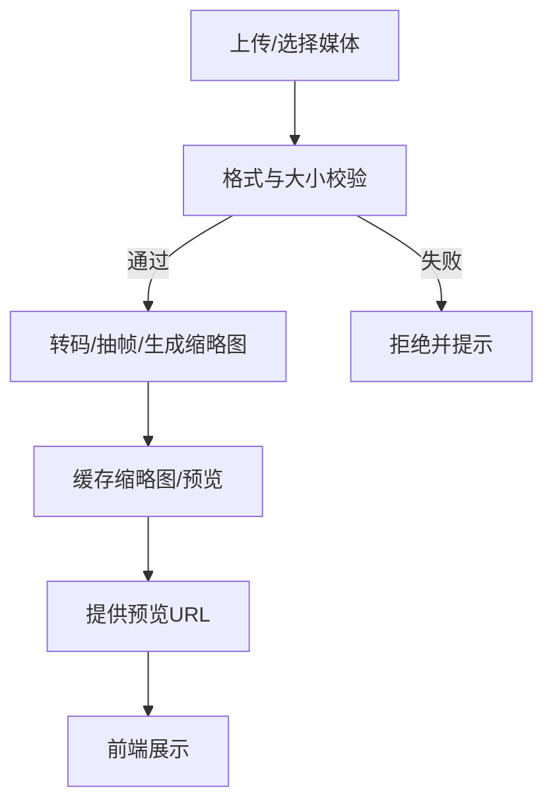

**图表来源**
- [media_presets.py](file://pipeline/media_presets.py)
- [user_assets.py](file://backend/app/api/v1/user_assets.py)

**章节来源**
- [media_presets.py](file://pipeline/media_presets.py)
- [user_assets.py](file://backend/app/api/v1/user_assets.py)

### 导入导出
- 导入：清单文件(JSON/YAML)、批量上传、去重策略、冲突处理
- 导出：ZIP打包媒体与清单、选择性导出、增量导出

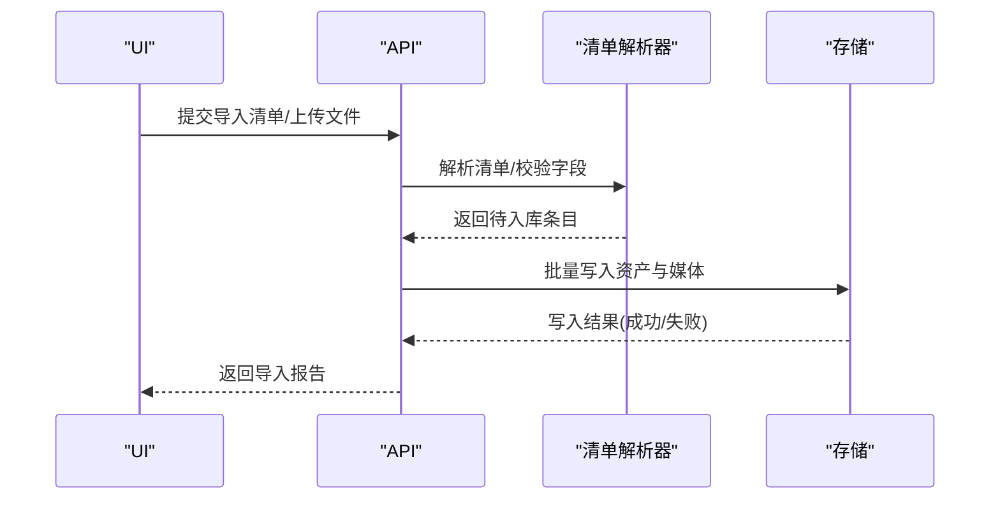

**图表来源**
- [user_assets.py](file://backend/app/api/v1/user_assets.py)
- [USER_ASSET_SOURCE_PAYLOAD_SHAPES.md](file://docs/contracts/USER_ASSET_SOURCE_PAYLOAD_SHAPES.md)

**章节来源**
- [user_assets.py](file://backend/app/api/v1/user_assets.py)
- [USER_ASSET_SOURCE_PAYLOAD_SHAPES.md](file://docs/contracts/USER_ASSET_SOURCE_PAYLOAD_SHAPES.md)

### 版本控制与协作共享
- 版本控制：每次再生成/重要编辑产生新版本，支持回滚与对比
- 协作共享：权限控制、分享链接、评论与标注

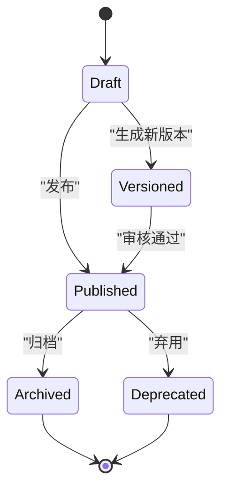

**图表来源**
- [user_asset_record.py](file://backend/app/models/user_asset_record.py)
- [user_asset.py](file://backend/app/schemas/user_asset.py)

**章节来源**
- [user_asset_record.py](file://backend/app/models/user_asset_record.py)
- [user_asset.py](file://backend/app/schemas/user_asset.py)

### 健康检查、损坏修复与数据备份
- 健康检查：扫描资产完整性、缩略图可用性、链接有效性
- 损坏修复：自动重建缩略图、替换坏件、清理孤立文件
- 数据备份：定期快照、增量备份、恢复演练

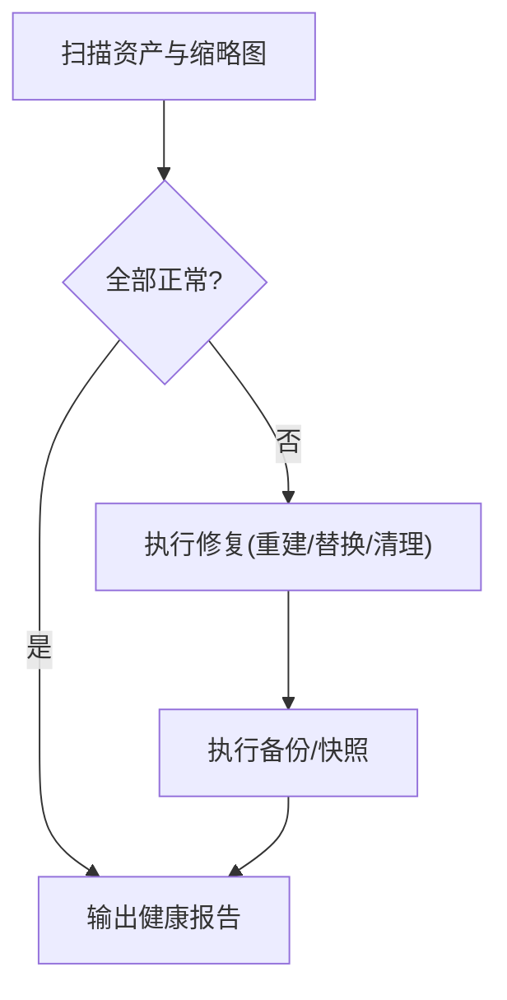

**图表来源**
- [library_regenerate_roles.py](file://pipeline/library_regenerate_roles.py)
- [media_presets.py](file://pipeline/media_presets.py)

**章节来源**
- [library_regenerate_roles.py](file://pipeline/library_regenerate_roles.py)
- [media_presets.py](file://pipeline/media_presets.py)

## 依赖关系分析
- 前端依赖后端 API：用户资产接口、资产工作室接口
- 后端依赖数据库与存储：PostgreSQL、对象存储（本地/云盘）
- 服务层依赖管线工具：媒体预处理、角色再生成
- 契约文档约束前后端数据结构

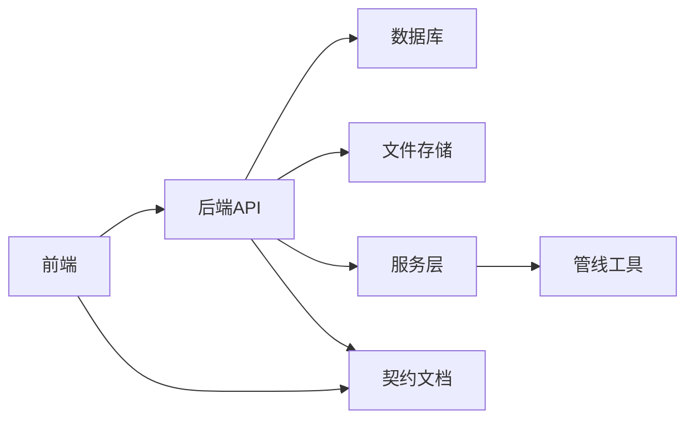

**图表来源**
- [user_assets.py](file://backend/app/api/v1/user_assets.py)
- [asset_studio_api/__init__.py](file://backend/app/api/v1/asset_studio_api/__init__.py)
- [asset_studio_model_catalog.py](file://backend/app/services/asset_studio_model_catalog.py)
- [library_regenerate_roles.py](file://pipeline/library_regenerate_roles.py)
- [USER_ASSET_LOCAL_STORAGE_METADATA_CONTRACT.md](file://docs/contracts/USER_ASSET_LOCAL_STORAGE_METADATA_CONTRACT.md)
- [USER_ASSET_SOURCE_PAYLOAD_SHAPES.md](file://docs/contracts/USER_ASSET_SOURCE_PAYLOAD_SHAPES.md)

**章节来源**
- [user_assets.py](file://backend/app/api/v1/user_assets.py)
- [asset_studio_api/__init__.py](file://backend/app/api/v1/asset_studio_api/__init__.py)
- [asset_studio_model_catalog.py](file://backend/app/services/asset_studio_model_catalog.py)
- [library_regenerate_roles.py](file://pipeline/library_regenerate_roles.py)
- [USER_ASSET_LOCAL_STORAGE_METADATA_CONTRACT.md](file://docs/contracts/USER_ASSET_LOCAL_STORAGE_METADATA_CONTRACT.md)
- [USER_ASSET_SOURCE_PAYLOAD_SHAPES.md](file://docs/contracts/USER_ASSET_SOURCE_PAYLOAD_SHAPES.md)

## 性能考量
- 列表分页与懒加载：减少首屏负载
- 缩略图缓存：CDN 或本地缓存命中
- 批量操作分片：避免长事务与内存峰值
- 任务队列异步：再生成与转码不阻塞主线程
- 索引优化：对常用筛选字段建立索引

[本节为通用指导，无需特定文件来源]

## 故障排查指南
- 常见问题
  - 缩略图缺失：检查转码任务与存储路径
  - 导入失败：核对清单结构与字段校验
  - 再生成超时：检查任务队列与工作进程状态
- 诊断步骤
  - 查看任务日志与错误堆栈
  - 校验文件完整性与权限
  - 验证数据库连接与迁移状态

**章节来源**
- [user_assets.py](file://backend/app/api/v1/user_assets.py)
- [library_regenerate_roles.py](file://pipeline/library_regenerate_roles.py)

## 结论
资产库管理模块围绕分类、展示、编辑、再生成、导入导出、版本控制与健康保障形成闭环。通过清晰的职责划分与契约约束，确保前后端协同稳定高效。建议持续优化索引与缓存策略，完善监控与告警，提升大规模资产下的可用性与性能。

[本节为总结，无需特定文件来源]

## 附录
- 契约文档
  - 本地存储元数据规范：[USER_ASSET_LOCAL_STORAGE_METADATA_CONTRACT.md](file://docs/contracts/USER_ASSET_LOCAL_STORAGE_METADATA_CONTRACT.md)
  - 来源载荷形状：[USER_ASSET_SOURCE_PAYLOAD_SHAPES.md](file://docs/contracts/USER_ASSET_SOURCE_PAYLOAD_SHAPES.md)
- 相关文件
  - 资产库运行时：[asset_library.py](file://agents/asset_library.py)
  - 用户资产 API：[user_assets.py](file://backend/app/api/v1/user_assets.py)
  - 资产工作室 API：[asset_studio_api/__init__.py](file://backend/app/api/v1/asset_studio_api/__init__.py)
  - 资产模型与模式：[user_asset_record.py](file://backend/app/models/user_asset_record.py), [user_asset.py](file://backend/app/schemas/user_asset.py)
  - 服务与管线：[asset_studio_model_catalog.py](file://backend/app/services/asset_studio_model_catalog.py), [library_regenerate_roles.py](file://pipeline/library_regenerate_roles.py), [media_presets.py](file://pipeline/media_presets.py)