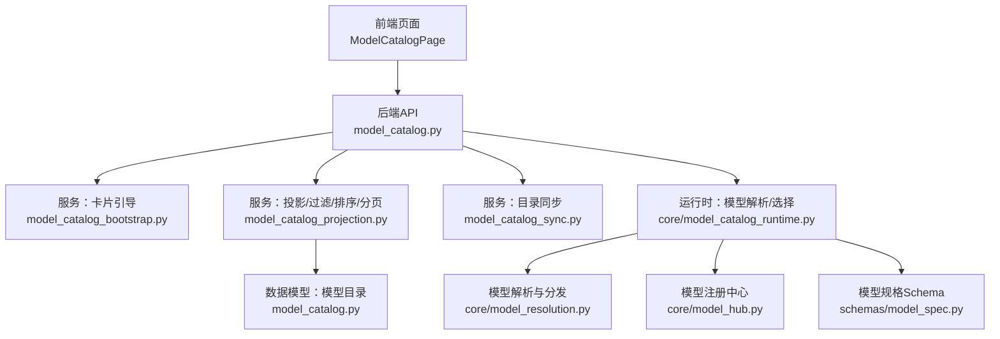
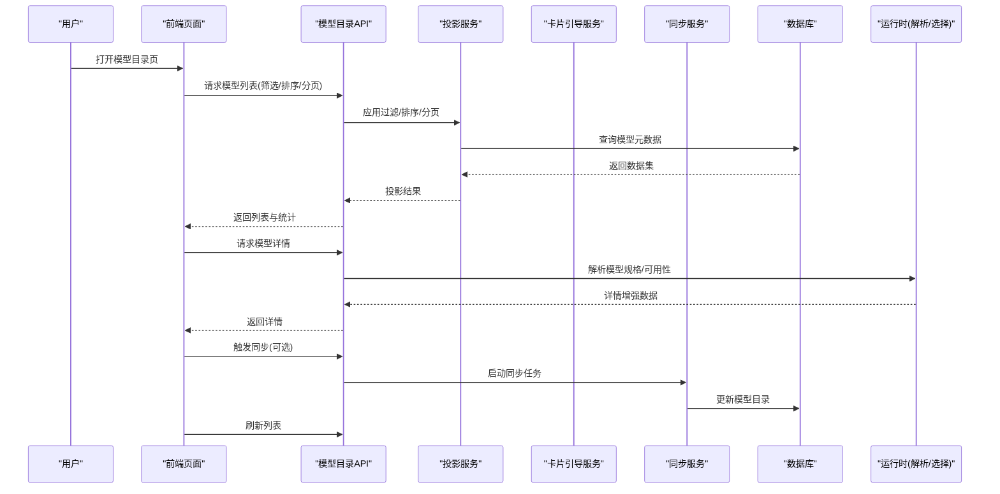
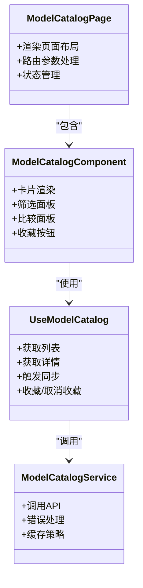
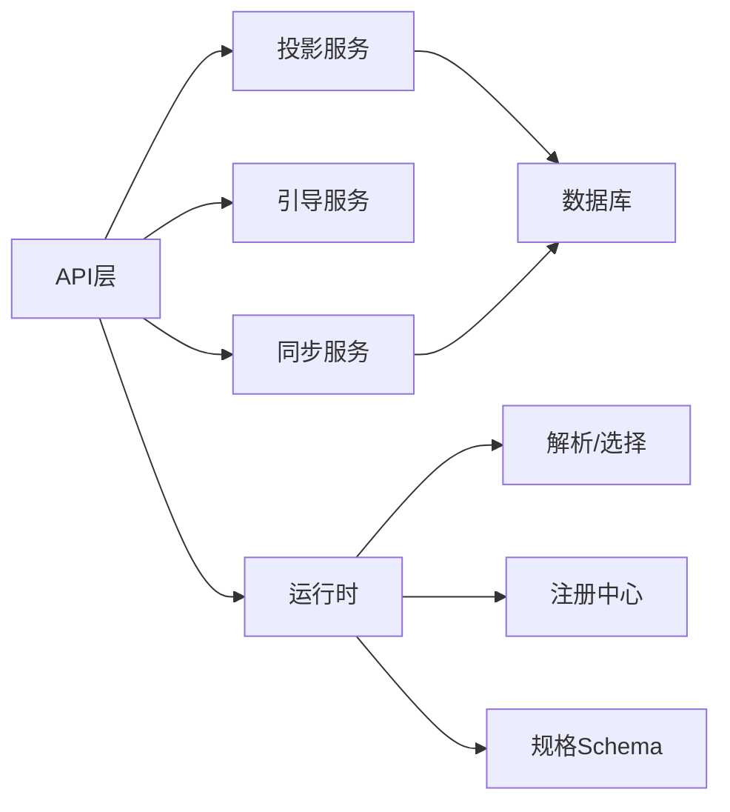

# 模型目录页面

<cite>
**本文引用的文件**   
- [backend/app/api/v1/model_catalog.py](file://backend/app/api/v1/model_catalog.py)
- [backend/app/models/model_catalog.py](file://backend/app/models/model_catalog.py)
- [backend/app/services/model_catalog_bootstrap.py](file://backend/app/services/model_catalog_bootstrap.py)
- [backend/app/services/model_catalog_projection.py](file://backend/app/services/model_catalog_projection.py)
- [backend/app/services/model_catalog_sync.py](file://backend/app/services/model_catalog_sync.py)
- [backend/app/scripts/bootstrap_model_catalog_cards.py](file://backend/app/scripts/bootstrap_model_catalog_cards.py)
- [core/model_catalog_runtime.py](file://core/model_catalog_runtime.py)
- [core/model_hub.py](file://core/model_hub.py)
- [core/model_resolution.py](file://core/model_resolution.py)
- [schemas/model_spec.py](file://schemas/model_spec.py)
- [frontend/src/pages/ModelCatalogPage.tsx](file://frontend/src/pages/ModelCatalogPage.tsx)
- [frontend/src/components/model-catalog/index.tsx](file://frontend/src/components/model-catalog/index.tsx)
- [frontend/src/hooks/useModelCatalog.ts](file://frontend/src/hooks/useModelCatalog.ts)
- [frontend/src/services/modelCatalogService.ts](file://frontend/src/services/modelCatalogService.ts)
</cite>

## 目录
1. [简介](#简介)
2. [项目结构](#项目结构)
3. [核心组件](#核心组件)
4. [架构总览](#架构总览)
5. [详细组件分析](#详细组件分析)
6. [依赖关系分析](#依赖关系分析)
7. [性能考量](#性能考量)
8. [故障排查指南](#故障排查指南)
9. [结论](#结论)
10. [附录：API与集成](#附录api与集成)

## 简介
本文件面向“模型目录页面”的功能文档，覆盖AI模型的浏览、筛选与比较；模型信息展示、性能指标与使用统计；模型测试界面、参数调优与结果对比；模型安装、配置与版本管理；推荐算法、个性化推荐与收藏功能；以及API文档、SDK下载与集成指南。内容基于后端API、数据模型、服务层、运行时解析与前端页面实现进行系统化梳理，帮助开发者与使用者快速理解并高效使用模型目录能力。

## 项目结构
围绕模型目录的核心代码分布在以下位置：
- 后端API路由：提供模型目录的查询、详情、同步、卡片初始化等接口
- 数据模型：定义模型目录表结构与字段
- 服务层：负责卡片引导、投影（过滤/排序/分页）、同步（拉取/更新）
- 运行时：统一解析模型规格、选择与分发
- 前端：页面、组件、Hook与服务封装，支撑UI交互与数据获取

图表来源
- [backend/app/api/v1/model_catalog.py](file://backend/app/api/v1/model_catalog.py)
- [backend/app/services/model_catalog_bootstrap.py](file://backend/app/services/model_catalog_bootstrap.py)
- [backend/app/services/model_catalog_projection.py](file://backend/app/services/model_catalog_projection.py)
- [backend/app/services/model_catalog_sync.py](file://backend/app/services/model_catalog_sync.py)
- [backend/app/models/model_catalog.py](file://backend/app/models/model_catalog.py)
- [core/model_catalog_runtime.py](file://core/model_catalog_runtime.py)
- [core/model_resolution.py](file://core/model_resolution.py)
- [core/model_hub.py](file://core/model_hub.py)
- [schemas/model_spec.py](file://schemas/model_spec.py)

章节来源
- [backend/app/api/v1/model_catalog.py](file://backend/app/api/v1/model_catalog.py)
- [backend/app/models/model_catalog.py](file://backend/app/models/model_catalog.py)
- [backend/app/services/model_catalog_bootstrap.py](file://backend/app/services/model_catalog_bootstrap.py)
- [backend/app/services/model_catalog_projection.py](file://backend/app/services/model_catalog_projection.py)
- [backend/app/services/model_catalog_sync.py](file://backend/app/services/model_catalog_sync.py)
- [core/model_catalog_runtime.py](file://core/model_catalog_runtime.py)
- [core/model_resolution.py](file://core/model_resolution.py)
- [core/model_hub.py](file://core/model_hub.py)
- [schemas/model_spec.py](file://schemas/model_spec.py)

## 核心组件
- 模型目录API：对外暴露模型列表、详情、筛选、排序、分页、同步、卡片初始化等接口
- 数据模型：持久化模型元数据、版本、标签、性能指标、使用统计、收藏状态等
- 服务层：
  - 卡片引导：初始化默认卡片、校验与标记验证状态
  - 投影：按条件过滤、多字段排序、分页、聚合统计
  - 同步：从上游源拉取或增量更新模型目录，处理冲突与回滚
- 运行时：统一解析模型规格、动态选择适配策略、缓存与热更新
- 前端：页面与组件承载浏览、筛选、比较、测试、收藏、推荐等交互

章节来源
- [backend/app/api/v1/model_catalog.py](file://backend/app/api/v1/model_catalog.py)
- [backend/app/models/model_catalog.py](file://backend/app/models/model_catalog.py)
- [backend/app/services/model_catalog_bootstrap.py](file://backend/app/services/model_catalog_bootstrap.py)
- [backend/app/services/model_catalog_projection.py](file://backend/app/services/model_catalog_projection.py)
- [backend/app/services/model_catalog_sync.py](file://backend/app/services/model_catalog_sync.py)
- [core/model_catalog_runtime.py](file://core/model_catalog_runtime.py)

## 架构总览
模型目录页面采用前后端分离架构，前端通过REST API访问后端服务，服务层协调数据库与运行时模块完成数据的读取、过滤、排序与模型选择。同步任务可异步执行，保障主流程性能。

图表来源
- [backend/app/api/v1/model_catalog.py](file://backend/app/api/v1/model_catalog.py)
- [backend/app/services/model_catalog_projection.py](file://backend/app/services/model_catalog_projection.py)
- [backend/app/services/model_catalog_bootstrap.py](file://backend/app/services/model_catalog_bootstrap.py)
- [backend/app/services/model_catalog_sync.py](file://backend/app/services/model_catalog_sync.py)
- [core/model_catalog_runtime.py](file://core/model_catalog_runtime.py)

## 详细组件分析

### 模型目录API
- 职责：接收前端请求，调用投影/引导/同步服务，返回标准化响应
- 关键能力：
  - 列表查询：支持按类型、标签、厂商、状态、评分等筛选；支持多字段排序与分页
  - 详情查询：返回模型基础信息、版本、性能指标、使用统计、兼容性、文档链接
  - 同步接口：触发全量/增量同步，返回任务ID与进度
  - 卡片引导：初始化默认卡片，确保首次加载体验
- 错误处理：参数校验失败、权限不足、同步冲突、数据不一致等

章节来源
- [backend/app/api/v1/model_catalog.py](file://backend/app/api/v1/model_catalog.py)

### 数据模型：模型目录
- 职责：持久化模型目录相关数据
- 关键字段：
  - 基本信息：名称、标识、类型、厂商、描述、标签、状态
  - 版本管理：版本号、发布渠道、变更日志、兼容矩阵
  - 性能指标：延迟、吞吐、成本、成功率、质量评分
  - 使用统计：调用次数、活跃用户数、收藏数、平均评分
  - 收藏与偏好：用户收藏、最近使用、个性化权重
- 约束与索引：唯一性约束、常用查询字段索引、时间戳字段

章节来源
- [backend/app/models/model_catalog.py](file://backend/app/models/model_catalog.py)

### 服务：卡片引导
- 职责：在系统初始化或首次访问时创建默认卡片，确保目录可用
- 关键逻辑：
  - 检查是否存在默认卡片
  - 生成默认卡片数据并写入数据库
  - 标记为已验证或待验证状态
- 异常处理：重复初始化、数据格式校验失败、写入失败重试

章节来源
- [backend/app/services/model_catalog_bootstrap.py](file://backend/app/services/model_catalog_bootstrap.py)

### 服务：投影（过滤/排序/分页）
- 职责：对模型数据进行条件过滤、多字段排序、分页与聚合统计
- 关键能力：
  - 过滤：按类型、标签、厂商、状态、评分区间、更新时间等
  - 排序：按热度、评分、延迟、成本、更新时间等
  - 分页：游标或偏移分页，支持大数据集
  - 聚合：统计总数、分类计数、评分分布
- 优化：索引命中、避免N+1查询、缓存热点结果

章节来源
- [backend/app/services/model_catalog_projection.py](file://backend/app/services/model_catalog_projection.py)

### 服务：目录同步
- 职责：从上游源拉取或增量更新模型目录，保证数据一致性
- 关键逻辑：
  - 增量检测：基于时间戳或版本号差异
  - 冲突处理：合并策略、回滚机制
  - 任务调度：异步执行、进度上报、失败重试
- 监控：同步耗时、成功率、数据差异报告

章节来源
- [backend/app/services/model_catalog_sync.py](file://backend/app/services/model_catalog_sync.py)

### 运行时：模型解析与选择
- 职责：统一解析模型规格，动态选择适配策略，提供运行时决策
- 关键能力：
  - 规格解析：依据Schema校验与转换
  - 策略选择：基于上下文、负载、成本、质量等维度
  - 缓存与热更新：提升响应速度，支持动态切换
- 扩展点：新增模型类型或适配器时的接入方式

章节来源
- [core/model_catalog_runtime.py](file://core/model_catalog_runtime.py)
- [core/model_resolution.py](file://core/model_resolution.py)
- [core/model_hub.py](file://core/model_hub.py)
- [schemas/model_spec.py](file://schemas/model_spec.py)

### 前端：模型目录页面与组件
- 页面：ModelCatalogPage 承载整体布局与路由
- 组件：model-catalog/index.tsx 提供卡片、列表、筛选面板、比较面板
- Hook：useModelCatalog 封装数据获取、状态管理、事件处理
- 服务：modelCatalogService.ts 封装API调用、错误处理、缓存策略

图表来源
- [frontend/src/pages/ModelCatalogPage.tsx](file://frontend/src/pages/ModelCatalogPage.tsx)
- [frontend/src/components/model-catalog/index.tsx](file://frontend/src/components/model-catalog/index.tsx)
- [frontend/src/hooks/useModelCatalog.ts](file://frontend/src/hooks/useModelCatalog.ts)
- [frontend/src/services/modelCatalogService.ts](file://frontend/src/services/modelCatalogService.ts)

章节来源
- [frontend/src/pages/ModelCatalogPage.tsx](file://frontend/src/pages/ModelCatalogPage.tsx)
- [frontend/src/components/model-catalog/index.tsx](file://frontend/src/components/model-catalog/index.tsx)
- [frontend/src/hooks/useModelCatalog.ts](file://frontend/src/hooks/useModelCatalog.ts)
- [frontend/src/services/modelCatalogService.ts](file://frontend/src/services/modelCatalogService.ts)

## 依赖关系分析
- 耦合度：API层与投影/引导/同步服务解耦，便于独立测试与扩展
- 内聚性：各服务职责单一，数据流向清晰
- 外部依赖：数据库、上游模型源、缓存（可选）
- 循环依赖：无直接循环，运行时与Schema解耦

图表来源
- [backend/app/api/v1/model_catalog.py](file://backend/app/api/v1/model_catalog.py)
- [backend/app/services/model_catalog_projection.py](file://backend/app/services/model_catalog_projection.py)
- [backend/app/services/model_catalog_bootstrap.py](file://backend/app/services/model_catalog_bootstrap.py)
- [backend/app/services/model_catalog_sync.py](file://backend/app/services/model_catalog_sync.py)
- [core/model_catalog_runtime.py](file://core/model_catalog_runtime.py)
- [core/model_resolution.py](file://core/model_resolution.py)
- [core/model_hub.py](file://core/model_hub.py)
- [schemas/model_spec.py](file://schemas/model_spec.py)

章节来源
- [backend/app/api/v1/model_catalog.py](file://backend/app/api/v1/model_catalog.py)
- [backend/app/services/model_catalog_projection.py](file://backend/app/services/model_catalog_projection.py)
- [backend/app/services/model_catalog_bootstrap.py](file://backend/app/services/model_catalog_bootstrap.py)
- [backend/app/services/model_catalog_sync.py](file://backend/app/services/model_catalog_sync.py)
- [core/model_catalog_runtime.py](file://core/model_catalog_runtime.py)

## 性能考量
- 查询优化：投影服务利用索引与分页，避免全表扫描；热点数据缓存
- 同步优化：增量同步减少带宽与存储压力；失败重试与幂等设计
- 运行时优化：规格解析缓存、策略选择预计算、降级与熔断
- 前端优化：懒加载、虚拟滚动、请求去抖与合并

[本节为通用性能建议，不直接分析具体文件]

## 故障排查指南
- 常见问题：
  - 列表为空：检查卡片引导是否执行、同步任务是否成功、数据库连接是否正常
  - 筛选无效：确认筛选字段索引与投影逻辑是否正确
  - 详情缺失：检查运行时解析是否成功、模型规格是否符合Schema
  - 同步失败：查看上游源可达性、认证配置、网络超时与重试策略
- 调试步骤：
  - 启用详细日志，定位错误堆栈
  - 使用脚本验证模型配置与连通性
  - 检查数据库迁移与索引状态
  - 前端网络请求抓包，核对API响应结构

章节来源
- [backend/app/scripts/bootstrap_model_catalog_cards.py](file://backend/app/scripts/bootstrap_model_catalog_cards.py)

## 结论
模型目录页面通过清晰的API、健壮的服务层与灵活的运行时，实现了完整的模型浏览、筛选、比较、测试、收藏与推荐能力。配合完善的性能优化与故障排查手段，可为用户提供稳定高效的模型发现与管理体验。

[本节为总结性内容，不直接分析具体文件]

## 附录：API与集成

### API概览
- 列表查询：支持筛选、排序、分页，返回模型摘要与统计
- 详情查询：返回完整元数据、版本、性能指标、使用统计、兼容性
- 同步接口：触发全量/增量同步，返回任务ID与进度
- 收藏接口：添加/移除收藏，返回用户偏好更新结果

章节来源
- [backend/app/api/v1/model_catalog.py](file://backend/app/api/v1/model_catalog.py)

### 数据模型字段说明
- 基本信息：名称、标识、类型、厂商、描述、标签、状态
- 版本管理：版本号、发布渠道、变更日志、兼容矩阵
- 性能指标：延迟、吞吐、成本、成功率、质量评分
- 使用统计：调用次数、活跃用户数、收藏数、平均评分
- 收藏与偏好：用户收藏、最近使用、个性化权重

章节来源
- [backend/app/models/model_catalog.py](file://backend/app/models/model_catalog.py)

### 运行时与规格
- 规格解析：依据Schema校验与转换，确保输入输出一致
- 策略选择：基于上下文、负载、成本、质量等多维度决策
- 缓存与热更新：提升响应速度，支持动态切换

章节来源
- [core/model_catalog_runtime.py](file://core/model_catalog_runtime.py)
- [core/model_resolution.py](file://core/model_resolution.py)
- [core/model_hub.py](file://core/model_hub.py)
- [schemas/model_spec.py](file://schemas/model_spec.py)

### 前端集成要点
- 页面与组件：使用ModelCatalogPage与model-catalog组件构建界面
- Hook与服务：通过useModelCatalog与modelCatalogService封装数据流
- 交互能力：筛选、排序、分页、比较、收藏、测试、推荐

章节来源
- [frontend/src/pages/ModelCatalogPage.tsx](file://frontend/src/pages/ModelCatalogPage.tsx)
- [frontend/src/components/model-catalog/index.tsx](file://frontend/src/components/model-catalog/index.tsx)
- [frontend/src/hooks/useModelCatalog.ts](file://frontend/src/hooks/useModelCatalog.ts)
- [frontend/src/services/modelCatalogService.ts](file://frontend/src/services/modelCatalogService.ts)