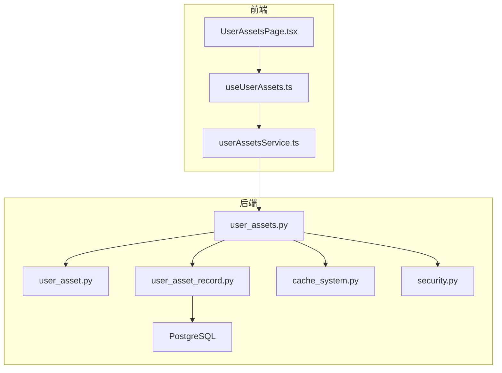
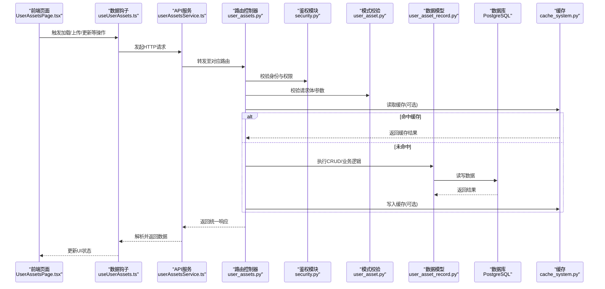
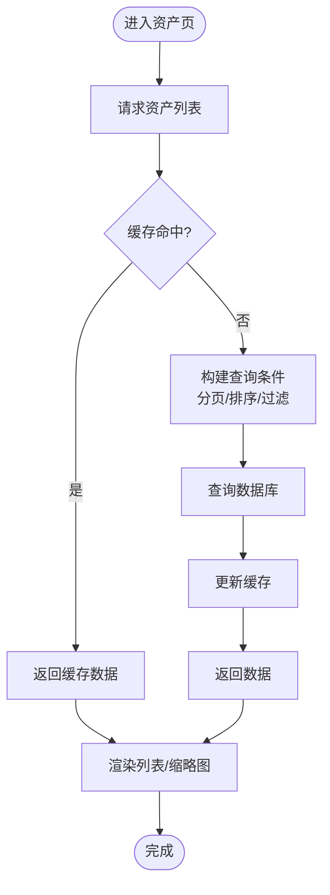
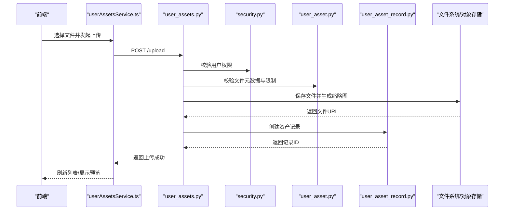
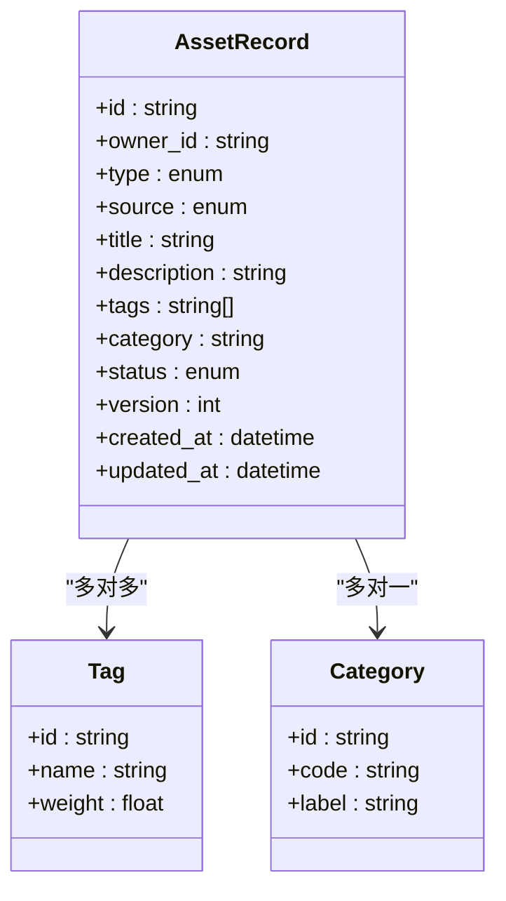
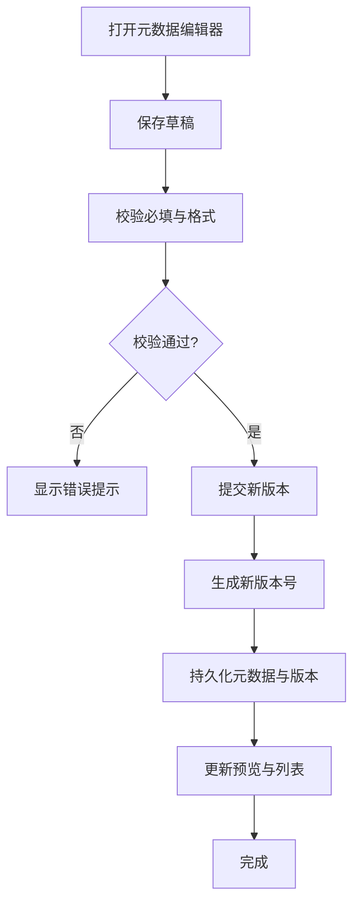
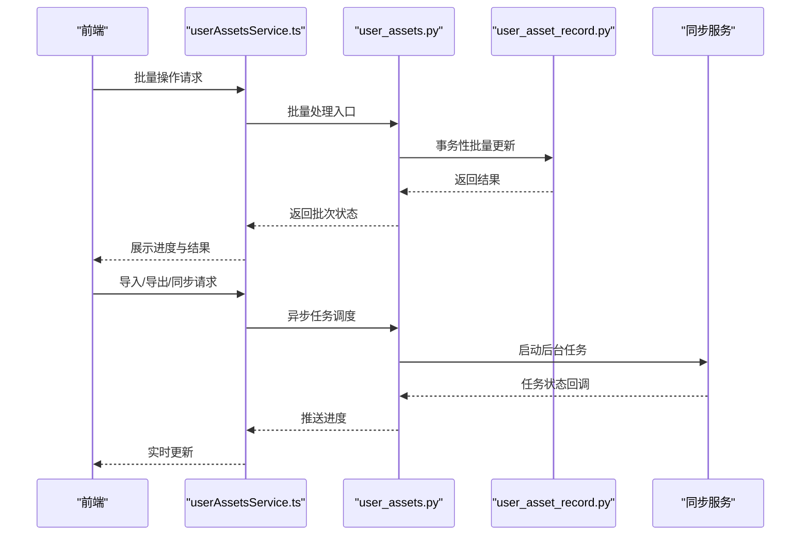
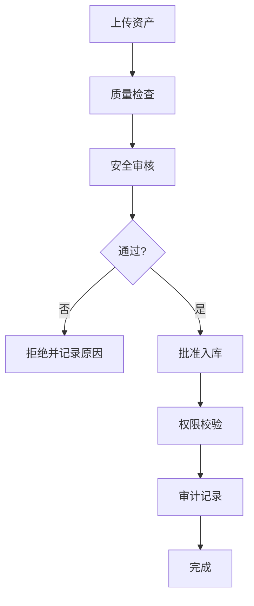
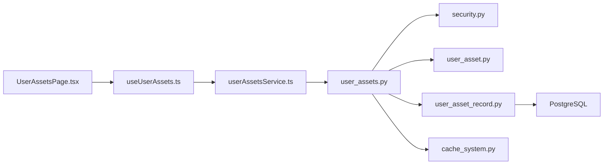

# 用户资产页面

<cite>
**本文引用的文件**   
- [backend/app/api/v1/user_assets.py](file://backend/app/api/v1/user_assets.py)
- [backend/app/schemas/user_asset.py](file://backend/app/schemas/user_asset.py)
- [backend/app/models/user_asset_record.py](file://backend/app/models/user_asset_record.py)
- [backend/alembic/versions/add_user_asset_records.py](file://backend/alembic/versions/add_user_asset_records.py)
- [backend/app/services/cache_system.py](file://backend/app/services/cache_system.py)
- [backend/app/core/security.py](file://backend/app/core/security.py)
- [frontend/src/pages/UserAssetsPage.tsx](file://frontend/src/pages/UserAssetsPage.tsx)
- [frontend/src/hooks/useUserAssets.ts](file://frontend/src/hooks/useUserAssets.ts)
- [frontend/src/services/userAssetsService.ts](file://frontend/src/services/userAssetsService.ts)
- [docs/contracts/USER_ASSET_LOCAL_STORAGE_METADATA_CONTRACT.md](file://docs/contracts/USER_ASSET_LOCAL_STORAGE_METADATA_CONTRACT.md)
- [docs/contracts/USER_ASSET_SOURCE_PAYLOAD_SHAPES.md](file://docs/contracts/USER_ASSET_SOURCE_PAYLOAD_SHAPES.md)
</cite>

## 目录
1. [简介](#简介)
2. [项目结构](#项目结构)
3. [核心组件](#核心组件)
4. [架构总览](#架构总览)
5. [详细组件分析](#详细组件分析)
6. [依赖关系分析](#依赖关系分析)
7. [性能考虑](#性能考虑)
8. [故障排查指南](#故障排查指南)
9. [结论](#结论)
10. [附录](#附录)

## 简介
本文件为用户资产页面的功能文档，覆盖资产库浏览、上传与管理、分类与标签、搜索过滤、预览与元数据编辑、版本控制、批量操作、导入导出与同步、质量检查、安全审核与权限管理、本地存储、云同步与数据迁移等能力。文档面向产品、研发与运维人员，既提供高层概览，也给出代码级结构与关键流程说明，帮助快速理解与使用。

## 项目结构
用户资产相关的前后端结构如下：
- 前端页面与服务层：
  - 页面入口：UserAssetsPage.tsx
  - 数据钩子：useUserAssets.ts
  - API 服务封装：userAssetsService.ts
- 后端接口与模型：
  - 路由与控制器：user_assets.py
  - 数据模型：user_asset_record.py
  - 请求/响应模式：user_asset.py
  - 数据库迁移：add_user_asset_records.py
- 支撑能力：
  - 缓存系统：cache_system.py
  - 安全与鉴权：security.py
  - 本地存储契约与载荷形状：USER_ASSET_LOCAL_STORAGE_METADATA_CONTRACT.md、USER_ASSET_SOURCE_PAYLOAD_SHAPES.md

图表来源
- [backend/app/api/v1/user_assets.py](file://backend/app/api/v1/user_assets.py)
- [backend/app/schemas/user_asset.py](file://backend/app/schemas/user_asset.py)
- [backend/app/models/user_asset_record.py](file://backend/app/models/user_asset_record.py)
- [backend/app/services/cache_system.py](file://backend/app/services/cache_system.py)
- [backend/app/core/security.py](file://backend/app/core/security.py)
- [frontend/src/pages/UserAssetsPage.tsx](file://frontend/src/pages/UserAssetsPage.tsx)
- [frontend/src/hooks/useUserAssets.ts](file://frontend/src/hooks/useUserAssets.ts)
- [frontend/src/services/userAssetsService.ts](file://frontend/src/services/userAssetsService.ts)

章节来源
- [backend/app/api/v1/user_assets.py](file://backend/app/api/v1/user_assets.py)
- [backend/app/schemas/user_asset.py](file://backend/app/schemas/user_asset.py)
- [backend/app/models/user_asset_record.py](file://backend/app/models/user_asset_record.py)
- [backend/alembic/versions/add_user_asset_records.py](file://backend/alembic/versions/add_user_asset_records.py)
- [backend/app/services/cache_system.py](file://backend/app/services/cache_system.py)
- [backend/app/core/security.py](file://backend/app/core/security.py)
- [frontend/src/pages/UserAssetsPage.tsx](file://frontend/src/pages/UserAssetsPage.tsx)
- [frontend/src/hooks/useUserAssets.ts](file://frontend/src/hooks/useUserAssets.ts)
- [frontend/src/services/userAssetsService.ts](file://frontend/src/services/userAssetsService.ts)

## 核心组件
- 资产路由与控制器（user_assets.py）
  - 负责接收前端请求，校验参数，调用领域服务，返回统一响应。
  - 典型能力：列表查询、详情获取、上传、更新元数据、删除、批量操作、导入导出、同步状态查询。
- 数据模型（user_asset_record.py）
  - 定义资产记录的核心字段与关系，如归属用户、类型、来源、路径、元数据、版本、状态、时间戳等。
- 请求/响应模式（user_asset.py）
  - 定义上传、更新、搜索、批量操作的输入输出结构，确保前后端契约一致。
- 缓存系统（cache_system.py）
  - 为高频读取场景提供缓存加速，如资产列表、预览缩略图、热门资产索引等。
- 安全与鉴权（security.py）
  - 校验用户身份与权限，保障资源访问隔离与操作审计。
- 前端页面与服务（UserAssetsPage.tsx, useUserAssets.ts, userAssetsService.ts）
  - 页面渲染、交互逻辑、API 调用封装、错误处理与状态管理。

章节来源
- [backend/app/api/v1/user_assets.py](file://backend/app/api/v1/user_assets.py)
- [backend/app/schemas/user_asset.py](file://backend/app/schemas/user_asset.py)
- [backend/app/models/user_asset_record.py](file://backend/app/models/user_asset_record.py)
- [backend/app/services/cache_system.py](file://backend/app/services/cache_system.py)
- [backend/app/core/security.py](file://backend/app/core/security.py)
- [frontend/src/pages/UserAssetsPage.tsx](file://frontend/src/pages/UserAssetsPage.tsx)
- [frontend/src/hooks/useUserAssets.ts](file://frontend/src/hooks/useUserAssets.ts)
- [frontend/src/services/userAssetsService.ts](file://frontend/src/services/userAssetsService.ts)

## 架构总览
用户资产页面采用前后端分离架构，前端通过 RESTful API 与后端交互，后端基于 FastAPI 风格的路由与 Pydantic 模式进行参数校验，数据持久化到 PostgreSQL，并通过缓存提升读性能。

图表来源
- [backend/app/api/v1/user_assets.py](file://backend/app/api/v1/user_assets.py)
- [backend/app/schemas/user_asset.py](file://backend/app/schemas/user_asset.py)
- [backend/app/models/user_asset_record.py](file://backend/app/models/user_asset_record.py)
- [backend/app/services/cache_system.py](file://backend/app/services/cache_system.py)
- [backend/app/core/security.py](file://backend/app/core/security.py)
- [frontend/src/pages/UserAssetsPage.tsx](file://frontend/src/pages/UserAssetsPage.tsx)
- [frontend/src/hooks/useUserAssets.ts](file://frontend/src/hooks/useUserAssets.ts)
- [frontend/src/services/userAssetsService.ts](file://frontend/src/services/userAssetsService.ts)

## 详细组件分析

### 资产库浏览与搜索过滤
- 功能要点
  - 分页列表：支持按用户维度分页、排序与筛选。
  - 分类与标签：按资产类型、来源、标签集合进行过滤。
  - 全文检索：支持标题、描述、标签的模糊匹配。
  - 预览缩略图：根据媒体类型生成或返回缩略图链接。
- 实现要点
  - 路由层聚合查询条件，优先走缓存；未命中则查询数据库。
  - 模式层对分页、排序、过滤参数进行严格校验。
  - 前端分页控件与搜索框联动，防抖减少请求。

图表来源
- [backend/app/api/v1/user_assets.py](file://backend/app/api/v1/user_assets.py)
- [backend/app/schemas/user_asset.py](file://backend/app/schemas/user_asset.py)
- [backend/app/services/cache_system.py](file://backend/app/services/cache_system.py)

章节来源
- [backend/app/api/v1/user_assets.py](file://backend/app/api/v1/user_assets.py)
- [backend/app/schemas/user_asset.py](file://backend/app/schemas/user_asset.py)
- [backend/app/services/cache_system.py](file://backend/app/services/cache_system.py)

### 资产上传与管理
- 功能要点
  - 单文件/多文件上传：支持图片、音频、视频、文档等类型。
  - 元数据编辑：标题、描述、标签、分类、自定义字段。
  - 预览与下载：在线预览与下载原文件。
  - 删除与回收站：软删除与恢复策略。
- 实现要点
  - 上传接口校验文件类型、大小限制，生成唯一标识与存储路径。
  - 元数据更新走模式校验，保证字段完整性。
  - 删除操作记录审计日志，支持软删除与定时清理。

图表来源
- [backend/app/api/v1/user_assets.py](file://backend/app/api/v1/user_assets.py)
- [backend/app/schemas/user_asset.py](file://backend/app/schemas/user_asset.py)
- [backend/app/models/user_asset_record.py](file://backend/app/models/user_asset_record.py)
- [backend/app/core/security.py](file://backend/app/core/security.py)

章节来源
- [backend/app/api/v1/user_assets.py](file://backend/app/api/v1/user_assets.py)
- [backend/app/schemas/user_asset.py](file://backend/app/schemas/user_asset.py)
- [backend/app/models/user_asset_record.py](file://backend/app/models/user_asset_record.py)
- [backend/app/core/security.py](file://backend/app/core/security.py)

### 分类、标签系统与搜索过滤
- 分类体系
  - 类型：图片、音频、视频、文档等。
  - 来源：用户上传、系统生成、第三方导入。
  - 项目/工作区：按项目维度隔离。
- 标签系统
  - 自由标签与预置标签并存，支持标签合并与去重。
  - 标签权重用于排序与推荐。
- 搜索过滤
  - 关键词搜索、标签多选、类型单选、时间范围、状态过滤。
  - 高级搜索支持正则与布尔表达式（可扩展）。

图表来源
- [backend/app/models/user_asset_record.py](file://backend/app/models/user_asset_record.py)
- [backend/app/schemas/user_asset.py](file://backend/app/schemas/user_asset.py)

章节来源
- [backend/app/models/user_asset_record.py](file://backend/app/models/user_asset_record.py)
- [backend/app/schemas/user_asset.py](file://backend/app/schemas/user_asset.py)

### 预览、元数据编辑与版本控制
- 预览
  - 媒体类型自动识别，生成缩略图或在线播放器。
  - 大文件分片预览，避免内存溢出。
- 元数据编辑
  - 表单驱动，实时校验，支持草稿保存。
  - 变更历史可追溯，支持回滚。
- 版本控制
  - 每次重要修改生成新版本号，保留历史版本。
  - 版本对比与差异展示（文本类）。
  - 默认版本标记与切换。

图表来源
- [backend/app/api/v1/user_assets.py](file://backend/app/api/v1/user_assets.py)
- [backend/app/schemas/user_asset.py](file://backend/app/schemas/user_asset.py)
- [backend/app/models/user_asset_record.py](file://backend/app/models/user_asset_record.py)

章节来源
- [backend/app/api/v1/user_assets.py](file://backend/app/api/v1/user_assets.py)
- [backend/app/schemas/user_asset.py](file://backend/app/schemas/user_asset.py)
- [backend/app/models/user_asset_record.py](file://backend/app/models/user_asset_record.py)

### 批量操作、导入导出与同步
- 批量操作
  - 批量移动、复制、删除、打标签、改分类。
  - 进度条与失败重试，支持断点续传。
- 导入导出
  - 导入：CSV/JSON 清单导入，映射字段，冲突策略。
  - 导出：按筛选条件导出清单与附件打包。
- 同步
  - 本地与云端双向同步，冲突检测与合并策略。
  - 增量同步与全量同步模式。

图表来源
- [backend/app/api/v1/user_assets.py](file://backend/app/api/v1/user_assets.py)
- [backend/app/models/user_asset_record.py](file://backend/app/models/user_asset_record.py)

章节来源
- [backend/app/api/v1/user_assets.py](file://backend/app/api/v1/user_assets.py)
- [backend/app/models/user_asset_record.py](file://backend/app/models/user_asset_record.py)

### 资产质量检查、安全审核与权限管理
- 质量检查
  - 媒体质量检测：分辨率、码率、时长、格式合规。
  - 内容语义检查：重复、低质、违规内容识别。
- 安全审核
  - 敏感词、图像/音视频内容审核，拦截与告警。
  - 审核记录与人工复核通道。
- 权限管理
  - 基于角色的访问控制（RBAC），细粒度到资产级别。
  - 操作审计日志，追踪敏感操作。

图表来源
- [backend/app/api/v1/user_assets.py](file://backend/app/api/v1/user_assets.py)
- [backend/app/core/security.py](file://backend/app/core/security.py)

章节来源
- [backend/app/api/v1/user_assets.py](file://backend/app/api/v1/user_assets.py)
- [backend/app/core/security.py](file://backend/app/core/security.py)

### 本地存储、云同步与数据迁移
- 本地存储
  - 本地磁盘或对象存储作为主存储，支持冷热分层。
  - 本地元数据契约与载荷形状规范，便于离线处理。
- 云同步
  - 与云端服务双向同步，冲突解决策略可配置。
  - 网络异常重试与断点续传。
- 数据迁移
  - 数据库迁移脚本管理，版本化演进。
  - 数据备份与恢复，跨环境迁移工具。

章节来源
- [docs/contracts/USER_ASSET_LOCAL_STORAGE_METADATA_CONTRACT.md](file://docs/contracts/USER_ASSET_LOCAL_STORAGE_METADATA_CONTRACT.md)
- [docs/contracts/USER_ASSET_SOURCE_PAYLOAD_SHAPES.md](file://docs/contracts/USER_ASSET_SOURCE_PAYLOAD_SHAPES.md)
- [backend/alembic/versions/add_user_asset_records.py](file://backend/alembic/versions/add_user_asset_records.py)

## 依赖关系分析
- 前端依赖
  - UserAssetsPage.tsx 依赖 useUserAssets.ts 与 userAssetsService.ts。
  - useUserAssets.ts 封装状态管理与副作用，调用 userAssetsService.ts。
- 后端依赖
  - user_assets.py 依赖 security.py 进行鉴权，user_asset.py 进行模式校验，user_asset_record.py 进行数据持久化。
  - cache_system.py 提供缓存能力，降低数据库压力。
- 外部依赖
  - 对象存储/文件系统用于文件存储。
  - 数据库（PostgreSQL）用于元数据与关系数据。
  - 可选：消息队列用于异步任务（导入/导出/同步）。

图表来源
- [frontend/src/pages/UserAssetsPage.tsx](file://frontend/src/pages/UserAssetsPage.tsx)
- [frontend/src/hooks/useUserAssets.ts](file://frontend/src/hooks/useUserAssets.ts)
- [frontend/src/services/userAssetsService.ts](file://frontend/src/services/userAssetsService.ts)
- [backend/app/api/v1/user_assets.py](file://backend/app/api/v1/user_assets.py)
- [backend/app/core/security.py](file://backend/app/core/security.py)
- [backend/app/schemas/user_asset.py](file://backend/app/schemas/user_asset.py)
- [backend/app/models/user_asset_record.py](file://backend/app/models/user_asset_record.py)
- [backend/app/services/cache_system.py](file://backend/app/services/cache_system.py)

章节来源
- [frontend/src/pages/UserAssetsPage.tsx](file://frontend/src/pages/UserAssetsPage.tsx)
- [frontend/src/hooks/useUserAssets.ts](file://frontend/src/hooks/useUserAssets.ts)
- [frontend/src/services/userAssetsService.ts](file://frontend/src/services/userAssetsService.ts)
- [backend/app/api/v1/user_assets.py](file://backend/app/api/v1/user_assets.py)
- [backend/app/core/security.py](file://backend/app/core/security.py)
- [backend/app/schemas/user_asset.py](file://backend/app/schemas/user_asset.py)
- [backend/app/models/user_asset_record.py](file://backend/app/models/user_asset_record.py)
- [backend/app/services/cache_system.py](file://backend/app/services/cache_system.py)

## 性能考虑
- 缓存策略
  - 列表与热点数据缓存，设置合理过期时间与失效策略。
  - 缩略图与预览资源 CDN 加速。
- 数据库优化
  - 常用查询建立索引（用户ID、类型、标签、更新时间）。
  - 分页查询使用游标或键集分页，避免深分页。
- 并发与异步
  - 批量操作与导入导出使用异步任务，避免阻塞请求。
  - 上传分片并行，提升大文件传输效率。
- 前端优化
  - 虚拟滚动与懒加载，减少首屏渲染压力。
  - 请求防抖与节流，避免频繁触发。

[本节为通用指导，不直接分析具体文件]

## 故障排查指南
- 常见问题
  - 上传失败：检查文件大小限制、类型白名单、存储空间配额。
  - 预览空白：确认缩略图生成是否成功，媒体编码是否兼容。
  - 同步冲突：查看冲突日志，调整合并策略。
  - 权限不足：核对角色与资源访问策略。
- 调试建议
  - 开启详细日志，定位错误堆栈。
  - 使用测试用例复现问题，逐步缩小范围。
  - 监控缓存命中率与数据库慢查询。

章节来源
- [backend/app/api/v1/user_assets.py](file://backend/app/api/v1/user_assets.py)
- [backend/app/core/security.py](file://backend/app/core/security.py)

## 结论
用户资产页面提供了完整的资产生命周期管理能力，涵盖浏览、上传、分类标签、搜索、预览、元数据编辑、版本控制、批量操作、导入导出、同步、质量与安全审核、权限管理以及本地与云端协同。通过清晰的架构设计与严格的模式校验，系统在易用性与可靠性之间取得平衡。建议在生产环境中完善监控与告警，持续优化缓存与数据库性能，确保高可用与可扩展。

[本节为总结性内容，不直接分析具体文件]

## 附录
- 本地存储元数据契约：USER_ASSET_LOCAL_STORAGE_METADATA_CONTRACT.md
- 源载荷形状规范：USER_ASSET_SOURCE_PAYLOAD_SHAPES.md
- 数据库迁移脚本：add_user_asset_records.py

章节来源
- [docs/contracts/USER_ASSET_LOCAL_STORAGE_METADATA_CONTRACT.md](file://docs/contracts/USER_ASSET_LOCAL_STORAGE_METADATA_CONTRACT.md)
- [docs/contracts/USER_ASSET_SOURCE_PAYLOAD_SHAPES.md](file://docs/contracts/USER_ASSET_SOURCE_PAYLOAD_SHAPES.md)
- [backend/alembic/versions/add_user_asset_records.py](file://backend/alembic/versions/add_user_asset_records.py)