# 数据库查询工具

<cite>
**本文引用的文件**   
- [README.md](file://README.md)
- [backend/app/main.py](file://backend/app/main.py)
- [backend/app/core/config.py](file://backend/app/core/config.py)
- [backend/app/core/security.py](file://backend/app/core/security.py)
- [backend/app/core/permissions.py](file://backend/app/core/permissions.py)
- [backend/app/db/base.py](file://backend/app/db/base.py)
- [backend/app/utils/sql_validator.py](file://backend/app/utils/sql_validator.py)
- [backend/app/api/v1/__init__.py](file://backend/app/api/v1/__init__.py)
- [backend/app/models/admin_log.py](file://backend/app/models/admin_log.py)
- [backend/app/services/batch_processor.py](file://backend/app/services/batch_processor.py)
- [backend/app/services/cache_system.py](file://backend/app/services/cache_system.py)
- [backend/app/tasks/audiobook_tasks.py](file://backend/app/tasks/audiobook_tasks.py)
- [frontend/src/pages/index.tsx](file://frontend/src/pages/index.tsx)
- [frontend/src/components/SqlEditor.tsx](file://frontend/src/components/SqlEditor.tsx)
- [frontend/src/components/ResultTable.tsx](file://frontend/src/components/ResultTable.tsx)
- [frontend/src/hooks/useQueryHistory.ts](file://frontend/src/hooks/useQueryHistory.ts)
- [postgres-init/01-init.sql](file://postgres-init/01-init.sql)
</cite>

## 目录
1. [简介](#简介)
2. [项目结构](#项目结构)
3. [核心组件](#核心组件)
4. [架构总览](#架构总览)
5. [详细组件分析](#详细组件分析)
6. [依赖分析](#依赖分析)
7. [性能考虑](#性能考虑)
8. [故障排查指南](#故障排查指南)
9. [结论](#结论)
10. [附录](#附录)

## 简介
本文件为“数据库查询工具”的功能文档，面向使用者与开发者，覆盖以下能力：
- SQL 查询编辑器、语法高亮与智能提示
- 查询结果展示、数据导出与查询历史
- 查询性能分析、慢查询检测与索引优化建议
- 数据表结构查看、关系图展示与字段类型信息
- 查询安全限制、权限控制与审计日志
- 批量操作、事务管理与数据备份

该工具采用前后端分离架构：前端提供可视化编辑与交互体验，后端提供安全的数据库访问、SQL 校验、权限控制、审计记录与任务编排。

## 项目结构
- 前端（React + TypeScript）
  - 页面与组件：SQL 编辑器、结果表格、历史记录等
  - Hooks：封装查询历史、状态管理等
- 后端（FastAPI + SQLAlchemy + Alembic）
  - API 路由：统一入口与模块路由注册
  - 核心：配置、安全、权限
  - 数据层：ORM 基类、模型、迁移
  - 工具：SQL 校验器、缓存、批处理、任务队列
- 数据库初始化脚本：PostgreSQL 初始化 DDL

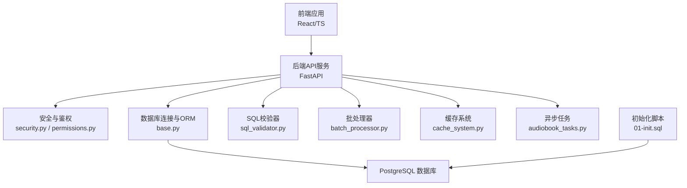

**图示来源** 
- [backend/app/main.py](file://backend/app/main.py)
- [backend/app/core/security.py](file://backend/app/core/security.py)
- [backend/app/core/permissions.py](file://backend/app/core/permissions.py)
- [backend/app/db/base.py](file://backend/app/db/base.py)
- [backend/app/utils/sql_validator.py](file://backend/app/utils/sql_validator.py)
- [backend/app/services/batch_processor.py](file://backend/app/services/batch_processor.py)
- [backend/app/services/cache_system.py](file://backend/app/services/cache_system.py)
- [backend/app/tasks/audiobook_tasks.py](file://backend/app/tasks/audiobook_tasks.py)
- [postgres-init/01-init.sql](file://postgres-init/01-init.sql)

**章节来源**
- [README.md](file://README.md)
- [backend/app/main.py](file://backend/app/main.py)
- [postgres-init/01-init.sql](file://postgres-init/01-init.sql)

## 核心组件
- SQL 查询编辑器与智能提示
  - 前端通过编辑器组件实现输入、语法高亮与自动补全；后端提供元数据接口用于提示与校验。
- 查询执行与安全
  - 后端对 SQL 进行白名单/黑名单校验，限制危险语句与越权访问；结合权限策略控制可访问的库/表/列。
- 结果展示与导出
  - 前端以表格形式渲染结果，支持分页、排序与导出 CSV/JSON。
- 查询历史
  - 前端本地或后端持久化保存最近执行的 SQL 与结果摘要，便于复用与回溯。
- 性能分析与慢查询
  - 后端采集执行耗时、计划信息与锁等待；前端展示慢查询列表与趋势。
- 索引优化建议
  - 基于执行计划与统计信息生成建议，如缺失索引、低效扫描等。
- 表结构与关系图
  - 读取系统目录生成表、字段类型、约束与外键关系，前端以图形化方式呈现。
- 审计日志
  - 记录用户、时间、IP、SQL 摘要、影响行数与结果状态，支持检索与导出。
- 批量操作与事务
  - 批处理器将大任务拆分为批次，配合事务保证一致性；失败回滚并记录错误。
- 数据备份
  - 通过任务队列触发 pg_dump 或逻辑备份流程，支持定时与增量。

**章节来源**
- [frontend/src/components/SqlEditor.tsx](file://frontend/src/components/SqlEditor.tsx)
- [backend/app/utils/sql_validator.py](file://backend/app/utils/sql_validator.py)
- [backend/app/core/permissions.py](file://backend/app/core/permissions.py)
- [backend/app/services/batch_processor.py](file://backend/app/services/batch_processor.py)
- [backend/app/models/admin_log.py](file://backend/app/models/admin_log.py)

## 架构总览
整体采用分层设计：
- 表现层：前端页面与组件
- 接口层：FastAPI 路由与中间件
- 业务层：权限校验、SQL 校验、批处理、缓存、任务调度
- 数据层：ORM、迁移、数据库连接
- 基础设施：PostgreSQL、Redis（可选）、消息队列（可选）

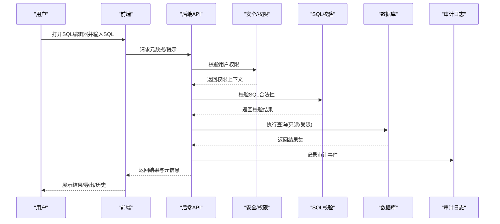

**图示来源** 
- [backend/app/main.py](file://backend/app/main.py)
- [backend/app/core/security.py](file://backend/app/core/security.py)
- [backend/app/core/permissions.py](file://backend/app/core/permissions.py)
- [backend/app/utils/sql_validator.py](file://backend/app/utils/sql_validator.py)
- [backend/app/models/admin_log.py](file://backend/app/models/admin_log.py)

## 详细组件分析

### SQL 编辑器与智能提示
- 功能要点
  - 语法高亮、括号匹配、格式化
  - 智能提示：表名、列名、关键字、函数
  - 实时校验：调用后端校验器反馈错误
- 交互流程
  - 前端在输入时触发节流请求，获取元数据与提示
  - 后端根据当前用户权限过滤可见对象
  - 校验器拒绝危险语句并返回定位信息

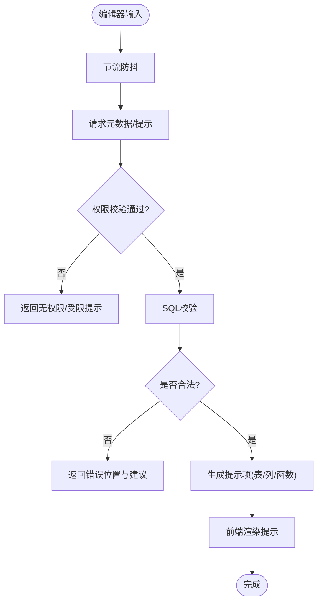

**图示来源** 
- [frontend/src/components/SqlEditor.tsx](file://frontend/src/components/SqlEditor.tsx)
- [backend/app/core/permissions.py](file://backend/app/core/permissions.py)
- [backend/app/utils/sql_validator.py](file://backend/app/utils/sql_validator.py)

**章节来源**
- [frontend/src/components/SqlEditor.tsx](file://frontend/src/components/SqlEditor.tsx)
- [backend/app/core/permissions.py](file://backend/app/core/permissions.py)
- [backend/app/utils/sql_validator.py](file://backend/app/utils/sql_validator.py)

### 查询执行与结果展示
- 执行策略
  - 默认只读模式，写操作需额外授权
  - 结果分页、列宽自适应、空值显示
- 导出能力
  - 支持 CSV/JSON 导出，含列头与编码设置
- 历史管理
  - 本地存储最近 N 条，支持搜索与收藏

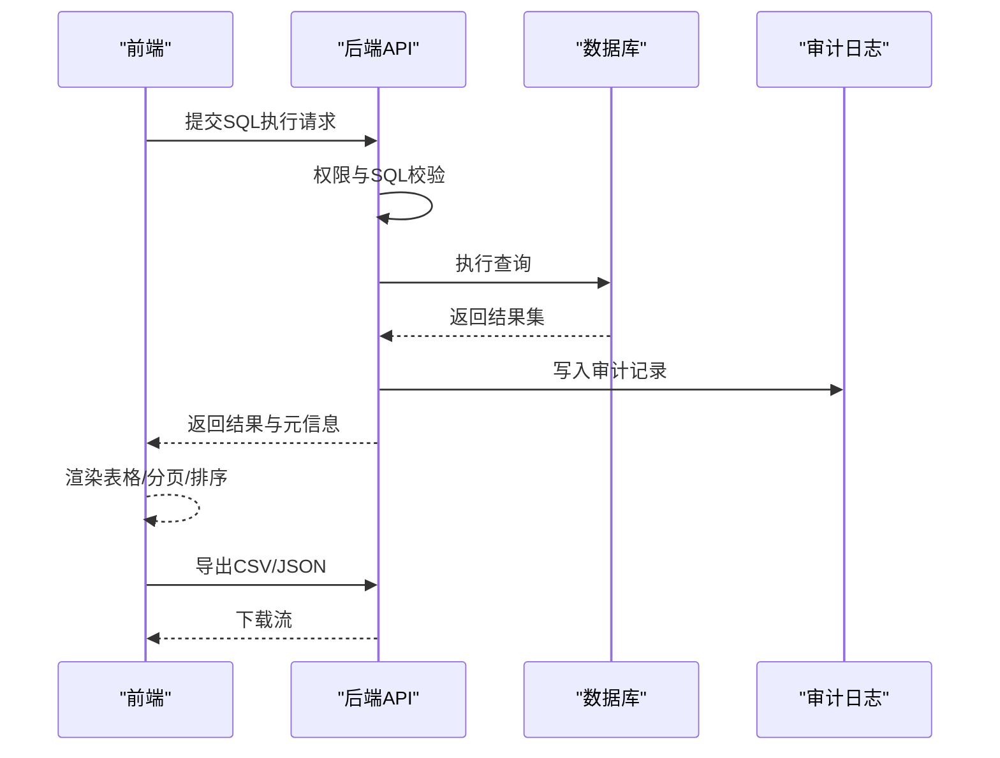

**图示来源** 
- [backend/app/main.py](file://backend/app/main.py)
- [backend/app/models/admin_log.py](file://backend/app/models/admin_log.py)

**章节来源**
- [backend/app/main.py](file://backend/app/main.py)
- [backend/app/models/admin_log.py](file://backend/app/models/admin_log.py)

### 查询历史
- 存储策略
  - 前端本地优先，必要时同步到后端
- 功能特性
  - 按时间/关键词检索、去重、收藏、分享链接

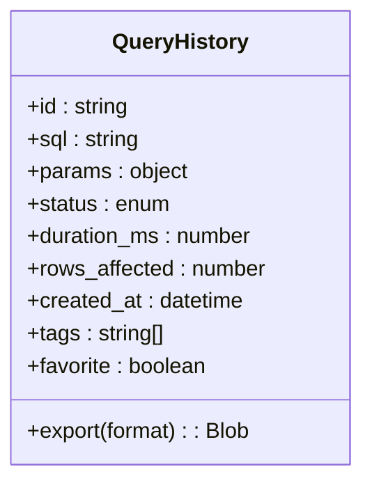

**图示来源** 
- [frontend/src/hooks/useQueryHistory.ts](file://frontend/src/hooks/useQueryHistory.ts)

**章节来源**
- [frontend/src/hooks/useQueryHistory.ts](file://frontend/src/hooks/useQueryHistory.ts)

### 性能分析与慢查询检测
- 指标采集
  - 执行时长、扫描行数、锁等待、临时文件使用
- 慢查询阈值
  - 可配置阈值，超过阈值的查询进入慢查询列表
- 可视化
  - 前端展示趋势图、TopN 慢查询、重复热点

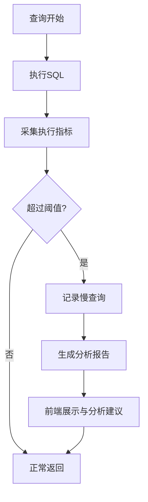

**图示来源** 
- [backend/app/main.py](file://backend/app/main.py)

**章节来源**
- [backend/app/main.py](file://backend/app/main.py)

### 索引优化建议
- 依据
  - 全表扫描、低选择性条件、频繁排序/分组
- 输出
  - 建议创建索引的表/列、预估收益、风险说明
- 验证
  - 建议后对比执行计划与耗时变化

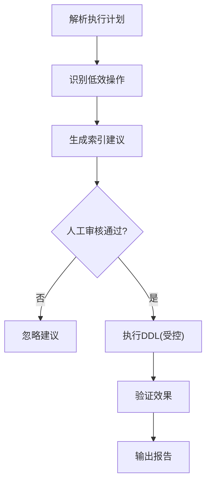

**图示来源** 
- [backend/app/utils/sql_validator.py](file://backend/app/utils/sql_validator.py)

**章节来源**
- [backend/app/utils/sql_validator.py](file://backend/app/utils/sql_validator.py)

### 表结构查看与关系图
- 数据来源
  - 系统目录视图：表、列、类型、约束、索引、外键
- 展示
  - 树形结构、字段类型、默认值、注释
  - ER 图：实体与关系连线

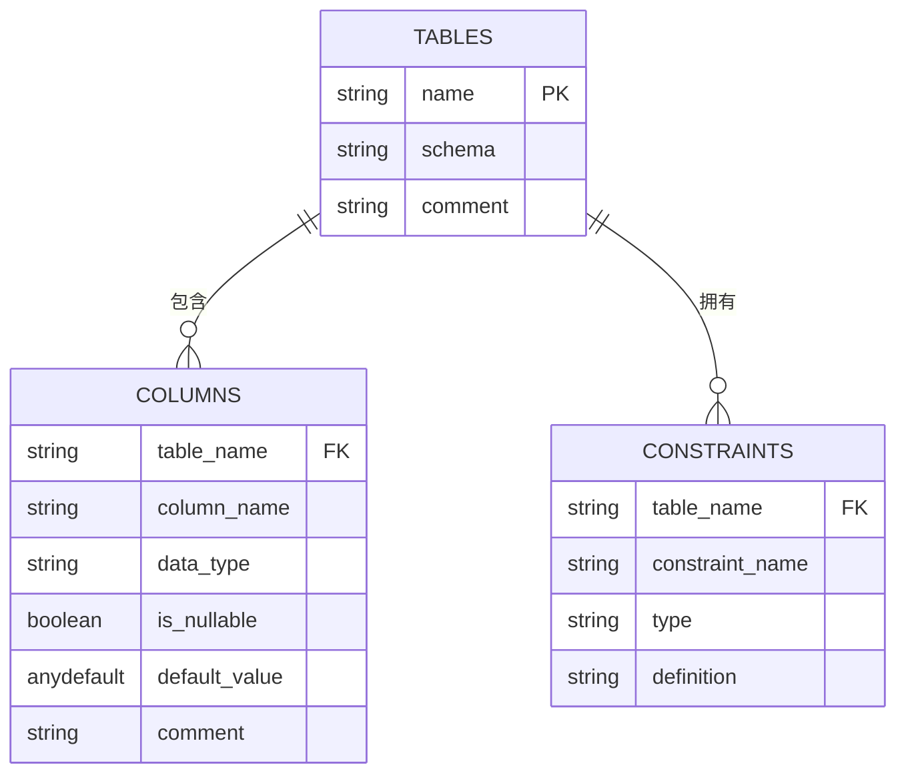

**图示来源** 
- [postgres-init/01-init.sql](file://postgres-init/01-init.sql)

**章节来源**
- [postgres-init/01-init.sql](file://postgres-init/01-init.sql)

### 查询安全限制与权限控制
- 安全策略
  - SQL 白名单/黑名单、禁止危险函数与跨库访问
  - 行级/列级权限映射到用户角色
- 执行隔离
  - 只读账号、连接池隔离、超时与资源限制
- 审计
  - 所有查询均记录审计日志，敏感操作二次确认

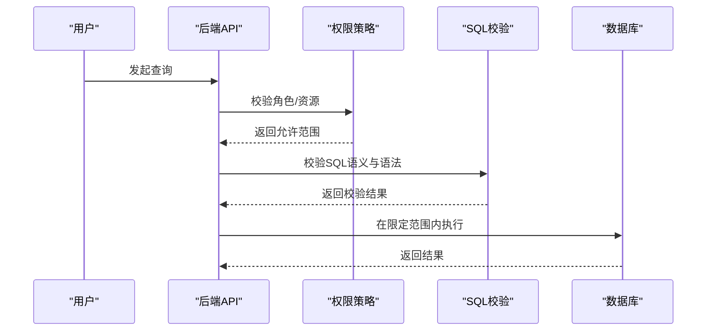

**图示来源** 
- [backend/app/core/security.py](file://backend/app/core/security.py)
- [backend/app/core/permissions.py](file://backend/app/core/permissions.py)
- [backend/app/utils/sql_validator.py](file://backend/app/utils/sql_validator.py)

**章节来源**
- [backend/app/core/security.py](file://backend/app/core/security.py)
- [backend/app/core/permissions.py](file://backend/app/core/permissions.py)
- [backend/app/utils/sql_validator.py](file://backend/app/utils/sql_validator.py)

### 批量操作与事务管理
- 批处理
  - 将大批量写入/更新切分为批次，避免长事务与大锁
- 事务
  - 每批次内开启事务，失败回滚；跨批次补偿策略
- 监控
  - 进度、成功率、失败重试与告警

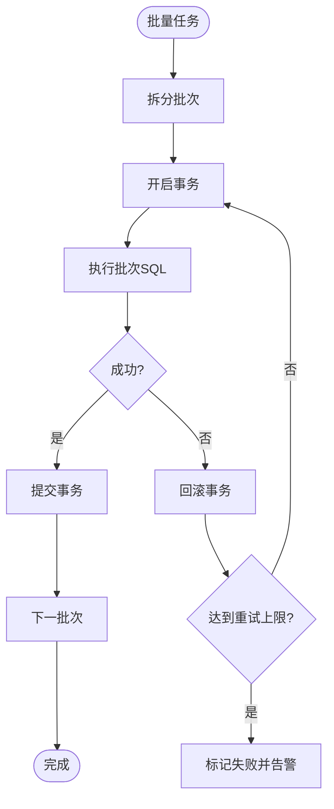

**图示来源** 
- [backend/app/services/batch_processor.py](file://backend/app/services/batch_processor.py)

**章节来源**
- [backend/app/services/batch_processor.py](file://backend/app/services/batch_processor.py)

### 数据备份
- 触发方式
  - 手动触发、定时任务、事件驱动
- 备份策略
  - 全量/增量、压缩、异地存储
- 恢复
  - 提供恢复脚本与校验步骤

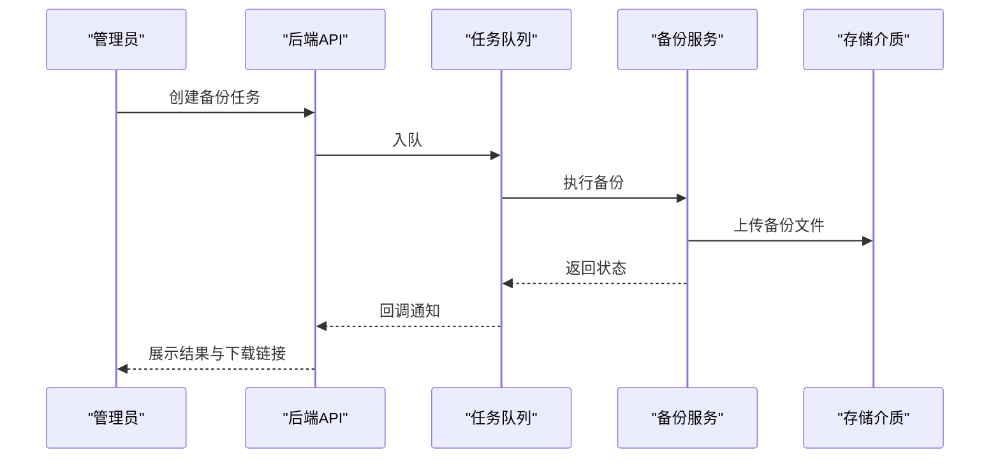

**图示来源** 
- [backend/app/tasks/audiobook_tasks.py](file://backend/app/tasks/audiobook_tasks.py)

**章节来源**
- [backend/app/tasks/audiobook_tasks.py](file://backend/app/tasks/audiobook_tasks.py)

## 依赖分析
- 组件耦合
  - API 层依赖安全、权限、校验、批处理、缓存与任务
  - 前端依赖编辑器、结果表格与历史 Hook
- 外部依赖
  - PostgreSQL、Alembic、消息队列（可选）、缓存（可选）

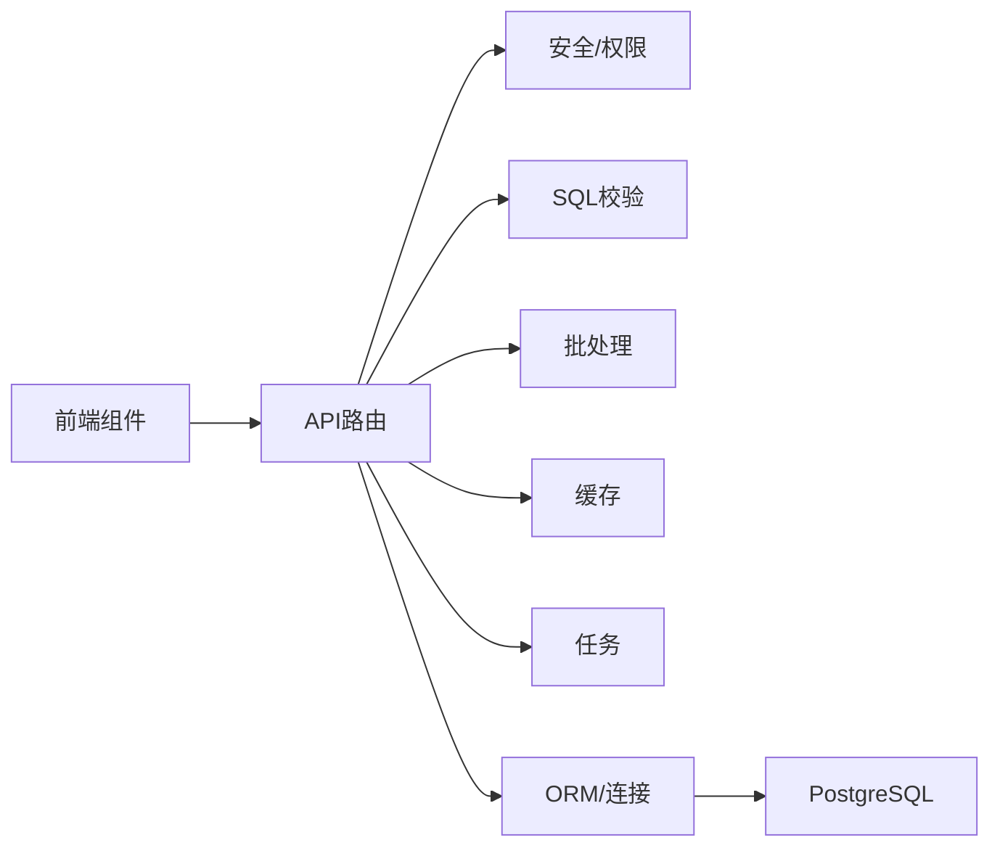

**图示来源** 
- [backend/app/main.py](file://backend/app/main.py)
- [backend/app/core/security.py](file://backend/app/core/security.py)
- [backend/app/core/permissions.py](file://backend/app/core/permissions.py)
- [backend/app/utils/sql_validator.py](file://backend/app/utils/sql_validator.py)
- [backend/app/services/batch_processor.py](file://backend/app/services/batch_processor.py)
- [backend/app/services/cache_system.py](file://backend/app/services/cache_system.py)
- [backend/app/tasks/audiobook_tasks.py](file://backend/app/tasks/audiobook_tasks.py)
- [backend/app/db/base.py](file://backend/app/db/base.py)

**章节来源**
- [backend/app/main.py](file://backend/app/main.py)
- [backend/app/db/base.py](file://backend/app/db/base.py)

## 性能考虑
- 查询层面
  - 合理使用索引、避免 SELECT *、减少子查询与复杂 JOIN
- 执行层面
  - 连接池大小、超时与并发限制、分页与游标
- 缓存层面
  - 热点元数据与字典表缓存，降低系统目录查询压力
- 批处理
  - 合理批次大小，避免锁竞争与内存峰值
- 监控
  - 慢查询阈值、QPS/延迟分布、错误率

[本节为通用指导，不直接分析具体文件]

## 故障排查指南
- 常见问题
  - SQL 被拦截：检查白名单/黑名单与权限范围
  - 结果过大导致超时：增加分页或限制列
  - 慢查询频发：查看执行计划与索引建议
  - 批处理失败：检查事务回滚与重试策略
- 诊断手段
  - 启用详细日志、采集慢查询、导出审计记录
  - 使用 EXPLAIN/ANALYZE 辅助定位

**章节来源**
- [backend/app/utils/sql_validator.py](file://backend/app/utils/sql_validator.py)
- [backend/app/models/admin_log.py](file://backend/app/models/admin_log.py)

## 结论
本数据库查询工具以安全为先，提供完整的编辑、执行、展示、导出、历史、性能分析与索引建议能力，并通过批处理、事务与备份保障稳定性与可恢复性。建议在生产环境严格配置权限与审计，持续优化索引与查询，建立完善的监控与告警体系。

[本节为总结，不直接分析具体文件]

## 附录
- 快速上手
  - 启动后端服务，配置数据库连接与权限策略
  - 启动前端，登录并选择目标库/表
- 常用操作
  - 编写 SQL、查看提示、执行并导出结果
  - 查看表结构、ER 图与字段类型
  - 查看慢查询与索引建议
- 最佳实践
  - 最小权限原则、只读优先、分批写入、定期备份

[本节为补充信息，不直接分析具体文件]