# 日志查看器

<cite>
**本文引用的文件**   
- [backend/app/main.py](file://backend/app/main.py)
- [backend/app/api/v1/monitoring.py](file://backend/app/api/v1/monitoring.py)
- [backend/app/services/streaming_service.py](file://backend/app/services/streaming_service.py)
- [backend/app/websocket/__init__.py](file://backend/app/websocket/__init__.py)
- [backend/app/websocket/manager.py](file://backend/app/websocket/manager.py)
- [core/logging_config.py](file://core/logging_config.py)
- [frontend/src/pages/LogsPage.tsx](file://frontend/src/pages/LogsPage.tsx)
- [frontend/src/hooks/useLogStream.ts](file://frontend/src/hooks/useLogStream.ts)
- [frontend/src/components/logViewer/LogList.tsx](file://frontend/src/components/logViewer/LogList.tsx)
- [frontend/src/components/logViewer/LogFilters.tsx](file://frontend/src/components/logViewer/LogFilters.tsx)
- [frontend/src/components/logViewer/LogDetailPanel.tsx](file://frontend/src/components/logViewer/LogDetailPanel.tsx)
- [frontend/src/utils/logFormatters.ts](file://frontend/src/utils/logFormatters.ts)
- [backend/app/schemas/common.py](file://backend/app/schemas/common.py)
</cite>

## 目录
1. [简介](#简介)
2. [项目结构](#项目结构)
3. [核心组件](#核心组件)
4. [架构总览](#架构总览)
5. [详细组件分析](#详细组件分析)
6. [依赖关系分析](#依赖关系分析)
7. [性能考量](#性能考量)
8. [故障排查指南](#故障排查指南)
9. [结论](#结论)
10. [附录](#附录)

## 简介
本文件为“日志查看器”的功能文档，面向运维、开发与产品人员。内容覆盖：
- 实时日志流：基于 WebSocket/SSE 的增量推送与前端高效渲染
- 过滤与检索：按级别、时间范围、关键词搜索与高亮
- 错误追踪：异常堆栈聚合、上下文关联与一键定位
- 聚合与展示：结构化字段提取、分组统计、格式化输出
- 存储与轮转：日志轮转策略、归档与清理
- 导出与协作：导出格式、分享链接、协作审阅
- 自定义能力：自定义格式、标签体系、告警规则配置

## 项目结构
后端提供日志采集、持久化、查询与实时推送；前端提供交互界面、过滤、搜索与可视化。关键路径如下：
- 后端入口与路由挂载：[backend/app/main.py](file://backend/app/main.py)
- 监控与日志 API：[backend/app/api/v1/monitoring.py](file://backend/app/api/v1/monitoring.py)
- 流式服务（SSE/WebSocket）：[backend/app/services/streaming_service.py](file://backend/app/services/streaming_service.py)、[backend/app/websocket/manager.py](file://backend/app/websocket/manager.py)
- 日志配置：[core/logging_config.py](file://core/logging_config.py)
- 前端页面与组件：[frontend/src/pages/LogsPage.tsx](file://frontend/src/pages/LogsPage.tsx)、[frontend/src/components/logViewer/*](file://frontend/src/components/logViewer/)
- 前端 Hook（流式订阅）：[frontend/src/hooks/useLogStream.ts](file://frontend/src/hooks/useLogStream.ts)
- 数据模型与 Schema：[backend/app/schemas/common.py](file://backend/app/schemas/common.py)

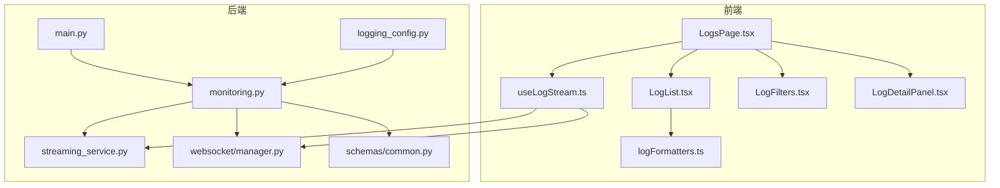

图表来源 
- [backend/app/main.py](file://backend/app/main.py)
- [backend/app/api/v1/monitoring.py](file://backend/app/api/v1/monitoring.py)
- [backend/app/services/streaming_service.py](file://backend/app/services/streaming_service.py)
- [backend/app/websocket/manager.py](file://backend/app/websocket/manager.py)
- [core/logging_config.py](file://core/logging_config.py)
- [frontend/src/pages/LogsPage.tsx](file://frontend/src/pages/LogsPage.tsx)
- [frontend/src/hooks/useLogStream.ts](file://frontend/src/hooks/useLogStream.ts)
- [frontend/src/components/logViewer/LogList.tsx](file://frontend/src/components/logViewer/LogList.tsx)
- [frontend/src/components/logViewer/LogFilters.tsx](file://frontend/src/components/logViewer/LogFilters.tsx)
- [frontend/src/components/logViewer/LogDetailPanel.tsx](file://frontend/src/components/logViewer/LogDetailPanel.tsx)
- [frontend/src/utils/logFormatters.ts](file://frontend/src/utils/logFormatters.ts)
- [backend/app/schemas/common.py](file://backend/app/schemas/common.py)

章节来源
- [backend/app/main.py](file://backend/app/main.py)
- [backend/app/api/v1/monitoring.py](file://backend/app/api/v1/monitoring.py)
- [core/logging_config.py](file://core/logging_config.py)
- [frontend/src/pages/LogsPage.tsx](file://frontend/src/pages/LogsPage.tsx)

## 核心组件
- 日志采集与配置：统一日志配置、分级输出、结构化字段注入
- 日志 API：分页查询、过滤（级别/时间/关键词）、聚合统计
- 实时流：WebSocket/SSE 增量推送，断线重连与背压控制
- 前端视图：列表、详情面板、过滤器、搜索高亮、格式化
- 存储与轮转：按大小/时间轮转、归档压缩、清理策略
- 导出与协作：CSV/JSON/ZIP 导出，分享链接与协作审阅

章节来源
- [backend/app/api/v1/monitoring.py](file://backend/app/api/v1/monitoring.py)
- [backend/app/services/streaming_service.py](file://backend/app/services/streaming_service.py)
- [backend/app/websocket/manager.py](file://backend/app/websocket/manager.py)
- [core/logging_config.py](file://core/logging_config.py)
- [frontend/src/hooks/useLogStream.ts](file://frontend/src/hooks/useLogStream.ts)
- [frontend/src/components/logViewer/LogList.tsx](file://frontend/src/components/logViewer/LogList.tsx)
- [frontend/src/components/logViewer/LogFilters.tsx](file://frontend/src/components/logViewer/LogFilters.tsx)
- [frontend/src/components/logViewer/LogDetailPanel.tsx](file://frontend/src/components/logViewer/LogDetailPanel.tsx)
- [frontend/src/utils/logFormatters.ts](file://frontend/src/utils/logFormatters.ts)

## 架构总览
系统采用前后端分离架构：
- 前端通过 useLogStream Hook 建立 WebSocket/SSE 连接，订阅增量日志并渲染到 LogList
- 后端 monitoring API 提供查询与聚合接口，streaming_service 负责事件分发与缓冲
- websocket manager 管理连接生命周期、权限校验与消息路由
- logging_config 统一注入 trace_id、span_id、环境标签等结构化字段

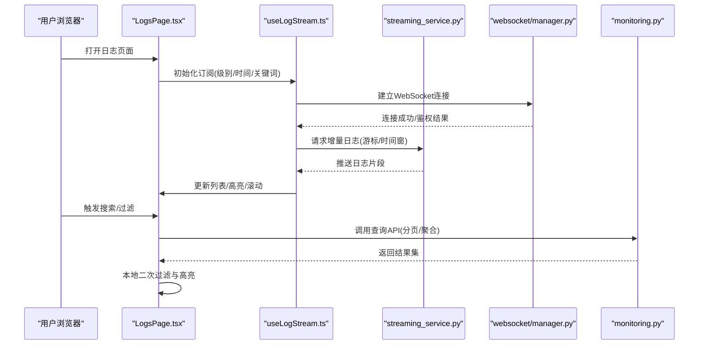

图表来源 
- [frontend/src/pages/LogsPage.tsx](file://frontend/src/pages/LogsPage.tsx)
- [frontend/src/hooks/useLogStream.ts](file://frontend/src/hooks/useLogStream.ts)
- [backend/app/services/streaming_service.py](file://backend/app/services/streaming_service.py)
- [backend/app/websocket/manager.py](file://backend/app/websocket/manager.py)
- [backend/app/api/v1/monitoring.py](file://backend/app/api/v1/monitoring.py)

## 详细组件分析

### 实时日志流（WebSocket/SSE）
- 连接建立与鉴权：前端 Hook 发起连接，后端 manager 校验令牌与会话
- 增量推送：服务端维护游标或时间窗口，按批次推送新日志，避免全量拉取
- 背压与重连：客户端限流与去抖，服务端队列长度限制；断线自动重连与幂等恢复
- 多路复用：按项目/模块/级别分流，减少无关流量

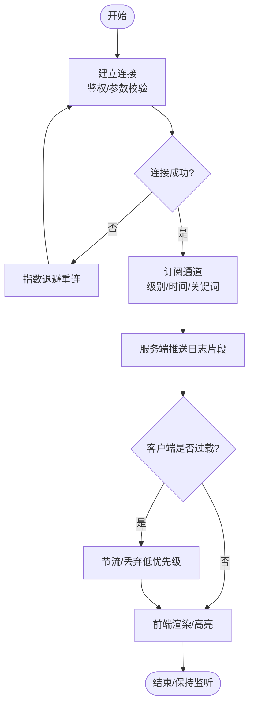

图表来源 
- [backend/app/websocket/manager.py](file://backend/app/websocket/manager.py)
- [backend/app/services/streaming_service.py](file://backend/app/services/streaming_service.py)
- [frontend/src/hooks/useLogStream.ts](file://frontend/src/hooks/useLogStream.ts)

章节来源
- [backend/app/websocket/manager.py](file://backend/app/websocket/manager.py)
- [backend/app/services/streaming_service.py](file://backend/app/services/streaming_service.py)
- [frontend/src/hooks/useLogStream.ts](file://frontend/src/hooks/useLogStream.ts)

### 日志级别过滤与时间范围选择
- 级别过滤：支持 ALL/INFO/WARN/ERROR/FATAL 等，可组合多选
- 时间范围：相对时间（最近N分钟/小时）与绝对时间区间
- 快速筛选：常用模板（仅错误、仅警告、最近5分钟）
- 联动行为：切换过滤条件时，重新计算游标并增量刷新

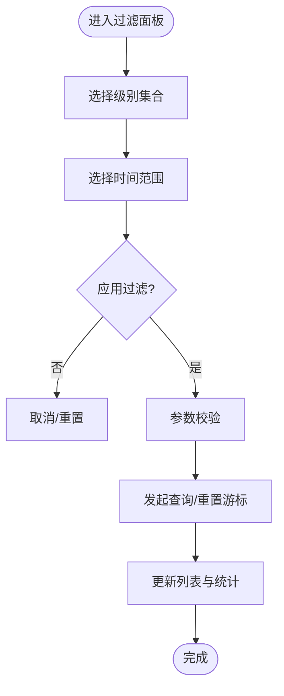

图表来源 
- [frontend/src/components/logViewer/LogFilters.tsx](file://frontend/src/components/logViewer/LogFilters.tsx)
- [backend/app/api/v1/monitoring.py](file://backend/app/api/v1/monitoring.py)

章节来源
- [frontend/src/components/logViewer/LogFilters.tsx](file://frontend/src/components/logViewer/LogFilters.tsx)
- [backend/app/api/v1/monitoring.py](file://backend/app/api/v1/monitoring.py)

### 日志搜索、关键词高亮与错误追踪
- 全文搜索：对 message、trace_id、span_id、tags 等字段进行索引与匹配
- 高亮显示：命中片段在 UI 中高亮，支持跳转与计数
- 错误追踪：按 error_code、exception_type、stack_trace 聚合，关联上下游 span
- 上下文展开：点击错误条目展开完整上下文与相关日志

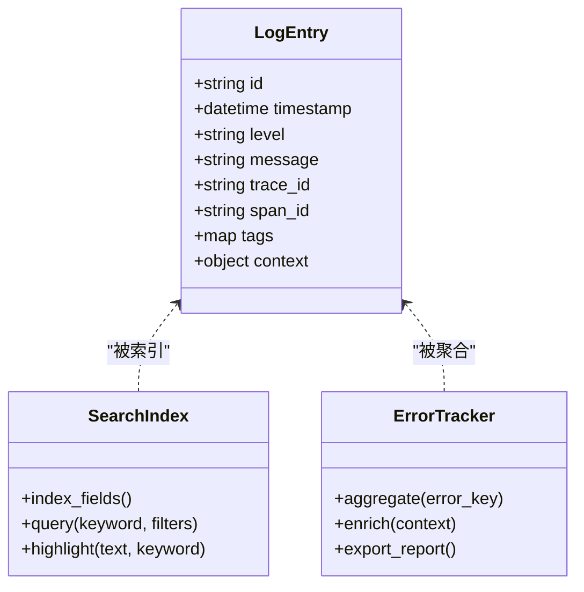

图表来源 
- [backend/app/schemas/common.py](file://backend/app/schemas/common.py)
- [backend/app/api/v1/monitoring.py](file://backend/app/api/v1/monitoring.py)
- [frontend/src/components/logViewer/LogList.tsx](file://frontend/src/components/logViewer/LogList.tsx)
- [frontend/src/utils/logFormatters.ts](file://frontend/src/utils/logFormatters.ts)

章节来源
- [backend/app/api/v1/monitoring.py](file://backend/app/api/v1/monitoring.py)
- [frontend/src/components/logViewer/LogList.tsx](file://frontend/src/components/logViewer/LogList.tsx)
- [frontend/src/utils/logFormatters.ts](file://frontend/src/utils/logFormatters.ts)

### 日志聚合、格式化与结构化展示
- 结构化字段：timestamp、level、message、trace_id、span_id、service、env、tags
- 聚合维度：按 service、level、error_code、tag 分组统计
- 格式化：JSON 原始、人类可读、表格视图、树形上下文
- 导出：CSV/JSON/ZIP（含附件/截图）

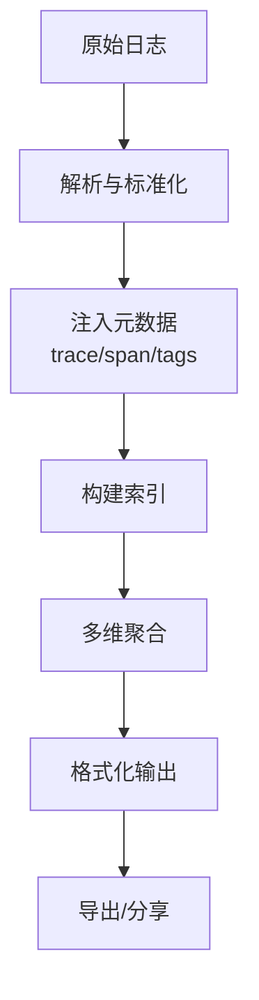

图表来源 
- [backend/app/api/v1/monitoring.py](file://backend/app/api/v1/monitoring.py)
- [frontend/src/utils/logFormatters.ts](file://frontend/src/utils/logFormatters.ts)

章节来源
- [backend/app/api/v1/monitoring.py](file://backend/app/api/v1/monitoring.py)
- [frontend/src/utils/logFormatters.ts](file://frontend/src/utils/logFormatters.ts)

### 日志轮转、存储管理与清理策略
- 轮转策略：按文件大小/时间间隔轮转，保留 N 份历史
- 归档压缩：冷数据压缩存储，降低 I/O 压力
- 清理策略：TTL 过期删除、磁盘阈值触发清理、合规保留期
- 冷热分层：热数据内存/SSD，冷数据对象存储

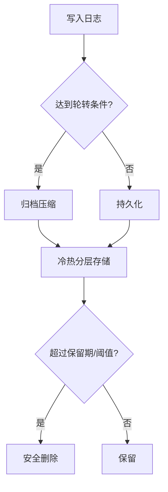

图表来源 
- [core/logging_config.py](file://core/logging_config.py)
- [backend/app/api/v1/monitoring.py](file://backend/app/api/v1/monitoring.py)

章节来源
- [core/logging_config.py](file://core/logging_config.py)
- [backend/app/api/v1/monitoring.py](file://backend/app/api/v1/monitoring.py)

### 日志导出、分享与协作
- 导出格式：CSV、JSON、ZIP（含附件）
- 分享链接：带访问权限与时效的只读链接
- 协作审阅：批注、评论、版本对比与审批流

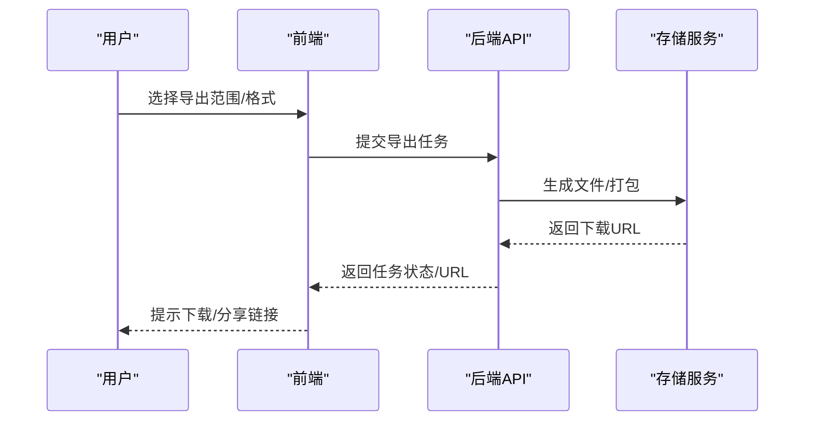

图表来源 
- [backend/app/api/v1/monitoring.py](file://backend/app/api/v1/monitoring.py)

章节来源
- [backend/app/api/v1/monitoring.py](file://backend/app/api/v1/monitoring.py)

### 自定义日志格式、标签系统与告警规则配置
- 自定义格式：支持模板引擎，定义字段映射与输出样式
- 标签系统：键值对标签，支持层级与继承，便于过滤与聚合
- 告警规则：基于阈值、模式匹配、趋势变化触发通知

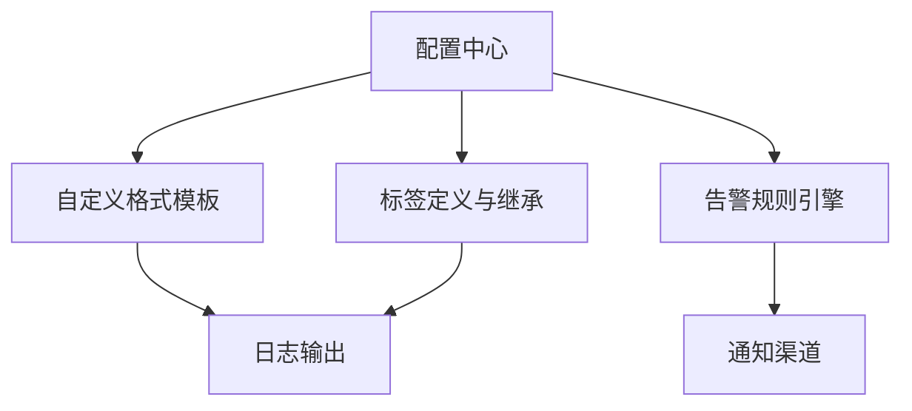

图表来源 
- [core/logging_config.py](file://core/logging_config.py)
- [backend/app/api/v1/monitoring.py](file://backend/app/api/v1/monitoring.py)

章节来源
- [core/logging_config.py](file://core/logging_config.py)
- [backend/app/api/v1/monitoring.py](file://backend/app/api/v1/monitoring.py)

### 前端组件与交互流程
- LogsPage：页面容器，协调 Hook、过滤器与列表
- LogList：虚拟滚动、高亮、行内操作
- LogFilters：级别、时间、关键词、模板
- LogDetailPanel：上下文展开、堆栈折叠、相关日志
- useLogStream：连接管理、增量更新、错误处理

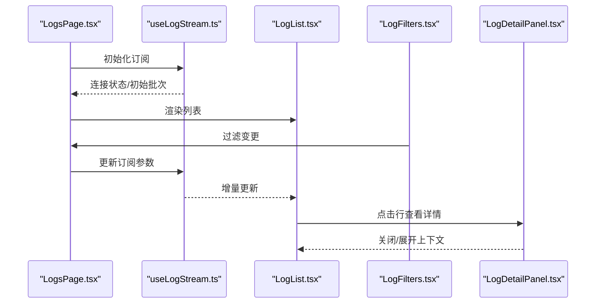

图表来源 
- [frontend/src/pages/LogsPage.tsx](file://frontend/src/pages/LogsPage.tsx)
- [frontend/src/hooks/useLogStream.ts](file://frontend/src/hooks/useLogStream.ts)
- [frontend/src/components/logViewer/LogList.tsx](file://frontend/src/components/logViewer/LogList.tsx)
- [frontend/src/components/logViewer/LogFilters.tsx](file://frontend/src/components/logViewer/LogFilters.tsx)
- [frontend/src/components/logViewer/LogDetailPanel.tsx](file://frontend/src/components/logViewer/LogDetailPanel.tsx)

章节来源
- [frontend/src/pages/LogsPage.tsx](file://frontend/src/pages/LogsPage.tsx)
- [frontend/src/hooks/useLogStream.ts](file://frontend/src/hooks/useLogStream.ts)
- [frontend/src/components/logViewer/LogList.tsx](file://frontend/src/components/logViewer/LogList.tsx)
- [frontend/src/components/logViewer/LogFilters.tsx](file://frontend/src/components/logViewer/LogFilters.tsx)
- [frontend/src/components/logViewer/LogDetailPanel.tsx](file://frontend/src/components/logViewer/LogDetailPanel.tsx)

## 依赖关系分析
- 前端依赖：React Hooks、虚拟列表、富文本/代码高亮库
- 后端依赖：Web 框架、WebSocket/SSE 中间件、数据库/对象存储、缓存
- 外部集成：认证服务、消息总线、告警平台、对象存储

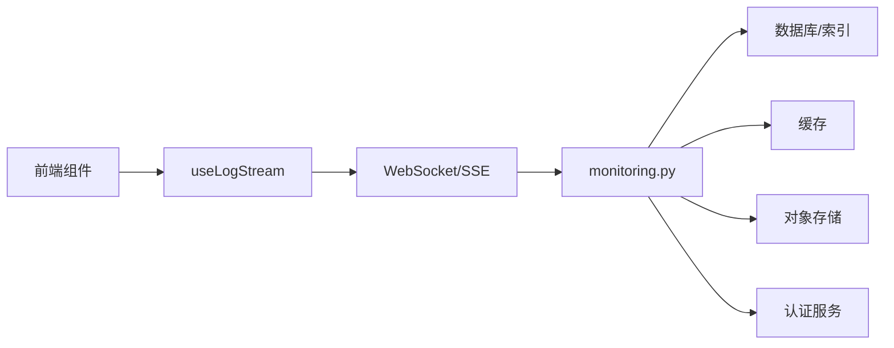

图表来源 
- [frontend/src/hooks/useLogStream.ts](file://frontend/src/hooks/useLogStream.ts)
- [backend/app/api/v1/monitoring.py](file://backend/app/api/v1/monitoring.py)

章节来源
- [frontend/src/hooks/useLogStream.ts](file://frontend/src/hooks/useLogStream.ts)
- [backend/app/api/v1/monitoring.py](file://backend/app/api/v1/monitoring.py)

## 性能考量
- 增量推送：游标/时间窗避免重复传输，降低带宽
- 虚拟滚动：大列表按需渲染，提升首屏与滚动性能
- 索引优化：关键字段建索引，模糊查询使用前缀/倒排
- 背压控制：客户端节流与服务端队列上限，防止雪崩
- 冷热分层：热数据近线，冷数据归档，降低存储成本

## 故障排查指南
- 连接失败：检查鉴权、跨域、防火墙与代理配置
- 无增量：确认游标/时间窗逻辑、服务端队列与消费者状态
- 搜索慢：检查索引完整性、查询复杂度与分页大小
- 内存占用：调整虚拟列表高度、批量大小与缓存策略
- 导出失败：确认存储空间、权限与打包超时设置

章节来源
- [backend/app/websocket/manager.py](file://backend/app/websocket/manager.py)
- [backend/app/services/streaming_service.py](file://backend/app/services/streaming_service.py)
- [backend/app/api/v1/monitoring.py](file://backend/app/api/v1/monitoring.py)

## 结论
日志查看器以“实时+结构化+可观测”为核心，提供从采集、查询、展示到导出与协作的完整闭环。通过合理的轮转与清理策略保障长期可用性与成本可控，借助自定义格式、标签与告警规则满足多样化场景需求。

## 附录
- 术语表：trace_id、span_id、游标、背压、冷热分层
- 最佳实践：统一日志格式、最小必要字段、合理采样率
- 扩展建议：向量检索、语义搜索、AI 辅助归因