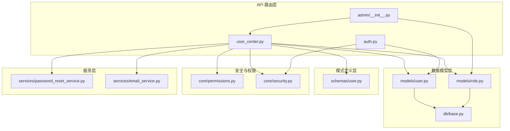
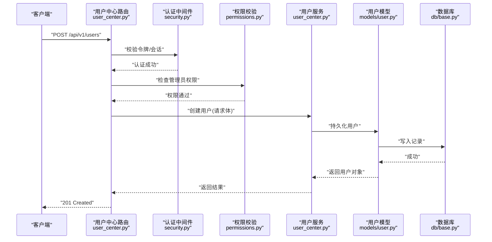
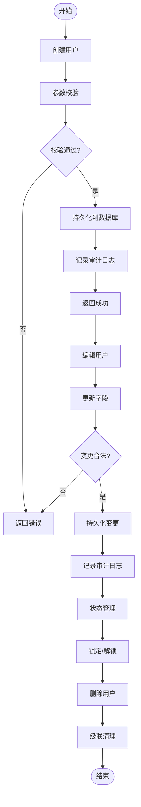
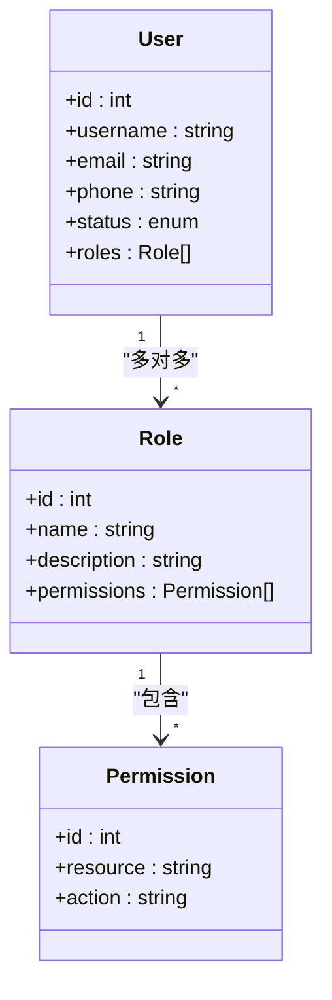
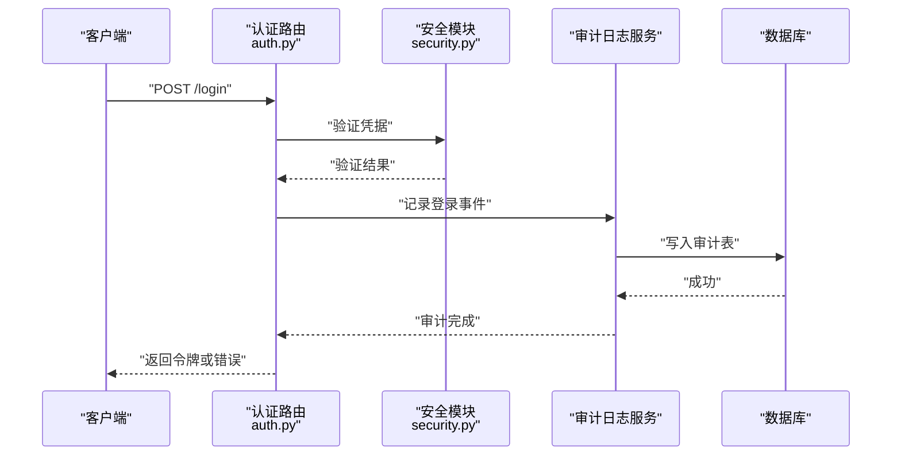
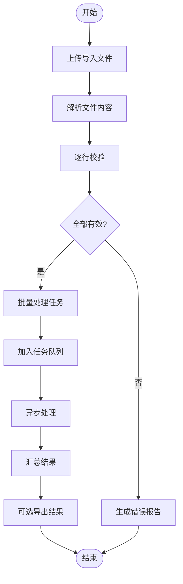
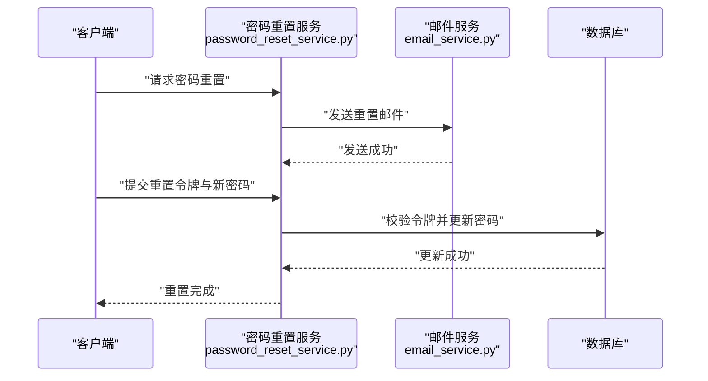
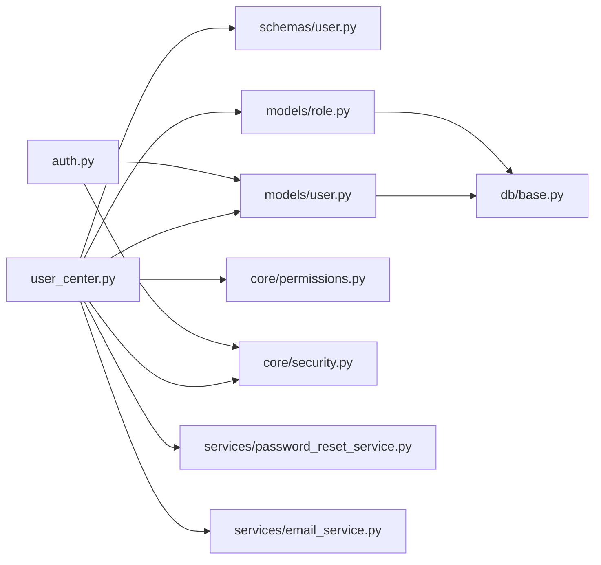

# 用户管理

<cite>
**本文档引用的文件**   
- [backend/app/api/v1/user_center.py](file://backend/app/api/v1/user_center.py)
- [backend/app/api/v1/auth.py](file://backend/app/api/v1/auth.py)
- [backend/app/models/user.py](file://backend/app/models/user.py)
- [backend/app/models/role.py](file://backend/app/models/role.py)
- [backend/app/schemas/user.py](file://backend/app/schemas/user.py)
- [backend/app/core/permissions.py](file://backend/app/core/permissions.py)
- [backend/app/core/security.py](file://backend/app/core/security.py)
- [backend/app/services/password_reset_service.py](file://backend/app/services/password_reset_service.py)
- [backend/app/services/email_service.py](file://backend/app/services/email_service.py)
- [backend/app/db/base.py](file://backend/app/db/base.py)
- [backend/app/api/v1/admin/__init__.py](file://backend/app/api/v1/admin/__init__.py)
</cite>

## 目录
1. [简介](#简介)
2. [项目结构](#项目结构)
3. [核心组件](#核心组件)
4. [架构总览](#架构总览)
5. [详细组件分析](#详细组件分析)
6. [依赖关系分析](#依赖关系分析)
7. [性能考虑](#性能考虑)
8. [故障排查指南](#故障排查指南)
9. [结论](#结论)
10. [附录](#附录)

## 简介
本文件为用户管理模块的功能文档，覆盖以下能力：
- 用户账户的创建、编辑、删除与状态管理
- 角色管理与权限控制（RBAC）
- 访问策略配置与安全策略（密码复杂度、锁定策略等）
- 用户活动日志、登录审计与安全监控
- 批量用户操作、导入导出
- 用户搜索、过滤与排序
- 密码重置、账户锁定与恢复
- 第三方登录集成（OAuth）

该模块基于后端 FastAPI 应用组织，采用模型-服务-路由的分层设计，结合数据库迁移与权限校验，提供稳定可扩展的用户管理能力。

## 项目结构
用户管理相关代码主要位于 backend/app 目录下，按功能域划分：
- API 路由层：用户中心、认证、管理员接口
- 数据模型层：用户、角色、审计日志等 ORM 模型
- 模式定义层：请求/响应 Pydantic Schema
- 安全与权限：JWT、密码哈希、权限校验
- 服务层：密码重置、邮件发送、点值计费事件等
- 数据库：Alembic 迁移与基础连接

图表来源
- [backend/app/api/v1/user_center.py](file://backend/app/api/v1/user_center.py)
- [backend/app/api/v1/auth.py](file://backend/app/api/v1/auth.py)
- [backend/app/models/user.py](file://backend/app/models/user.py)
- [backend/app/models/role.py](file://backend/app/models/role.py)
- [backend/app/schemas/user.py](file://backend/app/schemas/user.py)
- [backend/app/core/permissions.py](file://backend/app/core/permissions.py)
- [backend/app/core/security.py](file://backend/app/core/security.py)
- [backend/app/services/password_reset_service.py](file://backend/app/services/password_reset_service.py)
- [backend/app/services/email_service.py](file://backend/app/services/email_service.py)
- [backend/app/db/base.py](file://backend/app/db/base.py)
- [backend/app/api/v1/admin/__init__.py](file://backend/app/api/v1/admin/__init__.py)

章节来源
- [backend/app/api/v1/user_center.py](file://backend/app/api/v1/user_center.py)
- [backend/app/api/v1/auth.py](file://backend/app/api/v1/auth.py)
- [backend/app/models/user.py](file://backend/app/models/user.py)
- [backend/app/models/role.py](file://backend/app/models/role.py)
- [backend/app/schemas/user.py](file://backend/app/schemas/user.py)
- [backend/app/core/permissions.py](file://backend/app/core/permissions.py)
- [backend/app/core/security.py](file://backend/app/core/security.py)
- [backend/app/services/password_reset_service.py](file://backend/app/services/password_reset_service.py)
- [backend/app/services/email_service.py](file://backend/app/services/email_service.py)
- [backend/app/db/base.py](file://backend/app/db/base.py)
- [backend/app/api/v1/admin/__init__.py](file://backend/app/api/v1/admin/__init__.py)

## 核心组件
- 用户中心 API（user_center.py）
  - 负责用户 CRUD、批量操作、导入导出、搜索过滤排序、状态管理、角色分配、权限控制入口
- 认证 API（auth.py）
  - 负责登录、登出、令牌签发与刷新、第三方登录回调
- 用户与角色模型（models/user.py, models/role.py）
  - 定义用户、角色、关联关系及字段约束
- 模式定义（schemas/user.py）
  - 定义请求体与响应体的数据结构与校验规则
- 权限与安全（core/permissions.py, core/security.py）
  - 实现 RBAC 权限校验、JWT 签发/验证、密码哈希、会话与锁定策略
- 密码重置服务（services/password_reset_service.py）
  - 生成重置令牌、校验有效期、更新密码
- 邮件服务（services/email_service.py）
  - 发送邮件通知（如密码重置链接）
- 数据库基础（db/base.py）
  - 提供 ORM 基类与连接管理

章节来源
- [backend/app/api/v1/user_center.py](file://backend/app/api/v1/user_center.py)
- [backend/app/api/v1/auth.py](file://backend/app/api/v1/auth.py)
- [backend/app/models/user.py](file://backend/app/models/user.py)
- [backend/app/models/role.py](file://backend/app/models/role.py)
- [backend/app/schemas/user.py](file://backend/app/schemas/user.py)
- [backend/app/core/permissions.py](file://backend/app/core/permissions.py)
- [backend/app/core/security.py](file://backend/app/core/security.py)
- [backend/app/services/password_reset_service.py](file://backend/app/services/password_reset_service.py)
- [backend/app/services/email_service.py](file://backend/app/services/email_service.py)
- [backend/app/db/base.py](file://backend/app/db/base.py)

## 架构总览
用户管理采用分层架构：
- 路由层接收 HTTP 请求，进行参数校验与权限检查
- 服务层封装业务逻辑（如密码重置、批量处理、导入导出）
- 模型层通过 ORM 访问数据库
- 安全与权限模块贯穿各层，确保鉴权与策略执行

图表来源
- [backend/app/api/v1/user_center.py](file://backend/app/api/v1/user_center.py)
- [backend/app/core/security.py](file://backend/app/core/security.py)
- [backend/app/core/permissions.py](file://backend/app/core/permissions.py)
- [backend/app/models/user.py](file://backend/app/models/user.py)
- [backend/app/db/base.py](file://backend/app/db/base.py)

## 详细组件分析

### 用户账户生命周期（创建、编辑、删除、状态管理）
- 创建用户
  - 输入：用户名、邮箱、手机号、初始角色、状态等
  - 校验：唯一性、格式、密码策略
  - 输出：用户基本信息与状态
- 编辑用户
  - 支持修改基本信息、角色、状态、联系方式
  - 变更审计：记录操作人、时间、变更字段
- 删除用户
  - 软删除或硬删除策略
  - 级联清理：会话、资产记录、审计日志归档
- 状态管理
  - 启用/禁用、锁定/解锁、冻结/解冻
  - 状态变更触发通知与审计

章节来源
- [backend/app/api/v1/user_center.py](file://backend/app/api/v1/user_center.py)
- [backend/app/models/user.py](file://backend/app/models/user.py)
- [backend/app/schemas/user.py](file://backend/app/schemas/user.py)

### 角色管理与权限控制（RBAC）
- 角色定义
  - 内置角色：管理员、普通用户、只读用户等
  - 自定义角色：可配置资源与动作
- 权限模型
  - 资源-动作矩阵：如“用户:编辑”、“项目:删除”
  - 角色-权限绑定：多对多关系
- 访问策略
  - 基于角色的访问控制（RBAC）
  - 细粒度权限：字段级、行级、租户级隔离
- 策略配置
  - 动态加载策略文件/数据库配置
  - 运行时生效与缓存

图表来源
- [backend/app/models/user.py](file://backend/app/models/user.py)
- [backend/app/models/role.py](file://backend/app/models/role.py)
- [backend/app/core/permissions.py](file://backend/app/core/permissions.py)

章节来源
- [backend/app/models/user.py](file://backend/app/models/user.py)
- [backend/app/models/role.py](file://backend/app/models/role.py)
- [backend/app/core/permissions.py](file://backend/app/core/permissions.py)

### 用户活动日志、登录审计与安全监控
- 活动日志
  - 记录用户关键操作：登录、权限变更、敏感数据访问
  - 结构化日志：时间、IP、设备、操作类型、结果
- 登录审计
  - 登录成功/失败统计
  - 异常登录检测：异地、频繁失败、暴力破解
- 安全监控
  - 实时告警：账户锁定、策略违规
  - 报表导出：审计日志导出与分析

图表来源
- [backend/app/api/v1/auth.py](file://backend/app/api/v1/auth.py)
- [backend/app/core/security.py](file://backend/app/core/security.py)

章节来源
- [backend/app/api/v1/auth.py](file://backend/app/api/v1/auth.py)
- [backend/app/core/security.py](file://backend/app/core/security.py)

### 批量用户操作、导入导出
- 批量操作
  - 批量启用/禁用、批量赋权、批量状态变更
  - 任务队列异步处理，进度查询与结果回传
- 导入
  - CSV/Excel 模板下载与上传
  - 数据校验与错误报告
- 导出
  - 用户列表导出为 CSV/Excel
  - 筛选条件与分页导出

章节来源
- [backend/app/api/v1/user_center.py](file://backend/app/api/v1/user_center.py)

### 用户搜索、过滤与排序
- 搜索
  - 关键字匹配：用户名、邮箱、手机号
  - 高级搜索：角色、状态、注册时间范围
- 过滤
  - 多条件组合：AND/OR 逻辑
  - 分页与限流
- 排序
  - 支持按注册时间、最后登录时间、状态等排序
  - 默认排序与自定义排序

章节来源
- [backend/app/api/v1/user_center.py](file://backend/app/api/v1/user_center.py)
- [backend/app/schemas/user.py](file://backend/app/schemas/user.py)

### 密码重置、账户锁定与安全策略
- 密码重置
  - 生成一次性重置令牌，有效期限制
  - 邮件发送重置链接，校验令牌后更新密码
- 账户锁定
  - 连续失败次数阈值自动锁定
  - 管理员手动锁定/解锁
- 安全策略
  - 密码复杂度规则（长度、字符集、历史密码）
  - 会话超时与强制重登
  - IP 白名单/黑名单

图表来源
- [backend/app/services/password_reset_service.py](file://backend/app/services/password_reset_service.py)
- [backend/app/services/email_service.py](file://backend/app/services/email_service.py)

章节来源
- [backend/app/services/password_reset_service.py](file://backend/app/services/password_reset_service.py)
- [backend/app/services/email_service.py](file://backend/app/services/email_service.py)
- [backend/app/core/security.py](file://backend/app/core/security.py)

### 第三方登录（OAuth）
- 支持的提供商：微信、钉钉、Google 等
- 流程
  - 前端跳转至授权页面
  - 回调处理，获取用户信息
  - 本地用户映射或自动注册
- 安全
  - 状态参数防 CSRF
  - 令牌签名与过期校验

章节来源
- [backend/app/api/v1/auth.py](file://backend/app/api/v1/auth.py)
- [backend/app/core/security.py](file://backend/app/core/security.py)

## 依赖关系分析
- 路由依赖
  - user_center.py 依赖 schemas/user.py、models/user.py、models/role.py、core/permissions.py、core/security.py、services/password_reset_service.py、services/email_service.py
- 认证依赖
  - auth.py 依赖 core/security.py、models/user.py
- 模型依赖
  - models/user.py、models/role.py 依赖 db/base.py

图表来源
- [backend/app/api/v1/user_center.py](file://backend/app/api/v1/user_center.py)
- [backend/app/api/v1/auth.py](file://backend/app/api/v1/auth.py)
- [backend/app/schemas/user.py](file://backend/app/schemas/user.py)
- [backend/app/models/user.py](file://backend/app/models/user.py)
- [backend/app/models/role.py](file://backend/app/models/role.py)
- [backend/app/core/permissions.py](file://backend/app/core/permissions.py)
- [backend/app/core/security.py](file://backend/app/core/security.py)
- [backend/app/services/password_reset_service.py](file://backend/app/services/password_reset_service.py)
- [backend/app/services/email_service.py](file://backend/app/services/email_service.py)
- [backend/app/db/base.py](file://backend/app/db/base.py)

章节来源
- [backend/app/api/v1/user_center.py](file://backend/app/api/v1/user_center.py)
- [backend/app/api/v1/auth.py](file://backend/app/api/v1/auth.py)
- [backend/app/schemas/user.py](file://backend/app/schemas/user.py)
- [backend/app/models/user.py](file://backend/app/models/user.py)
- [backend/app/models/role.py](file://backend/app/models/role.py)
- [backend/app/core/permissions.py](file://backend/app/core/permissions.py)
- [backend/app/core/security.py](file://backend/app/core/security.py)
- [backend/app/services/password_reset_service.py](file://backend/app/services/password_reset_service.py)
- [backend/app/services/email_service.py](file://backend/app/services/email_service.py)
- [backend/app/db/base.py](file://backend/app/db/base.py)

## 性能考虑
- 数据库索引
  - 对用户表常用查询字段建立索引（用户名、邮箱、手机号、状态、角色）
- 缓存策略
  - 角色与权限配置缓存，减少重复计算
  - 用户会话缓存（Redis）提升登录性能
- 异步处理
  - 批量操作与导入导出使用任务队列，避免阻塞主线程
- 分页与限流
  - 列表查询默认分页，防止大数据量拖慢响应
  - 接口限流保护系统稳定性

[本节为通用指导，不直接分析具体文件]

## 故障排查指南
- 常见问题
  - 用户创建失败：检查唯一性约束与格式校验
  - 权限不足：确认角色与权限绑定是否正确
  - 密码重置失败：检查令牌有效期与邮件发送状态
  - 登录失败：查看审计日志中的失败原因（密码错误、账户锁定、IP 黑名单）
- 调试建议
  - 开启详细日志，定位错误堆栈
  - 使用测试账号模拟场景，复现问题
  - 检查数据库连接与迁移状态

章节来源
- [backend/app/api/v1/user_center.py](file://backend/app/api/v1/user_center.py)
- [backend/app/api/v1/auth.py](file://backend/app/api/v1/auth.py)
- [backend/app/core/security.py](file://backend/app/core/security.py)
- [backend/app/services/password_reset_service.py](file://backend/app/services/password_reset_service.py)

## 结论
用户管理模块提供了完整的用户生命周期管理、RBAC 权限控制、安全策略与审计监控能力。通过分层架构与模块化设计，确保了系统的可维护性与扩展性。建议在生产环境中启用严格的密码策略、会话管理与审计日志，以保障系统安全与合规。

[本节为总结，不直接分析具体文件]

## 附录
- 管理员初始化脚本
  - 用于初始化管理员账号与基础角色权限
- 数据库迁移
  - Alembic 迁移脚本管理用户与角色表结构变更

章节来源
- [backend/app/api/v1/admin/__init__.py](file://backend/app/api/v1/admin/__init__.py)
- [backend/app/db/base.py](file://backend/app/db/base.py)