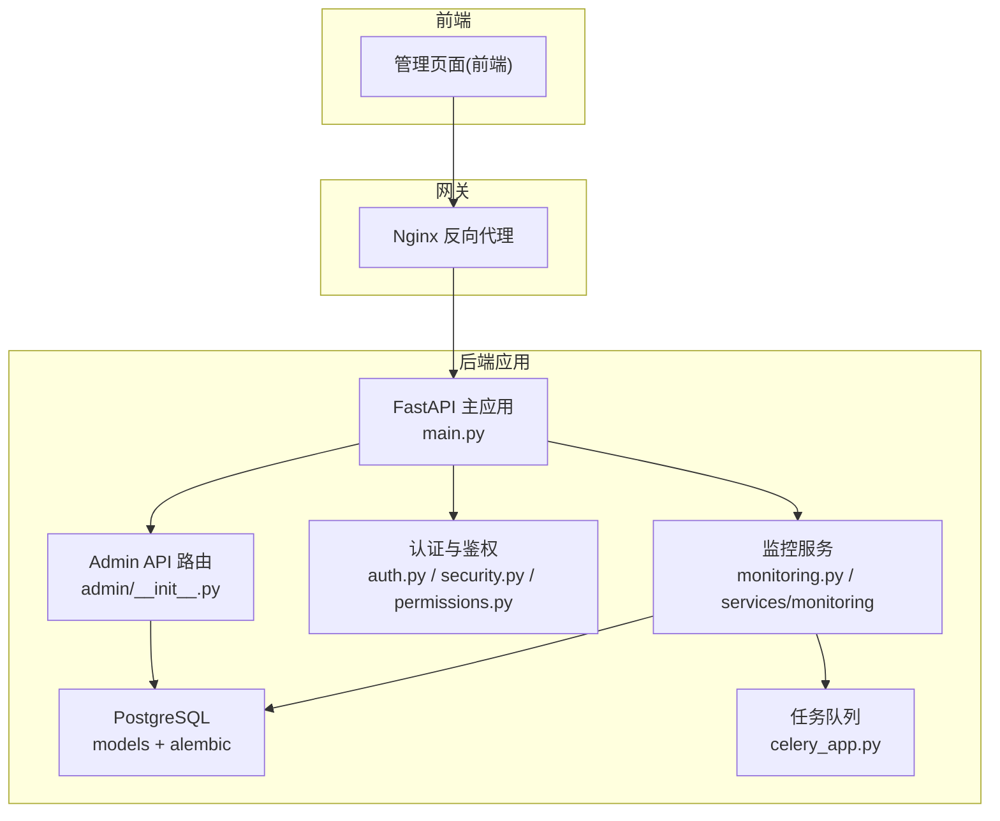
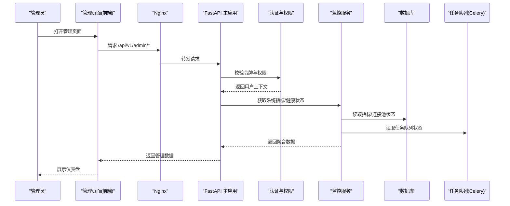
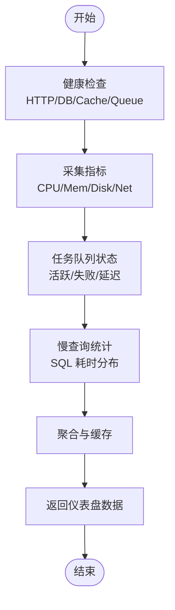
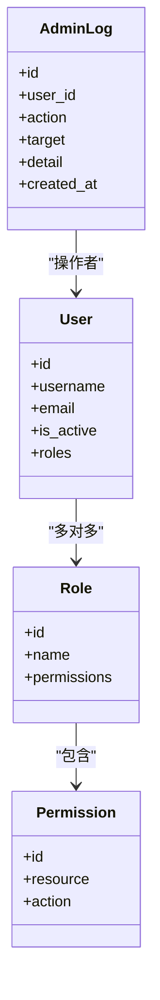
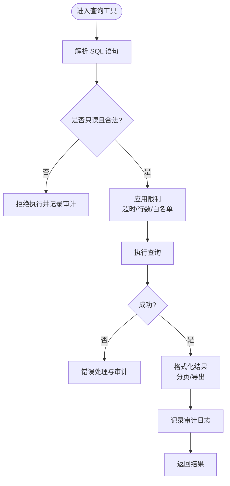
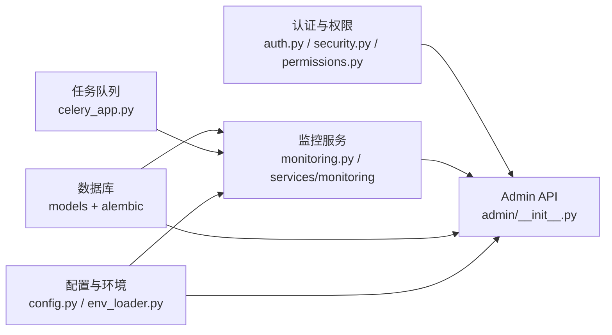

# 管理页面

<cite>
**本文引用的文件**   
- [backend/app/api/v1/admin/__init__.py](file://backend/app/api/v1/admin/__init__.py)
- [backend/app/api/v1/monitoring.py](file://backend/app/api/v1/monitoring.py)
- [backend/app/api/v1/auth.py](file://backend/app/api/v1/auth.py)
- [backend/app/core/config.py](file://backend/app/core/config.py)
- [backend/app/core/env_loader.py](file://backend/app/core/env_loader.py)
- [backend/app/core/permissions.py](file://backend/app/core/permissions.py)
- [backend/app/core/security.py](file://backend/app/core/security.py)
- [backend/app/models/admin_log.py](file://backend/app/models/admin_log.py)
- [backend/app/models/user.py](file://backend/app/models/user.py)
- [backend/app/models/role.py](file://backend/app/models/role.py)
- [backend/app/schemas/admin.py](file://backend/app/schemas/admin.py)
- [backend/app/services/monitoring/service.py](file://backend/app/services/monitoring/service.py)
- [backend/app/utils/sql_validator.py](file://backend/app/utils/sql_validator.py)
- [backend/app/celery_app.py](file://backend/app/celery_app.py)
- [backend/app/main.py](file://backend/app/main.py)
- [backend/alembic/env.py](file://backend/alembic/env.py)
- [postgres-init/01-init.sql](file://postgres-init/01-init.sql)
- [nginx.conf](file://nginx.conf)
- [docker-compose.yml](file://docker-compose.yml)
</cite>

## 目录
1. [简介](#简介)
2. [项目结构](#项目结构)
3. [核心组件](#核心组件)
4. [架构总览](#架构总览)
5. [详细组件分析](#详细组件分析)
6. [依赖关系分析](#依赖关系分析)
7. [性能考量](#性能考量)
8. [故障排查指南](#故障排查指南)
9. [结论](#结论)
10. [附录](#附录)

## 简介
本文件面向系统管理员与运维人员，系统化梳理“管理页面”相关能力，覆盖以下主题：
- 系统监控仪表盘：服务健康、资源指标、任务队列状态等
- 用户管理与权限配置：RBAC、角色、权限、用户生命周期
- 数据库查询工具：安全校验、只读访问、审计记录
- 日志查看器与性能分析：结构化日志、慢查询、耗时统计
- 配置管理：环境变量、动态配置、系统设置
- 审计日志与操作追踪：关键操作留痕、可追溯性
- 备份恢复与维护：数据导出、迁移、回滚策略
- API 管理、服务健康检查与告警配置：接口治理、可用性探测、阈值告警

## 项目结构
管理功能主要位于后端模块中，围绕 FastAPI 路由、权限控制、模型与 Schema、监控服务、Celery 任务以及数据库迁移展开。前端通过统一入口访问管理页面，Nginx 负责反向代理与静态资源分发。

图表来源
- [backend/app/main.py](file://backend/app/main.py)
- [backend/app/api/v1/admin/__init__.py](file://backend/app/api/v1/admin/__init__.py)
- [backend/app/api/v1/auth.py](file://backend/app/api/v1/auth.py)
- [backend/app/core/security.py](file://backend/app/core/security.py)
- [backend/app/core/permissions.py](file://backend/app/core/permissions.py)
- [backend/app/api/v1/monitoring.py](file://backend/app/api/v1/monitoring.py)
- [backend/app/services/monitoring/service.py](file://backend/app/services/monitoring/service.py)
- [backend/app/celery_app.py](file://backend/app/celery_app.py)
- [backend/alembic/env.py](file://backend/alembic/env.py)
- [postgres-init/01-init.sql](file://postgres-init/01-init.sql)
- [nginx.conf](file://nginx.conf)
- [docker-compose.yml](file://docker-compose.yml)

章节来源
- [backend/app/main.py](file://backend/app/main.py)
- [backend/app/api/v1/admin/__init__.py](file://backend/app/api/v1/admin/__init__.py)
- [backend/app/api/v1/monitoring.py](file://backend/app/api/v1/monitoring.py)
- [backend/app/core/config.py](file://backend/app/core/config.py)
- [backend/app/core/env_loader.py](file://backend/app/core/env_loader.py)
- [backend/app/core/permissions.py](file://backend/app/core/permissions.py)
- [backend/app/core/security.py](file://backend/app/core/security.py)
- [backend/app/models/admin_log.py](file://backend/app/models/admin_log.py)
- [backend/app/models/user.py](file://backend/app/models/user.py)
- [backend/app/models/role.py](file://backend/app/models/role.py)
- [backend/app/schemas/admin.py](file://backend/app/schemas/admin.py)
- [backend/app/services/monitoring/service.py](file://backend/app/services/monitoring/service.py)
- [backend/app/utils/sql_validator.py](file://backend/app/utils/sql_validator.py)
- [backend/app/celery_app.py](file://backend/app/celery_app.py)
- [backend/alembic/env.py](file://backend/alembic/env.py)
- [postgres-init/01-init.sql](file://postgres-init/01-init.sql)
- [nginx.conf](file://nginx.conf)
- [docker-compose.yml](file://docker-compose.yml)

## 核心组件
- 认证与授权：基于 JWT 的认证流程与 RBAC 权限控制，确保仅授权用户可访问管理端点。
- 监控仪表盘：聚合系统指标、任务队列状态、数据库连接与健康检查，提供可视化数据源。
- 用户与权限：用户、角色、权限模型与 CRUD 接口，支持细粒度权限分配与继承。
- 数据库工具：受控 SQL 执行（只读）、查询结果分页与审计记录。
- 日志与性能：结构化日志输出、慢查询与耗时统计、任务执行追踪。
- 配置与环境：集中式配置加载、环境变量注入、运行时配置更新。
- 审计与安全：关键操作审计日志、敏感信息脱敏、访问控制与防重放。
- 备份与维护：数据导出、迁移脚本、回滚策略与一键维护模式。
- API 治理：接口版本化、限流、健康检查与告警联动。

章节来源
- [backend/app/core/security.py](file://backend/app/core/security.py)
- [backend/app/core/permissions.py](file://backend/app/core/permissions.py)
- [backend/app/api/v1/auth.py](file://backend/app/api/v1/auth.py)
- [backend/app/api/v1/monitoring.py](file://backend/app/api/v1/monitoring.py)
- [backend/app/services/monitoring/service.py](file://backend/app/services/monitoring/service.py)
- [backend/app/models/user.py](file://backend/app/models/user.py)
- [backend/app/models/role.py](file://backend/app/models/role.py)
- [backend/app/models/admin_log.py](file://backend/app/models/admin_log.py)
- [backend/app/schemas/admin.py](file://backend/app/schemas/admin.py)
- [backend/app/utils/sql_validator.py](file://backend/app/utils/sql_validator.py)
- [backend/app/core/config.py](file://backend/app/core/config.py)
- [backend/app/core/env_loader.py](file://backend/app/core/env_loader.py)
- [backend/app/celery_app.py](file://backend/app/celery_app.py)

## 架构总览
管理页面采用前后端分离架构，前端通过 Nginx 反向代理访问后端 FastAPI 服务。认证由中间件完成，权限由 RBAC 控制；监控服务聚合多源指标并暴露给前端；数据库通过 Alembic 进行迁移；Celery 处理异步任务。

图表来源
- [backend/app/main.py](file://backend/app/main.py)
- [backend/app/api/v1/auth.py](file://backend/app/api/v1/auth.py)
- [backend/app/core/security.py](file://backend/app/core/security.py)
- [backend/app/core/permissions.py](file://backend/app/core/permissions.py)
- [backend/app/api/v1/monitoring.py](file://backend/app/api/v1/monitoring.py)
- [backend/app/services/monitoring/service.py](file://backend/app/services/monitoring/service.py)
- [backend/app/celery_app.py](file://backend/app/celery_app.py)
- [backend/alembic/env.py](file://backend/alembic/env.py)

## 详细组件分析

### 系统监控仪表盘
- 功能要点
  - 服务健康检查：HTTP 探针、数据库连通性、缓存与消息队列状态
  - 资源指标：CPU、内存、磁盘、网络 I/O
  - 任务队列：活跃任务数、失败重试、延迟任务
  - 慢查询与热点接口：SQL 慢查询统计、接口耗时分布
- 实现要点
  - 监控服务聚合各子系统指标，提供统一查询接口
  - 使用只读视图或快照表降低对生产库的影响
  - 定时采集与事件驱动上报结合

图表来源
- [backend/app/api/v1/monitoring.py](file://backend/app/api/v1/monitoring.py)
- [backend/app/services/monitoring/service.py](file://backend/app/services/monitoring/service.py)

章节来源
- [backend/app/api/v1/monitoring.py](file://backend/app/api/v1/monitoring.py)
- [backend/app/services/monitoring/service.py](file://backend/app/services/monitoring/service.py)

### 用户管理与权限配置
- 功能要点
  - 用户生命周期：创建、激活、禁用、删除
  - 角色与权限：角色定义、权限集合、继承与组合
  - 访问控制：按资源与动作维度限制
- 实现要点
  - 用户、角色、权限模型关联清晰，支持软删除与审计
  - 权限校验在路由层与业务层双重保障
  - 变更操作写入审计日志

图表来源
- [backend/app/models/user.py](file://backend/app/models/user.py)
- [backend/app/models/role.py](file://backend/app/models/role.py)
- [backend/app/models/admin_log.py](file://backend/app/models/admin_log.py)
- [backend/app/schemas/admin.py](file://backend/app/schemas/admin.py)

章节来源
- [backend/app/models/user.py](file://backend/app/models/user.py)
- [backend/app/models/role.py](file://backend/app/models/role.py)
- [backend/app/models/admin_log.py](file://backend/app/models/admin_log.py)
- [backend/app/schemas/admin.py](file://backend/app/schemas/admin.py)
- [backend/app/core/permissions.py](file://backend/app/core/permissions.py)

### 数据库查询工具
- 功能要点
  - 受限 SQL 执行：仅允许只读语句，白名单表与字段
  - 查询结果分页与导出：CSV/JSON 格式
  - 审计记录：谁、何时、执行了何种查询
- 实现要点
  - SQL 解析与校验，防止注入与危险操作
  - 查询超时与最大行数限制
  - 审计日志与结果脱敏

图表来源
- [backend/app/utils/sql_validator.py](file://backend/app/utils/sql_validator.py)
- [backend/app/models/admin_log.py](file://backend/app/models/admin_log.py)

章节来源
- [backend/app/utils/sql_validator.py](file://backend/app/utils/sql_validator.py)
- [backend/app/models/admin_log.py](file://backend/app/models/admin_log.py)

### 日志查看器与性能分析
- 功能要点
  - 结构化日志：按级别、模块、请求 ID 过滤
  - 慢查询与热点接口：SQL 与 HTTP 耗时统计
  - 任务执行追踪：Celery 任务状态与异常堆栈
- 实现要点
  - 日志聚合与索引，便于检索
  - 采样与采样率控制，避免性能影响
  - 告警联动：阈值触发通知

章节来源
- [backend/app/api/v1/monitoring.py](file://backend/app/api/v1/monitoring.py)
- [backend/app/services/monitoring/service.py](file://backend/app/services/monitoring/service.py)
- [backend/app/celery_app.py](file://backend/app/celery_app.py)

### 配置管理、环境变量与系统设置
- 功能要点
  - 集中式配置：默认值、环境覆盖、运行时更新
  - 环境变量：数据库、缓存、队列、第三方服务密钥
  - 系统设置：功能开关、配额与限额、模板与策略
- 实现要点
  - 配置加载优先级：代码默认 < 配置文件 < 环境变量 < 运行时注入
  - 敏感配置加密存储与最小权限访问
  - 配置变更审计与灰度发布

章节来源
- [backend/app/core/config.py](file://backend/app/core/config.py)
- [backend/app/core/env_loader.py](file://backend/app/core/env_loader.py)

### 审计日志、操作追踪与安全监控
- 功能要点
  - 关键操作留痕：用户增删改、权限变更、配置修改
  - 操作追踪：请求链路、参数与响应摘要
  - 安全监控：异常登录、越权尝试、高频访问
- 实现要点
  - 审计表结构与索引优化
  - 脱敏与合规：PII 字段掩码
  - 告警规则：阈值与频率控制

章节来源
- [backend/app/models/admin_log.py](file://backend/app/models/admin_log.py)
- [backend/app/core/security.py](file://backend/app/core/security.py)
- [backend/app/core/permissions.py](file://backend/app/core/permissions.py)

### 备份恢复、系统维护与故障排查
- 功能要点
  - 数据备份：全量与增量、压缩与异地存储
  - 恢复策略：时间点恢复、一致性校验
  - 系统维护：迁移、回滚、维护模式
- 实现要点
  - 迁移脚本与版本管理（Alembic）
  - 备份任务异步化与失败重试
  - 故障定位：日志、指标、链路追踪

章节来源
- [backend/alembic/env.py](file://backend/alembic/env.py)
- [postgres-init/01-init.sql](file://postgres-init/01-init.sql)
- [backend/app/celery_app.py](file://backend/app/celery_app.py)

### API 管理、服务健康检查与告警配置
- 功能要点
  - API 版本化与文档：OpenAPI/Swagger
  - 健康检查：存活、就绪、依赖健康
  - 告警配置：阈值、渠道、抑制与升级
- 实现要点
  - 健康探针与依赖检测
  - 告警规则引擎与通知集成
  - 限流与熔断保护

章节来源
- [backend/app/api/v1/monitoring.py](file://backend/app/api/v1/monitoring.py)
- [backend/app/services/monitoring/service.py](file://backend/app/services/monitoring/service.py)

## 依赖关系分析
管理页面依赖认证、权限、监控、数据库、任务队列与配置系统。各组件通过清晰的接口交互，避免强耦合。

图表来源
- [backend/app/api/v1/admin/__init__.py](file://backend/app/api/v1/admin/__init__.py)
- [backend/app/api/v1/auth.py](file://backend/app/api/v1/auth.py)
- [backend/app/core/security.py](file://backend/app/core/security.py)
- [backend/app/core/permissions.py](file://backend/app/core/permissions.py)
- [backend/app/api/v1/monitoring.py](file://backend/app/api/v1/monitoring.py)
- [backend/app/services/monitoring/service.py](file://backend/app/services/monitoring/service.py)
- [backend/app/models/user.py](file://backend/app/models/user.py)
- [backend/app/models/role.py](file://backend/app/models/role.py)
- [backend/app/models/admin_log.py](file://backend/app/models/admin_log.py)
- [backend/app/core/config.py](file://backend/app/core/config.py)
- [backend/app/core/env_loader.py](file://backend/app/core/env_loader.py)
- [backend/app/celery_app.py](file://backend/app/celery_app.py)
- [backend/alembic/env.py](file://backend/alembic/env.py)

章节来源
- [backend/app/api/v1/admin/__init__.py](file://backend/app/api/v1/admin/__init__.py)
- [backend/app/api/v1/monitoring.py](file://backend/app/api/v1/monitoring.py)
- [backend/app/core/config.py](file://backend/app/core/config.py)
- [backend/app/core/env_loader.py](file://backend/app/core/env_loader.py)
- [backend/app/core/permissions.py](file://backend/app/core/permissions.py)
- [backend/app/core/security.py](file://backend/app/core/security.py)
- [backend/app/models/admin_log.py](file://backend/app/models/admin_log.py)
- [backend/app/models/user.py](file://backend/app/models/user.py)
- [backend/app/models/role.py](file://backend/app/models/role.py)
- [backend/app/schemas/admin.py](file://backend/app/schemas/admin.py)
- [backend/app/services/monitoring/service.py](file://backend/app/services/monitoring/service.py)
- [backend/app/utils/sql_validator.py](file://backend/app/utils/sql_validator.py)
- [backend/app/celery_app.py](file://backend/app/celery_app.py)
- [backend/alembic/env.py](file://backend/alembic/env.py)
- [postgres-init/01-init.sql](file://postgres-init/01-init.sql)

## 性能考量
- 指标采集采样与缓存：减少高频查询对数据库的压力
- 慢查询与热点接口监控：及时识别瓶颈并优化
- 任务队列背压与限流：避免雪崩效应
- 只读查询与快照表：降低写路径影响
- 日志采样与滚动：控制存储与检索成本

[本节为通用指导，不直接分析具体文件]

## 故障排查指南
- 认证失败：检查 JWT 签发与验证配置、令牌过期时间、权限映射
- 权限不足：核对角色与权限绑定、资源与动作匹配
- 监控数据缺失：确认采集任务运行、依赖健康、指标上报通道
- 数据库连接失败：检查连接池、网络、凭据与迁移状态
- 任务执行失败：查看任务日志、重试次数、依赖服务状态
- 配置不生效：确认加载顺序、环境变量键名、运行时更新机制

章节来源
- [backend/app/core/security.py](file://backend/app/core/security.py)
- [backend/app/core/permissions.py](file://backend/app/core/permissions.py)
- [backend/app/api/v1/auth.py](file://backend/app/api/v1/auth.py)
- [backend/app/services/monitoring/service.py](file://backend/app/services/monitoring/service.py)
- [backend/app/celery_app.py](file://backend/app/celery_app.py)
- [backend/app/core/config.py](file://backend/app/core/config.py)
- [backend/app/core/env_loader.py](file://backend/app/core/env_loader.py)

## 结论
管理页面以认证与权限为核心，围绕监控、用户与权限、数据库工具、日志与性能、配置与环境、审计与安全、备份与维护、API 治理等能力构建完整的管理闭环。通过清晰的架构设计与严格的实现约束，确保系统在可扩展、可观测、可维护的前提下稳定运行。

[本节为总结性内容，不直接分析具体文件]

## 附录
- 部署与反向代理：Nginx 配置与 Docker Compose 编排
- 数据库初始化：初始 SQL 与迁移脚本
- 环境变量清单：数据库、缓存、队列、第三方服务密钥

章节来源
- [nginx.conf](file://nginx.conf)
- [docker-compose.yml](file://docker-compose.yml)
- [postgres-init/01-init.sql](file://postgres-init/01-init.sql)
- [backend/alembic/env.py](file://backend/alembic/env.py)