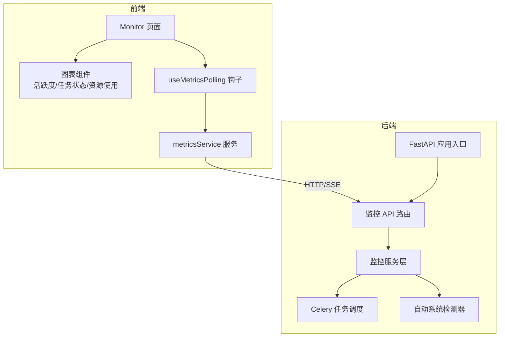
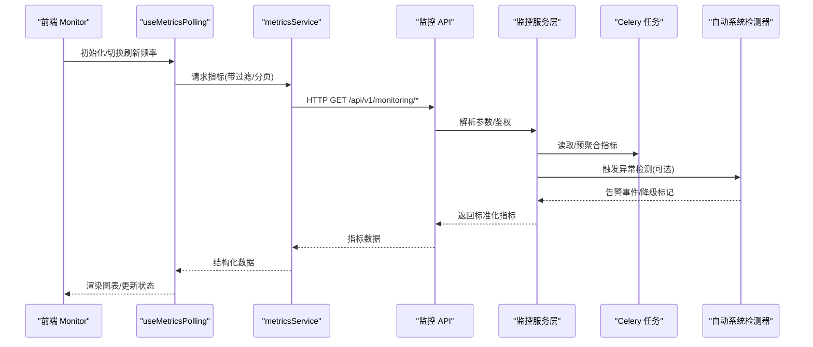
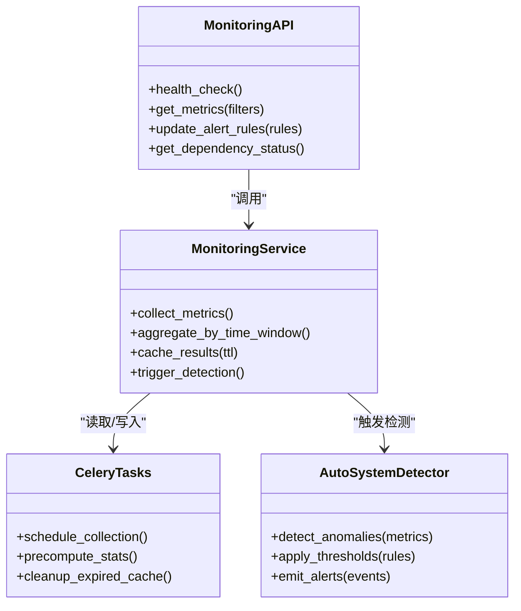
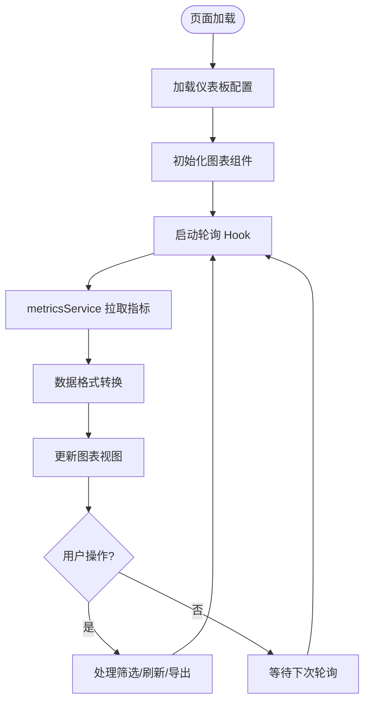
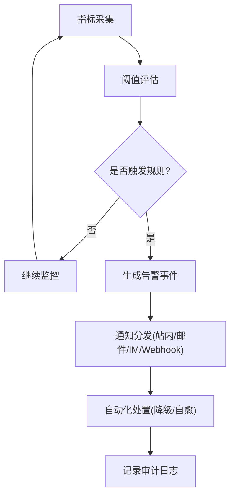
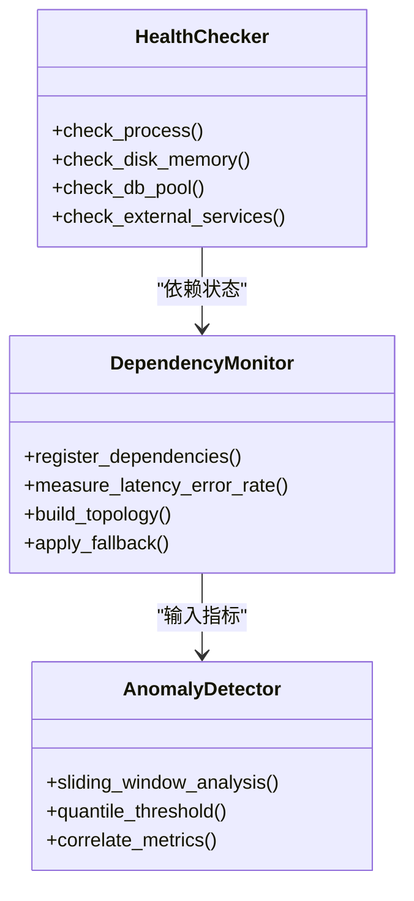
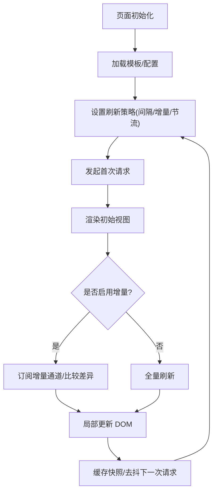
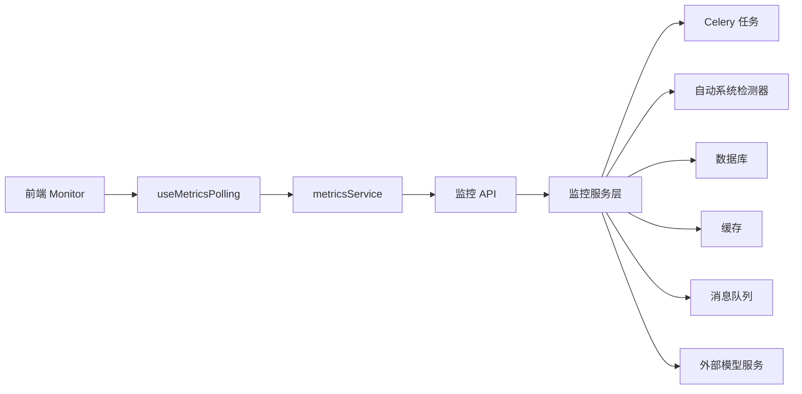

# 系统监控仪表盘

<cite>
**本文引用的文件**   
- [backend/app/api/v1/monitoring.py](file://backend/app/api/v1/monitoring.py)
- [backend/app/services/monitoring/__init__.py](file://backend/app/services/monitoring/__init__.py)
- [backend/app/services/auto_system_detector.py](file://backend/app/services/auto_system_detector.py)
- [backend/app/celery_app.py](file://backend/app/celery_app.py)
- [backend/app/main.py](file://backend/app/main.py)
- [frontend/src/pages/Monitor.tsx](file://frontend/src/pages/Monitor.tsx)
- [frontend/src/hooks/useMetricsPolling.ts](file://frontend/src/hooks/useMetricsPolling.ts)
- [frontend/src/components/charts/ActivityChart.tsx](file://frontend/src/components/charts/ActivityChart.tsx)
- [frontend/src/components/charts/TaskStatusChart.tsx](file://frontend/src/components/charts/TaskStatusChart.tsx)
- [frontend/src/components/charts/ResourceUsageChart.tsx](file://frontend/src/components/charts/ResourceUsageChart.tsx)
- [frontend/src/services/metricsService.ts](file://frontend/src/services/metricsService.ts)
- [config/models.yaml](file://config/models.yaml)
</cite>

## 目录
1. [简介](#简介)
2. [项目结构](#项目结构)
3. [核心组件](#核心组件)
4. [架构总览](#架构总览)
5. [详细组件分析](#详细组件分析)
6. [依赖关系分析](#依赖关系分析)
7. [性能考虑](#性能考虑)
8. [故障排查指南](#故障排查指南)
9. [结论](#结论)
10. [附录](#附录)

## 简介
本文件面向系统监控仪表盘，覆盖实时监控指标、性能数据展示与系统状态概览。重点说明关键业务指标的可视化（用户活跃度、任务执行状态、资源使用情况），告警配置与阈值设置、通知机制，以及系统健康检查、服务依赖监控与故障自动检测。同时提供自定义仪表板配置与数据刷新策略建议，帮助运维与产品团队快速掌握系统运行态势并做出及时响应。

## 项目结构
监控相关能力由后端 API、后台任务与前端页面共同组成：
- 后端暴露监控指标与健康检查接口，聚合各子系统状态与性能数据。
- 后台任务负责周期性采集、计算与缓存指标，降低主链路压力。
- 前端通过轮询或流式方式拉取指标，渲染图表与告警面板，支持自定义布局与刷新频率。

**图示来源** 
- [backend/app/main.py](file://backend/app/main.py)
- [backend/app/api/v1/monitoring.py](file://backend/app/api/v1/monitoring.py)
- [backend/app/services/monitoring/__init__.py](file://backend/app/services/monitoring/__init__.py)
- [backend/app/celery_app.py](file://backend/app/celery_app.py)
- [backend/app/services/auto_system_detector.py](file://backend/app/services/auto_system_detector.py)
- [frontend/src/pages/Monitor.tsx](file://frontend/src/pages/Monitor.tsx)
- [frontend/src/hooks/useMetricsPolling.ts](file://frontend/src/hooks/useMetricsPolling.ts)
- [frontend/src/services/metricsService.ts](file://frontend/src/services/metricsService.ts)

**章节来源**
- [backend/app/main.py](file://backend/app/main.py)
- [backend/app/api/v1/monitoring.py](file://backend/app/api/v1/monitoring.py)
- [backend/app/services/monitoring/__init__.py](file://backend/app/services/monitoring/__init__.py)
- [backend/app/celery_app.py](file://backend/app/celery_app.py)
- [backend/app/services/auto_system_detector.py](file://backend/app/services/auto_system_detector.py)
- [frontend/src/pages/Monitor.tsx](file://frontend/src/pages/Monitor.tsx)
- [frontend/src/hooks/useMetricsPolling.ts](file://frontend/src/hooks/useMetricsPolling.ts)
- [frontend/src/services/metricsService.ts](file://frontend/src/services/metricsService.ts)

## 核心组件
- 监控 API 路由：提供系统健康检查、指标查询、告警规则与阈值管理、服务依赖状态等接口。
- 监控服务层：聚合多源指标（进程、队列、数据库、外部模型服务），进行归一化与缓存。
- Celery 任务：定时采集与预处理指标，支撑高并发读取。
- 自动系统检测器：基于规则与统计的异常检测，触发告警与降级策略。
- 前端 Monitor 页面：统一展示仪表盘，包含用户活跃度、任务状态、资源使用三大类图表。
- 指标轮询 Hook：封装请求重试、去抖、错误处理与增量更新。
- metricsService：统一的指标数据获取与格式化。

**章节来源**
- [backend/app/api/v1/monitoring.py](file://backend/app/api/v1/monitoring.py)
- [backend/app/services/monitoring/__init__.py](file://backend/app/services/monitoring/__init__.py)
- [backend/app/celery_app.py](file://backend/app/celery_app.py)
- [backend/app/services/auto_system_detector.py](file://backend/app/services/auto_system_detector.py)
- [frontend/src/pages/Monitor.tsx](file://frontend/src/pages/Monitor.tsx)
- [frontend/src/hooks/useMetricsPolling.ts](file://frontend/src/hooks/useMetricsPolling.ts)
- [frontend/src/services/metricsService.ts](file://frontend/src/services/metricsService.ts)

## 架构总览
监控数据流从后端采集到前端展示的关键路径如下：

**图示来源** 
- [backend/app/api/v1/monitoring.py](file://backend/app/api/v1/monitoring.py)
- [backend/app/services/monitoring/__init__.py](file://backend/app/services/monitoring/__init__.py)
- [backend/app/celery_app.py](file://backend/app/celery_app.py)
- [backend/app/services/auto_system_detector.py](file://backend/app/services/auto_system_detector.py)
- [frontend/src/hooks/useMetricsPolling.ts](file://frontend/src/hooks/useMetricsPolling.ts)
- [frontend/src/services/metricsService.ts](file://frontend/src/services/metricsService.ts)

## 详细组件分析

### 监控 API 路由（后端）
- 功能要点
  - 健康检查：系统可用性、依赖服务连通性、关键资源水位。
  - 指标查询：用户活跃度、任务执行状态、资源使用率、延迟分布、错误率。
  - 告警与阈值：规则定义、阈值变更、生效范围与历史。
  - 服务依赖：依赖项状态、超时与失败统计、降级开关。
- 设计模式
  - 分层清晰：路由仅做参数校验与权限控制，业务逻辑下沉至服务层。
  - 可插拔：指标来源通过适配器注册，便于扩展新数据源。
- 错误处理
  - 统一错误码与消息，区分网络、认证、权限、数据缺失与上游超时。
  - 对上游依赖失败采用熔断与回退策略，保证接口可用。

**图示来源** 
- [backend/app/api/v1/monitoring.py](file://backend/app/api/v1/monitoring.py)
- [backend/app/services/monitoring/__init__.py](file://backend/app/services/monitoring/__init__.py)
- [backend/app/celery_app.py](file://backend/app/celery_app.py)
- [backend/app/services/auto_system_detector.py](file://backend/app/services/auto_system_detector.py)

**章节来源**
- [backend/app/api/v1/monitoring.py](file://backend/app/api/v1/monitoring.py)
- [backend/app/services/monitoring/__init__.py](file://backend/app/services/monitoring/__init__.py)
- [backend/app/celery_app.py](file://backend/app/celery_app.py)
- [backend/app/services/auto_system_detector.py](file://backend/app/services/auto_system_detector.py)

### 前端 Monitor 页面与图表
- 页面职责
  - 汇总展示系统健康、关键指标趋势、告警列表与服务依赖拓扑。
  - 支持时间范围选择、维度筛选、刷新频率调整与自定义布局保存。
- 图表组件
  - 用户活跃度：折线/面积图，按分钟/小时粒度聚合，支持多用户群对比。
  - 任务执行状态：堆叠柱状图，展示成功/失败/排队/运行中比例。
  - 资源使用情况：CPU/内存/磁盘/网络利用率，阈值线叠加显示。
- 交互与体验
  - 断线重连、加载骨架屏、错误提示与降级展示。
  - 本地缓存最近一次数据，避免频繁刷新导致抖动。

**图示来源** 
- [frontend/src/pages/Monitor.tsx](file://frontend/src/pages/Monitor.tsx)
- [frontend/src/components/charts/ActivityChart.tsx](file://frontend/src/components/charts/ActivityChart.tsx)
- [frontend/src/components/charts/TaskStatusChart.tsx](file://frontend/src/components/charts/TaskStatusChart.tsx)
- [frontend/src/components/charts/ResourceUsageChart.tsx](file://frontend/src/components/charts/ResourceUsageChart.tsx)
- [frontend/src/hooks/useMetricsPolling.ts](file://frontend/src/hooks/useMetricsPolling.ts)
- [frontend/src/services/metricsService.ts](file://frontend/src/services/metricsService.ts)

**章节来源**
- [frontend/src/pages/Monitor.tsx](file://frontend/src/pages/Monitor.tsx)
- [frontend/src/components/charts/ActivityChart.tsx](file://frontend/src/components/charts/ActivityChart.tsx)
- [frontend/src/components/charts/TaskStatusChart.tsx](file://frontend/src/components/charts/TaskStatusChart.tsx)
- [frontend/src/components/charts/ResourceUsageChart.tsx](file://frontend/src/components/charts/ResourceUsageChart.tsx)
- [frontend/src/hooks/useMetricsPolling.ts](file://frontend/src/hooks/useMetricsPolling.ts)
- [frontend/src/services/metricsService.ts](file://frontend/src/services/metricsService.ts)

### 告警配置、阈值与通知机制
- 告警规则
  - 指标阈值：如 CPU>85% 持续 5 分钟、错误率>2%、队列积压>阈值。
  - 复合规则：多指标组合条件（例如“延迟升高且成功率下降”）。
  - 作用域：全局/模块/实例级别，支持继承与覆盖。
- 通知渠道
  - 站内告警、邮件、IM（企业微信/钉钉）、Webhook。
  - 告警收敛与抑制：同因合并、静默期、升级策略。
- 自动化联动
  - 自动降级：关闭非核心功能、切换备用模型或服务。
  - 自愈动作：重启任务、扩容队列、清理临时文件。

**图示来源** 
- [backend/app/services/auto_system_detector.py](file://backend/app/services/auto_system_detector.py)
- [backend/app/services/monitoring/__init__.py](file://backend/app/services/monitoring/__init__.py)

**章节来源**
- [backend/app/services/auto_system_detector.py](file://backend/app/services/auto_system_detector.py)
- [backend/app/services/monitoring/__init__.py](file://backend/app/services/monitoring/__init__.py)

### 系统健康检查、服务依赖监控与故障自动检测
- 健康检查
  - 进程存活、端口监听、磁盘空间、内存占用、数据库连接池、外部服务连通性。
  - 分级健康：OK/WARNING/CRITICAL，附带诊断信息。
- 服务依赖监控
  - 依赖项清单与权重，超时与失败率统计，依赖拓扑可视化。
  - 依赖失效时的降级策略与回退数据。
- 故障自动检测
  - 基于规则的阈值检测与基于统计的异常检测（滑动窗口、分位数）。
  - 根因定位辅助：关联指标变化、时间序列相关性。

**图示来源** 
- [backend/app/services/auto_system_detector.py](file://backend/app/services/auto_system_detector.py)
- [backend/app/services/monitoring/__init__.py](file://backend/app/services/monitoring/__init__.py)

**章节来源**
- [backend/app/services/auto_system_detector.py](file://backend/app/services/auto_system_detector.py)
- [backend/app/services/monitoring/__init__.py](file://backend/app/services/monitoring/__init__.py)

### 自定义仪表板配置与数据刷新策略
- 仪表板配置
  - 布局：网格/自由拖拽，分组与折叠。
  - 图表类型：折线、柱状、堆叠、热力、拓扑。
  - 数据源：内置指标、自定义 SQL/脚本、第三方数据源。
  - 持久化：用户级/团队级模板，版本管理与回滚。
- 刷新策略
  - 轮询间隔：默认 5-15 秒，可按指标重要性动态调整。
  - 增量更新：仅推送变化字段，减少带宽与渲染开销。
  - 节流与防抖：高频操作时合并请求，避免抖动。
  - 离线缓存：本地存储最近快照，恢复后自动同步差异。

**图示来源** 
- [frontend/src/pages/Monitor.tsx](file://frontend/src/pages/Monitor.tsx)
- [frontend/src/hooks/useMetricsPolling.ts](file://frontend/src/hooks/useMetricsPolling.ts)
- [frontend/src/services/metricsService.ts](file://frontend/src/services/metricsService.ts)

**章节来源**
- [frontend/src/pages/Monitor.tsx](file://frontend/src/pages/Monitor.tsx)
- [frontend/src/hooks/useMetricsPolling.ts](file://frontend/src/hooks/useMetricsPolling.ts)
- [frontend/src/services/metricsService.ts](file://frontend/src/services/metricsService.ts)

## 依赖关系分析
监控模块依赖关系如下：
- 前端依赖 metricsService 与轮询 Hook，图表组件消费标准化数据。
- 后端 API 依赖监控服务层，服务层依赖 Celery 任务与自动检测器。
- 外部依赖包括数据库、缓存、消息队列与外部模型服务。

**图示来源** 
- [frontend/src/pages/Monitor.tsx](file://frontend/src/pages/Monitor.tsx)
- [frontend/src/hooks/useMetricsPolling.ts](file://frontend/src/hooks/useMetricsPolling.ts)
- [frontend/src/services/metricsService.ts](file://frontend/src/services/metricsService.ts)
- [backend/app/api/v1/monitoring.py](file://backend/app/api/v1/monitoring.py)
- [backend/app/services/monitoring/__init__.py](file://backend/app/services/monitoring/__init__.py)
- [backend/app/celery_app.py](file://backend/app/celery_app.py)
- [backend/app/services/auto_system_detector.py](file://backend/app/services/auto_system_detector.py)

**章节来源**
- [frontend/src/pages/Monitor.tsx](file://frontend/src/pages/Monitor.tsx)
- [frontend/src/hooks/useMetricsPolling.ts](file://frontend/src/hooks/useMetricsPolling.ts)
- [frontend/src/services/metricsService.ts](file://frontend/src/services/metricsService.ts)
- [backend/app/api/v1/monitoring.py](file://backend/app/api/v1/monitoring.py)
- [backend/app/services/monitoring/__init__.py](file://backend/app/services/monitoring/__init__.py)
- [backend/app/celery_app.py](file://backend/app/celery_app.py)
- [backend/app/services/auto_system_detector.py](file://backend/app/services/auto_system_detector.py)

## 性能考虑
- 数据采集
  - 批量采集与批处理，减少 IO 次数；使用异步任务解耦主链路。
  - 指标采样与降采样：高峰时段提高采样间隔，低谷时段降低。
- 缓存与存储
  - 热点指标入缓存（TTL 可控），冷数据落盘归档。
  - 分区与索引优化，按时间维度切分，提升查询效率。
- 前端渲染
  - 虚拟滚动与按需渲染，限制单页图表数量。
  - 增量更新与差量 Diff，避免整表重绘。
- 网络传输
  - 压缩与分页，SSE 或 WebSocket 推送关键指标。
  - 客户端去抖与合并请求，降低服务器压力。

[本节为通用指导，不直接分析具体文件]

## 故障排查指南
- 常见问题
  - 指标延迟：检查 Celery 任务堆积、队列长度与消费者数量。
  - 数据缺失：确认数据源连通性与权限，查看上游服务健康状态。
  - 告警风暴：检查规则收敛与抑制策略，避免重复告警。
  - 前端卡顿：检查图表数量与数据量，启用增量更新与节流。
- 诊断步骤
  - 查看健康检查输出与依赖状态，定位故障点。
  - 检查自动检测器的异常事件与降级动作。
  - 核对告警规则与阈值配置，验证生效范围。
  - 查看缓存命中率与 TTL，必要时清理过期数据。

**章节来源**
- [backend/app/services/auto_system_detector.py](file://backend/app/services/auto_system_detector.py)
- [backend/app/services/monitoring/__init__.py](file://backend/app/services/monitoring/__init__.py)
- [backend/app/celery_app.py](file://backend/app/celery_app.py)

## 结论
本监控系统以清晰的层次结构与可扩展的数据采集框架为基础，提供实时指标、告警与自动检测能力。前端通过灵活的图表与刷新策略，满足多样化监控需求。建议在生产环境中结合业务特性细化阈值与规则，完善通知与自愈流程，持续提升系统的可观测性与稳定性。

## 附录
- 模型与外部服务配置参考
  - models.yaml：用于描述外部模型与服务元数据，便于依赖监控与路由选择。

**章节来源**
- [config/models.yaml](file://config/models.yaml)