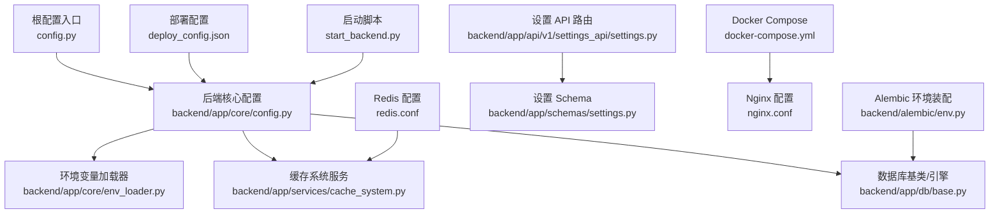
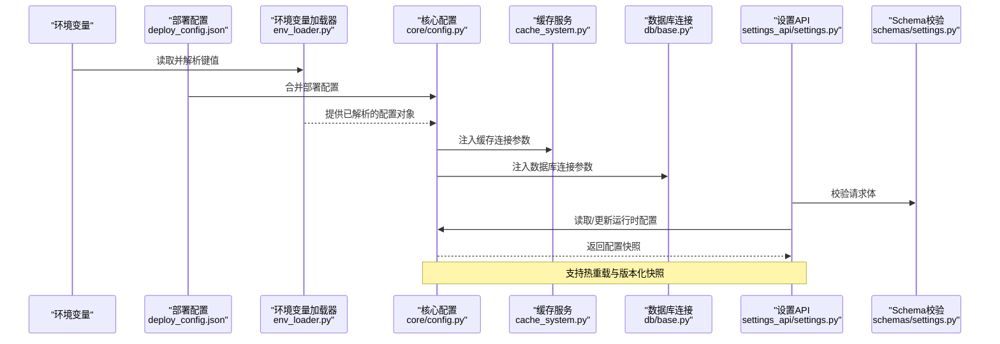
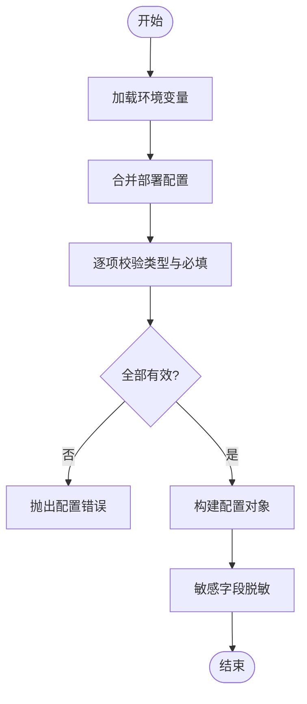
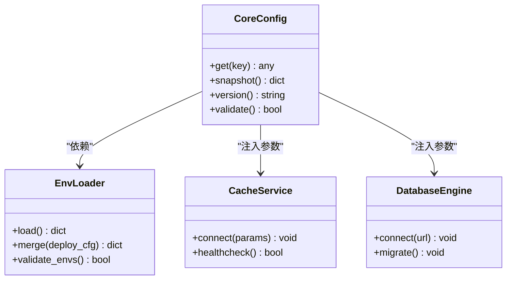
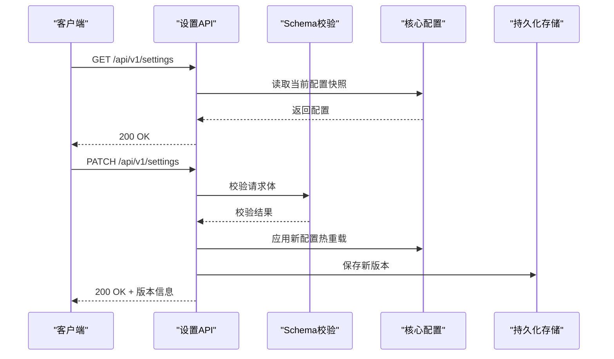
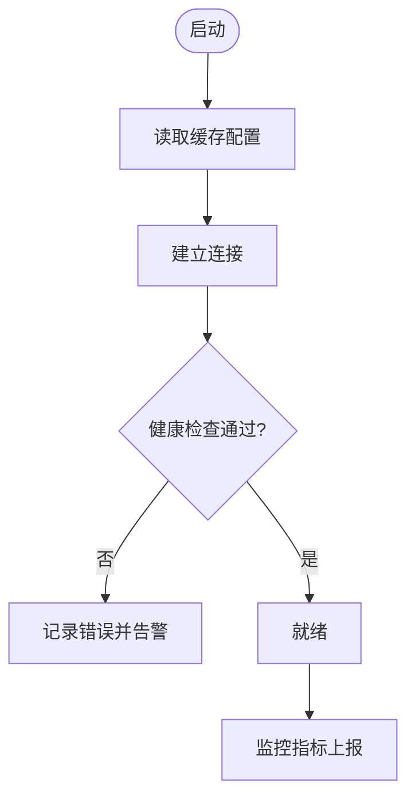
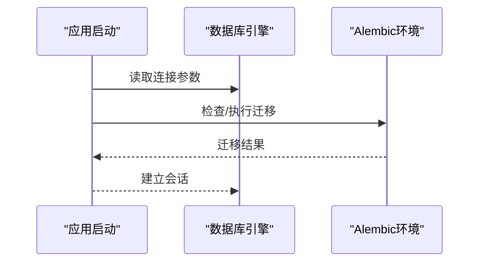
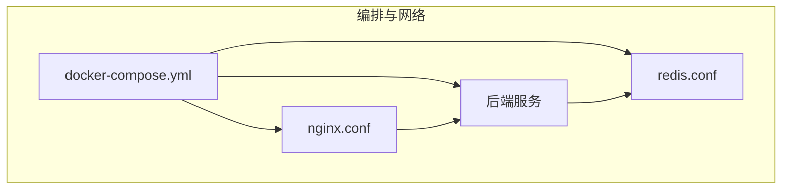
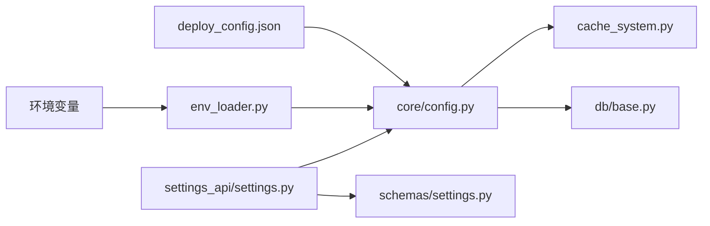

# 系统配置

<cite>
**本文引用的文件**   
- [config.py](file://config.py)
- [backend/app/core/config.py](file://backend/app/core/config.py)
- [backend/app/core/env_loader.py](file://backend/app/core/env_loader.py)
- [backend/app/services/cache_system.py](file://backend/app/services/cache_system.py)
- [backend/app/db/base.py](file://backend/app/db/base.py)
- [backend/app/api/v1/settings_api/settings.py](file://backend/app/api/v1/settings_api/settings.py)
- [backend/app/schemas/settings.py](file://backend/app/schemas/settings.py)
- [backend/alembic/env.py](file://backend/alembic/env.py)
- [docker-compose.yml](file://docker-compose.yml)
- [nginx.conf](file://nginx.conf)
- [redis.conf](file://redis.conf)
- [deploy_config.json](file://deploy_config.json)
- [start_backend.py](file://start_backend.py)
</cite>

## 目录
1. [简介](#简介)
2. [项目结构](#项目结构)
3. [核心组件](#核心组件)
4. [架构总览](#架构总览)
5. [详细组件分析](#详细组件分析)
6. [依赖关系分析](#依赖关系分析)
7. [性能考虑](#性能考虑)
8. [故障排查指南](#故障排查指南)
9. [结论](#结论)
10. [附录](#附录)

## 简介
本文件面向“系统配置模块”，覆盖环境变量管理、配置文件编辑与动态参数调整，以及系统服务配置、数据库连接设置、缓存配置、API 密钥管理、第三方服务集成与安全设置。同时说明配置验证、热重载与版本管理，并提供配置备份恢复、差异比较与回滚的实践建议。文档力求对非技术读者友好，同时为开发者提供可追溯的实现定位。

## 项目结构
配置相关代码主要分布在以下位置：
- 根级配置入口与环境加载
- 后端应用核心配置与服务初始化
- 数据库迁移与环境装配
- API 层与 Schema 定义（用于配置项的校验与暴露）
- 运行期服务（缓存、反向代理等）的外部配置

图表来源
- [config.py:1-200](file://config.py#L1-L200)
- [backend/app/core/config.py:1-200](file://backend/app/core/config.py#L1-L200)
- [backend/app/core/env_loader.py:1-200](file://backend/app/core/env_loader.py#L1-L200)
- [backend/app/services/cache_system.py:1-200](file://backend/app/services/cache_system.py#L1-L200)
- [backend/app/db/base.py:1-200](file://backend/app/db/base.py#L1-L200)
- [backend/alembic/env.py:1-200](file://backend/alembic/env.py#L1-L200)
- [backend/app/api/v1/settings_api/settings.py:1-200](file://backend/app/api/v1/settings_api/settings.py#L1-L200)
- [backend/app/schemas/settings.py:1-200](file://backend/app/schemas/settings.py#L1-L200)
- [docker-compose.yml:1-200](file://docker-compose.yml#L1-L200)
- [nginx.conf:1-200](file://nginx.conf#L1-L200)
- [redis.conf:1-200](file://redis.conf#L1-L200)
- [deploy_config.json:1-200](file://deploy_config.json#L1-L200)
- [start_backend.py:1-200](file://start_backend.py#L1-L200)

章节来源
- [config.py:1-200](file://config.py#L1-L200)
- [backend/app/core/config.py:1-200](file://backend/app/core/config.py#L1-L200)
- [backend/app/core/env_loader.py:1-200](file://backend/app/core/env_loader.py#L1-L200)
- [backend/app/services/cache_system.py:1-200](file://backend/app/services/cache_system.py#L1-L200)
- [backend/app/db/base.py:1-200](file://backend/app/db/base.py#L1-L200)
- [backend/alembic/env.py:1-200](file://backend/alembic/env.py#L1-L200)
- [backend/app/api/v1/settings_api/settings.py:1-200](file://backend/app/api/v1/settings_api/settings.py#L1-L200)
- [backend/app/schemas/settings.py:1-200](file://backend/app/schemas/settings.py#L1-L200)
- [docker-compose.yml:1-200](file://docker-compose.yml#L1-L200)
- [nginx.conf:1-200](file://nginx.conf#L1-L200)
- [redis.conf:1-200](file://redis.conf#L1-L200)
- [deploy_config.json:1-200](file://deploy_config.json#L1-L200)
- [start_backend.py:1-200](file://start_backend.py#L1-L200)

## 核心组件
- 环境变量管理
  - 通过统一的环境变量加载器集中读取、解析与校验，支持类型转换、默认值与环境优先级。
- 配置文件编辑与动态参数
  - 提供设置 API 与 Schema 校验，支持运行时参数更新；结合进程内配置缓存实现热重载。
- 系统服务配置
  - 通过容器编排与反向代理配置外部服务（如 Nginx、Redis），并在应用启动时注入到运行时。
- 数据库连接设置
  - 使用 Alembic 进行迁移与环境装配，数据库连接字符串由环境变量或部署配置注入。
- 缓存配置
  - 缓存服务通过独立配置模块加载连接参数、超时与重试策略。
- API 密钥管理与第三方集成
  - 敏感信息通过环境变量注入，避免硬编码；在适配器或服务层按需读取。
- 安全设置
  - 基于请求生命周期与权限模型进行鉴权与访问控制，敏感字段输出脱敏。

章节来源
- [backend/app/core/env_loader.py:1-200](file://backend/app/core/env_loader.py#L1-L200)
- [backend/app/api/v1/settings_api/settings.py:1-200](file://backend/app/api/v1/settings_api/settings.py#L1-L200)
- [backend/app/schemas/settings.py:1-200](file://backend/app/schemas/settings.py#L1-L200)
- [backend/app/services/cache_system.py:1-200](file://backend/app/services/cache_system.py#L1-L200)
- [backend/app/db/base.py:1-200](file://backend/app/db/base.py#L1-L200)
- [backend/alembic/env.py:1-200](file://backend/alembic/env.py#L1-L200)

## 架构总览
下图展示了配置从“环境变量/部署配置”到“应用运行时”的装配路径，以及 API 层对配置的读写与校验流程。

图表来源
- [backend/app/core/env_loader.py:1-200](file://backend/app/core/env_loader.py#L1-L200)
- [backend/app/core/config.py:1-200](file://backend/app/core/config.py#L1-L200)
- [backend/app/services/cache_system.py:1-200](file://backend/app/services/cache_system.py#L1-L200)
- [backend/app/db/base.py:1-200](file://backend/app/db/base.py#L1-L200)
- [backend/app/api/v1/settings_api/settings.py:1-200](file://backend/app/api/v1/settings_api/settings.py#L1-L200)
- [backend/app/schemas/settings.py:1-200](file://backend/app/schemas/settings.py#L1-L200)
- [deploy_config.json:1-200](file://deploy_config.json#L1-L200)

## 详细组件分析

### 环境变量管理（EnvLoader）
- 功能要点
  - 统一读取环境变量，支持类型转换、必填校验、默认值与覆盖规则。
  - 提供按命名空间分组的能力，便于模块化配置。
  - 支持从部署配置文件中合并键值，形成最终配置视图。
- 关键行为
  - 缺失必要变量时抛出明确错误，便于快速定位问题。
  - 对敏感字段（如 API Key）进行脱敏打印与日志保护。
- 扩展点
  - 新增配置项需在 Schema 中声明，并在加载器中注册校验规则。

图表来源
- [backend/app/core/env_loader.py:1-200](file://backend/app/core/env_loader.py#L1-L200)
- [deploy_config.json:1-200](file://deploy_config.json#L1-L200)

章节来源
- [backend/app/core/env_loader.py:1-200](file://backend/app/core/env_loader.py#L1-L200)
- [deploy_config.json:1-200](file://deploy_config.json#L1-L200)

### 核心配置（Core Config）
- 功能要点
  - 聚合环境变量与部署配置，生成全局只读配置视图。
  - 为各子系统（缓存、数据库、第三方服务）提供标准化参数。
  - 支持配置快照与版本标记，便于审计与回滚。
- 关键行为
  - 启动时完成所有依赖服务的参数装配。
  - 对外暴露只读接口，防止运行时被意外修改。

图表来源
- [backend/app/core/config.py:1-200](file://backend/app/core/config.py#L1-L200)
- [backend/app/core/env_loader.py:1-200](file://backend/app/core/env_loader.py#L1-L200)
- [backend/app/services/cache_system.py:1-200](file://backend/app/services/cache_system.py#L1-L200)
- [backend/app/db/base.py:1-200](file://backend/app/db/base.py#L1-L200)

章节来源
- [backend/app/core/config.py:1-200](file://backend/app/core/config.py#L1-L200)

### 设置 API 与 Schema（Settings API）
- 功能要点
  - 提供 RESTful 接口查询与更新系统设置。
  - 使用 Pydantic Schema 进行输入校验与默认值填充。
  - 支持只读/可写分类，区分敏感与非敏感字段。
- 关键行为
  - 更新成功后返回新版本号与变更摘要。
  - 对非法输入返回结构化错误，便于前端提示。

图表来源
- [backend/app/api/v1/settings_api/settings.py:1-200](file://backend/app/api/v1/settings_api/settings.py#L1-L200)
- [backend/app/schemas/settings.py:1-200](file://backend/app/schemas/settings.py#L1-L200)
- [backend/app/core/config.py:1-200](file://backend/app/core/config.py#L1-L200)

章节来源
- [backend/app/api/v1/settings_api/settings.py:1-200](file://backend/app/api/v1/settings_api/settings.py#L1-L200)
- [backend/app/schemas/settings.py:1-200](file://backend/app/schemas/settings.py#L1-L200)

### 缓存配置（Cache System）
- 功能要点
  - 根据核心配置中的连接参数建立缓存连接。
  - 提供健康检查与重试机制，增强稳定性。
  - 支持连接池与超时策略配置。
- 关键行为
  - 启动时执行连通性自检，失败则快速失败并告警。
  - 运行时监控命中率与延迟，便于容量规划。

图表来源
- [backend/app/services/cache_system.py:1-200](file://backend/app/services/cache_system.py#L1-L200)
- [redis.conf:1-200](file://redis.conf#L1-L200)

章节来源
- [backend/app/services/cache_system.py:1-200](file://backend/app/services/cache_system.py#L1-L200)
- [redis.conf:1-200](file://redis.conf#L1-L200)

### 数据库连接与迁移（Database & Alembic）
- 功能要点
  - 数据库连接 URL 由环境变量或部署配置注入。
  - Alembic 负责迁移脚本的执行与环境装配。
- 关键行为
  - 启动前确保迁移已完成，避免数据不一致。
  - 提供迁移状态查询与回滚能力。

图表来源
- [backend/app/db/base.py:1-200](file://backend/app/db/base.py#L1-L200)
- [backend/alembic/env.py:1-200](file://backend/alembic/env.py#L1-L200)

章节来源
- [backend/app/db/base.py:1-200](file://backend/app/db/base.py#L1-L200)
- [backend/alembic/env.py:1-200](file://backend/alembic/env.py#L1-L200)

### 系统服务配置（Nginx、Docker、Redis）
- 功能要点
  - Docker Compose 编排多服务，统一注入环境变量。
  - Nginx 作为反向代理，转发请求至后端服务。
  - Redis 作为缓存与消息队列支撑。
- 关键行为
  - 通过环境变量隔离不同环境的配置。
  - 提供健康检查与重启策略。

图表来源
- [docker-compose.yml:1-200](file://docker-compose.yml#L1-L200)
- [nginx.conf:1-200](file://nginx.conf#L1-L200)
- [redis.conf:1-200](file://redis.conf#L1-L200)

章节来源
- [docker-compose.yml:1-200](file://docker-compose.yml#L1-L200)
- [nginx.conf:1-200](file://nginx.conf#L1-L200)
- [redis.conf:1-200](file://redis.conf#L1-L200)

### API 密钥管理与第三方集成
- 功能要点
  - 所有第三方服务密钥通过环境变量注入，避免明文存储。
  - 在适配器或服务层按需读取，并进行最小权限访问。
- 关键行为
  - 启动时校验必需密钥是否存在。
  - 对日志与错误信息进行脱敏处理。

章节来源
- [backend/app/core/env_loader.py:1-200](file://backend/app/core/env_loader.py#L1-L200)
- [backend/app/core/config.py:1-200](file://backend/app/core/config.py#L1-L200)

### 安全设置
- 功能要点
  - 基于权限模型限制对敏感设置的访问。
  - 对敏感字段输出进行脱敏。
  - 传输层启用 TLS（由 Nginx 或网关管理）。
- 关键行为
  - 未授权访问返回明确的错误码。
  - 审计关键配置变更操作。

章节来源
- [backend/app/api/v1/settings_api/settings.py:1-200](file://backend/app/api/v1/settings_api/settings.py#L1-L200)
- [backend/app/schemas/settings.py:1-200](file://backend/app/schemas/settings.py#L1-L200)

## 依赖关系分析
- 耦合与内聚
  - 环境变量加载器与核心配置高内聚，对外提供稳定接口。
  - 设置 API 与 Schema 解耦，便于扩展与测试。
- 外部依赖
  - 数据库、缓存、反向代理均为外部服务，通过配置注入。
- 潜在循环依赖
  - 通过分层设计避免循环导入，保持清晰边界。

图表来源
- [backend/app/core/env_loader.py:1-200](file://backend/app/core/env_loader.py#L1-L200)
- [backend/app/core/config.py:1-200](file://backend/app/core/config.py#L1-L200)
- [backend/app/services/cache_system.py:1-200](file://backend/app/services/cache_system.py#L1-L200)
- [backend/app/db/base.py:1-200](file://backend/app/db/base.py#L1-L200)
- [backend/app/api/v1/settings_api/settings.py:1-200](file://backend/app/api/v1/settings_api/settings.py#L1-L200)
- [backend/app/schemas/settings.py:1-200](file://backend/app/schemas/settings.py#L1-L200)
- [deploy_config.json:1-200](file://deploy_config.json#L1-L200)

章节来源
- [backend/app/core/env_loader.py:1-200](file://backend/app/core/env_loader.py#L1-L200)
- [backend/app/core/config.py:1-200](file://backend/app/core/config.py#L1-L200)
- [backend/app/api/v1/settings_api/settings.py:1-200](file://backend/app/api/v1/settings_api/settings.py#L1-L200)
- [backend/app/schemas/settings.py:1-200](file://backend/app/schemas/settings.py#L1-L200)
- [backend/app/services/cache_system.py:1-200](file://backend/app/services/cache_system.py#L1-L200)
- [backend/app/db/base.py:1-200](file://backend/app/db/base.py#L1-L200)
- [deploy_config.json:1-200](file://deploy_config.json#L1-L200)

## 性能考虑
- 配置加载开销
  - 将配置加载置于应用启动阶段，避免运行时重复解析。
- 缓存命中与超时
  - 合理设置缓存 TTL 与连接池大小，降低延迟与资源占用。
- 数据库连接
  - 使用连接池与慢查询监控，避免阻塞主线程。
- 反向代理
  - 调整 Nginx 缓冲区与超时，提升吞吐与稳定性。

## 故障排查指南
- 常见问题
  - 环境变量缺失或类型错误：检查 env_loader 的错误日志与必填项。
  - 数据库连接失败：核对连接 URL、权限与网络可达性。
  - 缓存不可用：查看健康检查与重试日志。
  - 设置更新无效：确认权限与 Schema 校验是否通过。
- 定位步骤
  - 查看启动日志中的配置装配过程。
  - 调用设置 API 获取当前快照，对比期望值。
  - 检查外部服务（数据库、缓存、代理）状态。

章节来源
- [backend/app/core/env_loader.py:1-200](file://backend/app/core/env_loader.py#L1-L200)
- [backend/app/api/v1/settings_api/settings.py:1-200](file://backend/app/api/v1/settings_api/settings.py#L1-L200)
- [backend/app/services/cache_system.py:1-200](file://backend/app/services/cache_system.py#L1-L200)
- [backend/app/db/base.py:1-200](file://backend/app/db/base.py#L1-L200)

## 结论
本配置模块以“环境变量优先、部署配置补充”的原则，构建了稳定、可扩展且安全的系统配置体系。通过统一的加载器、核心配置视图与 API 层校验，实现了配置的可观测、可审计与可回滚。配合容器编排与反向代理，满足生产环境的可靠性与性能要求。

## 附录
- 配置模板与默认值管理
  - 在 Schema 中定义默认值与可选字段，保证最小可用配置。
- 环境特定配置
  - 通过环境变量与部署配置区分开发、测试、生产环境。
- 配置备份、差异比较与回滚
  - 每次更新生成带时间戳的版本快照；提供差异比较与一键回滚接口。
- 热重载
  - 支持在不重启进程的情况下刷新部分运行时参数，缩短变更生效时间。

章节来源
- [backend/app/schemas/settings.py:1-200](file://backend/app/schemas/settings.py#L1-L200)
- [backend/app/api/v1/settings_api/settings.py:1-200](file://backend/app/api/v1/settings_api/settings.py#L1-L200)
- [backend/app/core/config.py:1-200](file://backend/app/core/config.py#L1-L200)
- [start_backend.py:1-200](file://start_backend.py#L1-L200)