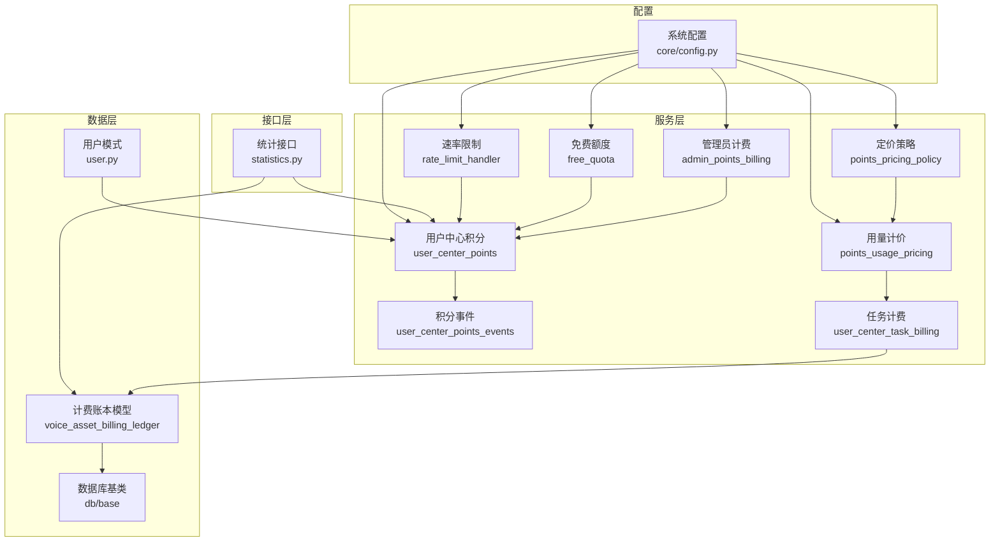
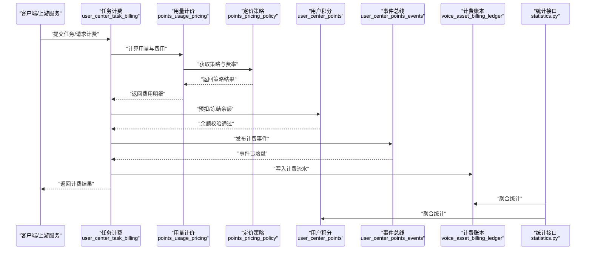
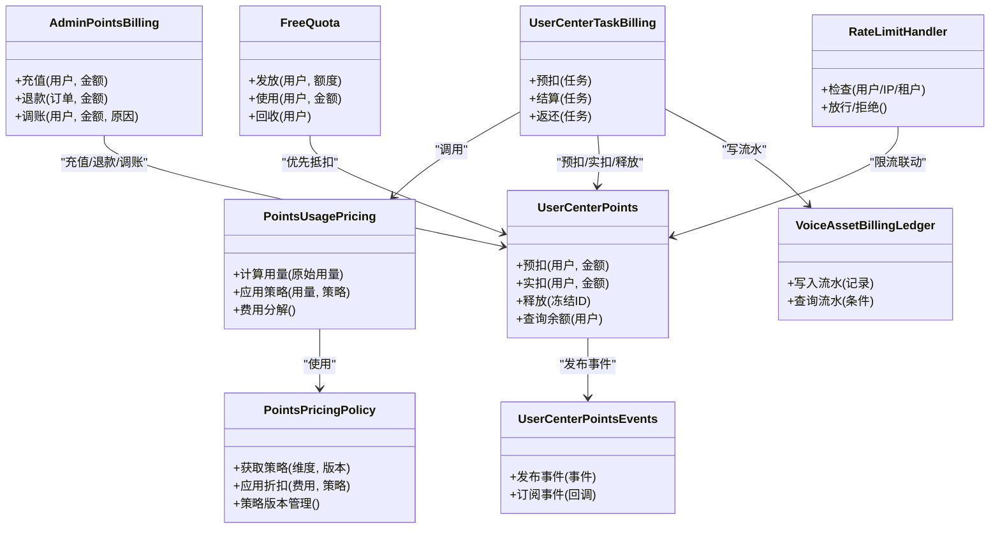

# 计费管理

<cite>
**本文引用的文件**   
- [backend/app/services/points_pricing_policy.py](file://backend/app/services/points_pricing_policy.py)
- [backend/app/services/points_usage_pricing.py](file://backend/app/services/points_usage_pricing.py)
- [backend/app/services/admin_points_billing.py](file://backend/app/services/admin_points_billing.py)
- [backend/app/services/user_center_points.py](file://backend/app/services/user_center_points.py)
- [backend/app/services/user_center_points_events.py](file://backend/app/services/user_center_points_events.py)
- [backend/app/services/user_center_task_billing.py](file://backend/app/services/user_center_task_billing.py)
- [backend/app/services/free_quota.py](file://backend/app/services/free_quota.py)
- [backend/app/services/rate_limit_handler.py](file://backend/app/services/rate_limit_handler.py)
- [backend/app/models/voice_asset_billing_ledger.py](file://backend/app/models/voice_asset_billing_ledger.py)
- [backend/app/schemas/user.py](file://backend/app/schemas/user.py)
- [backend/app/api/v1/statistics.py](file://backend/app/api/v1/statistics.py)
- [backend/app/core/config.py](file://backend/app/core/config.py)
- [backend/app/db/base.py](file://backend/app/db/base.py)
- [backend/tests/test_budget_ledger.py](file://backend/tests/test_budget_ledger.py)
- [backend/tests/test_user_center_billing_events.py](file://backend/tests/test_user_center_billing_events.py)
- [backend/tests/test_voice_asset_billing_ledger_repository.py](file://backend/tests/test_voice_asset_billing_ledger_repository.py)
</cite>

## 目录
1. [简介](#简介)
2. [项目结构](#项目结构)
3. [核心组件](#核心组件)
4. [架构总览](#架构总览)
5. [详细组件分析](#详细组件分析)
6. [依赖关系分析](#依赖关系分析)
7. [性能考虑](#性能考虑)
8. [故障排查指南](#故障排查指南)
9. [结论](#结论)
10. [附录](#附录)

## 简介
本文件面向“计费管理模块”，围绕积分定价策略、计费规则与费率配置，用户余额管理与充值记录、消费统计，账单生成、支付处理与退款流程，计费审计、异常检测与防欺诈机制，报表生成、数据分析与服务使用统计，以及计费策略的动态调整与历史版本管理进行系统化说明。文档以代码仓库中的服务层、模型层、API 与测试为依据，提供从概念到实现的全景视图，帮助开发者与运营人员理解并扩展计费能力。

## 项目结构
计费相关能力主要分布在后端服务的 services、models、schemas、api 与 tests 目录中：
- 服务层（services）：定价策略、用量计价、任务计费、免费额度、速率限制、事件与用户中心积分等
- 模型层（models）：计费账本实体定义
- 模式层（schemas）：用户与计费相关的数据契约
- API 层（api）：统计与查询接口
- 配置（core/config）：计费开关与阈值配置
- 数据库基类（db/base）：ORM 基础与迁移支撑
- 测试（tests）：预算账本、事件、计费账本仓储的验证用例

图表来源
- [backend/app/services/points_pricing_policy.py](file://backend/app/services/points_pricing_policy.py)
- [backend/app/services/points_usage_pricing.py](file://backend/app/services/points_usage_pricing.py)
- [backend/app/services/admin_points_billing.py](file://backend/app/services/admin_points_billing.py)
- [backend/app/services/user_center_points.py](file://backend/app/services/user_center_points.py)
- [backend/app/services/user_center_points_events.py](file://backend/app/services/user_center_points_events.py)
- [backend/app/services/user_center_task_billing.py](file://backend/app/services/user_center_task_billing.py)
- [backend/app/services/free_quota.py](file://backend/app/services/free_quota.py)
- [backend/app/services/rate_limit_handler.py](file://backend/app/services/rate_limit_handler.py)
- [backend/app/models/voice_asset_billing_ledger.py](file://backend/app/models/voice_asset_billing_ledger.py)
- [backend/app/schemas/user.py](file://backend/app/schemas/user.py)
- [backend/app/api/v1/statistics.py](file://backend/app/api/v1/statistics.py)
- [backend/app/core/config.py](file://backend/app/core/config.py)
- [backend/app/db/base.py](file://backend/app/db/base.py)

章节来源
- [backend/app/services/points_pricing_policy.py](file://backend/app/services/points_pricing_policy.py)
- [backend/app/services/points_usage_pricing.py](file://backend/app/services/points_usage_pricing.py)
- [backend/app/services/admin_points_billing.py](file://backend/app/services/admin_points_billing.py)
- [backend/app/services/user_center_points.py](file://backend/app/services/user_center_points.py)
- [backend/app/services/user_center_points_events.py](file://backend/app/services/user_center_points_events.py)
- [backend/app/services/user_center_task_billing.py](file://backend/app/services/user_center_task_billing.py)
- [backend/app/services/free_quota.py](file://backend/app/services/free_quota.py)
- [backend/app/services/rate_limit_handler.py](file://backend/app/services/rate_limit_handler.py)
- [backend/app/models/voice_asset_billing_ledger.py](file://backend/app/models/voice_asset_billing_ledger.py)
- [backend/app/schemas/user.py](file://backend/app/schemas/user.py)
- [backend/app/api/v1/statistics.py](file://backend/app/api/v1/statistics.py)
- [backend/app/core/config.py](file://backend/app/core/config.py)
- [backend/app/db/base.py](file://backend/app/db/base.py)

## 核心组件
- 定价策略（points_pricing_policy）：集中管理积分定价策略、费率表与策略版本，支持按维度（如模型、资源类型、时段）选择适用策略。
- 用量计价（points_usage_pricing）：基于实际用量（时长、Token、并发等）计算应扣积分，结合策略与折扣、封顶规则得出最终费用。
- 管理员计费（admin_points_billing）：面向运营的管理员操作，包括手动调账、批量充值、退款审批与对账导出。
- 用户中心积分（user_center_points）：用户余额读写、流水记录、冻结/解冻、限额控制与状态校验。
- 积分事件（user_center_points_events）：统一的事件发布与订阅，用于审计、追踪与跨服务通知。
- 任务计费（user_center_task_billing）：将任务执行结果映射为计费项，触发扣费或返还，并与账本持久化。
- 免费额度（free_quota）：免费试用额度、配额分配与过期回收逻辑。
- 速率限制（rate_limit_handler）：防止滥用与突发流量，结合计费上下文做限流与降级。
- 计费账本模型（voice_asset_billing_ledger）：不可变流水记录，保证审计可追溯。
- 统计接口（statistics.py）：聚合消费、余额、充值、退款等指标，供报表与分析使用。
- 配置（core/config.py）：计费开关、阈值、策略路由与灰度参数。
- 数据库基类（db/base.py）：ORM 基础、事务与迁移支持。

章节来源
- [backend/app/services/points_pricing_policy.py](file://backend/app/services/points_pricing_policy.py)
- [backend/app/services/points_usage_pricing.py](file://backend/app/services/points_usage_pricing.py)
- [backend/app/services/admin_points_billing.py](file://backend/app/services/admin_points_billing.py)
- [backend/app/services/user_center_points.py](file://backend/app/services/user_center_points.py)
- [backend/app/services/user_center_points_events.py](file://backend/app/services/user_center_points_events.py)
- [backend/app/services/user_center_task_billing.py](file://backend/app/services/user_center_task_billing.py)
- [backend/app/services/free_quota.py](file://backend/app/services/free_quota.py)
- [backend/app/services/rate_limit_handler.py](file://backend/app/services/rate_limit_handler.py)
- [backend/app/models/voice_asset_billing_ledger.py](file://backend/app/models/voice_asset_billing_ledger.py)
- [backend/app/api/v1/statistics.py](file://backend/app/api/v1/statistics.py)
- [backend/app/core/config.py](file://backend/app/core/config.py)
- [backend/app/db/base.py](file://backend/app/db/base.py)

## 架构总览
计费体系采用“策略+用量”解耦设计：策略层决定如何计费，用量层负责采集与折算，业务层（任务/用户中心）驱动调用，事件与账本保障可审计性，统计接口对外暴露指标。

图表来源
- [backend/app/services/user_center_task_billing.py](file://backend/app/services/user_center_task_billing.py)
- [backend/app/services/points_usage_pricing.py](file://backend/app/services/points_usage_pricing.py)
- [backend/app/services/points_pricing_policy.py](file://backend/app/services/points_pricing_policy.py)
- [backend/app/services/user_center_points.py](file://backend/app/services/user_center_points.py)
- [backend/app/services/user_center_points_events.py](file://backend/app/services/user_center_points_events.py)
- [backend/app/models/voice_asset_billing_ledger.py](file://backend/app/models/voice_asset_billing_ledger.py)
- [backend/app/api/v1/statistics.py](file://backend/app/api/v1/statistics.py)

## 详细组件分析

### 定价策略（points_pricing_policy）
- 职责：维护策略版本、维度匹配（模型/资源/区域/时段）、折扣与封顶规则；提供策略解析与缓存。
- 关键点：
  - 策略版本管理：新增策略时打版本号，旧版本保留以便回滚与审计。
  - 动态调整：热更新策略命中规则，支持灰度发布与 A/B 实验。
  - 优先级与冲突解决：多策略匹配时的优先级与覆盖规则。
- 典型用法：在用量计价前加载策略，确保费用计算一致性与可追溯。

章节来源
- [backend/app/services/points_pricing_policy.py](file://backend/app/services/points_pricing_policy.py)

### 用量计价（points_usage_pricing）
- 职责：根据实际用量（时长、Token、并发、存储等）与策略计算费用，应用折扣、封顶、保底等规则。
- 关键点：
  - 用量归一化：不同来源用量统一折算为标准单位。
  - 费用分解：明细包含基础费用、附加费用、折扣与封顶后的净费用。
  - 幂等与重试：重复请求不重复计费，支持补偿与对账。
- 典型用法：任务计费在服务编排中调用，输出费用明细供后续扣费与审计。

章节来源
- [backend/app/services/points_usage_pricing.py](file://backend/app/services/points_usage_pricing.py)

### 管理员计费（admin_points_billing）
- 职责：提供人工干预能力，包括充值、调账、退款审批、批量操作与导出。
- 关键点：
  - 权限与审批：管理员操作需鉴权与审批链。
  - 对账与审计：所有操作生成事件与流水，支持回溯。
  - 风险控制：大额操作二次确认与风控拦截。
- 典型用法：运营后台发起充值/退款，系统落库并推送事件。

章节来源
- [backend/app/services/admin_points_billing.py](file://backend/app/services/admin_points_billing.py)

### 用户中心积分（user_center_points）
- 职责：用户余额读写、流水记录、冻结/解冻、限额控制、状态校验。
- 关键点：
  - 原子扣款：事务内完成余额检查、扣减与流水写入。
  - 冻结机制：预扣后释放或转实扣，避免超扣。
  - 限额与黑名单：按用户/租户维度设置上限与黑名单。
- 典型用法：任务计费预扣、失败释放、成功转实扣。

章节来源
- [backend/app/services/user_center_points.py](file://backend/app/services/user_center_points.py)

### 积分事件（user_center_points_events）
- 职责：统一发布与订阅计费事件，支撑审计、追踪与跨服务通知。
- 关键点：
  - 事件模型：标准化字段（用户、金额、方向、原因、关联单号）。
  - 持久化与重试：事件落库与失败重试，保证至少一次语义。
  - 订阅者：统计、风控、对账、通知等。
- 典型用法：充值、扣费、退款、冻结、解冻均发布事件。

章节来源
- [backend/app/services/user_center_points_events.py](file://backend/app/services/user_center_points_events.py)

### 任务计费（user_center_task_billing）
- 职责：将任务执行结果映射为计费项，触发扣费或返还，并与账本持久化。
- 关键点：
  - 计费触发点：任务开始预扣、结束结算、失败返还。
  - 费用明细：与用量计价对齐，支持分拆与汇总。
  - 幂等与补偿：重复提交与中断恢复。
- 典型用法：音频/视频生成任务完成后，依据用量与策略结算。

章节来源
- [backend/app/services/user_center_task_billing.py](file://backend/app/services/user_center_task_billing.py)

### 免费额度（free_quota）
- 职责：免费试用额度发放、使用与过期回收。
- 关键点：
  - 额度池：按用户/租户维度隔离。
  - 优先抵扣：先扣免费额度，再扣付费余额。
  - 过期策略：定时清理与提醒。
- 典型用法：新用户注册赠送额度，首次体验后引导充值。

章节来源
- [backend/app/services/free_quota.py](file://backend/app/services/free_quota.py)

### 速率限制（rate_limit_handler）
- 职责：防止滥用与突发流量，结合计费上下文做限流与降级。
- 关键点：
  - 多维度限流：用户、IP、租户、接口级别。
  - 计费联动：超额请求直接拒绝或排队。
  - 弹性策略：高峰期放宽或收紧。
- 典型用法：高频调用场景下保护计费与下游服务。

章节来源
- [backend/app/services/rate_limit_handler.py](file://backend/app/services/rate_limit_handler.py)

### 计费账本模型（voice_asset_billing_ledger）
- 职责：不可变流水记录，保证审计可追溯。
- 关键点：
  - 字段完整性：用户、金额、方向、时间、原因、关联单号、摘要。
  - 索引优化：按用户、时间、类型查询。
  - 归档策略：冷热分离与压缩。
- 典型用法：所有计费事件落盘，供对账与报表。

章节来源
- [backend/app/models/voice_asset_billing_ledger.py](file://backend/app/models/voice_asset_billing_ledger.py)

### 统计接口（statistics.py）
- 职责：聚合消费、余额、充值、退款等指标，供报表与分析使用。
- 关键点：
  - 聚合维度：用户、租户、时间、资源类型。
  - 实时与离线：近实时查询与批处理报表。
  - 导出能力：CSV/Excel 导出与订阅。
- 典型用法：运营看板与财务对账。

章节来源
- [backend/app/api/v1/statistics.py](file://backend/app/api/v1/statistics.py)

### 配置（core/config.py）
- 职责：计费开关、阈值、策略路由与灰度参数。
- 关键点：
  - 环境变量注入：生产环境安全配置。
  - 动态重载：部分参数热更新。
  - 默认值与校验：启动时校验关键配置。
- 典型用法：控制免费额度开关、限流阈值、策略灰度比例。

章节来源
- [backend/app/core/config.py](file://backend/app/core/config.py)

### 数据库基类（db/base.py）
- 职责：ORM 基础、事务与迁移支撑。
- 关键点：
  - 会话管理：连接池与事务边界。
  - 迁移脚本：Alembic 版本管理。
  - 兼容性：字段变更与向后兼容。
- 典型用法：计费模型与流水表的建表与升级。

章节来源
- [backend/app/db/base.py](file://backend/app/db/base.py)

### 用户模式（schemas/user.py）
- 职责：用户与计费相关的数据契约。
- 关键点：
  - 字段约束：必填、长度、枚举。
  - 序列化/反序列化：API 输入输出校验。
  - 扩展点：预留计费扩展字段。
- 典型用法：用户创建、充值申请、退款申请的入参校验。

章节来源
- [backend/app/schemas/user.py](file://backend/app/schemas/user.py)

## 依赖关系分析
计费模块内部依赖清晰，服务层之间通过明确接口交互，数据层由 ORM 抽象，外部依赖通过配置与事件总线解耦。

图表来源
- [backend/app/services/points_pricing_policy.py](file://backend/app/services/points_pricing_policy.py)
- [backend/app/services/points_usage_pricing.py](file://backend/app/services/points_usage_pricing.py)
- [backend/app/services/admin_points_billing.py](file://backend/app/services/admin_points_billing.py)
- [backend/app/services/user_center_points.py](file://backend/app/services/user_center_points.py)
- [backend/app/services/user_center_points_events.py](file://backend/app/services/user_center_points_events.py)
- [backend/app/services/user_center_task_billing.py](file://backend/app/services/user_center_task_billing.py)
- [backend/app/services/free_quota.py](file://backend/app/services/free_quota.py)
- [backend/app/services/rate_limit_handler.py](file://backend/app/services/rate_limit_handler.py)
- [backend/app/models/voice_asset_billing_ledger.py](file://backend/app/models/voice_asset_billing_ledger.py)

章节来源
- [backend/app/services/points_pricing_policy.py](file://backend/app/services/points_pricing_policy.py)
- [backend/app/services/points_usage_pricing.py](file://backend/app/services/points_usage_pricing.py)
- [backend/app/services/admin_points_billing.py](file://backend/app/services/admin_points_billing.py)
- [backend/app/services/user_center_points.py](file://backend/app/services/user_center_points.py)
- [backend/app/services/user_center_points_events.py](file://backend/app/services/user_center_points_events.py)
- [backend/app/services/user_center_task_billing.py](file://backend/app/services/user_center_task_billing.py)
- [backend/app/services/free_quota.py](file://backend/app/services/free_quota.py)
- [backend/app/services/rate_limit_handler.py](file://backend/app/services/rate_limit_handler.py)
- [backend/app/models/voice_asset_billing_ledger.py](file://backend/app/models/voice_asset_billing_ledger.py)

## 性能考虑
- 用量计算缓存：策略与费率热点数据缓存，降低频繁读取开销。
- 批量写入：流水与事件批量落库，减少 IO 次数。
- 异步事件：事件发布与订阅异步化，避免阻塞主流程。
- 分页与索引：统计查询使用分页与合适索引，避免全表扫描。
- 限流与熔断：在高负载时快速失败，保护计费与下游服务。

[本节为通用指导，无需引用具体文件]

## 故障排查指南
- 余额不足：检查用户余额、冻结金额与免费额度使用情况，确认预扣与释放逻辑是否正确。
- 重复计费：核对任务幂等键与事件去重，检查重试与补偿机制。
- 策略不生效：确认策略版本与维度匹配，查看灰度与优先级。
- 事件丢失：检查事件队列与重试策略，确认消费者是否成功处理。
- 限流误杀：查看限流阈值与计数窗口，确认是否为正常波动。
- 对账差异：比对流水与余额变动，定位差异时间点与操作人。

章节来源
- [backend/tests/test_budget_ledger.py](file://backend/tests/test_budget_ledger.py)
- [backend/tests/test_user_center_billing_events.py](file://backend/tests/test_user_center_billing_events.py)
- [backend/tests/test_voice_asset_billing_ledger_repository.py](file://backend/tests/test_voice_asset_billing_ledger_repository.py)

## 结论
计费管理模块以“策略+用量”为核心，结合事件与账本实现可审计、可追溯、可扩展的计费体系。通过管理员计费、免费额度与速率限制，满足运营与风控需求；统计接口支撑报表与分析。建议在持续演进中加强策略版本治理、事件一致性保障与性能优化，确保计费准确与稳定。

[本节为总结，无需引用具体文件]

## 附录
- 术语表：
  - 策略：计费规则集合，含维度匹配、折扣与封顶。
  - 用量：实际消耗的资源度量（时长、Token、并发等）。
  - 预扣：冻结余额，待结算后转为实扣或释放。
  - 实扣：正式扣减余额。
  - 流水：不可变的计费记录，用于审计与对账。
  - 事件：计费过程中的消息，用于追踪与通知。
- 最佳实践：
  - 所有计费路径必须写流水与发事件。
  - 策略变更需版本化管理与灰度发布。
  - 对账与审计优先于功能迭代。
  - 限流与熔断保护计费链路稳定性。

[本节为补充信息，无需引用具体文件]