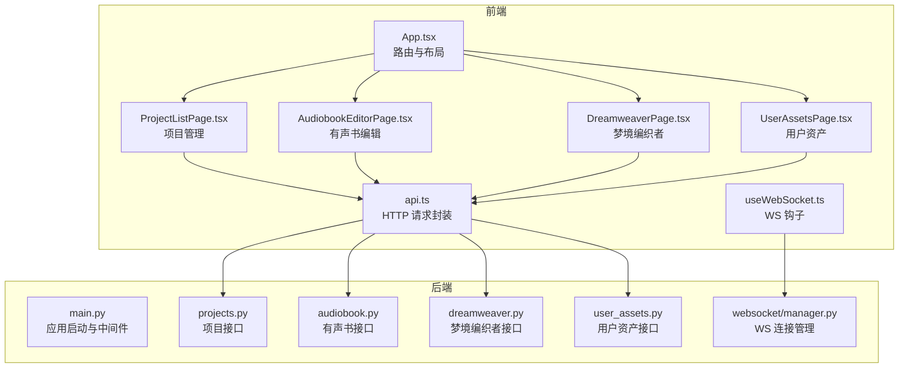
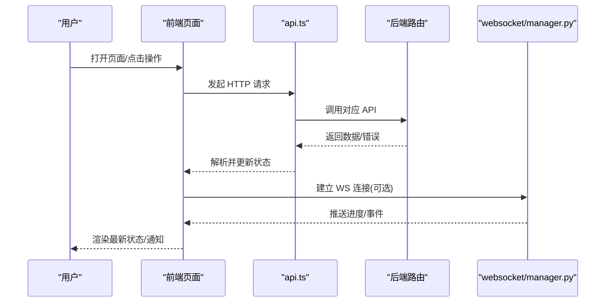
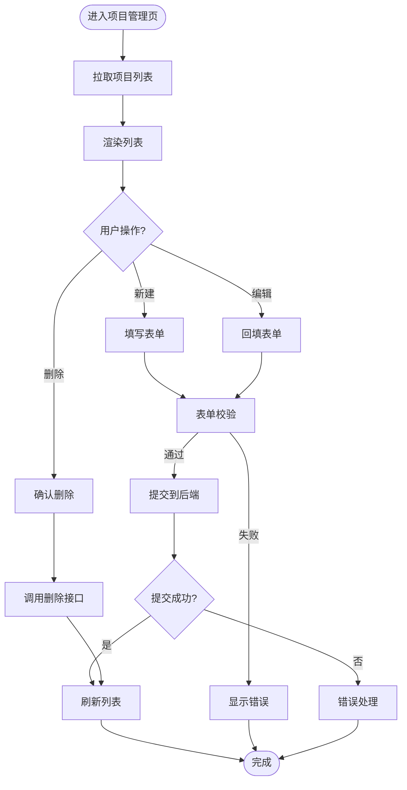
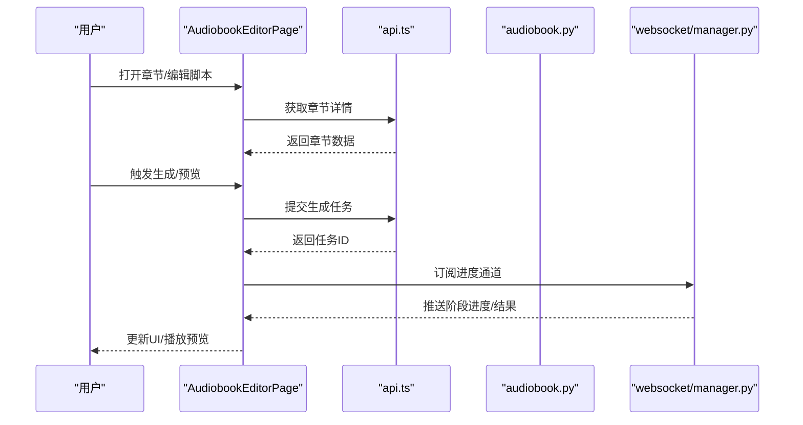
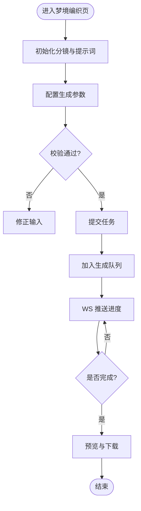
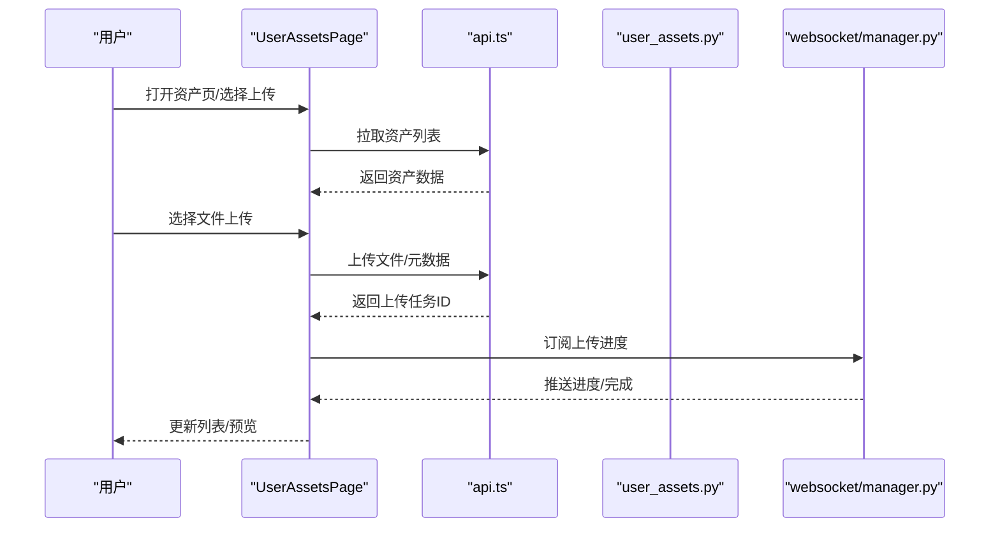
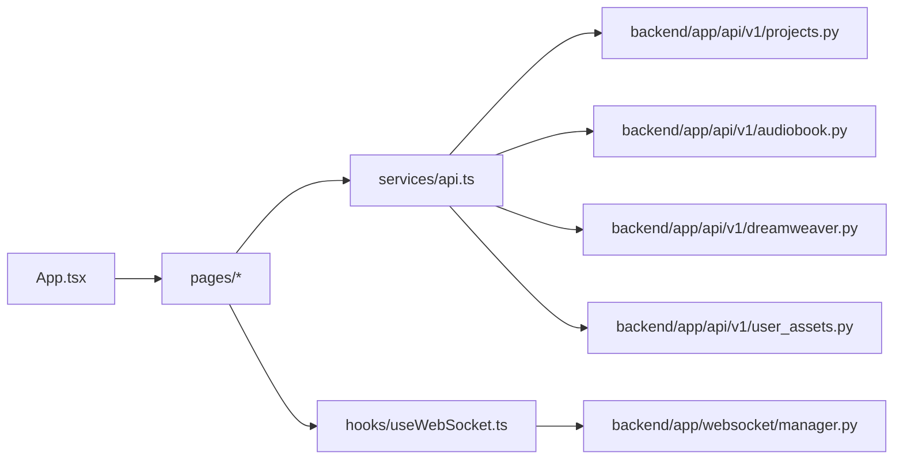

# 页面功能

<cite>
**本文档引用的文件**   
- [frontend/src/App.tsx](file://frontend/src/App.tsx)
- [frontend/src/pages/ProjectListPage.tsx](file://frontend/src/pages/ProjectListPage.tsx)
- [frontend/src/pages/AudiobookEditorPage.tsx](file://frontend/src/pages/AudiobookEditorPage.tsx)
- [frontend/src/pages/DreamweaverPage.tsx](file://frontend/src/pages/DreamweaverPage.tsx)
- [frontend/src/pages/UserAssetsPage.tsx](file://frontend/src/pages/UserAssetsPage.tsx)
- [frontend/src/hooks/useWebSocket.ts](file://frontend/src/hooks/useWebSocket.ts)
- [frontend/src/services/api.ts](file://frontend/src/services/api.ts)
- [backend/app/main.py](file://backend/app/main.py)
- [backend/app/api/v1/projects.py](file://backend/app/api/v1/projects.py)
- [backend/app/api/v1/audiobook.py](file://backend/app/api/v1/audiobook.py)
- [backend/app/api/v1/dreamweaver.py](file://backend/app/api/v1/dreamweaver.py)
- [backend/app/api/v1/user_assets.py](file://backend/app/api/v1/user_assets.py)
- [backend/app/websocket/manager.py](file://backend/app/websocket/manager.py)
</cite>

## 目录
1. [简介](#简介)
2. [项目结构](#项目结构)
3. [核心组件](#核心组件)
4. [架构总览](#架构总览)
5. [详细组件分析](#详细组件分析)
6. [依赖关系分析](#依赖关系分析)
7. [性能考虑](#性能考虑)
8. [故障排查指南](#故障排查指南)
9. [结论](#结论)
10. [附录](#附录)

## 简介
本文件面向小说创作代理系统的前端页面，系统性梳理项目管理、有声书编辑、梦境编织者、用户资产等页面的功能与交互。文档覆盖：
- 页面职责与导航关系
- 数据传递与状态共享机制
- 用户交互流程、表单验证与提交
- 实时通信（WebSocket）与进度更新
- 性能优化（懒加载、资源管理）
- 测试策略、用户反馈收集与错误处理

## 项目结构
前端采用 React + TypeScript 组织，页面位于 pages 目录，路由入口在 App.tsx；后端为 FastAPI，按领域划分 API 模块，WebSocket 由独立管理器提供。

图表来源
- [frontend/src/App.tsx](file://frontend/src/App.tsx)
- [frontend/src/pages/ProjectListPage.tsx](file://frontend/src/pages/ProjectListPage.tsx)
- [frontend/src/pages/AudiobookEditorPage.tsx](file://frontend/src/pages/AudiobookEditorPage.tsx)
- [frontend/src/pages/DreamweaverPage.tsx](file://frontend/src/pages/DreamweaverPage.tsx)
- [frontend/src/pages/UserAssetsPage.tsx](file://frontend/src/pages/UserAssetsPage.tsx)
- [frontend/src/hooks/useWebSocket.ts](file://frontend/src/hooks/useWebSocket.ts)
- [frontend/src/services/api.ts](file://frontend/src/services/api.ts)
- [backend/app/main.py](file://backend/app/main.py)
- [backend/app/api/v1/projects.py](file://backend/app/api/v1/projects.py)
- [backend/app/api/v1/audiobook.py](file://backend/app/api/v1/audiobook.py)
- [backend/app/api/v1/dreamweaver.py](file://backend/app/api/v1/dreamweaver.py)
- [backend/app/api/v1/user_assets.py](file://backend/app/api/v1/user_assets.py)
- [backend/app/websocket/manager.py](file://backend/app/websocket/manager.py)

章节来源
- [frontend/src/App.tsx](file://frontend/src/App.tsx)
- [backend/app/main.py](file://backend/app/main.py)

## 核心组件
- 项目管理页面：创建/编辑/删除项目，查看章节列表，进入有声书编辑或梦境编织任务。
- 有声书编辑页面：章节脚本编辑、角色与音色配置、分段生成与预览、时间轴对齐、导出字幕与音频。
- 梦境编织者页面：视频生成任务编排、分镜与提示词管理、素材库选择、生成进度与结果预览。
- 用户资产页面：本地/云端资产索引、上传与元数据管理、评分与审计记录、批量操作。

章节来源
- [frontend/src/pages/ProjectListPage.tsx](file://frontend/src/pages/ProjectListPage.tsx)
- [frontend/src/pages/AudiobookEditorPage.tsx](file://frontend/src/pages/AudiobookEditorPage.tsx)
- [frontend/src/pages/DreamweaverPage.tsx](file://frontend/src/pages/DreamweaverPage.tsx)
- [frontend/src/pages/UserAssetsPage.tsx](file://frontend/src/pages/UserAssetsPage.tsx)

## 架构总览
前后端通过 RESTful API 进行数据交互，长时任务与进度推送使用 WebSocket。页面级状态由组件内部 state 与 hooks 管理，跨页共享通过路由参数与全局 store（如有）。

图表来源
- [frontend/src/services/api.ts](file://frontend/src/services/api.ts)
- [backend/app/api/v1/projects.py](file://backend/app/api/v1/projects.py)
- [backend/app/api/v1/audiobook.py](file://backend/app/api/v1/audiobook.py)
- [backend/app/api/v1/dreamweaver.py](file://backend/app/api/v1/dreamweaver.py)
- [backend/app/api/v1/user_assets.py](file://backend/app/api/v1/user_assets.py)
- [backend/app/websocket/manager.py](file://backend/app/websocket/manager.py)

## 详细组件分析

### 项目管理页面
- 核心功能
  - 项目列表展示、搜索与分页
  - 新建/编辑/删除项目
  - 章节概览与跳转至编辑页
- 导航关系
  - 从首页或导航栏进入
  - 点击项目进入“有声书编辑”或“梦境编织者”
- 数据与状态
  - 列表数据通过 api.ts 获取，缓存于组件 state
  - 新增/编辑后刷新列表
- 交互与验证
  - 必填字段校验（名称、描述等）
  - 重复名称提示
- 错误处理
  - 网络异常重试与提示
  - 权限不足时的降级显示

章节来源
- [frontend/src/pages/ProjectListPage.tsx](file://frontend/src/pages/ProjectListPage.tsx)
- [frontend/src/services/api.ts](file://frontend/src/services/api.ts)
- [backend/app/api/v1/projects.py](file://backend/app/api/v1/projects.py)

### 有声书编辑页面
- 核心功能
  - 章节脚本编辑器（富文本/Markdown）
  - 角色与音色绑定、TTS 预览
  - 分段生成、时间轴对齐、字幕导出
  - 批量重生成与质量回退
- 导航关系
  - 从项目管理页进入具体章节
  - 可跳转到“用户资产”选择参考素材
- 数据与状态
  - 章节内容、角色配置、生成任务状态
  - 进度通过 WebSocket 实时更新
- 交互与验证
  - 脚本长度限制、敏感词检测
  - 音色可用性校验
- 错误处理
  - 生成失败重试、断点续传（如支持）
  - 超时与降级策略

图表来源
- [frontend/src/pages/AudiobookEditorPage.tsx](file://frontend/src/pages/AudiobookEditorPage.tsx)
- [frontend/src/services/api.ts](file://frontend/src/services/api.ts)
- [backend/app/api/v1/audiobook.py](file://backend/app/api/v1/audiobook.py)
- [backend/app/websocket/manager.py](file://backend/app/websocket/manager.py)

章节来源
- [frontend/src/pages/AudiobookEditorPage.tsx](file://frontend/src/pages/AudiobookEditorPage.tsx)
- [frontend/src/services/api.ts](file://frontend/src/services/api.ts)
- [backend/app/api/v1/audiobook.py](file://backend/app/api/v1/audiobook.py)

### 梦境编织者页面
- 核心功能
  - 视频生成任务编排（分镜、镜头、时长）
  - 提示词管理与模板复用
  - 素材库选择与替换
  - 生成队列与并发控制
- 导航关系
  - 从项目管理页进入特定项目的“梦境编织”
  - 可跳转到“用户资产”挑选参考图/音
- 数据与状态
  - 分镜序列、提示词、生成任务状态
  - 进度与结果通过 WebSocket 推送
- 交互与验证
  - 分镜顺序校验、提示词长度与合规检查
  - 素材格式与分辨率校验
- 错误处理
  - 模型不可用时的自动切换
  - 生成失败的回滚与重试

图表来源
- [frontend/src/pages/DreamweaverPage.tsx](file://frontend/src/pages/DreamweaverPage.tsx)
- [frontend/src/services/api.ts](file://frontend/src/services/api.ts)
- [backend/app/api/v1/dreamweaver.py](file://backend/app/api/v1/dreamweaver.py)
- [backend/app/websocket/manager.py](file://backend/app/websocket/manager.py)

章节来源
- [frontend/src/pages/DreamweaverPage.tsx](file://frontend/src/pages/DreamweaverPage.tsx)
- [frontend/src/services/api.ts](file://frontend/src/services/api.ts)
- [backend/app/api/v1/dreamweaver.py](file://backend/app/api/v1/dreamweaver.py)

### 用户资产页面
- 核心功能
  - 资产列表（图片/音频/视频）与分类标签
  - 上传、元数据编辑、评分与审计记录
  - 批量导入/导出、清理与去重
- 导航关系
  - 从其他页面跳转选择素材
  - 支持从外部存储同步
- 数据与状态
  - 本地与云端索引合并展示
  - 异步上传进度与失败重试
- 交互与验证
  - 文件格式与大小限制
  - 元数据必填项校验
- 错误处理
  - 上传失败重试、断点续传
  - 权限与配额不足提示

图表来源
- [frontend/src/pages/UserAssetsPage.tsx](file://frontend/src/pages/UserAssetsPage.tsx)
- [frontend/src/services/api.ts](file://frontend/src/services/api.ts)
- [backend/app/api/v1/user_assets.py](file://backend/app/api/v1/user_assets.py)
- [backend/app/websocket/manager.py](file://backend/app/websocket/manager.py)

章节来源
- [frontend/src/pages/UserAssetsPage.tsx](file://frontend/src/pages/UserAssetsPage.tsx)
- [frontend/src/services/api.ts](file://frontend/src/services/api.ts)
- [backend/app/api/v1/user_assets.py](file://backend/app/api/v1/user_assets.py)

## 依赖关系分析
- 前端依赖
  - 页面组件依赖 api.ts 统一请求封装
  - useWebSocket.ts 提供 WS 连接与消息分发
- 后端依赖
  - main.py 注册路由与中间件
  - 各 API 模块实现业务逻辑与数据访问
  - websocket/manager.py 管理连接与会话

图表来源
- [frontend/src/App.tsx](file://frontend/src/App.tsx)
- [frontend/src/services/api.ts](file://frontend/src/services/api.ts)
- [frontend/src/hooks/useWebSocket.ts](file://frontend/src/hooks/useWebSocket.ts)
- [backend/app/main.py](file://backend/app/main.py)
- [backend/app/api/v1/projects.py](file://backend/app/api/v1/projects.py)
- [backend/app/api/v1/audiobook.py](file://backend/app/api/v1/audiobook.py)
- [backend/app/api/v1/dreamweaver.py](file://backend/app/api/v1/dreamweaver.py)
- [backend/app/api/v1/user_assets.py](file://backend/app/api/v1/user_assets.py)
- [backend/app/websocket/manager.py](file://backend/app/websocket/manager.py)

章节来源
- [frontend/src/App.tsx](file://frontend/src/App.tsx)
- [backend/app/main.py](file://backend/app/main.py)

## 性能考虑
- 懒加载与代码分割
  - 页面级按需加载，减少首屏体积
  - 大文件上传分片与并发控制
- 缓存策略
  - 列表数据短期缓存与失效策略
  - 静态资源 CDN 与版本化
- 渲染优化
  - 虚拟列表与分页加载
  - 防抖/节流输入与搜索
- 资源管理
  - 图片/音频预加载与占位
  - WebSocket 心跳与重连机制

[本节为通用指导，不直接分析具体文件]

## 故障排查指南
- 常见问题
  - 页面空白：检查路由与组件挂载
  - 数据不更新：确认 API 响应与状态更新逻辑
  - WS 断开：检查心跳、重连与鉴权
- 定位方法
  - 浏览器开发者工具 Network/WebSocket 面板
  - 后端日志与错误码对照
- 恢复策略
  - 自动重试与降级
  - 用户提示与引导修复

章节来源
- [frontend/src/services/api.ts](file://frontend/src/services/api.ts)
- [frontend/src/hooks/useWebSocket.ts](file://frontend/src/hooks/useWebSocket.ts)
- [backend/app/websocket/manager.py](file://backend/app/websocket/manager.py)

## 结论
本系统以清晰的页面职责与模块化 API 为基础，结合 WebSocket 实现实时进度与事件推送。通过统一的请求封装与状态管理，保障多页面间的数据一致性与用户体验。后续可在懒加载、缓存与错误恢复方面持续优化。

[本节为总结性内容，不直接分析具体文件]

## 附录
- 术语表
  - 项目：小说创作的基本单元，包含章节与设置
  - 有声书：基于章节脚本的音频生成与编辑流程
  - 梦境编织者：视频生成与分镜编排工具
  - 用户资产：用户上传与管理的多媒体素材
- 最佳实践
  - 表单输入即时校验与友好提示
  - 长时任务明确进度与可取消
  - 错误信息可操作化（重试/回退/帮助）

[本节为补充说明，不直接分析具体文件]