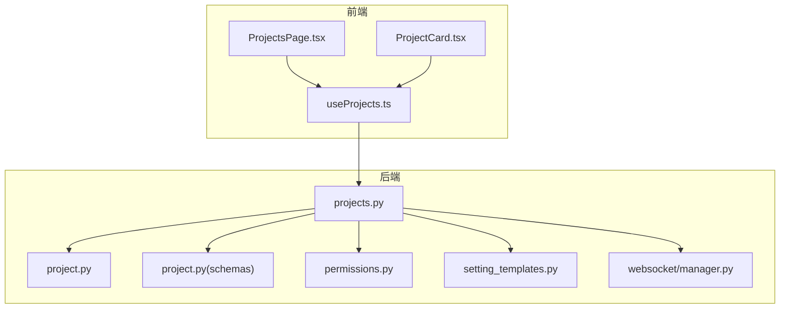
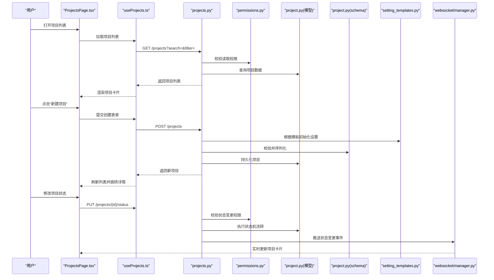
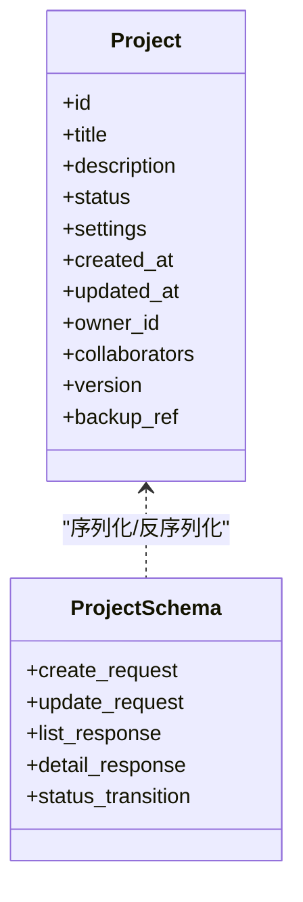
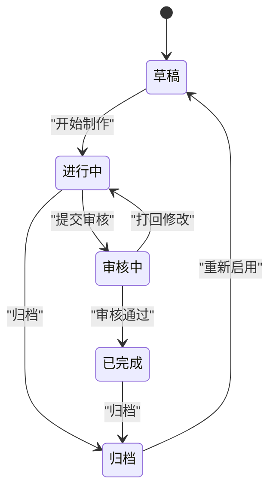
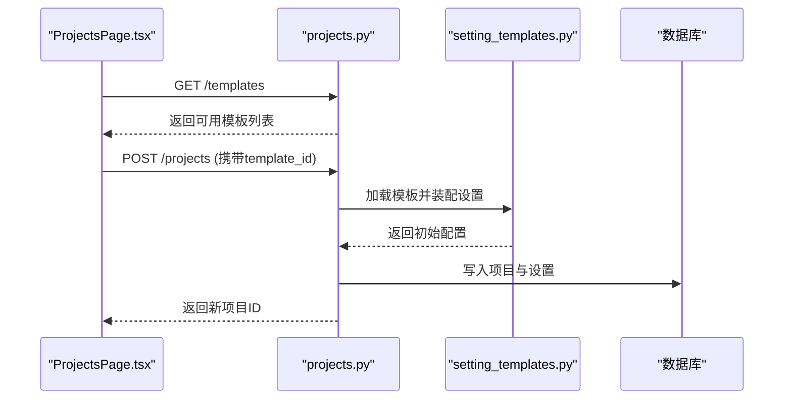
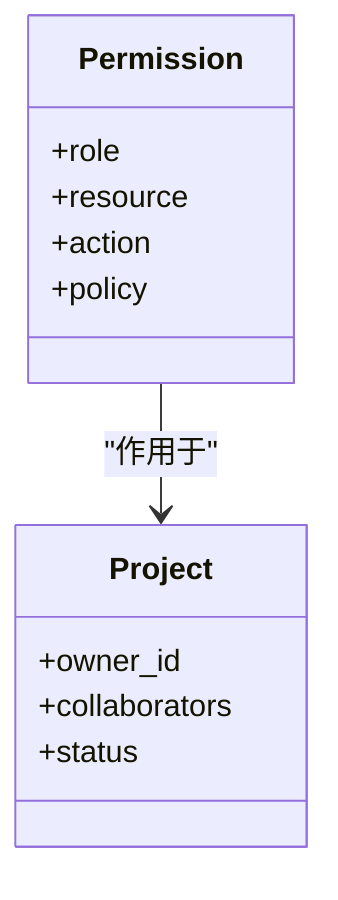
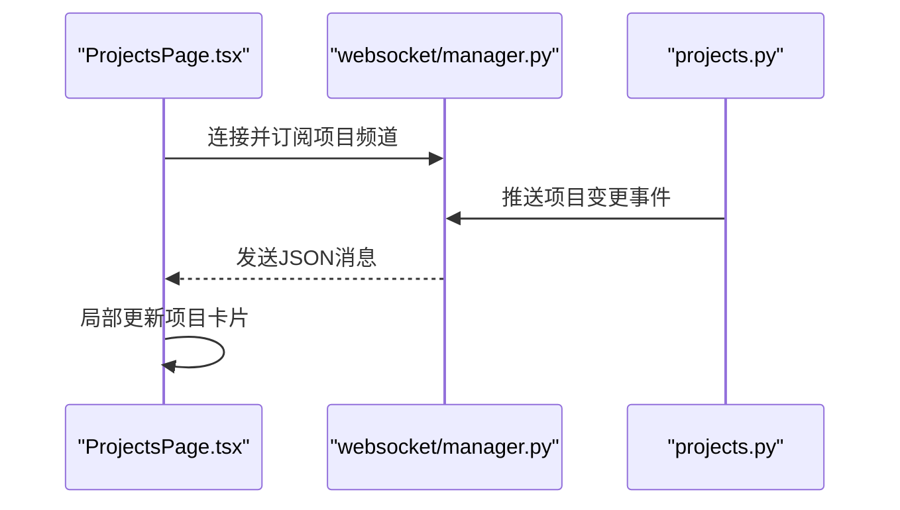
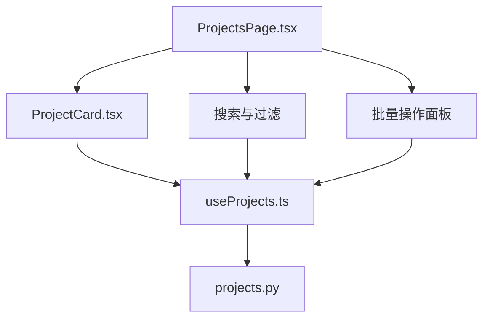
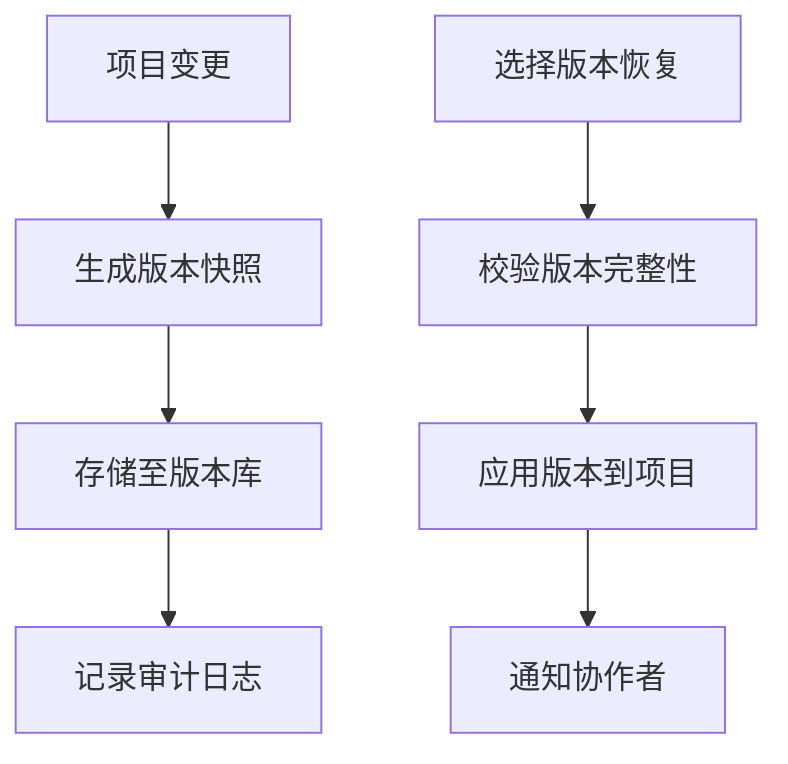
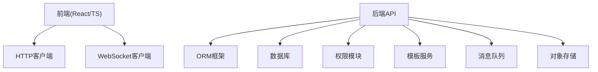

# 项目管理页面

<cite>
**本文引用的文件**   
- [backend/app/api/v1/projects.py](file://backend/app/api/v1/projects.py)
- [backend/app/models/project.py](file://backend/app/models/project.py)
- [backend/app/schemas/project.py](file://backend/app/schemas/project.py)
- [frontend/src/pages/ProjectsPage.tsx](file://frontend/src/pages/ProjectsPage.tsx)
- [frontend/src/components/projects/ProjectCard.tsx](file://frontend/src/components/projects/ProjectCard.tsx)
- [frontend/src/hooks/useProjects.ts](file://frontend/src/hooks/useProjects.ts)
- [backend/app/core/permissions.py](file://backend/app/core/permissions.py)
- [backend/app/services/setting_templates.py](file://backend/app/services/setting_templates.py)
- [backend/app/websocket/manager.py](file://backend/app/websocket/manager.py)
</cite>

## 目录
1. [简介](#简介)
2. [项目结构](#项目结构)
3. [核心组件](#核心组件)
4. [架构总览](#架构总览)
5. [详细组件分析](#详细组件分析)
6. [依赖关系分析](#依赖关系分析)
7. [性能考虑](#性能考虑)
8. [故障排查指南](#故障排查指南)
9. [结论](#结论)
10. [附录](#附录)

## 简介
本文件为“项目管理页面”的完整功能文档，覆盖以下能力：
- 项目列表展示、搜索与过滤
- 项目创建与编辑
- 项目状态管理（生命周期流转）
- 项目卡片组件交互
- 批量操作接口
- 数据模型与CRUD流程
- 实时同步机制（WebSocket）
- 项目模板系统与快速启动流程
- 协作与权限控制
- 版本管理与备份恢复
- 用户界面交互流程、错误处理与性能优化策略

## 项目结构
本项目采用前后端分离架构：
- 后端提供REST API与WebSocket通道，负责项目数据的持久化、权限校验、模板装配、状态机流转与异步任务编排。
- 前端通过React页面与Hooks组织UI逻辑，渲染项目卡片、表单与批量操作面板，并通过API与WS进行数据同步。



图表来源
- [backend/app/api/v1/projects.py](file://backend/app/api/v1/projects.py)
- [backend/app/models/project.py](file://backend/app/models/project.py)
- [backend/app/schemas/project.py](file://backend/app/schemas/project.py)
- [backend/app/core/permissions.py](file://backend/app/core/permissions.py)
- [backend/app/services/setting_templates.py](file://backend/app/services/setting_templates.py)
- [backend/app/websocket/manager.py](file://backend/app/websocket/manager.py)
- [frontend/src/pages/ProjectsPage.tsx](file://frontend/src/pages/ProjectsPage.tsx)
- [frontend/src/components/projects/ProjectCard.tsx](file://frontend/src/components/projects/ProjectCard.tsx)
- [frontend/src/hooks/useProjects.ts](file://frontend/src/hooks/useProjects.ts)

章节来源
- [backend/app/api/v1/projects.py](file://backend/app/api/v1/projects.py)
- [backend/app/models/project.py](file://backend/app/models/project.py)
- [backend/app/schemas/project.py](file://backend/app/schemas/project.py)
- [backend/app/core/permissions.py](file://backend/app/core/permissions.py)
- [backend/app/services/setting_templates.py](file://backend/app/services/setting_templates.py)
- [backend/app/websocket/manager.py](file://backend/app/websocket/manager.py)
- [frontend/src/pages/ProjectsPage.tsx](file://frontend/src/pages/ProjectsPage.tsx)
- [frontend/src/components/projects/ProjectCard.tsx](file://frontend/src/components/projects/ProjectCard.tsx)
- [frontend/src/hooks/useProjects.ts](file://frontend/src/hooks/useProjects.ts)

## 核心组件
- 项目数据模型：定义项目实体字段、关联关系与约束，支撑列表、详情、编辑与状态变更。
- 项目Schema：用于请求/响应校验与序列化，确保输入合法性与输出一致性。
- 项目API：提供项目的CRUD、状态流转、模板初始化、批量操作等接口。
- 权限控制：基于角色的访问控制（RBAC），对项目的读、写、删除、协作与导出等进行细粒度限制。
- 模板系统：支持按模板快速生成项目初始设置与内容骨架。
- WebSocket管理器：推送项目状态变更、任务进度与协作事件。
- 前端页面与组件：项目列表页、项目卡片、搜索过滤、创建/编辑表单、批量操作面板。
- 数据Hook：封装项目数据的获取、缓存、更新与同步逻辑。

章节来源
- [backend/app/models/project.py](file://backend/app/models/project.py)
- [backend/app/schemas/project.py](file://backend/app/schemas/project.py)
- [backend/app/api/v1/projects.py](file://backend/app/api/v1/projects.py)
- [backend/app/core/permissions.py](file://backend/app/core/permissions.py)
- [backend/app/services/setting_templates.py](file://backend/app/services/setting_templates.py)
- [backend/app/websocket/manager.py](file://backend/app/websocket/manager.py)
- [frontend/src/pages/ProjectsPage.tsx](file://frontend/src/pages/ProjectsPage.tsx)
- [frontend/src/components/projects/ProjectCard.tsx](file://frontend/src/components/projects/ProjectCard.tsx)
- [frontend/src/hooks/useProjects.ts](file://frontend/src/hooks/useProjects.ts)

## 架构总览
下图展示了从前端到后端的调用链路，包括权限校验、模板装配、状态机流转与WebSocket推送。



图表来源
- [backend/app/api/v1/projects.py](file://backend/app/api/v1/projects.py)
- [backend/app/core/permissions.py](file://backend/app/core/permissions.py)
- [backend/app/models/project.py](file://backend/app/models/project.py)
- [backend/app/schemas/project.py](file://backend/app/schemas/project.py)
- [backend/app/services/setting_templates.py](file://backend/app/services/setting_templates.py)
- [backend/app/websocket/manager.py](file://backend/app/websocket/manager.py)
- [frontend/src/pages/ProjectsPage.tsx](file://frontend/src/pages/ProjectsPage.tsx)
- [frontend/src/hooks/useProjects.ts](file://frontend/src/hooks/useProjects.ts)

## 详细组件分析

### 项目数据模型与Schema
- 数据模型包含项目基础信息、配置、状态、时间戳、关联资源等字段，并提供必要的索引与约束。
- Schema定义请求体与响应体的字段类型、默认值与校验规则，保证前后端契约一致。



图表来源
- [backend/app/models/project.py](file://backend/app/models/project.py)
- [backend/app/schemas/project.py](file://backend/app/schemas/project.py)

章节来源
- [backend/app/models/project.py](file://backend/app/models/project.py)
- [backend/app/schemas/project.py](file://backend/app/schemas/project.py)

### 项目API与CRUD流程
- 列表接口支持分页、排序、搜索与过滤；详情接口返回完整项目信息与权限标记。
- 创建接口支持模板初始化；更新接口支持增量更新与字段级校验。
- 删除接口支持软删除与回收站恢复。
- 状态接口支持状态机流转与审计记录。

```mermaid
flowchart TD
Start(["进入项目API"]) --> CheckAuth["权限校验"]
CheckAuth --> |通过| Route{"路由分发"}
CheckAuth --> |拒绝| Return403["返回403"]
Route --> |GET /projects| List["查询列表<br/>分页/搜索/过滤"]
Route --> |POST /projects| Create["创建项目<br/>模板初始化"]
Route --> |PUT /projects/{id}| Update["更新项目<br/>字段校验"]
Route --> |DELETE /projects/{id}| Delete["删除项目<br/>软删除"]
Route --> |PUT /projects/{id}/status| Status["状态流转<br/>状态机校验"]
List --> Persist["读写数据库"]
Create --> Persist
Update --> Persist
Delete --> Persist
Status --> Persist
Persist --> Notify["WebSocket推送变更"]
Notify --> End(["完成"])
```

图表来源
- [backend/app/api/v1/projects.py](file://backend/app/api/v1/projects.py)
- [backend/app/models/project.py](file://backend/app/models/project.py)
- [backend/app/schemas/project.py](file://backend/app/schemas/project.py)
- [backend/app/websocket/manager.py](file://backend/app/websocket/manager.py)

章节来源
- [backend/app/api/v1/projects.py](file://backend/app/api/v1/projects.py)

### 项目状态管理
- 状态机定义项目生命周期阶段（如草稿、进行中、审核中、已完成、归档等）。
- 状态转换需满足前置条件与权限要求，失败时返回明确错误码与原因。
- 状态变更触发异步任务（如生成预览、通知协作者）与WebSocket广播。



图表来源
- [backend/app/api/v1/projects.py](file://backend/app/api/v1/projects.py)
- [backend/app/models/project.py](file://backend/app/models/project.py)

章节来源
- [backend/app/api/v1/projects.py](file://backend/app/api/v1/projects.py)
- [backend/app/models/project.py](file://backend/app/models/project.py)

### 项目模板系统与快速启动
- 模板系统提供预设的项目设置、角色与权限、工作流与检查点。
- 创建项目时可选择模板，后端自动装配初始内容与基线配置。
- 模板可版本化管理，支持热更新与灰度发布。



图表来源
- [backend/app/api/v1/projects.py](file://backend/app/api/v1/projects.py)
- [backend/app/services/setting_templates.py](file://backend/app/services/setting_templates.py)

章节来源
- [backend/app/services/setting_templates.py](file://backend/app/services/setting_templates.py)
- [backend/app/api/v1/projects.py](file://backend/app/api/v1/projects.py)

### 协作与权限控制
- 基于角色的访问控制（RBAC）：管理员、编辑者、观察者等角色具备不同权限。
- 项目级权限：成员邀请、角色分配、操作审计。
- 敏感操作（删除、导出、状态变更）需要额外审批或二次确认。



图表来源
- [backend/app/core/permissions.py](file://backend/app/core/permissions.py)
- [backend/app/models/project.py](file://backend/app/models/project.py)

章节来源
- [backend/app/core/permissions.py](file://backend/app/core/permissions.py)

### 实时同步机制（WebSocket）
- 后端通过WebSocket管理器广播项目状态变更、任务进度与协作事件。
- 前端订阅频道，接收消息后局部更新UI，避免全量刷新。
- 支持断线重连与消息去重。



图表来源
- [backend/app/websocket/manager.py](file://backend/app/websocket/manager.py)
- [backend/app/api/v1/projects.py](file://backend/app/api/v1/projects.py)

章节来源
- [backend/app/websocket/manager.py](file://backend/app/websocket/manager.py)

### 前端项目卡片与搜索过滤
- 项目卡片组件展示项目标题、状态、更新时间、负责人与快捷操作。
- 搜索框支持关键词匹配，过滤器支持按状态、时间范围、标签筛选。
- 批量操作支持多选、批量状态切换、批量导出与删除。



图表来源
- [frontend/src/pages/ProjectsPage.tsx](file://frontend/src/pages/ProjectsPage.tsx)
- [frontend/src/components/projects/ProjectCard.tsx](file://frontend/src/components/projects/ProjectCard.tsx)
- [frontend/src/hooks/useProjects.ts](file://frontend/src/hooks/useProjects.ts)
- [backend/app/api/v1/projects.py](file://backend/app/api/v1/projects.py)

章节来源
- [frontend/src/pages/ProjectsPage.tsx](file://frontend/src/pages/ProjectsPage.tsx)
- [frontend/src/components/projects/ProjectCard.tsx](file://frontend/src/components/projects/ProjectCard.tsx)
- [frontend/src/hooks/useProjects.ts](file://frontend/src/hooks/useProjects.ts)

### 版本管理与备份恢复
- 版本管理：每次重要变更生成快照，支持对比与回滚。
- 备份恢复：定时备份项目数据与附件，支持一键恢复与增量同步。
- 审计日志：记录版本创建、恢复与关键操作轨迹。



图表来源
- [backend/app/api/v1/projects.py](file://backend/app/api/v1/projects.py)
- [backend/app/models/project.py](file://backend/app/models/project.py)

章节来源
- [backend/app/api/v1/projects.py](file://backend/app/api/v1/projects.py)
- [backend/app/models/project.py](file://backend/app/models/project.py)

## 依赖关系分析
- 前端依赖：React、TypeScript、HTTP客户端、WebSocket客户端。
- 后端依赖：ORM框架、数据库、权限模块、模板服务、WebSocket服务。
- 外部集成：对象存储（备份）、消息队列（异步任务）、认证服务（SSO/OAuth）。



图表来源
- [backend/app/api/v1/projects.py](file://backend/app/api/v1/projects.py)
- [backend/app/core/permissions.py](file://backend/app/core/permissions.py)
- [backend/app/services/setting_templates.py](file://backend/app/services/setting_templates.py)
- [backend/app/websocket/manager.py](file://backend/app/websocket/manager.py)

章节来源
- [backend/app/api/v1/projects.py](file://backend/app/api/v1/projects.py)
- [backend/app/core/permissions.py](file://backend/app/core/permissions.py)
- [backend/app/services/setting_templates.py](file://backend/app/services/setting_templates.py)
- [backend/app/websocket/manager.py](file://backend/app/websocket/manager.py)

## 性能考虑
- 列表分页与懒加载：减少首屏数据量，提升渲染速度。
- 搜索与过滤索引：对常用字段建立索引，优化查询性能。
- 缓存策略：热点项目数据缓存，降低数据库压力。
- WebSocket批处理：合并频繁消息，减少网络开销。
- 前端虚拟化：长列表使用虚拟滚动，避免DOM过大。
- 异步任务：耗时操作放入队列，避免阻塞主线程。

## 故障排查指南
- 权限错误：检查角色与资源绑定，确认操作是否被允许。
- 状态流转失败：查看状态机前置条件与依赖项是否满足。
- 模板加载失败：验证模板ID与版本是否存在且可用。
- WebSocket断开：检查网络连接与心跳机制，必要时重连。
- 备份恢复失败：校验备份文件完整性与权限，查看恢复日志。

章节来源
- [backend/app/core/permissions.py](file://backend/app/core/permissions.py)
- [backend/app/api/v1/projects.py](file://backend/app/api/v1/projects.py)
- [backend/app/services/setting_templates.py](file://backend/app/services/setting_templates.py)
- [backend/app/websocket/manager.py](file://backend/app/websocket/manager.py)

## 结论
项目管理页面通过清晰的前后端分层、严格的权限控制、灵活的模板系统与实时同步机制，提供了高效、稳定且可扩展的项目管理能力。建议在生产环境中加强监控与审计，持续优化查询与渲染性能，保障用户体验与数据安全。

## 附录
- 术语表：项目、状态机、模板、WebSocket、RBAC、快照、备份。
- 参考链接：内部API文档、部署手册、安全规范。