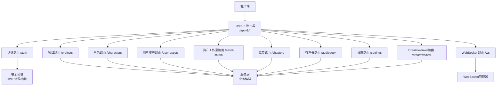
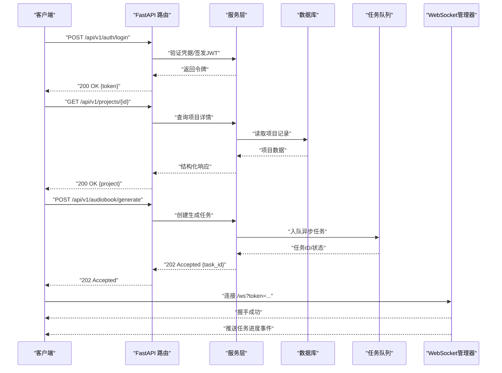
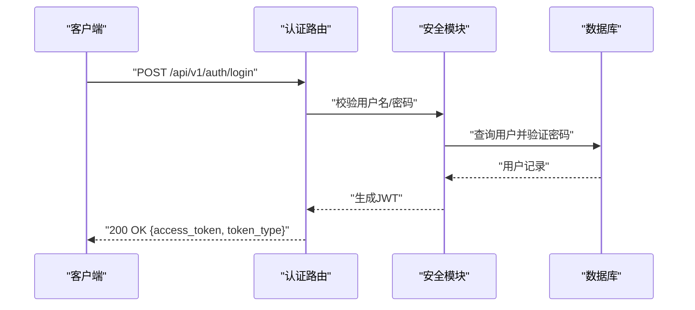
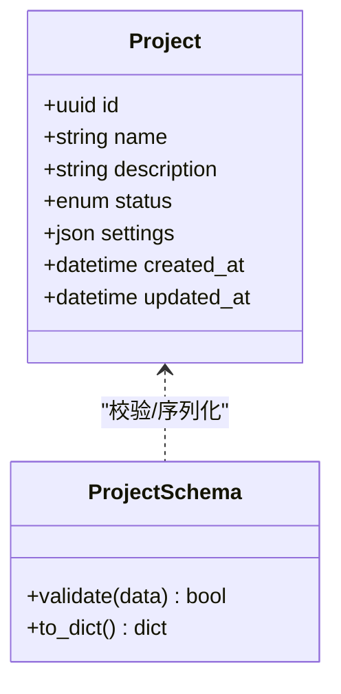
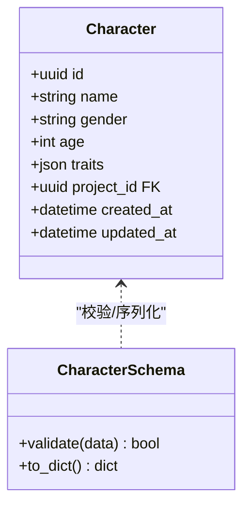
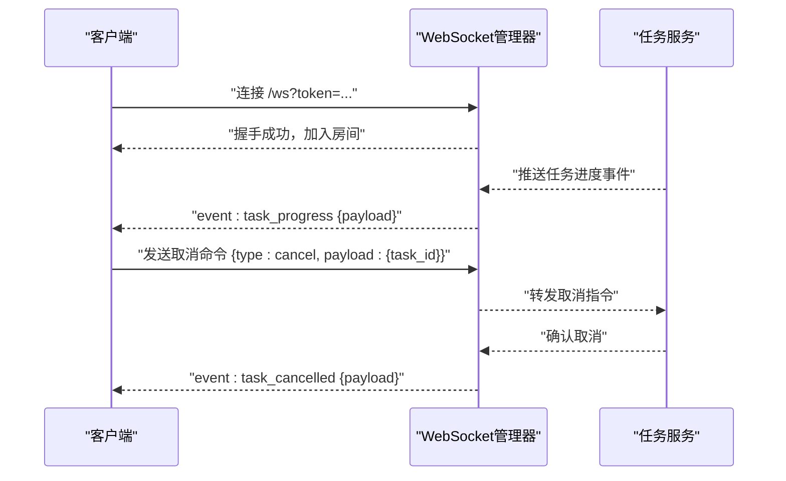
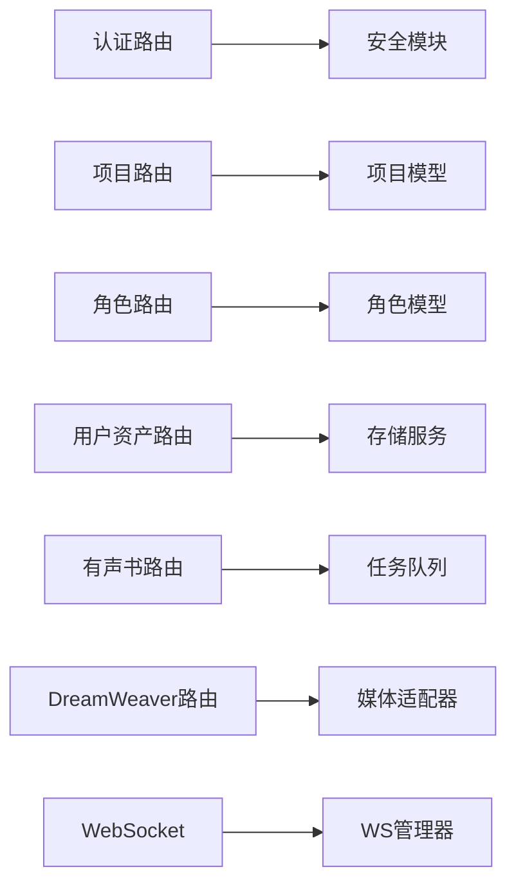

# API接口设计

<cite>
**本文引用的文件**   
- [backend/app/main.py](file://backend/app/main.py)
- [backend/app/api/v1/auth.py](file://backend/app/api/v1/auth.py)
- [backend/app/api/v1/projects.py](file://backend/app/api/v1/projects.py)
- [backend/app/api/v1/characters.py](file://backend/app/api/v1/characters.py)
- [backend/app/api/v1/user_assets.py](file://backend/app/api/v1/user_assets.py)
- [backend/app/api/v1/asset_studio.py](file://backend/app/api/v1/asset_studio.py)
- [backend/app/api/v1/dreamweaver.py](file://backend/app/api/v1/dreamweaver.py)
- [backend/app/api/v1/chapters.py](file://backend/app/api/v1/chapters.py)
- [backend/app/api/v1/audiobook.py](file://backend/app/api/v1/audiobook.py)
- [backend/app/api/v1/settings.py](file://backend/app/api/v1/settings.py)
- [backend/app/core/config.py](file://backend/app/core/config.py)
- [backend/app/core/security.py](file://backend/app/core/security.py)
- [backend/app/core/permissions.py](file://backend/app/core/permissions.py)
- [backend/app/websocket/__init__.py](file://backend/app/websocket/__init__.py)
- [backend/app/websocket/manager.py](file://backend/app/websocket/manager.py)
- [backend/app/models/project.py](file://backend/app/models/project.py)
- [backend/app/models/user.py](file://backend/app/models/user.py)
- [backend/app/models/character.py](file://backend/app/models/character.py)
- [backend/app/schemas/project.py](file://backend/app/schemas/project.py)
- [backend/app/schemas/user.py](file://backend/app/schemas/user.py)
- [backend/app/schemas/character.py](file://backend/app/schemas/character.py)
- [backend/app/utils/api_errors.py](file://backend/app/utils/api_errors.py)
</cite>

## 目录
1. [简介](#简介)
2. [项目结构](#项目结构)
3. [核心组件](#核心组件)
4. [架构总览](#架构总览)
5. [详细组件分析](#详细组件分析)
6. [依赖分析](#依赖分析)
7. [性能考虑](#性能考虑)
8. [故障排查指南](#故障排查指南)
9. [结论](#结论)
10. [附录](#附录)

## 简介
本文件为小说创作代理系统的API接口设计文档，聚焦RESTful API与WebSocket实时通信。内容涵盖：
- REST API规范：HTTP方法、URL模式、请求/响应格式、认证与鉴权、版本管理、错误码约定
- 核心模块接口：用户认证、项目管理、角色（人物）管理、资产库管理、章节与有声书生成、工作流与DreamWeaver视频生成、设置管理等
- WebSocket机制：连接建立、消息格式、事件类型、实时交互模式
- 使用示例：参数说明、响应结构、错误处理与状态码
- 安全与性能建议：鉴权策略、限流、缓存、异步任务与SSE/WS优化

## 项目结构
后端采用模块化分层组织：
- 入口与路由挂载：应用启动、中间件、路由注册
- API层：按领域划分的路由与控制器（v1）
- 服务层：业务编排、外部适配器调用、任务调度
- 数据模型与Schema：ORM模型与Pydantic校验
- 安全与权限：JWT、密码哈希、RBAC
- WebSocket：连接管理与事件分发
- 配置与环境：环境变量、密钥、功能开关

图表来源
- [backend/app/main.py](file://backend/app/main.py)
- [backend/app/api/v1/auth.py](file://backend/app/api/v1/auth.py)
- [backend/app/api/v1/projects.py](file://backend/app/api/v1/projects.py)
- [backend/app/api/v1/characters.py](file://backend/app/api/v1/characters.py)
- [backend/app/api/v1/user_assets.py](file://backend/app/api/v1/user_assets.py)
- [backend/app/api/v1/asset_studio.py](file://backend/app/api/v1/asset_studio.py)
- [backend/app/api/v1/chapters.py](file://backend/app/api/v1/chapters.py)
- [backend/app/api/v1/audiobook.py](file://backend/app/api/v1/audiobook.py)
- [backend/app/api/v1/settings.py](file://backend/app/api/v1/settings.py)
- [backend/app/api/v1/dreamweaver.py](file://backend/app/api/v1/dreamweaver.py)
- [backend/app/websocket/__init__.py](file://backend/app/websocket/__init__.py)
- [backend/app/websocket/manager.py](file://backend/app/websocket/manager.py)

章节来源
- [backend/app/main.py](file://backend/app/main.py)

## 核心组件
- 认证与鉴权：基于JWT的无状态认证，结合RBAC权限控制；支持密码重置、第三方登录扩展点
- 资源路由：项目、角色、用户资产、资产工作室、章节、有声书、设置、DreamWeaver等
- 服务层：统一业务编排、外部模型/媒体适配器调用、任务队列与进度追踪
- 数据层：SQLAlchemy ORM + Alembic迁移；Pydantic Schema校验与序列化
- WebSocket：连接生命周期管理、房间广播、事件驱动的消息协议
- 配置与安全：集中式配置加载、敏感信息保护、速率限制与审计日志

章节来源
- [backend/app/core/config.py](file://backend/app/core/config.py)
- [backend/app/core/security.py](file://backend/app/core/security.py)
- [backend/app/core/permissions.py](file://backend/app/core/permissions.py)
- [backend/app/models/user.py](file://backend/app/models/user.py)
- [backend/app/models/project.py](file://backend/app/models/project.py)
- [backend/app/models/character.py](file://backend/app/models/character.py)
- [backend/app/schemas/user.py](file://backend/app/schemas/user.py)
- [backend/app/schemas/project.py](file://backend/app/schemas/project.py)
- [backend/app/schemas/character.py](file://backend/app/schemas/character.py)

## 架构总览
系统采用“路由-服务-数据”三层分离，配合WebSocket提供实时能力。

图表来源
- [backend/app/api/v1/auth.py](file://backend/app/api/v1/auth.py)
- [backend/app/api/v1/projects.py](file://backend/app/api/v1/projects.py)
- [backend/app/api/v1/audiobook.py](file://backend/app/api/v1/audiobook.py)
- [backend/app/websocket/manager.py](file://backend/app/websocket/manager.py)

## 详细组件分析

### 认证模块（/api/v1/auth）
- 功能：用户注册/登录、令牌刷新、密码重置、第三方登录接入点
- 典型端点：
  - POST /api/v1/auth/register：注册用户
  - POST /api/v1/auth/login：登录获取JWT
  - POST /api/v1/auth/refresh：刷新令牌
  - POST /api/v1/auth/reset-password：密码重置
- 认证方式：Authorization: Bearer <JWT>
- 权限：部分操作需管理员或特定角色

图表来源
- [backend/app/api/v1/auth.py](file://backend/app/api/v1/auth.py)
- [backend/app/core/security.py](file://backend/app/core/security.py)
- [backend/app/models/user.py](file://backend/app/models/user.py)

章节来源
- [backend/app/api/v1/auth.py](file://backend/app/api/v1/auth.py)
- [backend/app/core/security.py](file://backend/app/core/security.py)
- [backend/app/schemas/user.py](file://backend/app/schemas/user.py)

### 项目管理（/api/v1/projects）
- 功能：项目CRUD、设置同步、导出/导入、统计概览
- 典型端点：
  - GET /api/v1/projects：列表（分页、过滤）
  - POST /api/v1/projects：创建项目
  - GET /api/v1/projects/{id}：详情
  - PUT /api/v1/projects/{id}：更新
  - DELETE /api/v1/projects/{id}：删除（软删）
  - PATCH /api/v1/projects/{id}/settings：更新项目设置
- 数据模型：项目实体包含名称、描述、状态、设置JSON、时间戳等

图表来源
- [backend/app/models/project.py](file://backend/app/models/project.py)
- [backend/app/schemas/project.py](file://backend/app/schemas/project.py)

章节来源
- [backend/app/api/v1/projects.py](file://backend/app/api/v1/projects.py)
- [backend/app/models/project.py](file://backend/app/models/project.py)
- [backend/app/schemas/project.py](file://backend/app/schemas/project.py)

### 角色/人物管理（/api/v1/characters）
- 功能：角色CRUD、关系绑定、属性模板、批量导入
- 典型端点：
  - GET /api/v1/characters：列表（按项目过滤）
  - POST /api/v1/characters：创建角色
  - GET /api/v1/characters/{id}：详情
  - PUT /api/v1/characters/{id}：更新
  - DELETE /api/v1/characters/{id}：删除
  - POST /api/v1/characters/batch：批量导入
- 数据模型：角色实体包含姓名、性别、年龄、性格标签、关系、所属项目等

图表来源
- [backend/app/models/character.py](file://backend/app/models/character.py)
- [backend/app/schemas/character.py](file://backend/app/schemas/character.py)

章节来源
- [backend/app/api/v1/characters.py](file://backend/app/api/v1/characters.py)
- [backend/app/models/character.py](file://backend/app/models/character.py)
- [backend/app/schemas/character.py](file://backend/app/schemas/character.py)

### 用户资产库（/api/v1/user-assets）
- 功能：用户上传、元数据管理、检索、评分、版本化
- 典型端点：
  - POST /api/v1/user-assets：上传资产
  - GET /api/v1/user-assets：列表（分页、搜索）
  - GET /api/v1/user-assets/{id}：详情
  - PUT /api/v1/user-assets/{id}：更新元数据
  - DELETE /api/v1/user-assets/{id}：删除
  - POST /api/v1/user-assets/{id}/rate：评分
- 存储策略：本地/云存储抽象，元数据持久化，索引构建

章节来源
- [backend/app/api/v1/user_assets.py](file://backend/app/api/v1/user_assets.py)

### 资产工作室（/api/v1/asset-studio）
- 功能：素材生产流水线、审核、发布、版本管理
- 典型端点：
  - POST /api/v1/asset-studio/pipeline：提交生产任务
  - GET /api/v1/asset-studio/jobs：任务列表
  - GET /api/v1/asset-studio/jobs/{id}：任务详情
  - POST /api/v1/asset-studio/jobs/{id}/approve：审核通过
  - POST /api/v1/asset-studio/jobs/{id}/reject：审核拒绝
- 集成：与外部媒体适配器、质量检查、自动QC联动

章节来源
- [backend/app/api/v1/asset_studio.py](file://backend/app/api/v1/asset_studio.py)

### 章节管理（/api/v1/chapters）
- 功能：章节CRUD、大纲生成、扩写、摘要、导出
- 典型端点：
  - GET /api/v1/chapters：列表（按项目/状态）
  - POST /api/v1/chapters：创建章节
  - GET /api/v1/chapters/{id}：详情
  - PUT /api/v1/chapters/{id}：更新
  - DELETE /api/v1/chapters/{id}：删除
  - POST /api/v1/chapters/{id}/expand：扩写
  - POST /api/v1/chapters/{id}/summary：生成摘要
- 流程：与Prompt工程、LLM适配、质量审查协作

章节来源
- [backend/app/api/v1/chapters.py](file://backend/app/api/v1/chapters.py)

### 有声书生成（/api/v1/audiobook）
- 功能：章节转音频、TTS合成、音轨对齐、字幕生成、导出包
- 典型端点：
  - POST /api/v1/audiobook/generate：发起生成
  - GET /api/v1/audiobook/tasks/{id}：任务状态
  - GET /api/v1/audiobook/export/{id}：下载产物
  - POST /api/v1/audiobook/review：质量评审
- 实时：通过SSE/WebSocket推送进度与结果

章节来源
- [backend/app/api/v1/audiobook.py](file://backend/app/api/v1/audiobook.py)

### DreamWeaver视频生成（/api/v1/dreamweaver）
- 功能：视频脚本到分镜、关键帧生成、视频合成、审核与回滚
- 典型端点：
  - POST /api/v1/dreamweaver/run：启动生成
  - GET /api/v1/dreamweaver/runs/{id}：运行状态
  - POST /api/v1/dreamweaver/runs/{id}/review：评审
  - GET /api/v1/dreamweaver/artifacts/{id}：获取产物
- 集成：多模态适配器、视频编辑管线、质量门控

章节来源
- [backend/app/api/v1/dreamweaver.py](file://backend/app/api/v1/dreamweaver.py)

### 设置管理（/api/v1/settings）
- 功能：全局与应用级设置、模板管理、灰度开关
- 典型端点：
  - GET /api/v1/settings：读取设置
  - PUT /api/v1/settings：更新设置
  - POST /api/v1/settings/templates：模板操作
  - GET /api/v1/settings/categories：分类枚举

章节来源
- [backend/app/api/v1/settings.py](file://backend/app/api/v1/settings.py)

### WebSocket实时通信（/ws）
- 连接：基于Token鉴权，支持房间订阅
- 消息格式：统一JSON结构，包含type、payload、timestamp、trace_id
- 事件类型：
  - task_progress：任务进度
  - generation_update：生成结果更新
  - review_notify：评审通知
  - error_event：错误事件
- 交互模式：客户端订阅频道，服务端推送事件；支持双向命令（如取消任务）

图表来源
- [backend/app/websocket/__init__.py](file://backend/app/websocket/__init__.py)
- [backend/app/websocket/manager.py](file://backend/app/websocket/manager.py)

章节来源
- [backend/app/websocket/__init__.py](file://backend/app/websocket/__init__.py)
- [backend/app/websocket/manager.py](file://backend/app/websocket/manager.py)

## 依赖分析
- 路由依赖：各API路由依赖服务层与数据模型，避免直接访问数据库
- 安全依赖：JWT与权限模块贯穿所有受保护路由
- 外部依赖：媒体适配器、TTS/LLM服务、对象存储、消息队列
- 耦合与内聚：路由薄、服务厚，保证高内聚低耦合

图表来源
- [backend/app/api/v1/auth.py](file://backend/app/api/v1/auth.py)
- [backend/app/api/v1/projects.py](file://backend/app/api/v1/projects.py)
- [backend/app/api/v1/characters.py](file://backend/app/api/v1/characters.py)
- [backend/app/api/v1/user_assets.py](file://backend/app/api/v1/user_assets.py)
- [backend/app/api/v1/audiobook.py](file://backend/app/api/v1/audiobook.py)
- [backend/app/api/v1/dreamweaver.py](file://backend/app/api/v1/dreamweaver.py)
- [backend/app/websocket/manager.py](file://backend/app/websocket/manager.py)

章节来源
- [backend/app/core/permissions.py](file://backend/app/core/permissions.py)
- [backend/app/core/security.py](file://backend/app/core/security.py)

## 性能考虑
- 缓存策略：热点数据（项目设置、角色模板）使用Redis缓存，设置失效与一致性保障
- 异步任务：长耗时操作（有声书生成、视频合成）入队执行，前端轮询或SSE/WS接收进度
- 分页与过滤：列表接口默认分页，支持字段过滤与排序
- I/O优化：大文件上传采用分片与断点续传，对象存储直链下载
- 连接池：数据库与外部API连接池复用，减少握手开销
- 限流与熔断：对高频接口实施限流，外部服务异常时快速失败与降级

[本节为通用指导，不直接分析具体文件]

## 故障排查指南
- 常见错误码：
  - 400：请求参数校验失败（Schema校验）
  - 401：未认证或令牌过期
  - 403：权限不足（RBAC）
  - 404：资源不存在
  - 409：冲突（重复资源）
  - 422：业务校验失败
  - 500：服务器内部错误
- 调试要点：
  - 查看请求Trace ID定位链路
  - 检查JWT签名与有效期
  - 核对Schema字段与必填项
  - 关注任务队列状态与重试次数
  - 检查外部适配器健康状态与配额

章节来源
- [backend/app/utils/api_errors.py](file://backend/app/utils/api_errors.py)

## 结论
本API设计以清晰的REST风格与WebSocket实时能力为核心，覆盖从用户认证到内容生产的完整链路。通过分层架构、严格的数据校验与权限控制，确保系统的可维护性与安全性。建议在后续迭代中持续完善监控、审计与自动化测试，提升稳定性与可观测性。

[本节为总结性内容，不直接分析具体文件]

## 附录

### 版本管理
- URL前缀：/api/v1
- 向后兼容：新增字段保持可选，废弃字段保留过渡期
- 变更通知：通过OpenAPI文档与变更日志同步

### 安全建议
- 强制HTTPS与HSTS
- JWT短期有效+刷新令牌
- 最小权限原则与细粒度RBAC
- 输入校验与输出脱敏
- 敏感配置加密存储

### 使用示例（概述）
- 登录：POST /api/v1/auth/login，返回access_token
- 获取项目：GET /api/v1/projects/{id}，携带Authorization头
- 创建角色：POST /api/v1/characters，提交角色定义
- 上传资产：POST /api/v1/user-assets，multipart/form-data
- 发起有声书生成：POST /api/v1/audiobook/generate，返回task_id
- 连接WebSocket：/ws?token=...，订阅任务进度事件

[本节为概念性示例，不直接分析具体文件]