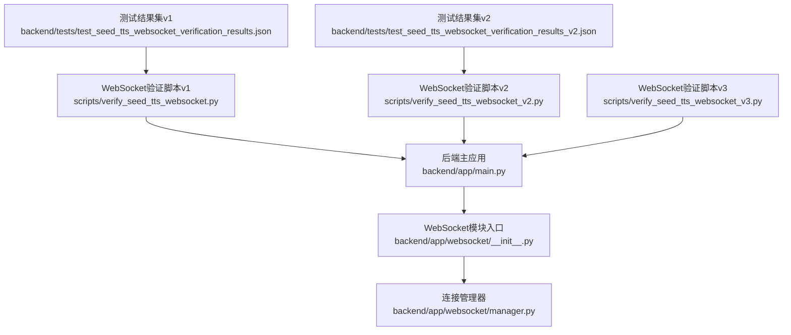
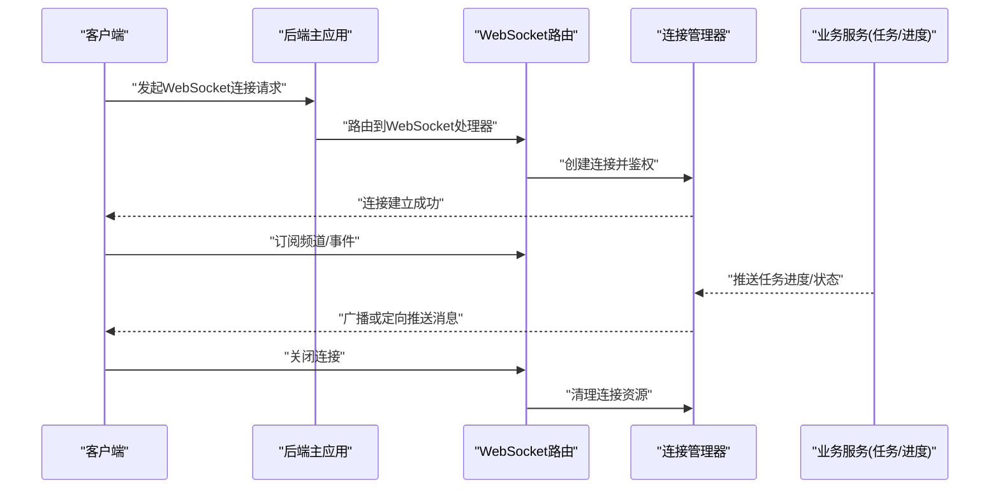
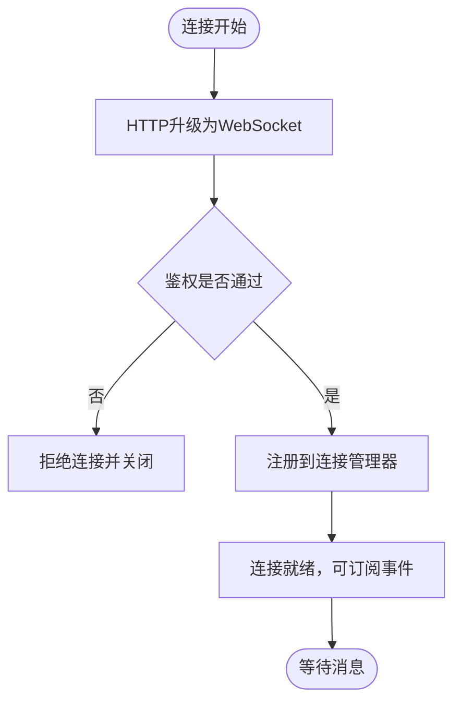
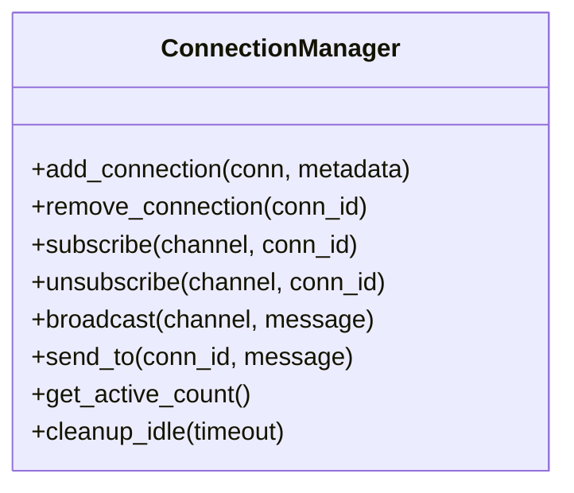
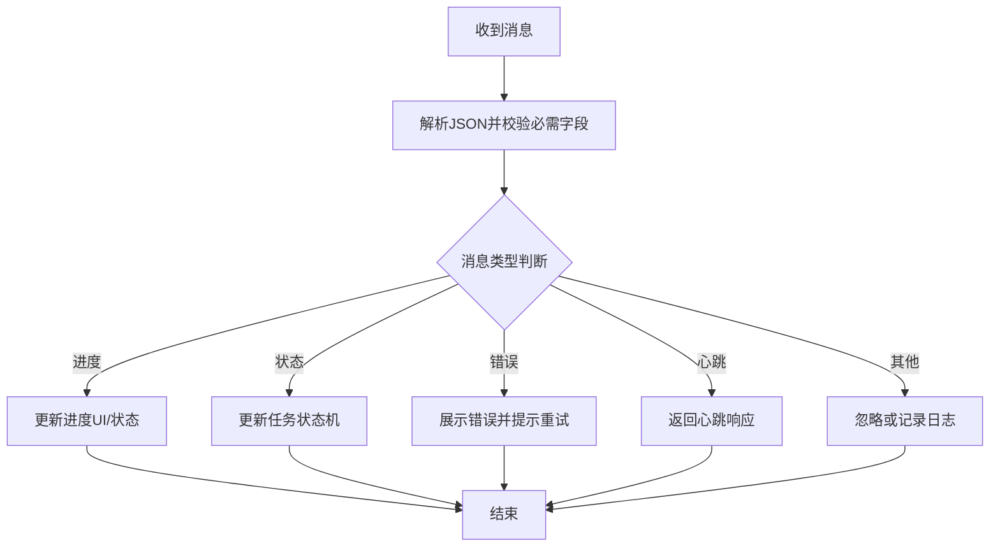
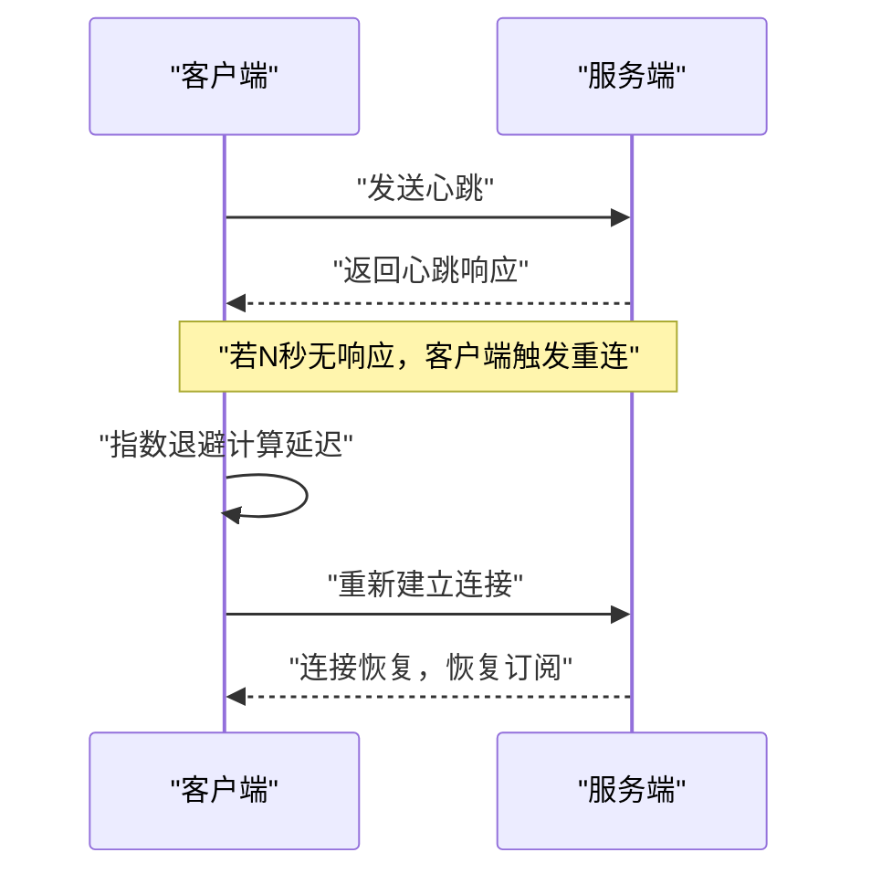
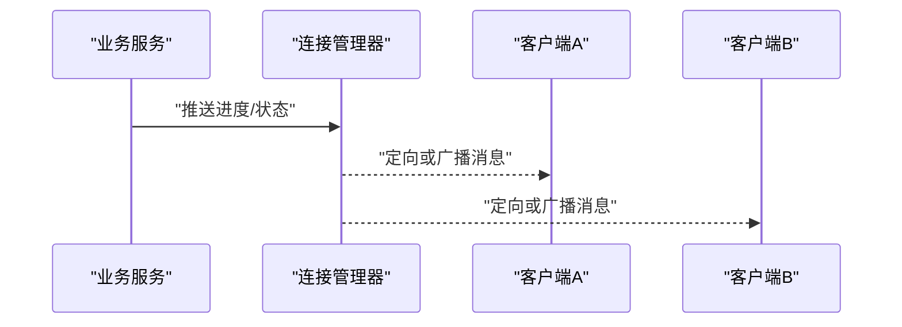

# WebSocket实时通信

<cite>
**本文档引用的文件**   
- [backend/app/main.py](file://backend/app/main.py)
- [backend/app/websocket/__init__.py](file://backend/app/websocket/__init__.py)
- [backend/app/websocket/manager.py](file://backend/app/websocket/manager.py)
- [scripts/verify_seed_tts_websocket.py](file://scripts/verify_seed_tts_websocket.py)
- [scripts/verify_seed_tts_websocket_v2.py](file://scripts/verify_seed_tts_websocket_v2.py)
- [scripts/verify_seed_tts_websocket_v3.py](file://scripts/verify_seed_tts_websocket_v3.py)
- [backend/tests/test_seed_tts_websocket_verification_results.json](file://backend/tests/test_seed_tts_websocket_verification_results.json)
- [backend/tests/test_seed_tts_websocket_verification_results_v2.json](file://backend/tests/test_seed_tts_websocket_verification_results_v2.json)
- [SEED_TTS_WEBSOCKET_IMPLEMENTATION.md](file://SEED_TTS_WEBSOCKET_IMPLEMENTATION.md)
</cite>

## 目录
1. [简介](#简介)
2. [项目结构](#项目结构)
3. [核心组件](#核心组件)
4. [架构总览](#架构总览)
5. [详细组件分析](#详细组件分析)
6. [依赖关系分析](#依赖关系分析)
7. [性能考量](#性能考量)
8. [故障排查指南](#故障排查指南)
9. [结论](#结论)
10. [附录](#附录)

## 简介
本文件为WebSocket实时通信API的接口文档，覆盖连接建立、消息协议、事件类型、连接管理等核心机制。重点说明实时进度推送、任务状态更新、错误通知等消息格式，并给出连接池管理、心跳检测、断线重连等实现细节与客户端集成示例。同时解释安全性、限流策略与性能优化方案，帮助开发者快速集成与稳定运行。

## 项目结构
后端采用模块化组织，WebSocket相关能力集中在 backend/app/websocket 目录下，并通过主应用入口进行路由挂载。测试与验证脚本位于 scripts 与 backend/tests 中，用于端到端校验WebSocket行为与消息格式。

图表来源
- [backend/app/main.py](file://backend/app/main.py)
- [backend/app/websocket/__init__.py](file://backend/app/websocket/__init__.py)
- [backend/app/websocket/manager.py](file://backend/app/websocket/manager.py)
- [scripts/verify_seed_tts_websocket.py](file://scripts/verify_seed_tts_websocket.py)
- [scripts/verify_seed_tts_websocket_v2.py](file://scripts/verify_seed_tts_websocket_v2.py)
- [scripts/verify_seed_tts_websocket_v3.py](file://scripts/verify_seed_tts_websocket_v3.py)
- [backend/tests/test_seed_tts_websocket_verification_results.json](file://backend/tests/test_seed_tts_websocket_verification_results.json)
- [backend/tests/test_seed_tts_websocket_verification_results_v2.json](file://backend/tests/test_seed_tts_websocket_verification_results_v2.json)

章节来源
- [backend/app/main.py](file://backend/app/main.py)
- [backend/app/websocket/__init__.py](file://backend/app/websocket/__init__.py)
- [backend/app/websocket/manager.py](file://backend/app/websocket/manager.py)

## 核心组件
- WebSocket路由与挂载：由后端主应用统一注册WebSocket端点，提供连接建立与鉴权流程。
- 连接管理器：维护活跃连接、订阅关系、广播与点对点消息分发，负责连接生命周期与资源清理。
- 验证与测试脚本：模拟客户端连接、发送指令、接收事件，验证消息协议与行为一致性。
- 结果数据集：记录不同版本的WebSocket交互结果，便于回归与对比。

章节来源
- [backend/app/websocket/manager.py](file://backend/app/websocket/manager.py)
- [scripts/verify_seed_tts_websocket.py](file://scripts/verify_seed_tts_websocket.py)
- [scripts/verify_seed_tts_websocket_v2.py](file://scripts/verify_seed_tts_websocket_v2.py)
- [scripts/verify_seed_tts_websocket_v3.py](file://scripts/verify_seed_tts_websocket_v3.py)
- [backend/tests/test_seed_tts_websocket_verification_results.json](file://backend/tests/test_seed_tts_websocket_verification_results.json)
- [backend/tests/test_seed_tts_websocket_verification_results_v2.json](file://backend/tests/test_seed_tts_websocket_verification_results_v2.json)

## 架构总览
WebSocket服务作为后端的一部分，通过主应用暴露端点。客户端建立连接后，服务端根据身份与权限进行鉴权，随后进入连接池管理。业务侧（如TTS生成、任务调度）通过事件总线或回调将进度与状态推送到连接管理器，再由管理器按订阅关系分发给对应客户端。

图表来源
- [backend/app/main.py](file://backend/app/main.py)
- [backend/app/websocket/__init__.py](file://backend/app/websocket/__init__.py)
- [backend/app/websocket/manager.py](file://backend/app/websocket/manager.py)

## 详细组件分析

### 连接建立与鉴权
- 客户端通过HTTP升级建立WebSocket连接，携带必要的认证信息（如令牌或会话标识）。
- 后端在握手阶段完成鉴权与权限校验，通过后进入连接生命周期管理。
- 鉴权失败时返回标准错误码并关闭连接。

章节来源
- [backend/app/main.py](file://backend/app/main.py)
- [backend/app/websocket/__init__.py](file://backend/app/websocket/__init__.py)

### 连接管理与连接池
- 连接管理器维护活跃连接集合，支持按用户、任务或频道维度进行分组与查找。
- 支持最大连接数限制、空闲超时检测与自动清理。
- 提供订阅/退订接口，确保消息精准投递。

图表来源
- [backend/app/websocket/manager.py](file://backend/app/websocket/manager.py)

章节来源
- [backend/app/websocket/manager.py](file://backend/app/websocket/manager.py)

### 消息协议与事件类型
- 消息体采用JSON格式，包含类型字段、时间戳、数据负载与可选上下文。
- 事件类型包括：
  - 进度推送：任务执行进度、百分比、阶段描述。
  - 状态更新：任务创建、进行中、完成、失败等状态变更。
  - 错误通知：错误码、错误信息、重试建议。
  - 心跳：保活探测与响应。
- 客户端需根据类型字段进行路由处理，忽略未知类型以保证向前兼容。

章节来源
- [scripts/verify_seed_tts_websocket.py](file://scripts/verify_seed_tts_websocket.py)
- [scripts/verify_seed_tts_websocket_v2.py](file://scripts/verify_seed_tts_websocket_v2.py)
- [scripts/verify_seed_tts_websocket_v3.py](file://scripts/verify_seed_tts_websocket_v3.py)
- [backend/tests/test_seed_tts_websocket_verification_results.json](file://backend/tests/test_seed_tts_websocket_verification_results.json)
- [backend/tests/test_seed_tts_websocket_verification_results_v2.json](file://backend/tests/test_seed_tts_websocket_verification_results_v2.json)

### 心跳检测与断线重连
- 心跳间隔可配置，客户端与服务端均需定期发送心跳帧。
- 服务端检测到心跳超时则标记连接为不健康，触发清理流程。
- 客户端实现指数退避重连策略，避免雪崩效应。

章节来源
- [backend/app/websocket/manager.py](file://backend/app/websocket/manager.py)
- [scripts/verify_seed_tts_websocket_v3.py](file://scripts/verify_seed_tts_websocket_v3.py)

### 实时进度推送与任务状态更新
- 业务服务在处理长耗时任务时，通过回调或事件通道向连接管理器推送进度与状态。
- 连接管理器按订阅关系将消息广播给相关客户端。
- 支持增量更新与批量合并，减少网络开销。

章节来源
- [backend/app/websocket/manager.py](file://backend/app/websocket/manager.py)
- [scripts/verify_seed_tts_websocket_v2.py](file://scripts/verify_seed_tts_websocket_v2.py)

### 错误通知与异常处理
- 错误消息包含错误码、错误信息与可选堆栈摘要。
- 客户端应根据错误码决定重试、降级或终止流程。
- 服务端对异常进行捕获与记录，避免影响整体稳定性。

章节来源
- [scripts/verify_seed_tts_websocket_v3.py](file://scripts/verify_seed_tts_websocket_v3.py)
- [backend/tests/test_seed_tts_websocket_verification_results.json](file://backend/tests/test_seed_tts_websocket_verification_results.json)

### 客户端集成示例
- 连接建立：使用WebSocket库建立连接，并在握手阶段附加认证头或查询参数。
- 消息订阅：连接成功后订阅所需频道或事件类型。
- 事件处理：根据消息类型分支处理，更新UI或触发后续逻辑。
- 心跳与重连：定时发送心跳，断线后按指数退避策略重连。

章节来源
- [scripts/verify_seed_tts_websocket.py](file://scripts/verify_seed_tts_websocket.py)
- [scripts/verify_seed_tts_websocket_v2.py](file://scripts/verify_seed_tts_websocket_v2.py)
- [scripts/verify_seed_tts_websocket_v3.py](file://scripts/verify_seed_tts_websocket_v3.py)

## 依赖关系分析
- 主应用负责路由挂载与中间件注入。
- WebSocket模块依赖连接管理器进行连接与消息管理。
- 验证脚本依赖后端端点，用于端到端测试。
- 测试结果集用于版本对比与回归验证。

图表来源
- [backend/app/main.py](file://backend/app/main.py)
- [backend/app/websocket/__init__.py](file://backend/app/websocket/__init__.py)
- [backend/app/websocket/manager.py](file://backend/app/websocket/manager.py)
- [scripts/verify_seed_tts_websocket.py](file://scripts/verify_seed_tts_websocket.py)
- [scripts/verify_seed_tts_websocket_v2.py](file://scripts/verify_seed_tts_websocket_v2.py)
- [scripts/verify_seed_tts_websocket_v3.py](file://scripts/verify_seed_tts_websocket_v3.py)
- [backend/tests/test_seed_tts_websocket_verification_results.json](file://backend/tests/test_seed_tts_websocket_verification_results.json)
- [backend/tests/test_seed_tts_websocket_verification_results_v2.json](file://backend/tests/test_seed_tts_websocket_verification_results_v2.json)

章节来源
- [backend/app/main.py](file://backend/app/main.py)
- [backend/app/websocket/__init__.py](file://backend/app/websocket/__init__.py)
- [backend/app/websocket/manager.py](file://backend/app/websocket/manager.py)

## 性能考量
- 连接池容量与内存占用：限制最大连接数，及时清理空闲连接。
- 消息批量化与节流：合并高频小消息，降低网络与序列化开销。
- 异步I/O与非阻塞处理：提升并发处理能力。
- 心跳间隔调优：平衡保活与带宽消耗。
- 前端渲染优化：增量更新UI，避免全量重绘。

[本节为通用指导，不涉及具体文件分析]

## 故障排查指南
- 连接失败：检查鉴权参数、网络可达性与防火墙策略。
- 消息丢失：确认订阅关系是否正确，检查连接管理器状态。
- 心跳超时：调整心跳间隔与超时阈值，检查客户端网络质量。
- 错误码定位：根据错误码查阅日志与测试结果集，定位问题根因。

章节来源
- [backend/tests/test_seed_tts_websocket_verification_results.json](file://backend/tests/test_seed_tts_websocket_verification_results.json)
- [backend/tests/test_seed_tts_websocket_verification_results_v2.json](file://backend/tests/test_seed_tts_websocket_verification_results_v2.json)
- [scripts/verify_seed_tts_websocket_v3.py](file://scripts/verify_seed_tts_websocket_v3.py)

## 结论
本WebSocket实时通信方案通过清晰的消息协议、稳健的连接管理与完善的错误处理机制，为长耗时任务提供了可靠的进度与状态推送能力。结合心跳检测、断线重连与性能优化策略，可在高并发场景下保持稳定与高效。建议在生产环境启用安全传输、限流与监控，以进一步提升系统可靠性与可观测性。

[本节为总结性内容，不涉及具体文件分析]

## 附录
- 参考实现与设计文档：详见“种子TTS WebSocket实现”文档，了解更详细的协议设计与实现细节。

章节来源
- [SEED_TTS_WEBSOCKET_IMPLEMENTATION.md](file://SEED_TTS_WEBSOCKET_IMPLEMENTATION.md)