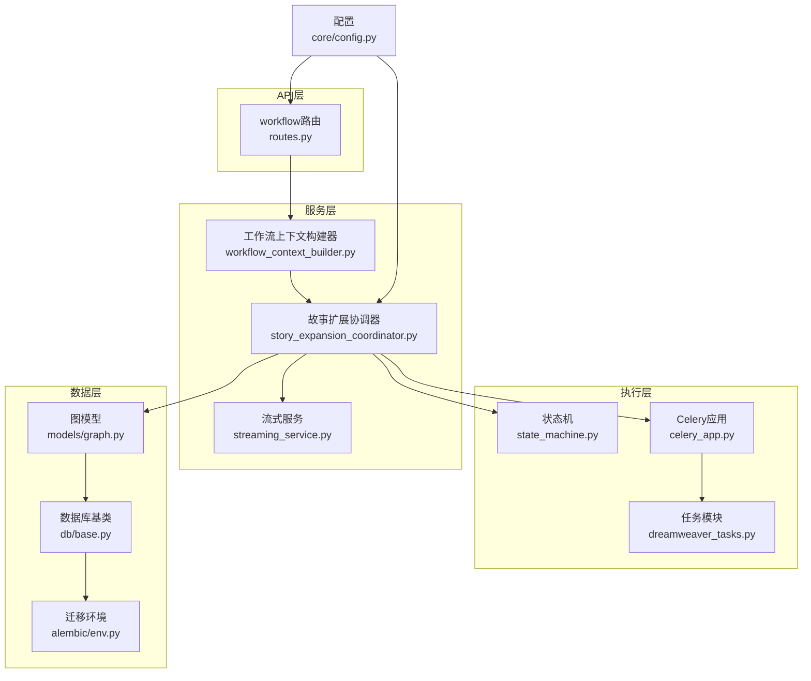
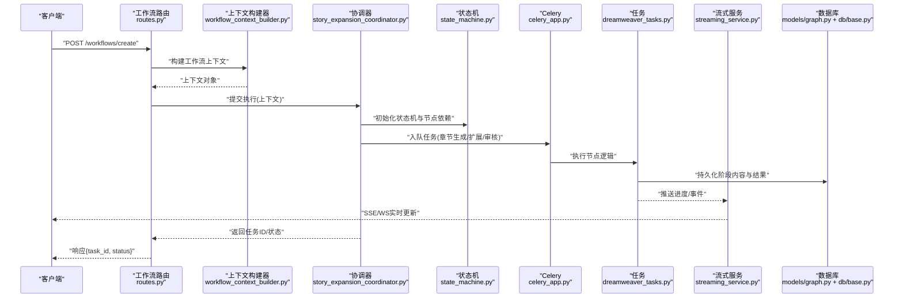
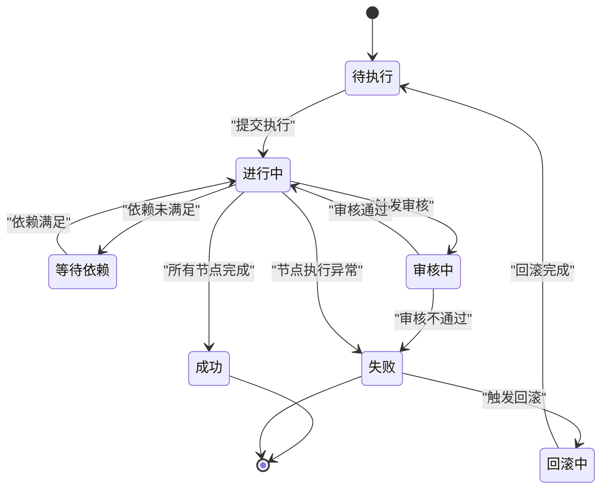
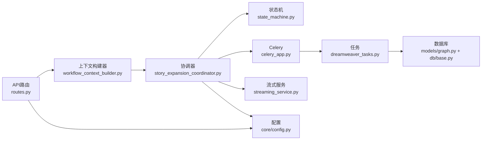

# 工作流API

<cite>
**本文引用的文件**   
- [backend/app/api/v1/workflow/__init__.py](file://backend/app/api/v1/workflow/__init__.py)
- [backend/app/api/v1/workflow/routes.py](file://backend/app/api/v1/workflow/routes.py)
- [backend/app/services/workflow_context_builder.py](file://backend/app/services/workflow_context_builder.py)
- [pipeline/state_machine.py](file://pipeline/state_machine.py)
- [backend/app/models/graph.py](file://backend/app/models/graph.py)
- [backend/app/celery_app.py](file://backend/app/celery_app.py)
- [backend/app/tasks/dreamweaver_tasks.py](file://backend/app/tasks/dreamweaver_tasks.py)
- [backend/app/schemas/story_expansion.py](file://backend/app/schemas/story_expansion.py)
- [backend/app/services/story_expansion_coordinator.py](file://backend/app/services/story_expansion_coordinator.py)
- [backend/app/services/agents/auditor.py](file://backend/app/services/agents/auditor.py)
- [backend/app/services/agents/scripter.py](file://backend/app/services/agents/scripter.py)
- [backend/app/services/agents/painter.py](file://backend/app/services/agents/painter.py)
- [backend/app/services/agents/dreamweaver.py](file://backend/app/services/agents/dreamweaver.py)
- [backend/app/services/streaming_service.py](file://backend/app/services/streaming_service.py)
- [backend/app/core/config.py](file://backend/app/core/config.py)
- [backend/app/db/base.py](file://backend/app/db/base.py)
- [backend/alembic/env.py](file://backend/alembic/env.py)
</cite>

## 目录
1. [简介](#简介)
2. [项目结构](#项目结构)
3. [核心组件](#核心组件)
4. [架构总览](#架构总览)
5. [详细组件分析](#详细组件分析)
6. [依赖关系分析](#依赖关系分析)
7. [性能考虑](#性能考虑)
8. [故障排查指南](#故障排查指南)
9. [结论](#结论)
10. [附录](#附录)

## 简介
本文件为“工作流API”的完整接口与实现文档，覆盖工作流的创建、执行、监控与管理等核心能力。重点说明：
- 工作流状态机与节点编排机制
- 依赖管理与任务调度
- 错误处理与重试策略
- 章节生成、故事扩展、内容审核等典型节点的API
- 自定义工作流开发、节点扩展与插件集成方式
- 工作流持久化、版本控制与回滚机制

## 项目结构
工作流相关代码主要分布在以下位置：
- API路由层：backend/app/api/v1/workflow
- 服务层：backend/app/services（含story_expansion_coordinator、streaming_service等）
- 模型与数据库：backend/app/models、backend/app/db、backend/alembic
- 任务与异步执行：backend/app/celery_app.py、backend/app/tasks
- 状态机与流程编排：pipeline/state_machine.py
- 配置与环境：backend/app/core/config.py

图表来源
- [backend/app/api/v1/workflow/routes.py](file://backend/app/api/v1/workflow/routes.py)
- [backend/app/services/workflow_context_builder.py](file://backend/app/services/workflow_context_builder.py)
- [backend/app/services/story_expansion_coordinator.py](file://backend/app/services/story_expansion_coordinator.py)
- [pipeline/state_machine.py](file://pipeline/state_machine.py)
- [backend/app/celery_app.py](file://backend/app/celery_app.py)
- [backend/app/tasks/dreamweaver_tasks.py](file://backend/app/tasks/dreamweaver_tasks.py)
- [backend/app/models/graph.py](file://backend/app/models/graph.py)
- [backend/app/db/base.py](file://backend/app/db/base.py)
- [backend/alembic/env.py](file://backend/alembic/env.py)
- [backend/app/core/config.py](file://backend/app/core/config.py)

章节来源
- [backend/app/api/v1/workflow/__init__.py](file://backend/app/api/v1/workflow/__init__.py)
- [backend/app/api/v1/workflow/routes.py](file://backend/app/api/v1/workflow/routes.py)
- [backend/app/services/workflow_context_builder.py](file://backend/app/services/workflow_context_builder.py)
- [pipeline/state_machine.py](file://pipeline/state_machine.py)
- [backend/app/models/graph.py](file://backend/app/models/graph.py)
- [backend/app/celery_app.py](file://backend/app/celery_app.py)
- [backend/app/tasks/dreamweaver_tasks.py](file://backend/app/tasks/dreamweaver_tasks.py)
- [backend/app/schemas/story_expansion.py](file://backend/app/schemas/story_expansion.py)
- [backend/app/services/story_expansion_coordinator.py](file://backend/app/services/story_expansion_coordinator.py)
- [backend/app/services/streaming_service.py](file://backend/app/services/streaming_service.py)
- [backend/app/core/config.py](file://backend/app/core/config.py)
- [backend/app/db/base.py](file://backend/app/db/base.py)
- [backend/alembic/env.py](file://backend/alembic/env.py)

## 核心组件
- 工作流路由层：提供REST接口用于创建工作流、提交执行、查询状态、管理节点与依赖、触发审核与生成等。
- 工作流上下文构建器：组装工作流运行所需上下文（项目、章节、素材、模型选择、参数等）。
- 故事扩展协调器：编排章节生成、故事扩展、多Agent协作（脚本、绘画、视频等），驱动状态机推进。
- 状态机：定义工作流状态转换规则、节点间依赖、条件分支与错误恢复路径。
- 任务与异步执行：通过Celery将耗时任务入队，支持重试、超时与结果持久化。
- 流式服务：提供SSE或WebSocket推送进度与中间结果，便于前端实时跟踪。
- 数据模型与迁移：使用SQLAlchemy模型与Alembic进行版本化管理，支持回滚。

章节来源
- [backend/app/api/v1/workflow/routes.py](file://backend/app/api/v1/workflow/routes.py)
- [backend/app/services/workflow_context_builder.py](file://backend/app/services/workflow_context_builder.py)
- [backend/app/services/story_expansion_coordinator.py](file://backend/app/services/story_expansion_coordinator.py)
- [pipeline/state_machine.py](file://pipeline/state_machine.py)
- [backend/app/celery_app.py](file://backend/app/celery_app.py)
- [backend/app/tasks/dreamweaver_tasks.py](file://backend/app/tasks/dreamweaver_tasks.py)
- [backend/app/services/streaming_service.py](file://backend/app/services/streaming_service.py)
- [backend/app/models/graph.py](file://backend/app/models/graph.py)
- [backend/alembic/env.py](file://backend/alembic/env.py)

## 架构总览
工作流API采用分层架构：API路由接收请求并校验输入，服务层负责业务编排与状态管理，执行层通过状态机与任务队列驱动节点执行，数据层持久化工作流与节点结果，配置中心统一注入环境变量与运行时参数。

图表来源
- [backend/app/api/v1/workflow/routes.py](file://backend/app/api/v1/workflow/routes.py)
- [backend/app/services/workflow_context_builder.py](file://backend/app/services/workflow_context_builder.py)
- [backend/app/services/story_expansion_coordinator.py](file://backend/app/services/story_expansion_coordinator.py)
- [pipeline/state_machine.py](file://pipeline/state_machine.py)
- [backend/app/celery_app.py](file://backend/app/celery_app.py)
- [backend/app/tasks/dreamweaver_tasks.py](file://backend/app/tasks/dreamweaver_tasks.py)
- [backend/app/services/streaming_service.py](file://backend/app/services/streaming_service.py)
- [backend/app/models/graph.py](file://backend/app/models/graph.py)
- [backend/app/db/base.py](file://backend/app/db/base.py)

## 详细组件分析

### 工作流路由与接口
- 创建工作流：接收项目ID、章节信息、节点配置与依赖图，返回工作流实例ID。
- 提交执行：根据工作流定义启动编排，返回任务ID与初始状态。
- 查询状态：按工作流ID或任务ID获取当前状态、节点进度与错误信息。
- 节点管理：新增/删除节点、设置依赖关系、更新节点参数。
- 审核与生成：触发内容审核、章节生成、故事扩展等具体节点。
- 流式监控：订阅SSE/WebSocket事件，实时获取执行进度与中间结果。

章节来源
- [backend/app/api/v1/workflow/routes.py](file://backend/app/api/v1/workflow/routes.py)

### 工作流上下文构建器
- 职责：聚合项目元数据、章节大纲、素材库、模型选择策略、参数模板等，形成可执行的上下文对象。
- 关键点：上下文校验、默认值填充、敏感字段脱敏、外部资源引用解析。
- 输出：标准化上下文，供协调器与状态机消费。

章节来源
- [backend/app/services/workflow_context_builder.py](file://backend/app/services/workflow_context_builder.py)

### 故事扩展协调器
- 职责：编排章节生成、故事扩展、多Agent协作（脚本、绘画、视频等），驱动状态机推进。
- 关键点：节点依赖解析、并行度控制、失败重试、补偿与回滚、结果合并。
- 集成：调用Celery任务、流式服务推送、数据库持久化。

章节来源
- [backend/app/services/story_expansion_coordinator.py](file://backend/app/services/story_expansion_coordinator.py)
- [backend/app/schemas/story_expansion.py](file://backend/app/schemas/story_expansion.py)

### 状态机与节点编排
- 状态定义：待执行、进行中、等待依赖、审核中、成功、失败、回滚中等。
- 转换规则：基于节点完成状态与依赖满足情况自动推进；异常时进入错误分支。
- 编排策略：支持串行、并行、条件分支、循环与重试。

图表来源
- [pipeline/state_machine.py](file://pipeline/state_machine.py)

章节来源
- [pipeline/state_machine.py](file://pipeline/state_machine.py)

### 任务与异步执行
- 任务入队：协调器将节点执行封装为Celery任务，支持优先级、超时与重试。
- 任务执行：任务模块调用具体Agent或服务（如脚本、绘画、视频生成），写入中间结果。
- 结果持久化：阶段内容、日志、指标写入数据库，供查询与审计。

章节来源
- [backend/app/celery_app.py](file://backend/app/celery_app.py)
- [backend/app/tasks/dreamweaver_tasks.py](file://backend/app/tasks/dreamweaver_tasks.py)

### 流式监控
- 事件源：任务执行进度、节点状态变更、审核结果、错误告警。
- 传输协议：SSE或WebSocket，支持断线重连与消息去重。
- 前端集成：订阅工作流ID或任务ID，渲染进度条与详情面板。

章节来源
- [backend/app/services/streaming_service.py](file://backend/app/services/streaming_service.py)

### 数据模型与持久化
- 图模型：工作流、节点、边、阶段内容、执行记录等实体。
- 数据库访问：通过SQLAlchemy基类统一管理连接、事务与查询优化。
- 迁移管理：Alembic维护版本，支持向前与向后迁移，保障一致性。

章节来源
- [backend/app/models/graph.py](file://backend/app/models/graph.py)
- [backend/app/db/base.py](file://backend/app/db/base.py)
- [backend/alembic/env.py](file://backend/alembic/env.py)

### 配置与环境
- 配置项：工作流超时、重试次数、并发度、模型选择策略、存储路径等。
- 加载顺序：环境变量优先，配置文件次之，默认值兜底。
- 安全：敏感配置加密存储，运行时动态刷新。

章节来源
- [backend/app/core/config.py](file://backend/app/core/config.py)

## 依赖关系分析
工作流各组件之间的耦合与内聚如下：
- API路由与服务层松耦合，通过上下文对象传递数据。
- 协调器与状态机强内聚，确保编排逻辑一致。
- 任务模块与Celery解耦，便于横向扩展与替换执行引擎。
- 数据层通过ORM抽象，屏蔽底层差异，提升可移植性。

图表来源
- [backend/app/api/v1/workflow/routes.py](file://backend/app/api/v1/workflow/routes.py)
- [backend/app/services/workflow_context_builder.py](file://backend/app/services/workflow_context_builder.py)
- [backend/app/services/story_expansion_coordinator.py](file://backend/app/services/story_expansion_coordinator.py)
- [pipeline/state_machine.py](file://pipeline/state_machine.py)
- [backend/app/celery_app.py](file://backend/app/celery_app.py)
- [backend/app/tasks/dreamweaver_tasks.py](file://backend/app/tasks/dreamweaver_tasks.py)
- [backend/app/models/graph.py](file://backend/app/models/graph.py)
- [backend/app/db/base.py](file://backend/app/db/base.py)
- [backend/app/core/config.py](file://backend/app/core/config.py)

章节来源
- [backend/app/api/v1/workflow/routes.py](file://backend/app/api/v1/workflow/routes.py)
- [backend/app/services/workflow_context_builder.py](file://backend/app/services/workflow_context_builder.py)
- [backend/app/services/story_expansion_coordinator.py](file://backend/app/services/story_expansion_coordinator.py)
- [pipeline/state_machine.py](file://pipeline/state_machine.py)
- [backend/app/celery_app.py](file://backend/app/celery_app.py)
- [backend/app/tasks/dreamweaver_tasks.py](file://backend/app/tasks/dreamweaver_tasks.py)
- [backend/app/models/graph.py](file://backend/app/models/graph.py)
- [backend/app/db/base.py](file://backend/app/db/base.py)
- [backend/app/core/config.py](file://backend/app/core/config.py)

## 性能考虑
- 并发与限流：通过Celery worker池与速率限制器控制并发，避免下游服务过载。
- 缓存与预取：对常用提示词、模型元数据、素材索引进行缓存，减少IO与网络开销。
- 流式输出：使用SSE/WebSocket逐步推送中间结果，降低前端内存占用与首屏延迟。
- 数据库优化：合理索引、分页查询、批量写入，避免锁竞争与慢查询。
- 资源隔离：不同工作流类型分配独立队列与资源组，防止相互干扰。

[本节为通用指导，无需特定文件来源]

## 故障排查指南
- 常见错误：
  - 依赖未满足：检查节点依赖图与前置任务状态。
  - 任务超时：调整Celery超时与重试策略，检查下游服务健康。
  - 审核失败：查看审核规则与输入内容，必要时人工介入。
  - 数据不一致：核对事务边界与回滚逻辑，确保幂等性。
- 诊断工具：
  - 日志采集：集中收集任务日志与工作流事件。
  - 指标监控：QPS、延迟、错误率、资源利用率。
  - 链路追踪：跨服务调用链路与关键步骤耗时。
- 恢复策略：
  - 重试与补偿：对可重试错误自动重试，不可重试触发补偿流程。
  - 回滚与快照：在工作流级别保存快照，支持快速回滚到稳定状态。

章节来源
- [backend/app/tasks/dreamweaver_tasks.py](file://backend/app/tasks/dreamweaver_tasks.py)
- [backend/app/services/streaming_service.py](file://backend/app/services/streaming_service.py)
- [pipeline/state_machine.py](file://pipeline/state_machine.py)

## 结论
本工作流API通过清晰的分层架构、强大的状态机与任务调度能力，实现了章节生成、故事扩展、内容审核等复杂业务流程的可编排、可观测与可恢复。结合流式监控与完善的错误处理机制，为开发者与用户提供高效稳定的工作流执行体验。建议在生产环境中加强监控与容量规划，持续优化性能与稳定性。

[本节为总结性内容，无需特定文件来源]

## 附录

### 节点API示例（章节生成、故事扩展、内容审核）
- 章节生成节点：
  - 输入：项目ID、章节大纲、风格参数、模型选择。
  - 输出：章节文本、元数据、质量评分。
  - 参考：[backend/app/services/agents/scripter.py](file://backend/app/services/agents/scripter.py)
- 故事扩展节点：
  - 输入：前文摘要、扩展方向、约束条件。
  - 输出：扩展段落、情节线索、角色一致性校验。
  - 参考：[backend/app/services/story_expansion_coordinator.py](file://backend/app/services/story_expansion_coordinator.py)
- 内容审核节点：
  - 输入：生成内容、审核规则、阈值。
  - 输出：审核结果、问题列表、修改建议。
  - 参考：[backend/app/services/agents/auditor.py](file://backend/app/services/agents/auditor.py)

章节来源
- [backend/app/services/agents/scripter.py](file://backend/app/services/agents/scripter.py)
- [backend/app/services/story_expansion_coordinator.py](file://backend/app/services/story_expansion_coordinator.py)
- [backend/app/services/agents/auditor.py](file://backend/app/services/agents/auditor.py)

### 自定义工作流与节点扩展
- 自定义节点：
  - 实现节点接口：输入校验、执行逻辑、输出格式化、错误处理。
  - 注册节点：在节点注册表中声明类型、参数与依赖。
  - 参考：[backend/app/services/agents/painter.py](file://backend/app/services/agents/painter.py)、[backend/app/services/agents/dreamweaver.py](file://backend/app/services/agents/dreamweaver.py)
- 插件集成：
  - 通过适配器模式接入第三方服务（LLM、图像、视频、TTS等）。
  - 参考：[adapters](file://adapters) 目录下的各类适配器实现。

章节来源
- [backend/app/services/agents/painter.py](file://backend/app/services/agents/painter.py)
- [backend/app/services/agents/dreamweaver.py](file://backend/app/services/agents/dreamweaver.py)
- [adapters](file://adapters)

### 持久化、版本控制与回滚
- 持久化：
  - 工作流状态、节点结果、执行日志写入数据库，支持查询与审计。
  - 参考：[backend/app/models/graph.py](file://backend/app/models/graph.py)、[backend/app/db/base.py](file://backend/app/db/base.py)
- 版本控制：
  - 使用Alembic管理数据库迁移，支持版本升级与回滚。
  - 参考：[backend/alembic/env.py](file://backend/alembic/env.py)
- 回滚机制：
  - 工作流级别快照与补偿逻辑，失败时恢复到上一个稳定状态。
  - 参考：[pipeline/state_machine.py](file://pipeline/state_machine.py)

章节来源
- [backend/app/models/graph.py](file://backend/app/models/graph.py)
- [backend/app/db/base.py](file://backend/app/db/base.py)
- [backend/alembic/env.py](file://backend/alembic/env.py)
- [pipeline/state_machine.py](file://pipeline/state_machine.py)