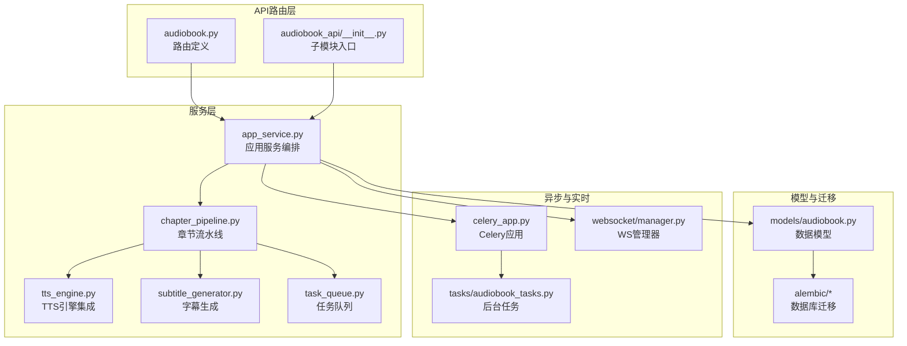
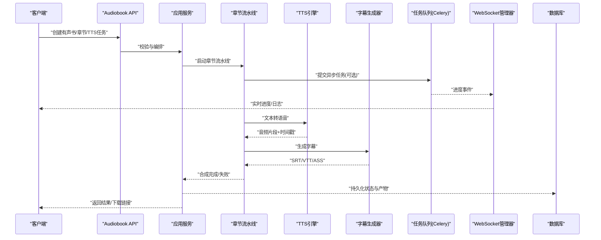
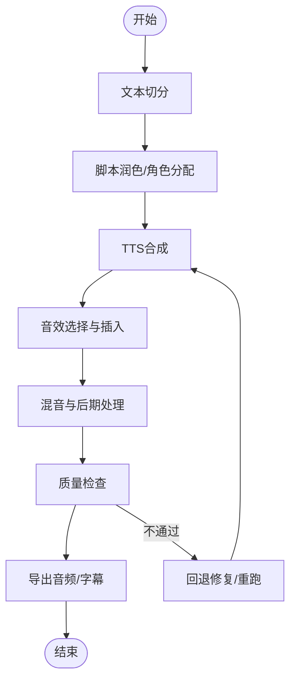
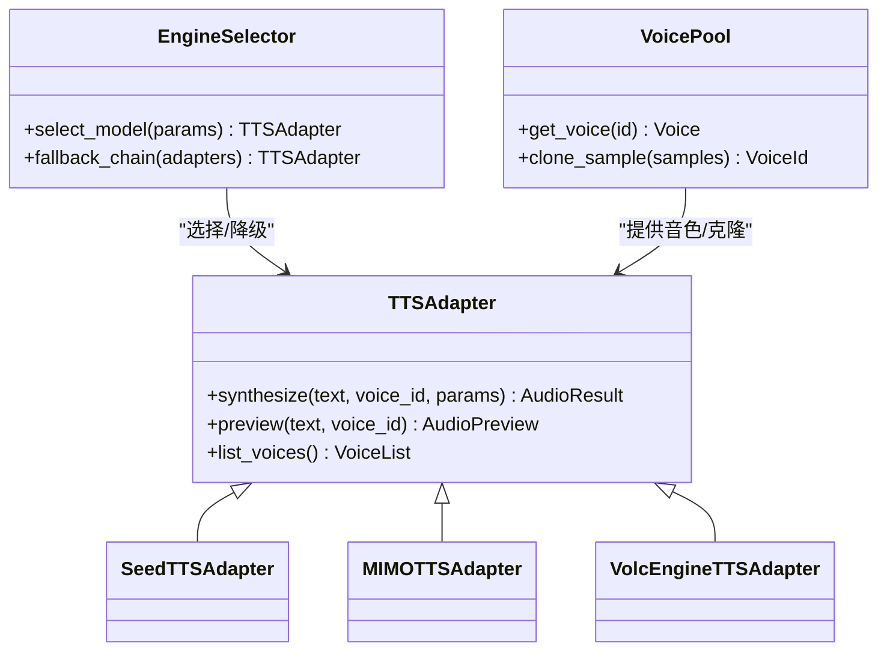
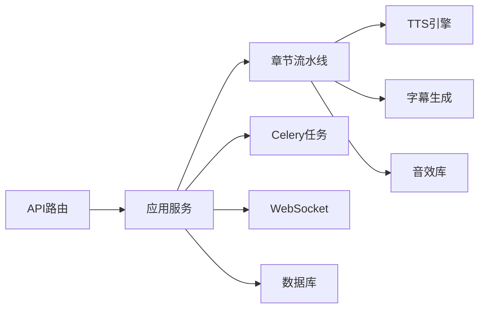

# 有声书API

<cite>
**本文引用的文件**   
- [README.md](file://README.md)
- [backend/app/main.py](file://backend/app/main.py)
- [backend/app/api/v1/audiobook.py](file://backend/app/api/v1/audiobook.py)
- [backend/app/api/v1/audiobook_api/__init__.py](file://backend/app/api/v1/audiobook_api/__init__.py)
- [backend/app/schemas/audiobook.py](file://backend/app/schemas/audiobook.py)
- [backend/app/models/audiobook.py](file://backend/app/models/audiobook.py)
- [backend/app/services/audiobook/app_service.py](file://backend/app/services/audiobook/app_service.py)
- [backend/app/services/audiobook/chapter_pipeline.py](file://backend/app/services/audiobook/chapter_pipeline.py)
- [backend/app/services/audiobook/tts_engine.py](file://backend/app/services/audiobook/tts_engine.py)
- [backend/app/services/audiobook/subtitle_generator.py](file://backend/app/services/audiobook/subtitle_generator.py)
- [backend/app/services/audiobook/task_queue.py](file://backend/app/services/audiobook/task_queue.py)
- [backend/app/websocket/manager.py](file://backend/app/websocket/manager.py)
- [backend/app/celery_app.py](file://backend/app/celery_app.py)
- [backend/app/tasks/audiobook_tasks.py](file://backend/app/tasks/audiobook_tasks.py)
- [backend/alembic/versions/add_audiobook_models.py](file://backend/alembic/versions/add_audiobook_models.py)
- [backend/alembic/versions/add_chapter_audio_runs.py](file://backend/alembic/versions/add_chapter_audio_runs.py)
- [backend/alembic/versions/add_script_fields_to_chapter_audios.py](file://backend/alembic/versions/add_script_fields_to_chapter_audios.py)
- [backend/data/audio_library/sound_effects/index.json](file://backend/data/audio_library/sound_effects/index.json)
- [shared/seed_tts_2_0_voices.json](file://shared/seed_tts_2_0_voices.json)
</cite>

## 目录
1. [简介](#简介)
2. [项目结构](#项目结构)
3. [核心组件](#核心组件)
4. [架构总览](#架构总览)
5. [详细组件分析](#详细组件分析)
6. [依赖分析](#依赖分析)
7. [性能考虑](#性能考虑)
8. [故障排查指南](#故障排查指南)
9. [结论](#结论)
10. [附录：接口清单与使用示例](#附录接口清单与使用示例)

## 简介
本文件为“有声书API”的权威接口文档，覆盖有声书项目的创建、章节管理、脚本编辑、TTS生成、字幕生成、音效添加、后期处理、实时进度跟踪、任务队列管理与错误恢复等全流程能力。文档面向开发者与内容创作者，既提供高层架构说明，也给出可操作的接口调用路径与最佳实践。

## 项目结构
后端采用分层架构：路由层（API）、服务层（业务编排）、模型层（数据持久化）、任务层（异步执行）、WebSocket（实时通信）以及数据库迁移与配置。有声书相关代码集中在 backend/app 下，按 api、services、models、tasks、websocket 划分职责。

图表来源
- [backend/app/api/v1/audiobook.py](file://backend/app/api/v1/audiobook.py)
- [backend/app/api/v1/audiobook_api/__init__.py](file://backend/app/api/v1/audiobook_api/__init__.py)
- [backend/app/services/audiobook/app_service.py](file://backend/app/services/audiobook/app_service.py)
- [backend/app/services/audiobook/chapter_pipeline.py](file://backend/app/services/audiobook/chapter_pipeline.py)
- [backend/app/services/audiobook/tts_engine.py](file://backend/app/services/audiobook/tts_engine.py)
- [backend/app/services/audiobook/subtitle_generator.py](file://backend/app/services/audiobook/subtitle_generator.py)
- [backend/app/services/audiobook/task_queue.py](file://backend/app/services/audiobook/task_queue.py)
- [backend/app/models/audiobook.py](file://backend/app/models/audiobook.py)
- [backend/alembic/versions/add_audiobook_models.py](file://backend/alembic/versions/add_audiobook_models.py)
- [backend/app/celery_app.py](file://backend/app/celery_app.py)
- [backend/app/tasks/audiobook_tasks.py](file://backend/app/tasks/audiobook_tasks.py)
- [backend/app/websocket/manager.py](file://backend/app/websocket/manager.py)

章节来源
- [README.md](file://README.md)
- [backend/app/main.py](file://backend/app/main.py)

## 核心组件
- 路由与请求校验：通过 FastAPI 路由组织有声书相关端点，统一入参出参与错误码。
- 应用服务：协调章节流水线、TTS引擎、字幕生成、音效与后期处理，并负责事务与状态机流转。
- 章节流水线：将文本切分、脚本润色、角色分配、TTS合成、音效叠加、混音与导出串联成可重试的流水线。
- TTS引擎：抽象多厂商TTS适配，支持语音克隆、音色选择、参数归一化与缓存。
- 字幕生成：基于TTS时间戳或ASR对齐生成SRT/VTT/ASS等多格式字幕。
- 任务队列：基于Celery的任务调度，支持批量、优先级、重试与幂等。
- WebSocket：实时推送任务进度、日志与结果片段，支持断线重连与增量更新。

章节来源
- [backend/app/api/v1/audiobook.py](file://backend/app/api/v1/audiobook.py)
- [backend/app/schemas/audiobook.py](file://backend/app/schemas/audiobook.py)
- [backend/app/services/audiobook/app_service.py](file://backend/app/services/audiobook/app_service.py)
- [backend/app/services/audiobook/chapter_pipeline.py](file://backend/app/services/audiobook/chapter_pipeline.py)
- [backend/app/services/audiobook/tts_engine.py](file://backend/app/services/audiobook/tts_engine.py)
- [backend/app/services/audiobook/subtitle_generator.py](file://backend/app/services/audiobook/subtitle_generator.py)
- [backend/app/services/audiobook/task_queue.py](file://backend/app/services/audiobook/task_queue.py)
- [backend/app/websocket/manager.py](file://backend/app/websocket/manager.py)

## 架构总览
下图展示从HTTP请求到TTS合成、字幕生成与结果返回的整体流程，包含异步任务与WebSocket实时更新。

图表来源
- [backend/app/api/v1/audiobook.py](file://backend/app/api/v1/audiobook.py)
- [backend/app/services/audiobook/app_service.py](file://backend/app/services/audiobook/app_service.py)
- [backend/app/services/audiobook/chapter_pipeline.py](file://backend/app/services/audiobook/chapter_pipeline.py)
- [backend/app/services/audiobook/tts_engine.py](file://backend/app/services/audiobook/tts_engine.py)
- [backend/app/services/audiobook/subtitle_generator.py](file://backend/app/services/audiobook/subtitle_generator.py)
- [backend/app/services/audiobook/task_queue.py](file://backend/app/services/audiobook/task_queue.py)
- [backend/app/websocket/manager.py](file://backend/app/websocket/manager.py)
- [backend/app/celery_app.py](file://backend/app/celery_app.py)
- [backend/app/tasks/audiobook_tasks.py](file://backend/app/tasks/audiobook_tasks.py)

## 详细组件分析

### 路由与模式（API层）
- 路由组织：按资源维度划分，如项目、章节、脚本、TTS任务、字幕、音效与导出。
- 模式校验：使用Pydantic Schema对输入进行强类型校验与默认值填充，减少非法请求进入服务层。
- 错误处理：统一异常映射为HTTP状态码与结构化错误体，便于前端解析与重试。

章节来源
- [backend/app/api/v1/audiobook.py](file://backend/app/api/v1/audiobook.py)
- [backend/app/schemas/audiobook.py](file://backend/app/schemas/audiobook.py)

### 应用服务（编排与状态机）
- 职责：协调章节流水线、TTS引擎、字幕生成、音效与后期处理；维护任务生命周期与幂等键；触发异步任务与WebSocket事件。
- 关键流程：创建项目→初始化章节→脚本编辑→TTS合成→音效叠加→混音导出→字幕生成→归档。
- 并发控制：基于任务ID与幂等键避免重复执行；失败时自动重试与降级策略。

章节来源
- [backend/app/services/audiobook/app_service.py](file://backend/app/services/audiobook/app_service.py)

### 章节流水线（Pipeline）
- 阶段：文本切分→脚本润色→角色分配→TTS合成→音效插入→混音→质量检查→导出。
- 可插拔：每个阶段以独立函数/类实现，支持替换与扩展（如不同TTS或字幕算法）。
- 容错：每阶段输出中间态，支持断点续跑与局部重算。

图表来源
- [backend/app/services/audiobook/chapter_pipeline.py](file://backend/app/services/audiobook/chapter_pipeline.py)

章节来源
- [backend/app/services/audiobook/chapter_pipeline.py](file://backend/app/services/audiobook/chapter_pipeline.py)

### TTS引擎集成（含语音克隆）
- 抽象层：统一TTS接口，屏蔽多厂商差异（模型ID、参数、鉴权）。
- 功能：语音克隆、音色库选择、语速/音调调节、停顿标记、缓存命中。
- 适配：通过适配器注册表动态加载，支持热切换与灰度发布。

图表来源
- [backend/app/services/audiobook/tts_engine.py](file://backend/app/services/audiobook/tts_engine.py)
- [shared/seed_tts_2_0_voices.json](file://shared/seed_tts_2_0_voices.json)

章节来源
- [backend/app/services/audiobook/tts_engine.py](file://backend/app/services/audiobook/tts_engine.py)
- [shared/seed_tts_2_0_voices.json](file://shared/seed_tts_2_0_voices.json)

### 字幕生成器
- 输入：TTS输出的音频片段与时间戳，或原始文本与分段信息。
- 输出：SRT/VTT/ASS等多种字幕格式，支持样式与角色标注。
- 对齐：基于时间戳或ASR辅助对齐，保证唇形与台词同步。

章节来源
- [backend/app/services/audiobook/subtitle_generator.py](file://backend/app/services/audiobook/subtitle_generator.py)

### 任务队列与异步处理
- 调度：Celery作为任务队列，支持延迟、周期、批处理与优先级。
- 可靠性：任务幂等、重试、死信队列与监控指标上报。
- 批量：支持批量章节/段落并行处理，限制并发度避免过载。

章节来源
- [backend/app/celery_app.py](file://backend/app/celery_app.py)
- [backend/app/tasks/audiobook_tasks.py](file://backend/app/tasks/audiobook_tasks.py)
- [backend/app/services/audiobook/task_queue.py](file://backend/app/services/audiobook/task_queue.py)

### WebSocket实时进度
- 事件：任务创建、进行中、完成、失败、进度百分比、日志片段。
- 连接：按项目/章节维度订阅，支持断线重连与增量推送。
- 安全：鉴权令牌与频道隔离，防止越权访问。

章节来源
- [backend/app/websocket/manager.py](file://backend/app/websocket/manager.py)

### 数据模型与迁移
- 模型：项目、章节、章节音频、脚本、任务、资产等实体关系清晰。
- 迁移：Alembic版本化管理，确保字段演进与兼容。

章节来源
- [backend/app/models/audiobook.py](file://backend/app/models/audiobook.py)
- [backend/alembic/versions/add_audiobook_models.py](file://backend/alembic/versions/add_audiobook_models.py)
- [backend/alembic/versions/add_chapter_audio_runs.py](file://backend/alembic/versions/add_chapter_audio_runs.py)
- [backend/alembic/versions/add_script_fields_to_chapter_audios.py](file://backend/alembic/versions/add_script_fields_to_chapter_audios.py)

## 依赖分析
- 外部依赖：TTS厂商SDK、Celery与Redis、FFmpeg（后期处理）、对象存储（产物归档）。
- 内部依赖：路由→服务→流水线→TTS/字幕/音效→任务→WS→DB。
- 耦合点：TTS适配器注册表、任务幂等键、WS事件通道。

图表来源
- [backend/app/api/v1/audiobook.py](file://backend/app/api/v1/audiobook.py)
- [backend/app/services/audiobook/app_service.py](file://backend/app/services/audiobook/app_service.py)
- [backend/app/services/audiobook/chapter_pipeline.py](file://backend/app/services/audiobook/chapter_pipeline.py)
- [backend/app/services/audiobook/tts_engine.py](file://backend/app/services/audiobook/tts_engine.py)
- [backend/app/services/audiobook/subtitle_generator.py](file://backend/app/services/audiobook/subtitle_generator.py)
- [backend/app/services/audiobook/task_queue.py](file://backend/app/services/audiobook/task_queue.py)
- [backend/app/websocket/manager.py](file://backend/app/websocket/manager.py)
- [backend/app/celery_app.py](file://backend/app/celery_app.py)
- [backend/app/tasks/audiobook_tasks.py](file://backend/app/tasks/audiobook_tasks.py)

章节来源
- [backend/app/api/v1/audiobook_api/__init__.py](file://backend/app/api/v1/audiobook_api/__init__.py)

## 性能考虑
- 并发与限流：任务队列设置合理并发上限，避免TTS与存储瓶颈。
- 缓存：TTS预览与中间结果缓存，减少重复计算。
- 流式处理：大文件分块上传/下载，降低内存峰值。
- 资源隔离：不同租户/项目隔离队列与临时目录。
- 监控：关键指标（耗时、成功率、队列长度、错误率）上报与告警。

## 故障排查指南
- 常见问题
  - TTS失败：检查模型ID、鉴权、文本长度与字符集；查看适配器日志与降级链。
  - 任务堆积：检查Celery Worker数量、Redis连接与任务幂等键冲突。
  - 字幕错位：确认时间戳来源与对齐策略，必要时启用ASR辅助。
  - 音效缺失：核对音效库索引与权限，检查路径与格式兼容性。
- 定位手段
  - 通过WebSocket事件与任务追踪ID定位阶段。
  - 查看数据库状态与中间产物，确认断点位置。
  - 启用调试开关输出详细日志与采样音频。

章节来源
- [backend/app/services/audiobook/app_service.py](file://backend/app/services/audiobook/app_service.py)
- [backend/app/services/audiobook/chapter_pipeline.py](file://backend/app/services/audiobook/chapter_pipeline.py)
- [backend/app/services/audiobook/tts_engine.py](file://backend/app/services/audiobook/tts_engine.py)
- [backend/app/services/audiobook/subtitle_generator.py](file://backend/app/services/audiobook/subtitle_generator.py)
- [backend/app/services/audiobook/task_queue.py](file://backend/app/services/audiobook/task_queue.py)
- [backend/app/websocket/manager.py](file://backend/app/websocket/manager.py)
- [backend/data/audio_library/sound_effects/index.json](file://backend/data/audio_library/sound_effects/index.json)

## 结论
本API围绕“项目-章节-脚本-TTS-字幕-音效-后期”的全链路能力构建，提供高可靠的任务队列与实时进度反馈，满足大规模有声书生产需求。通过模块化与可插拔设计，系统具备良好的扩展性与可维护性。

## 附录：接口清单与使用示例
以下为常用接口类别与典型调用流程（以路径与行为描述为主，具体字段请参考Schema与响应样例）：

- 项目与章节管理
  - 创建有声书项目：POST /api/v1/audiobook/projects
  - 获取项目详情：GET /api/v1/audiobook/projects/{project_id}
  - 创建章节：POST /api/v1/audiobook/projects/{project_id}/chapters
  - 更新章节元数据：PATCH /api/v1/audiobook/chapters/{chapter_id}
  - 删除章节（软删）：DELETE /api/v1/audiobook/chapters/{chapter_id}

- 脚本编辑
  - 获取章节脚本：GET /api/v1/audiobook/chapters/{chapter_id}/script
  - 保存脚本：PUT /api/v1/audiobook/chapters/{chapter_id}/script
  - 批量润色脚本：POST /api/v1/audiobook/chapters/batch/script/polish

- TTS生成与语音克隆
  - 预览TTS：POST /api/v1/audiobook/tts/preview
  - 生成章节音频：POST /api/v1/audiobook/chapters/{chapter_id}/tts
  - 语音克隆样本上传：POST /api/v1/audiobook/voices/clone/upload
  - 查询可用音色：GET /api/v1/audiobook/voices

- 字幕生成
  - 生成字幕：POST /api/v1/audiobook/chapters/{chapter_id}/subtitles
  - 下载字幕：GET /api/v1/audiobook/chapters/{chapter_id}/subtitles/{format}

- 音效与后期处理
  - 选择音效：POST /api/v1/audiobook/chapters/{chapter_id}/sfx/select
  - 应用后期预设：POST /api/v1/audiobook/chapters/{chapter_id}/postprocess

- 任务与进度
  - 提交批量任务：POST /api/v1/audiobook/tasks/batch
  - 查询任务状态：GET /api/v1/audiobook/tasks/{task_id}
  - 取消任务：POST /api/v1/audiobook/tasks/{task_id}/cancel

- WebSocket实时
  - 连接：ws://host/ws/audiobook?token=...
  - 订阅频道：{project_id}/{chapter_id}/{task_id}
  - 事件：progress、log、result、error

- 全流程示例（文本转语音→音频合成→字幕生成）
  - 步骤1：创建项目与章节，写入脚本
  - 步骤2：调用TTS生成音频片段，记录时间戳
  - 步骤3：选择并插入音效，执行混音与后期
  - 步骤4：生成SRT/VTT字幕，校验对齐
  - 步骤5：导出成品音频与字幕包，归档至对象存储
  - 实时：通过WebSocket订阅任务进度与日志

章节来源
- [backend/app/api/v1/audiobook.py](file://backend/app/api/v1/audiobook.py)
- [backend/app/schemas/audiobook.py](file://backend/app/schemas/audiobook.py)
- [backend/app/services/audiobook/app_service.py](file://backend/app/services/audiobook/app_service.py)
- [backend/app/services/audiobook/chapter_pipeline.py](file://backend/app/services/audiobook/chapter_pipeline.py)
- [backend/app/services/audiobook/tts_engine.py](file://backend/app/services/audiobook/tts_engine.py)
- [backend/app/services/audiobook/subtitle_generator.py](file://backend/app/services/audiobook/subtitle_generator.py)
- [backend/app/services/audiobook/task_queue.py](file://backend/app/services/audiobook/task_queue.py)
- [backend/app/websocket/manager.py](file://backend/app/websocket/manager.py)
- [backend/app/celery_app.py](file://backend/app/celery_app.py)
- [backend/app/tasks/audiobook_tasks.py](file://backend/app/tasks/audiobook_tasks.py)
- [backend/data/audio_library/sound_effects/index.json](file://backend/data/audio_library/sound_effects/index.json)
- [shared/seed_tts_2_0_voices.json](file://shared/seed_tts_2_0_voices.json)