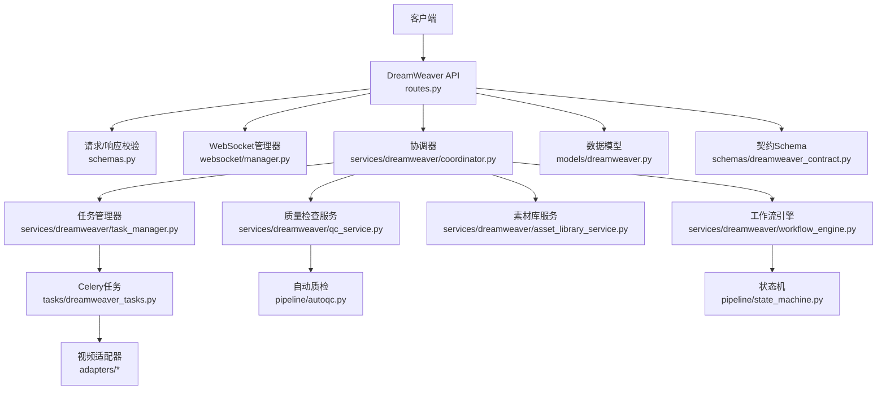
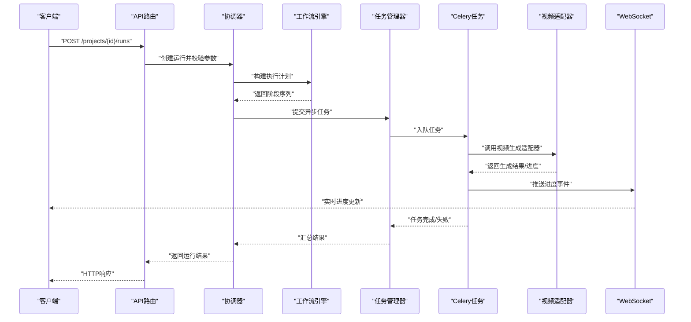
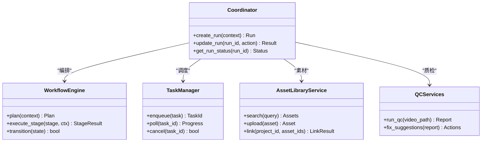
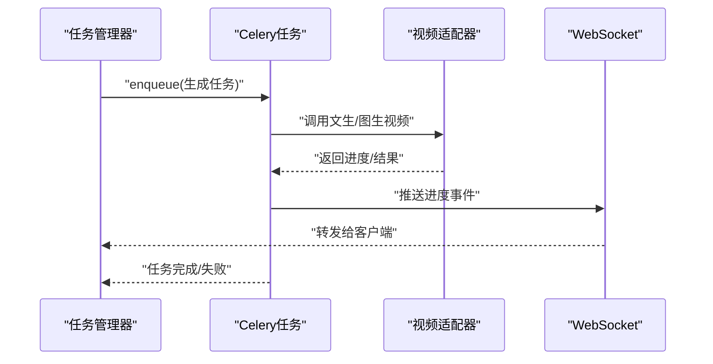
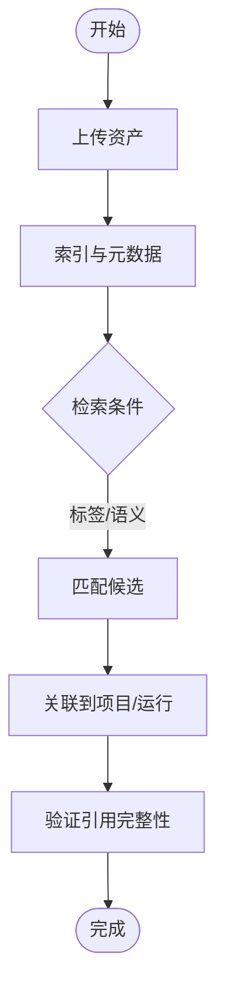
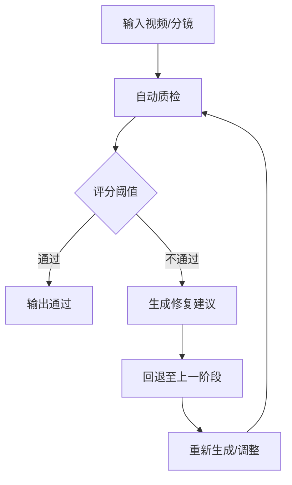
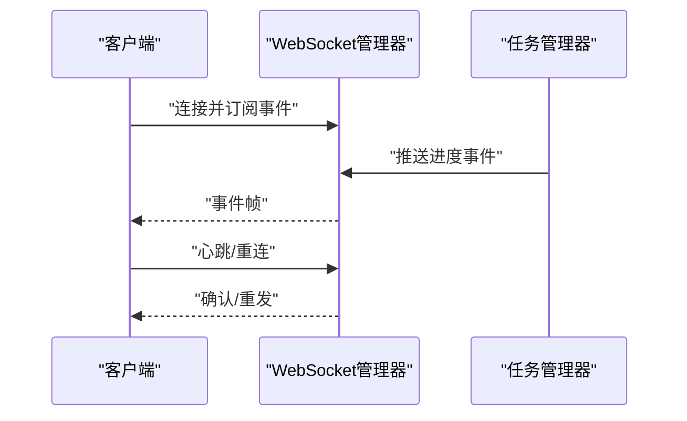
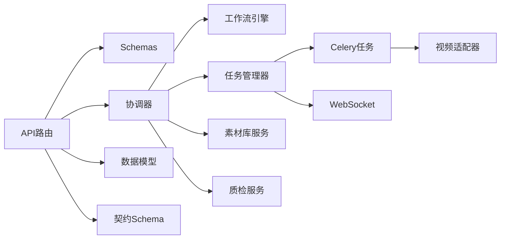

# 梦境编织者API

<cite>
**本文引用的文件**   
- [backend/app/api/v1/dreamweaver_api/__init__.py](file://backend/app/api/v1/dreamweaver_api/__init__.py)
- [backend/app/api/v1/dreamweaver_api/routes.py](file://backend/app/api/v1/dreamweaver_api/routes.py)
- [backend/app/api/v1/dreamweaver_api/schemas.py](file://backend/app/api/v1/dreamweaver_api/schemas.py)
- [backend/app/services/dreamweaver/coordinator.py](file://backend/app/services/dreamweaver/coordinator.py)
- [backend/app/services/dreamweaver/workflow_engine.py](file://backend/app/services/dreamweaver/workflow_engine.py)
- [backend/app/services/dreamweaver/task_manager.py](file://backend/app/services/dreamweaver/task_manager.py)
- [backend/app/services/dreamweaver/asset_library_service.py](file://backend/app/services/dreamweaver/asset_library_service.py)
- [backend/app/services/dreamweaver/qc_service.py](file://backend/app/services/dreamweaver/qc_service.py)
- [backend/app/websocket/manager.py](file://backend/app/websocket/manager.py)
- [backend/app/tasks/dreamweaver_tasks.py](file://backend/app/tasks/dreamweaver_tasks.py)
- [backend/app/models/dreamweaver.py](file://backend/app/models/dreamweaver.py)
- [backend/app/schemas/dreamweaver_contract.py](file://backend/app/schemas/dreamweaver_contract.py)
- [adapters/video_t2v.py](file://adapters/video_t2v.py)
- [adapters/video_i2v.py](file://adapters/video_i2v.py)
- [adapters/kling_omni_adapter.py](file://adapters/kling_omni_adapter.py)
- [pipeline/autoqc.py](file://pipeline/autoqc.py)
- [pipeline/state_machine.py](file://pipeline/state_machine.py)
</cite>

## 目录
1. [简介](#简介)
2. [项目结构](#项目结构)
3. [核心组件](#核心组件)
4. [架构总览](#架构总览)
5. [详细组件分析](#详细组件分析)
6. [依赖关系分析](#依赖关系分析)
7. [性能与并发](#性能与并发)
8. [故障排查指南](#故障排查指南)
9. [结论](#结论)
10. [附录：API使用示例](#附录api使用示例)

## 简介
本文件为“梦境编织者”视频生成系统的接口文档，覆盖项目管理、运行任务控制、素材库操作、工作流编排、分镜管理、资产关联、质量检查等核心能力。系统提供REST API与WebSocket实时通道，支持异步任务调度、资源管理与高并发处理，适用于从脚本到成片的全流程自动化生产。

## 项目结构
- API层：基于FastAPI的REST路由与请求校验（schemas），统一在dreamweaver_api模块下暴露接口。
- 服务层：协调器coordinator与工作流引擎workflow_engine负责编排；task_manager管理任务生命周期；asset_library_service管理素材；qc_service执行质量检查。
- 任务层：Celery任务定义与执行，承载耗时视频生成与后处理。
- WebSocket：manager维护连接、事件广播与进度推送。
- 数据模型：dreamweaver相关实体与合同schema定义。
- 适配器：对接多种视频生成后端（文生视频、图生视频、Kling Omni等）。
- 流水线：自动质检autoqc与状态机state_machine驱动质量门禁与状态流转。

**图表来源** 
- [backend/app/api/v1/dreamweaver_api/routes.py](file://backend/app/api/v1/dreamweaver_api/routes.py)
- [backend/app/api/v1/dreamweaver_api/schemas.py](file://backend/app/api/v1/dreamweaver_api/schemas.py)
- [backend/app/services/dreamweaver/coordinator.py](file://backend/app/services/dreamweaver/coordinator.py)
- [backend/app/services/dreamweaver/workflow_engine.py](file://backend/app/services/dreamweaver/workflow_engine.py)
- [backend/app/services/dreamweaver/task_manager.py](file://backend/app/services/dreamweaver/task_manager.py)
- [backend/app/services/dreamweaver/asset_library_service.py](file://backend/app/services/dreamweaver/asset_library_service.py)
- [backend/app/services/dreamweaver/qc_service.py](file://backend/app/services/dreamweaver/qc_service.py)
- [backend/app/websocket/manager.py](file://backend/app/websocket/manager.py)
- [backend/app/tasks/dreamweaver_tasks.py](file://backend/app/tasks/dreamweaver_tasks.py)
- [pipeline/autoqc.py](file://pipeline/autoqc.py)
- [pipeline/state_machine.py](file://pipeline/state_machine.py)

**章节来源**
- [backend/app/api/v1/dreamweaver_api/__init__.py](file://backend/app/api/v1/dreamweaver_api/__init__.py)
- [backend/app/api/v1/dreamweaver_api/routes.py](file://backend/app/api/v1/dreamweaver_api/routes.py)

## 核心组件
- DreamWeaver API路由：统一入口，定义项目、任务、素材、质量检查等REST端点，绑定请求/响应模型。
- 协调器：接收API请求，组装上下文，调用工作流引擎与任务管理器，协调素材与质检。
- 工作流引擎：根据输入（脚本、分镜、参数）生成执行计划，驱动状态机推进阶段。
- 任务管理器：创建、调度、监控异步任务，聚合进度与结果。
- 素材库服务：管理角色、场景、道具等资产，支持检索、版本与关联。
- 质量检查服务：集成自动质检，对画面一致性、语义匹配、时长合规等进行评分与拦截。
- WebSocket管理器：建立长连接，推送任务进度、错误与结果通知。
- 适配器层：封装不同视频生成后端的调用细节，屏蔽差异。
- 数据模型与契约：持久化结构与对外契约保持一致。

**章节来源**
- [backend/app/services/dreamweaver/coordinator.py](file://backend/app/services/dreamweaver/coordinator.py)
- [backend/app/services/dreamweaver/workflow_engine.py](file://backend/app/services/dreamweaver/workflow_engine.py)
- [backend/app/services/dreamweaver/task_manager.py](file://backend/app/services/dreamweaver/task_manager.py)
- [backend/app/services/dreamweaver/asset_library_service.py](file://backend/app/services/dreamweaver/asset_library_service.py)
- [backend/app/services/dreamweaver/qc_service.py](file://backend/app/services/dreamweaver/qc_service.py)
- [backend/app/websocket/manager.py](file://backend/app/websocket/manager.py)
- [backend/app/models/dreamweaver.py](file://backend/app/models/dreamweaver.py)
- [backend/app/schemas/dreamweaver_contract.py](file://backend/app/schemas/dreamweaver_contract.py)

## 架构总览
系统采用分层架构：API层暴露REST接口；服务层实现业务编排；任务层异步执行；适配器层对接外部模型；WebSocket提供实时反馈；数据层通过模型与迁移管理持久化。

**图表来源** 
- [backend/app/api/v1/dreamweaver_api/routes.py](file://backend/app/api/v1/dreamweaver_api/routes.py)
- [backend/app/services/dreamweaver/coordinator.py](file://backend/app/services/dreamweaver/coordinator.py)
- [backend/app/services/dreamweaver/workflow_engine.py](file://backend/app/services/dreamweaver/workflow_engine.py)
- [backend/app/services/dreamweaver/task_manager.py](file://backend/app/services/dreamweaver/task_manager.py)
- [backend/app/tasks/dreamweaver_tasks.py](file://backend/app/tasks/dreamweaver_tasks.py)
- [adapters/video_t2v.py](file://adapters/video_t2v.py)
- [adapters/video_i2v.py](file://adapters/video_i2v.py)
- [backend/app/websocket/manager.py](file://backend/app/websocket/manager.py)

## 详细组件分析

### REST API概览
- 项目与运行
  - 创建/查询/更新/删除项目
  - 启动运行（提交脚本、分镜、参数）
  - 查询运行状态与结果
- 任务控制
  - 暂停/恢复/取消运行
  - 重试失败阶段
- 素材库
  - 上传/检索/更新/删除资产（角色、场景、道具、参考图/音频）
  - 资产版本与关联
- 质量检查
  - 触发自动质检
  - 获取质检报告与修复建议
- 实时通道
  - WebSocket订阅任务进度与事件

**章节来源**
- [backend/app/api/v1/dreamweaver_api/routes.py](file://backend/app/api/v1/dreamweaver_api/routes.py)
- [backend/app/api/v1/dreamweaver_api/schemas.py](file://backend/app/api/v1/dreamweaver_api/schemas.py)

### 协调器与工作流程
- 协调器负责将API请求转换为内部上下文，调用工作流引擎生成阶段序列，并与任务管理器协作推进。
- 工作流引擎依据输入（脚本、分镜、参数）决定各阶段（如提示优化、素材准备、视频生成、拼接、质检）的执行顺序与依赖。
- 状态机驱动阶段状态转换，确保幂等与可恢复。

**图表来源** 
- [backend/app/services/dreamweaver/coordinator.py](file://backend/app/services/dreamweaver/coordinator.py)
- [backend/app/services/dreamweaver/workflow_engine.py](file://backend/app/services/dreamweaver/workflow_engine.py)
- [backend/app/services/dreamweaver/task_manager.py](file://backend/app/services/dreamweaver/task_manager.py)
- [backend/app/services/dreamweaver/asset_library_service.py](file://backend/app/services/dreamweaver/asset_library_service.py)
- [backend/app/services/dreamweaver/qc_service.py](file://backend/app/services/dreamweaver/qc_service.py)

**章节来源**
- [backend/app/services/dreamweaver/coordinator.py](file://backend/app/services/dreamweaver/coordinator.py)
- [backend/app/services/dreamweaver/workflow_engine.py](file://backend/app/services/dreamweaver/workflow_engine.py)
- [pipeline/state_machine.py](file://pipeline/state_machine.py)

### 任务管理与异步执行
- 任务管理器负责任务的创建、入队、轮询与取消，聚合进度事件并通过WebSocket推送。
- Celery任务封装视频生成、转码、拼接、质检等耗时步骤，支持重试与超时控制。
- 适配器层屏蔽不同视频模型的调用差异，统一返回进度与结果。

**图表来源** 
- [backend/app/services/dreamweaver/task_manager.py](file://backend/app/services/dreamweaver/task_manager.py)
- [backend/app/tasks/dreamweaver_tasks.py](file://backend/app/tasks/dreamweaver_tasks.py)
- [adapters/video_t2v.py](file://adapters/video_t2v.py)
- [adapters/video_i2v.py](file://adapters/video_i2v.py)
- [backend/app/websocket/manager.py](file://backend/app/websocket/manager.py)

**章节来源**
- [backend/app/tasks/dreamweaver_tasks.py](file://backend/app/tasks/dreamweaver_tasks.py)
- [backend/app/services/dreamweaver/task_manager.py](file://backend/app/services/dreamweaver/task_manager.py)

### 素材库操作与资产关联
- 素材库服务提供资产的上传、检索、更新、删除与版本管理。
- 支持按标签、语义、类型检索，便于分镜与角色/场景/道具的自动关联。
- 资产与项目/运行关联，确保生成过程引用一致性与可追溯性。

**图表来源** 
- [backend/app/services/dreamweaver/asset_library_service.py](file://backend/app/services/dreamweaver/asset_library_service.py)
- [backend/app/models/dreamweaver.py](file://backend/app/models/dreamweaver.py)

**章节来源**
- [backend/app/services/dreamweaver/asset_library_service.py](file://backend/app/services/dreamweaver/asset_library_service.py)
- [backend/app/models/dreamweaver.py](file://backend/app/models/dreamweaver.py)

### 质量检查与分镜管理
- 质量检查服务集成自动质检，涵盖画面一致性、语义匹配、时长合规、镜头连续性等维度。
- 分镜管理支持分镜条目编辑、时长估算、音频同步与变体生成。
- 质检报告包含问题定位与修复建议，支持自动或人工干预。

**图表来源** 
- [backend/app/services/dreamweaver/qc_service.py](file://backend/app/services/dreamweaver/qc_service.py)
- [pipeline/autoqc.py](file://pipeline/autoqc.py)

**章节来源**
- [backend/app/services/dreamweaver/qc_service.py](file://backend/app/services/dreamweaver/qc_service.py)
- [pipeline/autoqc.py](file://pipeline/autoqc.py)

### WebSocket实时通道
- 客户端建立WebSocket连接，订阅任务ID或项目ID的事件流。
- 服务端推送进度、阶段切换、错误与结果消息，支持断线重连与去抖。
- 事件格式遵循统一协议，便于前端渲染进度条与日志面板。

**图表来源** 
- [backend/app/websocket/manager.py](file://backend/app/websocket/manager.py)
- [backend/app/services/dreamweaver/task_manager.py](file://backend/app/services/dreamweaver/task_manager.py)

**章节来源**
- [backend/app/websocket/manager.py](file://backend/app/websocket/manager.py)

## 依赖关系分析
- API路由依赖schemas进行请求/响应校验，依赖协调器执行业务逻辑。
- 协调器依赖工作流引擎、任务管理器、素材库服务与质检服务。
- 任务管理器依赖Celery任务队列与WebSocket管理器。
- 适配器层依赖具体视频生成后端，被任务层调用。
- 数据模型与契约保证前后端与服务间的一致性。

**图表来源** 
- [backend/app/api/v1/dreamweaver_api/routes.py](file://backend/app/api/v1/dreamweaver_api/routes.py)
- [backend/app/api/v1/dreamweaver_api/schemas.py](file://backend/app/api/v1/dreamweaver_api/schemas.py)
- [backend/app/services/dreamweaver/coordinator.py](file://backend/app/services/dreamweaver/coordinator.py)
- [backend/app/services/dreamweaver/workflow_engine.py](file://backend/app/services/dreamweaver/workflow_engine.py)
- [backend/app/services/dreamweaver/task_manager.py](file://backend/app/services/dreamweaver/task_manager.py)
- [backend/app/services/dreamweaver/asset_library_service.py](file://backend/app/services/dreamweaver/asset_library_service.py)
- [backend/app/services/dreamweaver/qc_service.py](file://backend/app/services/dreamweaver/qc_service.py)
- [backend/app/tasks/dreamweaver_tasks.py](file://backend/app/tasks/dreamweaver_tasks.py)
- [backend/app/websocket/manager.py](file://backend/app/websocket/manager.py)
- [backend/app/models/dreamweaver.py](file://backend/app/models/dreamweaver.py)
- [backend/app/schemas/dreamweaver_contract.py](file://backend/app/schemas/dreamweaver_contract.py)

**章节来源**
- [backend/app/api/v1/dreamweaver_api/routes.py](file://backend/app/api/v1/dreamweaver_api/routes.py)
- [backend/app/services/dreamweaver/coordinator.py](file://backend/app/services/dreamweaver/coordinator.py)

## 性能与并发
- 异步任务：Celery承担视频生成、转码、拼接、质检等耗时操作，避免阻塞HTTP线程。
- 并发控制：任务管理器限制并发度，防止下游适配器限流与资源争用。
- 缓存与复用：素材库索引与中间结果缓存减少重复计算。
- 背压与重试：失败任务支持指数退避重试，超限降级或告警。
- 资源管理：GPU/CPU配额与队列分区，保障关键路径优先级。

[本节为通用指导，不直接分析具体文件]

## 故障排查指南
- 常见错误
  - 参数校验失败：检查schemas定义与请求体字段。
  - 任务失败：查看Celery日志与适配器返回码，确认凭据与配额。
  - WebSocket断开：检查心跳与重连策略，确认网络与代理设置。
  - 质检不通过：根据报告定位问题，调整分镜或素材。
- 诊断步骤
  - 通过运行ID查询状态与阶段详情。
  - 拉取任务进度与错误堆栈。
  - 检查素材关联与版本一致性。
  - 复现并缩小范围，必要时启用调试模式。

**章节来源**
- [backend/app/api/v1/dreamweaver_api/schemas.py](file://backend/app/api/v1/dreamweaver_api/schemas.py)
- [backend/app/tasks/dreamweaver_tasks.py](file://backend/app/tasks/dreamweaver_tasks.py)
- [backend/app/websocket/manager.py](file://backend/app/websocket/manager.py)
- [backend/app/services/dreamweaver/qc_service.py](file://backend/app/services/dreamweaver/qc_service.py)

## 结论
梦境编织者API以清晰的分层架构与完善的异步机制，支撑从脚本到成片的端到端视频生成。通过工作流编排、素材库管理、质量检查与WebSocket实时反馈，开发者可高效构建稳定可靠的视频生产流水线。建议在生产环境强化限流、监控与审计，持续优化适配器适配与质检规则。

[本节为总结，不直接分析具体文件]

## 附录：API使用示例
以下为典型使用流程（以描述为主，不包含代码片段）：
- 创建项目
  - 调用项目创建接口，填写项目名称、描述与基础配置。
  - 返回项目ID用于后续操作。
- 准备素材
  - 上传角色、场景、道具等资产，建立索引与元数据。
  - 检索并关联所需素材到项目。
- 编写脚本与分镜
  - 提交脚本文本与分镜条目，设定时长、镜头语言与音频同步要求。
- 启动运行
  - 调用运行接口，传入项目ID、脚本、分镜与生成参数（分辨率、帧率、模型选择等）。
  - 返回运行ID与初始阶段。
- 实时监控
  - 建立WebSocket连接，订阅运行ID的事件流。
  - 接收进度、阶段切换、错误与结果消息。
- 质量检查
  - 触发自动质检，查看报告与修复建议。
  - 根据建议调整分镜或素材，重新运行。
- 结果获取
  - 查询运行结果，下载成品视频与元数据。
  - 归档资产与运行记录，便于回溯与复用。

**章节来源**
- [backend/app/api/v1/dreamweaver_api/routes.py](file://backend/app/api/v1/dreamweaver_api/routes.py)
- [backend/app/api/v1/dreamweaver_api/schemas.py](file://backend/app/api/v1/dreamweaver_api/schemas.py)
- [backend/app/services/dreamweaver/coordinator.py](file://backend/app/services/dreamweaver/coordinator.py)
- [backend/app/services/dreamweaver/workflow_engine.py](file://backend/app/services/dreamweaver/workflow_engine.py)
- [backend/app/services/dreamweaver/task_manager.py](file://backend/app/services/dreamweaver/task_manager.py)
- [backend/app/services/dreamweaver/asset_library_service.py](file://backend/app/services/dreamweaver/asset_library_service.py)
- [backend/app/services/dreamweaver/qc_service.py](file://backend/app/services/dreamweaver/qc_service.py)
- [backend/app/websocket/manager.py](file://backend/app/websocket/manager.py)