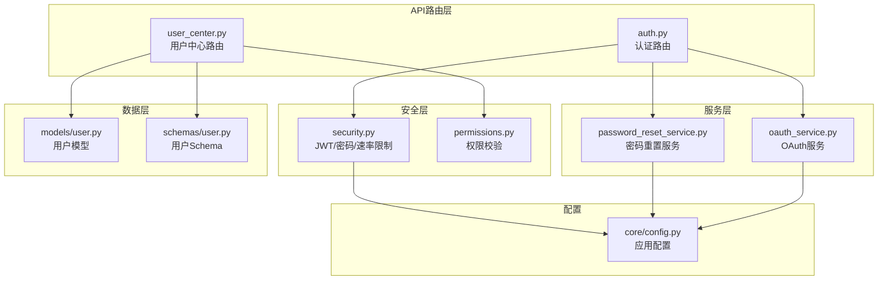
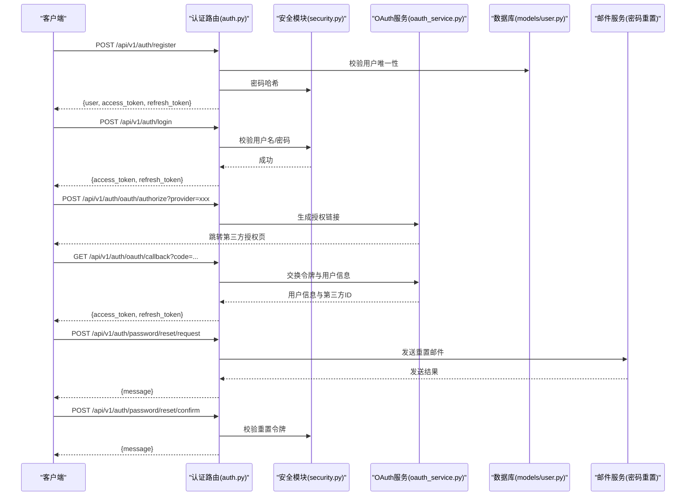
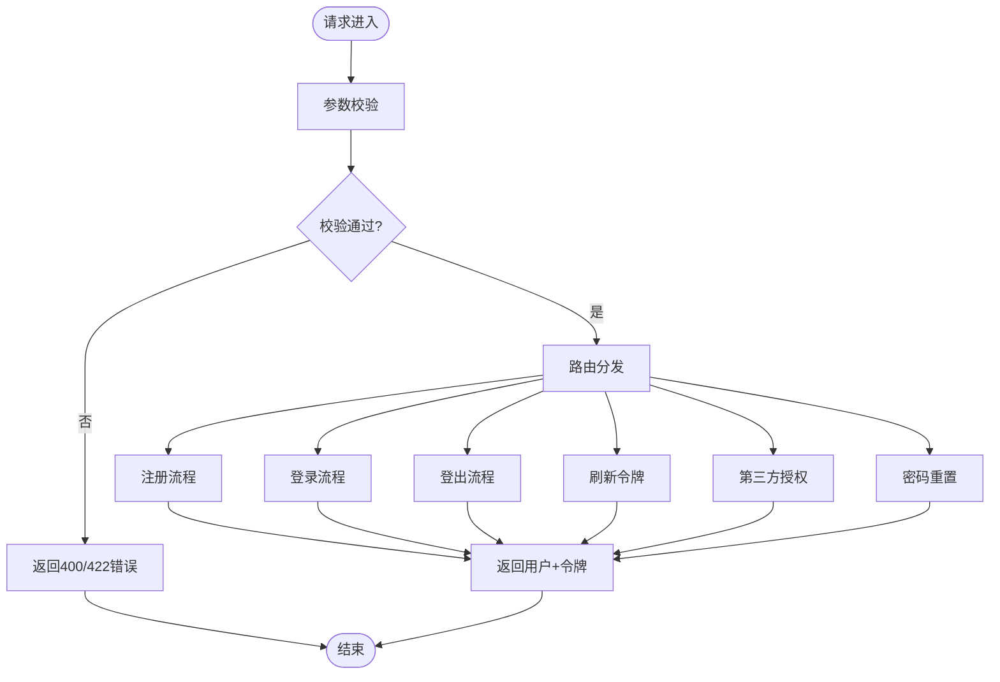
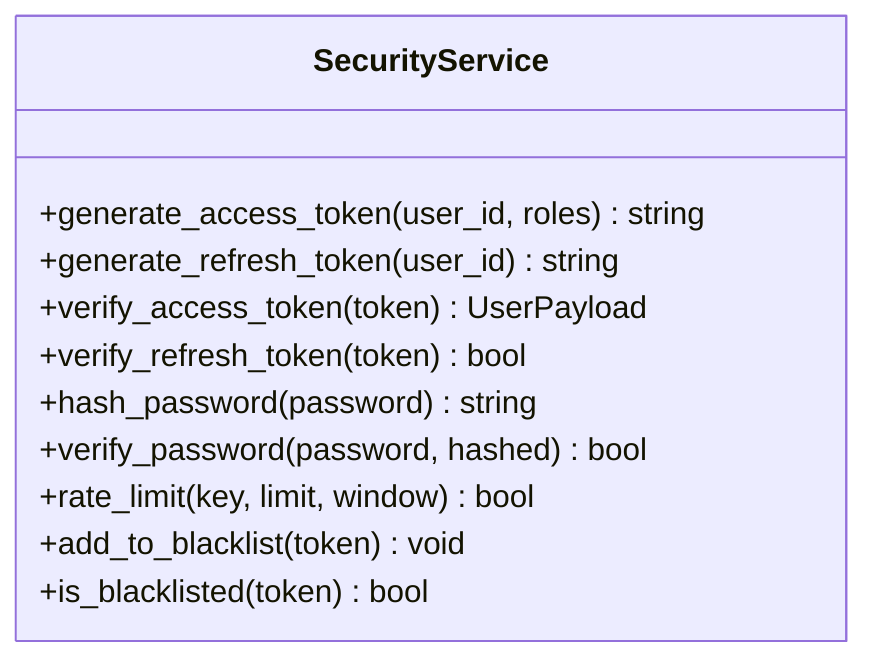
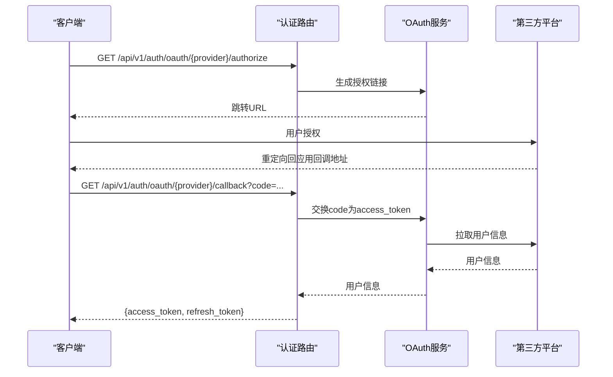
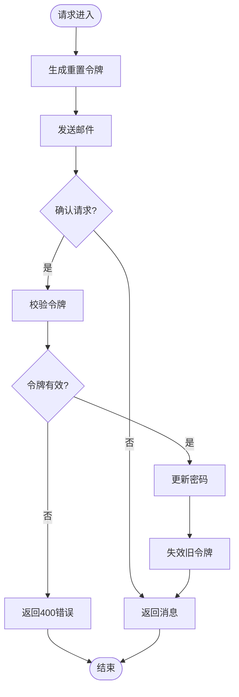
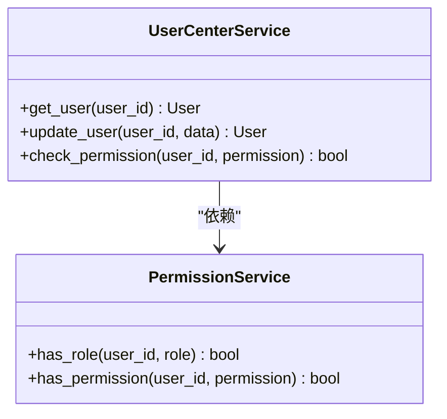
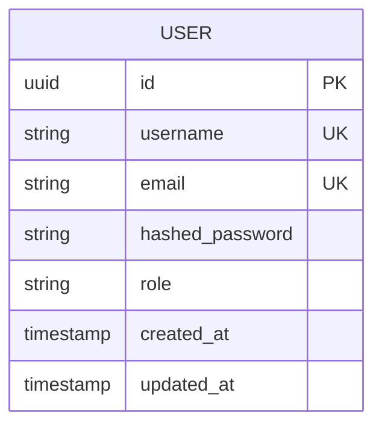
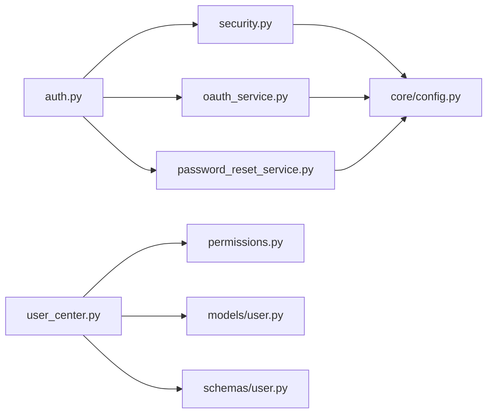

# 用户认证API

<cite>
**本文档引用的文件**   
- [backend/app/api/v1/auth.py](file://backend/app/api/v1/auth.py)
- [backend/app/core/security.py](file://backend/app/core/security.py)
- [backend/app/services/oauth_service.py](file://backend/app/services/oauth_service.py)
- [backend/app/services/password_reset_service.py](file://backend/app/services/password_reset_service.py)
- [backend/app/models/user.py](file://backend/app/models/user.py)
- [backend/app/schemas/user.py](file://backend/app/schemas/user.py)
- [backend/app/core/config.py](file://backend/app/core/config.py)
- [backend/app/core/permissions.py](file://backend/app/core/permissions.py)
- [backend/app/api/v1/user_center.py](file://backend/app/api/v1/user_center.py)
- [backend/tests/test_auth_routes.py](file://backend/tests/test_auth_routes.py)
</cite>

## 目录
1. [简介](#简介)
2. [项目结构](#项目结构)
3. [核心组件](#核心组件)
4. [架构总览](#架构总览)
5. [详细组件分析](#详细组件分析)
6. [依赖关系分析](#依赖关系分析)
7. [性能考虑](#性能考虑)
8. [故障排查指南](#故障排查指南)
9. [结论](#结论)
10. [附录](#附录)

## 简介
本文件为用户认证API的完整接口文档，覆盖用户注册、登录、密码重置、第三方登录（OAuth2）等认证相关RESTful端点。文档详细说明JWT令牌机制、会话管理、权限验证的实现方式，提供完整的请求与响应示例（含用户信息格式）、错误处理与安全最佳实践，并解释OAuth2集成、多因素认证（MFA）与账户安全策略。最后给出客户端集成指南与常见问题解决方案。

## 项目结构
认证功能主要分布在以下模块：
- API路由层：定义REST端点与参数校验
- 服务层：封装业务逻辑（OAuth、密码重置、用户中心）
- 安全层：JWT签发与校验、密码哈希、速率限制
- 数据模型与Schema：用户实体、输入输出结构
- 配置与权限：环境变量、角色与权限控制
- 测试：认证流程与边界用例

图表来源
- [backend/app/api/v1/auth.py](file://backend/app/api/v1/auth.py)
- [backend/app/api/v1/user_center.py](file://backend/app/api/v1/user_center.py)
- [backend/app/services/oauth_service.py](file://backend/app/services/oauth_service.py)
- [backend/app/services/password_reset_service.py](file://backend/app/services/password_reset_service.py)
- [backend/app/core/security.py](file://backend/app/core/security.py)
- [backend/app/core/permissions.py](file://backend/app/core/permissions.py)
- [backend/app/models/user.py](file://backend/app/models/user.py)
- [backend/app/schemas/user.py](file://backend/app/schemas/user.py)
- [backend/app/core/config.py](file://backend/app/core/config.py)

章节来源
- [backend/app/api/v1/auth.py](file://backend/app/api/v1/auth.py)
- [backend/app/api/v1/user_center.py](file://backend/app/api/v1/user_center.py)
- [backend/app/services/oauth_service.py](file://backend/app/services/oauth_service.py)
- [backend/app/services/password_reset_service.py](file://backend/app/services/password_reset_service.py)
- [backend/app/core/security.py](file://backend/app/core/security.py)
- [backend/app/core/permissions.py](file://backend/app/core/permissions.py)
- [backend/app/models/user.py](file://backend/app/models/user.py)
- [backend/app/schemas/user.py](file://backend/app/schemas/user.py)
- [backend/app/core/config.py](file://backend/app/core/config.py)

## 核心组件
- 认证路由（auth.py）：暴露注册、登录、登出、刷新令牌、密码重置、第三方授权等端点
- 安全模块（security.py）：JWT签发与校验、密码哈希、速率限制、令牌黑名单（可选）
- OAuth服务（oauth_service.py）：对接第三方平台（如微信、Google、GitHub），处理授权码交换与用户信息拉取
- 密码重置服务（password_reset_service.py）：生成重置令牌、邮件发送、令牌校验与密码更新
- 用户中心（user_center.py）：用户信息查询、资料更新、权限校验
- 用户模型与Schema（models/user.py, schemas/user.py）：用户字段定义、输入校验规则
- 配置与权限（core/config.py, core/permissions.py）：JWT密钥、过期时间、第三方凭据、RBAC策略

章节来源
- [backend/app/api/v1/auth.py](file://backend/app/api/v1/auth.py)
- [backend/app/core/security.py](file://backend/app/core/security.py)
- [backend/app/services/oauth_service.py](file://backend/app/services/oauth_service.py)
- [backend/app/services/password_reset_service.py](file://backend/app/services/password_reset_service.py)
- [backend/app/api/v1/user_center.py](file://backend/app/api/v1/user_center.py)
- [backend/app/models/user.py](file://backend/app/models/user.py)
- [backend/app/schemas/user.py](file://backend/app/schemas/user.py)
- [backend/app/core/config.py](file://backend/app/core/config.py)
- [backend/app/core/permissions.py](file://backend/app/core/permissions.py)

## 架构总览
认证流程采用“无状态JWT + 可选会话”的混合模式：
- 登录成功后返回访问令牌（access_token）与刷新令牌（refresh_token）
- 后续请求通过Authorization头携带JWT进行身份验证
- 敏感操作可结合RBAC权限校验
- 第三方登录通过OAuth2授权码流程完成

图表来源
- [backend/app/api/v1/auth.py](file://backend/app/api/v1/auth.py)
- [backend/app/core/security.py](file://backend/app/core/security.py)
- [backend/app/services/oauth_service.py](file://backend/app/services/oauth_service.py)
- [backend/app/services/password_reset_service.py](file://backend/app/services/password_reset_service.py)
- [backend/app/models/user.py](file://backend/app/models/user.py)

## 详细组件分析

### 认证路由（auth.py）
- 注册：POST /api/v1/auth/register
  - 请求体包含用户名、邮箱、密码等
  - 响应返回用户基本信息与JWT令牌
- 登录：POST /api/v1/auth/login
  - 请求体包含用户名/邮箱与密码
  - 响应返回access_token与refresh_token
- 登出：POST /api/v1/auth/logout
  - 支持本地会话清理或令牌黑名单
- 刷新令牌：POST /api/v1/auth/token/refresh
  - 使用refresh_token换取新的access_token
- 第三方登录：GET/POST /api/v1/auth/oauth/{provider}/authorize 与 /callback
  - 支持微信、Google、GitHub等
- 密码重置：POST /api/v1/auth/password/reset/request 与 /confirm

图表来源
- [backend/app/api/v1/auth.py](file://backend/app/api/v1/auth.py)

章节来源
- [backend/app/api/v1/auth.py](file://backend/app/api/v1/auth.py)

### 安全模块（security.py）
- JWT签发与校验：
  - access_token短时效，refresh_token长时效
  - 支持自定义载荷（用户ID、角色、权限）
- 密码哈希：
  - 使用强哈希算法（如bcrypt/argon2）
- 速率限制：
  - 对登录、注册、密码重置等接口限流
- 令牌黑名单（可选）：
  - 登出时将access_token加入黑名单

图表来源
- [backend/app/core/security.py](file://backend/app/core/security.py)

章节来源
- [backend/app/core/security.py](file://backend/app/core/security.py)

### OAuth服务（oauth_service.py）
- 支持的提供商：微信、Google、GitHub等
- 授权流程：
  - 生成授权链接（authorize）
  - 回调处理（callback）交换code为access_token
  - 拉取第三方用户信息并绑定本地用户
- 错误处理：
  - 网络异常、授权失败、用户信息缺失

图表来源
- [backend/app/services/oauth_service.py](file://backend/app/services/oauth_service.py)
- [backend/app/api/v1/auth.py](file://backend/app/api/v1/auth.py)

章节来源
- [backend/app/services/oauth_service.py](file://backend/app/services/oauth_service.py)

### 密码重置服务（password_reset_service.py）
- 生成重置令牌：
  - 令牌有时效性（如15分钟）
  - 与用户邮箱绑定
- 邮件发送：
  - 包含重置链接与验证码
- 令牌校验与密码更新：
  - 校验令牌有效性
  - 更新密码并失效旧令牌

图表来源
- [backend/app/services/password_reset_service.py](file://backend/app/services/password_reset_service.py)

章节来源
- [backend/app/services/password_reset_service.py](file://backend/app/services/password_reset_service.py)

### 用户中心（user_center.py）
- 获取用户信息：GET /api/v1/user/me
- 更新用户资料：PUT /api/v1/user/me
- 权限校验：基于RBAC的角色与权限控制

图表来源
- [backend/app/api/v1/user_center.py](file://backend/app/api/v1/user_center.py)
- [backend/app/core/permissions.py](file://backend/app/core/permissions.py)

章节来源
- [backend/app/api/v1/user_center.py](file://backend/app/api/v1/user_center.py)
- [backend/app/core/permissions.py](file://backend/app/core/permissions.py)

### 用户模型与Schema（models/user.py, schemas/user.py）
- 用户模型字段：id、username、email、hashed_password、role、created_at、updated_at等
- Schema校验规则：必填字段、长度限制、邮箱格式、密码强度

图表来源
- [backend/app/models/user.py](file://backend/app/models/user.py)
- [backend/app/schemas/user.py](file://backend/app/schemas/user.py)

章节来源
- [backend/app/models/user.py](file://backend/app/models/user.py)
- [backend/app/schemas/user.py](file://backend/app/schemas/user.py)

### 配置与权限（core/config.py, core/permissions.py）
- JWT配置：密钥、算法、过期时间
- 第三方OAuth配置：客户端ID、密钥、回调地址
- RBAC策略：角色定义、权限映射

章节来源
- [backend/app/core/config.py](file://backend/app/core/config.py)
- [backend/app/core/permissions.py](file://backend/app/core/permissions.py)

## 依赖关系分析
认证模块依赖关系如下：
- auth.py依赖security.py、oauth_service.py、password_reset_service.py
- user_center.py依赖permissions.py、models/user.py、schemas/user.py
- security.py依赖config.py
- oauth_service.py依赖config.py与外部OAuth提供商
- password_reset_service.py依赖config.py与邮件服务

图表来源
- [backend/app/api/v1/auth.py](file://backend/app/api/v1/auth.py)
- [backend/app/core/security.py](file://backend/app/core/security.py)
- [backend/app/services/oauth_service.py](file://backend/app/services/oauth_service.py)
- [backend/app/services/password_reset_service.py](file://backend/app/services/password_reset_service.py)
- [backend/app/api/v1/user_center.py](file://backend/app/api/v1/user_center.py)
- [backend/app/core/permissions.py](file://backend/app/core/permissions.py)
- [backend/app/models/user.py](file://backend/app/models/user.py)
- [backend/app/schemas/user.py](file://backend/app/schemas/user.py)
- [backend/app/core/config.py](file://backend/app/core/config.py)

章节来源
- [backend/app/api/v1/auth.py](file://backend/app/api/v1/auth.py)
- [backend/app/core/security.py](file://backend/app/core/security.py)
- [backend/app/services/oauth_service.py](file://backend/app/services/oauth_service.py)
- [backend/app/services/password_reset_service.py](file://backend/app/services/password_reset_service.py)
- [backend/app/api/v1/user_center.py](file://backend/app/api/v1/user_center.py)
- [backend/app/core/permissions.py](file://backend/app/core/permissions.py)
- [backend/app/models/user.py](file://backend/app/models/user.py)
- [backend/app/schemas/user.py](file://backend/app/schemas/user.py)
- [backend/app/core/config.py](file://backend/app/core/config.py)

## 性能考虑
- JWT无状态验证：避免每次请求查询数据库，提升性能
- 令牌缓存：可将常用用户信息缓存至Redis
- 速率限制：防止暴力破解与滥用
- 异步任务：密码重置邮件发送使用异步队列
- 连接池：数据库与外部API调用使用连接池优化

## 故障排查指南
- 登录失败：
  - 检查用户名/密码是否正确
  - 查看速率限制是否触发
  - 检查日志中的错误码
- 令牌无效：
  - 确认令牌未过期
  - 检查Authorization头格式
  - 查看令牌黑名单
- OAuth失败：
  - 检查第三方配置（客户端ID、密钥）
  - 确认回调地址正确
  - 查看第三方平台错误响应
- 密码重置失败：
  - 检查邮箱是否正确
  - 确认重置令牌未过期
  - 查看邮件服务状态

章节来源
- [backend/tests/test_auth_routes.py](file://backend/tests/test_auth_routes.py)

## 结论
本认证API采用JWT无状态令牌机制，结合OAuth2第三方登录与密码重置功能，提供完整的用户认证解决方案。通过RBAC权限控制与速率限制保障安全性，支持高并发与可扩展性。建议在生产环境中启用HTTPS、严格配置JWT密钥与第三方凭据，并监控关键指标以保障系统稳定性。

## 附录

### RESTful端点清单
- 注册：POST /api/v1/auth/register
- 登录：POST /api/v1/auth/login
- 登出：POST /api/v1/auth/logout
- 刷新令牌：POST /api/v1/auth/token/refresh
- 第三方授权：GET /api/v1/auth/oauth/{provider}/authorize
- 第三方回调：GET /api/v1/auth/oauth/{provider}/callback
- 密码重置请求：POST /api/v1/auth/password/reset/request
- 密码重置确认：POST /api/v1/auth/password/reset/confirm
- 获取用户信息：GET /api/v1/user/me
- 更新用户资料：PUT /api/v1/user/me

### 请求与响应示例
- 注册请求：
  - 请求体：{username, email, password}
  - 响应：{user, access_token, refresh_token}
- 登录请求：
  - 请求体：{username_or_email, password}
  - 响应：{access_token, refresh_token}
- 第三方登录：
  - 授权链接：https://app.com/api/v1/auth/oauth/{provider}/authorize
  - 回调处理：自动交换令牌并返回JWT
- 密码重置：
  - 请求重置：{email}
  - 确认重置：{token, new_password}

### 错误处理
- 400：请求参数错误
- 401：未认证或令牌无效
- 403：权限不足
- 404：资源不存在
- 422：数据校验失败
- 429：请求过于频繁
- 500：服务器内部错误

### 安全最佳实践
- 使用HTTPS传输
- 设置合理的JWT过期时间
- 实现令牌黑名单机制
- 启用速率限制
- 使用强密码策略
- 定期轮换密钥
- 记录安全审计日志

### 客户端集成指南
- 存储令牌：建议使用安全存储（如HttpOnly Cookie或安全存储）
- 自动刷新：在access_token过期前使用refresh_token刷新
- 错误处理：根据HTTP状态码处理不同错误场景
- 重试机制：对网络错误实施指数退避重试

### 常见问题解决方案
- Q: 令牌为什么无效？
  - A: 检查令牌是否过期、格式是否正确、是否在黑名单中
- Q: 第三方登录失败？
  - A: 检查第三方配置、回调地址、网络连通性
- Q: 密码重置邮件未收到？
  - A: 检查邮箱地址、垃圾邮件箱、邮件服务状态

章节来源
- [backend/app/api/v1/auth.py](file://backend/app/api/v1/auth.py)
- [backend/app/core/security.py](file://backend/app/core/security.py)
- [backend/app/services/oauth_service.py](file://backend/app/services/oauth_service.py)
- [backend/app/services/password_reset_service.py](file://backend/app/services/password_reset_service.py)
- [backend/app/api/v1/user_center.py](file://backend/app/api/v1/user_center.py)
- [backend/app/models/user.py](file://backend/app/models/user.py)
- [backend/app/schemas/user.py](file://backend/app/schemas/user.py)
- [backend/app/core/config.py](file://backend/app/core/config.py)
- [backend/app/core/permissions.py](file://backend/app/core/permissions.py)
- [backend/tests/test_auth_routes.py](file://backend/tests/test_auth_routes.py)