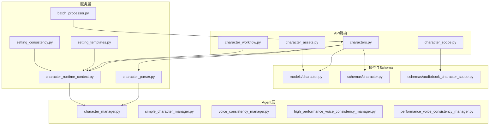
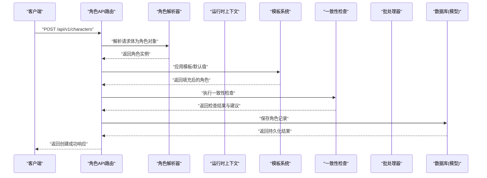
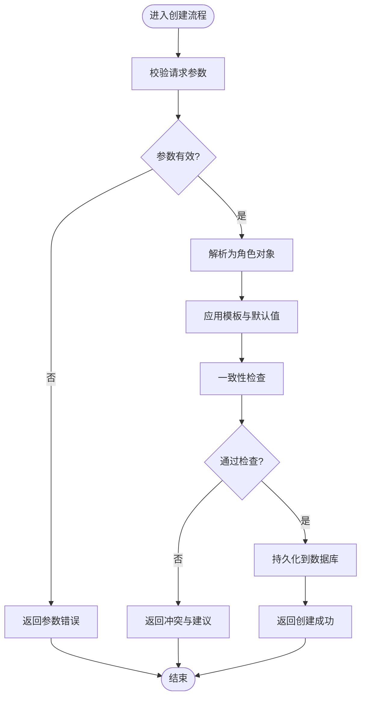
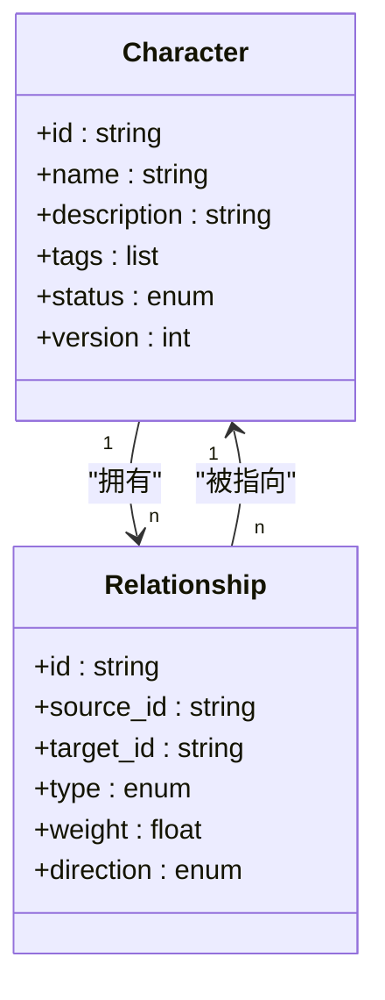
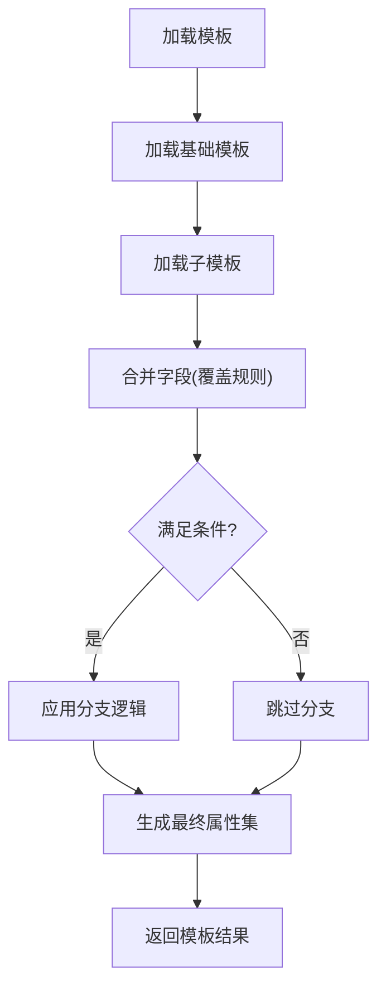
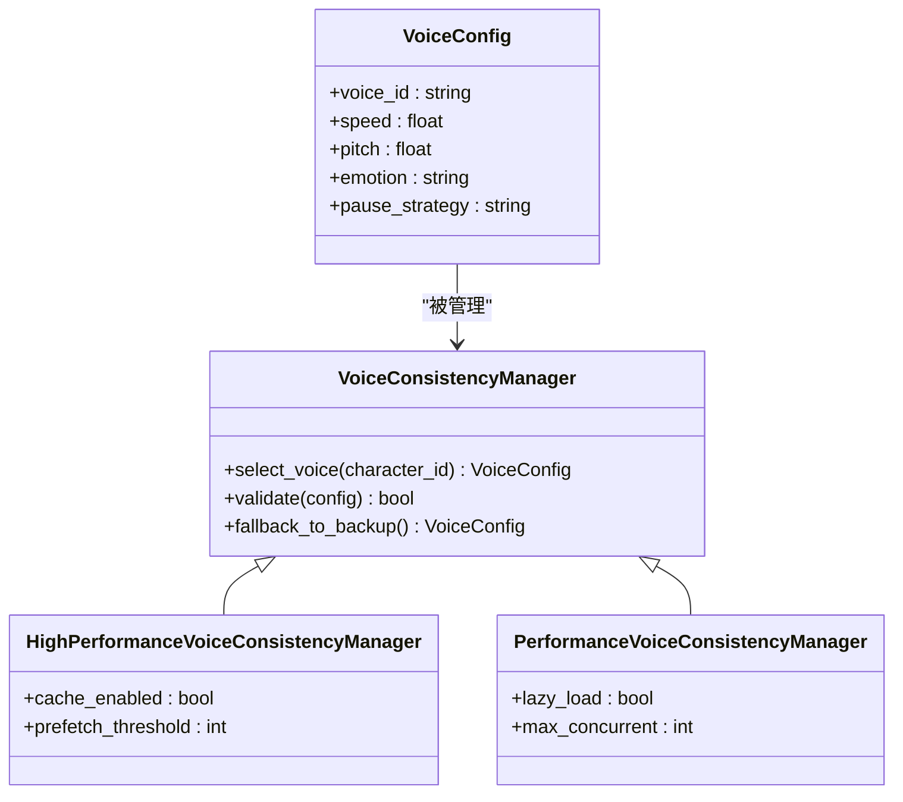
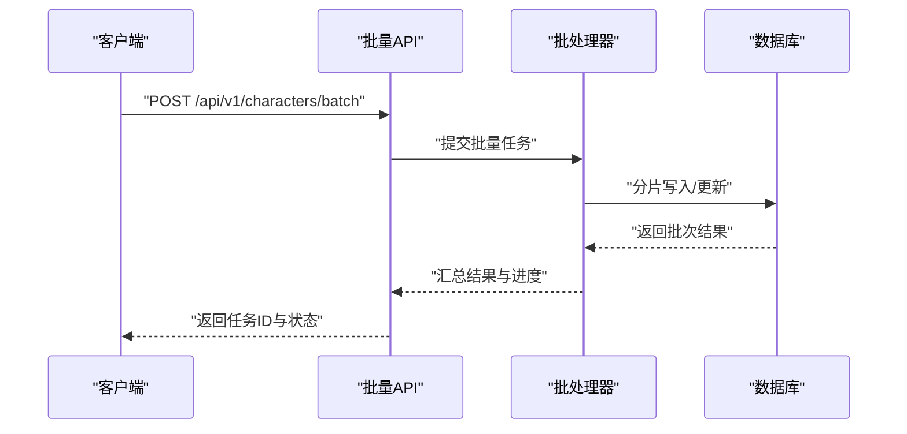
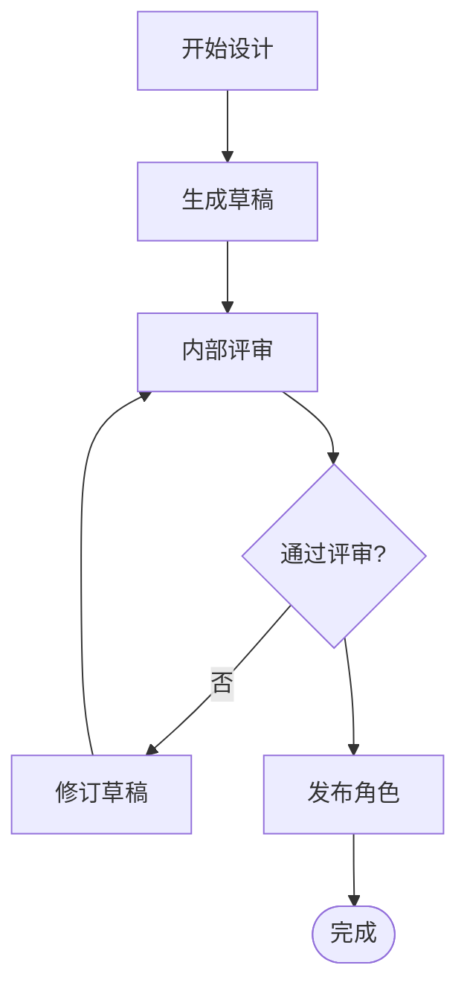
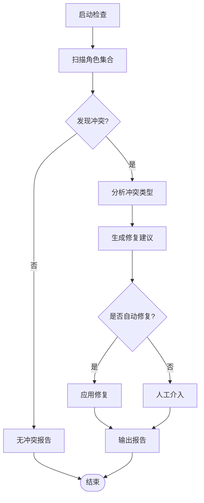
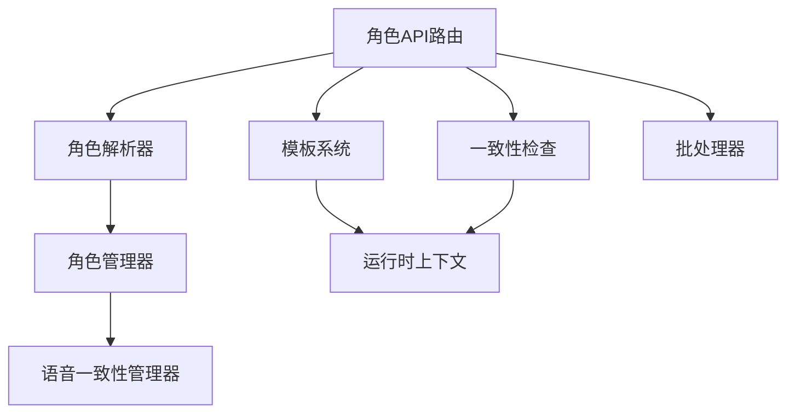

# 角色管理API

<cite>
**本文引用的文件**   
- [backend/app/api/v1/characters.py](file://backend/app/api/v1/characters.py)
- [backend/app/models/character.py](file://backend/app/models/character.py)
- [backend/app/schemas/character.py](file://backend/app/schemas/character.py)
- [backend/app/services/character_parser.py](file://backend/app/services/character_parser.py)
- [backend/app/services/character_runtime_context.py](file://backend/app/services/character_runtime_context.py)
- [backend/app/services/setting_templates.py](file://backend/app/services/setting_templates.py)
- [backend/app/services/setting_consistency.py](file://backend/app/services/setting_consistency.py)
- [backend/app/services/batch_processor.py](file://backend/app/services/batch_processor.py)
- [agents/character_manager.py](file://agents/character_manager.py)
- [agents/simple_character_manager.py](file://agents/simple_character_manager.py)
- [agents/high_performance_voice_consistency_manager.py](file://agents/high_performance_voice_consistency_manager.py)
- [agents/performance_voice_consistency_manager.py](file://agents/performance_voice_consistency_manager.py)
- [agents/voice_consistency_manager.py](file://agents/voice_consistency_manager.py)
- [backend/app/api/v1/audiobook_api/character_scope.py](file://backend/app/api/v1/audiobook_api/character_scope.py)
- [backend/app/schemas/audiobook_character_scope.py](file://backend/app/schemas/audiobook_character_scope.py)
- [backend/app/api/v1/asset_studio_api/character_assets.py](file://backend/app/api/v1/asset_studio_api/character_assets.py)
- [backend/app/api/v1/workflow/character_workflow.py](file://backend/app/api/v1/workflow/character_workflow.py)
</cite>

## 目录
1. [简介](#简介)
2. [项目结构](#项目结构)
3. [核心组件](#核心组件)
4. [架构总览](#架构总览)
5. [详细组件分析](#详细组件分析)
6. [依赖关系分析](#依赖关系分析)
7. [性能考虑](#性能考虑)
8. [故障排查指南](#故障排查指南)
9. [结论](#结论)
10. [附录](#附录)

## 简介
本文件为“角色管理API”的完整接口文档，覆盖角色的创建、编辑、删除、查询等基础操作，以及角色关系管理、属性配置、语音设置等高级能力。同时说明角色数据模型与继承关系、模板系统使用方式、批量操作、导入导出、版本控制、设计工作流、AI辅助生成与智能推荐、一致性检查与冲突解决机制等。读者可据此快速集成前端或外部系统，并高效完成角色全生命周期管理。

## 项目结构
围绕角色管理的代码主要分布在以下位置：
- API路由层：定义HTTP端点与请求响应契约
- 数据模型层：数据库表结构与字段定义
- Schema层：Pydantic校验与序列化规范
- 服务层：解析、上下文构建、模板、一致性检查、批处理等
- Agent层：角色管理与语音一致性策略
- 工作流与资产：角色在工作流中的编排与素材管理

图表来源 
- [backend/app/api/v1/characters.py](file://backend/app/api/v1/characters.py)
- [backend/app/models/character.py](file://backend/app/models/character.py)
- [backend/app/schemas/character.py](file://backend/app/schemas/character.py)
- [backend/app/services/character_parser.py](file://backend/app/services/character_parser.py)
- [backend/app/services/character_runtime_context.py](file://backend/app/services/character_runtime_context.py)
- [backend/app/services/setting_templates.py](file://backend/app/services/setting_templates.py)
- [backend/app/services/setting_consistency.py](file://backend/app/services/setting_consistency.py)
- [backend/app/services/batch_processor.py](file://backend/app/services/batch_processor.py)
- [agents/character_manager.py](file://agents/character_manager.py)
- [agents/simple_character_manager.py](file://agents/simple_character_manager.py)
- [agents/voice_consistency_manager.py](file://agents/voice_consistency_manager.py)
- [agents/high_performance_voice_consistency_manager.py](file://agents/high_performance_voice_consistency_manager.py)
- [agents/performance_voice_consistency_manager.py](file://agents/performance_voice_consistency_manager.py)

章节来源
- [backend/app/api/v1/characters.py](file://backend/app/api/v1/characters.py)
- [backend/app/models/character.py](file://backend/app/models/character.py)
- [backend/app/schemas/character.py](file://backend/app/schemas/character.py)

## 核心组件
- 角色数据模型：定义角色的核心字段（名称、描述、标签、分类、状态、版本、关联资产等）及继承关系（如通用角色、有声书角色、项目内角色等）。
- Schema校验：统一输入输出格式，确保必填项、枚举值、长度限制、JSON结构等约束。
- 角色解析器：将文本/结构化输入解析为角色对象，支持模板填充与默认值合并。
- 运行时上下文：在生成过程中注入角色信息（台词风格、称谓、关系图谱片段），保证一致性。
- 模板系统：提供角色模板与属性模板，支持继承、覆盖与条件渲染。
- 一致性检查：跨角色、跨章节的一致性校验与冲突检测，支持自动修复建议。
- 批处理器：批量创建、更新、导入导出任务的分片执行与进度跟踪。
- 语音一致性管理器：多策略实现（高性能、性能优化、轻量版），保障同一角色在不同场景下的音色一致。

章节来源
- [backend/app/models/character.py](file://backend/app/models/character.py)
- [backend/app/schemas/character.py](file://backend/app/schemas/character.py)
- [backend/app/services/character_parser.py](file://backend/app/services/character_parser.py)
- [backend/app/services/character_runtime_context.py](file://backend/app/services/character_runtime_context.py)
- [backend/app/services/setting_templates.py](file://backend/app/services/setting_templates.py)
- [backend/app/services/setting_consistency.py](file://backend/app/services/setting_consistency.py)
- [backend/app/services/batch_processor.py](file://backend/app/services/batch_processor.py)
- [agents/voice_consistency_manager.py](file://agents/voice_consistency_manager.py)
- [agents/high_performance_voice_consistency_manager.py](file://agents/high_performance_voice_consistency_manager.py)
- [agents/performance_voice_consistency_manager.py](file://agents/performance_voice_consistency_manager.py)

## 架构总览
角色管理API采用分层架构：API路由接收请求，调用服务层进行解析、校验、模板应用、一致性检查与批处理；服务层通过Agent层协调角色管理与语音一致性；数据持久化由模型层负责。

图表来源 
- [backend/app/api/v1/characters.py](file://backend/app/api/v1/characters.py)
- [backend/app/services/character_parser.py](file://backend/app/services/character_parser.py)
- [backend/app/services/character_runtime_context.py](file://backend/app/services/character_runtime_context.py)
- [backend/app/services/setting_templates.py](file://backend/app/services/setting_templates.py)
- [backend/app/services/setting_consistency.py](file://backend/app/services/setting_consistency.py)
- [backend/app/models/character.py](file://backend/app/models/character.py)

## 详细组件分析

### 角色基础CRUD接口
- 创建角色：支持单条与批量创建，包含必填字段校验、模板应用、一致性预检。
- 查询角色：按项目、标签、状态、版本过滤，支持分页与排序。
- 更新角色：支持增量更新与全量替换，保留版本历史。
- 删除角色：软删除标记，支持恢复与级联清理。

图表来源 
- [backend/app/api/v1/characters.py](file://backend/app/api/v1/characters.py)
- [backend/app/services/character_parser.py](file://backend/app/services/character_parser.py)
- [backend/app/services/setting_templates.py](file://backend/app/services/setting_templates.py)
- [backend/app/services/setting_consistency.py](file://backend/app/services/setting_consistency.py)

章节来源
- [backend/app/api/v1/characters.py](file://backend/app/api/v1/characters.py)
- [backend/app/schemas/character.py](file://backend/app/schemas/character.py)

### 角色关系管理
- 关系类型：父子、师徒、敌对、盟友、亲属等，支持权重与方向性。
- 关系维护：添加、移除、更新关系，支持批量操作与事务回滚。
- 关系查询：按角色、关系类型、项目范围检索，支持图谱视图。

图表来源 
- [backend/app/models/character.py](file://backend/app/models/character.py)
- [backend/app/api/v1/characters.py](file://backend/app/api/v1/characters.py)

章节来源
- [backend/app/api/v1/characters.py](file://backend/app/api/v1/characters.py)
- [backend/app/models/character.py](file://backend/app/models/character.py)

### 属性配置与模板系统
- 属性分类：基础属性、叙事属性、技术属性（TTS参数）、扩展属性。
- 模板继承：父模板定义公共字段，子模板覆盖与扩展。
- 条件渲染：根据项目、章节、角色类型动态选择模板分支。

图表来源 
- [backend/app/services/setting_templates.py](file://backend/app/services/setting_templates.py)
- [backend/app/schemas/character.py](file://backend/app/schemas/character.py)

章节来源
- [backend/app/services/setting_templates.py](file://backend/app/services/setting_templates.py)
- [backend/app/schemas/character.py](file://backend/app/schemas/character.py)

### 语音设置与一致性
- 语音配置：音色ID、语速、语调、情感、停顿策略。
- 一致性策略：高性能模式（缓存+预取）、性能优化模式（按需加载）、轻量模式（最小开销）。
- 验证与回退：失败重试、降级到备用音色、日志追踪。

图表来源 
- [agents/voice_consistency_manager.py](file://agents/voice_consistency_manager.py)
- [agents/high_performance_voice_consistency_manager.py](file://agents/high_performance_voice_consistency_manager.py)
- [agents/performance_voice_consistency_manager.py](file://agents/performance_voice_consistency_manager.py)

章节来源
- [agents/voice_consistency_manager.py](file://agents/voice_consistency_manager.py)
- [agents/high_performance_voice_consistency_manager.py](file://agents/high_performance_voice_consistency_manager.py)
- [agents/performance_voice_consistency_manager.py](file://agents/performance_voice_consistency_manager.py)

### 角色批量操作、导入导出与版本控制
- 批量操作：分片执行、并发控制、失败重试、进度回调。
- 导入导出：CSV/JSON格式，字段映射、校验、冲突处理。
- 版本控制：每次变更生成新版本，支持回滚与差异对比。

图表来源 
- [backend/app/api/v1/characters.py](file://backend/app/api/v1/characters.py)
- [backend/app/services/batch_processor.py](file://backend/app/services/batch_processor.py)

章节来源
- [backend/app/api/v1/characters.py](file://backend/app/api/v1/characters.py)
- [backend/app/services/batch_processor.py](file://backend/app/services/batch_processor.py)

### 角色设计工作流、AI辅助生成与智能推荐
- 工作流：草稿→评审→定稿→发布，支持阶段内容保存与回滚。
- AI辅助：基于提示词生成角色描述、关系建议、属性补全。
- 智能推荐：根据项目主题、已有角色推荐新角色模板与属性。

图表来源 
- [backend/app/api/v1/workflow/character_workflow.py](file://backend/app/api/v1/workflow/character_workflow.py)
- [backend/app/services/character_parser.py](file://backend/app/services/character_parser.py)

章节来源
- [backend/app/api/v1/workflow/character_workflow.py](file://backend/app/api/v1/workflow/character_workflow.py)
- [backend/app/services/character_parser.py](file://backend/app/services/character_parser.py)

### 角色一致性检查与冲突解决
- 检查维度：名称唯一性、关系环检测、属性冲突、语音冲突。
- 冲突解决：自动修复建议、人工确认、回滚到上一版本。
- 报告输出：冲突列表、影响范围、修复步骤。

图表来源 
- [backend/app/services/setting_consistency.py](file://backend/app/services/setting_consistency.py)
- [backend/app/services/character_runtime_context.py](file://backend/app/services/character_runtime_context.py)

章节来源
- [backend/app/services/setting_consistency.py](file://backend/app/services/setting_consistency.py)
- [backend/app/services/character_runtime_context.py](file://backend/app/services/character_runtime_context.py)

### 角色资产与工作流集成
- 资产绑定：角色与图片、音频、视频素材关联，支持版本化。
- 工作流节点：在故事板、分镜、配音等环节引用角色。
- 同步机制：资产变更触发角色上下文刷新。

章节来源
- [backend/app/api/v1/asset_studio_api/character_assets.py](file://backend/app/api/v1/asset_studio_api/character_assets.py)
- [backend/app/api/v1/workflow/character_workflow.py](file://backend/app/api/v1/workflow/character_workflow.py)

## 依赖关系分析
角色管理API依赖多个服务与Agent模块，形成清晰的职责边界与松耦合结构。

图表来源 
- [backend/app/api/v1/characters.py](file://backend/app/api/v1/characters.py)
- [backend/app/services/character_parser.py](file://backend/app/services/character_parser.py)
- [backend/app/services/setting_templates.py](file://backend/app/services/setting_templates.py)
- [backend/app/services/setting_consistency.py](file://backend/app/services/setting_consistency.py)
- [backend/app/services/batch_processor.py](file://backend/app/services/batch_processor.py)
- [backend/app/services/character_runtime_context.py](file://backend/app/services/character_runtime_context.py)
- [agents/character_manager.py](file://agents/character_manager.py)
- [agents/voice_consistency_manager.py](file://agents/voice_consistency_manager.py)

章节来源
- [backend/app/api/v1/characters.py](file://backend/app/api/v1/characters.py)
- [backend/app/services/character_parser.py](file://backend/app/services/character_parser.py)
- [backend/app/services/setting_templates.py](file://backend/app/services/setting_templates.py)
- [backend/app/services/setting_consistency.py](file://backend/app/services/setting_consistency.py)
- [backend/app/services/batch_processor.py](file://backend/app/services/batch_processor.py)
- [backend/app/services/character_runtime_context.py](file://backend/app/services/character_runtime_context.py)
- [agents/character_manager.py](file://agents/character_manager.py)
- [agents/voice_consistency_manager.py](file://agents/voice_consistency_manager.py)

## 性能考虑
- 批处理分片：大任务拆分为小批次，降低内存占用与超时风险。
- 缓存策略：高频模板与语音配置缓存，减少重复计算与I/O。
- 并发控制：限制并行度，避免资源争用与数据库锁竞争。
- 懒加载：按需加载大型资产与上下文，提升首屏响应速度。
- 监控与告警：关键路径埋点，异常阈值告警与自动回滚。

[本节为通用指导，不直接分析具体文件]

## 故障排查指南
- 参数校验失败：检查Schema定义与必填字段，核对枚举值与长度限制。
- 模板应用错误：确认模板存在且语法正确，检查覆盖规则与条件分支。
- 一致性冲突：查看冲突报告，按建议修复或手动调整。
- 语音不一致：检查音色ID有效性、缓存命中情况与降级策略。
- 批处理失败：定位失败批次，检查重试次数与错误日志。

章节来源
- [backend/app/schemas/character.py](file://backend/app/schemas/character.py)
- [backend/app/services/setting_templates.py](file://backend/app/services/setting_templates.py)
- [backend/app/services/setting_consistency.py](file://backend/app/services/setting_consistency.py)
- [agents/voice_consistency_manager.py](file://agents/voice_consistency_manager.py)
- [backend/app/services/batch_processor.py](file://backend/app/services/batch_processor.py)

## 结论
角色管理API提供了完整的角色生命周期管理能力，涵盖基础CRUD、关系管理、属性模板、语音一致性、批量操作、导入导出、版本控制、工作流集成、AI辅助与一致性检查。通过分层架构与模块化设计，系统具备良好的可扩展性与可维护性，适合复杂创作场景下的角色治理需求。

[本节为总结性内容，不直接分析具体文件]

## 附录
- 相关API端点参考：
  - 角色基础操作：见[backend/app/api/v1/characters.py](file://backend/app/api/v1/characters.py)
  - 角色关系与范围：见[backend/app/api/v1/audiobook_api/character_scope.py](file://backend/app/api/v1/audiobook_api/character_scope.py)
  - 角色资产绑定：见[backend/app/api/v1/asset_studio_api/character_assets.py](file://backend/app/api/v1/asset_studio_api/character_assets.py)
  - 角色工作流：见[backend/app/api/v1/workflow/character_workflow.py](file://backend/app/api/v1/workflow/character_workflow.py)
- 数据模型与Schema：
  - 角色模型：见[backend/app/models/character.py](file://backend/app/models/character.py)
  - 角色Schema：见[backend/app/schemas/character.py](file://backend/app/schemas/character.py)
  - 有声书角色范围Schema：见[backend/app/schemas/audiobook_character_scope.py](file://backend/app/schemas/audiobook_character_scope.py)
- 服务与Agent：
  - 角色解析器：见[backend/app/services/character_parser.py](file://backend/app/services/character_parser.py)
  - 运行时上下文：见[backend/app/services/character_runtime_context.py](file://backend/app/services/character_runtime_context.py)
  - 模板系统：见[backend/app/services/setting_templates.py](file://backend/app/services/setting_templates.py)
  - 一致性检查：见[backend/app/services/setting_consistency.py](file://backend/app/services/setting_consistency.py)
  - 批处理器：见[backend/app/services/batch_processor.py](file://backend/app/services/batch_processor.py)
  - 角色管理器：见[agents/character_manager.py](file://agents/character_manager.py)、[agents/simple_character_manager.py](file://agents/simple_character_manager.py)
  - 语音一致性管理器：见[agents/voice_consistency_manager.py](file://agents/voice_consistency_manager.py)、[agents/high_performance_voice_consistency_manager.py](file://agents/high_performance_voice_consistency_manager.py)、[agents/performance_voice_consistency_manager.py](file://agents/performance_voice_consistency_manager.py)