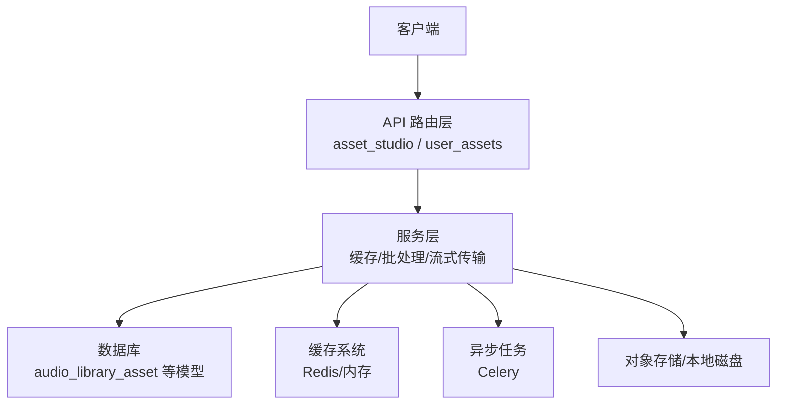
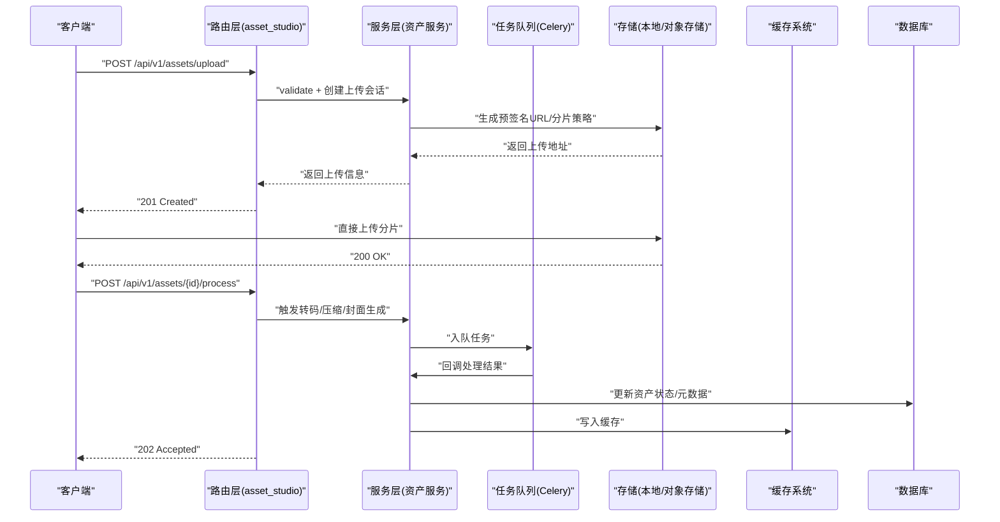
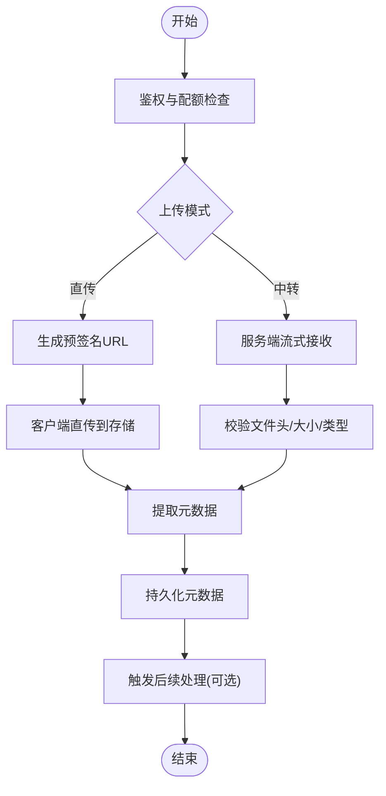
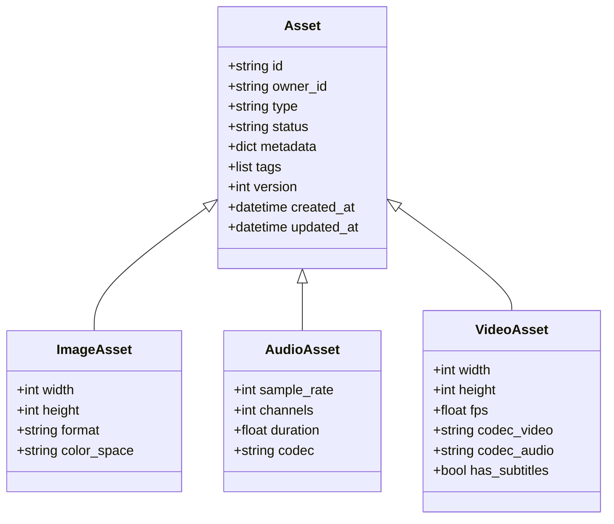
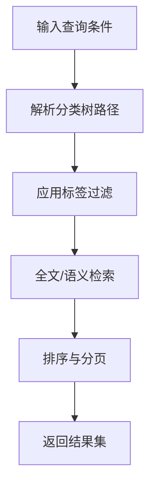
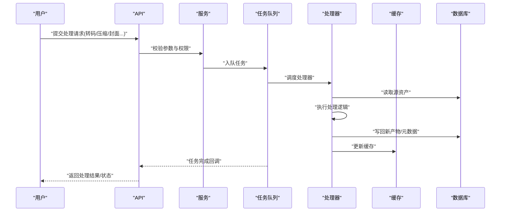
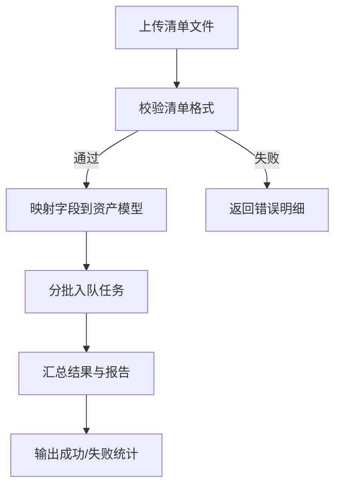
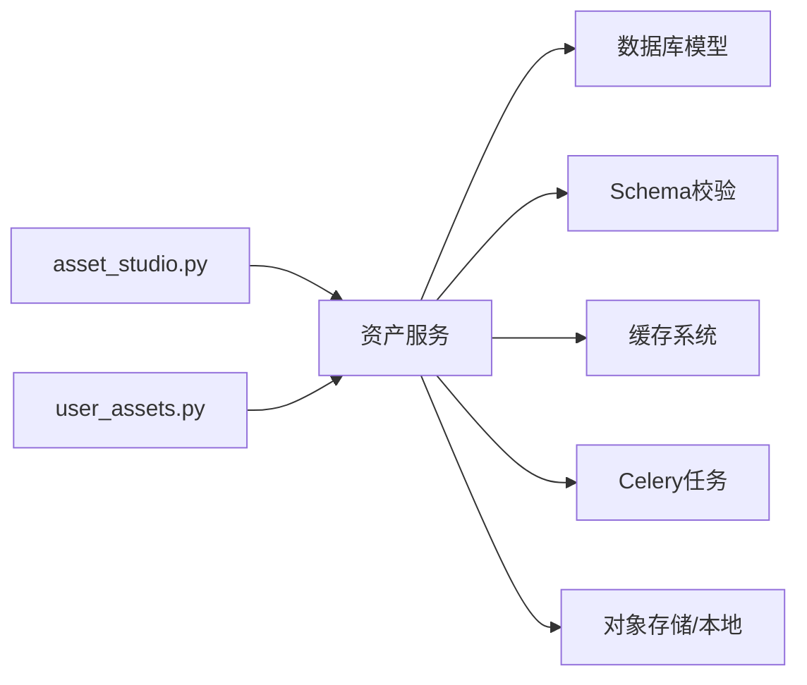

# 资产库API

<cite>
**本文引用的文件**   
- [backend/app/api/v1/asset_studio.py](file://backend/app/api/v1/asset_studio.py)
- [backend/app/api/v1/asset_studio_api/__init__.py](file://backend/app/api/v1/asset_studio_api/__init__.py)
- [backend/app/api/v1/user_assets.py](file://backend/app/api/v1/user_assets.py)
- [backend/app/models/audio_library_asset.py](file://backend/app/models/audio_library_asset.py)
- [backend/app/schemas/user_asset.py](file://backend/app/schemas/user_asset.py)
- [backend/app/services/cache_system.py](file://backend/app/services/cache_system.py)
- [backend/app/core/config.py](file://backend/app/core/config.py)
- [backend/app/celery_app.py](file://backend/app/celery_app.py)
- [backend/data/audio_library/sound_effects/index.jsonl](file://backend/data/audio_library/sound_effects/index.jsonl)
- [backend/data/audio_library/approved_sfx/index.jsonl](file://backend/data/audio_library/approved_sfx/index.jsonl)
- [backend/app/services/batch_processor.py](file://backend/app/services/batch_processor.py)
- [backend/app/services/streaming_service.py](file://backend/app/services/streaming_service.py)
- [backend/app/services/rate_limit_handler.py](file://backend/app/services/rate_limit_handler.py)
- [backend/app/utils/api_errors.py](file://backend/app/utils/api_errors.py)
- [backend/app/db/base.py](file://backend/app/db/base.py)
- [backend/app/db/schema_compat.py](file://backend/app/db/schema_compat.py)
- [backend/app/api/v1/auth.py](file://backend/app/api/v1/auth.py)
</cite>

## 目录
1. [简介](#简介)
2. [项目结构](#项目结构)
3. [核心组件](#核心组件)
4. [架构总览](#架构总览)
5. [详细组件分析](#详细组件分析)
6. [依赖关系分析](#依赖关系分析)
7. [性能与缓存](#性能与缓存)
8. [故障排查指南](#故障排查指南)
9. [结论](#结论)
10. [附录：接口清单与示例](#附录接口清单与示例)

## 简介
本文件为“资产库API”的完整接口文档，覆盖文件上传下载、媒体资源管理、资产分类与标签、搜索与预览、格式转换与压缩、批量操作、元数据管理、版本控制与协作共享等能力。同时说明图像、音频、视频等不同类型资产的专用接口与处理流程，并给出存储策略、缓存机制与性能优化建议。

## 项目结构
后端采用分层架构：路由层（FastAPI）→ 服务层 → 模型/数据库 → 任务队列与缓存。资产库相关的路由集中在 v1 下的 asset_studio 与 user_assets 模块；数据模型与 Schema 分别位于 models 与 schemas；缓存与流式传输在 services 中实现；配置与认证在 core 与 api 下提供。

图表来源
- [backend/app/api/v1/asset_studio.py](file://backend/app/api/v1/asset_studio.py)
- [backend/app/api/v1/user_assets.py](file://backend/app/api/v1/user_assets.py)
- [backend/app/services/cache_system.py](file://backend/app/services/cache_system.py)
- [backend/app/celery_app.py](file://backend/app/celery_app.py)

章节来源
- [backend/app/api/v1/asset_studio.py](file://backend/app/api/v1/asset_studio.py)
- [backend/app/api/v1/user_assets.py](file://backend/app/api/v1/user_assets.py)
- [backend/app/core/config.py](file://backend/app/core/config.py)

## 核心组件
- 资产路由与控制器：负责接收请求、参数校验、权限检查、调用服务层。
- 资产模型与Schema：定义资产元数据、分类、标签、版本、状态等字段与校验规则。
- 存储服务：统一封装本地/云存储读写、分片上传、断点续传、签名直传。
- 缓存系统：热点资产元数据与缩略图/转码产物缓存，降低重复计算与IO。
- 任务队列：异步执行转码、压缩、封面生成、审核、索引构建等耗时任务。
- 流式传输：大文件下载与在线播放的分块流式响应。
- 批处理：批量导入、导出、标签更新、批量转码。
- 鉴权与限流：基于用户/角色的访问控制与速率限制。

章节来源
- [backend/app/api/v1/asset_studio.py](file://backend/app/api/v1/asset_studio.py)
- [backend/app/api/v1/user_assets.py](file://backend/app/api/v1/user_assets.py)
- [backend/app/models/audio_library_asset.py](file://backend/app/models/audio_library_asset.py)
- [backend/app/schemas/user_asset.py](file://backend/app/schemas/user_asset.py)
- [backend/app/services/cache_system.py](file://backend/app/services/cache_system.py)
- [backend/app/celery_app.py](file://backend/app/celery_app.py)
- [backend/app/services/streaming_service.py](file://backend/app/services/streaming_service.py)
- [backend/app/services/batch_processor.py](file://backend/app/services/batch_processor.py)
- [backend/app/services/rate_limit_handler.py](file://backend/app/services/rate_limit_handler.py)

## 架构总览
资产库API遵循“路由-服务-存储/缓存/队列”的分层设计，确保高内聚低耦合与可扩展性。

图表来源
- [backend/app/api/v1/asset_studio.py](file://backend/app/api/v1/asset_studio.py)
- [backend/app/celery_app.py](file://backend/app/celery_app.py)
- [backend/app/services/cache_system.py](file://backend/app/services/cache_system.py)
- [backend/app/models/audio_library_asset.py](file://backend/app/models/audio_library_asset.py)

## 详细组件分析

### 资产上传与下载
- 上传
  - 支持单文件与分片上传，断点续传，并发分片，进度上报。
  - 支持预签名直传（减少服务器压力），或经服务端中转。
  - 上传完成后自动触发元数据提取（尺寸、时长、编码信息等）。
- 下载
  - 支持范围请求（Range）与流式下载，适合大文件与在线播放。
  - 支持CDN加速与签名链接过期控制。

章节来源
- [backend/app/api/v1/asset_studio.py](file://backend/app/api/v1/asset_studio.py)
- [backend/app/services/streaming_service.py](file://backend/app/services/streaming_service.py)
- [backend/app/services/cache_system.py](file://backend/app/services/cache_system.py)

### 媒体资源管理与类型专用接口
- 图像
  - 自动生成缩略图、多种尺寸预览、WebP/AVIF 转换。
  - EXIF 清理、色彩空间标准化、安全扫描。
- 音频
  - 采样率/比特率规范化、响度归一化、静音裁剪。
  - 波形图生成、关键帧抽取、ASR 文本提取（可选）。
- 视频
  - 多码率转码、HLS/DASH 切片、封面帧抽取。
  - 字幕/SRT/VTT 生成与同步、水印添加。

图表来源
- [backend/app/models/audio_library_asset.py](file://backend/app/models/audio_library_asset.py)
- [backend/app/schemas/user_asset.py](file://backend/app/schemas/user_asset.py)

章节来源
- [backend/app/models/audio_library_asset.py](file://backend/app/models/audio_library_asset.py)
- [backend/app/schemas/user_asset.py](file://backend/app/schemas/user_asset.py)

### 资产分类与标签系统
- 分类
  - 支持多级分类树、按项目/用户维度隔离、默认分类模板。
- 标签
  - 支持键值对与自由标签，批量打标签/去标签，标签统计与聚合。
- 检索
  - 组合条件过滤（类型、分类、标签、时间范围、状态）、全文检索、向量语义检索（可选）。

章节来源
- [backend/app/api/v1/asset_studio.py](file://backend/app/api/v1/asset_studio.py)
- [backend/app/schemas/user_asset.py](file://backend/app/schemas/user_asset.py)

### 搜索、预览与处理流水线
- 搜索
  - 关键词、标签、分类、时间、作者、状态等多维筛选。
  - 支持高亮片段与命中摘要。
- 预览
  - 图片缩略图、音频波形、视频首帧/关键帧预览。
  - 在线播放器集成（HLS/DASH/MP3/MP4）。
- 处理
  - 转码、压缩、封面生成、水印、字幕、ASR、OCR、内容安全检测。
  - 任务状态可查询，失败重试与告警。

图表来源
- [backend/app/celery_app.py](file://backend/app/celery_app.py)
- [backend/app/services/cache_system.py](file://backend/app/services/cache_system.py)
- [backend/app/models/audio_library_asset.py](file://backend/app/models/audio_library_asset.py)

章节来源
- [backend/app/api/v1/asset_studio.py](file://backend/app/api/v1/asset_studio.py)
- [backend/app/celery_app.py](file://backend/app/celery_app.py)

### 批量操作
- 批量导入/导出：CSV/JSON 清单驱动，支持映射字段与错误报告。
- 批量标签/分类更新：按条件选择资产，原子更新。
- 批量转码/压缩：按预设策略并行处理，进度与失败重试。

章节来源
- [backend/app/services/batch_processor.py](file://backend/app/services/batch_processor.py)
- [backend/app/api/v1/asset_studio.py](file://backend/app/api/v1/asset_studio.py)

### 元数据管理
- 标准元数据：名称、描述、作者、版权、来源、许可证、时间戳。
- 扩展元数据：自定义键值对、结构化字段（如拍摄设备、场景信息）。
- 版本控制：每次修改生成新版本，保留历史快照与差异对比。

章节来源
- [backend/app/schemas/user_asset.py](file://backend/app/schemas/user_asset.py)
- [backend/app/models/audio_library_asset.py](file://backend/app/models/audio_library_asset.py)

### 版本控制与协作共享
- 版本控制
  - 版本号递增、分支合并、冲突解决、回滚到指定版本。
- 协作共享
  - 项目级可见性、成员角色（查看/编辑/管理）、分享链接与有效期。
  - 审计日志记录访问与变更。

章节来源
- [backend/app/schemas/user_asset.py](file://backend/app/schemas/user_asset.py)
- [backend/app/api/v1/asset_studio.py](file://backend/app/api/v1/asset_studio.py)

### 资产存储策略
- 存储后端
  - 本地磁盘与对象存储（S3/OSS/COS）可切换，按项目/用户分桶/目录组织。
- 生命周期
  - 冷热分层、过期清理、归档与恢复。
- 一致性
  - 事务性写入、幂等上传、完整性校验（哈希）。

章节来源
- [backend/app/core/config.py](file://backend/app/core/config.py)
- [backend/app/db/base.py](file://backend/app/db/base.py)

## 依赖关系分析
- 路由依赖服务：asset_studio/user_assets 路由依赖资产服务、缓存、任务队列。
- 服务依赖数据层：资产服务依赖数据库模型与Schema。
- 外部依赖：对象存储、Redis、Celery、FFmpeg（转码）、ASR/OCR（可选）。

图表来源
- [backend/app/api/v1/asset_studio.py](file://backend/app/api/v1/asset_studio.py)
- [backend/app/api/v1/user_assets.py](file://backend/app/api/v1/user_assets.py)
- [backend/app/models/audio_library_asset.py](file://backend/app/models/audio_library_asset.py)
- [backend/app/schemas/user_asset.py](file://backend/app/schemas/user_asset.py)
- [backend/app/services/cache_system.py](file://backend/app/services/cache_system.py)
- [backend/app/celery_app.py](file://backend/app/celery_app.py)

章节来源
- [backend/app/api/v1/asset_studio.py](file://backend/app/api/v1/asset_studio.py)
- [backend/app/api/v1/user_assets.py](file://backend/app/api/v1/user_assets.py)
- [backend/app/models/audio_library_asset.py](file://backend/app/models/audio_library_asset.py)
- [backend/app/schemas/user_asset.py](file://backend/app/schemas/user_asset.py)
- [backend/app/services/cache_system.py](file://backend/app/services/cache_system.py)
- [backend/app/celery_app.py](file://backend/app/celery_app.py)

## 性能与缓存
- 缓存策略
  - 元数据缓存：热点资产元数据短TTL，避免频繁读库。
  - 产物缓存：缩略图、转码产物、波形图等长TTL，按指纹键命名。
  - 查询缓存：复杂检索结果短期缓存，提升列表页性能。
- 流式处理
  - 大文件下载与在线播放使用分块流式响应，降低内存占用。
- 并发与限流
  - 上传/处理任务并发控制，全局与用户级速率限制。
- 存储优化
  - 分片上传、断点续传、CDN缓存、压缩与格式优选（WebP/AVIF/HLS）。

章节来源
- [backend/app/services/cache_system.py](file://backend/app/services/cache_system.py)
- [backend/app/services/streaming_service.py](file://backend/app/services/streaming_service.py)
- [backend/app/services/rate_limit_handler.py](file://backend/app/services/rate_limit_handler.py)

## 故障排查指南
- 常见问题
  - 上传失败：检查网络、配额、文件大小与类型限制、存储后端连通性。
  - 转码失败：确认输入格式支持、FFmpeg可用性与参数合法性。
  - 缓存不一致：清理对应键或强制刷新，核对缓存键生成规则。
  - 权限错误：验证用户角色与资源可见性策略。
- 诊断步骤
  - 查看任务队列状态与日志，定位失败任务与重试次数。
  - 检查数据库约束与迁移状态，确保Schema一致。
  - 启用调试日志与追踪ID，串联请求链路。

章节来源
- [backend/app/utils/api_errors.py](file://backend/app/utils/api_errors.py)
- [backend/app/celery_app.py](file://backend/app/celery_app.py)
- [backend/app/db/schema_compat.py](file://backend/app/db/schema_compat.py)

## 结论
资产库API以清晰的分层架构与完善的处理能力，支撑图像、音频、视频等多类型资产的上传、管理、处理与分发。通过缓存、流式传输、任务队列与存储策略优化，满足高并发与大文件场景需求。结合分类标签、版本控制与协作共享，形成完整的资产管理闭环。

## 附录：接口清单与示例

### 认证与鉴权
- 登录与令牌获取
  - 方法：POST
  - 路径：/api/v1/auth/login
  - 说明：用户名密码或第三方授权，返回访问令牌与过期时间。
- 刷新令牌
  - 方法：POST
  - 路径：/api/v1/auth/refresh
  - 说明：使用刷新令牌换取新的访问令牌。

章节来源
- [backend/app/api/v1/auth.py](file://backend/app/api/v1/auth.py)

### 资产上传与下载
- 创建上传会话
  - 方法：POST
  - 路径：/api/v1/assets/upload
  - 说明：返回直传URL或分片策略，支持断点续传。
- 上传分片
  - 方法：PUT/Multipart
  - 路径：/api/v1/assets/uploads/{upload_id}/parts
  - 说明：按序上传分片，最后合并完成。
- 下载资产
  - 方法：GET
  - 路径：/api/v1/assets/{id}/download
  - 说明：支持Range与流式下载。

章节来源
- [backend/app/api/v1/asset_studio.py](file://backend/app/api/v1/asset_studio.py)
- [backend/app/services/streaming_service.py](file://backend/app/services/streaming_service.py)

### 媒体资源管理
- 获取资产详情
  - 方法：GET
  - 路径：/api/v1/assets/{id}
  - 说明：返回元数据、状态、版本、标签等。
- 更新元数据
  - 方法：PATCH
  - 路径：/api/v1/assets/{id}
  - 说明：支持部分更新，包含分类、标签、描述等。
- 删除资产
  - 方法：DELETE
  - 路径：/api/v1/assets/{id}
  - 说明：软删除或硬删除，受权限控制。

章节来源
- [backend/app/api/v1/asset_studio.py](file://backend/app/api/v1/asset_studio.py)
- [backend/app/schemas/user_asset.py](file://backend/app/schemas/user_asset.py)

### 资产分类与标签
- 列出分类
  - 方法：GET
  - 路径：/api/v1/categories
  - 说明：返回分类树结构。
- 设置标签
  - 方法：POST
  - 路径：/api/v1/assets/{id}/tags
  - 说明：新增或替换标签集合。
- 批量标签更新
  - 方法：POST
  - 路径：/api/v1/assets/batch/tags
  - 说明：按条件批量更新标签。

章节来源
- [backend/app/api/v1/asset_studio.py](file://backend/app/api/v1/asset_studio.py)
- [backend/app/schemas/user_asset.py](file://backend/app/schemas/user_asset.py)

### 搜索与预览
- 搜索资产
  - 方法：GET
  - 路径：/api/v1/assets/search
  - 说明：支持关键词、标签、分类、时间范围、状态等过滤。
- 获取预览
  - 方法：GET
  - 路径：/api/v1/assets/{id}/preview
  - 说明：返回缩略图/波形/首帧等预览资源。

章节来源
- [backend/app/api/v1/asset_studio.py](file://backend/app/api/v1/asset_studio.py)

### 处理流水线（转码/压缩/封面/字幕）
- 提交处理任务
  - 方法：POST
  - 路径：/api/v1/assets/{id}/process
  - 说明：指定处理类型与参数，返回任务ID。
- 查询任务状态
  - 方法：GET
  - 路径：/api/v1/tasks/{task_id}
  - 说明：返回进度、状态与结果。
- 取消任务
  - 方法：DELETE
  - 路径：/api/v1/tasks/{task_id}
  - 说明：未开始的任务可取消。

章节来源
- [backend/app/celery_app.py](file://backend/app/celery_app.py)
- [backend/app/api/v1/asset_studio.py](file://backend/app/api/v1/asset_studio.py)

### 批量操作
- 批量导入
  - 方法：POST
  - 路径：/api/v1/assets/batch/import
  - 说明：上传清单文件，映射字段，返回导入报告。
- 批量导出
  - 方法：POST
  - 路径：/api/v1/assets/batch/export
  - 说明：按条件导出CSV/JSON。
- 批量转码
  - 方法：POST
  - 路径：/api/v1/assets/batch/process
  - 说明：按预设策略批量处理，返回任务ID。

章节来源
- [backend/app/services/batch_processor.py](file://backend/app/services/batch_processor.py)
- [backend/app/api/v1/asset_studio.py](file://backend/app/api/v1/asset_studio.py)

### 元数据与版本控制
- 创建版本
  - 方法：POST
  - 路径：/api/v1/assets/{id}/versions
  - 说明：基于当前资产创建新版本。
- 回滚版本
  - 方法：POST
  - 路径：/api/v1/assets/{id}/rollback
  - 说明：恢复到指定版本。
- 版本差异
  - 方法：GET
  - 路径：/api/v1/assets/{id}/diff
  - 说明：比较两个版本的元数据差异。

章节来源
- [backend/app/schemas/user_asset.py](file://backend/app/schemas/user_asset.py)
- [backend/app/models/audio_library_asset.py](file://backend/app/models/audio_library_asset.py)

### 协作与共享
- 设置可见性
  - 方法：PATCH
  - 路径：/api/v1/assets/{id}/visibility
  - 说明：设置项目/团队可见性与角色。
- 分享链接
  - 方法：POST
  - 路径：/api/v1/assets/{id}/share
  - 说明：生成带过期时间的分享链接。
- 访问审计
  - 方法：GET
  - 路径：/api/v1/assets/{id}/audit
  - 说明：查看访问与变更记录。

章节来源
- [backend/app/api/v1/asset_studio.py](file://backend/app/api/v1/asset_studio.py)

### 数据模型与Schema要点
- 资产模型字段
  - 标识、所有者、类型、状态、元数据、标签、版本、时间戳。
- Schema校验
  - 必填字段、枚举值、长度限制、正则匹配、嵌套结构校验。

章节来源
- [backend/app/models/audio_library_asset.py](file://backend/app/models/audio_library_asset.py)
- [backend/app/schemas/user_asset.py](file://backend/app/schemas/user_asset.py)

### 存储与索引示例
- 声音效果索引
  - 文件：index.jsonl
  - 用途：记录素材来源、许可、质量评分与检索关键字。

章节来源
- [backend/data/audio_library/sound_effects/index.jsonl](file://backend/data/audio_library/sound_effects/index.jsonl)
- [backend/data/audio_library/approved_sfx/index.jsonl](file://backend/data/audio_library/approved_sfx/index.jsonl)