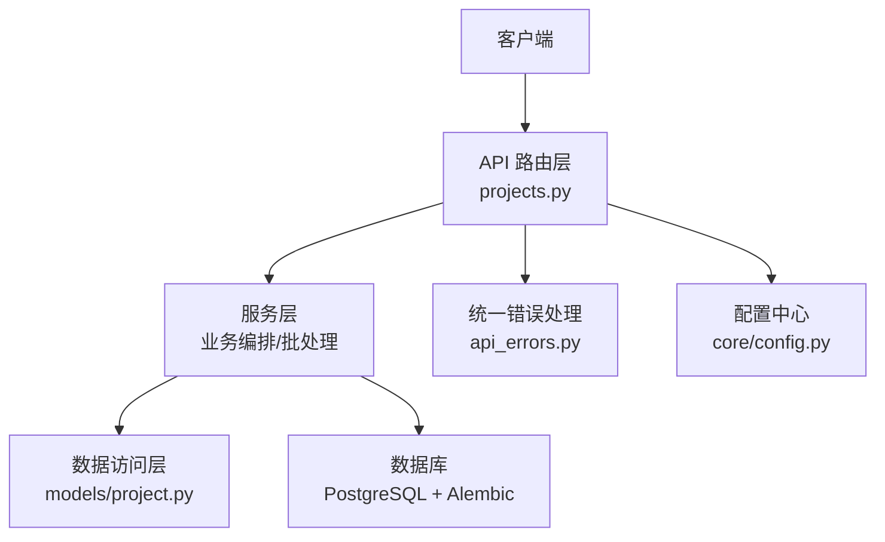
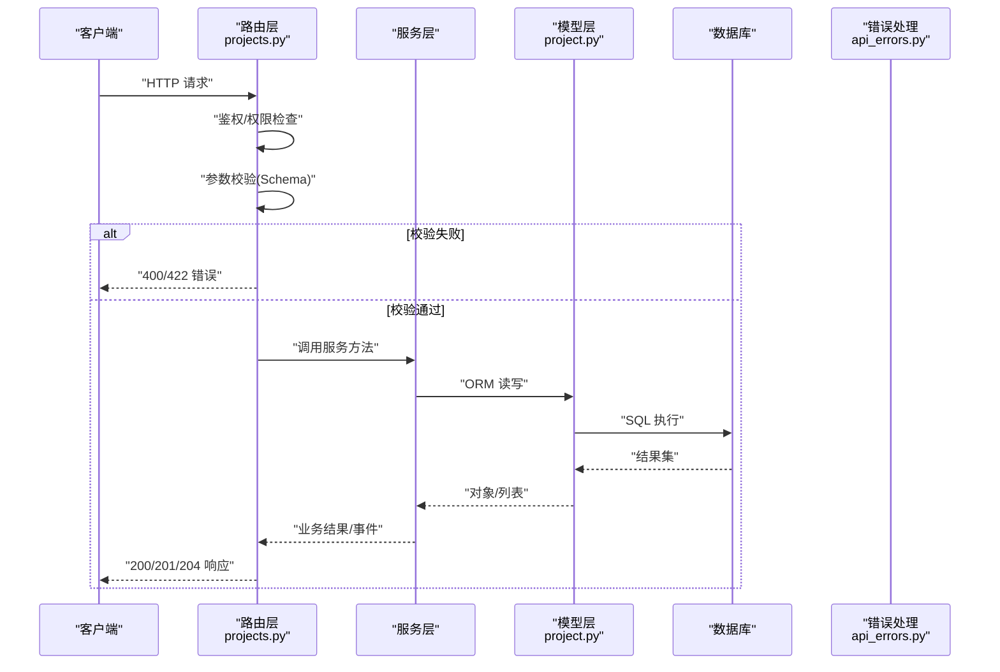
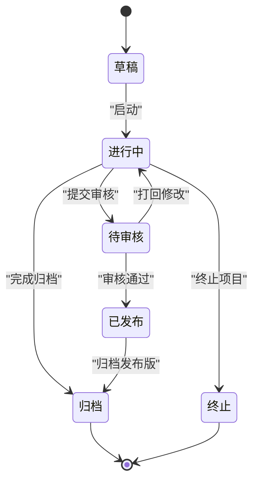
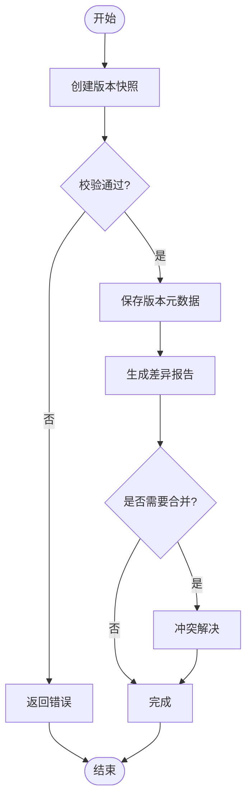
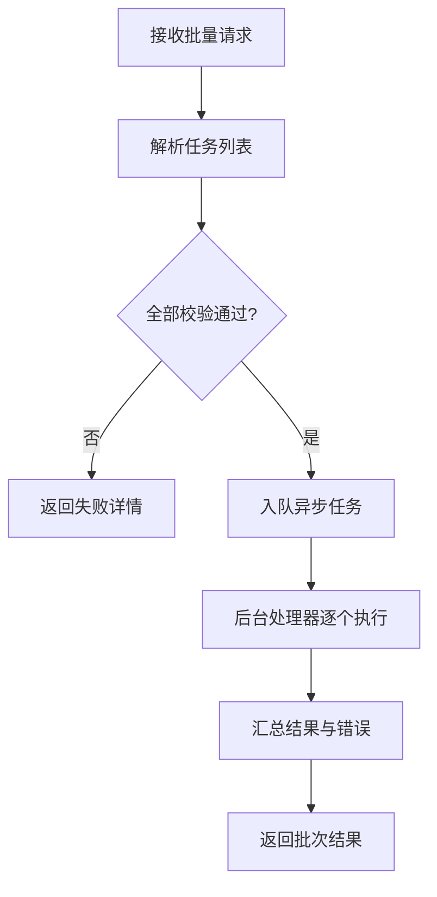
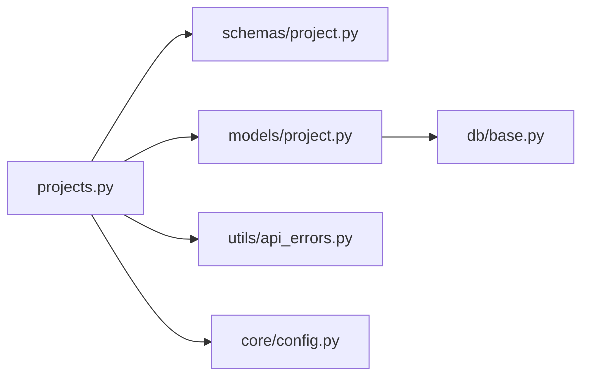

# 项目管理API

<cite>
**本文档引用的文件**   
- [backend/app/api/v1/projects.py](file://backend/app/api/v1/projects.py)
- [backend/app/schemas/project.py](file://backend/app/schemas/project.py)
- [backend/app/models/project.py](file://backend/app/models/project.py)
- [backend/app/services/batch_processor.py](file://backend/app/services/batch_processor.py)
- [backend/app/utils/api_errors.py](file://backend/app/utils/api_errors.py)
- [backend/app/core/config.py](file://backend/app/core/config.py)
- [backend/app/db/base.py](file://backend/app/db/base.py)
- [backend/alembic/versions/add_project_display_no.py](file://backend/alembic/versions/add_project_display_no.py)
- [backend/alembic/versions/add_project_review_config.py](file://backend/alembic/versions/add_project_settings_review_meta.py)
- [backend/alembic/versions/create_project_settings_table.py](file://backend/alembic/versions/create_project_settings_table.py)
</cite>

## 目录
1. [简介](#简介)
2. [项目结构](#项目结构)
3. [核心组件](#核心组件)
4. [架构总览](#架构总览)
5. [详细组件分析](#详细组件分析)
6. [依赖关系分析](#依赖关系分析)
7. [性能考虑](#性能考虑)
8. [故障排查指南](#故障排查指南)
9. [结论](#结论)
10. [附录](#附录)

## 简介
本文件为“项目管理API”的完整接口文档，覆盖项目的CRUD、状态管理、版本控制、协作能力、导入导出、批量操作、搜索过滤等高级功能。文档同时给出数据模型定义、字段说明与校验规则、错误处理机制、性能优化建议以及项目生命周期管理与数据同步策略说明，帮助开发者快速集成与扩展。

## 项目结构
后端采用分层架构：路由层（API）、服务层（业务逻辑）、数据访问层（ORM/迁移）与配置/工具模块。项目相关的路由集中在 v1 接口下，数据模型与Schema分离，便于前后端契约一致。

图表来源
- [backend/app/api/v1/projects.py](file://backend/app/api/v1/projects.py)
- [backend/app/models/project.py](file://backend/app/models/project.py)
- [backend/app/utils/api_errors.py](file://backend/app/utils/api_errors.py)
- [backend/app/core/config.py](file://backend/app/core/config.py)

章节来源
- [backend/app/api/v1/projects.py](file://backend/app/api/v1/projects.py)
- [backend/app/models/project.py](file://backend/app/models/project.py)
- [backend/app/schemas/project.py](file://backend/app/schemas/project.py)

## 核心组件
- 路由层：提供项目相关的RESTful端点，包括创建、查询、更新、删除、状态流转、版本管理、协作成员管理、导入导出、批量操作、搜索过滤等。
- Schema层：定义请求/响应数据结构与校验规则，确保输入合法性与输出一致性。
- 模型层：映射数据库表结构，承载项目实体及其关联关系。
- 服务层：封装复杂业务逻辑，如状态机转换、版本合并、协作权限校验、导入导出流程、批量任务调度。
- 错误处理：统一的异常类型与HTTP状态码映射，保证错误信息规范且可追踪。
- 配置与迁移：环境变量与数据库迁移脚本支撑项目字段演进与运行时行为。

章节来源
- [backend/app/schemas/project.py](file://backend/app/schemas/project.py)
- [backend/app/models/project.py](file://backend/app/models/project.py)
- [backend/app/utils/api_errors.py](file://backend/app/utils/api_errors.py)
- [backend/app/core/config.py](file://backend/app/core/config.py)

## 架构总览
下图展示从请求到响应的典型调用链，涵盖鉴权、参数校验、业务编排、持久化与返回结果。

图表来源
- [backend/app/api/v1/projects.py](file://backend/app/api/v1/projects.py)
- [backend/app/models/project.py](file://backend/app/models/project.py)
- [backend/app/utils/api_errors.py](file://backend/app/utils/api_errors.py)

## 详细组件分析

### 项目CRUD与基础字段
- 创建项目：支持标题、描述、类型、初始设置、显示编号等字段；返回项目ID与初始状态。
- 查询项目：支持按ID、名称、类型、状态、创建时间范围、标签等过滤；支持分页与排序。
- 更新项目：支持部分更新，包含元数据、设置项、协作成员、可见性、审核配置等。
- 删除项目：软删除或硬删除，受权限与依赖约束保护。

字段与校验要点
- 必填字段：标题、类型、创建者ID等。
- 长度与格式：标题长度限制、描述文本编码、URL/邮箱格式校验。
- 唯一性：项目名称在同一用户/团队内唯一。
- 枚举值：项目类型、状态、可见性等限定集合。

章节来源
- [backend/app/api/v1/projects.py](file://backend/app/api/v1/projects.py)
- [backend/app/schemas/project.py](file://backend/app/schemas/project.py)
- [backend/app/models/project.py](file://backend/app/models/project.py)

### 项目状态管理
- 状态机：草稿、进行中、待审核、已发布、归档、终止等状态。
- 状态流转：仅允许合法转移路径，受角色与权限控制。
- 触发条件：人工操作、自动任务（如质量门禁通过后自动发布）。
- 审计记录：状态变更日志包含操作人、时间、原因。

图表来源
- [backend/app/api/v1/projects.py](file://backend/app/api/v1/projects.py)
- [backend/app/models/project.py](file://backend/app/models/project.py)

章节来源
- [backend/app/api/v1/projects.py](file://backend/app/api/v1/projects.py)
- [backend/app/models/project.py](file://backend/app/models/project.py)

### 版本控制
- 版本创建：基于当前快照生成新版本，支持语义化版本号。
- 版本对比：差异比较内容、设置、成员、附件等。
- 版本回滚：将项目恢复到指定版本，保留历史轨迹。
- 分支与合并：支持多分支并行开发，冲突检测与合并策略。

图表来源
- [backend/app/api/v1/projects.py](file://backend/app/api/v1/projects.py)
- [backend/app/models/project.py](file://backend/app/models/project.py)

章节来源
- [backend/app/api/v1/projects.py](file://backend/app/api/v1/projects.py)
- [backend/app/models/project.py](file://backend/app/models/project.py)

### 协作功能
- 成员管理：添加/移除成员、设置角色（所有者、编辑者、查看者等）。
- 权限控制：基于角色的资源访问控制，细粒度到字段级。
- 评论与审批：项目内评论、任务指派、审批流。
- 通知与同步：变更通知、实时同步（可选WebSocket）。

章节来源
- [backend/app/api/v1/projects.py](file://backend/app/api/v1/projects.py)
- [backend/app/schemas/project.py](file://backend/app/schemas/project.py)

### 导入与导出
- 导入：支持JSON/YAML/CSV等多种格式；提供模板下载与批量导入；导入后生成差异报告与预览。
- 导出：按项目维度导出完整快照（内容、设置、成员、版本），支持增量导出。
- 校验与回滚：导入前校验，失败时自动回滚并记录审计日志。

章节来源
- [backend/app/api/v1/projects.py](file://backend/app/api/v1/projects.py)
- [backend/app/schemas/project.py](file://backend/app/schemas/project.py)

### 批量操作
- 批量更新：对多个项目批量设置状态、标签、可见性等。
- 批量删除：软删除标记，支持恢复。
- 任务队列：异步执行大批量任务，避免阻塞主线程。

图表来源
- [backend/app/api/v1/projects.py](file://backend/app/api/v1/projects.py)
- [backend/app/services/batch_processor.py](file://backend/app/services/batch_processor.py)

章节来源
- [backend/app/api/v1/projects.py](file://backend/app/api/v1/projects.py)
- [backend/app/services/batch_processor.py](file://backend/app/services/batch_processor.py)

### 搜索与过滤
- 全文检索：标题、描述、标签等字段支持模糊匹配。
- 组合过滤：按类型、状态、时间、作者、团队等多条件筛选。
- 排序与分页：支持多字段排序与游标分页。

章节来源
- [backend/app/api/v1/projects.py](file://backend/app/api/v1/projects.py)
- [backend/app/schemas/project.py](file://backend/app/schemas/project.py)

### 项目设置与审核配置
- 项目设置：存储结构化配置项，支持分类与默认模板。
- 审核配置：定义审核流程、规则、评分标准与回调。
- 元数据：记录设置变更历史与生效时间。

章节来源
- [backend/alembic/versions/create_project_settings_table.py](file://backend/alembic/versions/create_project_settings_table.py)
- [backend/alembic/versions/add_project_review_config.py](file://backend/alembic/versions/add_project_review_config.py)
- [backend/alembic/versions/add_project_settings_review_meta.py](file://backend/alembic/versions/add_project_settings_review_meta.py)

## 依赖关系分析
- 路由依赖Schema进行输入校验，依赖模型进行数据持久化。
- 服务层协调业务编排，必要时调用外部服务（如消息队列、对象存储）。
- 错误处理模块统一捕获异常并转换为标准HTTP响应。
- 配置模块提供运行时开关与限流策略。

图表来源
- [backend/app/api/v1/projects.py](file://backend/app/api/v1/projects.py)
- [backend/app/schemas/project.py](file://backend/app/schemas/project.py)
- [backend/app/models/project.py](file://backend/app/models/project.py)
- [backend/app/utils/api_errors.py](file://backend/app/utils/api_errors.py)
- [backend/app/core/config.py](file://backend/app/core/config.py)
- [backend/app/db/base.py](file://backend/app/db/base.py)

章节来源
- [backend/app/api/v1/projects.py](file://backend/app/api/v1/projects.py)
- [backend/app/models/project.py](file://backend/app/models/project.py)
- [backend/app/schemas/project.py](file://backend/app/schemas/project.py)
- [backend/app/utils/api_errors.py](file://backend/app/utils/api_errors.py)
- [backend/app/core/config.py](file://backend/app/core/config.py)
- [backend/app/db/base.py](file://backend/app/db/base.py)

## 性能考虑
- 分页与游标：大数据量查询使用游标分页，减少偏移开销。
- 索引优化：对常用过滤字段建立复合索引（如状态+更新时间）。
- 缓存策略：热点项目元数据缓存，缩短读取延迟。
- 异步任务：导入导出、批量操作走异步队列，避免阻塞。
- 连接池：数据库连接池与超时配置，提升并发稳定性。
- 压缩传输：大文件导出启用Gzip压缩。

[本节为通用指导，不直接分析具体文件]

## 故障排查指南
- 常见错误码
  - 400：请求参数缺失或格式错误。
  - 401：未认证或令牌过期。
  - 403：无权限操作。
  - 404：资源不存在。
  - 409：冲突（如重复名称、状态非法）。
  - 422：校验失败。
  - 500：服务器内部错误。
- 定位步骤
  - 检查请求体是否符合Schema定义。
  - 查看服务端日志中的异常堆栈与事务ID。
  - 确认数据库迁移是否最新，字段是否存在。
  - 验证权限与角色配置是否正确。
- 恢复建议
  - 重试幂等接口（GET/POST去重）。
  - 回滚失败的导入/批量任务。
  - 清理临时文件与锁资源。

章节来源
- [backend/app/utils/api_errors.py](file://backend/app/utils/api_errors.py)

## 结论
本项目API以清晰的分层架构与严格的Schema校验为基础，提供了完善的项目CRUD、状态管理、版本控制、协作与导入导出能力。通过异步批处理与缓存策略，兼顾了可扩展性与性能。建议在接入时严格遵循字段校验与错误处理规范，并结合监控与日志进行问题定位与性能调优。

[本节为总结性内容，不直接分析具体文件]

## 附录

### 数据模型示例（项目）
- 项目标识：id、display_no（显示编号）
- 基本信息：title、description、type、status、visibility、owner_id、team_id
- 设置与审核：settings（结构化JSON）、review_config（审核规则）
- 时间与审计：created_at、updated_at、deleted_at、audit_log
- 协作：members（成员列表与角色）、permissions（权限矩阵）

章节来源
- [backend/app/models/project.py](file://backend/app/models/project.py)
- [backend/alembic/versions/add_project_display_no.py](file://backend/alembic/versions/add_project_display_no.py)
- [backend/alembic/versions/create_project_settings_table.py](file://backend/alembic/versions/create_project_settings_table.py)
- [backend/alembic/versions/add_project_review_config.py](file://backend/alembic/versions/add_project_review_config.py)
- [backend/alembic/versions/add_project_settings_review_meta.py](file://backend/alembic/versions/add_project_settings_review_meta.py)

### 项目生命周期与数据同步策略
- 生命周期阶段：草稿→进行中→待审核→已发布→归档/终止
- 关键事件：创建、提交审核、审核通过、发布、归档、终止
- 数据同步：
  - 本地缓存与数据库一致性：写后失效或双写校验
  - 版本快照：每次重要变更生成不可变快照
  - 审计日志：所有状态与设置变更写入审计表
  - 异步同步：导入导出与批量任务完成后推送事件

[本节为概念性说明，不直接分析具体文件]