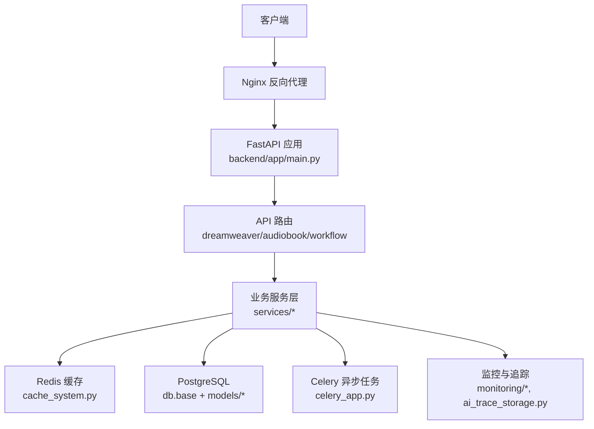
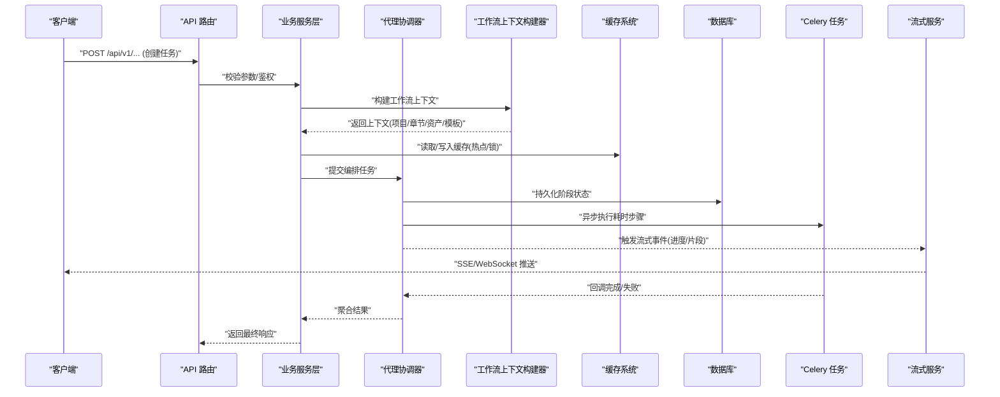
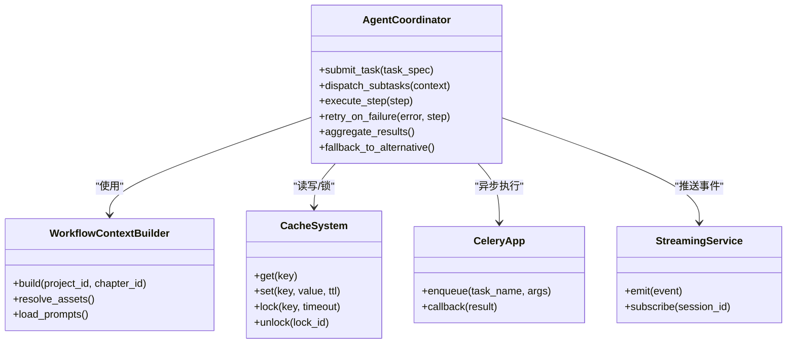
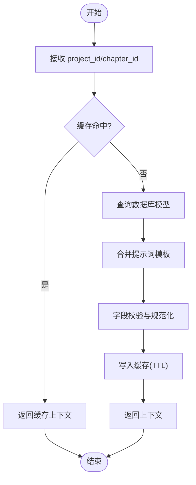
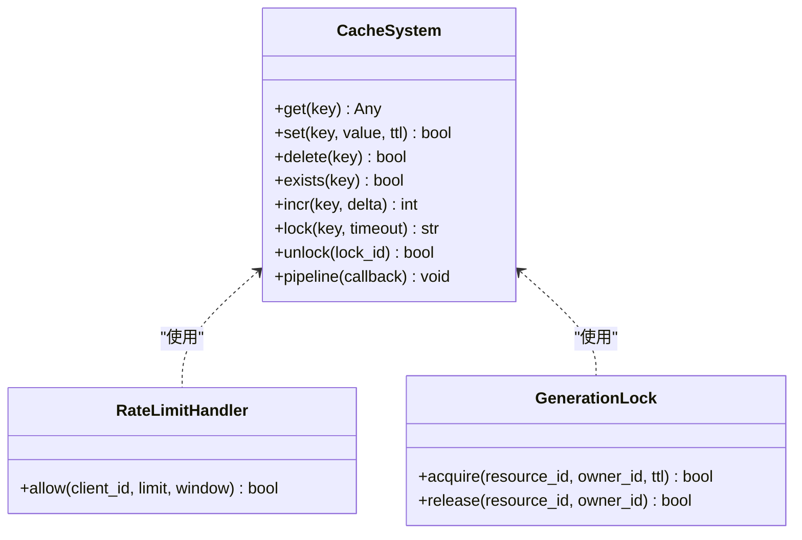
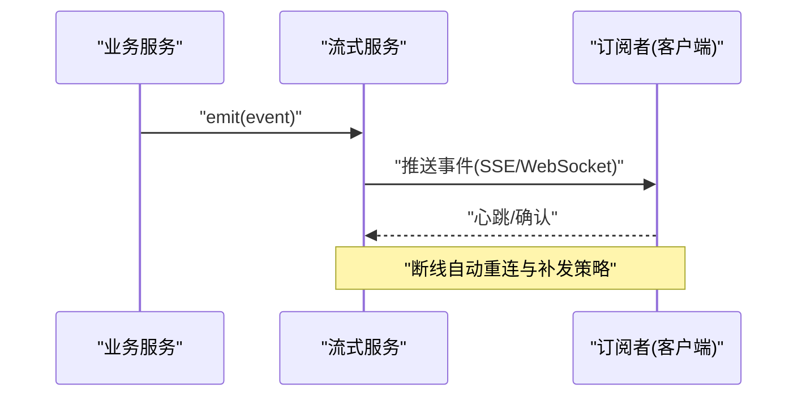
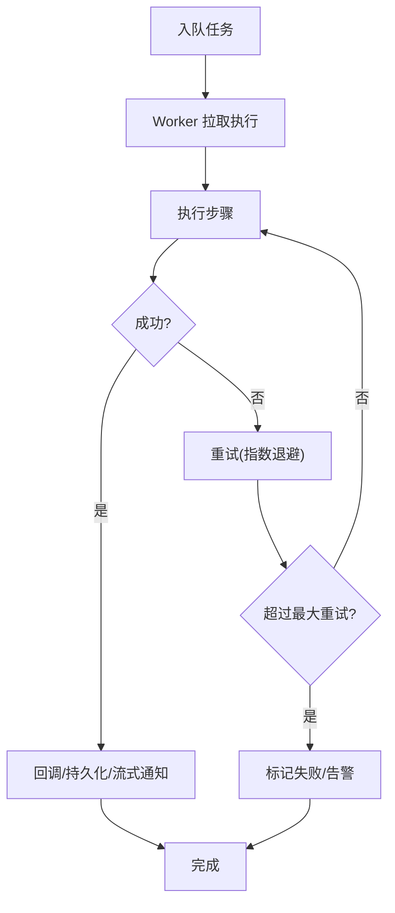
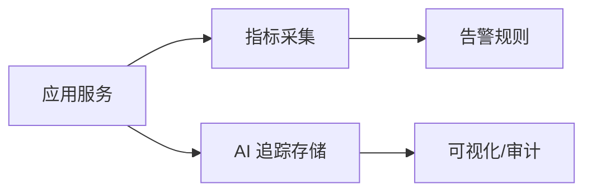
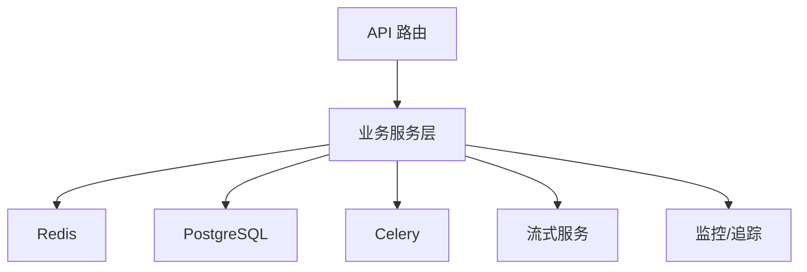

# 业务服务

<cite>
**本文引用的文件**   
- [backend/app/services/agent_coordinator.py](file://backend/app/services/agent_coordinator.py)
- [backend/app/services/workflow_context_builder.py](file://backend/app/services/workflow_context_builder.py)
- [backend/app/services/cache_system.py](file://backend/app/services/cache_system.py)
- [backend/app/services/streaming_service.py](file://backend/app/services/streaming_service.py)
- [backend/app/celery_app.py](file://backend/app/celery_app.py)
- [backend/app/core/config.py](file://backend/app/core/config.py)
- [backend/app/core/env_loader.py](file://backend/app/core/env_loader.py)
- [backend/app/main.py](file://backend/app/main.py)
- [backend/app/api/v1/dreamweaver_api/routes.py](file://backend/app/api/v1/dreamweaver_api/routes.py)
- [backend/app/api/v1/audiobook_api/routes.py](file://backend/app/api/v1/audiobook_api/routes.py)
- [backend/app/api/v1/workflow/routes.py](file://backend/app/api/v1/workflow/routes.py)
- [backend/app/services/batch_processor.py](file://backend/app/services/batch_processor.py)
- [backend/app/services/rate_limit_handler.py](file://backend/app/services/rate_limit_handler.py)
- [backend/app/services/generation_lock.py](file://backend/app/services/generation_lock.py)
- [backend/app/services/ai_trace_storage.py](file://backend/app/services/ai_trace_storage.py)
- [backend/app/services/monitoring/metrics_collector.py](file://backend/app/services/monitoring/metrics_collector.py)
- [backend/app/services/monitoring/alerts.py](file://backend/app/services/monitoring/alerts.py)
- [backend/app/db/base.py](file://backend/app/db/base.py)
- [backend/app/models/project.py](file://backend/app/models/project.py)
- [backend/app/models/chapter.py](file://backend/app/models/chapter.py)
- [backend/app/schemas/common.py](file://backend/app/schemas/common.py)
- [backend/app/utils/api_errors.py](file://backend/app/utils/api_errors.py)
- [docker-compose.yml](file://docker-compose.yml)
- [nginx.conf](file://nginx.conf)
</cite>

## 目录
1. [简介](#简介)
2. [项目结构](#项目结构)
3. [核心组件](#核心组件)
4. [架构总览](#架构总览)
5. [详细组件分析](#详细组件分析)
6. [依赖关系分析](#依赖关系分析)
7. [性能考量](#性能考量)
8. [故障排查指南](#故障排查指南)
9. [结论](#结论)
10. [附录](#附录)

## 简介
本文件面向小说创作代理系统的“业务服务层”，聚焦于代理协调器、工作流上下文构建器、缓存系统与流式服务等关键组件，系统阐述其职责边界、交互流程与数据流转模式。文档同时覆盖异步任务处理机制、错误重试策略、监控告警实现、配置与环境变量管理、部署注意事项，以及扩展与集成测试方法，帮助读者快速理解并安全扩展该服务层。

## 项目结构
业务服务层位于 backend/app/services 目录下，围绕 FastAPI 应用入口（main.py）暴露的 API 路由进行编排，通过 Celery 执行异步任务，借助 Redis 提供缓存与限流能力，并通过数据库持久化状态。整体采用分层设计：
- 接口层：API 路由负责请求解析、鉴权与响应封装
- 服务层：业务编排、上下文构建、缓存、流式输出、批处理、限流、锁等
- 基础设施：Celery 任务、数据库模型、配置与环境加载、监控与追踪

**图示来源** 
- [backend/app/main.py](file://backend/app/main.py)
- [backend/app/api/v1/dreamweaver_api/routes.py](file://backend/app/api/v1/dreamweaver_api/routes.py)
- [backend/app/api/v1/audiobook_api/routes.py](file://backend/app/api/v1/audiobook_api/routes.py)
- [backend/app/api/v1/workflow/routes.py](file://backend/app/api/v1/workflow/routes.py)
- [backend/app/services/cache_system.py](file://backend/app/services/cache_system.py)
- [backend/app/celery_app.py](file://backend/app/celery_app.py)
- [backend/app/db/base.py](file://backend/app/db/base.py)
- [backend/app/models/project.py](file://backend/app/models/project.py)
- [backend/app/models/chapter.py](file://backend/app/models/chapter.py)

**章节来源**
- [backend/app/main.py](file://backend/app/main.py)
- [backend/app/api/v1/dreamweaver_api/routes.py](file://backend/app/api/v1/dreamweaver_api/routes.py)
- [backend/app/api/v1/audiobook_api/routes.py](file://backend/app/api/v1/audiobook_api/routes.py)
- [backend/app/api/v1/workflow/routes.py](file://backend/app/api/v1/workflow/routes.py)

## 核心组件
本节概述四大核心业务服务的职责与协作方式：
- 代理协调器（Agent Coordinator）：统一编排多类代理（LLM、图像、视频、TTS 等），负责任务拆分、调度、结果聚合与失败回退
- 工作流上下文构建器（Workflow Context Builder）：组装跨步骤的上下文（项目、章节、角色、资产、提示词模板等），确保一致性
- 缓存系统（Cache System）：基于 Redis 的键值缓存、热点数据预取、分布式锁辅助与 TTL 管理
- 流式服务（Streaming Service）：SSE/WebSocket 流式输出，增量推送生成进度与中间结果

这些组件共同支撑长链路、高并发、可观测的小说创作流水线。

**章节来源**
- [backend/app/services/agent_coordinator.py](file://backend/app/services/agent_coordinator.py)
- [backend/app/services/workflow_context_builder.py](file://backend/app/services/workflow_context_builder.py)
- [backend/app/services/cache_system.py](file://backend/app/services/cache_system.py)
- [backend/app/services/streaming_service.py](file://backend/app/services/streaming_service.py)

## 架构总览
下图展示从 HTTP 请求到业务服务、缓存、数据库与异步任务的端到端调用链，强调流式输出与异步解耦。

**图示来源** 
- [backend/app/api/v1/dreamweaver_api/routes.py](file://backend/app/api/v1/dreamweaver_api/routes.py)
- [backend/app/api/v1/audiobook_api/routes.py](file://backend/app/api/v1/audiobook_api/routes.py)
- [backend/app/api/v1/workflow/routes.py](file://backend/app/api/v1/workflow/routes.py)
- [backend/app/services/agent_coordinator.py](file://backend/app/services/agent_coordinator.py)
- [backend/app/services/workflow_context_builder.py](file://backend/app/services/workflow_context_builder.py)
- [backend/app/services/cache_system.py](file://backend/app/services/cache_system.py)
- [backend/app/celery_app.py](file://backend/app/celery_app.py)
- [backend/app/services/streaming_service.py](file://backend/app/services/streaming_service.py)

## 详细组件分析

### 代理协调器（Agent Coordinator）
- 职责
  - 将复杂创作任务拆分为子任务（文本、分镜、图像、视频、音频等）
  - 选择适配的后端模型/适配器，处理降级与回退
  - 维护任务生命周期（排队、执行、重试、完成、失败）
  - 聚合各子任务结果，形成统一的业务输出
- 关键交互
  - 与工作流上下文构建器协作获取稳定输入
  - 通过缓存系统进行幂等与去重
  - 通过 Celery 执行耗时步骤，避免阻塞请求
  - 通过流式服务推送阶段性结果
- 错误与重试
  - 按错误类型分类重试（网络、限流、模型不可用）
  - 指数退避与最大重试次数控制
  - 失败路径记录与告警上报

**图示来源** 
- [backend/app/services/agent_coordinator.py](file://backend/app/services/agent_coordinator.py)
- [backend/app/services/workflow_context_builder.py](file://backend/app/services/workflow_context_builder.py)
- [backend/app/services/cache_system.py](file://backend/app/services/cache_system.py)
- [backend/app/services/streaming_service.py](file://backend/app/services/streaming_service.py)
- [backend/app/celery_app.py](file://backend/app/celery_app.py)

**章节来源**
- [backend/app/services/agent_coordinator.py](file://backend/app/services/agent_coordinator.py)

### 工作流上下文构建器（Workflow Context Builder）
- 职责
  - 根据项目与章节标识，加载并合并上下文（角色、场景、资产、提示词模板、历史摘要）
  - 保证上下文版本一致性与可追溯性
  - 提供只读视图供下游服务消费
- 关键交互
  - 从数据库读取实体模型（项目、章节、角色等）
  - 与缓存系统配合加速热点上下文加载
  - 为代理协调器提供稳定的输入契约
- 数据流
  - 输入：project_id、chapter_id、可选过滤条件
  - 处理：实体查询、模板绑定、字段校验
  - 输出：结构化上下文对象

**图示来源** 
- [backend/app/services/workflow_context_builder.py](file://backend/app/services/workflow_context_builder.py)
- [backend/app/db/base.py](file://backend/app/db/base.py)
- [backend/app/models/project.py](file://backend/app/models/project.py)
- [backend/app/models/chapter.py](file://backend/app/models/chapter.py)
- [backend/app/services/cache_system.py](file://backend/app/services/cache_system.py)

**章节来源**
- [backend/app/services/workflow_context_builder.py](file://backend/app/services/workflow_context_builder.py)

### 缓存系统（Cache System）
- 职责
  - 提供高性能键值存取、TTL 管理、分布式锁、批量操作
  - 支持热点数据预取与失效策略
  - 为限流、幂等、去重提供基础能力
- 关键特性
  - 键命名规范与命名空间隔离
  - 序列化/反序列化与兼容性处理
  - 异常容错（连接失败降级为本地或直连）
- 典型用法
  - 上下文缓存、模型元数据缓存、结果缓存
  - 分布式锁保护临界区（如生成锁）

**图示来源** 
- [backend/app/services/cache_system.py](file://backend/app/services/cache_system.py)
- [backend/app/services/rate_limit_handler.py](file://backend/app/services/rate_limit_handler.py)
- [backend/app/services/generation_lock.py](file://backend/app/services/generation_lock.py)

**章节来源**
- [backend/app/services/cache_system.py](file://backend/app/services/cache_system.py)

### 流式服务（Streaming Service）
- 职责
  - 提供 SSE/WebSocket 通道，实时推送任务进度、中间结果与最终产物
  - 管理会话生命周期与订阅者状态
  - 与代理协调器的事件总线对接，实现增量更新
- 关键交互
  - 接收上游事件（步骤开始、进度、片段、完成、失败）
  - 按会话广播给订阅者
  - 断线重连与消息去重
- 数据模型
  - 事件类型、负载结构、时间戳、关联任务 ID

**图示来源** 
- [backend/app/services/streaming_service.py](file://backend/app/services/streaming_service.py)
- [backend/app/services/agent_coordinator.py](file://backend/app/services/agent_coordinator.py)

**章节来源**
- [backend/app/services/streaming_service.py](file://backend/app/services/streaming_service.py)

### 异步任务处理（Celery）
- 职责
  - 将耗时步骤（模型推理、媒体转码、批量处理）放入队列
  - 支持重试、超时、优先级与并发控制
  - 回调与状态同步至数据库与流式通道
- 关键配置
  - Broker（Redis）、Worker 数量、重试策略、日志级别
- 典型任务
  - 章节生成、音频合成、视频剪辑、质量审查

**图示来源** 
- [backend/app/celery_app.py](file://backend/app/celery_app.py)
- [backend/app/services/batch_processor.py](file://backend/app/services/batch_processor.py)

**章节来源**
- [backend/app/celery_app.py](file://backend/app/celery_app.py)

### 批处理器（Batch Processor）
- 职责
  - 对大批量数据进行分片、并行处理与结果聚合
  - 支持断点续传与失败重试
  - 与缓存和数据库协同，保障一致性
- 适用场景
  - 批量导入、批量转码、批量评测

**章节来源**
- [backend/app/services/batch_processor.py](file://backend/app/services/batch_processor.py)

### 限流与生成锁
- 限流（Rate Limit Handler）
  - 基于滑动窗口或令牌桶限制客户端频率
  - 防止后端过载与资源争用
- 生成锁（Generation Lock）
  - 针对同一资源的互斥访问，避免重复生成
  - 结合 TTL 与所有权校验，确保释放安全

**章节来源**
- [backend/app/services/rate_limit_handler.py](file://backend/app/services/rate_limit_handler.py)
- [backend/app/services/generation_lock.py](file://backend/app/services/generation_lock.py)

### 监控与追踪
- 指标采集（Metrics Collector）
  - 收集 QPS、延迟、错误率、队列长度等关键指标
- 告警（Alerts）
  - 阈值触发告警（错误率、延迟、资源水位）
- AI 追踪存储（AI Trace Storage）
  - 记录请求链路、模型调用、成本与质量评分

**图示来源** 
- [backend/app/services/monitoring/metrics_collector.py](file://backend/app/services/monitoring/metrics_collector.py)
- [backend/app/services/monitoring/alerts.py](file://backend/app/services/monitoring/alerts.py)
- [backend/app/services/ai_trace_storage.py](file://backend/app/services/ai_trace_storage.py)

**章节来源**
- [backend/app/services/monitoring/metrics_collector.py](file://backend/app/services/monitoring/metrics_collector.py)
- [backend/app/services/monitoring/alerts.py](file://backend/app/services/monitoring/alerts.py)
- [backend/app/services/ai_trace_storage.py](file://backend/app/services/ai_trace_storage.py)

## 依赖关系分析
- 外部依赖
  - Redis：缓存、限流、分布式锁、Broker
  - PostgreSQL：持久化模型与状态
  - Celery：异步任务执行
  - Nginx：反向代理与负载均衡
- 内部依赖
  - API 路由依赖服务层
  - 服务层依赖缓存、数据库、Celery、流式服务与监控
  - 监控与追踪贯穿全链路

**图示来源** 
- [backend/app/api/v1/dreamweaver_api/routes.py](file://backend/app/api/v1/dreamweaver_api/routes.py)
- [backend/app/api/v1/audiobook_api/routes.py](file://backend/app/api/v1/audiobook_api/routes.py)
- [backend/app/api/v1/workflow/routes.py](file://backend/app/api/v1/workflow/routes.py)
- [backend/app/services/cache_system.py](file://backend/app/services/cache_system.py)
- [backend/app/db/base.py](file://backend/app/db/base.py)
- [backend/app/celery_app.py](file://backend/app/celery_app.py)
- [backend/app/services/streaming_service.py](file://backend/app/services/streaming_service.py)
- [backend/app/services/monitoring/metrics_collector.py](file://backend/app/services/monitoring/metrics_collector.py)

**章节来源**
- [backend/app/api/v1/dreamweaver_api/routes.py](file://backend/app/api/v1/dreamweaver_api/routes.py)
- [backend/app/api/v1/audiobook_api/routes.py](file://backend/app/api/v1/audiobook_api/routes.py)
- [backend/app/api/v1/workflow/routes.py](file://backend/app/api/v1/workflow/routes.py)

## 性能考量
- 缓存优先：热点上下文与模型元数据应优先命中缓存，减少数据库压力
- 异步解耦：耗时步骤一律走 Celery，避免请求阻塞
- 流式输出：长时任务通过 SSE/WebSocket 增量反馈，提升用户体验
- 限流与锁：合理设置限流阈值与锁 TTL，防止雪崩与重复计算
- 批处理：大任务分片并行，结合断点续传提高吞吐
- 监控与追踪：关注 P95/P99 延迟、错误率与队列积压，及时扩容与优化

[本节为通用指导，不直接分析具体文件]

## 故障排查指南
- 常见问题
  - Redis 连接失败：检查环境变量与网络连通性，启用降级策略
  - Celery 任务堆积：检查 Worker 数量与任务耗时，调整并发与重试策略
  - 数据库锁竞争：检查事务粒度与索引，避免长事务
  - 流式中断：检查网络与心跳，启用重连与补发
- 定位手段
  - 查看监控指标与告警
  - 检索 AI 追踪记录，定位慢调用与错误节点
  - 检查错误日志与 API 错误码
- 恢复策略
  - 重启 Worker/清理死锁
  - 回滚不一致状态
  - 临时关闭非关键功能以保活

**章节来源**
- [backend/app/utils/api_errors.py](file://backend/app/utils/api_errors.py)
- [backend/app/services/monitoring/alerts.py](file://backend/app/services/monitoring/alerts.py)
- [backend/app/services/ai_trace_storage.py](file://backend/app/services/ai_trace_storage.py)

## 结论
业务服务层通过代理协调器、工作流上下文构建器、缓存系统与流式服务的协同，构建了可扩展、高可用、可观测的小说创作流水线。借助 Celery 异步化、Redis 缓存与限流、数据库持久化与监控追踪，系统在性能与稳定性上具备良好平衡。遵循本文档的扩展规范与最佳实践，可安全地新增服务与能力。

[本节为总结，不直接分析具体文件]

## 附录

### 配置与环境变量
- 核心配置
  - 应用配置：backend/app/core/config.py
  - 环境加载：backend/app/core/env_loader.py
- 关键环境变量（示例）
  - REDIS_URL：Redis 连接串
  - DATABASE_URL：PostgreSQL 连接串
  - CELERY_BROKER_URL：Celery Broker 地址
  - STREAMING_BACKEND：流式后端类型（SSE/WebSocket）
  - MONITORING_ENABLED：是否启用监控
- 部署注意
  - docker-compose.yml：容器编排与服务依赖
  - nginx.conf：反向代理与静态资源

**章节来源**
- [backend/app/core/config.py](file://backend/app/core/config.py)
- [backend/app/core/env_loader.py](file://backend/app/core/env_loader.py)
- [docker-compose.yml](file://docker-compose.yml)
- [nginx.conf](file://nginx.conf)

### 扩展指南与自定义服务开发规范
- 新增服务
  - 在 services 下新建模块，定义清晰的接口与依赖注入
  - 复用缓存、限流、锁、流式与监控能力
  - 通过 API 路由暴露新能力
- 数据模型与 Schema
  - 在 models 与 schemas 中定义强类型契约
  - 保持向后兼容与迁移策略
- 测试方法
  - 单元测试：Mock 外部依赖（Redis、DB、Celery）
  - 集成测试：启动最小环境验证端到端流程
  - 流式测试：模拟 SSE/WebSocket 连接与事件序列

**章节来源**
- [backend/app/schemas/common.py](file://backend/app/schemas/common.py)
- [backend/app/db/base.py](file://backend/app/db/base.py)
- [backend/app/models/project.py](file://backend/app/models/project.py)
- [backend/app/models/chapter.py](file://backend/app/models/chapter.py)