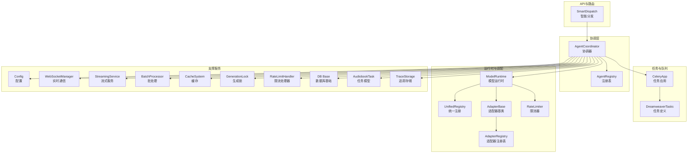
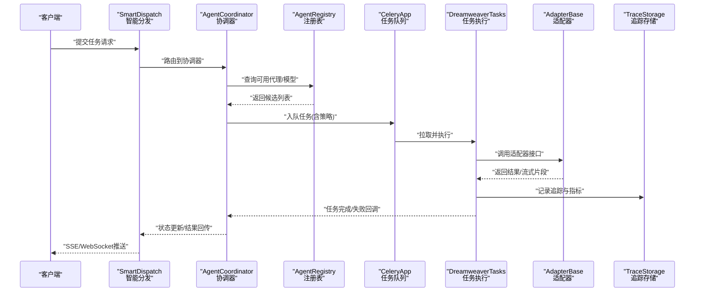
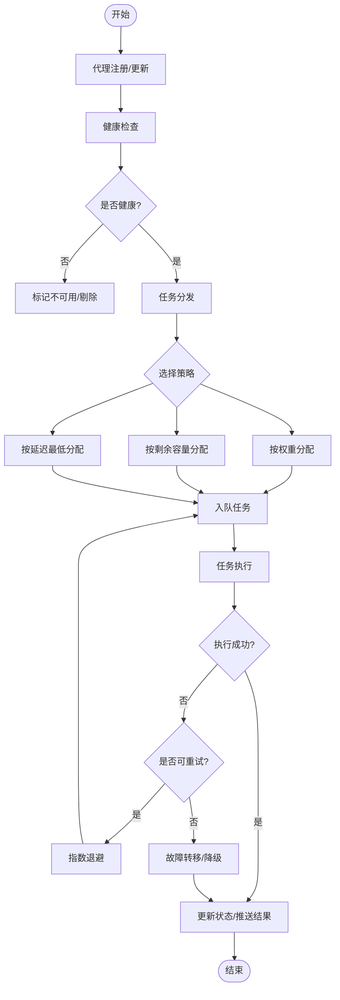
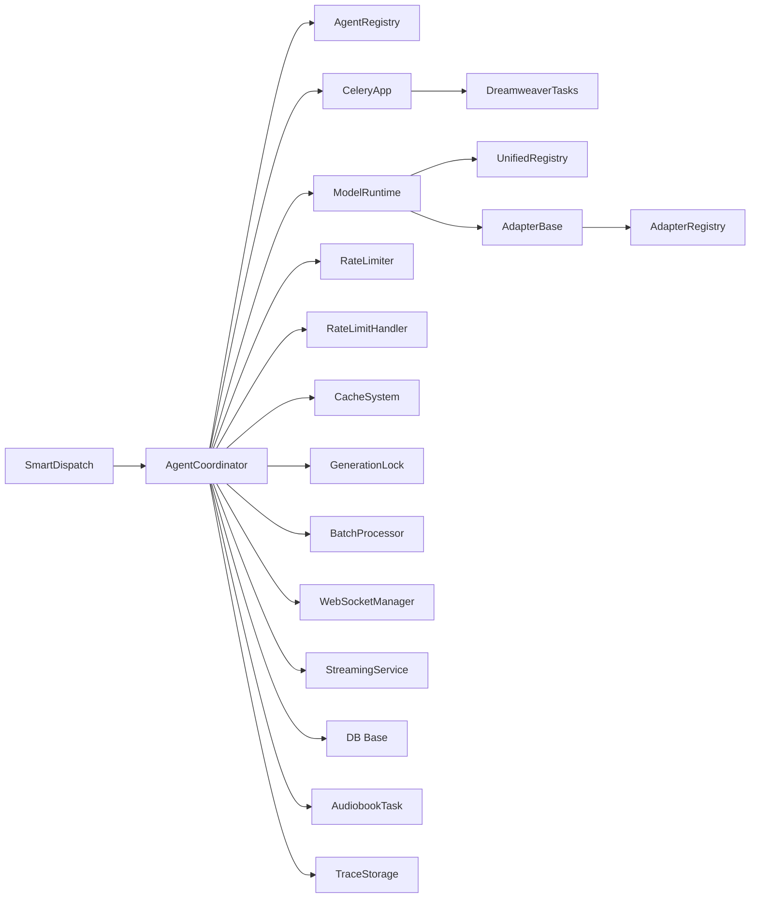

# 代理协调器服务

<cite>
**本文引用的文件**   
- [agent_coordinator.py](file://agent_coordinator.py)
- [split_agent_coordinator.py](file://split_agent_coordinator.py)
- [backend/app/services/agent_coordinator.py](file://backend/app/services/agent_coordinator.py)
- [backend/app/services/agent_registry.py](file://backend/app/services/agent_registry.py)
- [backend/app/celery_app.py](file://backend/app/celery_app.py)
- [backend/app/tasks/dreamweaver_tasks.py](file://backend/app/tasks/dreamweaver_tasks.py)
- [backend/app/api/v1/smart_dispatch.py](file://backend/app/api/v1/smart_dispatch.py)
- [core/model_runtime.py](file://core/model_runtime.py)
- [core/unified_registry.py](file://core/unified_registry.py)
- [adapters/base.py](file://adapters/base.py)
- [adapters/registry.py](file://adapters/registry.py)
- [adapters/rate_limiter.py](file://adapters/rate_limiter.py)
- [backend/app/core/config.py](file://backend/app/core/config.py)
- [backend/app/websocket/manager.py](file://backend/app/websocket/manager.py)
- [backend/app/services/streaming_service.py](file://backend/app/services/streaming_service.py)
- [backend/app/services/batch_processor.py](file://backend/app/services/batch_processor.py)
- [backend/app/services/cache_system.py](file://backend/app/services/cache_system.py)
- [backend/app/services/generation_lock.py](file://backend/app/services/generation_lock.py)
- [backend/app/services/rate_limit_handler.py](file://backend/app/services/rate_limit_handler.py)
- [backend/app/models/audiobook_task.py](file://backend/app/models/audiobook_task.py)
- [backend/app/db/base.py](file://backend/app/db/base.py)
- [backend/app/services/monitoring/trace_storage.py](file://backend/app/services/monitoring/trace_storage.py)
</cite>

## 目录
1. [简介](#简介)
2. [项目结构](#项目结构)
3. [核心组件](#核心组件)
4. [架构总览](#架构总览)
5. [详细组件分析](#详细组件分析)
6. [依赖关系分析](#依赖关系分析)
7. [性能考量](#性能考量)
8. [故障排查指南](#故障排查指南)
9. [结论](#结论)
10. [附录](#附录)

## 简介
本技术文档围绕“代理协调器服务”展开，聚焦以下关键主题：
- 代理生命周期管理：注册、发现、健康检查、状态监控与动态扩缩容。
- 任务分发与负载均衡：智能路由、队列处理、重试与故障转移。
- 异步任务队列：Celery 集成、事件驱动与流式输出。
- 错误处理与可观测性：重试策略、熔断限流、追踪与指标。
- 配置管理与资源调度：模型选择、速率限制、缓存与锁机制。
- 代理间通信协议与消息格式：统一适配器接口、事件总线与 WebSocket 推送。

该服务以“协调器 + 注册中心 + 任务队列 + 适配器层”的分层架构实现高可用、可扩展的代理编排能力。

## 项目结构
从仓库结构看，代理协调器相关代码主要分布在根目录与后端服务中：
- 根目录协调器入口：agent_coordinator.py、split_agent_coordinator.py
- 后端服务中的协调器与注册表：backend/app/services/agent_coordinator.py、backend/app/services/agent_registry.py
- 任务队列与任务定义：backend/app/celery_app.py、backend/app/tasks/dreamweaver_tasks.py
- API 路由与智能分发：backend/app/api/v1/smart_dispatch.py
- 模型运行时与统一注册：core/model_runtime.py、core/unified_registry.py
- 适配器基类与注册表：adapters/base.py、adapters/registry.py
- 限流与并发控制：adapters/rate_limiter.py、backend/app/services/rate_limit_handler.py
- 配置与环境：backend/app/core/config.py
- 实时通信与流式输出：backend/app/websocket/manager.py、backend/app/services/streaming_service.py
- 批处理、缓存与锁：backend/app/services/batch_processor.py、backend/app/services/cache_system.py、backend/app/services/generation_lock.py
- 数据库模型与迁移：backend/app/models/audiobook_task.py、backend/app/db/base.py
- 监控与追踪：backend/app/services/monitoring/trace_storage.py

图表来源
- [agent_coordinator.py](file://agent_coordinator.py)
- [backend/app/services/agent_coordinator.py](file://backend/app/services/agent_coordinator.py)
- [backend/app/services/agent_registry.py](file://backend/app/services/agent_registry.py)
- [backend/app/celery_app.py](file://backend/app/celery_app.py)
- [backend/app/tasks/dreamweaver_tasks.py](file://backend/app/tasks/dreamweaver_tasks.py)
- [backend/app/api/v1/smart_dispatch.py](file://backend/app/api/v1/smart_dispatch.py)
- [core/model_runtime.py](file://core/model_runtime.py)
- [core/unified_registry.py](file://core/unified_registry.py)
- [adapters/base.py](file://adapters/base.py)
- [adapters/registry.py](file://adapters/registry.py)
- [adapters/rate_limiter.py](file://adapters/rate_limiter.py)
- [backend/app/core/config.py](file://backend/app/core/config.py)
- [backend/app/websocket/manager.py](file://backend/app/websocket/manager.py)
- [backend/app/services/streaming_service.py](file://backend/app/services/streaming_service.py)
- [backend/app/services/batch_processor.py](file://backend/app/services/batch_processor.py)
- [backend/app/services/cache_system.py](file://backend/app/services/cache_system.py)
- [backend/app/services/generation_lock.py](file://backend/app/services/generation_lock.py)
- [backend/app/services/rate_limit_handler.py](file://backend/app/services/rate_limit_handler.py)
- [backend/app/models/audiobook_task.py](file://backend/app/models/audiobook_task.py)
- [backend/app/db/base.py](file://backend/app/db/base.py)
- [backend/app/services/monitoring/trace_storage.py](file://backend/app/services/monitoring/trace_storage.py)

章节来源
- [agent_coordinator.py](file://agent_coordinator.py)
- [split_agent_coordinator.py](file://split_agent_coordinator.py)
- [backend/app/services/agent_coordinator.py](file://backend/app/services/agent_coordinator.py)
- [backend/app/services/agent_registry.py](file://backend/app/services/agent_registry.py)
- [backend/app/celery_app.py](file://backend/app/celery_app.py)
- [backend/app/tasks/dreamweaver_tasks.py](file://backend/app/tasks/dreamweaver_tasks.py)
- [backend/app/api/v1/smart_dispatch.py](file://backend/app/api/v1/smart_dispatch.py)
- [core/model_runtime.py](file://core/model_runtime.py)
- [core/unified_registry.py](file://core/unified_registry.py)
- [adapters/base.py](file://adapters/base.py)
- [adapters/registry.py](file://adapters/registry.py)
- [adapters/rate_limiter.py](file://adapters/rate_limiter.py)
- [backend/app/core/config.py](file://backend/app/core/config.py)
- [backend/app/websocket/manager.py](file://backend/app/websocket/manager.py)
- [backend/app/services/streaming_service.py](file://backend/app/services/streaming_service.py)
- [backend/app/services/batch_processor.py](file://backend/app/services/batch_processor.py)
- [backend/app/services/cache_system.py](file://backend/app/services/cache_system.py)
- [backend/app/services/generation_lock.py](file://backend/app/services/generation_lock.py)
- [backend/app/services/rate_limit_handler.py](file://backend/app/services/rate_limit_handler.py)
- [backend/app/models/audiobook_task.py](file://backend/app/models/audiobook_task.py)
- [backend/app/db/base.py](file://backend/app/db/base.py)
- [backend/app/services/monitoring/trace_storage.py](file://backend/app/services/monitoring/trace_storage.py)

## 核心组件
- 代理协调器（AgentCoordinator）
  - 职责：统一管理代理生命周期（注册、发现、健康检查）、任务分发、负载均衡、失败重试与故障转移、事件广播与状态同步。
  - 关键点：与注册表交互获取可用代理；通过任务队列派发任务；结合限流、缓存与锁保证稳定性。
- 代理注册表（AgentRegistry）
  - 职责：维护代理实例元数据（能力、权重、容量、健康状态），提供查询与更新接口。
- 模型运行时（ModelRuntime）与统一注册（UnifiedRegistry）
  - 职责：抽象模型调用接口，按能力与策略选择具体适配器；集中注册与发现模型能力。
- 适配器基类与注册表（AdapterBase、AdapterRegistry）
  - 职责：标准化各厂商/模型的调用方式，提供统一的输入输出契约；支持插件化扩展。
- 任务队列（CeleryApp、DreamweaverTasks）
  - 职责：异步执行长耗时任务，支持重试、超时、结果持久化与进度上报。
- 智能分发（SmartDispatch）
  - 职责：根据请求上下文、负载与健康状态进行路由决策，支持多策略切换。
- 支撑服务
  - 限流（RateLimiter、RateLimitHandler）：保护下游与系统资源。
  - 缓存（CacheSystem）：降低重复计算与外部调用压力。
  - 锁（GenerationLock）：避免并发冲突与重复生成。
  - 批处理（BatchProcessor）：聚合任务提升吞吐。
  - 实时通信（WebSocketManager、StreamingService）：推送进度与增量结果。
  - 配置（Config）：集中管理环境变量与运行时参数。
  - 数据库（DB Base、AudiobookTask）：任务与状态持久化。
  - 追踪（TraceStorage）：记录链路追踪与审计日志。

章节来源
- [backend/app/services/agent_coordinator.py](file://backend/app/services/agent_coordinator.py)
- [backend/app/services/agent_registry.py](file://backend/app/services/agent_registry.py)
- [core/model_runtime.py](file://core/model_runtime.py)
- [core/unified_registry.py](file://core/unified_registry.py)
- [adapters/base.py](file://adapters/base.py)
- [adapters/registry.py](file://adapters/registry.py)
- [backend/app/celery_app.py](file://backend/app/celery_app.py)
- [backend/app/tasks/dreamweaver_tasks.py](file://backend/app/tasks/dreamweaver_tasks.py)
- [backend/app/api/v1/smart_dispatch.py](file://backend/app/api/v1/smart_dispatch.py)
- [adapters/rate_limiter.py](file://adapters/rate_limiter.py)
- [backend/app/services/rate_limit_handler.py](file://backend/app/services/rate_limit_handler.py)
- [backend/app/services/cache_system.py](file://backend/app/services/cache_system.py)
- [backend/app/services/generation_lock.py](file://backend/app/services/generation_lock.py)
- [backend/app/services/batch_processor.py](file://backend/app/services/batch_processor.py)
- [backend/app/websocket/manager.py](file://backend/app/websocket/manager.py)
- [backend/app/services/streaming_service.py](file://backend/app/services/streaming_service.py)
- [backend/app/core/config.py](file://backend/app/core/config.py)
- [backend/app/models/audiobook_task.py](file://backend/app/models/audiobook_task.py)
- [backend/app/db/base.py](file://backend/app/db/base.py)
- [backend/app/services/monitoring/trace_storage.py](file://backend/app/services/monitoring/trace_storage.py)

## 架构总览
整体采用“分层+事件驱动”的架构：
- 接入层：API 路由接收请求，进入智能分发模块。
- 协调层：协调器负责生命周期管理、任务编排与负载均衡。
- 执行层：任务队列异步执行，适配器层调用具体模型或外部服务。
- 支撑层：限流、缓存、锁、批处理、实时通信、配置、数据库与追踪。

图表来源
- [backend/app/api/v1/smart_dispatch.py](file://backend/app/api/v1/smart_dispatch.py)
- [backend/app/services/agent_coordinator.py](file://backend/app/services/agent_coordinator.py)
- [backend/app/services/agent_registry.py](file://backend/app/services/agent_registry.py)
- [backend/app/celery_app.py](file://backend/app/celery_app.py)
- [backend/app/tasks/dreamweaver_tasks.py](file://backend/app/tasks/dreamweaver_tasks.py)
- [adapters/base.py](file://adapters/base.py)
- [backend/app/services/monitoring/trace_storage.py](file://backend/app/services/monitoring/trace_storage.py)

## 详细组件分析

### 代理协调器（AgentCoordinator）
- 功能要点
  - 代理注册与发现：维护代理实例元数据，支持动态加入/退出。
  - 健康检查与状态监控：周期性探测、阈值告警、自动剔除不健康节点。
  - 任务分发与负载均衡：基于权重、容量、延迟等策略选择目标。
  - 异步队列与事件驱动：通过 Celery 派发任务，使用事件回调推进状态。
  - 错误重试与故障转移：指数退避、最大重试次数、降级与旁路。
  - 资源调度：结合限流、缓存与锁，避免过载与冲突。
- 关键流程
  - 注册：代理启动时向注册表上报能力与资源信息。
  - 发现：协调器按需查询可用代理集合。
  - 分发：根据策略选择代理并封装任务。
  - 执行：任务队列消费并调用适配器。
  - 反馈：结果与状态通过事件通道回传。

图表来源
- [backend/app/services/agent_coordinator.py](file://backend/app/services/agent_coordinator.py)
- [backend/app/services/agent_registry.py](file://backend/app/services/agent_registry.py)
- [backend/app/celery_app.py](file://backend/app/celery_app.py)
- [backend/app/tasks/dreamweaver_tasks.py](file://backend/app/tasks/dreamweaver_tasks.py)

章节来源
- [backend/app/services/agent_coordinator.py](file://backend/app/services/agent_coordinator.py)
- [backend/app/services/agent_registry.py](file://backend/app/services/agent_registry.py)
- [backend/app/celery_app.py](file://backend/app/celery_app.py)
- [backend/app/tasks/dreamweaver_tasks.py](file://backend/app/tasks/dreamweaver_tasks.py)

### 代理注册表（AgentRegistry）
- 功能要点
  - 维护代理实例映射：ID、地址、能力标签、权重、容量、健康状态。
  - 查询接口：按能力过滤、按负载排序、按健康筛选。
  - 更新接口：心跳上报、状态变更、容量调整。
- 数据结构建议
  - 代理条目：包含标识、元数据、能力集、权重、容量、健康状态、最后心跳时间。
  - 索引：按能力、区域、版本等维度建立快速查找。
- 一致性保障
  - 使用内存+持久化双写，确保重启恢复与跨进程一致。
  - 心跳超时自动剔除，避免僵尸节点。

章节来源
- [backend/app/services/agent_registry.py](file://backend/app/services/agent_registry.py)

### 模型运行时与统一注册（ModelRuntime、UnifiedRegistry）
- 功能要点
  - 统一抽象：屏蔽不同模型/厂商差异，提供一致的调用接口。
  - 能力解析：根据请求语义选择合适模型与适配器。
  - 注册发现：集中注册模型能力，支持热插拔与版本管理。
- 设计模式
  - 工厂模式：按模型 ID 创建对应适配器实例。
  - 策略模式：按策略选择最佳实现。
  - 观察者模式：能力变更事件通知订阅者。

章节来源
- [core/model_runtime.py](file://core/model_runtime.py)
- [core/unified_registry.py](file://core/unified_registry.py)

### 适配器层（AdapterBase、AdapterRegistry）
- 功能要点
  - 标准化接口：输入校验、输出归一化、错误码映射。
  - 插件化扩展：新增适配器无需修改核心逻辑。
  - 限流与重试：在适配器层实现细粒度控制。
- 典型方法
  - 初始化：加载配置与连接池。
  - 调用：封装 HTTP/SDK 调用，处理鉴权与重试。
  - 流式：支持分片返回与进度上报。

章节来源
- [adapters/base.py](file://adapters/base.py)
- [adapters/registry.py](file://adapters/registry.py)
- [adapters/rate_limiter.py](file://adapters/rate_limiter.py)

### 任务队列与任务执行（CeleryApp、DreamweaverTasks）
- 功能要点
  - 异步执行：将长耗时任务放入队列，解耦请求与处理。
  - 重试与超时：配置重试策略与超时时间，防止阻塞。
  - 结果持久化：保存任务状态、进度与结果引用。
  - 事件回调：任务完成触发后续流程（如状态更新、通知）。
- 任务类型
  - 生成类任务：文本/图像/视频生成。
  - 处理类任务：后处理、质检、转码。
  - 调度类任务：定时巡检、健康检查、清理。

章节来源
- [backend/app/celery_app.py](file://backend/app/celery_app.py)
- [backend/app/tasks/dreamweaver_tasks.py](file://backend/app/tasks/dreamweaver_tasks.py)

### 智能分发（SmartDispatch）
- 功能要点
  - 路由决策：基于请求上下文、负载、健康与策略选择目标。
  - 多策略切换：支持轮询、加权、最少连接、延迟优先等。
  - 灰度与分流：按用户/租户/版本进行流量隔离。
- 关键指标
  - 命中率、平均延迟、错误率、吞吐量。

章节来源
- [backend/app/api/v1/smart_dispatch.py](file://backend/app/api/v1/smart_dispatch.py)

### 支撑服务（限流、缓存、锁、批处理、实时通信、配置、数据库、追踪）
- 限流（RateLimiter、RateLimitHandler）
  - 令牌桶/漏桶算法，保护下游与系统资源。
- 缓存（CacheSystem）
  - 热点数据缓存、结果去重、预取与失效策略。
- 锁（GenerationLock）
  - 分布式锁避免重复生成与并发冲突。
- 批处理（BatchProcessor）
  - 批量聚合任务，提高吞吐与资源利用率。
- 实时通信（WebSocketManager、StreamingService）
  - 推送进度、增量结果与事件通知。
- 配置（Config）
  - 集中管理环境变量、特性开关与运行时参数。
- 数据库（DB Base、AudiobookTask）
  - 任务与状态持久化，支持事务与迁移。
- 追踪（TraceStorage）
  - 记录链路追踪、审计日志与性能指标。

章节来源
- [adapters/rate_limiter.py](file://adapters/rate_limiter.py)
- [backend/app/services/rate_limit_handler.py](file://backend/app/services/rate_limit_handler.py)
- [backend/app/services/cache_system.py](file://backend/app/services/cache_system.py)
- [backend/app/services/generation_lock.py](file://backend/app/services/generation_lock.py)
- [backend/app/services/batch_processor.py](file://backend/app/services/batch_processor.py)
- [backend/app/websocket/manager.py](file://backend/app/websocket/manager.py)
- [backend/app/services/streaming_service.py](file://backend/app/services/streaming_service.py)
- [backend/app/core/config.py](file://backend/app/core/config.py)
- [backend/app/models/audiobook_task.py](file://backend/app/models/audiobook_task.py)
- [backend/app/db/base.py](file://backend/app/db/base.py)
- [backend/app/services/monitoring/trace_storage.py](file://backend/app/services/monitoring/trace_storage.py)

## 依赖关系分析
协调器依赖注册表、任务队列、适配器层与支撑服务；API 路由依赖协调器；运行时依赖统一注册与适配器；任务执行依赖适配器与追踪存储。

图表来源
- [backend/app/api/v1/smart_dispatch.py](file://backend/app/api/v1/smart_dispatch.py)
- [backend/app/services/agent_coordinator.py](file://backend/app/services/agent_coordinator.py)
- [backend/app/services/agent_registry.py](file://backend/app/services/agent_registry.py)
- [backend/app/celery_app.py](file://backend/app/celery_app.py)
- [backend/app/tasks/dreamweaver_tasks.py](file://backend/app/tasks/dreamweaver_tasks.py)
- [core/model_runtime.py](file://core/model_runtime.py)
- [core/unified_registry.py](file://core/unified_registry.py)
- [adapters/base.py](file://adapters/base.py)
- [adapters/registry.py](file://adapters/registry.py)
- [adapters/rate_limiter.py](file://adapters/rate_limiter.py)
- [backend/app/services/rate_limit_handler.py](file://backend/app/services/rate_limit_handler.py)
- [backend/app/services/cache_system.py](file://backend/app/services/cache_system.py)
- [backend/app/services/generation_lock.py](file://backend/app/services/generation_lock.py)
- [backend/app/services/batch_processor.py](file://backend/app/services/batch_processor.py)
- [backend/app/websocket/manager.py](file://backend/app/websocket/manager.py)
- [backend/app/services/streaming_service.py](file://backend/app/services/streaming_service.py)
- [backend/app/db/base.py](file://backend/app/db/base.py)
- [backend/app/models/audiobook_task.py](file://backend/app/models/audiobook_task.py)
- [backend/app/services/monitoring/trace_storage.py](file://backend/app/services/monitoring/trace_storage.py)

章节来源
- [backend/app/api/v1/smart_dispatch.py](file://backend/app/api/v1/smart_dispatch.py)
- [backend/app/services/agent_coordinator.py](file://backend/app/services/agent_coordinator.py)
- [backend/app/services/agent_registry.py](file://backend/app/services/agent_registry.py)
- [backend/app/celery_app.py](file://backend/app/celery_app.py)
- [backend/app/tasks/dreamweaver_tasks.py](file://backend/app/tasks/dreamweaver_tasks.py)
- [core/model_runtime.py](file://core/model_runtime.py)
- [core/unified_registry.py](file://core/unified_registry.py)
- [adapters/base.py](file://adapters/base.py)
- [adapters/registry.py](file://adapters/registry.py)
- [adapters/rate_limiter.py](file://adapters/rate_limiter.py)
- [backend/app/services/rate_limit_handler.py](file://backend/app/services/rate_limit_handler.py)
- [backend/app/services/cache_system.py](file://backend/app/services/cache_system.py)
- [backend/app/services/generation_lock.py](file://backend/app/services/generation_lock.py)
- [backend/app/services/batch_processor.py](file://backend/app/services/batch_processor.py)
- [backend/app/websocket/manager.py](file://backend/app/websocket/manager.py)
- [backend/app/services/streaming_service.py](file://backend/app/services/streaming_service.py)
- [backend/app/db/base.py](file://backend/app/db/base.py)
- [backend/app/models/audiobook_task.py](file://backend/app/models/audiobook_task.py)
- [backend/app/services/monitoring/trace_storage.py](file://backend/app/services/monitoring/trace_storage.py)

## 性能考量
- 队列与并发
  - 合理设置 Worker 数量与队列优先级，避免饥饿与拥塞。
  - 使用批量任务与合并策略提升吞吐。
- 缓存与去重
  - 对热点输入进行缓存，减少重复计算与外部调用。
  - 使用一致性哈希与 TTL 管理缓存失效。
- 限流与背压
  - 在适配器与协调器层实施限流，保护下游与系统稳定。
  - 使用令牌桶/漏桶算法平滑突发流量。
- 锁与一致性
  - 使用分布式锁避免重复生成与状态竞争。
  - 短事务与幂等设计降低锁持有时间。
- 流式与增量
  - 使用 SSE/WebSocket 推送增量结果，降低首屏延迟。
  - 分片传输与断点续传提升用户体验。
- 监控与优化
  - 采集关键指标（QPS、延迟、错误率、队列长度、Worker 利用率）。
  - 基于追踪定位瓶颈与异常路径。

[本节为通用指导，不直接分析具体文件]

## 故障排查指南
- 常见问题
  - 代理不可用：检查健康检查与心跳上报，确认网络与端口可达。
  - 任务堆积：查看队列长度与 Worker 状态，调整并发与重试策略。
  - 适配器调用失败：检查鉴权、限流与超时配置，查看错误码与重试次数。
  - 缓存不一致：检查缓存键与失效策略，必要时清空热点键。
  - 锁冲突：检查锁持有时间与释放逻辑，避免死锁。
- 诊断步骤
  - 查看追踪日志与指标，定位异常路径。
  - 检查配置与环境变量，确认参数正确。
  - 复现问题并抓取快照，分析堆栈与上下文。
- 恢复策略
  - 临时扩容 Worker 或增加副本。
  - 降级到备用适配器或旁路。
  - 重置队列与清理僵尸任务。

章节来源
- [backend/app/services/monitoring/trace_storage.py](file://backend/app/services/monitoring/trace_storage.py)
- [backend/app/services/rate_limit_handler.py](file://backend/app/services/rate_limit_handler.py)
- [backend/app/services/cache_system.py](file://backend/app/services/cache_system.py)
- [backend/app/services/generation_lock.py](file://backend/app/services/generation_lock.py)
- [backend/app/celery_app.py](file://backend/app/celery_app.py)
- [backend/app/tasks/dreamweaver_tasks.py](file://backend/app/tasks/dreamweaver_tasks.py)

## 结论
代理协调器服务通过分层架构与事件驱动实现了高可用、可扩展的代理编排能力。协调器统一管理代理生命周期与任务分发，注册表提供动态发现与健康检查，任务队列承载异步执行与重试，适配器层屏蔽差异并提供统一接口。配合限流、缓存、锁、批处理、实时通信、配置、数据库与追踪等支撑服务，系统在性能、稳定性与可观测性方面具备良好表现。建议在生产环境中持续监控关键指标，优化队列与缓存策略，完善错误处理与故障转移机制，以提升整体服务质量。

[本节为总结性内容，不直接分析具体文件]

## 附录
- 术语说明
  - 代理：具备特定能力的执行单元（如模型、工具或服务）。
  - 协调器：负责代理生命周期管理与任务编排的核心组件。
  - 注册表：维护代理元数据与状态的集中存储。
  - 适配器：标准化外部调用的中间层。
  - 任务队列：异步执行任务的中间件。
  - 限流：控制请求速率的保护机制。
  - 缓存：加速访问的临时存储。
  - 锁：保证并发一致性的同步原语。
  - 批处理：聚合多个任务以提升效率的处理方式。
  - 实时通信：推送状态与结果的通信机制。
  - 追踪：记录链路信息与指标的观测手段。

[本节为概念性内容，不直接分析具体文件]