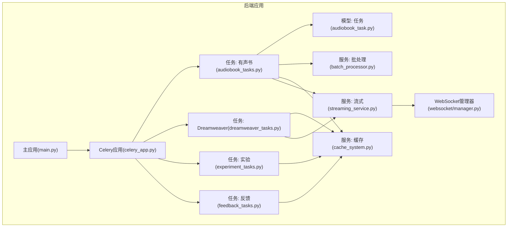
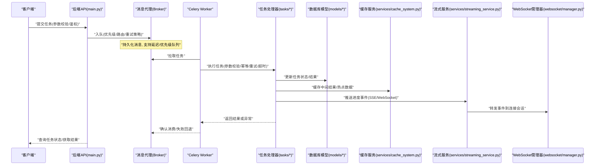
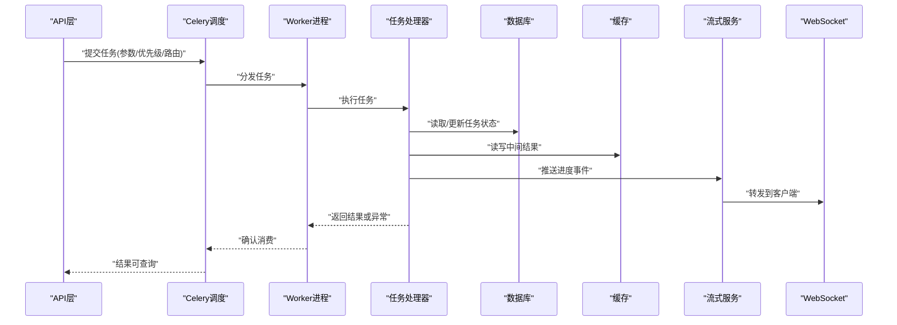
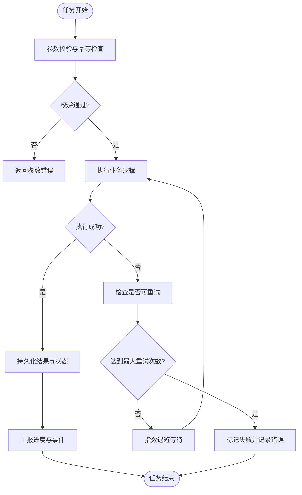
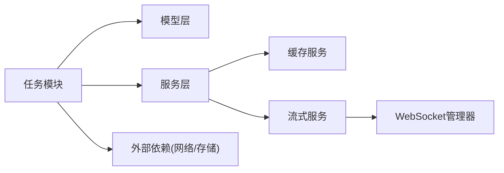

# 后台任务服务

<cite>
**本文引用的文件**   
- [backend/app/celery_app.py](file://backend/app/celery_app.py)
- [backend/app/tasks/audiobook_tasks.py](file://backend/app/tasks/audiobook_tasks.py)
- [backend/app/tasks/dreamweaver_tasks.py](file://backend/app/tasks/dreamweaver_tasks.py)
- [backend/app/tasks/experiment_tasks.py](file://backend/app/tasks/experiment_tasks.py)
- [backend/app/tasks/feedback_tasks.py](file://backend/app/tasks/feedback_tasks.py)
- [backend/app/main.py](file://backend/app/main.py)
- [backend/app/core/config.py](file://backend/app/core/config.py)
- [backend/app/models/audiobook_task.py](file://backend/app/models/audiobook_task.py)
- [backend/app/services/batch_processor.py](file://backend/app/services/batch_processor.py)
- [backend/app/services/cache_system.py](file://backend/app/services/cache_system.py)
- [backend/app/services/streaming_service.py](file://backend/app/services/streaming_service.py)
- [backend/app/websocket/manager.py](file://backend/app/websocket/manager.py)
- [backend/tests/test_audiobook_background_jobs_audio.py](file://backend/tests/test_audiobook_background_jobs_audio.py)
- [backend/tests/test_audiobook_sse_progress.py](file://backend/tests/test_audiobook_sse_progress.py)
- [backend/tests/test_audiobook_task_trace.py](file://backend/tests/test_audiobook_task_trace.py)
- [backend/tests/test_dreamweaver_task_trace.py](file://backend/tests/test_dreamweaver_task_trace.py)
- [backend/tests/test_dev_worker_lifecycle.py](file://backend/tests/test_dev_worker_lifecycle.py)
- [backend/tests/test_sse_retry_preview.py](file://backend/tests/test_sse_retry_preview.py)
- [backend/tests/test_audiobook_task_enqueue_order.py](file://backend/tests/test_audiobook_task_enqueue_order.py)
</cite>

## 目录
1. [简介](#简介)
2. [项目结构](#项目结构)
3. [核心组件](#核心组件)
4. [架构总览](#架构总览)
5. [详细组件分析](#详细组件分析)
6. [依赖关系分析](#依赖关系分析)
7. [性能考量](#性能考量)
8. [故障排查指南](#故障排查指南)
9. [结论](#结论)
10. [附录](#附录)

## 简介
本技术文档聚焦于项目的后台任务服务，围绕Celery任务队列的配置、调度与执行机制展开。内容涵盖任务类型定义、参数校验、结果存储策略、优先级管理、重试与超时控制、监控与进度跟踪、失败处理逻辑，以及开发规范、测试方法与性能优化建议。同时提供队列扩展、自定义路由器与中间件的开发指引，帮助读者在现有工程基础上高效构建可靠的异步任务系统。

## 项目结构
后台任务相关代码主要位于 backend/app 目录下：
- Celery应用初始化与配置入口
- 任务模块按业务域划分（有声书、Dreamweaver、实验、反馈等）
- 模型层用于持久化任务状态与元数据
- 服务层提供批处理、缓存、流式输出等能力
- WebSocket管理器用于实时推送任务进度
- 测试覆盖任务生命周期、SSE进度、追踪与入队顺序等

图表来源
- [backend/app/main.py](file://backend/app/main.py)
- [backend/app/celery_app.py](file://backend/app/celery_app.py)
- [backend/app/tasks/audiobook_tasks.py](file://backend/app/tasks/audiobook_tasks.py)
- [backend/app/tasks/dreamweaver_tasks.py](file://backend/app/tasks/dreamweaver_tasks.py)
- [backend/app/tasks/experiment_tasks.py](file://backend/app/tasks/experiment_tasks.py)
- [backend/app/tasks/feedback_tasks.py](file://backend/app/tasks/feedback_tasks.py)
- [backend/app/models/audiobook_task.py](file://backend/app/models/audiobook_task.py)
- [backend/app/services/batch_processor.py](file://backend/app/services/batch_processor.py)
- [backend/app/services/cache_system.py](file://backend/app/services/cache_system.py)
- [backend/app/services/streaming_service.py](file://backend/app/services/streaming_service.py)
- [backend/app/websocket/manager.py](file://backend/app/websocket/manager.py)

章节来源
- [backend/app/main.py](file://backend/app/main.py)
- [backend/app/celery_app.py](file://backend/app/celery_app.py)

## 核心组件
- Celery应用与配置
  - 负责Broker与Backend的初始化、任务发现、路由与中间件注册、并发与限流策略、日志与追踪集成。
- 任务模块
  - 按业务域组织任务函数，包含参数校验、幂等性设计、重试与超时、结果写入、进度上报。
- 模型与持久化
  - 任务实体模型用于记录任务ID、状态、输入输出、错误信息、时间戳等。
- 服务层
  - 批处理服务用于批量任务编排；缓存服务用于中间结果与热点数据；流式服务用于SSE/WebSocket进度推送。
- WebSocket管理器
  - 维护连接与会话，将任务进度事件推送到前端。

章节来源
- [backend/app/celery_app.py](file://backend/app/celery_app.py)
- [backend/app/tasks/audiobook_tasks.py](file://backend/app/tasks/audiobook_tasks.py)
- [backend/app/models/audiobook_task.py](file://backend/app/models/audiobook_task.py)
- [backend/app/services/batch_processor.py](file://backend/app/services/batch_processor.py)
- [backend/app/services/cache_system.py](file://backend/app/services/cache_system.py)
- [backend/app/services/streaming_service.py](file://backend/app/services/streaming_service.py)
- [backend/app/websocket/manager.py](file://backend/app/websocket/manager.py)

## 架构总览
下图展示了请求从API进入，到Celery任务调度、执行、结果持久化与进度推送的整体流程。

图表来源
- [backend/app/main.py](file://backend/app/main.py)
- [backend/app/celery_app.py](file://backend/app/celery_app.py)
- [backend/app/tasks/audiobook_tasks.py](file://backend/app/tasks/audiobook_tasks.py)
- [backend/app/models/audiobook_task.py](file://backend/app/models/audiobook_task.py)
- [backend/app/services/cache_system.py](file://backend/app/services/cache_system.py)
- [backend/app/services/streaming_service.py](file://backend/app/services/streaming_service.py)
- [backend/app/websocket/manager.py](file://backend/app/websocket/manager.py)

## 详细组件分析

### Celery应用与配置
- 功能要点
  - Broker与Backend初始化：消息代理与结果存储配置，支持高可用与持久化。
  - 任务发现与注册：自动扫描任务模块，确保任务可被Worker加载。
  - 路由与中间件：自定义路由规则、限流、重试、日志与追踪钩子。
  - 并发与资源：工作进程数、线程池大小、内存限制、软/硬超时。
  - 监控与指标：集成Prometheus/Flower等工具，暴露关键指标。
- 最佳实践
  - 使用环境变量集中管理配置，避免硬编码。
  - 为不同业务域设置独立队列与路由键，便于隔离与扩缩容。
  - 启用任务级追踪上下文，便于问题定位与审计。

章节来源
- [backend/app/celery_app.py](file://backend/app/celery_app.py)
- [backend/app/core/config.py](file://backend/app/core/config.py)

### 任务模块：有声书任务
- 功能要点
  - 任务类型：音频生成、转写、质量评估、导出等。
  - 参数校验：基于Pydantic或自定义校验器，确保输入合法性。
  - 结果存储：写入数据库模型与对象存储，保证一致性。
  - 进度上报：通过流式服务与WebSocket推送阶段性结果。
  - 重试与超时：针对外部依赖调用设置指数退避与最大重试次数。
- 典型流程
  - 接收任务参数 -> 校验与幂等检查 -> 调用批处理服务 -> 更新模型状态 -> 推送进度 -> 返回结果。

章节来源
- [backend/app/tasks/audiobook_tasks.py](file://backend/app/tasks/audiobook_tasks.py)
- [backend/app/models/audiobook_task.py](file://backend/app/models/audiobook_task.py)
- [backend/app/services/batch_processor.py](file://backend/app/services/batch_processor.py)
- [backend/app/services/cache_system.py](file://backend/app/services/cache_system.py)
- [backend/app/services/streaming_service.py](file://backend/app/services/streaming_service.py)
- [backend/app/websocket/manager.py](file://backend/app/websocket/manager.py)

### 任务模块：Dreamweaver任务
- 功能要点
  - 任务类型：视频生成、编辑、审核、合成等。
  - 参数校验：严格约束媒体规格、模型选择、渲染参数。
  - 结果存储：产物路径、元数据、版本信息持久化。
  - 进度上报：分阶段进度与错误码映射。
  - 重试与超时：对网络调用与GPU资源进行保护。

章节来源
- [backend/app/tasks/dreamweaver_tasks.py](file://backend/app/tasks/dreamweaver_tasks.py)
- [backend/app/services/cache_system.py](file://backend/app/services/cache_system.py)
- [backend/app/services/streaming_service.py](file://backend/app/services/streaming_service.py)

### 任务模块：实验与反馈任务
- 功能要点
  - 实验任务：A/B测试、模型评测、数据采集与分析。
  - 反馈任务：用户反馈收集、清洗、入库与统计。
  - 参数校验与结果存储：结构化数据入库，支持查询与导出。
  - 进度与重试：轻量任务快速完成，必要时重试与补偿。

章节来源
- [backend/app/tasks/experiment_tasks.py](file://backend/app/tasks/experiment_tasks.py)
- [backend/app/tasks/feedback_tasks.py](file://backend/app/tasks/feedback_tasks.py)
- [backend/app/services/cache_system.py](file://backend/app/services/cache_system.py)

### 模型与持久化：任务实体
- 字段说明
  - 任务ID、状态、输入参数、输出结果、错误信息、时间戳、追踪ID等。
- 设计原则
  - 不可变历史：状态变更追加记录，便于审计与回放。
  - 索引优化：常用查询字段建立索引，提升检索性能。
  - 一致性保障：事务内更新状态与结果，避免脏读。

章节来源
- [backend/app/models/audiobook_task.py](file://backend/app/models/audiobook_task.py)

### 服务层：批处理、缓存与流式
- 批处理服务
  - 批量任务编排、并行度控制、失败隔离与补偿。
- 缓存服务
  - 热点数据缓存、中间结果复用、过期策略与一致性校验。
- 流式服务
  - SSE/WebSocket事件推送、背压控制、断线重连与重试预览。

章节来源
- [backend/app/services/batch_processor.py](file://backend/app/services/batch_processor.py)
- [backend/app/services/cache_system.py](file://backend/app/services/cache_system.py)
- [backend/app/services/streaming_service.py](file://backend/app/services/streaming_service.py)
- [backend/app/websocket/manager.py](file://backend/app/websocket/manager.py)

### 任务执行序列图（以有声书任务为例）

图表来源
- [backend/app/tasks/audiobook_tasks.py](file://backend/app/tasks/audiobook_tasks.py)
- [backend/app/models/audiobook_task.py](file://backend/app/models/audiobook_task.py)
- [backend/app/services/cache_system.py](file://backend/app/services/cache_system.py)
- [backend/app/services/streaming_service.py](file://backend/app/services/streaming_service.py)
- [backend/app/websocket/manager.py](file://backend/app/websocket/manager.py)

### 复杂逻辑流程图（任务重试与超时控制）

图表来源
- [backend/app/tasks/audiobook_tasks.py](file://backend/app/tasks/audiobook_tasks.py)
- [backend/app/tasks/dreamweaver_tasks.py](file://backend/app/tasks/dreamweaver_tasks.py)

## 依赖关系分析
- 组件耦合
  - 任务模块依赖模型与服务层，服务层依赖缓存与流式组件，WebSocket管理器作为推送通道。
- 外部依赖
  - Broker（如Redis/RabbitMQ）、结果后端（如Redis/数据库）、对象存储（如S3/OSS）。
- 潜在循环依赖
  - 通过接口抽象与分层设计避免循环导入，确保模块职责清晰。

图表来源
- [backend/app/tasks/audiobook_tasks.py](file://backend/app/tasks/audiobook_tasks.py)
- [backend/app/models/audiobook_task.py](file://backend/app/models/audiobook_task.py)
- [backend/app/services/cache_system.py](file://backend/app/services/cache_system.py)
- [backend/app/services/streaming_service.py](file://backend/app/services/streaming_service.py)
- [backend/app/websocket/manager.py](file://backend/app/websocket/manager.py)

章节来源
- [backend/app/celery_app.py](file://backend/app/celery_app.py)
- [backend/app/tasks/audiobook_tasks.py](file://backend/app/tasks/audiobook_tasks.py)

## 性能考量
- 队列与路由
  - 按业务域拆分队列，避免热点阻塞；使用优先级队列区分紧急任务。
- 并发与资源
  - 合理设置Worker数量与线程池，避免CPU/内存争用；对I/O密集型任务使用协程或线程池。
- 缓存与批处理
  - 热点数据缓存减少重复计算；批处理合并小任务降低开销。
- 流式推送
  - 背压控制防止前端过载；断线重连与重试预览提升用户体验。
- 监控与指标
  - 暴露队列长度、消费速率、错误率、延迟分布等指标，辅助容量规划与调优。

[本节为通用指导，不直接分析具体文件]

## 故障排查指南
- 常见问题
  - 任务未执行：检查Broker连通性、Worker启动状态、任务路由与队列绑定。
  - 任务失败：查看错误日志、重试次数、超时配置与外部依赖健康状态。
  - 进度不更新：确认流式服务与WebSocket连接状态，检查事件推送链路。
  - 结果不一致：核对持久化事务与缓存一致性策略。
- 调试方法
  - 使用本地Worker单步调试任务；启用详细日志与追踪上下文。
  - 通过测试用例复现场景，验证入队顺序与重试行为。

章节来源
- [backend/tests/test_audiobook_background_jobs_audio.py](file://backend/tests/test_audiobook_background_jobs_audio.py)
- [backend/tests/test_audiobook_sse_progress.py](file://backend/tests/test_audiobook_sse_progress.py)
- [backend/tests/test_audiobook_task_trace.py](file://backend/tests/test_audiobook_task_trace.py)
- [backend/tests/test_dreamweaver_task_trace.py](file://backend/tests/test_dreamweaver_task_trace.py)
- [backend/tests/test_dev_worker_lifecycle.py](file://backend/tests/test_dev_worker_lifecycle.py)
- [backend/tests/test_sse_retry_preview.py](file://backend/tests/test_sse_retry_preview.py)
- [backend/tests/test_audiobook_task_enqueue_order.py](file://backend/tests/test_audiobook_task_enqueue_order.py)

## 结论
本项目后台任务服务基于Celery构建了稳定高效的异步处理能力。通过模块化任务设计、完善的参数校验与结果持久化、灵活的优先级与重试策略、实时的进度推送与监控，满足了复杂业务场景下的可靠性与可扩展性需求。建议在后续迭代中持续优化队列路由、缓存策略与流式推送，完善监控告警与自动化测试，进一步提升系统稳定性与性能。

[本节为总结性内容，不直接分析具体文件]

## 附录
- 任务开发规范
  - 明确任务边界与输入输出契约；实现幂等性与重试语义；统一错误码与日志格式。
- 测试方法
  - 单元测试覆盖参数校验与核心逻辑；集成测试验证端到端流程；性能测试评估吞吐与延迟。
- 扩展与定制
  - 自定义路由器实现动态路由；中间件注入横切关注点（认证、限流、追踪）；插件化任务注册与管理。

[本节为通用指导，不直接分析具体文件]