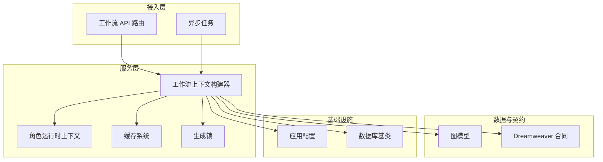
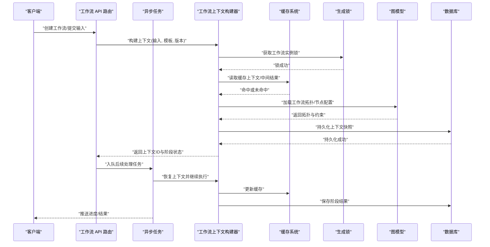
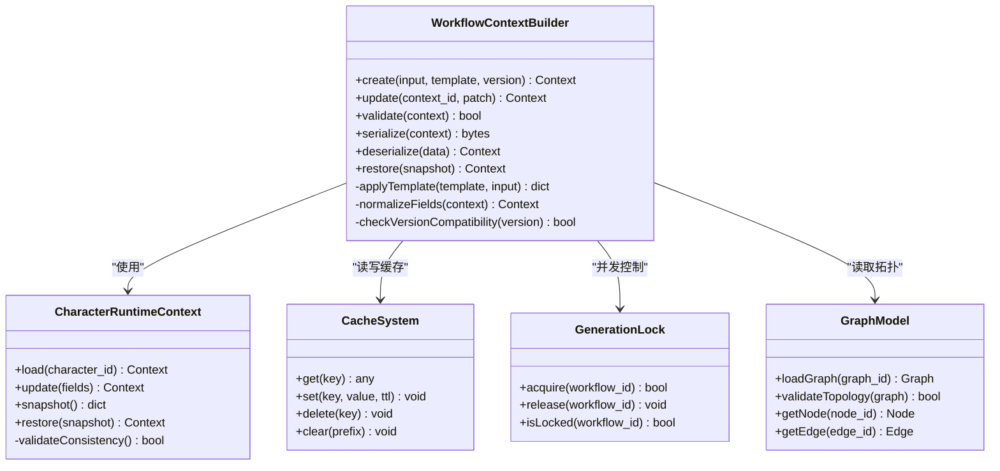
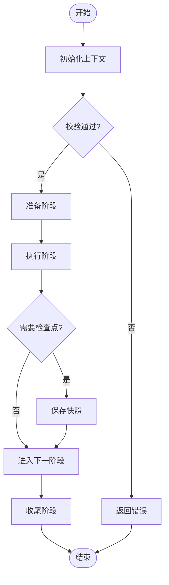
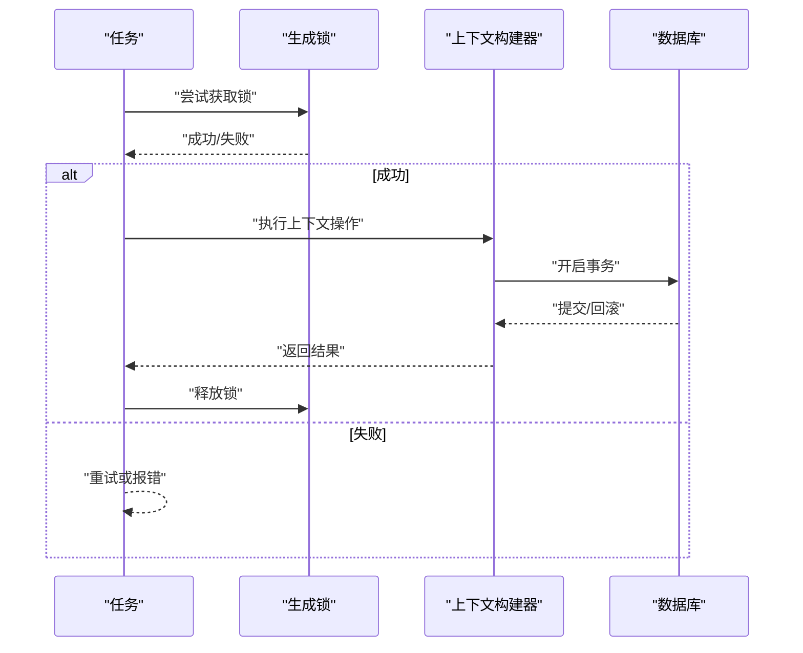
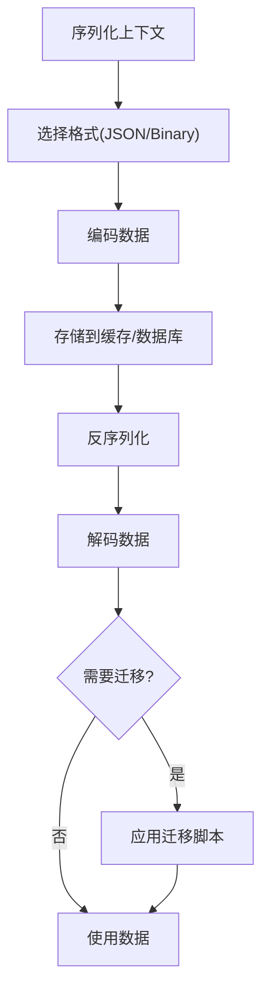
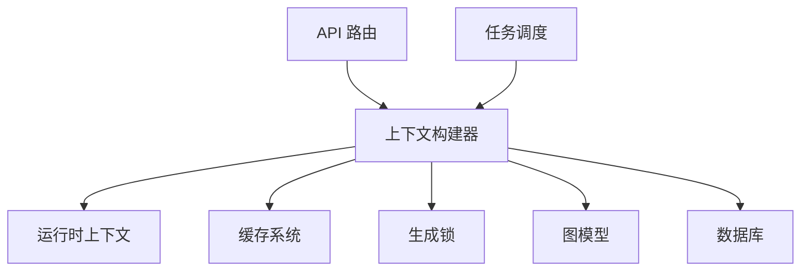

# 工作流上下文构建器

<cite>
**本文引用的文件**   
- [backend/app/services/workflow_context_builder.py](file://backend/app/services/workflow_context_builder.py)
- [backend/app/services/character_runtime_context.py](file://backend/app/services/character_runtime_context.py)
- [backend/app/services/cache_system.py](file://backend/app/services/cache_system.py)
- [backend/app/services/generation_lock.py](file://backend/app/services/generation_lock.py)
- [backend/app/models/graph.py](file://backend/app/models/graph.py)
- [backend/app/schemas/dreamweaver_contract.py](file://backend/app/schemas/dreamweaver_contract.py)
- [backend/app/api/v1/workflow/routes.py](file://backend/app/api/v1/workflow/routes.py)
- [backend/app/tasks/dreamweaver_tasks.py](file://backend/app/tasks/dreamweaver_tasks.py)
- [backend/app/core/config.py](file://backend/app/core/config.py)
- [backend/app/db/base.py](file://backend/app/db/base.py)
- [backend/tests/test_workflow_context_builder.py](file://backend/tests/test_workflow_context_builder.py)
</cite>

## 目录
1. [简介](#简介)
2. [项目结构](#项目结构)
3. [核心组件](#核心组件)
4. [架构总览](#架构总览)
5. [详细组件分析](#详细组件分析)
6. [依赖关系分析](#依赖关系分析)
7. [性能考虑](#性能考虑)
8. [故障排查指南](#故障排查指南)
9. [结论](#结论)
10. [附录](#附录)

## 简介
本技术文档聚焦于“工作流上下文构建器”的设计与实现，围绕工作流状态管理、上下文数据结构、版本控制机制展开。文档覆盖工作流生命周期各阶段的数据传递、状态持久化与恢复策略；解释上下文隔离、并发控制与事务管理机制；并说明工作流模板系统、动态流程编排与执行引擎集成。此外，提供上下文序列化、反序列化与迁移方案，以及性能优化、内存管理与缓存策略的实践建议。

## 项目结构
工作流上下文构建器位于后端服务层，主要涉及以下模块：
- 服务层：工作流上下文构建器、角色运行时上下文、缓存系统、生成锁
- 数据模型：图模型（用于工作流节点与边）
- 接口契约：Dreamweaver 合同（定义输入输出结构）
- API 路由：工作流相关接口
- 任务调度：异步任务执行
- 配置与数据库：应用配置、数据库基类
- 测试：工作流上下文构建器的单元测试

图表来源
- [backend/app/services/workflow_context_builder.py](file://backend/app/services/workflow_context_builder.py)
- [backend/app/services/character_runtime_context.py](file://backend/app/services/character_runtime_context.py)
- [backend/app/services/cache_system.py](file://backend/app/services/cache_system.py)
- [backend/app/services/generation_lock.py](file://backend/app/services/generation_lock.py)
- [backend/app/models/graph.py](file://backend/app/models/graph.py)
- [backend/app/schemas/dreamweaver_contract.py](file://backend/app/schemas/dreamweaver_contract.py)
- [backend/app/api/v1/workflow/routes.py](file://backend/app/api/v1/workflow/routes.py)
- [backend/app/tasks/dreamweaver_tasks.py](file://backend/app/tasks/dreamweaver_tasks.py)
- [backend/app/core/config.py](file://backend/app/core/config.py)
- [backend/app/db/base.py](file://backend/app/db/base.py)

章节来源
- [backend/app/services/workflow_context_builder.py](file://backend/app/services/workflow_context_builder.py)
- [backend/app/services/character_runtime_context.py](file://backend/app/services/character_runtime_context.py)
- [backend/app/services/cache_system.py](file://backend/app/services/cache_system.py)
- [backend/app/services/generation_lock.py](file://backend/app/services/generation_lock.py)
- [backend/app/models/graph.py](file://backend/app/models/graph.py)
- [backend/app/schemas/dreamweaver_contract.py](file://backend/app/schemas/dreamweaver_contract.py)
- [backend/app/api/v1/workflow/routes.py](file://backend/app/api/v1/workflow/routes.py)
- [backend/app/tasks/dreamweaver_tasks.py](file://backend/app/tasks/dreamweaver_tasks.py)
- [backend/app/core/config.py](file://backend/app/core/config.py)
- [backend/app/db/base.py](file://backend/app/db/base.py)

## 核心组件
- 工作流上下文构建器：负责组装工作流运行所需的上下文对象，包括阶段信息、输入参数、模板绑定、资源引用、版本元数据等；提供创建、更新、校验、序列化和恢复能力。
- 角色运行时上下文：维护角色相关的运行时状态（如角色属性、关联资产、一致性约束），供工作流步骤读取与写入。
- 缓存系统：为工作流上下文及中间结果提供缓存支持，减少重复计算与 I/O 压力。
- 生成锁：确保同一工作流实例的并发安全，避免竞态条件导致的上下文不一致。
- 图模型：描述工作流节点与边的拓扑结构，支撑动态编排与执行。
- Dreamweaver 合同：定义工作流输入输出结构与字段约束，保证跨模块契约一致性。
- 工作流 API 路由：暴露创建工作流、查询状态、提交输入、获取结果等接口。
- 异步任务：将耗时操作放入队列，保障高吞吐与可恢复性。
- 配置与数据库：集中管理环境变量与数据库连接，支撑上下文持久化与迁移。

章节来源
- [backend/app/services/workflow_context_builder.py](file://backend/app/services/workflow_context_builder.py)
- [backend/app/services/character_runtime_context.py](file://backend/app/services/character_runtime_context.py)
- [backend/app/services/cache_system.py](file://backend/app/services/cache_system.py)
- [backend/app/services/generation_lock.py](file://backend/app/services/generation_lock.py)
- [backend/app/models/graph.py](file://backend/app/models/graph.py)
- [backend/app/schemas/dreamweaver_contract.py](file://backend/app/schemas/dreamweaver_contract.py)
- [backend/app/api/v1/workflow/routes.py](file://backend/app/api/v1/workflow/routes.py)
- [backend/app/tasks/dreamweaver_tasks.py](file://backend/app/tasks/dreamweaver_tasks.py)
- [backend/app/core/config.py](file://backend/app/core/config.py)
- [backend/app/db/base.py](file://backend/app/db/base.py)

## 架构总览
工作流上下文构建器处于服务层的核心位置，向上对接 API 路由与任务调度，向下依赖缓存、锁、图模型与数据库。其职责包括：
- 解析请求或任务载荷，结合模板与配置构建上下文
- 校验上下文完整性与版本兼容性
- 在阶段间传递数据，保持状态一致性与可追溯性
- 通过缓存与锁提升并发性能与安全性
- 持久化关键状态，支持断点恢复与回滚

图表来源
- [backend/app/api/v1/workflow/routes.py](file://backend/app/api/v1/workflow/routes.py)
- [backend/app/tasks/dreamweaver_tasks.py](file://backend/app/tasks/dreamweaver_tasks.py)
- [backend/app/services/workflow_context_builder.py](file://backend/app/services/workflow_context_builder.py)
- [backend/app/services/cache_system.py](file://backend/app/services/cache_system.py)
- [backend/app/services/generation_lock.py](file://backend/app/services/generation_lock.py)
- [backend/app/models/graph.py](file://backend/app/models/graph.py)
- [backend/app/db/base.py](file://backend/app/db/base.py)

## 详细组件分析

### 工作流上下文构建器
- 功能要点
  - 上下文装配：整合输入参数、模板变量、资源引用、阶段元数据与版本信息
  - 校验与规范化：字段类型检查、必填项验证、默认值填充、格式标准化
  - 版本控制：兼容不同版本的上下文结构，提供迁移路径与降级策略
  - 序列化与恢复：将上下文持久化为稳定格式，支持从快照恢复执行状态
  - 阶段数据传递：在各阶段之间传递必要数据，保持最小耦合与最大内聚
- 设计模式
  - 工厂模式：根据模板与配置创建不同类型的上下文实例
  - 策略模式：针对不同工作流类型选择相应的校验与转换策略
  - 观察者模式：记录上下文变更事件，便于审计与追踪
- 错误处理
  - 结构化错误码与消息，便于前端展示与调试
  - 异常捕获与重试策略，提高鲁棒性
- 性能优化
  - 懒加载与增量更新，减少不必要的计算
  - 缓存热点数据，降低 I/O 开销

图表来源
- [backend/app/services/workflow_context_builder.py](file://backend/app/services/workflow_context_builder.py)
- [backend/app/services/character_runtime_context.py](file://backend/app/services/character_runtime_context.py)
- [backend/app/services/cache_system.py](file://backend/app/services/cache_system.py)
- [backend/app/services/generation_lock.py](file://backend/app/services/generation_lock.py)
- [backend/app/models/graph.py](file://backend/app/models/graph.py)

章节来源
- [backend/app/services/workflow_context_builder.py](file://backend/app/services/workflow_context_builder.py)
- [backend/app/services/character_runtime_context.py](file://backend/app/services/character_runtime_context.py)
- [backend/app/services/cache_system.py](file://backend/app/services/cache_system.py)
- [backend/app/services/generation_lock.py](file://backend/app/services/generation_lock.py)
- [backend/app/models/graph.py](file://backend/app/models/graph.py)

### 工作流生命周期与数据传递
- 阶段划分
  - 初始化：解析输入、加载模板、构建初始上下文
  - 准备：校验上下文、预取资源、预热缓存
  - 执行：按拓扑顺序执行节点，传递阶段数据
  - 收尾：聚合结果、清理临时资源、更新最终状态
- 数据传递策略
  - 显式传递：通过上下文对象在各阶段间传递必要数据
  - 隐式共享：通过缓存或外部存储共享大对象
  - 事件驱动：通过事件总线通知下游阶段
- 状态持久化与恢复
  - 快照策略：在每个阶段边界保存上下文快照
  - 增量更新：仅保存变更字段，减少存储开销
  - 恢复机制：从最新快照恢复执行状态，支持断点续跑

图表来源
- [backend/app/services/workflow_context_builder.py](file://backend/app/services/workflow_context_builder.py)
- [backend/app/tasks/dreamweaver_tasks.py](file://backend/app/tasks/dreamweaver_tasks.py)

章节来源
- [backend/app/services/workflow_context_builder.py](file://backend/app/services/workflow_context_builder.py)
- [backend/app/tasks/dreamweaver_tasks.py](file://backend/app/tasks/dreamweaver_tasks.py)

### 上下文隔离、并发控制与事务管理
- 上下文隔离
  - 每个工作流实例拥有独立的上下文空间，避免数据污染
  - 通过命名空间或键前缀隔离缓存条目
- 并发控制
  - 使用生成锁确保同一工作流实例的串行执行
  - 细粒度锁：按节点或阶段锁定，提高并行度
- 事务管理
  - 数据库操作包裹在事务中，保证一致性
  - 失败回滚：异常时回滚未提交的事务

图表来源
- [backend/app/services/generation_lock.py](file://backend/app/services/generation_lock.py)
- [backend/app/db/base.py](file://backend/app/db/base.py)

章节来源
- [backend/app/services/generation_lock.py](file://backend/app/services/generation_lock.py)
- [backend/app/db/base.py](file://backend/app/db/base.py)

### 工作流模板系统与动态编排
- 模板系统
  - 模板定义：描述工作流结构、节点类型、参数绑定与约束
  - 模板版本：支持多版本模板并存与切换
  - 模板继承：基础模板与扩展模板的组合
- 动态编排
  - 基于图模型的动态构建：根据输入动态生成工作流拓扑
  - 条件分支：根据运行时条件选择不同执行路径
  - 循环与并行：支持复杂控制流

图表来源
- [backend/app/models/graph.py](file://backend/app/models/graph.py)
- [backend/app/schemas/dreamweaver_contract.py](file://backend/app/schemas/dreamweaver_contract.py)

章节来源
- [backend/app/models/graph.py](file://backend/app/models/graph.py)
- [backend/app/schemas/dreamweaver_contract.py](file://backend/app/schemas/dreamweaver_contract.py)

### 执行引擎集成
- 集成方式
  - 适配器模式：封装不同执行引擎的差异
  - 插件机制：支持动态加载自定义执行器
- 任务调度
  - 异步任务队列：解耦耗时操作
  - 重试与超时：提高可靠性
- 监控与追踪
  - 指标收集：记录执行时间与成功率
  - 链路追踪：串联调用链，便于问题定位

章节来源
- [backend/app/tasks/dreamweaver_tasks.py](file://backend/app/tasks/dreamweaver_tasks.py)
- [backend/app/api/v1/workflow/routes.py](file://backend/app/api/v1/workflow/routes.py)

### 上下文序列化、反序列化与迁移
- 序列化格式
  - JSON/YAML：人类可读，便于调试
  - Protobuf/MessagePack：高效二进制格式
- 迁移策略
  - 向后兼容：新版本能读取旧版本数据
  - 向前兼容：旧版本能忽略新增字段
  - 迁移脚本：自动升级数据结构

图表来源
- [backend/app/services/workflow_context_builder.py](file://backend/app/services/workflow_context_builder.py)

章节来源
- [backend/app/services/workflow_context_builder.py](file://backend/app/services/workflow_context_builder.py)

## 依赖关系分析
工作流上下文构建器依赖多个子系统，形成清晰的层次结构：
- 上层：API 路由与任务调度
- 中层：上下文构建器与运行时上下文
- 下层：缓存、锁、图模型、数据库

图表来源
- [backend/app/api/v1/workflow/routes.py](file://backend/app/api/v1/workflow/routes.py)
- [backend/app/tasks/dreamweaver_tasks.py](file://backend/app/tasks/dreamweaver_tasks.py)
- [backend/app/services/workflow_context_builder.py](file://backend/app/services/workflow_context_builder.py)
- [backend/app/services/character_runtime_context.py](file://backend/app/services/character_runtime_context.py)
- [backend/app/services/cache_system.py](file://backend/app/services/cache_system.py)
- [backend/app/services/generation_lock.py](file://backend/app/services/generation_lock.py)
- [backend/app/models/graph.py](file://backend/app/models/graph.py)
- [backend/app/db/base.py](file://backend/app/db/base.py)

章节来源
- [backend/app/api/v1/workflow/routes.py](file://backend/app/api/v1/workflow/routes.py)
- [backend/app/tasks/dreamweaver_tasks.py](file://backend/app/tasks/dreamweaver_tasks.py)
- [backend/app/services/workflow_context_builder.py](file://backend/app/services/workflow_context_builder.py)
- [backend/app/services/character_runtime_context.py](file://backend/app/services/character_runtime_context.py)
- [backend/app/services/cache_system.py](file://backend/app/services/cache_system.py)
- [backend/app/services/generation_lock.py](file://backend/app/services/generation_lock.py)
- [backend/app/models/graph.py](file://backend/app/models/graph.py)
- [backend/app/db/base.py](file://backend/app/db/base.py)

## 性能考虑
- 缓存策略
  - 多级缓存：内存缓存 + 分布式缓存
  - 缓存失效：基于 TTL 或版本号
  - 热点数据：预加载与预计算
- 内存管理
  - 对象池：复用大型对象
  - 流式处理：避免一次性加载大数据
  - 垃圾回收：及时释放不再使用的资源
- 并发优化
  - 无锁数据结构：减少竞争
  - 批量操作：合并 I/O 请求
  - 异步 I/O：提高吞吐量

## 故障排查指南
- 常见问题
  - 上下文构建失败：检查输入参数与模板配置
  - 状态不一致：查看锁状态与事务日志
  - 性能瓶颈：分析缓存命中率与 I/O 延迟
- 调试技巧
  - 启用详细日志：记录关键步骤与参数
  - 使用追踪 ID：串联调用链
  - 模拟环境：复现问题场景
- 恢复策略
  - 从快照恢复：使用最近的有效快照
  - 重试机制：对瞬时失败进行自动重试
  - 降级方案：切换到备用流程

章节来源
- [backend/tests/test_workflow_context_builder.py](file://backend/tests/test_workflow_context_builder.py)

## 结论
工作流上下文构建器是整个工作流系统的核心组件，负责上下文的生命周期管理、状态持久化与恢复、并发控制与性能优化。通过清晰的架构设计与模块化实现，系统具备良好的可扩展性与可维护性。未来可进一步探索更智能的模板推理、自适应编排与自动化调优。

## 附录
- 术语表
  - 上下文：工作流执行所需的状态与数据集合
  - 快照：特定时刻的上下文状态副本
  - 模板：定义工作流结构与行为的蓝图
- 参考链接
  - 工作流 API 文档
  - 模板语法规范
  - 性能基准测试结果