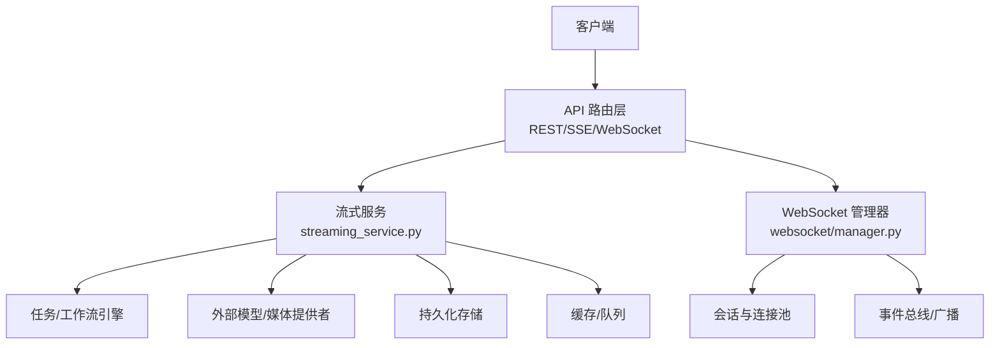
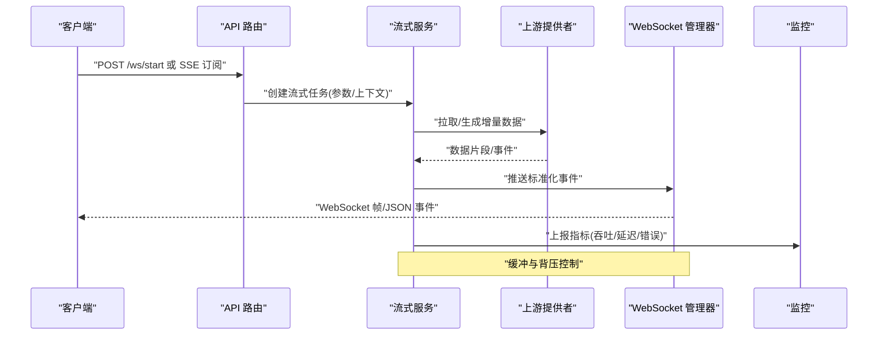
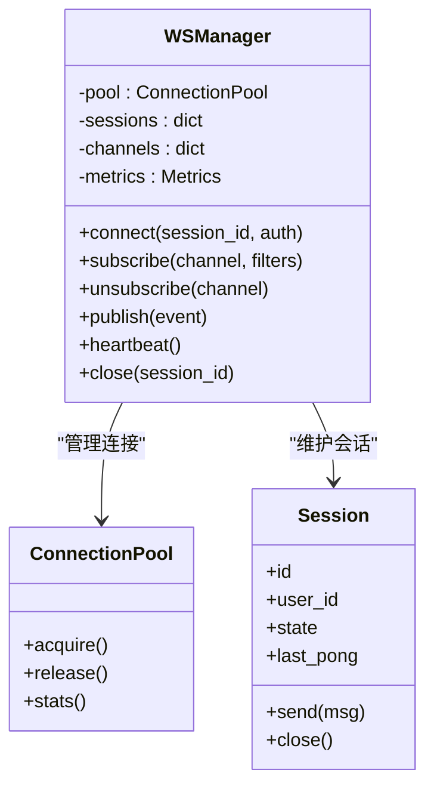
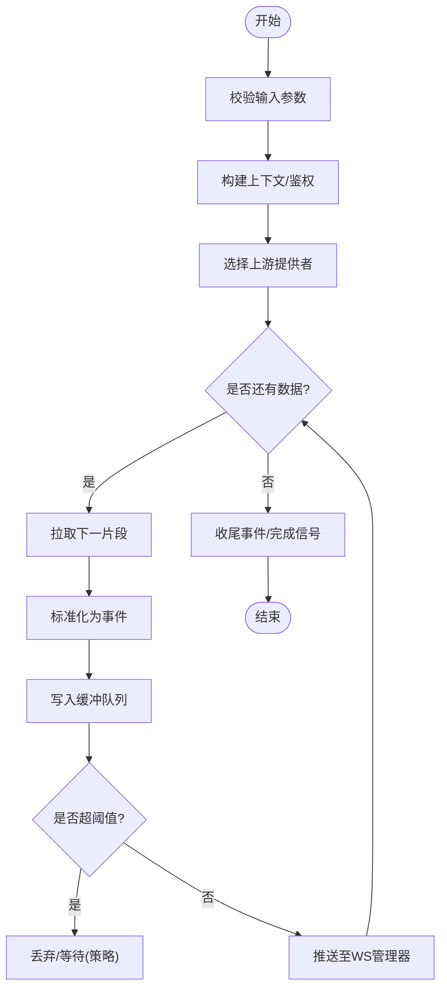
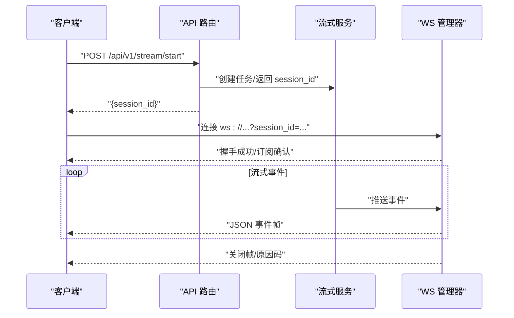
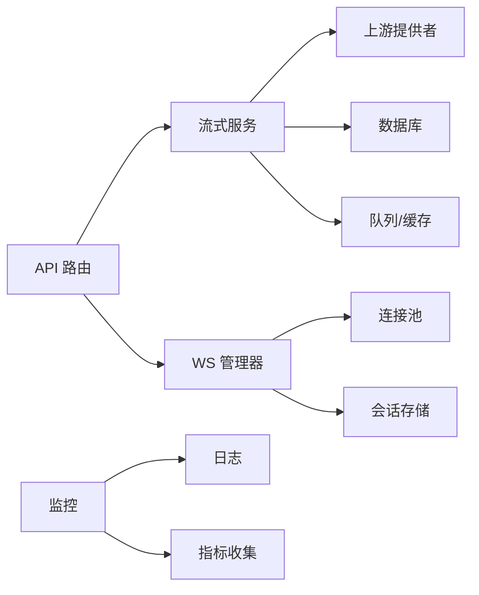

# 流式服务

<cite>
**本文引用的文件**   
- [backend/app/main.py](file://backend/app/main.py)
- [backend/app/websocket/manager.py](file://backend/app/websocket/manager.py)
- [backend/app/services/streaming_service.py](file://backend/app/services/streaming_service.py)
- [backend/app/api/v1/audiobook.py](file://backend/app/api/v1/audiobook.py)
- [backend/app/api/v1/dreamweaver.py](file://backend/app/api/v1/dreamweaver.py)
- [backend/app/api/v1/monitoring.py](file://backend/app/api/v1/monitoring.py)
- [scripts/verify_seed_tts_websocket.py](file://scripts/verify_seed_tts_websocket.py)
- [scripts/verify_seed_tts_websocket_v2.py](file://scripts/verify_seed_tts_websocket_v2.py)
- [scripts/verify_seed_tts_websocket_v3.py](file://scripts/verify_seed_tts_websocket_v3.py)
- [backend/tests/test_audiobook_stream_routes.py](file://backend/tests/test_audiobook_stream_routes.py)
- [backend/tests/test_sse_retry_preview.py](file://backend/tests/test_sse_retry_preview.py)
- [backend/tests/test_workflow_streaming_regression.py](file://backend/tests/test_workflow_streaming_regression.py)
- [docs/SEED_TTS_WEBSOCKET_IMPLEMENTATION.md](file://docs/SEED_TTS_WEBSOCKET_IMPLEMENTATION.md)
</cite>

## 目录
1. [简介](#简介)
2. [项目结构](#项目结构)
3. [核心组件](#核心组件)
4. [架构总览](#架构总览)
5. [详细组件分析](#详细组件分析)
6. [依赖关系分析](#依赖关系分析)
7. [性能考量](#性能考量)
8. [故障排查指南](#故障排查指南)
9. [结论](#结论)
10. [附录](#附录)

## 简介
本技术文档聚焦于项目的“流式服务”能力，覆盖 WebSocket 连接管理、实时消息推送与事件订阅机制；阐述流式数据传输协议、消息格式与错误处理策略；说明连接池管理、心跳检测与断线重连逻辑；并给出流式数据处理、缓冲管理与背压控制方案。同时提供流式 API 接口规范、客户端集成指南、性能优化建议以及监控调试与故障排查方法。

## 项目结构
本项目采用分层与按功能域组织相结合的结构：
- 应用入口与路由层：后端主应用、API 路由（REST/SSE/WebSocket）
- 服务层：流式服务编排、任务调度、业务编排
- WebSocket 管理层：连接生命周期、会话状态、广播与订阅
- 脚本与测试：WebSocket 验证脚本、回归与兼容性测试
- 文档：WebSocket 实现说明与设计要点

图表来源
- [backend/app/main.py](file://backend/app/main.py)
- [backend/app/websocket/manager.py](file://backend/app/websocket/manager.py)
- [backend/app/services/streaming_service.py](file://backend/app/services/streaming_service.py)

章节来源
- [backend/app/main.py](file://backend/app/main.py)
- [backend/app/websocket/manager.py](file://backend/app/websocket/manager.py)
- [backend/app/services/streaming_service.py](file://backend/app/services/streaming_service.py)

## 核心组件
- WebSocket 管理器：负责连接建立、鉴权与会话绑定、心跳保活、断线重连协调、消息路由与广播、连接池统计与限流。
- 流式服务：统一编排流式生成流程（如 TTS/视频/图像），将上游数据源转换为标准流式事件，支持分片、缓冲与背压。
- API 路由层：暴露 REST/SSE/WebSocket 端点，用于发起流式任务、查询进度、订阅事件与获取结果。
- 监控与诊断：提供连接数、吞吐、延迟、错误率等指标，以及日志与追踪上下文透传。

章节来源
- [backend/app/websocket/manager.py](file://backend/app/websocket/manager.py)
- [backend/app/services/streaming_service.py](file://backend/app/services/streaming_service.py)
- [backend/app/api/v1/audiobook.py](file://backend/app/api/v1/audiobook.py)
- [backend/app/api/v1/dreamweaver.py](file://backend/app/api/v1/dreamweaver.py)
- [backend/app/api/v1/monitoring.py](file://backend/app/api/v1/monitoring.py)

## 架构总览
整体采用“请求-流式编排-事件分发”的架构：
- 客户端通过 REST/SSE/WebSocket 发起流式任务或订阅事件。
- 路由层校验参数与权限后，调用流式服务进行编排。
- 流式服务根据任务类型选择上游提供者，产生增量数据。
- 数据经标准化封装为事件，通过 WebSocket 管理器推送到对应会话。
- 监控模块采集关键指标，便于观测与告警。

图表来源
- [backend/app/api/v1/audiobook.py](file://backend/app/api/v1/audiobook.py)
- [backend/app/api/v1/dreamweaver.py](file://backend/app/api/v1/dreamweaver.py)
- [backend/app/services/streaming_service.py](file://backend/app/services/streaming_service.py)
- [backend/app/websocket/manager.py](file://backend/app/websocket/manager.py)
- [backend/app/api/v1/monitoring.py](file://backend/app/api/v1/monitoring.py)

## 详细组件分析

### WebSocket 管理器
职责与特性：
- 连接生命周期：握手、鉴权、会话注册、关闭清理。
- 心跳检测：周期性 Ping/Pong，超时判定断开。
- 断线重连：服务端侧协调重试策略（退避、上限）。
- 连接池管理：按用户/租户维度隔离，容量限制与配额。
- 事件订阅：主题/通道级别订阅，支持过滤与优先级。
- 背压与缓冲：基于内存队列与阈值控制，避免 OOM。

图表来源
- [backend/app/websocket/manager.py](file://backend/app/websocket/manager.py)

章节来源
- [backend/app/websocket/manager.py](file://backend/app/websocket/manager.py)

### 流式服务
职责与特性：
- 统一编排：抽象不同上游（TTS/视频/图像/LLM）的流式输出。
- 事件标准化：定义统一的 JSON 事件结构，包含类型、序列号、时间戳、负载。
- 缓冲与背压：滑动窗口、水位线、丢弃策略（可配置）。
- 错误恢复：重试、降级、熔断、补偿事件。
- 监控埋点：耗时、吞吐、错误码分布、资源使用。

图表来源
- [backend/app/services/streaming_service.py](file://backend/app/services/streaming_service.py)

章节来源
- [backend/app/services/streaming_service.py](file://backend/app/services/streaming_service.py)

### API 路由层（REST/SSE/WebSocket）
- REST：提交流式任务、查询状态、下载结果。
- SSE：单向流式进度与中间结果推送。
- WebSocket：双向交互，支持命令/事件、心跳、重连协商。

图表来源
- [backend/app/api/v1/audiobook.py](file://backend/app/api/v1/audiobook.py)
- [backend/app/api/v1/dreamweaver.py](file://backend/app/api/v1/dreamweaver.py)
- [backend/app/services/streaming_service.py](file://backend/app/services/streaming_service.py)
- [backend/app/websocket/manager.py](file://backend/app/websocket/manager.py)

章节来源
- [backend/app/api/v1/audiobook.py](file://backend/app/api/v1/audiobook.py)
- [backend/app/api/v1/dreamweaver.py](file://backend/app/api/v1/dreamweaver.py)

### 监控与诊断
- 指标：连接数、活跃会话、事件吞吐、平均/分位延迟、错误率。
- 日志：结构化日志，包含 session_id、trace_id、阶段标记。
- 诊断：健康检查、慢查询/慢路径定位、内存与队列水位告警。

章节来源
- [backend/app/api/v1/monitoring.py](file://backend/app/api/v1/monitoring.py)

## 依赖关系分析
- 路由层依赖流式服务与 WS 管理器。
- 流式服务依赖上游提供者、数据库与缓存/队列。
- WS 管理器依赖连接池与会话存储。
- 监控模块依赖日志与指标收集器。

图表来源
- [backend/app/api/v1/audiobook.py](file://backend/app/api/v1/audiobook.py)
- [backend/app/api/v1/dreamweaver.py](file://backend/app/api/v1/dreamweaver.py)
- [backend/app/services/streaming_service.py](file://backend/app/services/streaming_service.py)
- [backend/app/websocket/manager.py](file://backend/app/websocket/manager.py)

章节来源
- [backend/app/api/v1/audiobook.py](file://backend/app/api/v1/audiobook.py)
- [backend/app/api/v1/dreamweaver.py](file://backend/app/api/v1/dreamweaver.py)
- [backend/app/services/streaming_service.py](file://backend/app/services/streaming_service.py)
- [backend/app/websocket/manager.py](file://backend/app/websocket/manager.py)

## 性能考量
- 缓冲与背压
  - 使用有界队列与水位线，超过阈值时触发丢弃或阻塞生产者。
  - 对大对象进行分块传输，减少单次帧大小。
- 心跳与超时
  - 合理设置 Ping/Pong 间隔与超时阈值，避免误判。
  - 空闲连接回收与资源释放。
- 连接池与并发
  - 按用户/租户隔离连接池，限制最大连接数与单会话速率。
  - 异步 I/O 与非阻塞发送，避免线程阻塞。
- 上游限流与熔断
  - 对上游提供者实施令牌桶/漏桶限流，失败快速失败与重试退避。
- 监控与调优
  - 关注队列长度、GC 停顿、CPU 与网络带宽，结合分位延迟优化。

[本节为通用指导，不直接分析具体文件]

## 故障排查指南
常见问题与定位步骤：
- 连接频繁断开
  - 检查心跳间隔与超时配置，查看 WS 管理器日志中的 Ping/Pong 记录。
  - 观察网络抖动与代理/负载均衡超时设置。
- 消息丢失或乱序
  - 核对事件序列号与去重逻辑，检查缓冲队列溢出策略。
  - 确认消费者消费速度与背压生效。
- 高延迟或吞吐下降
  - 查看上游提供者响应时间与错误率，启用熔断与降级。
  - 检查 CPU、内存、I/O 瓶颈，调整并发与批大小。
- 内存泄漏
  - 监控会话与连接数量，确保关闭路径释放资源。
  - 检查未消费队列堆积与大对象引用。

章节来源
- [backend/app/websocket/manager.py](file://backend/app/websocket/manager.py)
- [backend/app/services/streaming_service.py](file://backend/app/services/streaming_service.py)
- [backend/app/api/v1/monitoring.py](file://backend/app/api/v1/monitoring.py)

## 结论
该流式服务以 WebSocket 为核心通道，配合标准化的事件协议与完善的连接管理，实现了稳定高效的实时推送与事件订阅。通过缓冲与背压、心跳与重连、监控与诊断等手段，保障了在高并发与不稳定网络环境下的可靠性与性能。建议在接入时严格遵循事件格式与错误码约定，并结合监控指标持续优化。

[本节为总结性内容，不直接分析具体文件]

## 附录

### 流式数据传输协议与消息格式
- 传输协议
  - WebSocket：二进制帧承载 JSON 事件，支持 Ping/Pong 心跳。
  - SSE：文本流，逐行推送事件，适合单向进度与中间结果。
- 事件结构（示例字段）
  - type：事件类型（start、chunk、done、error、ping、pong）
  - session_id：会话标识
  - seq：序列号（单调递增）
  - ts：时间戳（毫秒）
  - payload：业务负载（因类型而异）
  - error_code：错误码（仅 error 事件）
- 错误码约定
  - 4xx：客户端错误（参数非法、权限不足）
  - 5xx：服务端错误（上游失败、内部异常）
  - 1xxx：业务错误（内容安全、配额不足）

章节来源
- [backend/app/services/streaming_service.py](file://backend/app/services/streaming_service.py)
- [backend/app/websocket/manager.py](file://backend/app/websocket/manager.py)

### 连接池管理、心跳检测与断线重连
- 连接池
  - 按用户/租户维度隔离，支持容量限制与配额。
  - 空闲连接回收与热插拔扩容。
- 心跳检测
  - 客户端与服务端双向 Ping/Pong，超时即断开。
  - 可配置最小/最大间隔与重试次数。
- 断线重连
  - 指数退避与抖动，避免雪崩。
  - 支持会话恢复（可选）与事件补发（可选）。

章节来源
- [backend/app/websocket/manager.py](file://backend/app/websocket/manager.py)

### 流式数据处理、缓冲管理与背压控制
- 缓冲策略
  - 有界队列与水位线，超限触发丢弃或阻塞。
  - 分块传输与合并策略，平衡延迟与吞吐。
- 背压控制
  - 消费者反馈（ACK/NACK）驱动生产者速率。
  - 动态调整批次大小与并发度。

章节来源
- [backend/app/services/streaming_service.py](file://backend/app/services/streaming_service.py)

### 流式 API 接口规范
- REST
  - POST /api/v1/stream/start：创建流式任务，返回 session_id
  - GET /api/v1/stream/status?session_id=...：查询状态
  - GET /api/v1/stream/result?session_id=...：获取最终结果
- SSE
  - GET /api/v1/stream/events?session_id=...：订阅事件流
- WebSocket
  - ws://host/ws?session_id=...：双向通信，支持命令与事件

章节来源
- [backend/app/api/v1/audiobook.py](file://backend/app/api/v1/audiobook.py)
- [backend/app/api/v1/dreamweaver.py](file://backend/app/api/v1/dreamweaver.py)

### 客户端集成指南
- 连接建立
  - 先通过 REST 创建任务获取 session_id，再连接 WebSocket。
  - 首次消息发送订阅主题与过滤器。
- 心跳与重连
  - 客户端定时发送 Ping，服务端回 Pong。
  - 断线后按指数退避重连，携带 session_id 恢复。
- 事件处理
  - 按序列号去重与排序，处理 done/error 终止条件。
  - 背压：当本地渲染/播放慢时，暂停消费或丢弃低优先级事件。

章节来源
- [scripts/verify_seed_tts_websocket.py](file://scripts/verify_seed_tts_websocket.py)
- [scripts/verify_seed_tts_websocket_v2.py](file://scripts/verify_seed_tts_websocket_v2.py)
- [scripts/verify_seed_tts_websocket_v3.py](file://scripts/verify_seed_tts_websocket_v3.py)

### 监控、调试与测试
- 监控
  - 连接数、活跃会话、事件吞吐、延迟分位、错误率。
  - 健康检查端点与告警规则。
- 调试
  - 结构化日志与 trace_id 透传。
  - 回放工具与抓包辅助。
- 测试
  - 回归测试覆盖常见场景与边界条件。
  - 压力测试评估吞吐与稳定性。

章节来源
- [backend/app/api/v1/monitoring.py](file://backend/app/api/v1/monitoring.py)
- [backend/tests/test_audiobook_stream_routes.py](file://backend/tests/test_audiobook_stream_routes.py)
- [backend/tests/test_sse_retry_preview.py](file://backend/tests/test_sse_retry_preview.py)
- [backend/tests/test_workflow_streaming_regression.py](file://backend/tests/test_workflow_streaming_regression.py)
- [docs/SEED_TTS_WEBSOCKET_IMPLEMENTATION.md](file://docs/SEED_TTS_WEBSOCKET_IMPLEMENTATION.md)