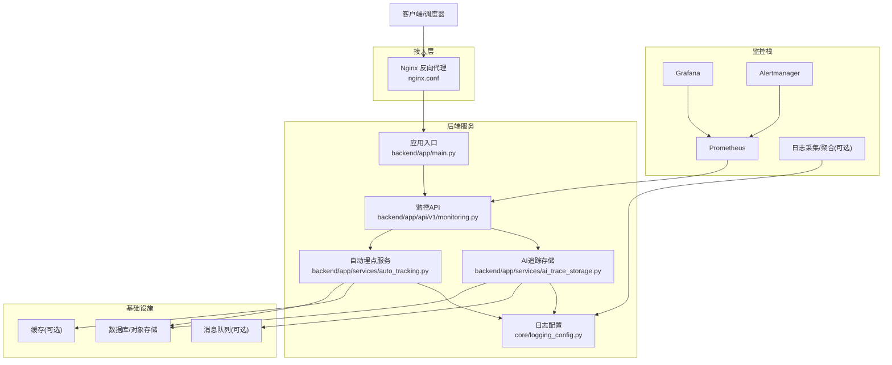
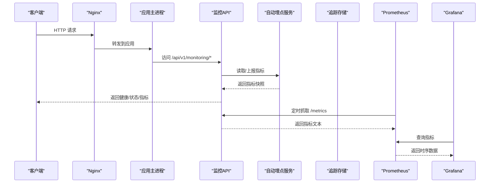
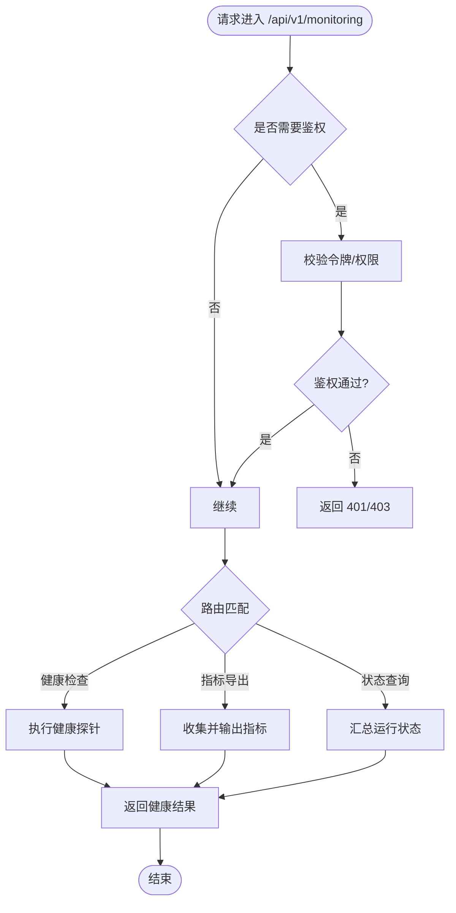
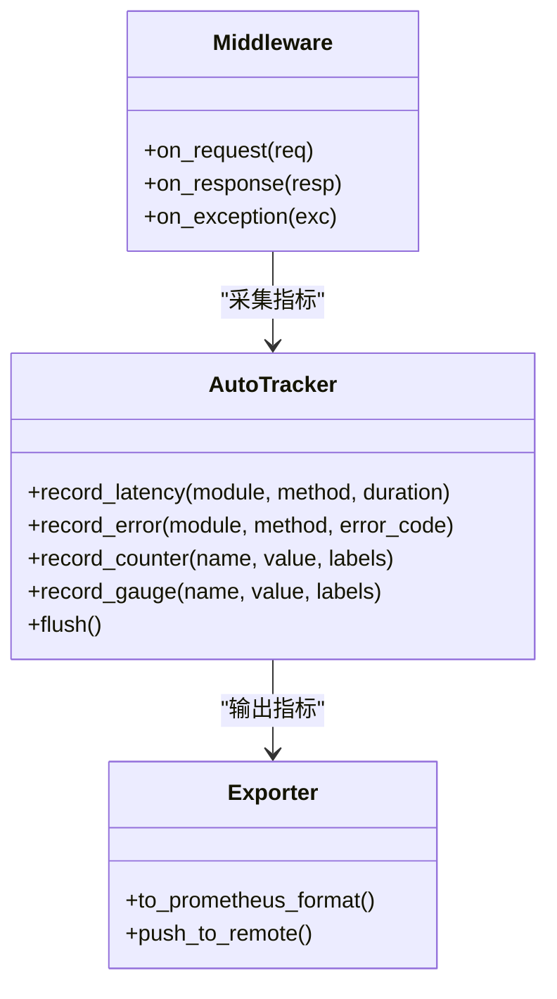
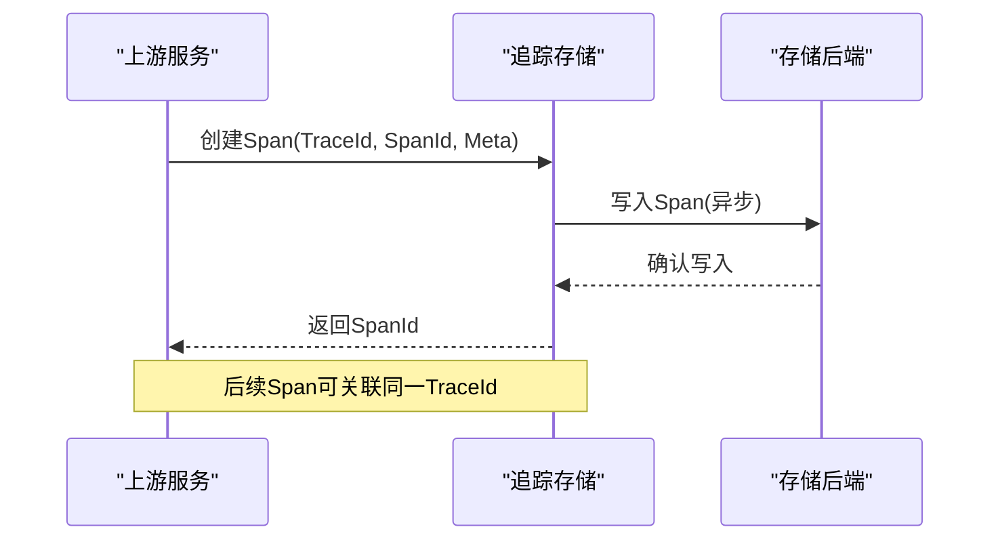
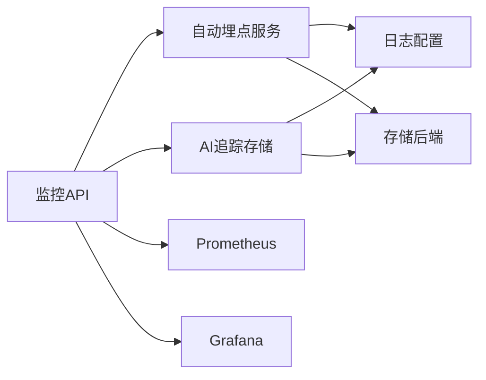

# 监控服务

<cite>
**本文引用的文件**   
- [backend/app/api/v1/monitoring.py](file://backend/app/api/v1/monitoring.py)
- [backend/app/services/monitoring/__init__.py](file://backend/app/services/monitoring/__init__.py)
- [backend/app/services/auto_tracking.py](file://backend/app/services/auto_tracking.py)
- [backend/app/services/ai_trace_storage.py](file://backend/app/services/ai_trace_storage.py)
- [core/logging_config.py](file://core/logging_config.py)
- [backend/app/main.py](file://backend/app/main.py)
- [docker-compose.yml](file://docker-compose.yml)
- [nginx.conf](file://nginx.conf)
- [backend/tests/test_ai_trace_storage_safety.py](file://backend/tests/test_ai_trace_storage_safety.py)
</cite>

## 目录
1. [简介](#简介)
2. [项目结构](#项目结构)
3. [核心组件](#核心组件)
4. [架构总览](#架构总览)
5. [详细组件分析](#详细组件分析)
6. [依赖关系分析](#依赖关系分析)
7. [性能考量](#性能考量)
8. [故障排查指南](#故障排查指南)
9. [结论](#结论)
10. [附录](#附录)

## 简介
本技术文档围绕“监控服务”展开，覆盖应用性能监控、业务指标收集与日志聚合机制；说明 Prometheus 指标导出、Grafana 仪表板配置与告警规则设置；阐述分布式追踪、链路追踪与调用链分析；包含健康检查、服务发现与故障检测逻辑；提供监控数据可视化、自定义指标开发与告警通知配置；并记录监控对性能的影响、数据存储与查询优化策略。

## 项目结构
监控相关代码主要分布在后端 API、服务层、日志配置以及容器编排文件中：
- API 层：暴露监控与健康检查接口
- 服务层：自动埋点、AI 追踪存储等
- 日志配置：统一日志输出格式与级别
- 编排与网关：Docker Compose 集成外部监控组件，Nginx 反向代理

图表来源
- [backend/app/api/v1/monitoring.py](file://backend/app/api/v1/monitoring.py)
- [backend/app/services/auto_tracking.py](file://backend/app/services/auto_tracking.py)
- [backend/app/services/ai_trace_storage.py](file://backend/app/services/ai_trace_storage.py)
- [core/logging_config.py](file://core/logging_config.py)
- [backend/app/main.py](file://backend/app/main.py)
- [nginx.conf](file://nginx.conf)
- [docker-compose.yml](file://docker-compose.yml)

章节来源
- [backend/app/api/v1/monitoring.py](file://backend/app/api/v1/monitoring.py)
- [backend/app/services/auto_tracking.py](file://backend/app/services/auto_tracking.py)
- [backend/app/services/ai_trace_storage.py](file://backend/app/services/ai_trace_storage.py)
- [core/logging_config.py](file://core/logging_config.py)
- [backend/app/main.py](file://backend/app/main.py)
- [nginx.conf](file://nginx.conf)
- [docker-compose.yml](file://docker-compose.yml)

## 核心组件
- 监控API（/api/v1/monitoring）：对外暴露健康检查、指标导出、状态查询等端点，供 Prometheus 抓取与前端展示。
- 自动埋点服务：在关键路径自动采集耗时、错误率、吞吐等指标，减少业务侵入。
- AI 追踪存储：将分布式追踪上下文持久化，支持链路回溯与调用链分析。
- 日志配置：统一日志格式、分级与输出目标，便于集中采集与检索。
- 应用入口：注册中间件、路由与监控端点，初始化监控组件。

章节来源
- [backend/app/api/v1/monitoring.py](file://backend/app/api/v1/monitoring.py)
- [backend/app/services/auto_tracking.py](file://backend/app/services/auto_tracking.py)
- [backend/app/services/ai_trace_storage.py](file://backend/app/services/ai_trace_storage.py)
- [core/logging_config.py](file://core/logging_config.py)
- [backend/app/main.py](file://backend/app/main.py)

## 架构总览
监控体系采用“应用内埋点 + 指标导出 + 外部采集 + 可视化与告警”的分层架构：
- 应用层：通过中间件与服务层埋点，生成指标与追踪数据
- 导出层：HTTP 端点暴露指标，供 Prometheus 定期拉取
- 存储层：结构化数据落库，追踪上下文持久化
- 采集层：Prometheus 抓取指标，日志系统采集结构化日志
- 展示与告警：Grafana 构建仪表板，Alertmanager 触发告警

图表来源
- [backend/app/api/v1/monitoring.py](file://backend/app/api/v1/monitoring.py)
- [backend/app/services/auto_tracking.py](file://backend/app/services/auto_tracking.py)
- [backend/app/services/ai_trace_storage.py](file://backend/app/services/ai_trace_storage.py)
- [nginx.conf](file://nginx.conf)
- [docker-compose.yml](file://docker-compose.yml)

## 详细组件分析

### 监控API（/api/v1/monitoring）
- 职责：提供健康检查、服务状态、指标导出与调试信息；为 Prometheus 提供 /metrics 端点；为运维提供快速诊断能力。
- 典型端点：
  - 健康检查：返回服务存活、依赖可用性、资源水位
  - 指标导出：按 Prometheus 规范输出指标
  - 状态查询：返回当前运行态、队列长度、缓存命中率等
- 错误处理：对依赖不可用进行降级与标记不健康，避免级联失败

图表来源
- [backend/app/api/v1/monitoring.py](file://backend/app/api/v1/monitoring.py)

章节来源
- [backend/app/api/v1/monitoring.py](file://backend/app/api/v1/monitoring.py)

### 自动埋点服务（auto_tracking）
- 职责：在关键路径自动采集性能指标（延迟、吞吐、错误率）、业务指标（任务数、成功率）与资源指标（CPU、内存、I/O）。
- 实现要点：
  - 基于装饰器或中间件的无侵入埋点
  - 指标分类与标签设计（模块、方法、状态码、模型名等）
  - 异步上报与批量写入，降低对主流程影响
- 优化建议：
  - 采样策略：高负载时启用自适应采样
  - 指标去重与合并：避免维度爆炸
  - 缓冲与重试：网络异常时的本地缓冲与重试

图表来源
- [backend/app/services/auto_tracking.py](file://backend/app/services/auto_tracking.py)

章节来源
- [backend/app/services/auto_tracking.py](file://backend/app/services/auto_tracking.py)

### AI 追踪存储（ai_trace_storage）
- 职责：持久化分布式追踪上下文，支持链路回溯、调用链分析与问题定位。
- 数据结构：
  - TraceId/SpanId：唯一标识一次调用链
  - Span：节点级操作（输入、输出、耗时、错误）
  - Context：跨服务传递的上下文（用户ID、模型名、版本等）
- 存储策略：
  - 热数据：内存/缓存加速查询
  - 冷数据：对象存储或列式数据库归档
  - 索引：按时间、TraceId、模块名建立索引
- 安全与合规：
  - 敏感字段脱敏
  - 访问控制与审计日志

图表来源
- [backend/app/services/ai_trace_storage.py](file://backend/app/services/ai_trace_storage.py)
- [backend/tests/test_ai_trace_storage_safety.py](file://backend/tests/test_ai_trace_storage_safety.py)

章节来源
- [backend/app/services/ai_trace_storage.py](file://backend/app/services/ai_trace_storage.py)
- [backend/tests/test_ai_trace_storage_safety.py](file://backend/tests/test_ai_trace_storage_safety.py)

### 日志配置（logging_config）
- 职责：统一日志格式、级别、输出目标（控制台、文件、远端），支持结构化日志与采样。
- 关键点：
  - JSON 结构化输出，便于 ELK/Loki 采集
  - 分级输出（DEBUG/INFO/WARN/ERROR）
  - 采样与过滤：高吞吐场景下降低日志量
  - 敏感信息过滤：避免泄露密钥与隐私数据

章节来源
- [core/logging_config.py](file://core/logging_config.py)

### 应用入口（main）
- 职责：注册监控中间件、路由与端点，初始化追踪与指标组件，启动健康检查与优雅关闭。
- 关键点：
  - 中间件链：鉴权、限流、埋点、日志
  - 路由挂载：/api/v1/monitoring 等
  - 生命周期钩子：启动预热、关闭清理

章节来源
- [backend/app/main.py](file://backend/app/main.py)

## 依赖关系分析
- 组件耦合：
  - 监控API依赖自动埋点与追踪存储，形成松耦合的服务间调用
  - 日志配置被各组件引用，保证一致性
- 外部依赖：
  - Prometheus：指标抓取
  - Grafana：可视化
  - 存储后端：结构化数据与追踪上下文持久化
  - 消息队列（可选）：异步上报与削峰

图表来源
- [backend/app/api/v1/monitoring.py](file://backend/app/api/v1/monitoring.py)
- [backend/app/services/auto_tracking.py](file://backend/app/services/auto_tracking.py)
- [backend/app/services/ai_trace_storage.py](file://backend/app/services/ai_trace_storage.py)
- [core/logging_config.py](file://core/logging_config.py)

章节来源
- [backend/app/api/v1/monitoring.py](file://backend/app/api/v1/monitoring.py)
- [backend/app/services/auto_tracking.py](file://backend/app/services/auto_tracking.py)
- [backend/app/services/ai_trace_storage.py](file://backend/app/services/ai_trace_storage.py)
- [core/logging_config.py](file://core/logging_config.py)

## 性能考量
- 指标采集开销：
  - 使用计数器与直方图替代频繁同步写盘
  - 采样与批处理降低 I/O 压力
- 追踪数据量控制：
  - 按采样率与条件过滤减少 Span 数量
  - 冷热分层存储，提升查询效率
- 日志吞吐优化：
  - 异步写入与缓冲队列
  - 结构化日志压缩与去重
- 查询优化：
  - 合理索引与分区策略
  - 预聚合与时序窗口计算

[本节为通用指导，不直接分析具体文件]

## 故障排查指南
- 健康检查失败：
  - 检查依赖服务连通性（数据库、缓存、消息队列）
  - 查看资源水位（CPU、内存、磁盘、网络）
  - 审查最近变更与回滚策略
- 指标缺失或异常：
  - 验证 /metrics 端点可达性与格式正确性
  - 检查 Prometheus 抓取间隔与超时配置
  - 核对标签维度是否爆炸
- 追踪断链：
  - 确认 TraceId/SpanId 传播是否正确
  - 检查异步任务与消息队列中的上下文透传
  - 查看存储写入是否成功与索引是否命中
- 日志丢失或乱码：
  - 检查日志采集器配置与编码设置
  - 确认缓冲区容量与丢弃策略
  - 审核敏感信息过滤规则

章节来源
- [backend/app/api/v1/monitoring.py](file://backend/app/api/v1/monitoring.py)
- [backend/app/services/auto_tracking.py](file://backend/app/services/auto_tracking.py)
- [backend/app/services/ai_trace_storage.py](file://backend/app/services/ai_trace_storage.py)
- [core/logging_config.py](file://core/logging_config.py)

## 结论
本监控服务以“低侵入埋点 + 标准化指标 + 结构化日志 + 分布式追踪”为核心，结合 Prometheus/Grafana/Alertmanager 构建完整的可观测性体系。通过合理的采样、缓冲与分层存储策略，在保证精度的同时有效控制性能开销。建议在上线前完成端到端压测与告警演练，确保在高负载与异常场景下的稳定性与可恢复性。

[本节为总结性内容，不直接分析具体文件]

## 附录
- 部署与集成：
  - Docker Compose 编排 Prometheus、Grafana、Alertmanager 与日志采集器
  - Nginx 反向代理与负载均衡，统一入口与证书管理
- 指标与告警：
  - 定义关键指标（QPS、延迟分位、错误率、饱和度）
  - 配置阈值与多级告警（警告、严重、致命）
  - 告警收敛与升级策略，避免告警风暴
- 最佳实践：
  - 指标命名规范与标签设计
  - 追踪上下文透传与脱敏
  - 日志结构化与采样策略

章节来源
- [docker-compose.yml](file://docker-compose.yml)
- [nginx.conf](file://nginx.conf)