# 缓存系统

<cite>
**本文引用的文件**   
- [backend/app/services/cache_system.py](file://backend/app/services/cache_system.py)
- [redis.conf](file://redis.conf)
- [docker-compose.yml](file://docker-compose.yml)
- [backend/app/core/config.py](file://backend/app/core/config.py)
- [backend/app/api/v1/monitoring.py](file://backend/app/api/v1/monitoring.py)
- [backend/app/services/generation_lock.py](file://backend/app/services/generation_lock.py)
- [backend/app/services/batch_processor.py](file://backend/app/services/batch_processor.py)
- [backend/app/services/streaming_service.py](file://backend/app/services/streaming_service.py)
- [backend/app/services/vector_sync.py](file://backend/app/services/vector_sync.py)
- [backend/app/services/prompt_evolution/evolution_scheduler.py](file://backend/app/services/prompt_evolution/evolution_scheduler.py)
- [backend/app/scripts/warmup_tts_voice_previews.py](file://backend/app/scripts/warmup_tts_voice_previews.py)
</cite>

## 目录
1. [简介](#简介)
2. [项目结构](#项目结构)
3. [核心组件](#核心组件)
4. [架构总览](#架构总览)
5. [详细组件分析](#详细组件分析)
6. [依赖关系分析](#依赖关系分析)
7. [性能考量](#性能考量)
8. [故障排查指南](#故障排查指南)
9. [结论](#结论)
10. [附录](#附录)

## 简介
本技术文档围绕项目的缓存系统，系统性阐述多级缓存架构设计、缓存策略与失效机制、Redis 配置与连接池管理、分布式锁实现、缓存预热与预取、批量操作优化、一致性保证与数据同步、冲突解决策略、监控统计与性能调优、安全访问控制与审计日志等关键主题。文档面向不同技术背景的读者，既提供高层概览，也给出代码级分析与可视化图示，帮助快速理解与落地实践。

## 项目结构
缓存相关能力主要分布在后端服务层与基础设施配置中：
- 缓存服务抽象与实现位于 services 层，提供统一的缓存接口、策略与工具方法。
- Redis 配置通过配置文件与容器编排进行集中管理。
- 监控与统计通过 API 暴露，便于外部观测。
- 分布式锁、批处理、流式输出、向量同步、提示词演化调度等模块与缓存协同工作。
- 预热脚本用于启动阶段的数据预热。

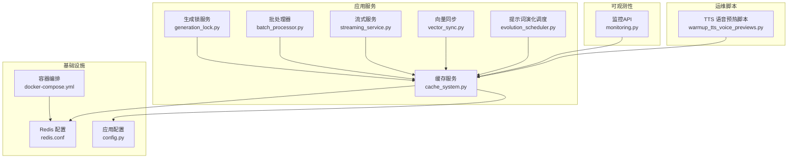

**图表来源** 
- [backend/app/services/cache_system.py](file://backend/app/services/cache_system.py)
- [redis.conf](file://redis.conf)
- [docker-compose.yml](file://docker-compose.yml)
- [backend/app/core/config.py](file://backend/app/core/config.py)
- [backend/app/api/v1/monitoring.py](file://backend/app/api/v1/monitoring.py)
- [backend/app/services/generation_lock.py](file://backend/app/services/generation_lock.py)
- [backend/app/services/batch_processor.py](file://backend/app/services/batch_processor.py)
- [backend/app/services/streaming_service.py](file://backend/app/services/streaming_service.py)
- [backend/app/services/vector_sync.py](file://backend/app/services/vector_sync.py)
- [backend/app/services/prompt_evolution/evolution_scheduler.py](file://backend/app/services/prompt_evolution/evolution_scheduler.py)
- [backend/app/scripts/warmup_tts_voice_previews.py](file://backend/app/scripts/warmup_tts_voice_previews.py)

**章节来源**
- [backend/app/services/cache_system.py](file://backend/app/services/cache_system.py)
- [redis.conf](file://redis.conf)
- [docker-compose.yml](file://docker-compose.yml)
- [backend/app/core/config.py](file://backend/app/core/config.py)
- [backend/app/api/v1/monitoring.py](file://backend/app/api/v1/monitoring.py)
- [backend/app/services/generation_lock.py](file://backend/app/services/generation_lock.py)
- [backend/app/services/batch_processor.py](file://backend/app/services/batch_processor.py)
- [backend/app/services/streaming_service.py](file://backend/app/services/streaming_service.py)
- [backend/app/services/vector_sync.py](file://backend/app/services/vector_sync.py)
- [backend/app/services/prompt_evolution/evolution_scheduler.py](file://backend/app/services/prompt_evolution/evolution_scheduler.py)
- [backend/app/scripts/warmup_tts_voice_previews.py](file://backend/app/scripts/warmup_tts_voice_previews.py)

## 核心组件
- 缓存服务（Cache Service）
  - 职责：封装多级缓存读写、序列化/反序列化、过期策略、键命名规范、错误重试与降级。
  - 关键点：统一接口、可插拔存储后端、原子操作支持、事务边界清晰。
- 分布式锁服务（Generation Lock）
  - 职责：基于 Redis 的分布式锁，避免重复生成或并发写冲突。
  - 关键点：锁粒度、超时与续期、幂等性、死锁防护。
- 批处理器（Batch Processor）
  - 职责：聚合多次缓存写入/读取，减少网络往返与序列化开销。
  - 关键点：批量大小、失败回退、部分成功处理。
- 流式服务（Streaming Service）
  - 职责：将大结果分块返回，结合缓存提升首字节延迟与吞吐。
  - 关键点：分片缓存、断点续传、内存水位控制。
- 向量同步（Vector Sync）
  - 职责：在向量库与主存储之间保持索引一致，必要时借助缓存加速查询。
  - 关键点：增量同步、冲突检测、回滚策略。
- 提示词演化调度（Evolution Scheduler）
  - 职责：周期性评估与更新提示词模板，利用缓存降低冷启动与频繁计算成本。
  - 关键点：版本化、灰度发布、回滚。
- 监控 API（Monitoring）
  - 职责：暴露缓存命中率、延迟、容量、错误率等指标。
  - 关键点：指标口径、采样频率、告警阈值。
- 预热脚本（Warmup TTS Voice Previews）
  - 职责：启动时预加载高频数据到缓存，缩短首请求延迟。
  - 关键点：分批预热、失败重试、进度上报。

**章节来源**
- [backend/app/services/cache_system.py](file://backend/app/services/cache_system.py)
- [backend/app/services/generation_lock.py](file://backend/app/services/generation_lock.py)
- [backend/app/services/batch_processor.py](file://backend/app/services/batch_processor.py)
- [backend/app/services/streaming_service.py](file://backend/app/services/streaming_service.py)
- [backend/app/services/vector_sync.py](file://backend/app/services/vector_sync.py)
- [backend/app/services/prompt_evolution/evolution_scheduler.py](file://backend/app/services/prompt_evolution/evolution_scheduler.py)
- [backend/app/api/v1/monitoring.py](file://backend/app/api/v1/monitoring.py)
- [backend/app/scripts/warmup_tts_voice_previews.py](file://backend/app/scripts/warmup_tts_voice_previews.py)

## 架构总览
缓存系统采用“本地内存 + Redis”的多级缓存架构，上层服务通过统一缓存接口访问，底层根据键空间与热点程度自动选择存储层级。分布式锁保障并发安全，批处理与流式输出提升吞吐，监控与预热脚本增强稳定性与性能。

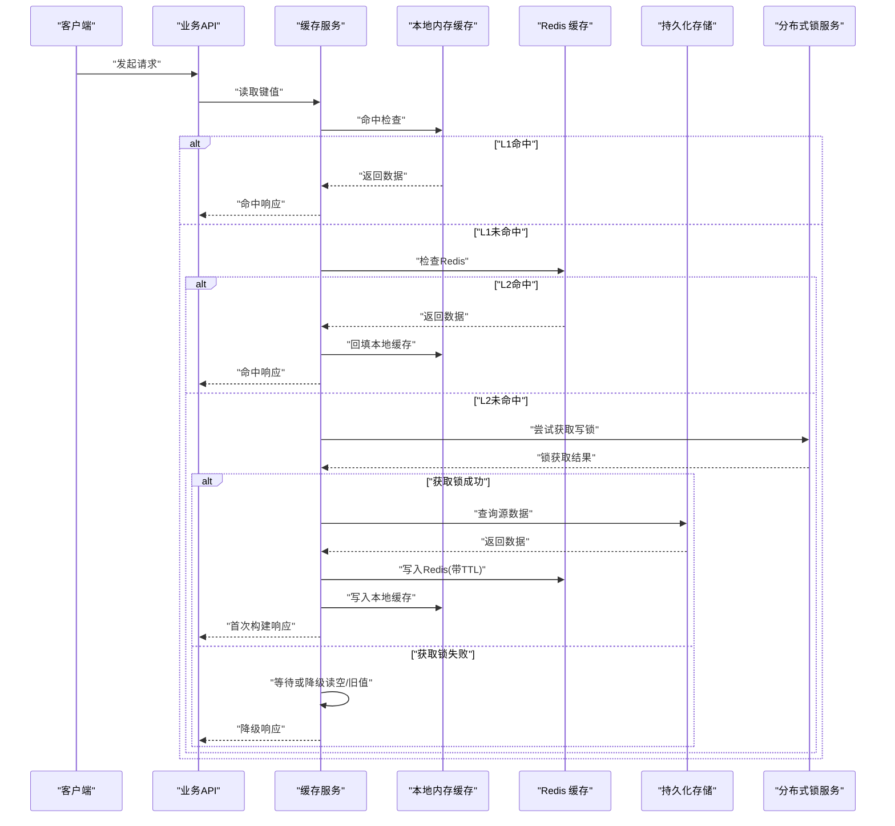

**图表来源** 
- [backend/app/services/cache_system.py](file://backend/app/services/cache_system.py)
- [backend/app/services/generation_lock.py](file://backend/app/services/generation_lock.py)

**章节来源**
- [backend/app/services/cache_system.py](file://backend/app/services/cache_system.py)
- [backend/app/services/generation_lock.py](file://backend/app/services/generation_lock.py)

## 详细组件分析

### 缓存服务（Cache System）
- 设计要点
  - 多级缓存：优先本地内存，其次 Redis，最后回源数据库。
  - 键命名规范：按业务域+实体ID+版本号组织，避免冲突。
  - 序列化：统一 JSON/MessagePack，兼容跨语言。
  - 过期策略：TTL 与惰性删除结合，定期清理热点键。
  - 错误处理：重试、熔断、降级到默认值或空对象。
- 数据结构与复杂度
  - 本地缓存：哈希表 O(1) 读写；LRU/LFU 淘汰策略。
  - Redis：字符串/哈希/集合/有序集合，复杂查询使用管道与 Lua。
- 依赖链
  - 依赖配置中心读取连接参数与策略开关。
  - 依赖分布式锁服务保护写路径。
  - 依赖监控埋点记录命中率与延迟。

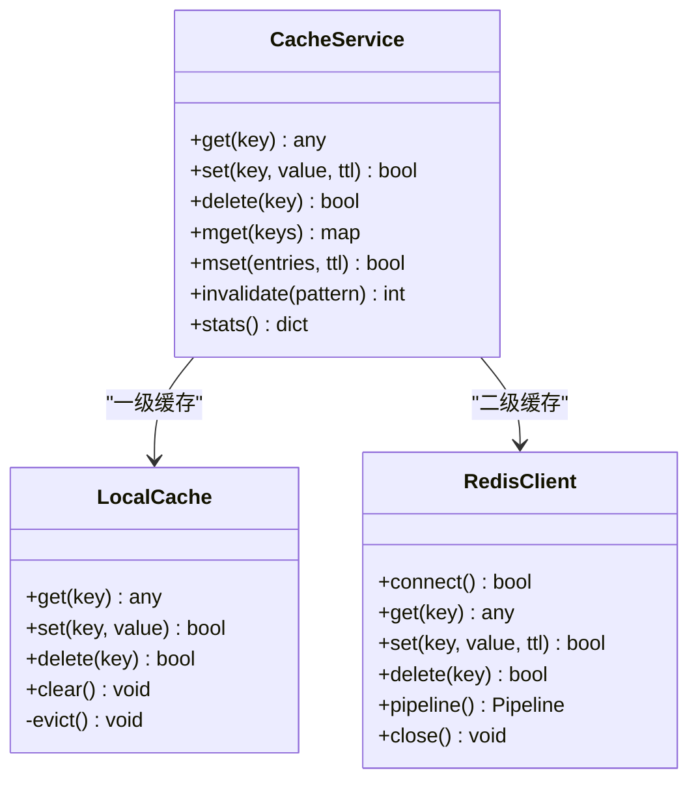

**图表来源** 
- [backend/app/services/cache_system.py](file://backend/app/services/cache_system.py)

**章节来源**
- [backend/app/services/cache_system.py](file://backend/app/services/cache_system.py)

### 分布式锁（Generation Lock）
- 设计要点
  - 基于 Redis SET NX EX 实现原子加锁。
  - 锁粒度：按资源标识划分，最小化竞争。
  - 超时与续期：防止进程崩溃导致死锁，后台任务续期。
  - 幂等性：同一请求不重复执行，支持重试。
- 流程说明
  - 尝试获取锁 -> 执行业务逻辑 -> 释放锁 -> 异常回滚。

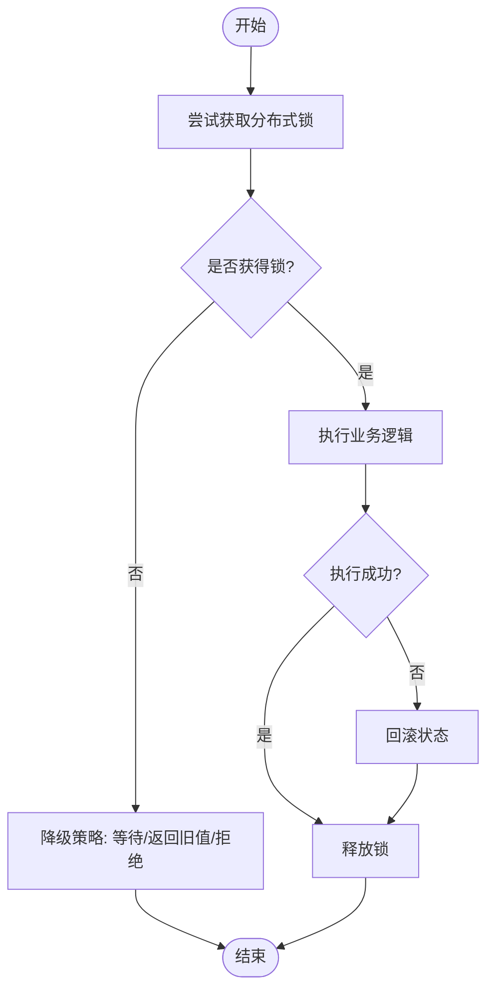

**图表来源** 
- [backend/app/services/generation_lock.py](file://backend/app/services/generation_lock.py)

**章节来源**
- [backend/app/services/generation_lock.py](file://backend/app/services/generation_lock.py)

### 批处理器（Batch Processor）
- 设计要点
  - 聚合多个读写操作，使用 Redis PIPELINE 减少 RTT。
  - 失败回退：部分失败时回滚或重试单个键。
  - 限流与背压：控制批量大小与并发度。
- 适用场景
  - 初始化导入、批量更新、批量查询热点键。

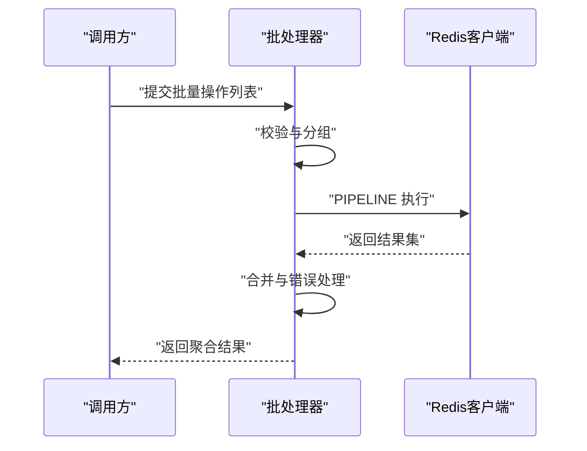

**图表来源** 
- [backend/app/services/batch_processor.py](file://backend/app/services/batch_processor.py)

**章节来源**
- [backend/app/services/batch_processor.py](file://backend/app/services/batch_processor.py)

### 流式服务（Streaming Service）
- 设计要点
  - 分片缓存：将大结果拆分为片段并分别缓存。
  - 首字节优化：优先返回头部片段，后续片段按需加载。
  - 内存控制：限制单条流的最大内存占用。
- 适用场景
  - 大文件下载、长文本生成、音视频切片。

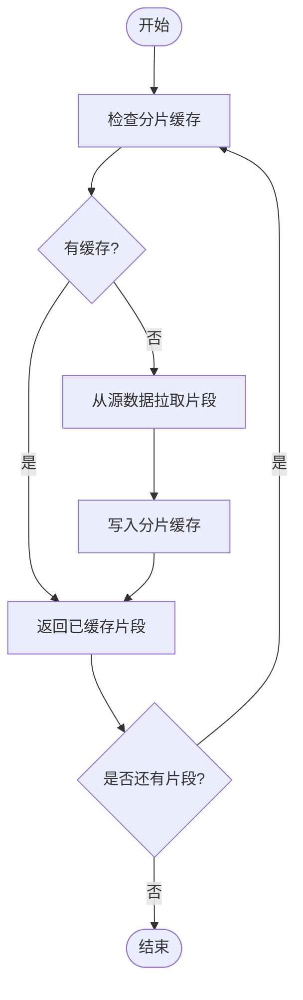

**图表来源** 
- [backend/app/services/streaming_service.py](file://backend/app/services/streaming_service.py)

**章节来源**
- [backend/app/services/streaming_service.py](file://backend/app/services/streaming_service.py)

### 向量同步（Vector Sync）
- 设计要点
  - 增量同步：基于时间戳或版本号变更。
  - 冲突解决：以主存储为准，冲突标记与人工复核。
  - 缓存加速：热点查询走向量缓存，降低向量库压力。
- 适用场景
  - 语义检索、推荐系统、知识图谱。

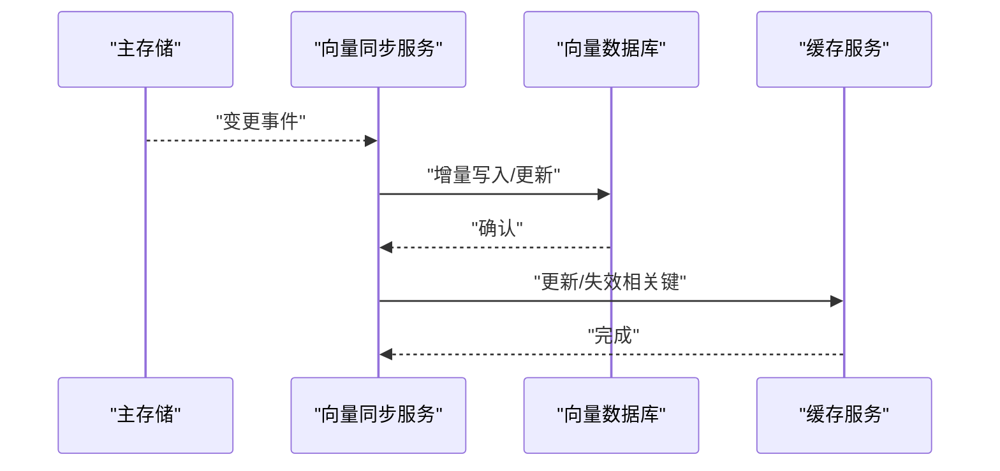

**图表来源** 
- [backend/app/services/vector_sync.py](file://backend/app/services/vector_sync.py)

**章节来源**
- [backend/app/services/vector_sync.py](file://backend/app/services/vector_sync.py)

### 提示词演化调度（Evolution Scheduler）
- 设计要点
  - 周期评估：定时任务扫描提示词效果指标。
  - 版本化：新旧版本并存，灰度切换。
  - 缓存优化：缓存评估结果与模板，减少重复计算。
- 适用场景
  - A/B 测试、模型提示词优化、自动化迭代。

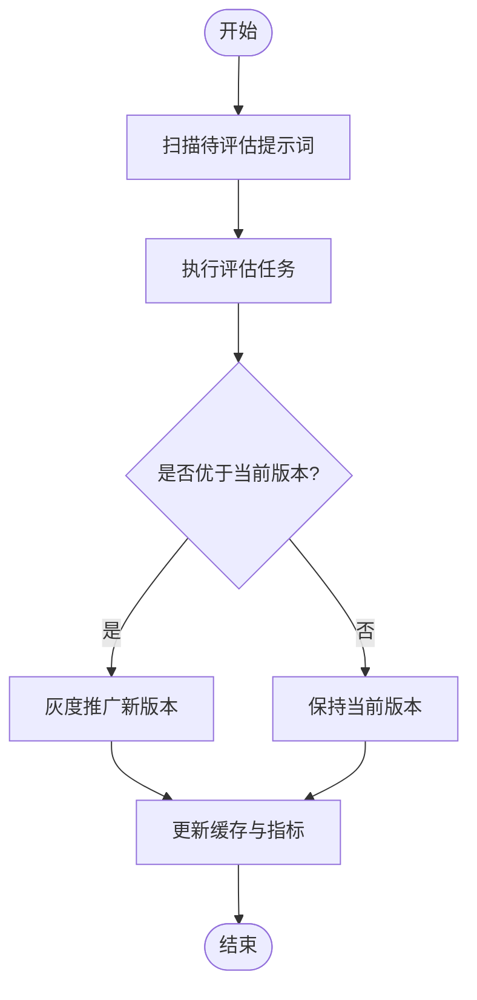

**图表来源** 
- [backend/app/services/prompt_evolution/evolution_scheduler.py](file://backend/app/services/prompt_evolution/evolution_scheduler.py)

**章节来源**
- [backend/app/services/prompt_evolution/evolution_scheduler.py](file://backend/app/services/prompt_evolution/evolution_scheduler.py)

### 监控 API（Monitoring）
- 设计要点
  - 指标采集：命中率、延迟分布、错误率、内存使用、连接池状态。
  - 暴露方式：REST API 与 Prometheus 格式导出。
  - 告警规则：阈值触发通知与自动恢复。
- 适用场景
  - 运行态观测、容量规划、性能瓶颈定位。

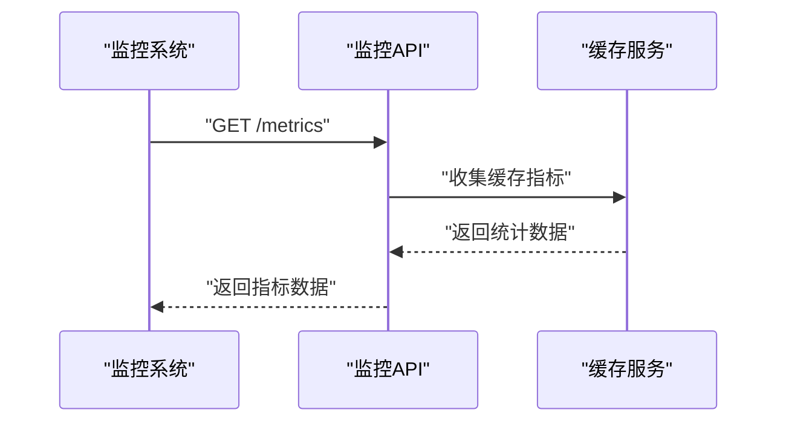

**图表来源** 
- [backend/app/api/v1/monitoring.py](file://backend/app/api/v1/monitoring.py)

**章节来源**
- [backend/app/api/v1/monitoring.py](file://backend/app/api/v1/monitoring.py)

### 预热脚本（Warmup TTS Voice Previews）
- 设计要点
  - 启动阶段批量加载高频语音预览到缓存。
  - 分批执行与失败重试，确保整体成功率。
  - 进度上报与可观测性。
- 适用场景
  - 冷启动优化、首请求延迟降低。

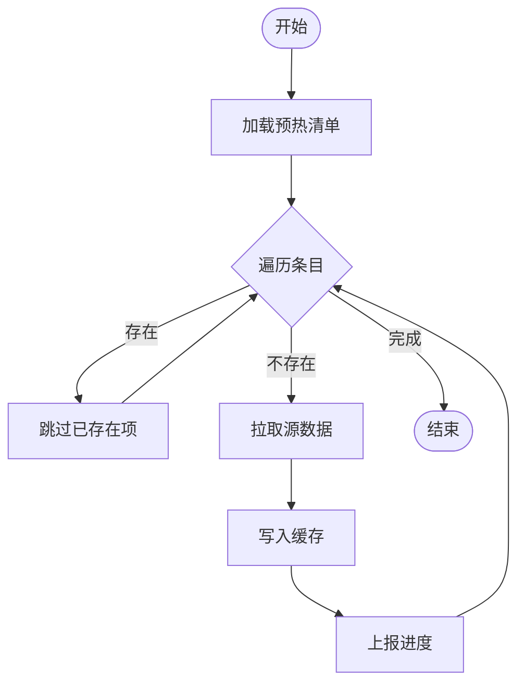

**图表来源** 
- [backend/app/scripts/warmup_tts_voice_previews.py](file://backend/app/scripts/warmup_tts_voice_previews.py)

**章节来源**
- [backend/app/scripts/warmup_tts_voice_previews.py](file://backend/app/scripts/warmup_tts_voice_previews.py)

## 依赖关系分析
- 组件耦合
  - 缓存服务为各业务模块提供统一访问，低耦合高内聚。
  - 分布式锁与批处理器作为基础能力被广泛复用。
  - 监控 API 仅依赖缓存服务的指标接口，解耦良好。
- 外部依赖
  - Redis：连接池、超时、重试、集群模式。
  - 配置中心：动态调整 TTL、批量大小、限流阈值。
- 潜在循环依赖
  - 通过接口抽象与依赖注入避免循环引用。

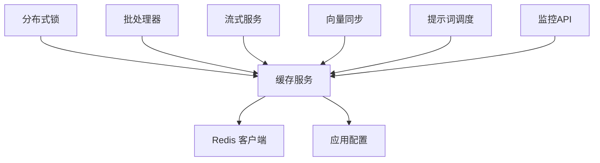

**图表来源** 
- [backend/app/services/cache_system.py](file://backend/app/services/cache_system.py)
- [backend/app/core/config.py](file://backend/app/core/config.py)

**章节来源**
- [backend/app/services/cache_system.py](file://backend/app/services/cache_system.py)
- [backend/app/core/config.py](file://backend/app/core/config.py)

## 性能考量
- 多级缓存命中率优化
  - 合理设置 TTL，避免热键过早过期。
  - 本地缓存容量与淘汰策略调优。
- 连接池与并发
  - Redis 连接池大小与最大并发数匹配。
  - 批处理减少网络往返，提高吞吐。
- 内存与序列化
  - 选择高效序列化格式，控制对象大小。
  - 监控内存水位，及时扩容或降载。
- 流式与分片
  - 分片大小平衡首字节延迟与内存占用。
  - 断点续传与重试机制提升鲁棒性。
- 监控与告警
  - 建立命中率、延迟、错误率基线。
  - 阈值告警与自动扩缩容联动。

[本节为通用指导，不直接分析具体文件]

## 故障排查指南
- 常见问题
  - 缓存穿透：空值缓存与布隆过滤器。
  - 缓存雪崩：随机 TTL 与限流降级。
  - 锁竞争：锁粒度细化与超时设置。
  - 连接池耗尽：连接泄漏与最大连接数不足。
- 诊断步骤
  - 查看监控指标与日志，定位热点键与错误堆栈。
  - 检查 Redis 健康状态与慢查询。
  - 验证分布式锁持有者与超时情况。
  - 回放批处理与流式任务的中间状态。
- 恢复策略
  - 重启预热脚本恢复冷启动。
  - 临时关闭非关键功能减轻负载。
  - 扩容 Redis 实例与本地缓存节点。

**章节来源**
- [backend/app/api/v1/monitoring.py](file://backend/app/api/v1/monitoring.py)
- [backend/app/services/cache_system.py](file://backend/app/services/cache_system.py)
- [backend/app/services/generation_lock.py](file://backend/app/services/generation_lock.py)
- [backend/app/services/batch_processor.py](file://backend/app/services/batch_processor.py)
- [backend/app/services/streaming_service.py](file://backend/app/services/streaming_service.py)

## 结论
本项目缓存系统通过多级缓存、分布式锁、批处理与流式输出等手段，构建了高性能、高可用的数据访问层。配合完善的监控与预热机制，能够有效应对高并发与大数据量场景。建议持续优化 TTL 策略、连接池配置与批处理大小，并结合监控指标进行容量规划与性能调优。

[本节为总结性内容，不直接分析具体文件]

## 附录
- Redis 配置要点
  - 持久化策略：RDB/AOF 的选择与压缩。
  - 内存上限与淘汰策略：allkeys-lru/allkeys-lfu。
  - 连接池与超时：maxclients、timeout、reconnect。
- 容器编排
  - 资源限制与健康检查。
  - 多副本与主从复制。
- 安全与审计
  - 访问控制：ACL 与白名单。
  - 审计日志：记录敏感操作与异常事件。

**章节来源**
- [redis.conf](file://redis.conf)
- [docker-compose.yml](file://docker-compose.yml)
- [backend/app/core/config.py](file://backend/app/core/config.py)