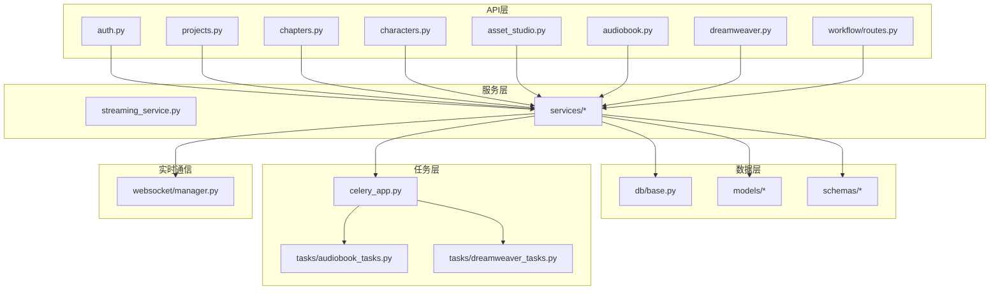
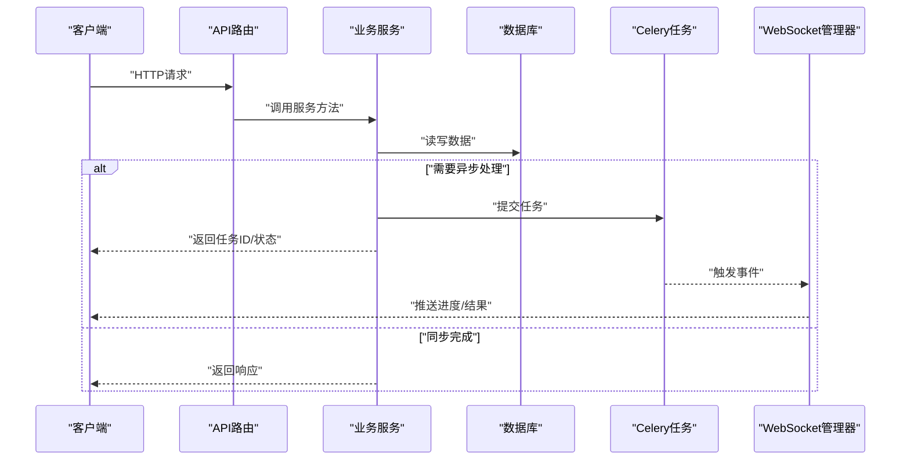
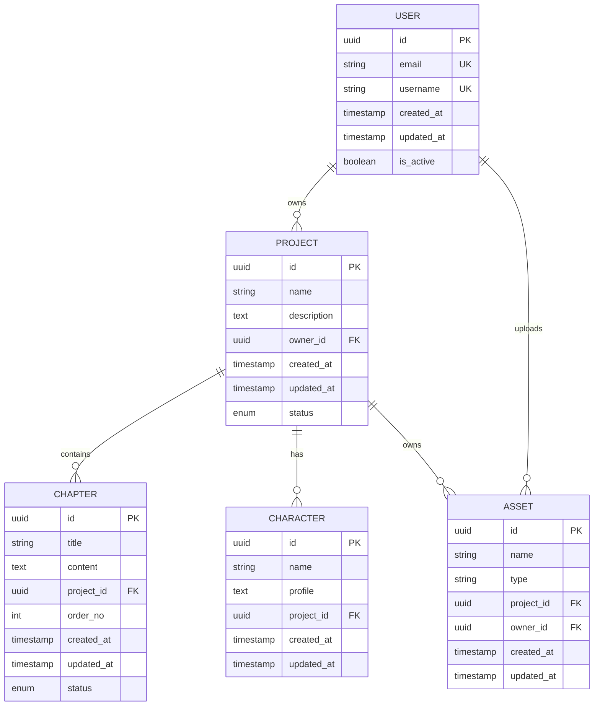
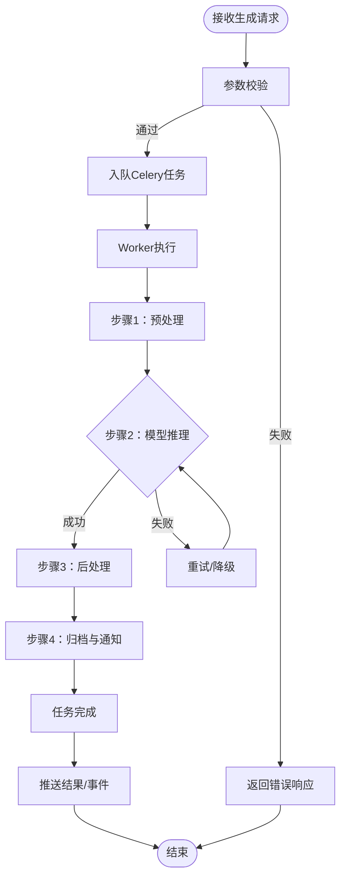
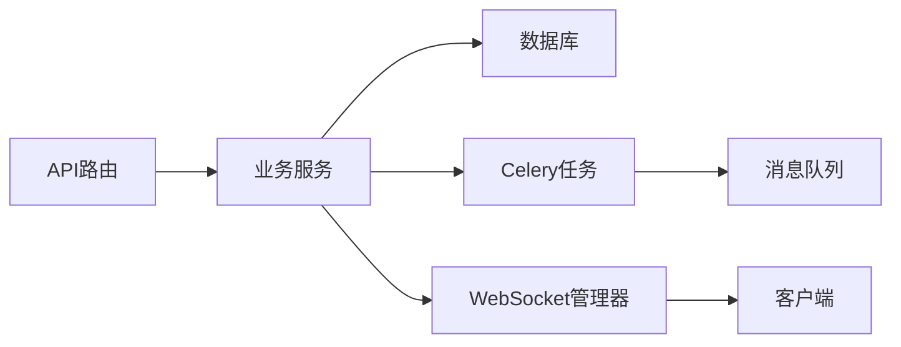

# 后端服务

<cite>
**本文引用的文件**   
- [backend/app/main.py](file://backend/app/main.py)
- [backend/app/celery_app.py](file://backend/app/celery_app.py)
- [backend/app/core/config.py](file://backend/app/core/config.py)
- [backend/app/core/security.py](file://backend/app/core/security.py)
- [backend/app/api/v1/auth.py](file://backend/app/api/v1/auth.py)
- [backend/app/api/v1/projects.py](file://backend/app/api/v1/projects.py)
- [backend/app/api/v1/chapters.py](file://backend/app/api/v1/chapters.py)
- [backend/app/api/v1/characters.py](file://backend/app/api/v1/characters.py)
- [backend/app/api/v1/asset_studio.py](file://backend/app/api/v1/asset_studio.py)
- [backend/app/api/v1/audiobook.py](file://backend/app/api/v1/audiobook.py)
- [backend/app/api/v1/dreamweaver.py](file://backend/app/api/v1/dreamweaver.py)
- [backend/app/api/v1/workflow/__init__.py](file://backend/app/api/v1/workflow/__init__.py)
- [backend/app/api/v1/workflow/routes.py](file://backend/app/api/v1/workflow/routes.py)
- [backend/app/websocket/manager.py](file://backend/app/websocket/manager.py)
- [backend/app/db/base.py](file://backend/app/db/base.py)
- [backend/app/models/project.py](file://backend/app/models/project.py)
- [backend/app/models/chapter.py](file://backend/app/models/chapter.py)
- [backend/app/models/character.py](file://backend/app/models/character.py)
- [backend/app/models/user.py](file://backend/app/models/user.py)
- [backend/app/schemas/project.py](file://backend/app/schemas/project.py)
- [backend/app/schemas/user.py](file://backend/app/schemas/user.py)
- [backend/app/services/streaming_service.py](file://backend/app/services/streaming_service.py)
- [backend/app/tasks/audiobook_tasks.py](file://backend/app/tasks/audiobook_tasks.py)
- [backend/app/tasks/dreamweaver_tasks.py](file://backend/app/tasks/dreamweaver_tasks.py)
- [backend/app/utils/api_errors.py](file://backend/app/utils/api_errors.py)
</cite>

## 目录
1. [简介](#简介)
2. [项目结构](#项目结构)
3. [核心组件](#核心组件)
4. [架构总览](#架构总览)
5. [详细组件分析](#详细组件分析)
6. [依赖关系分析](#依赖关系分析)
7. [性能考虑](#性能考虑)
8. [故障排查指南](#故障排查指南)
9. [结论](#结论)
10. [附录](#附录)

## 简介
本文件为小说创作代理系统的后端服务文档，聚焦于RESTful API、WebSocket实时通信、数据库模型设计、业务服务架构以及Celery异步任务机制。文档面向开发者与运维人员，提供从接口契约到实现细节的全景说明，帮助快速集成与排障。

## 项目结构
后端采用模块化分层架构：
- API层：按领域划分路由模块（认证、项目、章节、角色、资产工作室、有声书、梦境编织、工作流等）
- 服务层：封装业务逻辑（流式输出、审计追踪、缓存、权限、定价与计费、工作流编排等）
- 数据层：SQLAlchemy模型与Alembic迁移管理
- 任务层：Celery任务（有声书生成、梦境视频生成等）
- WebSocket：连接管理与事件分发
- 配置与安全：环境变量加载、JWT鉴权、速率限制

图表来源
- [backend/app/main.py](file://backend/app/main.py)
- [backend/app/api/v1/workflow/routes.py](file://backend/app/api/v1/workflow/routes.py)
- [backend/app/services/streaming_service.py](file://backend/app/services/streaming_service.py)
- [backend/app/celery_app.py](file://backend/app/celery_app.py)
- [backend/app/websocket/manager.py](file://backend/app/websocket/manager.py)
- [backend/app/db/base.py](file://backend/app/db/base.py)

章节来源
- [backend/app/main.py](file://backend/app/main.py)

## 核心组件
- 应用入口与路由挂载：统一注册API路由、中间件、CORS、静态资源与监控端点
- 认证与授权：基于JWT的登录/刷新/权限校验，支持RBAC与细粒度策略
- 数据模型与迁移：SQLAlchemy模型定义、字段约束、索引与外键关系；Alembic版本化管理
- 服务编排：业务服务组合调用外部适配器（LLM/TTS/图像/视频）、缓存、审计与计费
- 异步任务：Celery任务队列、重试策略、错误处理与监控
- WebSocket：连接生命周期、消息协议、事件广播与房间管理

章节来源
- [backend/app/core/config.py](file://backend/app/core/config.py)
- [backend/app/core/security.py](file://backend/app/core/security.py)
- [backend/app/db/base.py](file://backend/app/db/base.py)
- [backend/app/celery_app.py](file://backend/app/celery_app.py)
- [backend/app/websocket/manager.py](file://backend/app/websocket/manager.py)

## 架构总览
系统以FastAPI为核心，结合SQLAlchemy、Celery与WebSocket构建高内聚低耦合的后端服务。请求进入API层后由服务层协调业务逻辑，必要时通过Celery执行耗时任务，并通过WebSocket或SSE向客户端推送进度与结果。

图表来源
- [backend/app/main.py](file://backend/app/main.py)
- [backend/app/services/streaming_service.py](file://backend/app/services/streaming_service.py)
- [backend/app/celery_app.py](file://backend/app/celery_app.py)
- [backend/app/websocket/manager.py](file://backend/app/websocket/manager.py)

## 详细组件分析

### RESTful API端点
- 认证
  - POST /api/v1/auth/login：用户名密码登录，返回访问令牌与刷新令牌
  - POST /api/v1/auth/refresh：刷新访问令牌
  - GET /api/v1/auth/me：获取当前用户信息
- 项目管理
  - GET /api/v1/projects：列出项目
  - POST /api/v1/projects：创建项目
  - GET /api/v1/projects/{project_id}：获取项目详情
  - PUT /api/v1/projects/{project_id}：更新项目设置
  - DELETE /api/v1/projects/{project_id}：删除项目
- 章节管理
  - GET /api/v1/projects/{project_id}/chapters：列出章节
  - POST /api/v1/projects/{project_id}/chapters：创建章节
  - GET /api/v1/projects/{project_id}/chapters/{chapter_id}：获取章节详情
  - PUT /api/v1/projects/{project_id}/chapters/{chapter_id}：更新章节
  - DELETE /api/v1/projects/{project_id}/chapters/{chapter_id}：删除章节
- 角色管理
  - GET /api/v1/projects/{project_id}/characters：列出角色
  - POST /api/v1/projects/{project_id}/characters：创建角色
  - GET /api/v1/projects/{project_id}/characters/{character_id}：获取角色详情
  - PUT /api/v1/projects/{project_id}/characters/{character_id}：更新角色
  - DELETE /api/v1/projects/{project_id}/characters/{character_id}：删除角色
- 资产工作室
  - GET /api/v1/asset-studio/assets：列出资产
  - POST /api/v1/asset-studio/assets：上传/创建资产
  - GET /api/v1/asset-studio/assets/{asset_id}：获取资产详情
  - PUT /api/v1/asset-studio/assets/{asset_id}：更新资产元数据
  - DELETE /api/v1/asset-studio/assets/{asset_id}：删除资产
- 有声书
  - POST /api/v1/audiobook/generate：提交有声书生成任务
  - GET /api/v1/audiobook/tasks/{task_id}：查询任务状态
  - GET /api/v1/audiobook/tasks/{task_id}/progress：获取进度（SSE或轮询）
- 梦境编织（视频/图像生成）
  - POST /api/v1/dreamweaver/generate：提交生成任务
  - GET /api/v1/dreamweaver/tasks/{task_id}：查询任务状态
  - GET /api/v1/dreamweaver/tasks/{task_id}/progress：获取进度
- 工作流
  - POST /api/v1/workflow/run：启动工作流
  - GET /api/v1/workflow/status/{run_id}：查询运行状态
  - GET /api/v1/workflow/stages/{stage_id}：获取阶段详情

认证方式
- 使用JWT Bearer Token进行鉴权，部分管理端点需管理员角色
- 敏感操作需二次确认或审批流程

请求/响应模式
- 统一响应体包含code、message、data字段
- 分页参数：page、page_size
- 排序与过滤：sort_by、filter_字段名=值

章节来源
- [backend/app/api/v1/auth.py](file://backend/app/api/v1/auth.py)
- [backend/app/api/v1/projects.py](file://backend/app/api/v1/projects.py)
- [backend/app/api/v1/chapters.py](file://backend/app/api/v1/chapters.py)
- [backend/app/api/v1/characters.py](file://backend/app/api/v1/characters.py)
- [backend/app/api/v1/asset_studio.py](file://backend/app/api/v1/asset_studio.py)
- [backend/app/api/v1/audiobook.py](file://backend/app/api/v1/audiobook.py)
- [backend/app/api/v1/dreamweaver.py](file://backend/app/api/v1/dreamweaver.py)
- [backend/app/api/v1/workflow/routes.py](file://backend/app/api/v1/workflow/routes.py)

### WebSocket实时通信
- 连接建立
  - 路径示例：/ws/audiobook/{task_id}、/ws/dreamweaver/{task_id}
  - 握手时携带Authorization头或token查询参数
- 消息格式
  - 入站消息：{type, payload}
  - 出站消息：{event, data, timestamp}
- 事件类型
  - progress：进度更新（百分比、阶段描述）
  - result：任务完成结果（文件URL或状态码）
  - error：错误事件（错误码、错误信息、可重试标志）
  - heartbeat：心跳保活
- 交互模式
  - 客户端订阅特定任务ID的房间
  - 服务端按阶段广播进度与结果
  - 断线重连与幂等恢复

章节来源
- [backend/app/websocket/manager.py](file://backend/app/websocket/manager.py)

### 数据库模型设计
- 实体关系
  - 项目（Project）一对多章节（Chapter）
  - 项目（Project）一对多角色（Character）
  - 用户（User）拥有项目与资产记录
  - 资产（Asset）关联项目与用户
- 字段定义与约束
  - 主键：UUID或自增ID
  - 时间戳：created_at、updated_at、deleted_at（软删除）
  - 唯一性：项目名称、用户邮箱、资产名称等
  - 非空与长度限制：标题、描述、内容等
- 索引与查询优化
  - 常用过滤字段建立索引（project_id、user_id、status）
  - 联合索引用于复合查询（如project_id+status）
- 数据验证规则
  - 枚举字段校验（状态、类型）
  - 正则表达式校验（邮箱、URL）
  - 业务规则校验（章节顺序、角色唯一性）

图表来源
- [backend/app/db/base.py](file://backend/app/db/base.py)
- [backend/app/models/project.py](file://backend/app/models/project.py)
- [backend/app/models/chapter.py](file://backend/app/models/chapter.py)
- [backend/app/models/character.py](file://backend/app/models/character.py)
- [backend/app/models/user.py](file://backend/app/models/user.py)

章节来源
- [backend/app/models/project.py](file://backend/app/models/project.py)
- [backend/app/models/chapter.py](file://backend/app/models/chapter.py)
- [backend/app/models/character.py](file://backend/app/models/character.py)
- [backend/app/models/user.py](file://backend/app/models/user.py)

### 业务服务架构
- 项目管理服务
  - 项目CRUD、设置项管理、权限控制
  - 与资产库、章节、角色服务的协作
- 资产存储服务
  - 本地/云存储适配、元数据管理、版本化
  - 安全策略（访问控制、病毒扫描、内容审核）
- 工作流服务
  - 阶段编排、状态机驱动、依赖解析
  - 失败回滚与补偿事务
- 流式服务
  - SSE/WS推送进度与增量结果
  - 缓冲与背压控制

章节来源
- [backend/app/services/streaming_service.py](file://backend/app/services/streaming_service.py)

### Celery异步任务
- 任务定义
  - 有声书生成任务：文本预处理、TTS合成、后期处理、导出
  - 梦境编织任务：提示词优化、模型推理、后处理、归档
- 调度与重试
  - 指数退避重试、最大重试次数、死信队列
  - 任务优先级与队列隔离
- 监控与日志
  - 任务状态跟踪、耗时统计、错误堆栈
  - 与AI追踪系统集成

图表来源
- [backend/app/celery_app.py](file://backend/app/celery_app.py)
- [backend/app/tasks/audiobook_tasks.py](file://backend/app/tasks/audiobook_tasks.py)
- [backend/app/tasks/dreamweaver_tasks.py](file://backend/app/tasks/dreamweaver_tasks.py)

章节来源
- [backend/app/celery_app.py](file://backend/app/celery_app.py)
- [backend/app/tasks/audiobook_tasks.py](file://backend/app/tasks/audiobook_tasks.py)
- [backend/app/tasks/dreamweaver_tasks.py](file://backend/app/tasks/dreamweaver_tasks.py)

## 依赖关系分析
- API层依赖服务层，服务层依赖数据层与任务层
- WebSocket管理器与服务层解耦，通过事件总线通信
- Celery任务独立运行，通过Redis或消息队列与API/服务层交互

图表来源
- [backend/app/main.py](file://backend/app/main.py)
- [backend/app/services/streaming_service.py](file://backend/app/services/streaming_service.py)
- [backend/app/celery_app.py](file://backend/app/celery_app.py)
- [backend/app/websocket/manager.py](file://backend/app/websocket/manager.py)

章节来源
- [backend/app/main.py](file://backend/app/main.py)

## 性能考虑
- 数据库
  - 合理使用索引与查询计划，避免N+1查询
  - 读写分离与连接池调优
- 缓存
  - 热点数据缓存（模型目录、设置项、预览图）
  - 缓存失效策略与一致性保证
- 异步与并发
  - 长耗时任务下沉至Celery
  - 流式输出减少内存占用
- 网络与I/O
  - 大文件分块传输与断点续传
  - CDN加速静态资源与媒体文件

## 故障排查指南
- 常见错误
  - 认证失败：检查JWT有效期与签名
  - 任务失败：查看Celery日志与重试计数
  - WebSocket断开：检查心跳与重连逻辑
- 诊断工具
  - 健康检查端点与指标暴露
  - 结构化日志与链路追踪
- 恢复策略
  - 任务幂等与补偿
  - 数据备份与回滚

章节来源
- [backend/app/utils/api_errors.py](file://backend/app/utils/api_errors.py)

## 结论
本后端服务以清晰的模块化架构与完善的异步、实时能力支撑小说创作代理系统的高效运行。通过标准化API、健壮的数据模型与可扩展的服务编排，满足复杂业务场景需求。建议在生产环境加强监控与容量规划，持续优化关键路径性能。

## 附录
- 环境变量与配置
  - 数据库连接、Redis、对象存储、第三方API密钥
- 部署清单
  - Docker镜像、Nginx反向代理、Supervisor/Celery Worker
- 测试与验收
  - 单元测试、集成测试、端到端测试用例