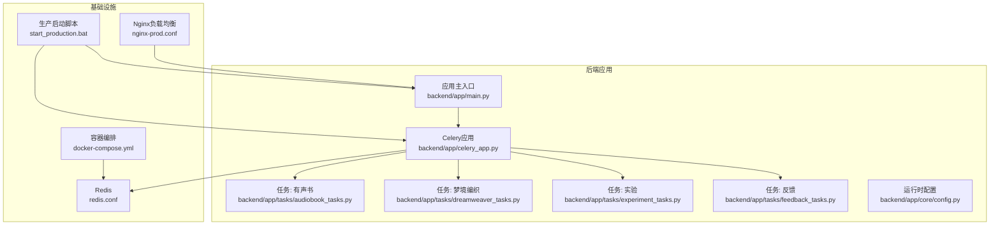
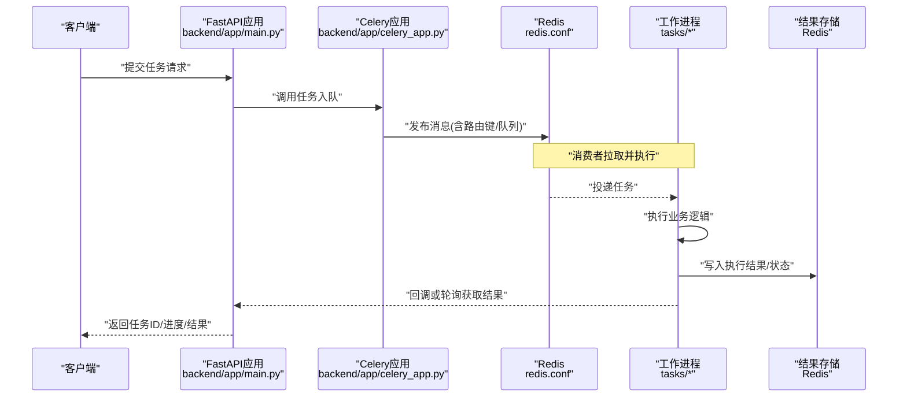
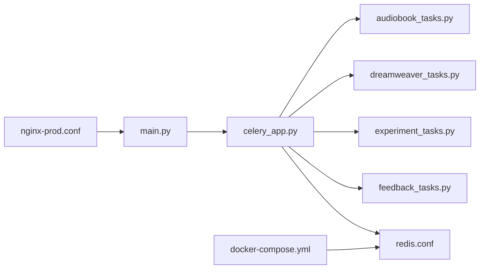

# Celery配置与管理

<cite>
**本文档引用的文件**   
- [backend/app/celery_app.py](file://backend/app/celery_app.py)
- [backend/app/tasks/audiobook_tasks.py](file://backend/app/tasks/audiobook_tasks.py)
- [backend/app/tasks/dreamweaver_tasks.py](file://backend/app/tasks/dreamweaver_tasks.py)
- [backend/app/tasks/experiment_tasks.py](file://backend/app/tasks/experiment_tasks.py)
- [backend/app/tasks/feedback_tasks.py](file://backend/app/tasks/feedback_tasks.py)
- [backend/app/core/config.py](file://backend/app/core/config.py)
- [backend/app/main.py](file://backend/app/main.py)
- [redis.conf](file://redis.conf)
- [docker-compose.yml](file://docker-compose.yml)
- [nginx-prod.conf](file://nginx-prod.conf)
- [start_production.bat](file://start_production.bat)
- [docs/AUDIOBOOK_TASK_QUEUE.md](file://docs/AUDIOBOOK_TASK_QUEUE.md)
</cite>

## 目录
1. [简介](#简介)
2. [项目结构](#项目结构)
3. [核心组件](#核心组件)
4. [架构总览](#架构总览)
5. [详细组件分析](#详细组件分析)
6. [依赖关系分析](#依赖关系分析)
7. [性能考量](#性能考量)
8. [故障排查指南](#故障排查指南)
9. [结论](#结论)
10. [附录](#附录)

## 简介
本文件面向Celery任务队列的配置与运维管理，覆盖应用初始化、Redis连接、任务路由、并发参数调优、工作进程管理、队列优先级、任务超时、监控与日志、生产部署、负载均衡与故障恢复等主题。文档以仓库中的Celery应用与任务实现为依据，提供可操作的配置建议与排障方法，帮助读者在生产环境中稳定运行异步任务。

## 项目结构
本项目将Celery应用定义在后端模块中，并通过多个任务模块组织业务逻辑。关键位置如下：
- Celery应用实例与基础配置位于后端应用的celery_app.py
- 任务定义分布在tasks目录下，按业务域划分（有声书、梦境编织、实验、反馈等）
- 运行时配置由core/config.py集中管理
- Redis服务通过独立配置文件与容器编排进行部署
- Nginx用于反向代理与负载均衡
- 生产启动脚本统一入口

图表来源
- [backend/app/celery_app.py](file://backend/app/celery_app.py)
- [backend/app/tasks/audiobook_tasks.py](file://backend/app/tasks/audiobook_tasks.py)
- [backend/app/tasks/dreamweaver_tasks.py](file://backend/app/tasks/dreamweaver_tasks.py)
- [backend/app/tasks/experiment_tasks.py](file://backend/app/tasks/experiment_tasks.py)
- [backend/app/tasks/feedback_tasks.py](file://backend/app/tasks/feedback_tasks.py)
- [backend/app/core/config.py](file://backend/app/core/config.py)
- [backend/app/main.py](file://backend/app/main.py)
- [redis.conf](file://redis.conf)
- [docker-compose.yml](file://docker-compose.yml)
- [nginx-prod.conf](file://nginx-prod.conf)
- [start_production.bat](file://start_production.bat)

章节来源
- [backend/app/celery_app.py](file://backend/app/celery_app.py)
- [backend/app/core/config.py](file://backend/app/core/config.py)
- [backend/app/main.py](file://backend/app/main.py)
- [redis.conf](file://redis.conf)
- [docker-compose.yml](file://docker-compose.yml)
- [nginx-prod.conf](file://nginx-prod.conf)
- [start_production.bat](file://start_production.bat)

## 核心组件
- Celery应用初始化与配置
  - 应用实例创建、Broker与Backend设置、任务自动发现、默认队列与路由策略、并发与进程池参数、任务超时与重试策略、日志与监控开关等均在celery_app.py中集中管理。
- 任务模块
  - 各业务域任务在tasks子模块中定义，包含任务函数、路由键、队列绑定、执行上下文与错误处理。
- 运行时配置
  - core/config.py提供环境变量加载、敏感信息注入、功能开关与默认值，供Celery与应用共享。
- 基础设施
  - Redis作为消息代理与结果存储；Docker Compose编排服务；Nginx负责HTTP层负载均衡；生产脚本统一拉起服务。

章节来源
- [backend/app/celery_app.py](file://backend/app/celery_app.py)
- [backend/app/tasks/audiobook_tasks.py](file://backend/app/tasks/audiobook_tasks.py)
- [backend/app/tasks/dreamweaver_tasks.py](file://backend/app/tasks/dreamweaver_tasks.py)
- [backend/app/tasks/experiment_tasks.py](file://backend/app/tasks/experiment_tasks.py)
- [backend/app/tasks/feedback_tasks.py](file://backend/app/tasks/feedback_tasks.py)
- [backend/app/core/config.py](file://backend/app/core/config.py)

## 架构总览
下图展示从Web请求到任务入队、调度执行、结果落盘与状态回写的整体流程。

图表来源
- [backend/app/main.py](file://backend/app/main.py)
- [backend/app/celery_app.py](file://backend/app/celery_app.py)
- [redis.conf](file://redis.conf)
- [backend/app/tasks/audiobook_tasks.py](file://backend/app/tasks/audiobook_tasks.py)
- [backend/app/tasks/dreamweaver_tasks.py](file://backend/app/tasks/dreamweaver_tasks.py)

## 详细组件分析

### Celery应用初始化与配置
- Broker与Backend
  - 使用Redis作为消息代理与结果后端，连接参数由运行时配置注入，支持密码、数据库索引、连接池与SSL选项。
- 任务发现与注册
  - 自动扫描tasks子模块，确保所有任务函数被正确注册。
- 队列与路由
  - 定义默认队列与专用队列（如高优先级的实时生成队列），通过路由键将任务定向到对应队列。
- 并发与进程池
  - 根据CPU核数与I/O密集程度调整worker数量、预取数、线程池大小，避免过度竞争与内存膨胀。
- 任务超时与重试
  - 为长耗时任务设置合理超时，结合指数退避重试与死信队列，保障失败任务的可观测性与可恢复性。
- 日志与监控
  - 启用结构化日志，输出任务生命周期事件；暴露指标端点以便Prometheus抓取。

章节来源
- [backend/app/celery_app.py](file://backend/app/celery_app.py)
- [backend/app/core/config.py](file://backend/app/core/config.py)

### 任务模块与路由
- 任务分类
  - 有声书任务：分章合成、音频后处理、字幕生成等
  - 梦境编织任务：视频生成、图像编辑、多模态推理等
  - 实验与反馈任务：A/B测试、评测收集、数据清洗等
- 路由策略
  - 基于任务名前缀或显式路由键映射到不同队列，保证资源隔离与优先级控制。
- 执行上下文
  - 任务内读取运行时配置，动态选择模型、适配器与缓存策略。

章节来源
- [backend/app/tasks/audiobook_tasks.py](file://backend/app/tasks/audiobook_tasks.py)
- [backend/app/tasks/dreamweaver_tasks.py](file://backend/app/tasks/dreamweaver_tasks.py)
- [backend/app/tasks/experiment_tasks.py](file://backend/app/tasks/experiment_tasks.py)
- [backend/app/tasks/feedback_tasks.py](file://backend/app/tasks/feedback_tasks.py)

### 工作进程管理与队列优先级
- 进程管理
  - 通过celery worker启动多个进程/线程，按队列名称指定监听队列，支持热重载与优雅退出。
- 优先级
  - 在高负载场景下，对关键队列启用优先级队列或延迟队列，确保SLA。
- 伸缩策略
  - 结合容器编排的HPA或外部调度器，依据队列长度与CPU利用率弹性扩缩容。

章节来源
- [backend/app/celery_app.py](file://backend/app/celery_app.py)
- [docker-compose.yml](file://docker-compose.yml)

### 任务超时与重试机制
- 超时设置
  - 针对网络调用与模型推理任务设置硬超时，防止僵尸任务占用资源。
- 重试策略
  - 区分可重试与不可重试异常，采用指数退避与最大重试次数限制。
- 失败处理
  - 记录失败原因与堆栈，推送告警，必要时进入人工复核队列。

章节来源
- [backend/app/celery_app.py](file://backend/app/celery_app.py)
- [backend/app/tasks/audiobook_tasks.py](file://backend/app/tasks/audiobook_tasks.py)

### 监控、日志与性能指标
- 日志
  - 统一日志格式，包含任务ID、队列、耗时、状态码与关键参数脱敏。
- 指标
  - 暴露队列长度、任务成功率、平均耗时、重试率等指标，便于看板与告警。
- 追踪
  - 集成分布式追踪，串联HTTP请求与任务执行链路。

章节来源
- [backend/app/celery_app.py](file://backend/app/celery_app.py)
- [backend/app/core/config.py](file://backend/app/core/config.py)

### 生产环境部署与负载均衡
- 容器编排
  - 使用docker-compose定义Celery Worker、Redis、PostgreSQL等服务，设置健康检查与重启策略。
- Nginx负载均衡
  - 对API层进行反向代理与限流，配合上游多实例提升吞吐与可用性。
- 启动脚本
  - 统一拉起API、Worker与依赖服务，支持灰度与回滚。

章节来源
- [docker-compose.yml](file://docker-compose.yml)
- [nginx-prod.conf](file://nginx-prod.conf)
- [start_production.bat](file://start_production.bat)

### 故障恢复与高可用
- 幂等性
  - 任务设计遵循幂等原则，支持重复消费不产生副作用。
- 断线重连
  - Broker与Backend连接具备自动重连与退避策略。
- 数据一致性
  - 关键状态变更采用事务或补偿机制，确保最终一致。

章节来源
- [backend/app/celery_app.py](file://backend/app/celery_app.py)
- [redis.conf](file://redis.conf)

## 依赖关系分析
- 应用层依赖
  - main.py依赖celery_app.py进行任务入队与状态查询
  - tasks模块依赖core/config.py获取运行时配置
- 基础设施依赖
  - celery_app.py依赖Redis作为Broker与Backend
  - docker-compose.yml编排Redis与其他服务
  - nginx-prod.conf对API进行负载均衡与健康检查

图表来源
- [backend/app/main.py](file://backend/app/main.py)
- [backend/app/celery_app.py](file://backend/app/celery_app.py)
- [backend/app/tasks/audiobook_tasks.py](file://backend/app/tasks/audiobook_tasks.py)
- [backend/app/tasks/dreamweaver_tasks.py](file://backend/app/tasks/dreamweaver_tasks.py)
- [backend/app/tasks/experiment_tasks.py](file://backend/app/tasks/experiment_tasks.py)
- [backend/app/tasks/feedback_tasks.py](file://backend/app/tasks/feedback_tasks.py)
- [redis.conf](file://redis.conf)
- [docker-compose.yml](file://docker-compose.yml)
- [nginx-prod.conf](file://nginx-prod.conf)

章节来源
- [backend/app/main.py](file://backend/app/main.py)
- [backend/app/celery_app.py](file://backend/app/celery_app.py)
- [redis.conf](file://redis.conf)
- [docker-compose.yml](file://docker-compose.yml)
- [nginx-prod.conf](file://nginx-prod.conf)

## 性能考量
- 并发与预取
  - 合理设置worker数量与prefetch_count，避免队列积压与内存峰值。
- I/O与计算分离
  - 将网络密集型任务与CPU密集型任务拆分到不同队列与进程池。
- 结果存储优化
  - 大结果采用对象存储或数据库持久化，减少Redis压力。
- 缓存与预热
  - 对热点模型与数据进行本地缓存，降低冷启动开销。
- 监控与容量规划
  - 基于历史QPS与P99耗时评估容量，预留扩容空间。

[本节为通用指导，无需特定文件引用]

## 故障排查指南
- 常见问题
  - 无法连接Redis：检查网络连通、认证信息与端口开放
  - 任务未执行：确认worker已启动且监听了目标队列
  - 任务频繁超时：检查下游服务响应时间与超时阈值
  - 内存泄漏：定位长时间运行的任务与未释放资源
- 诊断步骤
  - 查看任务日志与错误堆栈
  - 检查队列长度与消费者状态
  - 验证Broker与Backend连接健康
  - 采集系统指标（CPU、内存、磁盘IO、网络）
- 恢复策略
  - 重启worker或清理阻塞任务
  - 降级非关键队列，优先保障SLA
  - 回滚最近变更并观察稳定性

章节来源
- [backend/app/celery_app.py](file://backend/app/celery_app.py)
- [backend/app/tasks/audiobook_tasks.py](file://backend/app/tasks/audiobook_tasks.py)
- [backend/app/tasks/dreamweaver_tasks.py](file://backend/app/tasks/dreamweaver_tasks.py)

## 结论
通过统一的Celery应用配置、清晰的任务路由与严格的并发与超时策略，本项目实现了高可靠、可扩展的异步任务处理能力。结合Redis、容器编排与Nginx负载均衡，可在生产环境中获得稳定的吞吐与低延迟。持续完善监控与排障能力，是保障长期稳定运行的关键。

[本节为总结性内容，无需特定文件引用]

## 附录
- 参考文档
  - 任务队列设计与实践详见[AUDIOBOOK_TASK_QUEUE.md](file://docs/AUDIOBOOK_TASK_QUEUE.md)

章节来源
- [docs/AUDIOBOOK_TASK_QUEUE.md](file://docs/AUDIOBOOK_TASK_QUEUE.md)