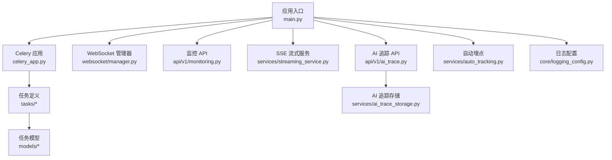
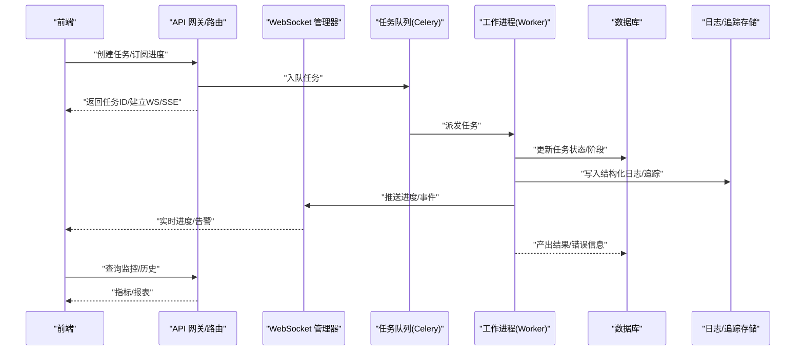
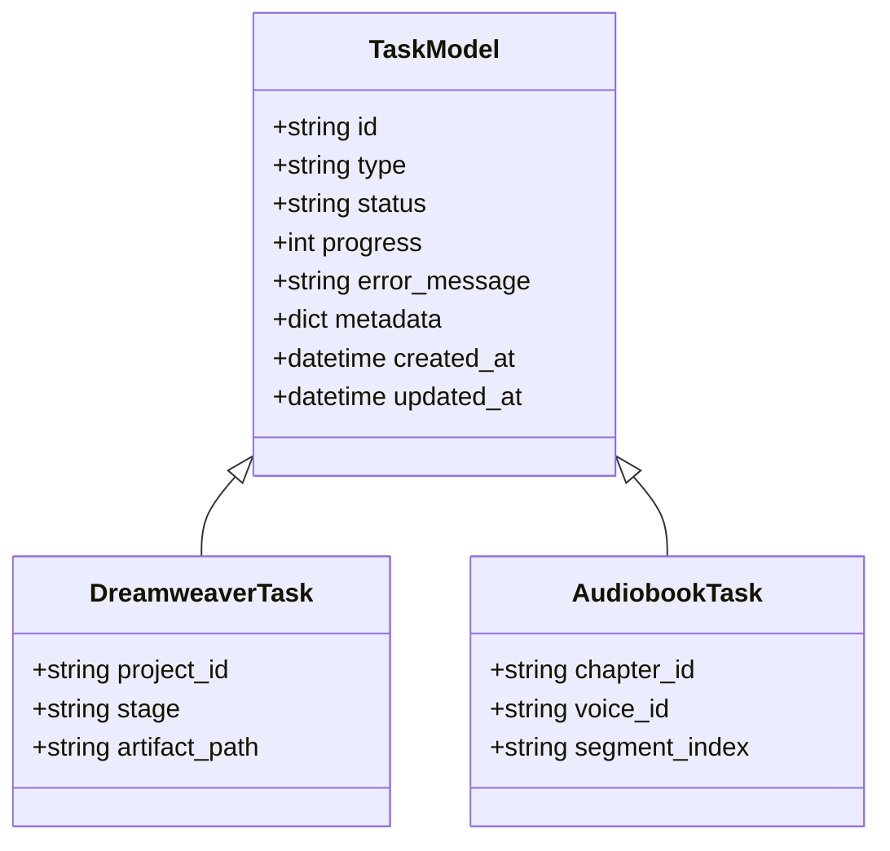
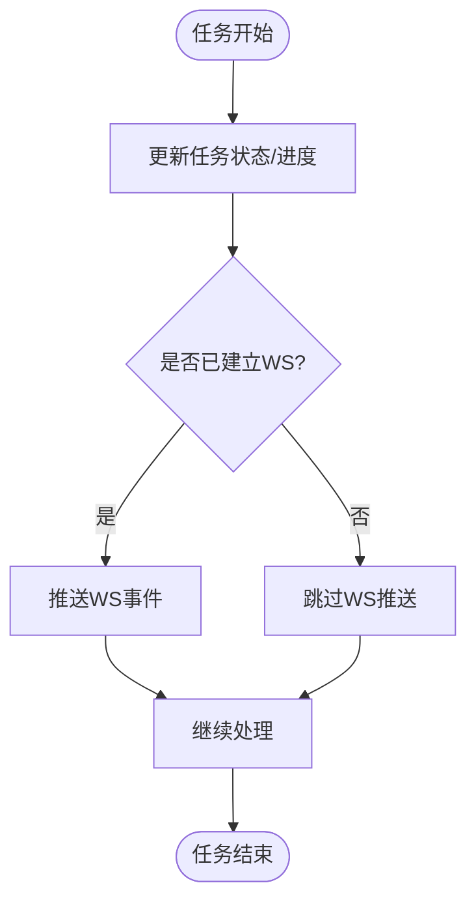
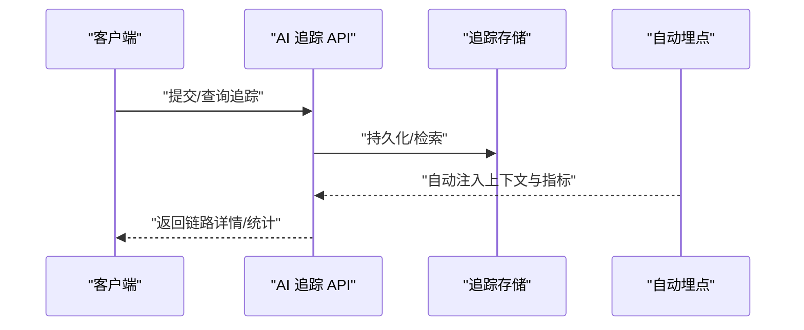
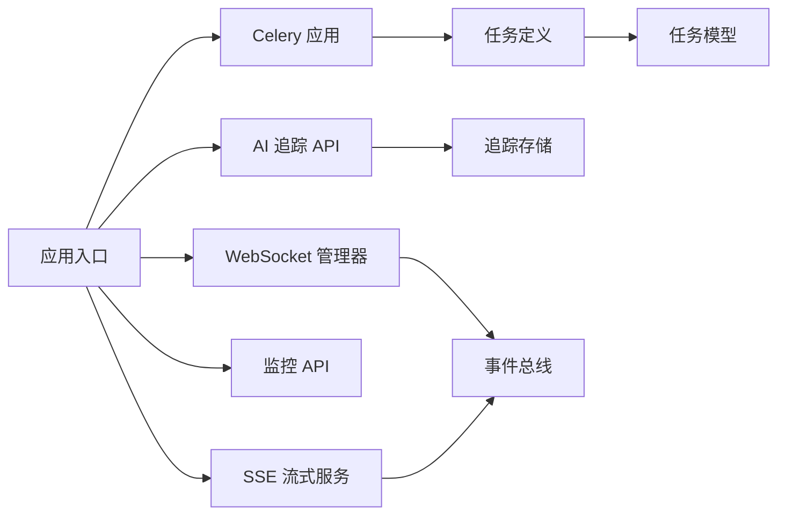

# 任务监控与日志

<cite>
**本文引用的文件**   
- [backend/app/main.py](file://backend/app/main.py)
- [backend/app/celery_app.py](file://backend/app/celery_app.py)
- [backend/app/websocket/manager.py](file://backend/app/websocket/manager.py)
- [backend/app/api/v1/monitoring.py](file://backend/app/api/v1/monitoring.py)
- [backend/app/services/streaming_service.py](file://backend/app/services/streaming_service.py)
- [backend/app/services/auto_tracking.py](file://backend/app/services/auto_tracking.py)
- [core/logging_config.py](file://core/logging_config.py)
- [backend/app/api/v1/ai_trace.py](file://backend/app/api/v1/ai_trace.py)
- [backend/app/services/ai_trace_storage.py](file://backend/app/services/ai_trace_storage.py)
- [backend/app/services/agent_coordinator.py](file://backend/app/services/agent_coordinator.py)
- [backend/app/tasks/dreamweaver_tasks.py](file://backend/app/tasks/dreamweaver_tasks.py)
- [backend/app/tasks/audiobook_tasks.py](file://backend/app/tasks/audiobook_tasks.py)
- [backend/app/models/dreamweaver.py](file://backend/app/models/dreamweaver.py)
- [backend/app/models/audiobook_task.py](file://backend/app/models/audiobook_task.py)
- [backend/app/schemas/common.py](file://backend/app/schemas/common.py)
- [backend/app/core/config.py](file://backend/app/core/config.py)
- [backend/app/db/base.py](file://backend/app/db/base.py)
</cite>

## 目录
1. [简介](#简介)
2. [项目结构](#项目结构)
3. [核心组件](#核心组件)
4. [架构总览](#架构总览)
5. [详细组件分析](#详细组件分析)
6. [依赖关系分析](#依赖关系分析)
7. [性能考量](#性能考量)
8. [故障排查指南](#故障排查指南)
9. [结论](#结论)
10. [附录](#附录)

## 简介
本文件面向“异步任务监控与日志系统”，覆盖以下关键能力：
- 任务执行状态跟踪、实时进度更新与异常告警机制
- WebSocket 实时通信、事件推送与前端集成方案
- 性能指标收集、资源使用监控与瓶颈分析工具
- 日志级别管理、结构化日志格式与日志聚合方案
- 监控仪表板、告警规则与故障诊断指南
- 分布式追踪、链路追踪与性能分析最佳实践

目标读者包括后端工程师、运维人员、前端开发者与产品/测试人员。

## 项目结构
围绕任务监控与日志，代码主要分布在以下模块：
- 应用入口与配置：后端主应用、Celery 应用初始化、全局配置
- 任务编排与执行：Celery 任务定义、任务模型与状态机
- 实时监控与事件：WebSocket 管理器、SSE 流式服务
- 可观测性：AI 追踪存储与 API、自动埋点、监控接口
- 日志体系：统一日志配置、结构化输出、分级策略

图表来源
- [backend/app/main.py](file://backend/app/main.py)
- [backend/app/celery_app.py](file://backend/app/celery_app.py)
- [backend/app/websocket/manager.py](file://backend/app/websocket/manager.py)
- [backend/app/api/v1/monitoring.py](file://backend/app/api/v1/monitoring.py)
- [backend/app/services/streaming_service.py](file://backend/app/services/streaming_service.py)
- [backend/app/api/v1/ai_trace.py](file://backend/app/api/v1/ai_trace.py)
- [backend/app/services/ai_trace_storage.py](file://backend/app/services/ai_trace_storage.py)
- [backend/app/services/auto_tracking.py](file://backend/app/services/auto_tracking.py)
- [core/logging_config.py](file://core/logging_config.py)

章节来源
- [backend/app/main.py](file://backend/app/main.py)
- [backend/app/celery_app.py](file://backend/app/celery_app.py)
- [backend/app/websocket/manager.py](file://backend/app/websocket/manager.py)
- [backend/app/api/v1/monitoring.py](file://backend/app/api/v1/monitoring.py)
- [backend/app/services/streaming_service.py](file://backend/app/services/streaming_service.py)
- [backend/app/api/v1/ai_trace.py](file://backend/app/api/v1/ai_trace.py)
- [backend/app/services/ai_trace_storage.py](file://backend/app/services/ai_trace_storage.py)
- [backend/app/services/auto_tracking.py](file://backend/app/services/auto_tracking.py)
- [core/logging_config.py](file://core/logging_config.py)

## 核心组件
- 任务执行与状态跟踪
  - Celery 任务调度与执行器，负责长耗时任务的异步化与重试
  - 任务模型持久化，记录任务生命周期、阶段、错误信息与产物位置
- 实时进度与事件推送
  - WebSocket 连接管理与消息路由，支持按会话/任务维度广播
  - SSE（Server-Sent Events）用于单向流式进度与日志回推
- 监控与可观测性
  - 监控 API 暴露系统健康、队列深度、任务统计等指标
  - AI 追踪存储与 API 提供请求级链路数据，便于问题定位
  - 自动埋点服务在关键路径注入上下文与度量
- 日志体系
  - 统一日志配置，支持分级、结构化字段、输出到多目的地
  - 建议结合外部日志聚合平台进行集中采集与分析

章节来源
- [backend/app/celery_app.py](file://backend/app/celery_app.py)
- [backend/app/tasks/dreamweaver_tasks.py](file://backend/app/tasks/dreamweaver_tasks.py)
- [backend/app/tasks/audiobook_tasks.py](file://backend/app/tasks/audiobook_tasks.py)
- [backend/app/models/dreamweaver.py](file://backend/app/models/dreamweaver.py)
- [backend/app/models/audiobook_task.py](file://backend/app/models/audiobook_task.py)
- [backend/app/websocket/manager.py](file://backend/app/websocket/manager.py)
- [backend/app/services/streaming_service.py](file://backend/app/services/streaming_service.py)
- [backend/app/api/v1/monitoring.py](file://backend/app/api/v1/monitoring.py)
- [backend/app/api/v1/ai_trace.py](file://backend/app/api/v1/ai_trace.py)
- [backend/app/services/ai_trace_storage.py](file://backend/app/services/ai_trace_storage.py)
- [backend/app/services/auto_tracking.py](file://backend/app/services/auto_tracking.py)
- [core/logging_config.py](file://core/logging_config.py)

## 架构总览
下图展示从前端到后端、再到任务执行与可观测性的整体流程。

图表来源
- [backend/app/main.py](file://backend/app/main.py)
- [backend/app/websocket/manager.py](file://backend/app/websocket/manager.py)
- [backend/app/celery_app.py](file://backend/app/celery_app.py)
- [backend/app/api/v1/monitoring.py](file://backend/app/api/v1/monitoring.py)
- [backend/app/services/streaming_service.py](file://backend/app/services/streaming_service.py)
- [backend/app/api/v1/ai_trace.py](file://backend/app/api/v1/ai_trace.py)
- [backend/app/services/ai_trace_storage.py](file://backend/app/services/ai_trace_storage.py)

## 详细组件分析

### 任务执行与状态跟踪（Celery + 任务模型）
- 任务生命周期
  - 入队：接收请求后生成任务 ID，落库初始状态
  - 执行：Worker 拉取并执行，逐步推进阶段（如准备、运行、校验、完成）
  - 完成/失败：写回最终状态、错误码、堆栈摘要与产物路径
- 状态模型
  - 任务表包含：任务类型、关联业务 ID、阶段、进度百分比、错误信息、时间戳、扩展元数据
- 重试与幂等
  - 对网络调用或外部服务失败设置指数退避重试
  - 通过任务 ID 与幂等键避免重复执行

图表来源
- [backend/app/models/dreamweaver.py](file://backend/app/models/dreamweaver.py)
- [backend/app/models/audiobook_task.py](file://backend/app/models/audiobook_task.py)

章节来源
- [backend/app/celery_app.py](file://backend/app/celery_app.py)
- [backend/app/tasks/dreamweaver_tasks.py](file://backend/app/tasks/dreamweaver_tasks.py)
- [backend/app/tasks/audiobook_tasks.py](file://backend/app/tasks/audiobook_tasks.py)
- [backend/app/models/dreamweaver.py](file://backend/app/models/dreamweaver.py)
- [backend/app/models/audiobook_task.py](file://backend/app/models/audiobook_task.py)

### 实时进度与事件推送（WebSocket + SSE）
- WebSocket 管理器
  - 维护连接与会话映射，按任务/用户维度广播消息
  - 支持断线重连与心跳保活
- SSE 流式服务
  - 为不支持 WS 的场景提供单向流式推送
  - 适合浏览器端直接订阅进度与日志
- 事件类型
  - 进度更新、阶段切换、警告、错误、完成通知

图表来源
- [backend/app/websocket/manager.py](file://backend/app/websocket/manager.py)
- [backend/app/services/streaming_service.py](file://backend/app/services/streaming_service.py)

章节来源
- [backend/app/websocket/manager.py](file://backend/app/websocket/manager.py)
- [backend/app/services/streaming_service.py](file://backend/app/services/streaming_service.py)

### 监控与可观测性（监控 API + AI 追踪 + 自动埋点）
- 监控 API
  - 暴露系统健康检查、队列长度、任务吞吐、错误率等指标
- AI 追踪
  - 记录请求级链路：输入、模型选择、参数、耗时、错误
  - 提供查询接口用于排障与审计
- 自动埋点
  - 在关键路径注入上下文（如 trace_id、span_id）
  - 统一上报指标与事件

图表来源
- [backend/app/api/v1/ai_trace.py](file://backend/app/api/v1/ai_trace.py)
- [backend/app/services/ai_trace_storage.py](file://backend/app/services/ai_trace_storage.py)
- [backend/app/services/auto_tracking.py](file://backend/app/services/auto_tracking.py)

章节来源
- [backend/app/api/v1/monitoring.py](file://backend/app/api/v1/monitoring.py)
- [backend/app/api/v1/ai_trace.py](file://backend/app/api/v1/ai_trace.py)
- [backend/app/services/ai_trace_storage.py](file://backend/app/services/ai_trace_storage.py)
- [backend/app/services/auto_tracking.py](file://backend/app/services/auto_tracking.py)

### 日志体系（级别管理 + 结构化格式 + 聚合）
- 日志级别管理
  - 按环境区分默认级别（开发/测试/生产）
  - 支持运行时调整特定模块的级别
- 结构化日志格式
  - 固定字段：时间、级别、模块、trace_id、任务ID、阶段、耗时、错误码
  - 便于下游解析与聚合
- 日志聚合方案
  - 推荐接入集中式日志平台（如 ELK/Loki），按服务/任务维度索引
  - 结合告警规则实现异常快速发现

章节来源
- [core/logging_config.py](file://core/logging_config.py)

### 前端集成方案（WebSocket + SSE）
- 连接建立
  - 优先使用 WebSocket 建立双向通道；若不可用则降级至 SSE
- 订阅策略
  - 按任务 ID 订阅进度与事件
  - 处理重连与心跳，保证长时间任务稳定
- UI 呈现
  - 进度条、阶段标签、错误提示、操作按钮（取消/重试）
- 错误处理
  - 网络异常、服务端错误、超时等场景的友好提示与恢复

章节来源
- [backend/app/websocket/manager.py](file://backend/app/websocket/manager.py)
- [backend/app/services/streaming_service.py](file://backend/app/services/streaming_service.py)

## 依赖关系分析
- 组件耦合
  - 任务执行依赖 Celery 与数据库模型
  - 实时推送依赖 WebSocket 管理器与 SSE 服务
  - 可观测性依赖追踪存储与自动埋点
- 外部依赖
  - 数据库（PostgreSQL/MySQL）、消息队列（Redis/RabbitMQ）、日志聚合平台
- 潜在循环依赖
  - 确保任务模块不反向依赖推送层，避免阻塞

图表来源
- [backend/app/main.py](file://backend/app/main.py)
- [backend/app/celery_app.py](file://backend/app/celery_app.py)
- [backend/app/websocket/manager.py](file://backend/app/websocket/manager.py)
- [backend/app/services/streaming_service.py](file://backend/app/services/streaming_service.py)
- [backend/app/api/v1/monitoring.py](file://backend/app/api/v1/monitoring.py)
- [backend/app/api/v1/ai_trace.py](file://backend/app/api/v1/ai_trace.py)
- [backend/app/services/ai_trace_storage.py](file://backend/app/services/ai_trace_storage.py)

章节来源
- [backend/app/main.py](file://backend/app/main.py)
- [backend/app/celery_app.py](file://backend/app/celery_app.py)
- [backend/app/websocket/manager.py](file://backend/app/websocket/manager.py)
- [backend/app/services/streaming_service.py](file://backend/app/services/streaming_service.py)
- [backend/app/api/v1/monitoring.py](file://backend/app/api/v1/monitoring.py)
- [backend/app/api/v1/ai_trace.py](file://backend/app/api/v1/ai_trace.py)
- [backend/app/services/ai_trace_storage.py](file://backend/app/services/ai_trace_storage.py)

## 性能考量
- 任务执行
  - 合理拆分长耗时步骤，提升并行度与可中断性
  - 使用批量写入与缓存减少数据库压力
- 实时推送
  - 控制事件频率，合并高频更新（如每 N% 或每秒上限）
  - 使用连接池与异步 I/O 提高吞吐
- 监控与追踪
  - 采样策略降低追踪开销，关键路径全量记录
  - 指标聚合与降采样，避免热点查询
- 资源监控
  - CPU、内存、磁盘 I/O、网络带宽的阈值告警
  - 慢查询与锁等待监控

[本节为通用指导，无需引用具体文件]

## 故障排查指南
- 常见问题
  - 任务卡住：检查 Worker 负载、队列堆积、外部依赖可用性
  - 进度不更新：确认 WS/SSE 连接状态与事件推送逻辑
  - 追踪缺失：验证埋点注入与追踪存储写入
  - 日志丢失：检查日志级别与输出目标配置
- 诊断步骤
  - 通过监控 API 查看任务状态与错误摘要
  - 使用 AI 追踪查询链路详情与耗时分布
  - 检索结构化日志，过滤 trace_id 与任务 ID
  - 复现场景并开启更细粒度日志级别
- 告警规则建议
  - 任务失败率超过阈值
  - 队列深度持续增长
  - 平均耗时突增
  - 外部依赖错误率升高

章节来源
- [backend/app/api/v1/monitoring.py](file://backend/app/api/v1/monitoring.py)
- [backend/app/api/v1/ai_trace.py](file://backend/app/api/v1/ai_trace.py)
- [backend/app/services/ai_trace_storage.py](file://backend/app/services/ai_trace_storage.py)
- [core/logging_config.py](file://core/logging_config.py)

## 结论
本系统通过 Celery 任务编排、WebSocket/SSE 实时推送、监控与追踪能力，构建了完整的异步任务监控与日志体系。建议在部署时完善日志聚合与告警规则，持续优化任务拆分与事件频率，以提升稳定性与可观测性。

[本节为总结，无需引用具体文件]

## 附录
- 监控仪表板
  - 关键指标：任务吞吐、成功率、平均耗时、错误率、队列深度
  - 视图：趋势图、热力图、明细列表
- 告警规则示例
  - 连续 N 分钟失败率 > X%
  - 队列深度 > Y
  - 平均耗时 > Z
- 分布式追踪最佳实践
  - 统一 trace_id 贯穿请求链
  - 关键节点打点，记录输入输出摘要
  - 采样与采样权重控制开销

[本节为概念性内容，无需引用具体文件]