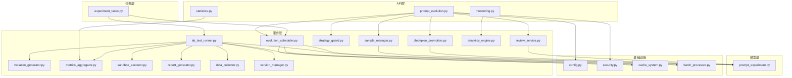
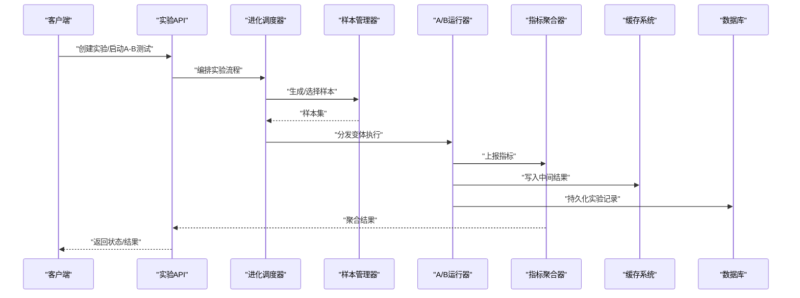
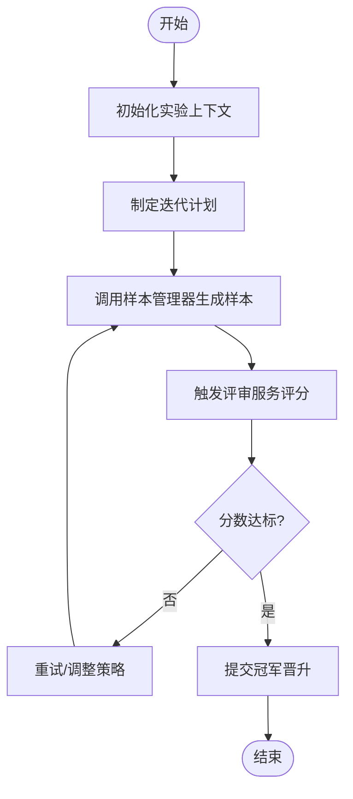
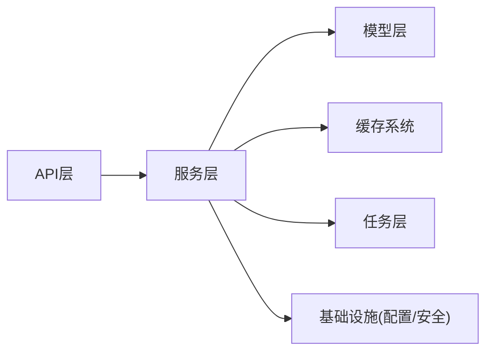

# 实验任务处理

<cite>
**本文引用的文件**   
- [backend/app/api/v1/prompt_evolution.py](file://backend/app/api/v1/prompt_evolution.py)
- [backend/app/services/prompt_evolution/evolution_scheduler.py](file://backend/app/services/prompt_evolution/evolution_scheduler.py)
- [backend/app/services/prompt_evolution/sample_manager.py](file://backend/app/services/prompt_evolution/sample_manager.py)
- [backend/app/services/prompt_evolution/champion_promotion.py](file://backend/app/services/prompt_evolution/champion_promotion.py)
- [backend/app/services/prompt_evolution/strategy_guard.py](file://backend/app/services/prompt_evolution/strategy_guard.py)
- [backend/app/services/prompt_evolution/review_service.py](file://backend/app/services/prompt_evolution/review_service.py)
- [backend/app/models/prompt_experiment.py](file://backend/app/models/prompt_experiment.py)
- [backend/app/tasks/experiment_tasks.py](file://backend/app/tasks/experiment_tasks.py)
- [backend/app/core/config.py](file://backend/app/core/config.py)
- [backend/app/core/security.py](file://backend/app/core/security.py)
- [backend/app/services/cache_system.py](file://backend/app/services/cache_system.py)
- [backend/app/services/batch_processor.py](file://backend/app/services/batch_processor.py)
- [backend/app/api/v1/statistics.py](file://backend/app/api/v1/statistics.py)
- [backend/app/api/v1/monitoring.py](file://backend/app/api/v1/monitoring.py)
- [backend/app/services/content_evolution/variation_generator.py](file://backend/app/services/content_evolution/variation_generator.py)
- [backend/app/services/content_evolution/ab_test_runner.py](file://backend/app/services/content_evolution/ab_test_runner.py)
- [backend/app/services/content_evolution/metrics_aggregator.py](file://backend/app/services/content_evolution/metrics_aggregator.py)
- [backend/app/services/content_evolution/sandbox_executor.py](file://backend/app/services/content_evolution/sandbox_executor.py)
- [backend/app/services/content_evolution/report_generator.py](file://backend/app/services/content_evolution/report_generator.py)
- [backend/app/services/content_evolution/data_collector.py](file://backend/app/services/content_evolution/data_collector.py)
- [backend/app/services/content_evolution/analytics_engine.py](file://backend/app/services/content_evolution/analytics_engine.py)
- [backend/app/services/content_evolution/version_manager.py](file://backend/app/services/content_evolution/version_manager.py)
</cite>

## 目录
1. [简介](#简介)
2. [项目结构](#项目结构)
3. [核心组件](#核心组件)
4. [架构总览](#架构总览)
5. [详细组件分析](#详细组件分析)
6. [依赖关系分析](#依赖关系分析)
7. [性能考量](#性能考量)
8. [故障排查指南](#故障排查指南)
9. [结论](#结论)
10. [附录](#附录)

## 简介
本文件面向“实验任务处理系统”，聚焦提示词进化、内容变体生成与A/B测试三大能力。文档从系统设计、数据流、调度优化、资源隔离、结果缓存、监控界面、数据分析与报告生成、沙箱环境与安全权限等方面，提供循序渐进的说明，帮助读者快速理解并高效使用该系统。

## 项目结构
实验相关代码主要分布在后端服务的以下模块：
- API层：暴露实验创建、执行、查询与统计接口
- 服务层：实现提示词进化、样本管理、冠军晋升、策略守卫、评审服务等核心逻辑
- 模型层：定义实验、版本、指标等持久化实体
- 任务层：异步执行实验任务，解耦耗时操作
- 配置与安全：集中管理环境变量、权限控制与访问校验
- 缓存与批处理：提升吞吐与稳定性
- 内容变体与A/B测试：变体生成、执行、指标聚合与分析
- 沙箱与报告：安全隔离执行与结果报告输出

图表来源
- [backend/app/api/v1/prompt_evolution.py](file://backend/app/api/v1/prompt_evolution.py)
- [backend/app/services/prompt_evolution/evolution_scheduler.py](file://backend/app/services/prompt_evolution/evolution_scheduler.py)
- [backend/app/services/prompt_evolution/sample_manager.py](file://backend/app/services/prompt_evolution/sample_manager.py)
- [backend/app/services/prompt_evolution/champion_promotion.py](file://backend/app/services/prompt_evolution/champion_promotion.py)
- [backend/app/services/prompt_evolution/strategy_guard.py](file://backend/app/services/prompt_evolution/strategy_guard.py)
- [backend/app/services/prompt_evolution/review_service.py](file://backend/app/services/prompt_evolution/review_service.py)
- [backend/app/models/prompt_experiment.py](file://backend/app/models/prompt_experiment.py)
- [backend/app/tasks/experiment_tasks.py](file://backend/app/tasks/experiment_tasks.py)
- [backend/app/core/config.py](file://backend/app/core/config.py)
- [backend/app/core/security.py](file://backend/app/core/security.py)
- [backend/app/services/cache_system.py](file://backend/app/services/cache_system.py)
- [backend/app/services/batch_processor.py](file://backend/app/services/batch_processor.py)
- [backend/app/api/v1/statistics.py](file://backend/app/api/v1/statistics.py)
- [backend/app/api/v1/monitoring.py](file://backend/app/api/v1/monitoring.py)
- [backend/app/services/content_evolution/variation_generator.py](file://backend/app/services/content_evolution/variation_generator.py)
- [backend/app/services/content_evolution/ab_test_runner.py](file://backend/app/services/content_evolution/ab_test_runner.py)
- [backend/app/services/content_evolution/metrics_aggregator.py](file://backend/app/services/content_evolution/metrics_aggregator.py)
- [backend/app/services/content_evolution/sandbox_executor.py](file://backend/app/services/content_evolution/sandbox_executor.py)
- [backend/app/services/content_evolution/report_generator.py](file://backend/app/services/content_evolution/report_generator.py)
- [backend/app/services/content_evolution/data_collector.py](file://backend/app/services/content_evolution/data_collector.py)
- [backend/app/services/content_evolution/analytics_engine.py](file://backend/app/services/content_evolution/analytics_engine.py)
- [backend/app/services/content_evolution/version_manager.py](file://backend/app/services/content_evolution/version_manager.py)

章节来源
- [backend/app/api/v1/prompt_evolution.py](file://backend/app/api/v1/prompt_evolution.py)
- [backend/app/services/prompt_evolution/evolution_scheduler.py](file://backend/app/services/prompt_evolution/evolution_scheduler.py)
- [backend/app/models/prompt_experiment.py](file://backend/app/models/prompt_experiment.py)
- [backend/app/tasks/experiment_tasks.py](file://backend/app/tasks/experiment_tasks.py)
- [backend/app/core/config.py](file://backend/app/core/config.py)
- [backend/app/core/security.py](file://backend/app/core/security.py)
- [backend/app/services/cache_system.py](file://backend/app/services/cache_system.py)
- [backend/app/services/batch_processor.py](file://backend/app/services/batch_processor.py)
- [backend/app/api/v1/statistics.py](file://backend/app/api/v1/statistics.py)
- [backend/app/api/v1/monitoring.py](file://backend/app/api/v1/monitoring.py)
- [backend/app/services/content_evolution/variation_generator.py](file://backend/app/services/content_evolution/variation_generator.py)
- [backend/app/services/content_evolution/ab_test_runner.py](file://backend/app/services/content_evolution/ab_test_runner.py)
- [backend/app/services/content_evolution/metrics_aggregator.py](file://backend/app/services/content_evolution/metrics_aggregator.py)
- [backend/app/services/content_evolution/sandbox_executor.py](file://backend/app/services/content_evolution/sandbox_executor.py)
- [backend/app/services/content_evolution/report_generator.py](file://backend/app/services/content_evolution/report_generator.py)
- [backend/app/services/content_evolution/data_collector.py](file://backend/app/services/content_evolution/data_collector.py)
- [backend/app/services/content_evolution/analytics_engine.py](file://backend/app/services/content_evolution/analytics_engine.py)
- [backend/app/services/content_evolution/version_manager.py](file://backend/app/services/content_evolution/version_manager.py)

## 核心组件
- 提示词进化调度器：负责实验生命周期编排、迭代计划、并发控制与重试
- 样本管理器：负责采样策略、样本池维护、质量评估与多样性控制
- 冠军晋升服务：基于指标阈值与统计显著性进行版本晋升与回滚
- 策略守卫：对进化策略进行约束与审计，防止越权或异常策略生效
- 评审服务：集成多源评审（LLM/规则/人工），统一评分与反馈闭环
- 内容变体生成器：按模板、参数与上下文生成多样化内容变体
- A/B测试运行器：流量分配、分组、执行与结果收集
- 指标聚合器：汇总业务与系统指标，支持多维度统计
- 数据收集器：埋点采集、清洗与入库
- 分析引擎：统计检验、显著性分析与洞察生成
- 沙箱执行器：隔离执行用户脚本/策略，限制资源与权限
- 报告生成器：导出可视化报告与对比分析
- 版本管理器：实验版本、分支与发布管理
- 缓存系统：热点数据与中间结果缓存
- 批处理器：批量任务拆分、去重与失败重试
- 配置与安全：环境变量加载、鉴权与授权

章节来源
- [backend/app/services/prompt_evolution/evolution_scheduler.py](file://backend/app/services/prompt_evolution/evolution_scheduler.py)
- [backend/app/services/prompt_evolution/sample_manager.py](file://backend/app/services/prompt_evolution/sample_manager.py)
- [backend/app/services/prompt_evolution/champion_promotion.py](file://backend/app/services/prompt_evolution/champion_promotion.py)
- [backend/app/services/prompt_evolution/strategy_guard.py](file://backend/app/services/prompt_evolution/strategy_guard.py)
- [backend/app/services/prompt_evolution/review_service.py](file://backend/app/services/prompt_evolution/review_service.py)
- [backend/app/services/content_evolution/variation_generator.py](file://backend/app/services/content_evolution/variation_generator.py)
- [backend/app/services/content_evolution/ab_test_runner.py](file://backend/app/services/content_evolution/ab_test_runner.py)
- [backend/app/services/content_evolution/metrics_aggregator.py](file://backend/app/services/content_evolution/metrics_aggregator.py)
- [backend/app/services/content_evolution/data_collector.py](file://backend/app/services/content_evolution/data_collector.py)
- [backend/app/services/content_evolution/analytics_engine.py](file://backend/app/services/content_evolution/analytics_engine.py)
- [backend/app/services/content_evolution/sandbox_executor.py](file://backend/app/services/content_evolution/sandbox_executor.py)
- [backend/app/services/content_evolution/report_generator.py](file://backend/app/services/content_evolution/report_generator.py)
- [backend/app/services/content_evolution/version_manager.py](file://backend/app/services/content_evolution/version_manager.py)
- [backend/app/services/cache_system.py](file://backend/app/services/cache_system.py)
- [backend/app/services/batch_processor.py](file://backend/app/services/batch_processor.py)
- [backend/app/core/config.py](file://backend/app/core/config.py)
- [backend/app/core/security.py](file://backend/app/core/security.py)

## 架构总览
系统采用分层架构与事件驱动的任务编排，API层接收请求后交由服务层处理，关键耗时操作通过任务队列异步执行，结果经缓存与批处理优化后返回。

图表来源
- [backend/app/api/v1/prompt_evolution.py](file://backend/app/api/v1/prompt_evolution.py)
- [backend/app/services/prompt_evolution/evolution_scheduler.py](file://backend/app/services/prompt_evolution/evolution_scheduler.py)
- [backend/app/services/prompt_evolution/sample_manager.py](file://backend/app/services/prompt_evolution/sample_manager.py)
- [backend/app/services/content_evolution/ab_test_runner.py](file://backend/app/services/content_evolution/ab_test_runner.py)
- [backend/app/services/content_evolution/metrics_aggregator.py](file://backend/app/services/content_evolution/metrics_aggregator.py)
- [backend/app/services/cache_system.py](file://backend/app/services/cache_system.py)
- [backend/app/models/prompt_experiment.py](file://backend/app/models/prompt_experiment.py)

## 详细组件分析

### 提示词进化调度器
- 职责：实验生命周期管理、迭代计划、并发控制、重试与补偿
- 关键点：
  - 支持按项目/主题维度组织实验
  - 可配置迭代轮次、样本规模与评审阈值
  - 与样本管理器协作，确保样本质量与多样性
  - 与冠军晋升服务联动，自动升级最优策略

图表来源
- [backend/app/services/prompt_evolution/evolution_scheduler.py](file://backend/app/services/prompt_evolution/evolution_scheduler.py)
- [backend/app/services/prompt_evolution/sample_manager.py](file://backend/app/services/prompt_evolution/sample_manager.py)
- [backend/app/services/prompt_evolution/review_service.py](file://backend/app/services/prompt_evolution/review_service.py)
- [backend/app/services/prompt_evolution/champion_promotion.py](file://backend/app/services/prompt_evolution/champion_promotion.py)

章节来源
- [backend/app/services/prompt_evolution/evolution_scheduler.py](file://backend/app/services/prompt_evolution/evolution_scheduler.py)
- [backend/app/services/prompt_evolution/sample_manager.py](file://backend/app/services/prompt_evolution/sample_manager.py)
- [backend/app/services/prompt_evolution/review_service.py](file://backend/app/services/prompt_evolution/review_service.py)
- [backend/app/services/prompt_evolution/champion_promotion.py](file://backend/app/services/prompt_evolution/champion_promotion.py)

### 样本管理器
- 职责：样本池构建、采样策略、质量过滤与多样性保障
- 关键点：
  - 支持多种采样策略（随机、分层、重要性采样）
  - 内置质量评估与去重机制
  - 与评审服务对接，动态调整样本权重

章节来源
- [backend/app/services/prompt_evolution/sample_manager.py](file://backend/app/services/prompt_evolution/sample_manager.py)
- [backend/app/services/prompt_evolution/review_service.py](file://backend/app/services/prompt_evolution/review_service.py)

### 冠军晋升服务
- 职责：基于指标与统计显著性进行版本晋升与回滚
- 关键点：
  - 支持阈值与置信区间判定
  - 保留历史版本与晋升轨迹
  - 与策略守卫协作，确保晋升合规

章节来源
- [backend/app/services/prompt_evolution/champion_promotion.py](file://backend/app/services/prompt_evolution/champion_promotion.py)
- [backend/app/services/prompt_evolution/strategy_guard.py](file://backend/app/services/prompt_evolution/strategy_guard.py)

### 策略守卫
- 职责：策略合法性校验、审计与拦截
- 关键点：
  - 白名单/黑名单策略检查
  - 资源用量与配额限制
  - 审计日志与告警

章节来源
- [backend/app/services/prompt_evolution/strategy_guard.py](file://backend/app/services/prompt_evolution/strategy_guard.py)

### 评审服务
- 职责：多源评审（LLM/规则/人工）、评分标准化与反馈闭环
- 关键点：
  - 可插拔评审器注册
  - 评分一致性校准
  - 评审结果持久化与追溯

章节来源
- [backend/app/services/prompt_evolution/review_service.py](file://backend/app/services/prompt_evolution/review_service.py)

### 内容变体生成器
- 职责：根据模板、参数与上下文生成多样化内容变体
- 关键点：
  - 模板引擎与参数注入
  - 变体去重与相似度控制
  - 与A/B运行器协作，按组别分发

章节来源
- [backend/app/services/content_evolution/variation_generator.py](file://backend/app/services/content_evolution/variation_generator.py)
- [backend/app/services/content_evolution/ab_test_runner.py](file://backend/app/services/content_evolution/ab_test_runner.py)

### A/B测试运行器
- 职责：流量分配、分组执行、结果收集与指标上报
- 关键点：
  - 支持多分组与权重分配
  - 失败重试与熔断保护
  - 与指标聚合器、数据收集器协同

章节来源
- [backend/app/services/content_evolution/ab_test_runner.py](file://backend/app/services/content_evolution/ab_test_runner.py)
- [backend/app/services/content_evolution/metrics_aggregator.py](file://backend/app/services/content_evolution/metrics_aggregator.py)
- [backend/app/services/content_evolution/data_collector.py](file://backend/app/services/content_evolution/data_collector.py)

### 指标聚合器
- 职责：汇总业务与系统指标，支持多维度统计
- 关键点：
  - 实时与离线聚合
  - 指标口径一致性与去重
  - 与统计分析引擎对接

章节来源
- [backend/app/services/content_evolution/metrics_aggregator.py](file://backend/app/services/content_evolution/metrics_aggregator.py)
- [backend/app/services/content_evolution/analytics_engine.py](file://backend/app/services/content_evolution/analytics_engine.py)

### 数据收集器
- 职责：埋点采集、清洗与入库
- 关键点：
  - 高吞吐写入与缓冲
  - 数据质量校验与异常处理
  - 与缓存系统协作减少DB压力

章节来源
- [backend/app/services/content_evolution/data_collector.py](file://backend/app/services/content_evolution/data_collector.py)
- [backend/app/services/cache_system.py](file://backend/app/services/cache_system.py)

### 分析引擎
- 职责：统计检验、显著性分析与洞察生成
- 关键点：
  - 支持t检验、卡方检验等方法
  - 自动生成分析报告与建议
  - 与报告生成器协作输出可视化结果

章节来源
- [backend/app/services/content_evolution/analytics_engine.py](file://backend/app/services/content_evolution/analytics_engine.py)
- [backend/app/services/content_evolution/report_generator.py](file://backend/app/services/content_evolution/report_generator.py)

### 沙箱执行器
- 职责：隔离执行用户脚本/策略，限制资源与权限
- 关键点：
  - 进程级隔离与资源配额
  - 文件系统与网络访问限制
  - 审计日志与异常捕获

章节来源
- [backend/app/services/content_evolution/sandbox_executor.py](file://backend/app/services/content_evolution/sandbox_executor.py)
- [backend/app/core/security.py](file://backend/app/core/security.py)

### 报告生成器
- 职责：导出可视化报告与对比分析
- 关键点：
  - 模板化报告生成
  - 多格式输出（PDF/HTML/JSON）
  - 与版本管理器协作标注版本信息

章节来源
- [backend/app/services/content_evolution/report_generator.py](file://backend/app/services/content_evolution/report_generator.py)
- [backend/app/services/content_evolution/version_manager.py](file://backend/app/services/content_evolution/version_manager.py)

### 版本管理器
- 职责：实验版本、分支与发布管理
- 关键点：
  - 版本快照与差异对比
  - 发布审批与回滚机制
  - 与冠军晋升服务联动

章节来源
- [backend/app/services/content_evolution/version_manager.py](file://backend/app/services/content_evolution/version_manager.py)
- [backend/app/services/prompt_evolution/champion_promotion.py](file://backend/app/services/prompt_evolution/champion_promotion.py)

### 缓存系统与批处理器
- 缓存系统：热点数据与中间结果缓存，降低重复计算与DB压力
- 批处理器：批量任务拆分、去重与失败重试，提升吞吐与稳定性

章节来源
- [backend/app/services/cache_system.py](file://backend/app/services/cache_system.py)
- [backend/app/services/batch_processor.py](file://backend/app/services/batch_processor.py)

### 配置与安全
- 配置：集中管理环境变量与运行时参数
- 安全：鉴权、授权与访问控制，确保实验数据安全

章节来源
- [backend/app/core/config.py](file://backend/app/core/config.py)
- [backend/app/core/security.py](file://backend/app/core/security.py)

## 依赖关系分析
- 低耦合高内聚：各服务模块职责清晰，通过明确接口交互
- 外部依赖：数据库、缓存、任务队列与外部评审服务
- 潜在循环依赖：通过接口抽象与事件解耦避免
- 集成点：API路由、任务入口、缓存与批处理、安全与配置

图表来源
- [backend/app/api/v1/prompt_evolution.py](file://backend/app/api/v1/prompt_evolution.py)
- [backend/app/services/prompt_evolution/evolution_scheduler.py](file://backend/app/services/prompt_evolution/evolution_scheduler.py)
- [backend/app/models/prompt_experiment.py](file://backend/app/models/prompt_experiment.py)
- [backend/app/tasks/experiment_tasks.py](file://backend/app/tasks/experiment_tasks.py)
- [backend/app/services/cache_system.py](file://backend/app/services/cache_system.py)
- [backend/app/core/config.py](file://backend/app/core/config.py)
- [backend/app/core/security.py](file://backend/app/core/security.py)

章节来源
- [backend/app/api/v1/prompt_evolution.py](file://backend/app/api/v1/prompt_evolution.py)
- [backend/app/services/prompt_evolution/evolution_scheduler.py](file://backend/app/services/prompt_evolution/evolution_scheduler.py)
- [backend/app/models/prompt_experiment.py](file://backend/app/models/prompt_experiment.py)
- [backend/app/tasks/experiment_tasks.py](file://backend/app/tasks/experiment_tasks.py)
- [backend/app/services/cache_system.py](file://backend/app/services/cache_system.py)
- [backend/app/core/config.py](file://backend/app/core/config.py)
- [backend/app/core/security.py](file://backend/app/core/security.py)

## 性能考量
- 并发与限流：调度器与运行器支持并发控制与速率限制，避免过载
- 缓存命中：热点数据与中间结果缓存，减少重复计算
- 批处理优化：批量任务拆分与合并，降低IO与序列化开销
- 异步执行：耗时操作通过任务队列异步处理，提升响应速度
- 指标聚合：实时与离线聚合结合，平衡准确性与延迟

[本节为通用指导，不直接分析具体文件]

## 故障排查指南
- 常见问题：
  - 实验任务失败：检查任务队列状态、重试次数与错误日志
  - 指标缺失：确认数据收集器埋点与缓存写入是否正常
  - 评审超时：检查评审服务健康与超时配置
  - 晋升失败：查看策略守卫审计日志与阈值设置
- 定位方法：
  - 通过监控接口查看实验状态与指标趋势
  - 使用统计接口获取聚合结果与显著性分析
  - 检查缓存命中率与批处理队列积压情况
  - 审查安全日志与权限配置

章节来源
- [backend/app/api/v1/monitoring.py](file://backend/app/api/v1/monitoring.py)
- [backend/app/api/v1/statistics.py](file://backend/app/api/v1/statistics.py)
- [backend/app/services/cache_system.py](file://backend/app/services/cache_system.py)
- [backend/app/services/batch_processor.py](file://backend/app/services/batch_processor.py)
- [backend/app/core/security.py](file://backend/app/core/security.py)

## 结论
本系统围绕提示词进化、内容变体生成与A/B测试构建了完整的实验框架。通过清晰的模块划分、异步任务编排、缓存与批处理优化、严格的安全与权限控制，以及完善的监控、分析与报告能力，能够有效支撑大规模实验的高效、稳定与安全运行。建议在生产环境中合理配置并发、缓存与资源配额，并结合监控与统计接口持续优化实验流程与策略。

[本节为总结性内容，不直接分析具体文件]

## 附录
- 术语表：
  - 实验：一组用于比较不同策略或版本的受控试验
  - 变体：同一实验下的不同实现或参数组合
  - 冠军晋升：将表现最优的策略提升为当前生产版本
  - 沙箱：隔离执行环境，限制资源与权限
- 最佳实践：
  - 小步快跑：先小规模验证，再逐步扩大范围
  - 指标先行：明确评估指标与目标，避免盲目优化
  - 安全优先：严格权限控制与审计，确保数据安全
  - 可观测性：完善监控与日志，便于问题定位与复盘

[本节为补充信息，不直接分析具体文件]