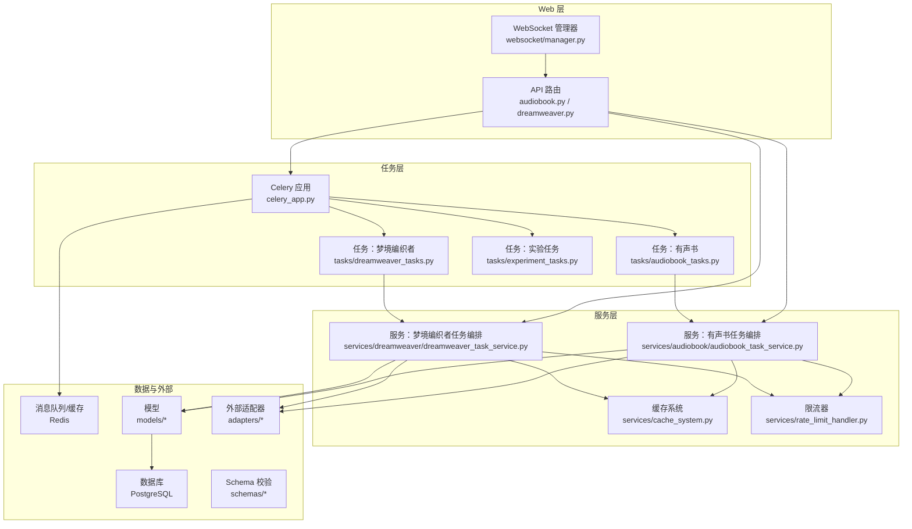
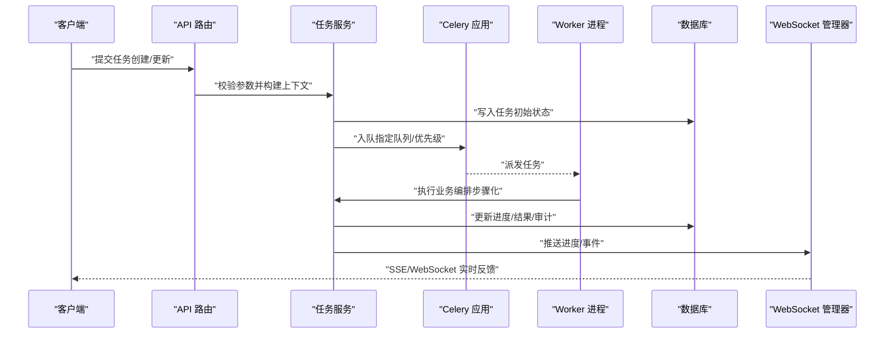
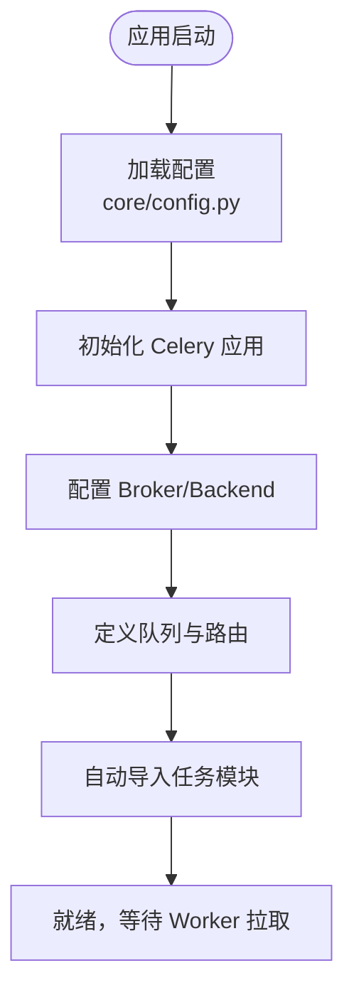
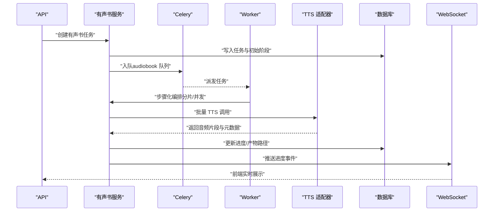
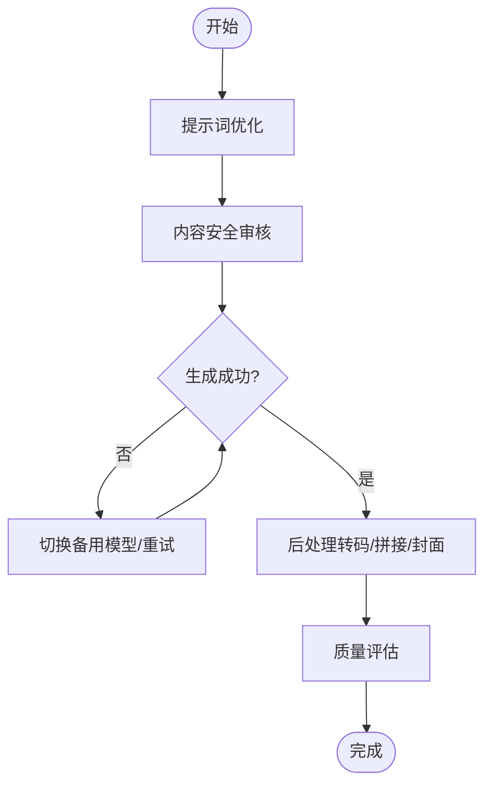
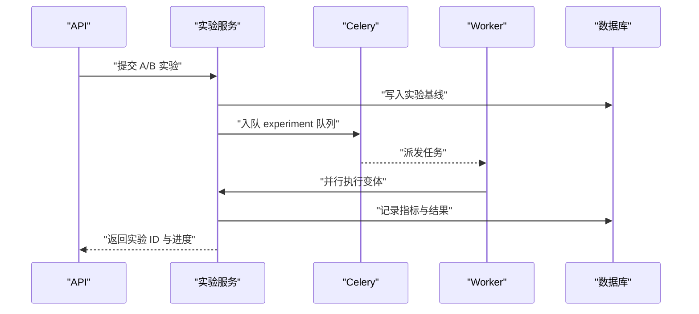
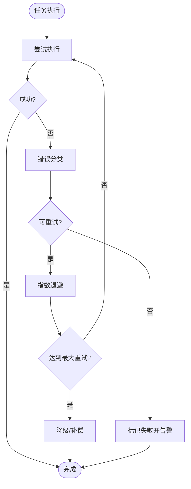
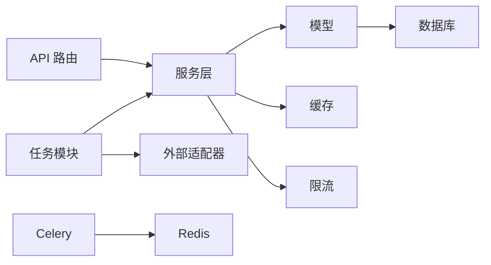

# 异步任务处理

<cite>
**本文引用的文件**   
- [backend/app/celery_app.py](file://backend/app/celery_app.py)
- [backend/app/tasks/audiobook_tasks.py](file://backend/app/tasks/audiobook_tasks.py)
- [backend/app/tasks/dreamweaver_tasks.py](file://backend/app/tasks/dreamweaver_tasks.py)
- [backend/app/tasks/experiment_tasks.py](file://backend/app/tasks/experiment_tasks.py)
- [backend/app/tasks/__init__.py](file://backend/app/tasks/__init__.py)
- [backend/app/main.py](file://backend/app/main.py)
- [backend/app/core/config.py](file://backend/app/core/config.py)
- [backend/app/services/audiobook/audiobook_task_service.py](file://backend/app/services/audiobook/audiobook_task_service.py)
- [backend/app/services/dreamweaver/dreamweaver_task_service.py](file://backend/app/services/dreamweaver/dreamweaver_task_service.py)
- [backend/app/models/audiobook_task.py](file://backend/app/models/audiobook_task.py)
- [backend/app/models/dreamweaver.py](file://backend/app/models/dreamweaver.py)
- [backend/app/schemas/audiobook.py](file://backend/app/schemas/audiobook.py)
- [backend/app/schemas/dreamweaver_contract.py](file://backend/app/schemas/dreamweaver_contract.py)
- [backend/app/api/v1/audiobook.py](file://backend/app/api/v1/audiobook.py)
- [backend/app/api/v1/dreamweaver.py](file://backend/app/api/v1/dreamweaver.py)
- [backend/app/websocket/manager.py](file://backend/app/websocket/manager.py)
- [backend/app/services/monitoring/metrics_collector.py](file://backend/app/services/monitoring/metrics_collector.py)
- [backend/app/services/cache_system.py](file://backend/app/services/cache_system.py)
- [backend/app/services/rate_limit_handler.py](file://backend/app/services/rate_limit_handler.py)
- [docker-compose.yml](file://docker-compose.yml)
- [redis.conf](file://redis.conf)
- [nginx-prod.conf](file://nginx-prod.conf)
- [requirements.txt](file://requirements.txt)
</cite>

## 目录
1. [简介](#简介)
2. [项目结构](#项目结构)
3. [核心组件](#核心组件)
4. [架构总览](#架构总览)
5. [详细组件分析](#详细组件分析)
6. [依赖关系分析](#依赖关系分析)
7. [性能考虑](#性能考虑)
8. [故障排除指南](#故障排除指南)
9. [结论](#结论)
10. [附录](#附录)

## 简介
本文件面向小说创作代理系统的异步任务处理子系统，聚焦 Celery 任务队列的配置与管理、任务定义与调度策略、执行监控与可观测性、优先级与重试机制、错误处理策略、分布式部署与负载均衡、以及开发与调试实践。系统围绕三大核心业务流展开：有声书生成、梦境编织者视频生成、实验任务（A/B 或灰度评测）。通过统一的任务服务层与模型/适配器抽象，实现高内聚、低耦合的异步编排能力。

## 项目结构
异步任务相关代码主要位于 backend/app 下，关键目录与职责如下：
- celery_app.py：Celery 应用初始化、Broker/Backend 配置、Worker 启动参数、任务注册入口
- tasks/*：按业务域划分的任务模块（有声书、梦境编织者、实验）
- services/*：任务编排与领域服务（如 audiobook_task_service、dreamweaver_task_service）
- models/*：持久化实体（任务状态、运行记录等）
- schemas/*：请求/响应契约与校验
- api/*：HTTP 路由，负责入队、查询、进度推送
- websocket/manager.py：WebSocket 实时进度与事件推送
- core/config.py：集中式配置加载（含 Celery 相关项）
- docker-compose.yml、redis.conf、nginx-prod.conf：容器编排、消息中间件与反向代理配置
- requirements.txt：依赖清单（包含 Celery、Redis、数据库驱动等）

图表来源 
- [backend/app/celery_app.py](file://backend/app/celery_app.py)
- [backend/app/tasks/audiobook_tasks.py](file://backend/app/tasks/audiobook_tasks.py)
- [backend/app/tasks/dreamweaver_tasks.py](file://backend/app/tasks/dreamweaver_tasks.py)
- [backend/app/tasks/experiment_tasks.py](file://backend/app/tasks/experiment_tasks.py)
- [backend/app/services/audiobook/audiobook_task_service.py](file://backend/app/services/audiobook/audiobook_task_service.py)
- [backend/app/services/dreamweaver/dreamweaver_task_service.py](file://backend/app/services/dreamweaver/dreamweaver_task_service.py)
- [backend/app/models/audiobook_task.py](file://backend/app/models/audiobook_task.py)
- [backend/app/models/dreamweaver.py](file://backend/app/models/dreamweaver.py)
- [backend/app/websocket/manager.py](file://backend/app/websocket/manager.py)

章节来源
- [backend/app/celery_app.py](file://backend/app/celery_app.py)
- [backend/app/main.py](file://backend/app/main.py)
- [backend/app/core/config.py](file://backend/app/core/config.py)
- [docker-compose.yml](file://docker-compose.yml)
- [redis.conf](file://redis.conf)
- [nginx-prod.conf](file://nginx-prod.conf)
- [requirements.txt](file://requirements.txt)

## 核心组件
- Celery 应用与 Worker
  - 应用初始化、Broker/Backend 配置、并发与进程池设置、任务自动发现与注册
  - 支持多队列与路由规则，便于按业务域分流
- 任务模块
  - 有声书任务：分章/场景音频合成、TTS 调用、字幕与时间轴对齐、质量门控
  - 梦境编织者任务：文本到视频/图像到视频、提示词优化、安全审核、后处理与合流
  - 实验任务：A/B 评测、指标采集、结果回写与归档
- 任务服务层
  - 将复杂流程拆分为步骤，封装重试、幂等、锁、计费与埋点
- 模型与 Schema
  - 任务实体、运行记录、审计字段；请求/响应校验与默认值填充
- WebSocket 与监控
  - 实时进度推送、事件总线、指标收集与日志聚合

章节来源
- [backend/app/tasks/audiobook_tasks.py](file://backend/app/tasks/audiobook_tasks.py)
- [backend/app/tasks/dreamweaver_tasks.py](file://backend/app/tasks/dreamweaver_tasks.py)
- [backend/app/tasks/experiment_tasks.py](file://backend/app/tasks/experiment_tasks.py)
- [backend/app/services/audiobook/audiobook_task_service.py](file://backend/app/services/audiobook/audiobook_task_service.py)
- [backend/app/services/dreamweaver/dreamweaver_task_service.py](file://backend/app/services/dreamweaver/dreamweaver_task_service.py)
- [backend/app/models/audiobook_task.py](file://backend/app/models/audiobook_task.py)
- [backend/app/models/dreamweaver.py](file://backend/app/models/dreamweaver.py)
- [backend/app/schemas/audiobook.py](file://backend/app/schemas/audiobook.py)
- [backend/app/schemas/dreamweaver_contract.py](file://backend/app/schemas/dreamweaver_contract.py)

## 架构总览
整体采用“API 入队 + Celery Worker 执行 + 服务层编排 + 数据库持久化 + WebSocket 推送”的分层架构。Celery 作为异步引擎，Redis 作为 Broker/Cache，PostgreSQL 作为持久化存储。服务层屏蔽外部适配器差异，提供统一的编排接口。

图表来源 
- [backend/app/api/v1/audiobook.py](file://backend/app/api/v1/audiobook.py)
- [backend/app/api/v1/dreamweaver.py](file://backend/app/api/v1/dreamweaver.py)
- [backend/app/services/audiobook/audiobook_task_service.py](file://backend/app/services/audiobook/audiobook_task_service.py)
- [backend/app/services/dreamweaver/dreamweaver_task_service.py](file://backend/app/services/dreamweaver/dreamweaver_task_service.py)
- [backend/app/celery_app.py](file://backend/app/celery_app.py)
- [backend/app/websocket/manager.py](file://backend/app/websocket/manager.py)

## 详细组件分析

### Celery 应用与配置
- 应用初始化
  - 设置 Broker（Redis）、Backend（Redis/DB）、序列化方式、时区、任务路由
  - 定义队列集合与默认队列，支持按业务域路由
- Worker 启动
  - 并发数、进程/线程池、预取限制、内存上限、优雅退出
- 任务发现
  - 自动导入 tasks/* 模块，确保所有任务被注册

图表来源 
- [backend/app/celery_app.py](file://backend/app/celery_app.py)
- [backend/app/core/config.py](file://backend/app/core/config.py)

章节来源
- [backend/app/celery_app.py](file://backend/app/celery_app.py)
- [backend/app/core/config.py](file://backend/app/core/config.py)

### 任务定义与调度策略
- 任务粒度
  - 原子任务：单次调用（如 TTS 片段、单帧生成）
  - 复合任务：多步骤编排（如整章有声书、整段视频生成）
- 调度策略
  - 队列隔离：按业务域划分队列（如 audiobook、dreamweaver、experiment）
  - 优先级：基于任务类型与紧急程度设置 priority
  - 延迟与定时：支持 cron/eta 调度周期性任务（如清理、统计）
  - 路由规则：按标签/属性路由到特定队列或 Worker 组

```mermaid
classDiagram
class CeleryApp {
+broker
+backend
+queues
+task_routes
+worker_opts
}
class TaskBase {
+retry_policy
+max_retries
+priority
+queue
+on_success()
+on_failure()
}
class AudiobookTask {
+chapter_id
+scene_ids
+tts_config
+quality_gate
}
class DreamweaverTask {
+prompt
+media_type
+safety_audit
+post_process
}
class ExperimentTask {
+variant_a
+variant_b
+metrics
}
CeleryApp --> TaskBase : "注册"
TaskBase <|-- AudiobookTask
TaskBase <|-- DreamweaverTask
TaskBase <|-- ExperimentTask
```

图表来源 
- [backend/app/celery_app.py](file://backend/app/celery_app.py)
- [backend/app/tasks/audiobook_tasks.py](file://backend/app/tasks/audiobook_tasks.py)
- [backend/app/tasks/dreamweaver_tasks.py](file://backend/app/tasks/dreamweaver_tasks.py)
- [backend/app/tasks/experiment_tasks.py](file://backend/app/tasks/experiment_tasks.py)

章节来源
- [backend/app/tasks/audiobook_tasks.py](file://backend/app/tasks/audiobook_tasks.py)
- [backend/app/tasks/dreamweaver_tasks.py](file://backend/app/tasks/dreamweaver_tasks.py)
- [backend/app/tasks/experiment_tasks.py](file://backend/app/tasks/experiment_tasks.py)

### 有声书生成任务
- 业务流程
  - 解析章节与场景，拆分音频片段
  - 调用 TTS 适配器，生成语音与时间戳
  - 生成字幕（SRT/VTT/ASS），进行质量门控与审听
  - 合并输出，更新任务状态与审计记录
- 关键特性
  - 断点续跑：按片段粒度失败重试
  - 并发控制：按章节/场景并行，避免资源争用
  - 计费与配额：调用次数与时长统计

图表来源 
- [backend/app/api/v1/audiobook.py](file://backend/app/api/v1/audiobook.py)
- [backend/app/services/audiobook/audiobook_task_service.py](file://backend/app/services/audiobook/audiobook_task_service.py)
- [backend/app/tasks/audiobook_tasks.py](file://backend/app/tasks/audiobook_tasks.py)
- [backend/app/models/audiobook_task.py](file://backend/app/models/audiobook_task.py)
- [backend/app/websocket/manager.py](file://backend/app/websocket/manager.py)

章节来源
- [backend/app/tasks/audiobook_tasks.py](file://backend/app/tasks/audiobook_tasks.py)
- [backend/app/services/audiobook/audiobook_task_service.py](file://backend/app/services/audiobook/audiobook_task_service.py)
- [backend/app/models/audiobook_task.py](file://backend/app/models/audiobook_task.py)
- [backend/app/schemas/audiobook.py](file://backend/app/schemas/audiobook.py)

### 梦境编织者视频生成任务
- 业务流程
  - 提示词优化与安全审核
  - 文本/图像到视频生成，支持多模型适配
  - 后处理（转码、拼接、水印、封面）
  - 质量评估与人工复核通道
- 关键特性
  - 多模型路由：根据配置选择最优模型
  - 失败降级：主模型失败自动切换备用模型
  - 资源保护：并发与速率限制，避免超限

图表来源 
- [backend/app/tasks/dreamweaver_tasks.py](file://backend/app/tasks/dreamweaver_tasks.py)
- [backend/app/services/dreamweaver/dreamweaver_task_service.py](file://backend/app/services/dreamweaver/dreamweaver_task_service.py)
- [backend/app/models/dreamweaver.py](file://backend/app/models/dreamweaver.py)
- [backend/app/schemas/dreamweaver_contract.py](file://backend/app/schemas/dreamweaver_contract.py)

章节来源
- [backend/app/tasks/dreamweaver_tasks.py](file://backend/app/tasks/dreamweaver_tasks.py)
- [backend/app/services/dreamweaver/dreamweaver_task_service.py](file://backend/app/services/dreamweaver/dreamweaver_task_service.py)
- [backend/app/models/dreamweaver.py](file://backend/app/models/dreamweaver.py)
- [backend/app/schemas/dreamweaver_contract.py](file://backend/app/schemas/dreamweaver_contract.py)

### 实验任务（A/B 评测）
- 目标
  - 对比不同策略/模型的效果，采集指标并归档
- 流程
  - 构造对照组与实验组
  - 并行执行，记录耗时、成功率、质量评分
  - 汇总报告，触发后续决策（如灰度发布）

图表来源 
- [backend/app/tasks/experiment_tasks.py](file://backend/app/tasks/experiment_tasks.py)
- [backend/app/services/dreamweaver/dreamweaver_task_service.py](file://backend/app/services/dreamweaver/dreamweaver_task_service.py)

章节来源
- [backend/app/tasks/experiment_tasks.py](file://backend/app/tasks/experiment_tasks.py)

### 任务优先级管理
- 队列隔离：不同业务使用独立队列，避免相互阻塞
- 优先级字段：在任务入队时设置 priority，结合 Broker 能力实现优先调度
- 动态调整：根据负载与 SLA 动态调整队列权重与并发

章节来源
- [backend/app/celery_app.py](file://backend/app/celery_app.py)
- [backend/app/core/config.py](file://backend/app/core/config.py)

### 失败重试机制与错误处理
- 重试策略
  - 指数退避、最大重试次数、重试条件过滤（网络异常/超时）
  - 幂等设计：重复执行不产生副作用
- 错误分类
  - 可重试（临时错误）与不可重试（参数错误/权限不足）
- 补偿与降级
  - 失败分支走降级路径（备用模型/简化流程）
  - 记录审计日志与告警

图表来源 
- [backend/app/tasks/audiobook_tasks.py](file://backend/app/tasks/audiobook_tasks.py)
- [backend/app/tasks/dreamweaver_tasks.py](file://backend/app/tasks/dreamweaver_tasks.py)
- [backend/app/tasks/experiment_tasks.py](file://backend/app/tasks/experiment_tasks.py)

章节来源
- [backend/app/tasks/audiobook_tasks.py](file://backend/app/tasks/audiobook_tasks.py)
- [backend/app/tasks/dreamweaver_tasks.py](file://backend/app/tasks/dreamweaver_tasks.py)
- [backend/app/tasks/experiment_tasks.py](file://backend/app/tasks/experiment_tasks.py)

### 任务监控、日志与可观测性
- 指标采集
  - 任务吞吐、延迟、成功率、队列长度、Worker 健康状态
- 日志规范
  - 结构化日志（JSON），包含任务 ID、阶段、耗时、错误码
- 实时推送
  - WebSocket/SSE 推送进度与事件，前端可视化

章节来源
- [backend/app/websocket/manager.py](file://backend/app/websocket/manager.py)
- [backend/app/services/monitoring/metrics_collector.py](file://backend/app/services/monitoring/metrics_collector.py)

### 分布式部署、负载均衡与容错
- 容器编排
  - 多实例 Worker 水平扩展，共享 Redis 与 PostgreSQL
- 负载均衡
  - Nginx 反代 API，健康检查与熔断
- 容错机制
  - Broker/Backend 高可用（Redis Sentinel/Cluster）
  - 数据库连接池与重试
  - 任务幂等与去重键

章节来源
- [docker-compose.yml](file://docker-compose.yml)
- [redis.conf](file://redis.conf)
- [nginx-prod.conf](file://nginx-prod.conf)

## 依赖关系分析
- 内部依赖
  - API 依赖服务层，服务层依赖模型与缓存/限流
  - 任务模块依赖服务层与适配器
- 外部依赖
  - Redis（Broker/缓存）、PostgreSQL（持久化）、外部媒体/TTS 适配器
- 潜在风险
  - 循环依赖需避免
  - 适配器不稳定导致任务失败，需加强降级与重试

图表来源 
- [backend/app/api/v1/audiobook.py](file://backend/app/api/v1/audiobook.py)
- [backend/app/api/v1/dreamweaver.py](file://backend/app/api/v1/dreamweaver.py)
- [backend/app/services/audiobook/audiobook_task_service.py](file://backend/app/services/audiobook/audiobook_task_service.py)
- [backend/app/services/dreamweaver/dreamweaver_task_service.py](file://backend/app/services/dreamweaver/dreamweaver_task_service.py)
- [backend/app/models/audiobook_task.py](file://backend/app/models/audiobook_task.py)
- [backend/app/models/dreamweaver.py](file://backend/app/models/dreamweaver.py)
- [backend/app/services/cache_system.py](file://backend/app/services/cache_system.py)
- [backend/app/services/rate_limit_handler.py](file://backend/app/services/rate_limit_handler.py)
- [backend/app/celery_app.py](file://backend/app/celery_app.py)

章节来源
- [backend/app/celery_app.py](file://backend/app/celery_app.py)
- [backend/app/services/cache_system.py](file://backend/app/services/cache_system.py)
- [backend/app/services/rate_limit_handler.py](file://backend/app/services/rate_limit_handler.py)

## 性能考虑
- 并发与资源
  - Worker 并发数与预取限制调优，避免内存峰值
  - 大文件 I/O 使用流式处理与临时目录隔离
- 缓存与去重
  - 热点数据缓存（提示词、音色库、模型元信息）
  - 任务去重键防止重复执行
- 限流与背压
  - 外部 API 限流，避免触发配额限制
  - 队列长度监控与动态扩缩容
- 数据库优化
  - 读写分离与索引优化，减少慢查询
  - 批量写入与事务边界控制

[本节为通用指导，不直接分析具体文件]

## 故障排除指南
- 常见问题
  - Worker 无法消费任务：检查 Broker 连通性与队列名
  - 任务频繁重试：定位错误类型，区分可重试与不可重试
  - 进度不更新：确认 WebSocket 连接与事件推送链路
- 诊断步骤
  - 查看任务日志与审计记录
  - 检查队列长度与 Worker 健康状态
  - 验证模型/适配器可用性
- 恢复策略
  - 重启 Worker/扩容实例
  - 重置失败任务状态并重试
  - 启用降级路径与备用模型

章节来源
- [backend/app/websocket/manager.py](file://backend/app/websocket/manager.py)
- [backend/app/services/monitoring/metrics_collector.py](file://backend/app/services/monitoring/metrics_collector.py)

## 结论
本异步任务处理系统以 Celery 为核心，结合服务层编排与完善的监控/重试/降级机制，支撑有声书生成、梦境编织者视频生成与实验任务等高复杂度业务。通过队列隔离、优先级管理与分布式部署，系统在可扩展性与稳定性方面具备良好基础。建议持续完善指标体系、自动化运维与容量规划，以提升整体交付效率与用户体验。

[本节为总结，不直接分析具体文件]

## 附录
- 任务开发指南
  - 新建任务模块：继承任务基类，定义重试策略与队列
  - 服务层封装：步骤化编排、幂等与审计
  - Schema 校验：输入输出契约与默认值
- 调试技巧
  - 本地模拟 Broker/Backend，快速验证任务逻辑
  - 使用测试用例覆盖边界与异常路径
- 最佳实践
  - 小步快跑，原子化任务设计
  - 严格错误分类与告警阈值
  - 定期演练故障恢复流程

[本节为通用指导，不直接分析具体文件]