# 任务编排与调度

<cite>
**本文引用的文件**   
- [backend/app/celery_app.py](file://backend/app/celery_app.py)
- [backend/app/tasks/audiobook_tasks.py](file://backend/app/tasks/audiobook_tasks.py)
- [backend/app/services/audiobook/job_tracker_service.py](file://backend/app/services/audiobook/job_tracker_service.py)
- [backend/app/models/audiobook_task.py](file://backend/app/models/audiobook_task.py)
- [backend/app/api/v1/audiobook_api/task_routes.py](file://backend/app/api/v1/audiobook_api/task_routes.py)
- [backend/app/core/config.py](file://backend/app/core/config.py)
- [docker-compose.yml](file://docker-compose.yml)
- [backend/Dockerfile](file://backend/Dockerfile)
- [backend/requirements.txt](file://backend/requirements.txt)
- [docs/AUDIOBOOK_TASK_QUEUE.md](file://docs/AUDIOBOOK_TASK_QUEUE.md)
- [docs/AUDIOBOOK_TASK_TRACE_OBSERVABILITY_PLAN_20260505.md](file://docs/AUDIOBOOK_TASK_TRACE_OBSERVABILITY_PLAN_20260505.md)
</cite>

## 目录
1. [简介](#简介)
2. [项目结构](#项目结构)
3. [核心组件](#核心组件)
4. [架构总览](#架构总览)
5. [详细组件分析](#详细组件分析)
6. [依赖关系分析](#依赖关系分析)
7. [性能考量](#性能考量)
8. [故障排查指南](#故障排查指南)
9. [结论](#结论)
10. [附录](#附录)

## 简介
本文件面向“有声书任务编排与调度系统”，聚焦 Celery 任务队列、作业跟踪与后台任务管理。文档覆盖任务依赖解析、执行顺序控制、负载均衡策略；任务状态管理、进度跟踪与异常处理流程；重试机制、超时控制与资源清理；监控接口、日志收集与性能分析方法；分布式执行、容器化部署与水平扩展设计；以及任务优先级、资源限制与故障恢复策略。

## 项目结构
围绕任务编排与调度的关键代码分布在以下位置：
- Celery 应用初始化与配置：backend/app/celery_app.py
- 业务任务定义（有声书相关）：backend/app/tasks/audiobook_tasks.py
- 作业跟踪服务（状态、进度、事件）：backend/app/services/audiobook/job_tracker_service.py
- 任务模型与持久化：backend/app/models/audiobook_task.py
- 任务相关 API 路由（提交、查询、取消等）：backend/app/api/v1/audiobook_api/task_routes.py
- 全局配置（含队列/并发/超时等）：backend/app/core/config.py
- 容器编排与依赖：docker-compose.yml、backend/Dockerfile、backend/requirements.txt
- 设计文档与计划：docs/AUDIOBOOK_TASK_QUEUE.md、docs/AUDIOBOOK_TASK_TRACE_OBSERVABILITY_PLAN_20260505.md

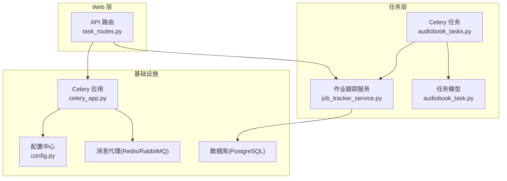

**图表来源** 
- [backend/app/celery_app.py](file://backend/app/celery_app.py)
- [backend/app/tasks/audiobook_tasks.py](file://backend/app/tasks/audiobook_tasks.py)
- [backend/app/services/audiobook/job_tracker_service.py](file://backend/app/services/audiobook/job_tracker_service.py)
- [backend/app/models/audiobook_task.py](file://backend/app/models/audiobook_task.py)
- [backend/app/api/v1/audiobook_api/task_routes.py](file://backend/app/api/v1/audiobook_api/task_routes.py)
- [backend/app/core/config.py](file://backend/app/core/config.py)

**章节来源**
- [backend/app/celery_app.py](file://backend/app/celery_app.py)
- [backend/app/tasks/audiobook_tasks.py](file://backend/app/tasks/audiobook_tasks.py)
- [backend/app/services/audiobook/job_tracker_service.py](file://backend/app/services/audiobook/job_tracker_service.py)
- [backend/app/models/audiobook_task.py](file://backend/app/models/audiobook_task.py)
- [backend/app/api/v1/audiobook_api/task_routes.py](file://backend/app/api/v1/audiobook_api/task_routes.py)
- [backend/app/core/config.py](file://backend/app/core/config.py)

## 核心组件
- Celery 应用与配置：集中管理 Broker/Backend、Worker 并发、队列路由、重试与超时策略。
- 任务定义：将有声书生产流水线拆分为可独立执行的原子任务，支持参数校验、幂等性与上下文传递。
- 作业跟踪服务：统一维护任务生命周期状态、阶段进度、事件流与审计信息。
- 任务模型：持久化任务元数据、依赖图、执行结果与错误堆栈。
- API 路由：提供任务提交、状态查询、进度拉取、取消与批量操作接口。

**章节来源**
- [backend/app/celery_app.py](file://backend/app/celery_app.py)
- [backend/app/tasks/audiobook_tasks.py](file://backend/app/tasks/audiobook_tasks.py)
- [backend/app/services/audiobook/job_tracker_service.py](file://backend/app/services/audiobook/job_tracker_service.py)
- [backend/app/models/audiobook_task.py](file://backend/app/models/audiobook_task.py)
- [backend/app/api/v1/audiobook_api/task_routes.py](file://backend/app/api/v1/audiobook_api/task_routes.py)

## 架构总览
下图展示了从 Web 请求到 Celery Worker 的端到端调用链，以及作业跟踪与持久化的交互。

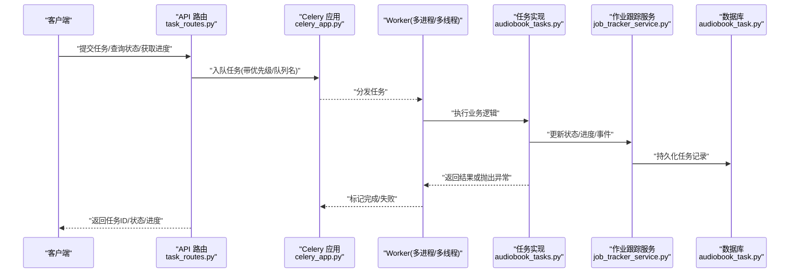

**图表来源** 
- [backend/app/api/v1/audiobook_api/task_routes.py](file://backend/app/api/v1/audiobook_api/task_routes.py)
- [backend/app/celery_app.py](file://backend/app/celery_app.py)
- [backend/app/tasks/audiobook_tasks.py](file://backend/app/tasks/audiobook_tasks.py)
- [backend/app/services/audiobook/job_tracker_service.py](file://backend/app/services/audiobook/job_tracker_service.py)
- [backend/app/models/audiobook_task.py](file://backend/app/models/audiobook_task.py)

## 详细组件分析

### Celery 应用与配置
- 职责：初始化 Celery 实例、加载配置、注册任务、设置默认重试/超时、定义队列与路由规则。
- 关键点：
  - Broker/Backend 连接参数由配置中心注入，便于容器化与环境隔离。
  - Worker 并发度、队列亲和性、任务序列化格式在配置中声明。
  - 全局重试策略与退避算法可被任务级覆盖。

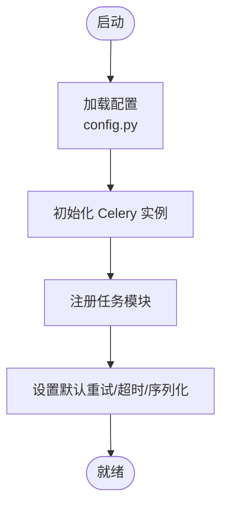

**图表来源** 
- [backend/app/celery_app.py](file://backend/app/celery_app.py)
- [backend/app/core/config.py](file://backend/app/core/config.py)

**章节来源**
- [backend/app/celery_app.py](file://backend/app/celery_app.py)
- [backend/app/core/config.py](file://backend/app/core/config.py)

### 任务定义与依赖解析
- 职责：将复杂有声书生成流程拆解为多个原子任务，并通过依赖图组织执行顺序。
- 关键点：
  - 每个任务具备唯一 ID、输入参数校验、幂等键与上下文携带。
  - 依赖解析器根据上游任务完成状态决定下游任务是否可入队。
  - 支持按阶段分组与条件分支，避免不必要的计算。

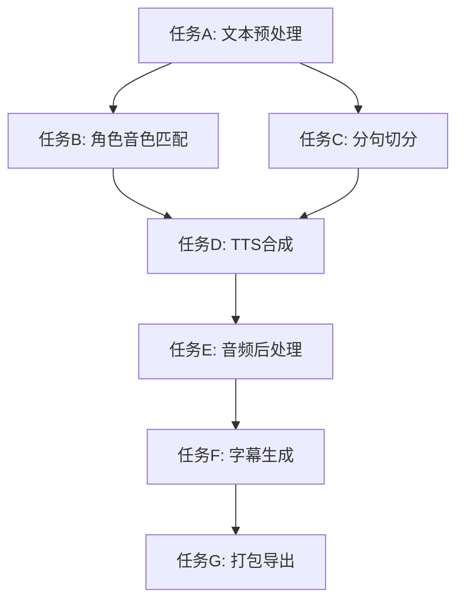

**图表来源** 
- [backend/app/tasks/audiobook_tasks.py](file://backend/app/tasks/audiobook_tasks.py)
- [backend/app/services/audiobook/job_tracker_service.py](file://backend/app/services/audiobook/job_tracker_service.py)

**章节来源**
- [backend/app/tasks/audiobook_tasks.py](file://backend/app/tasks/audiobook_tasks.py)
- [backend/app/services/audiobook/job_tracker_service.py](file://backend/app/services/audiobook/job_tracker_service.py)

### 作业跟踪服务与状态机
- 职责：统一管理任务生命周期状态、阶段进度、事件流与审计日志。
- 关键点：
  - 状态机包含待处理、运行中、成功、失败、取消、重试等状态。
  - 进度以百分比或阶段里程碑形式上报，支持 SSE/WebSocket 推送。
  - 异常捕获并持久化堆栈，便于回溯与告警。

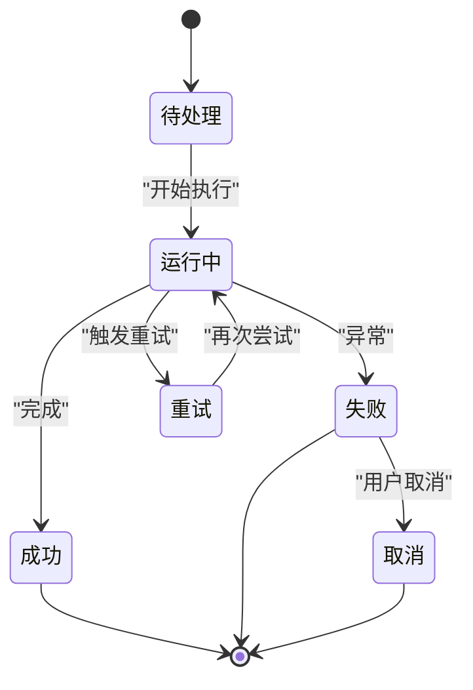

**图表来源** 
- [backend/app/services/audiobook/job_tracker_service.py](file://backend/app/services/audiobook/job_tracker_service.py)
- [backend/app/models/audiobook_task.py](file://backend/app/models/audiobook_task.py)

**章节来源**
- [backend/app/services/audiobook/job_tracker_service.py](file://backend/app/services/audiobook/job_tracker_service.py)
- [backend/app/models/audiobook_task.py](file://backend/app/models/audiobook_task.py)

### API 路由：任务提交与查询
- 职责：暴露 RESTful 接口用于任务提交、状态查询、进度拉取、取消与批量操作。
- 关键点：
  - 提交接口负责参数校验、权限检查、入队与返回任务 ID。
  - 查询接口支持分页、过滤与排序，结合作业跟踪服务实时返回状态。
  - 取消接口通过中间件协调 Celery 任务取消与状态回写。

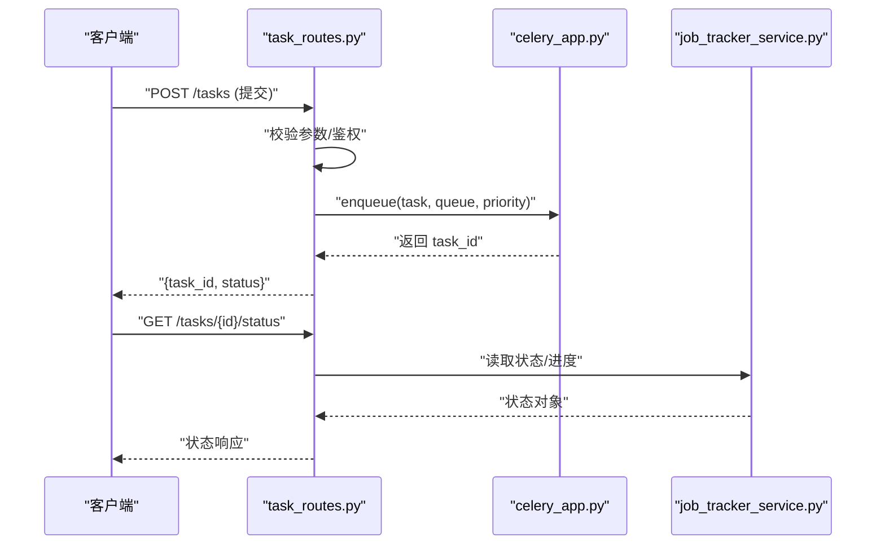

**图表来源** 
- [backend/app/api/v1/audiobook_api/task_routes.py](file://backend/app/api/v1/audiobook_api/task_routes.py)
- [backend/app/celery_app.py](file://backend/app/celery_app.py)
- [backend/app/services/audiobook/job_tracker_service.py](file://backend/app/services/audiobook/job_tracker_service.py)

**章节来源**
- [backend/app/api/v1/audiobook_api/task_routes.py](file://backend/app/api/v1/audiobook_api/task_routes.py)
- [backend/app/services/audiobook/job_tracker_service.py](file://backend/app/services/audiobook/job_tracker_service.py)

### 任务模型与持久化
- 职责：定义任务表结构与字段语义，支撑状态、进度、依赖图、结果与错误信息的持久化。
- 关键点：
  - 字段包括任务 ID、类型、状态、进度、优先级、队列、创建/更新时间、错误信息等。
  - 索引优化常见查询路径（如按项目、状态、时间范围）。
  - 软删除与审计字段支持合规与追溯。

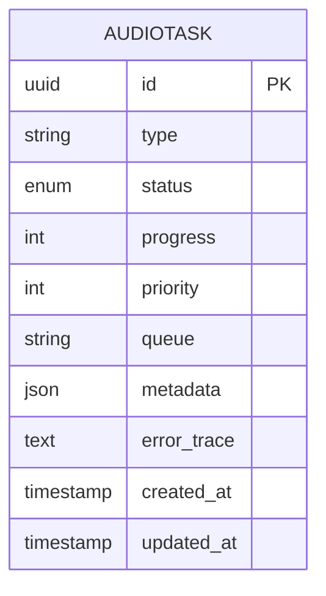

**图表来源** 
- [backend/app/models/audiobook_task.py](file://backend/app/models/audiobook_task.py)

**章节来源**
- [backend/app/models/audiobook_task.py](file://backend/app/models/audiobook_task.py)

### 重试机制、超时控制与资源清理
- 重试机制：
  - 全局默认退避策略（指数退避/固定间隔），任务级可覆盖最大重试次数与延迟。
  - 区分可重试异常与不可重试异常，避免无效重试。
- 超时控制：
  - 任务级 soft/hard 超时，防止长尾任务阻塞 Worker。
  - 外部依赖（TTS/视频/LLM）调用需设置合理超时与熔断。
- 资源清理：
  - 任务完成后清理临时文件、释放锁、关闭连接。
  - 失败任务进入死信队列或人工干预面板。

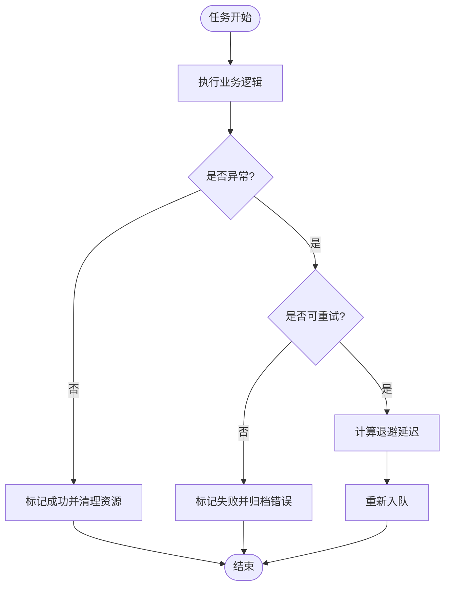

**图表来源** 
- [backend/app/tasks/audiobook_tasks.py](file://backend/app/tasks/audiobook_tasks.py)
- [backend/app/celery_app.py](file://backend/app/celery_app.py)

**章节来源**
- [backend/app/tasks/audiobook_tasks.py](file://backend/app/tasks/audiobook_tasks.py)
- [backend/app/celery_app.py](file://backend/app/celery_app.py)

### 负载均衡与水平扩展
- 队列划分：按业务域或资源类型划分队列（如 tts_queue、video_queue、llm_queue），实现资源隔离与定向扩容。
- Worker 扩缩容：基于 CPU/内存/外部配额指标自动伸缩 Worker 数量。
- 消费策略：公平队列、权重队列、最小延迟优先等策略按需选择。
- 水平扩展：无状态 Worker 横向扩展，Broker/Backend 高可用部署。

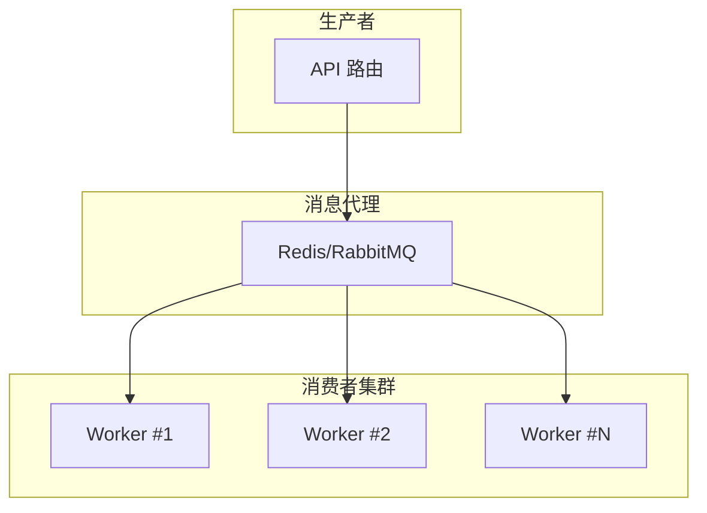

**图表来源** 
- [backend/app/api/v1/audiobook_api/task_routes.py](file://backend/app/api/v1/audiobook_api/task_routes.py)
- [backend/app/celery_app.py](file://backend/app/celery_app.py)

**章节来源**
- [backend/app/api/v1/audiobook_api/task_routes.py](file://backend/app/api/v1/audiobook_api/task_routes.py)
- [backend/app/celery_app.py](file://backend/app/celery_app.py)

### 监控接口、日志收集与性能分析
- 监控接口：
  - 任务状态/进度查询、队列长度、Worker 健康检查、吞吐与延迟统计。
- 日志收集：
  - 结构化日志（JSON）、Trace ID 贯穿请求链路、SSE/WebSocket 推送进度。
- 性能分析：
  - 任务耗时分布、瓶颈定位（IO/CPU/外部依赖）、热点队列识别。
  - 慢查询与数据库连接池监控。

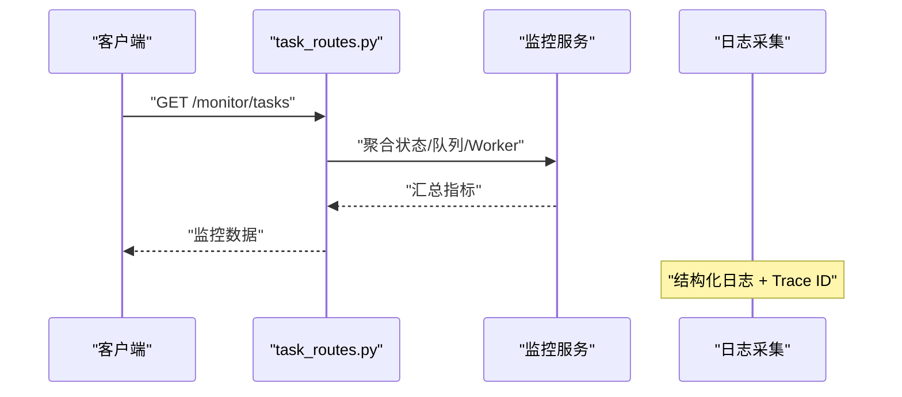

**图表来源** 
- [backend/app/api/v1/audiobook_api/task_routes.py](file://backend/app/api/v1/audiobook_api/task_routes.py)
- [docs/AUDIOBOOK_TASK_TRACE_OBSERVABILITY_PLAN_20260505.md](file://docs/AUDIOBOOK_TASK_TRACE_OBSERVABILITY_PLAN_20260505.md)

**章节来源**
- [backend/app/api/v1/audiobook_api/task_routes.py](file://backend/app/api/v1/audiobook_api/task_routes.py)
- [docs/AUDIOBOOK_TASK_TRACE_OBSERVABILITY_PLAN_20260505.md](file://docs/AUDIOBOOK_TASK_TRACE_OBSERVABILITY_PLAN_20260505.md)

### 分布式执行、容器化部署与水平扩展
- 分布式执行：
  - 多节点 Worker 共享 Broker/Backend，保证任务不丢失与幂等执行。
- 容器化部署：
  - Dockerfile 封装运行时环境，docker-compose 编排 Redis/PostgreSQL/Celery/Worker。
  - 环境变量驱动配置，支持多环境切换。
- 水平扩展：
  - 通过副本数与队列分区提升吞吐，结合 HPA/KEDA 实现弹性伸缩。

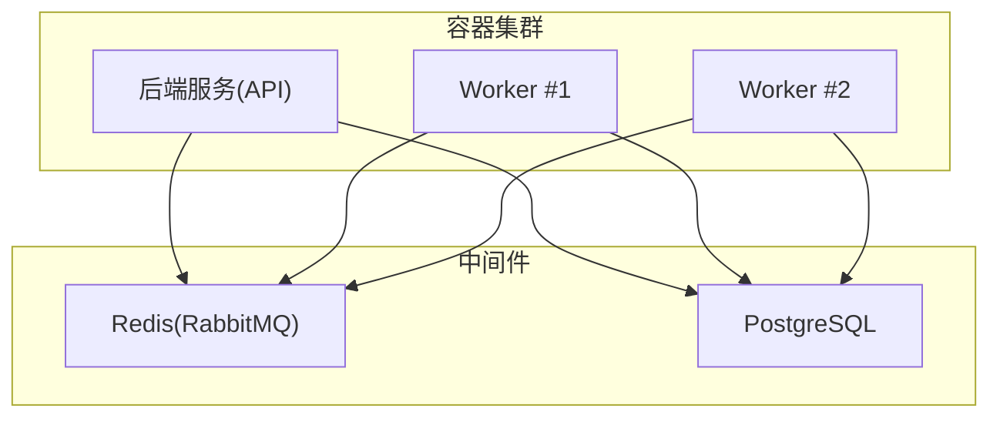

**图表来源** 
- [docker-compose.yml](file://docker-compose.yml)
- [backend/Dockerfile](file://backend/Dockerfile)
- [backend/requirements.txt](file://backend/requirements.txt)

**章节来源**
- [docker-compose.yml](file://docker-compose.yml)
- [backend/Dockerfile](file://backend/Dockerfile)
- [backend/requirements.txt](file://backend/requirements.txt)

### 任务优先级、资源限制与故障恢复
- 优先级：
  - 队列级与任务级优先级，结合权重与公平调度避免饥饿。
- 资源限制：
  - Worker 进程/线程上限、CPU 亲和、内存限制与外部配额保护。
- 故障恢复：
  - 死信队列、补偿任务、断点续跑与幂等键去重。
  - 健康检查与自动重启，异常告警与降级策略。

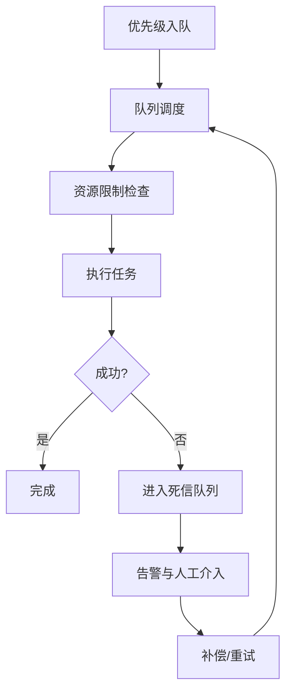

**图表来源** 
- [backend/app/celery_app.py](file://backend/app/celery_app.py)
- [backend/app/tasks/audiobook_tasks.py](file://backend/app/tasks/audiobook_tasks.py)

**章节来源**
- [backend/app/celery_app.py](file://backend/app/celery_app.py)
- [backend/app/tasks/audiobook_tasks.py](file://backend/app/tasks/audiobook_tasks.py)

## 依赖关系分析
- 组件耦合：
  - API 路由依赖 Celery 应用进行入队，依赖作业跟踪服务进行状态查询。
  - 任务实现依赖作业跟踪服务与任务模型进行状态与进度持久化。
  - Celery 应用依赖配置中心与 Broker/Backend。
- 外部依赖：
  - 消息代理（Redis/RabbitMQ）、数据库（PostgreSQL）、外部服务（TTS/视频/LLM）。
- 潜在循环依赖：
  - 确保任务模块仅依赖服务与模型，避免反向引用。

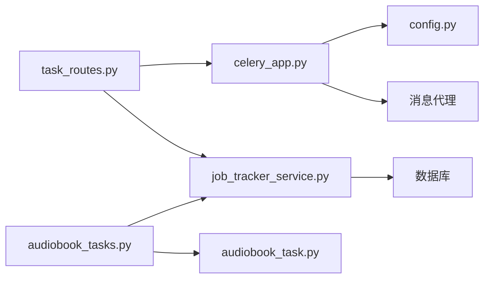

**图表来源** 
- [backend/app/api/v1/audiobook_api/task_routes.py](file://backend/app/api/v1/audiobook_api/task_routes.py)
- [backend/app/celery_app.py](file://backend/app/celery_app.py)
- [backend/app/tasks/audiobook_tasks.py](file://backend/app/tasks/audiobook_tasks.py)
- [backend/app/services/audiobook/job_tracker_service.py](file://backend/app/services/audiobook/job_tracker_service.py)
- [backend/app/models/audiobook_task.py](file://backend/app/models/audiobook_task.py)
- [backend/app/core/config.py](file://backend/app/core/config.py)

**章节来源**
- [backend/app/api/v1/audiobook_api/task_routes.py](file://backend/app/api/v1/audiobook_api/task_routes.py)
- [backend/app/celery_app.py](file://backend/app/celery_app.py)
- [backend/app/tasks/audiobook_tasks.py](file://backend/app/tasks/audiobook_tasks.py)
- [backend/app/services/audiobook/job_tracker_service.py](file://backend/app/services/audiobook/job_tracker_service.py)
- [backend/app/models/audiobook_task.py](file://backend/app/models/audiobook_task.py)
- [backend/app/core/config.py](file://backend/app/core/config.py)

## 性能考量
- 队列与 Worker 容量规划：根据峰值 QPS 与平均任务耗时估算 Worker 数量与队列分区。
- I/O 与外部依赖：引入缓存、批处理与连接池，降低 RT 与抖动。
- 序列化与传输：使用高效序列化格式，减少 Broker 负载。
- 监控与观测：建立关键指标看板（吞吐、延迟、错误率、队列长度、Worker 利用率）。

[本节为通用指导，不直接分析具体文件]

## 故障排查指南
- 常见问题：
  - 任务堆积：检查 Broker/Worker 健康、队列路由与资源限制。
  - 频繁重试：确认异常类型与退避策略，避免无限重试。
  - 超时失败：调整 soft/hard 超时与外部依赖超时。
  - 状态不一致：核对幂等键与事务边界，确保状态落库一致性。
- 诊断步骤：
  - 查看任务日志与 Trace ID，定位异常堆栈。
  - 检查队列长度与 Worker 消费速率。
  - 验证依赖服务可用性（TTS/视频/LLM/数据库）。
  - 必要时启用调试模式与慢查询日志。

**章节来源**
- [docs/AUDIOBOOK_TASK_QUEUE.md](file://docs/AUDIOBOOK_TASK_QUEUE.md)
- [docs/AUDIOBOOK_TASK_TRACE_OBSERVABILITY_PLAN_20260505.md](file://docs/AUDIOBOOK_TASK_TRACE_OBSERVABILITY_PLAN_20260505.md)

## 结论
本系统通过 Celery 任务队列与作业跟踪服务，实现了有声书生产流水线的可靠编排与调度。借助依赖解析、状态机、重试与超时控制、监控与日志体系，系统在分布式与容器化环境下具备良好的可扩展性与可观测性。建议持续完善指标采集与自动化运维能力，进一步提升稳定性与效率。

[本节为总结性内容，不直接分析具体文件]

## 附录
- 参考设计文档：
  - [docs/AUDIOBOOK_TASK_QUEUE.md](file://docs/AUDIOBOOK_TASK_QUEUE.md)
  - [docs/AUDIOBOOK_TASK_TRACE_OBSERVABILITY_PLAN_20260505.md](file://docs/AUDIOBOOK_TASK_TRACE_OBSERVABILITY_PLAN_20260505.md)

[本节为参考资料，不直接分析具体文件]