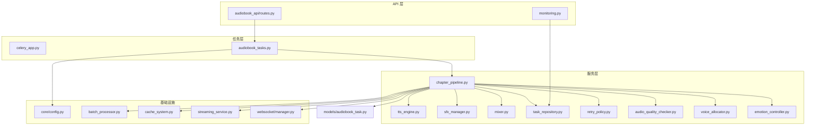
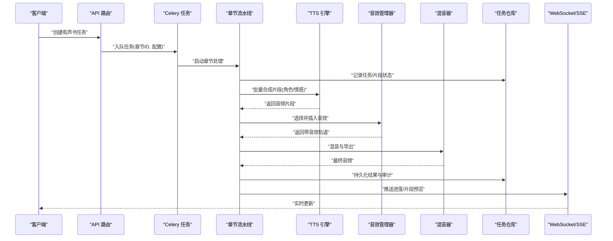
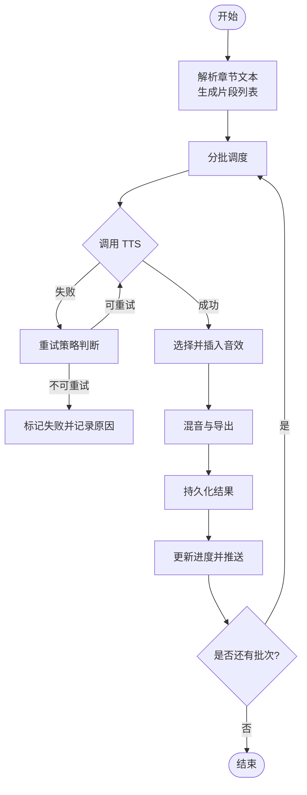
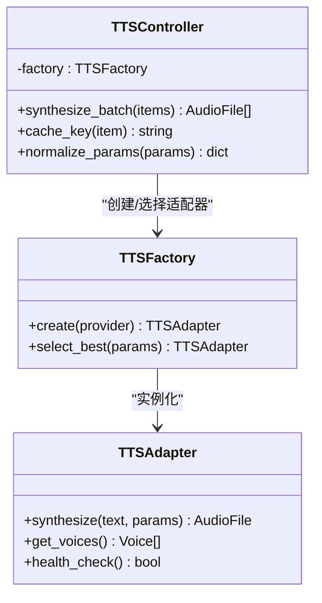
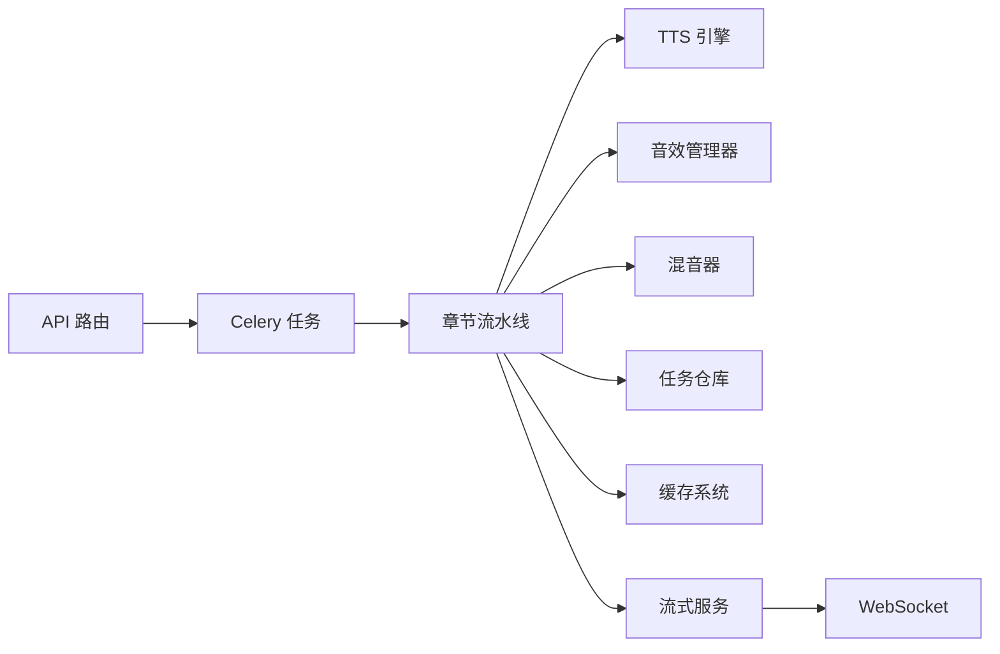

# 有声书生成任务

<cite>
**本文引用的文件**   
- [backend/app/celery_app.py](file://backend/app/celery_app.py)
- [backend/app/tasks/audiobook_tasks.py](file://backend/app/tasks/audiobook_tasks.py)
- [backend/app/services/audiobook/chapter_pipeline.py](file://backend/app/services/audiobook/chapter_pipeline.py)
- [backend/app/services/audiobook/tts_engine.py](file://backend/app/services/audiobook/tts_engine.py)
- [backend/app/services/audiobook/sfx_manager.py](file://backend/app/services/audiobook/sfx_manager.py)
- [backend/app/services/audiobook/mixer.py](file://backend/app/services/audiobook/mixer.py)
- [backend/app/models/audiobook_task.py](file://backend/app/models/audiobook_task.py)
- [backend/app/api/v1/audiobook_api/routes.py](file://backend/app/api/v1/audiobook_api/routes.py)
- [backend/app/api/v1/monitoring.py](file://backend/app/api/v1/monitoring.py)
- [backend/app/core/config.py](file://backend/app/core/config.py)
- [backend/app/services/batch_processor.py](file://backend/app/services/batch_processor.py)
- [backend/app/services/cache_system.py](file://backend/app/services/cache_system.py)
- [backend/app/services/streaming_service.py](file://backend/app/services/streaming_service.py)
- [backend/app/websocket/manager.py](file://backend/app/websocket/manager.py)
- [backend/app/services/audiobook/task_repository.py](file://backend/app/services/audiobook/task_repository.py)
- [backend/app/services/audiobook/retry_policy.py](file://backend/app/services/audiobook/retry_policy.py)
- [backend/app/services/audiobook/audio_quality_checker.py](file://backend/app/services/audiobook/audio_quality_checker.py)
- [backend/app/services/audiobook/voice_allocator.py](file://backend/app/services/audiobook/voice_allocator.py)
- [backend/app/services/audiobook/emotion_controller.py](file://backend/app/services/audiobook/emotion_controller.py)
</cite>

## 目录
1. [简介](#简介)
2. [项目结构](#项目结构)
3. [核心组件](#核心组件)
4. [架构总览](#架构总览)
5. [详细组件分析](#详细组件分析)
6. [依赖关系分析](#依赖关系分析)
7. [性能考量](#性能考量)
8. [故障排查指南](#故障排查指南)
9. [结论](#结论)
10. [附录](#附录)

## 简介
本文件面向“有声书生成异步任务”的完整实现，覆盖章节处理、语音合成（TTS）、音效添加与音频混音等关键流程。文档从系统架构、数据流、任务分解与并行策略、进度跟踪、角色语音分配与情感控制、质量检查、失败重试与恢复、持久化、监控接口、日志分析、性能优化、分布式执行与扩展性等方面进行全面说明，帮助读者快速理解并高效使用该系统。

## 项目结构
后端采用分层与按领域划分相结合的组织方式：
- API 层：暴露 REST/WebSocket/SSE 接口，负责请求校验、鉴权、路由与响应封装。
- 服务层：按领域拆分（如 audiobook 子域），包含编排器、引擎、管理器、仓库等。
- 任务层：基于 Celery 的异步任务定义与调度。
- 模型与迁移：数据库模型与 Alembic 迁移脚本。
- 配置与环境：统一配置加载、环境变量解析。
- 共享工具：批处理、缓存、流式输出、WebSocket 管理等通用能力。

图表来源
- [backend/app/api/v1/audiobook_api/routes.py](file://backend/app/api/v1/audiobook_api/routes.py)
- [backend/app/api/v1/monitoring.py](file://backend/app/api/v1/monitoring.py)
- [backend/app/celery_app.py](file://backend/app/celery_app.py)
- [backend/app/tasks/audiobook_tasks.py](file://backend/app/tasks/audiobook_tasks.py)
- [backend/app/services/audiobook/chapter_pipeline.py](file://backend/app/services/audiobook/chapter_pipeline.py)
- [backend/app/services/audiobook/tts_engine.py](file://backend/app/services/audiobook/tts_engine.py)
- [backend/app/services/audiobook/sfx_manager.py](file://backend/app/services/audiobook/sfx_manager.py)
- [backend/app/services/audiobook/mixer.py](file://backend/app/services/audiobook/mixer.py)
- [backend/app/services/audiobook/task_repository.py](file://backend/app/services/audiobook/task_repository.py)
- [backend/app/services/audiobook/retry_policy.py](file://backend/app/services/audiobook/retry_policy.py)
- [backend/app/services/audiobook/audio_quality_checker.py](file://backend/app/services/audiobook/audio_quality_checker.py)
- [backend/app/services/audiobook/voice_allocator.py](file://backend/app/services/audiobook/voice_allocator.py)
- [backend/app/services/audiobook/emotion_controller.py](file://backend/app/services/audiobook/emotion_controller.py)
- [backend/app/core/config.py](file://backend/app/core/config.py)
- [backend/app/services/batch_processor.py](file://backend/app/services/batch_processor.py)
- [backend/app/services/cache_system.py](file://backend/app/services/cache_system.py)
- [backend/app/services/streaming_service.py](file://backend/app/services/streaming_service.py)
- [backend/app/websocket/manager.py](file://backend/app/websocket/manager.py)
- [backend/app/models/audiobook_task.py](file://backend/app/models/audiobook_task.py)

章节来源
- [backend/app/celery_app.py](file://backend/app/celery_app.py)
- [backend/app/tasks/audiobook_tasks.py](file://backend/app/tasks/audiobook_tasks.py)
- [backend/app/services/audiobook/chapter_pipeline.py](file://backend/app/services/audiobook/chapter_pipeline.py)
- [backend/app/core/config.py](file://backend/app/core/config.py)

## 核心组件
- 任务编排器（章节流水线）：将章节文本切分为片段，驱动 TTS、音效选择与混音，协调并发与重试。
- 语音合成引擎（TTS）：对接多厂商 TTS 适配器，支持角色音色、情感参数、采样率与格式标准化。
- 音效管理器：根据场景/情绪/节奏自动匹配音效库资源，进行音量归一化与淡入淡出。
- 混音器：将人声、BGM、SFX 按时间轴对齐，执行响度均衡、动态范围压缩与导出。
- 任务仓库与状态机：持久化任务、片段、结果与审计信息，提供查询与恢复能力。
- 重试策略：指数退避、最大重试次数、幂等键与去重。
- 质量检查：对合成音频进行静音检测、失真检测、响度与时长阈值校验。
- 角色语音分配：基于角色设定与历史一致性策略分配音色，支持克隆与参考样本。
- 情感控制器：依据文本语义与上下文注入情感标签，影响 TTS 参数。
- 批处理与缓存：批量提交 TTS 请求、缓存中间产物与预览，降低重复计算。
- 流式与 WebSocket：实时推送进度与片段音频，提升交互体验。

章节来源
- [backend/app/services/audiobook/chapter_pipeline.py](file://backend/app/services/audiobook/chapter_pipeline.py)
- [backend/app/services/audiobook/tts_engine.py](file://backend/app/services/audiobook/tts_engine.py)
- [backend/app/services/audiobook/sfx_manager.py](file://backend/app/services/audiobook/sfx_manager.py)
- [backend/app/services/audiobook/mixer.py](file://backend/app/services/audiobook/mixer.py)
- [backend/app/services/audiobook/task_repository.py](file://backend/app/services/audiobook/task_repository.py)
- [backend/app/services/audiobook/retry_policy.py](file://backend/app/services/audiobook/retry_policy.py)
- [backend/app/services/audiobook/audio_quality_checker.py](file://backend/app/services/audiobook/audio_quality_checker.py)
- [backend/app/services/audiobook/voice_allocator.py](file://backend/app/services/audiobook/voice_allocator.py)
- [backend/app/services/audiobook/emotion_controller.py](file://backend/app/services/audiobook/emotion_controller.py)
- [backend/app/services/batch_processor.py](file://backend/app/services/batch_processor.py)
- [backend/app/services/cache_system.py](file://backend/app/services/cache_system.py)
- [backend/app/services/streaming_service.py](file://backend/app/services/streaming_service.py)
- [backend/app/websocket/manager.py](file://backend/app/websocket/manager.py)

## 架构总览
整体采用“API 触发 → Celery 任务 → 章节流水线 → 多引擎协作 → 持久化 + 流式反馈”的异步流水线架构。Celery 作为任务队列与执行器，章节流水线负责编排各阶段；TTS、音效与混音为可插拔引擎；状态与结果通过仓库持久化；WebSocket/SSE 提供实时进度与预览。

图表来源
- [backend/app/api/v1/audiobook_api/routes.py](file://backend/app/api/v1/audiobook_api/routes.py)
- [backend/app/celery_app.py](file://backend/app/celery_app.py)
- [backend/app/tasks/audiobook_tasks.py](file://backend/app/tasks/audiobook_tasks.py)
- [backend/app/services/audiobook/chapter_pipeline.py](file://backend/app/services/audiobook/chapter_pipeline.py)
- [backend/app/services/audiobook/tts_engine.py](file://backend/app/services/audiobook/tts_engine.py)
- [backend/app/services/audiobook/sfx_manager.py](file://backend/app/services/audiobook/sfx_manager.py)
- [backend/app/services/audiobook/mixer.py](file://backend/app/services/audiobook/mixer.py)
- [backend/app/services/audiobook/task_repository.py](file://backend/app/services/audiobook/task_repository.py)
- [backend/app/websocket/manager.py](file://backend/app/websocket/manager.py)

## 详细组件分析

### 章节流水线（Chapter Pipeline）
职责：
- 章节文本切分与片段边界判定
- 并发调度 TTS、音效与混音
- 进度上报与断点续跑
- 失败重试与降级策略

关键点：
- 切片策略：按语义段落与时长上限切分，避免过长片段导致合成不稳定。
- 并发控制：基于批处理器限制并发度，避免下游限流或资源耗尽。
- 进度追踪：每完成一个片段即更新状态并推送事件。
- 容错：单片段失败不影响其他片段，支持局部重试与跳过。

图表来源
- [backend/app/services/audiobook/chapter_pipeline.py](file://backend/app/services/audiobook/chapter_pipeline.py)
- [backend/app/services/batch_processor.py](file://backend/app/services/batch_processor.py)
- [backend/app/services/audiobook/retry_policy.py](file://backend/app/services/audiobook/retry_policy.py)

章节来源
- [backend/app/services/audiobook/chapter_pipeline.py](file://backend/app/services/audiobook/chapter_pipeline.py)
- [backend/app/services/batch_processor.py](file://backend/app/services/batch_processor.py)
- [backend/app/services/audiobook/retry_policy.py](file://backend/app/services/audiobook/retry_policy.py)

### 语音合成引擎（TTS Engine）
职责：
- 统一 TTS 接口抽象，适配多厂商
- 角色音色与情感参数注入
- 采样率/格式标准化与缓存命中
- 批量请求与速率限制

关键点：
- 适配器注册与选择：根据项目配置与可用性选择最优提供商。
- 参数规范化：将情感、语速、停顿等映射到具体厂商参数。
- 缓存策略：以文本+参数哈希为键，命中则直接返回，减少重复调用。
- 错误分类：网络/限流/内容安全/模型不可用等错误类型化处理。

图表来源
- [backend/app/services/audiobook/tts_engine.py](file://backend/app/services/audiobook/tts_engine.py)
- [backend/app/services/cache_system.py](file://backend/app/services/cache_system.py)

章节来源
- [backend/app/services/audiobook/tts_engine.py](file://backend/app/services/audiobook/tts_engine.py)
- [backend/app/services/cache_system.py](file://backend/app/services/cache_system.py)

### 音效管理器（SFX Manager）
职责：
- 基于场景/情绪/节奏检索音效库
- 音量归一化、淡入淡出、交叉淡化
- 冲突检测与避让（与人声频段避让）

关键点：
- 索引与检索：按标签、时长、风格等多维筛选候选集。
- 质量控制：响度目标、峰值限制、噪声门限。
- 时间轴对齐：依据片段起止时间与节拍点插入。

章节来源
- [backend/app/services/audiobook/sfx_manager.py](file://backend/app/services/audiobook/sfx_manager.py)

### 混音器（Mixer）
职责：
- 多轨对齐（人声/BGM/SFX）
- 响度均衡、动态压缩、限幅
- 导出格式与元数据写入

关键点：
- 轨道管理：维护轨道时间线、增益曲线与效果链。
- 质量门控：输出前进行响度与失真检查。
- 增量导出：支持分段导出与合并，降低内存占用。

章节来源
- [backend/app/services/audiobook/mixer.py](file://backend/app/services/audiobook/mixer.py)

### 任务仓库与状态机（Task Repository & State Machine）
职责：
- 任务、片段、结果、审计记录的持久化
- 状态流转（待处理/进行中/部分完成/已完成/失败）
- 查询与恢复（按任务/片段维度）

关键点：
- 幂等写入：基于唯一键避免重复提交。
- 快照机制：关键节点保存快照，便于回滚与恢复。
- 审计日志：记录关键操作与错误堆栈。

章节来源
- [backend/app/models/audiobook_task.py](file://backend/app/models/audiobook_task.py)
- [backend/app/services/audiobook/task_repository.py](file://backend/app/services/audiobook/task_repository.py)

### 重试策略（Retry Policy）
职责：
- 指数退避、最大重试次数、抖动
- 条件重试（仅网络/限流类错误）
- 幂等键与去重

关键点：
- 错误分类：区分可重试与不可重试错误。
- 资源保护：在高频失败时快速失败，避免雪崩。
- 观测性：记录重试次数与耗时分布。

章节来源
- [backend/app/services/audiobook/retry_policy.py](file://backend/app/services/audiobook/retry_policy.py)

### 音频质量检查（Audio Quality Checker）
职责：
- 静音段检测、失真检测、响度与时长阈值校验
- 不合格片段自动修复或标记人工复核

关键点：
- 指标采集：RMS、峰值、静音占比、频谱异常。
- 规则引擎：可配置阈值与修复策略。
- 报告输出：生成质量报告与问题定位。

章节来源
- [backend/app/services/audiobook/audio_quality_checker.py](file://backend/app/services/audiobook/audio_quality_checker.py)

### 角色语音分配（Voice Allocator）
职责：
- 基于角色设定与历史一致性策略分配音色
- 支持克隆与参考样本，保持跨章节一致

关键点：
- 一致性评分：结合上下文与历史使用统计。
- 冲突解决：多人同场时的优先级与避让。
- 回退策略：当首选不可用时选择次优音色。

章节来源
- [backend/app/services/audiobook/voice_allocator.py](file://backend/app/services/audiobook/voice_allocator.py)

### 情感控制器（Emotion Controller）
职责：
- 文本语义分析提取情感标签
- 映射到 TTS 情感参数（语速、语调、停顿）

关键点：
- 规则与模型混合：轻量规则优先，复杂场景使用模型。
- 上下文感知：考虑前后句与场景氛围。
- 可调强度：允许用户调节情感强度。

章节来源
- [backend/app/services/audiobook/emotion_controller.py](file://backend/app/services/audiobook/emotion_controller.py)

### 批处理与缓存（Batch Processor & Cache System）
职责：
- 批量提交 TTS 请求，提高吞吐
- 缓存中间产物与预览，减少重复计算

关键点：
- 批大小自适应：根据下游限流与负载调整。
- 缓存失效策略：按参数哈希与版本失效。
- 命中率监控：持续优化缓存策略。

章节来源
- [backend/app/services/batch_processor.py](file://backend/app/services/batch_processor.py)
- [backend/app/services/cache_system.py](file://backend/app/services/cache_system.py)

### 流式与 WebSocket（Streaming Service & WebSocket Manager）
职责：
- 实时推送进度与片段音频
- 连接管理与消息路由

关键点：
- 事件模型：进度、片段、错误、完成等事件。
- 背压控制：防止客户端过载。
- 断线重连：自动恢复与状态同步。

章节来源
- [backend/app/services/streaming_service.py](file://backend/app/services/streaming_service.py)
- [backend/app/websocket/manager.py](file://backend/app/websocket/manager.py)

## 依赖关系分析
- 低耦合高内聚：各引擎（TTS/SFX/Mixer）通过统一接口协作，易于替换与扩展。
- 外部依赖：Celery、数据库、缓存、对象存储、第三方 TTS 提供商。
- 潜在循环依赖：通过服务层隔离与接口抽象避免。
- 可扩展性：新增引擎只需实现标准接口并注册。

图表来源
- [backend/app/api/v1/audiobook_api/routes.py](file://backend/app/api/v1/audiobook_api/routes.py)
- [backend/app/celery_app.py](file://backend/app/celery_app.py)
- [backend/app/tasks/audiobook_tasks.py](file://backend/app/tasks/audiobook_tasks.py)
- [backend/app/services/audiobook/chapter_pipeline.py](file://backend/app/services/audiobook/chapter_pipeline.py)
- [backend/app/services/audiobook/tts_engine.py](file://backend/app/services/audiobook/tts_engine.py)
- [backend/app/services/audiobook/sfx_manager.py](file://backend/app/services/audiobook/sfx_manager.py)
- [backend/app/services/audiobook/mixer.py](file://backend/app/services/audiobook/mixer.py)
- [backend/app/services/audiobook/task_repository.py](file://backend/app/services/audiobook/task_repository.py)
- [backend/app/services/cache_system.py](file://backend/app/services/cache_system.py)
- [backend/app/services/streaming_service.py](file://backend/app/services/streaming_service.py)
- [backend/app/websocket/manager.py](file://backend/app/websocket/manager.py)

章节来源
- [backend/app/core/config.py](file://backend/app/core/config.py)
- [backend/app/services/batch_processor.py](file://backend/app/services/batch_processor.py)
- [backend/app/services/cache_system.py](file://backend/app/services/cache_system.py)

## 性能考量
- 并发与批处理：合理设置并发度与批大小，避免下游限流与资源争用。
- 缓存命中：最大化中间产物与预览缓存，减少重复计算。
- 流式输出：边合成边推送，降低端到端延迟。
- 资源隔离：不同任务/章节使用独立工作进程，避免相互干扰。
- 监控与告警：关键指标（QPS、延迟、错误率、缓存命中率）实时监控。

[本节为通用指导，不直接分析具体文件]

## 故障排查指南
常见问题与定位方法：
- 任务卡住：检查 Celery Worker 状态、队列堆积、锁与死锁。
- TTS 失败：查看错误分类（网络/限流/内容安全/模型不可用），确认适配器健康检查。
- 音质问题：查看质量检查报告，定位静音/失真/响度异常片段。
- 进度不更新：检查 WebSocket/SSE 连接与事件推送链路。
- 数据不一致：核对任务仓库快照与审计日志，必要时回滚恢复。

章节来源
- [backend/app/api/v1/monitoring.py](file://backend/app/api/v1/monitoring.py)
- [backend/app/services/audiobook/audio_quality_checker.py](file://backend/app/services/audiobook/audio_quality_checker.py)
- [backend/app/services/audiobook/retry_policy.py](file://backend/app/services/audiobook/retry_policy.py)
- [backend/app/websocket/manager.py](file://backend/app/websocket/manager.py)

## 结论
本系统通过清晰的层次与模块化设计，实现了高可用、可扩展的有声书生成流水线。借助 Celery 异步任务、章节流水线编排、多引擎协作与完善的监控/重试/质量检查机制，能够稳定支撑大规模并发生产。建议在生产环境中强化资源隔离、缓存策略与观测性建设，持续提升吞吐与稳定性。

[本节为总结，不直接分析具体文件]

## 附录
- 任务监控接口：提供任务状态、进度、错误统计与审计查询。
- 日志分析：结构化日志与关键路径埋点，便于问题定位与性能分析。
- 扩展指南：新增 TTS 提供商或音效库时，遵循接口规范并注册即可。

章节来源
- [backend/app/api/v1/monitoring.py](file://backend/app/api/v1/monitoring.py)
- [backend/app/core/config.py](file://backend/app/core/config.py)