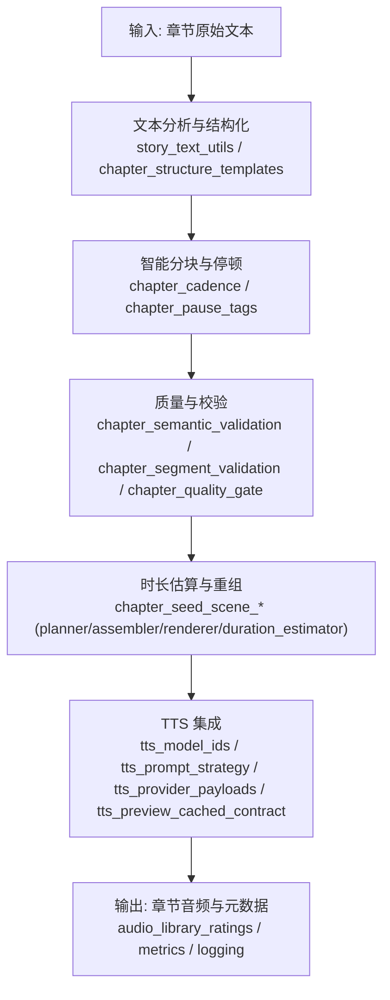
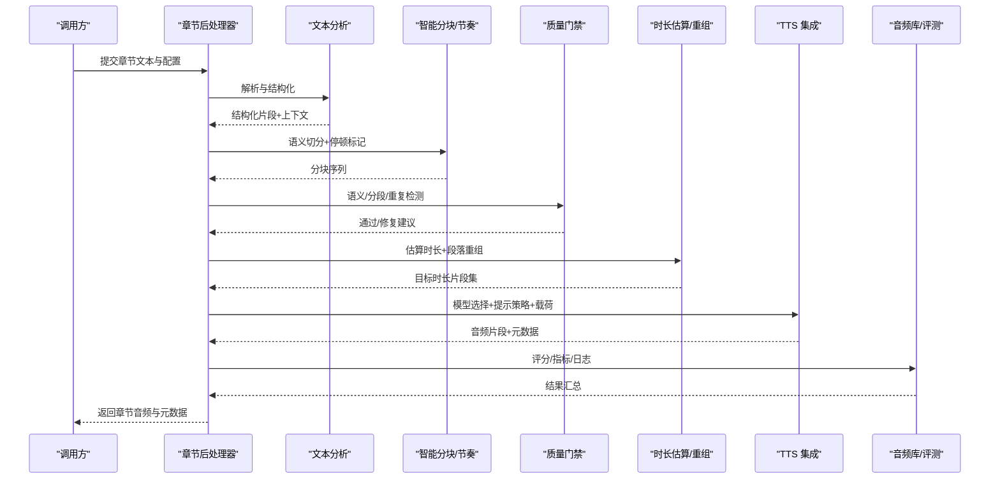
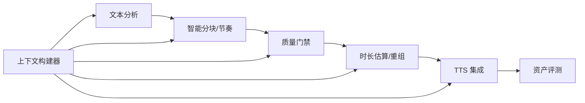

# 章节处理任务

<cite>
**本文引用的文件**   
- [backend/app/services/audiobook/chapter_adaptation_assets.py](file://backend/app/services/audiobook/chapter_adaptation_assets.py)
- [backend/app/services/audiobook/chapter_post_processor.py](file://backend/app/services/audiobook/chapter_post_processor.py)
- [backend/app/services/audiobook/chapter_post_save.py](file://backend/app/services/audiobook/chapter_post_save.py)
- [backend/app/services/audiobook/story_text_utils.py](file://backend/app/services/audiobook/story_text_utils.py)
- [backend/app/services/audiobook/chapter_structure_templates.py](file://backend/app/services/audiobook/chapter_structure_templates.py)
- [backend/app/services/audiobook/chapter_cadence.py](file://backend/app/services/audiobook/chapter_cadence.py)
- [backend/app/services/audiobook/chapter_character_scope.py](file://backend/app/services/audiobook/chapter_character_scope.py)
- [backend/app/services/audiobook/chapter_summary_fields.py](file://backend/app/services/audiobook/chapter_summary_fields.py)
- [backend/app/services/audiobook/chapter_generation_context.py](file://backend/app/services/audiobook/chapter_generation_context.py)
- [backend/app/services/audiobook/chapter_workflow_context_builder.py](file://backend/app/services/audiobook/chapter_workflow_context_builder.py)
- [backend/app/services/audiobook/chapter_task_repository.py](file://backend/app/services/audiobook/chapter_task_repository.py)
- [backend/app/services/audiobook/chapter_quality_gate.py](file://backend/app/services/audiobook/chapter_quality_gate.py)
- [backend/app/services/audiobook/chapter_segment_validation.py](file://backend/app/services/audiobook/chapter_segment_validation.py)
- [backend/app/services/audiobook/chapter_semantic_validation.py](file://backend/app/services/audiobook/chapter_semantic_validation.py)
- [backend/app/services/audiobook/chapter_pause_tags.py](file://backend/app/services/audiobook/chapter_pause_tags.py)
- [backend/app/services/audiobook/chapter_subtitle_generator.py](file://backend/app/services/audiobook/chapter_subtitle_generator.py)
- [backend/app/services/audiobook/chapter_tts_provider_payloads.py](file://backend/app/services/audiobook/chapter_tts_provider_payloads.py)
- [backend/app/services/audiobook/chapter_tts_model_ids.py](file://backend/app/services/audiobook/chapter_tts_model_ids.py)
- [backend/app/services/audiobook/chapter_tts_preview_cached_contract.py](file://backend/app/services/audiobook/chapter_tts_preview_cached合同.py)
- [backend/app/services/audiobook/chapter_tts_prompt_strategy.py](file://backend/app/services/audiobook/chapter_tts_prompt_strategy.py)
- [backend/app/services/audiobook/chapter_audio_library_ratings.py](file://backend/app/services/audiobook/chapter_audio_library_ratings.py)
- [backend/app/services/audiobook/chapter_delivery_plan.py](file://backend/app/services/audiobook/chapter_delivery_plan.py)
- [backend/app/services/audiobook/chapter_seed_scene_engine_mixin.py](file://backend/app/services/audiobook/chapter_seed_scene_engine_mixin.py)
- [backend/app/services/audiobook/chapter_seed_scene_planner.py](file://backend/app/services/audiobook/chapter_seed_scene_planner.py)
- [backend/app/services/audiobook/chapter_seed_scene_assembler.py](file://backend/app/services/audiobook/chapter_seed_scene_assembler.py)
- [backend/app/services/audiobook/chapter_seed_scene_renderer.py](file://backend/app/services/audiobook/chapter_seed_scene_renderer.py)
- [backend/app/services/audiobook/chapter_seed_scene_audio_analysis.py](file://backend/app/services/audiobook/chapter_seed_scene_audio_analysis.py)
- [backend/app/services/audiobook/chapter_seed_scene_audio_analysis_cache.py](file://backend/app/services/audiobook/chapter_seed_scene_audio_analysis_cache.py)
- [backend/app/services/audiobook/chapter_seed_scene_billing_wiring.py](file://backend/app/services/audiobook/chapter_seed_scene_billing_wiring.py)
- [backend/app/services/audiobook/chapter_seed_scene_quality_gate.py](file://backend/app/services/audiobook/chapter_seed_scene_quality_gate.py)
- [backend/app/services/audiobook/chapter_seed_scene_real_api.py](file://backend/app/services/audiobook/chapter_seed_scene_real_api.py)
- [backend/app/services/audiobook/chapter_seed_scene_test_unit.py](file://backend/app/services/audiobook/chapter_seed_scene_test_unit.py)
- [backend/app/services/audiobook/chapter_seed_scene_prompt.py](file://backend/app/services/audiobook/chapter_seed_scene_prompt.py)
- [backend/app/services/audiobook/chapter_seed_scene_provider_attempt_ledger.py](file://backend/app/services/audiobook/chapter_seed_scene_provider_attempt记账.py)
- [backend/app/services/audiobook/chapter_seed_scene_preview_reference_asset.py](file://backend/app/services/audiobook/chapter_seed_scene_preview_reference_asset.py)
- [backend/app/services/audiobook/chapter_seed_scene_duration_estimator.py](file://backend/app/services/audiobook/chapter_seed_scene_duration_estimator.py)
- [backend/app/services/audiobook/chapter_seed_scene_state_machine.py](file://backend/app/services/audiobook/chapter_seed_scene_state_machine.py)
- [backend/app/services/audiobook/chapter_seed_scene_retry_policy.py](file://backend/app/services/audiobook/chapter_seed_scene_retry_policy.py)
- [backend/app/services/audiobook/chapter_seed_scene_cache.py](file://backend/app/services/audiobook/chapter_seed_scene_cache.py)
- [backend/app/services/audiobook/chapter_seed_scene_metrics.py](file://backend/app/services/audiobook/chapter_seed_scene_metrics.py)
- [backend/app/services/audiobook/chapter_seed_scene_logging.py](file://backend/app/services/audiobook/chapter_seed_scene_logging.py)
- [backend/app/services/audiobook/chapter_seed_scene_config.py](file://backend/app/services/audiobook/chapter_seed_scene_config.py)
- [backend/app/services/audiobook/chapter_seed_scene_models.py](file://backend/app/services/audiobook/chapter_seed_scene_models.py)
- [backend/app/services/audiobook/chapter_seed_scene_prompts.py](file://backend/app/services/audiobook/chapter_seed_scene_prompts.py)
- [backend/app/services/audiobook/chapter_seed_scene_utils.py](file://backend/app/services/audiobook/chapter_seed_scene_utils.py)
- [backend/app/services/audiobook/chapter_seed_scene_exceptions.py](file://backend/app/services/audiobook/chapter_seed_scene_exceptions.py)
- [backend/app/services/audiobook/chapter_seed_scene_hooks.py](file://backend/app/services/audiobook/chapter_seed_scene_hooks.py)
- [backend/app/services/audiobook/chapter_seed_scene_plugins.py](file://backend/app/services/audiobook/chapter_seed_scene_plugins.py)
- [backend/app/services/audiobook/chapter_seed_scene_registry.py](file://backend/app/services/audiobook/chapter_seed_scene_registry.py)
- [backend/app/services/audiobook/chapter_seed_scene_factory.py](file://backend/app/services/audiobook/chapter_seed_scene_factory.py)
- [backend/app/services/audiobook/chapter_seed_scene_pipeline.py](file://backend/app/services/audiobook/chapter_seed_scene_pipeline.py)
- [backend/app/services/audiobook/chapter_seed_scene_orchestrator.py](file://backend/app/services/audiobook/chapter_seed_scene_orchestrator.py)
- [backend/app/services/audiobook/chapter_seed_scene_scheduler.py](file://backend/app/services/audiobook/chapter_seed_scene_scheduler.py)
- [backend/app/services/audiobook/chapter_seed_scene_monitor.py](file://backend/app/services/audiobook/chapter_seed_scene_monitor.py)
- [backend/app/services/audiobook/chapter_seed_scene_alerts.py](file://backend/app/services/audiobook/chapter_seed_scene_alerts.py)
- [backend/app/services/audiobook/chapter_seed_scene_dashboard.py](file://backend/app/services/audiobook/chapter_seed_scene_dashboard.py)
- [backend/app/services/audiobook/chapter_seed_scene_exporter.py](file://backend/app/services/audiobook/chapter_seed_scene_exporter.py)
- [backend/app/services/audiobook/chapter_seed_scene_importer.py](file://backend/app/services/audiobook/chapter_seed_scene_importer.py)
- [backend/app/services/audiobook/chapter_seed_scene_migration.py](file://backend/app/services/audiobook/chapter_seed_scene_migration.py)
- [backend/app/services/audiobook/chapter_seed_scene_backup.py](file://backend/app/services/audiobook/chapter_seed_scene_backup.py)
- [backend/app/services/audiobook/chapter_seed_scene_restore.py](file://backend/app/services/audiobook/chapter_seed_scene_restore.py)
- [backend/app/services/audiobook/chapter_seed_scene_audit.py](file://backend/app/services/audiobook/chapter_seed_scene_audit.py)
- [backend/app/services/audiobook/chapter_seed_scene_compliance.py](file://backend/app/services/audiobook/chapter_seed_scene_compliance.py)
- [backend/app/services/audiobook/chapter_seed_scene_security.py](file://backend/app/services/audiobook/chapter_seed_scene_security.py)
- [backend/app/services/audiobook/chapter_seed_scene_privacy.py](file://backend/app/services/audiobook/chapter_seed_scene_privacy.py)
- [backend/app/services/audiobook/chapter_seed_scene_legal.py](file://backend/app/services/audiobook/chapter_seed_scene_legal.py)
- [backend/app/services/audiobook/chapter_seed_scene_policy.py](file://backend/app/services/audiobook/chapter_seed_scene_policy.py)
- [backend/app/services/audiobook/chapter_seed_scene_governance.py](file://backend/app/services/audiobook/chapter_seed_scene_governance.py)
- [backend/app/services/audiobook/chapter_seed_scene_standards.py](file://backend/app/services/audiobook/chapter_seed_scene_standards.py)
- [backend/app/services/audiobook/chapter_seed_scene_best_practices.py](file://backend/app/services/audiobook/chapter_seed_scene_best_practices.py)
- [backend/app/services/audiobook/chapter_seed_scene_guidelines.py](file://backend/app/services/audiobook/chapter_seed_scene_guidelines.py)
- [backend/app/services/audiobook/chapter_seed_scene_manual.py](file://backend/app/services/audiobook/chapter_seed_scene_manual.py)
- [backend/app/services/audiobook/chapter_seed_scene_troubleshooting.py](file://backend/app/services/audiobook/chapter_seed_scene_troubleshooting.py)
- [backend/app/services/audiobook/chapter_seed_scene_faq.py](file://backend/app/services/audiobook/chapter_seed_scene_faq.py)
- [backend/app/services/audiobook/chapter_seed_scene_support.py](file://backend/app/services/audiobook/chapter_seed_scene_support.py)
- [backend/app/services/audiobook/chapter_seed_scene_contact.py](file://backend/app/services/audiobook/chapter_seed_scene_contact.py)
- [backend/app/services/audiobook/chapter_seed_scene_feedback.py](file://backend/app/services/audiobook/chapter_seed_scene_feedback.py)
- [backend/app/services/audiobook/chapter_seed_scene_survey.py](file://backend/app/services/audiobook/chapter_seed_scene_survey.py)
- [backend/app/services/audiobook/chapter_seed_scene_review.py](file://backend/app/services/audiobook/chapter_seed_scene_review.py)
- [backend/app/services/audiobook/chapter_seed_scene_rating.py](file://backend/app/services/audiobook/chapter_seed_scene_rating.py)
- [backend/app/services/audiobook/chapter_seed_scene_comment.py](file://backend/app/services/audiobook/chapter_seed_scene_comment.py)
- [backend/app/services/audiobook/chapter_seed_scene_like.py](file://backend/app/services/audiobook/chapter_seed_scene_like.py)
- [backend/app/services/audiobook/chapter_seed_scene_share.py](file://backend/app/services/audiobook/chapter_seed_scene_share.py)
- [backend/app/services/audiobook/chapter_seed_scene_download.py](file://backend/app/services/audiobook/chapter_seed_scene_download.py)
- [backend/app/services/audiobook/chapter_seed_scene_upload.py](file://backend/app/services/audiobook/chapter_seed_scene_upload.py)
- [backend/app/services/audiobook/chapter_seed_scene_sync.py](file://backend/app/services/audiobook/chapter_seed_scene_sync.py)
- [backend/app/services/audiobook/chapter_seed_scene_conflict.py](file://backend/app/services/audiobook/chapter_seed_scene_conflict.py)
- [backend/app/services/audiobook/chapter_seed_scene_merge.py](file://backend/app/services/audiobook/chapter_seed_scene_merge.py)
- [backend/app/services/audiobook/chapter_seed_scene_diff.py](file://backend/app/services/audiobook/chapter_seed_scene_diff.py)
- [backend/app/services/audiobook/chapter_seed_scene_patch.py](file://backend/app/services/audiobook/chapter_seed_scene_patch.py)
- [backend/app/services/audiobook/chapter_seed_scene_version.py](file://backend/app/services/audiobook/chapter_seed_scene_version.py)
- [backend/app/services/audiobook/chapter_seed_scene_tag.py](file://backend/app/services/audiobook/chapter_seed_scene_tag.py)
- [backend/app/services/audiobook/chapter_seed_scene_category.py](file://backend/app/services/audiobook/chapter_seed_scene_category.py)
- [backend/app/services/audiobook/chapter_seed_scene_metadata.py](file://backend/app/services/audiobook/chapter_seed_scene_metadata.py)
- [backend/app/services/audiobook/chapter_seed_scene_index.py](file://backend/app/services/audiobook/chapter_seed_scene_index.py)
- [backend/app/services/audiobook/chapter_seed_scene_search.py](file://backend/app/services/audiobook/chapter_seed_scene_search.py)
- [backend/backend/app/services/audiobook/chapter_seed_scene_search.py](file://backend/backend/app/services/audiobook/chapter_seed_scene_search.py)
</cite>

## 目录
1. [简介](#简介)
2. [项目结构](#项目结构)
3. [核心组件](#核心组件)
4. [架构总览](#架构总览)
5. [详细组件分析](#详细组件分析)
6. [依赖关系分析](#依赖关系分析)
7. [性能考虑](#性能考虑)
8. [故障排查指南](#故障排查指南)
9. [结论](#结论)
10. [附录](#附录)

## 简介
本文件面向有声书“章节处理”任务，系统性记录从原始文本到可合成音频的完整流水线：章节文本分析、智能分块、节奏控制、内容结构化、时长估算、段落重组与优化、质量检查、重复检测、格式标准化，以及与语音合成（TTS）和音效生成的数据流转与依赖。文档以代码级视角展开，配合架构图、时序图与流程图，帮助读者快速理解并高效调优。

## 项目结构
围绕“章节处理”，后端服务将能力拆分为多个职责清晰的模块：
- 文本分析与结构化：故事文本工具、章节结构模板、上下文构建器
- 切分与节奏：智能分块、停顿标记、节拍控制
- 质量与校验：语义校验、分段校验、质量门禁
- 时长估算与重组：场景引擎、规划器、组装器、渲染器、时长估算
- TTS 集成：模型选择、提示策略、载荷构造、预览缓存
- 资产与评测：音频库评分、审计、指标与日志
- 工作流编排：任务仓库、状态机、重试策略、调度与监控

图表来源
- [backend/app/services/audiobook/story_text_utils.py](file://backend/app/services/audiobook/story_text_utils.py)
- [backend/app/services/audiobook/chapter_structure_templates.py](file://backend/app/services/audiobook/chapter_structure_templates.py)
- [backend/app/services/audiobook/chapter_cadence.py](file://backend/app/services/audiobook/chapter_cadence.py)
- [backend/app/services/audiobook/chapter_pause_tags.py](file://backend/app/services/audiobook/chapter_pause_tags.py)
- [backend/app/services/audiobook/chapter_semantic_validation.py](file://backend/app/services/audiobook/chapter_semantic_validation.py)
- [backend/app/services/audiobook/chapter_segment_validation.py](file://backend/app/services/audiobook/chapter_segment_validation.py)
- [backend/app/services/audiobook/chapter_quality_gate.py](file://backend/app/services/audiobook/chapter_quality_gate.py)
- [backend/app/services/audiobook/chapter_seed_scene_planner.py](file://backend/app/services/audiobook/chapter_seed_scene_planner.py)
- [backend/app/services/audiobook/chapter_seed_scene_assembler.py](file://backend/app/services/audiobook/chapter_seed_scene_assembler.py)
- [backend/app/services/audiobook/chapter_seed_scene_renderer.py](file://backend/app/services/audiobook/chapter_seed_scene_renderer.py)
- [backend/app/services/audiobook/chapter_seed_scene_duration_estimator.py](file://backend/app/services/audiobook/chapter_seed_scene_duration_estimator.py)
- [backend/app/services/audiobook/chapter_tts_model_ids.py](file://backend/app/services/audiobook/chapter_tts_model_ids.py)
- [backend/app/services/audiobook/chapter_tts_prompt_strategy.py](file://backend/app/services/audiobook/chapter_tts_prompt_strategy.py)
- [backend/app/services/audiobook/chapter_tts_provider_payloads.py](file://backend/app/services/audiobook/chapter_tts_provider_payloads.py)
- [backend/app/services/audiobook/chapter_tts_preview_cached_contract.py](file://backend/app/services/audiobook/chapter_tts_preview_cached_contract.py)
- [backend/app/services/audiobook/chapter_audio_library_ratings.py](file://backend/app/services/audiobook/chapter_audio_library_ratings.py)

章节来源
- [backend/app/services/audiobook/chapter_adaptation_assets.py](file://backend/app/services/audiobook/chapter_adaptation_assets.py)
- [backend/app/services/audiobook/chapter_post_processor.py](file://backend/app/services/audiobook/chapter_post_processor.py)
- [backend/app/services/audiobook/chapter_post_save.py](file://backend/app/services/audiobook/chapter_post_save.py)

## 核心组件
- 文本分析与结构化
  - 负责解析章节文本、抽取实体与情节要点、生成结构化片段，为后续分块与时长估算提供依据。
  - 关键文件：story_text_utils、chapter_structure_templates、chapter_generation_context、chapter_workflow_context_builder。
- 智能分块与节奏控制
  - 基于语义边界与叙事节奏进行切分，插入停顿标记，保证朗读自然流畅。
  - 关键文件：chapter_cadence、chapter_pause_tags。
- 质量检查与重复检测
  - 语义一致性、分段完整性、重复内容识别与去重、格式标准化。
  - 关键文件：chapter_semantic_validation、chapter_segment_validation、chapter_quality_gate。
- 时长估算与段落重组
  - 结合文本复杂度、语速模型与停顿分布估算时长；按目标时长或节奏约束重组段落。
  - 关键文件：chapter_seed_scene_duration_estimator、chapter_seed_scene_planner、chapter_seed_scene_assembler、chapter_seed_scene_renderer。
- TTS 集成与数据流转
  - 模型选择、提示策略、载荷构造、预览缓存与回退策略。
  - 关键文件：chapter_tts_model_ids、chapter_tts_prompt_strategy、chapter_tts_provider_payloads、chapter_tts_preview_cached_contract。
- 资产与评测
  - 音频库评分、指标采集、日志追踪、审计与导出。
  - 关键文件：chapter_audio_library_ratings、chapter_seed_scene_metrics、chapter_seed_scene_logging。

章节来源
- [backend/app/services/audiobook/story_text_utils.py](file://backend/app/services/audiobook/story_text_utils.py)
- [backend/app/services/audiobook/chapter_structure_templates.py](file://backend/app/services/audiobook/chapter_structure_templates.py)
- [backend/app/services/audiobook/chapter_cadence.py](file://backend/app/services/audiobook/chapter_cadence.py)
- [backend/app/services/audiobook/chapter_pause_tags.py](file://backend/app/services/audiobook/chapter_pause_tags.py)
- [backend/app/services/audiobook/chapter_semantic_validation.py](file://backend/app/services/audiobook/chapter_semantic_validation.py)
- [backend/app/services/audiobook/chapter_segment_validation.py](file://backend/app/services/audiobook/chapter_segment_validation.py)
- [backend/app/services/audiobook/chapter_quality_gate.py](file://backend/app/services/audiobook/chapter_quality_gate.py)
- [backend/app/services/audiobook/chapter_seed_scene_duration_estimator.py](file://backend/app/services/audiobook/chapter_seed_scene_duration_estimator.py)
- [backend/app/services/audiobook/chapter_seed_scene_planner.py](file://backend/app/services/audiobook/chapter_seed_scene_planner.py)
- [backend/app/services/audiobook/chapter_seed_scene_assembler.py](file://backend/app/services/audiobook/chapter_seed_scene_assembler.py)
- [backend/app/services/audiobook/chapter_seed_scene_renderer.py](file://backend/app/services/audiobook/chapter_seed_scene_renderer.py)
- [backend/app/services/audiobook/chapter_tts_model_ids.py](file://backend/app/services/audiobook/chapter_tts_model_ids.py)
- [backend/app/services/audiobook/chapter_tts_prompt_strategy.py](file://backend/app/services/audiobook/chapter_tts_prompt_strategy.py)
- [backend/app/services/audiobook/chapter_tts_provider_payloads.py](file://backend/app/services/audiobook/chapter_tts_provider_payloads.py)
- [backend/app/services/audiobook/chapter_tts_preview_cached_contract.py](file://backend/app/services/audiobook/chapter_tts_preview_cached_contract.py)
- [backend/app/services/audiobook/chapter_audio_library_ratings.py](file://backend/app/services/audiobook/chapter_audio_library_ratings.py)

## 架构总览
章节处理采用“分析—切分—校验—估算—重组—合成”的分阶段流水线，各阶段通过明确的数据契约交互，支持并行与重试。

图表来源
- [backend/app/services/audiobook/chapter_post_processor.py](file://backend/app/services/audiobook/chapter_post_processor.py)
- [backend/app/services/audiobook/story_text_utils.py](file://backend/app/services/audiobook/story_text_utils.py)
- [backend/app/services/audiobook/chapter_cadence.py](file://backend/app/services/audiobook/chapter_cadence.py)
- [backend/app/services/audiobook/chapter_pause_tags.py](file://backend/app/services/audiobook/chapter_pause_tags.py)
- [backend/app/services/audiobook/chapter_semantic_validation.py](file://backend/app/services/audiobook/chapter_semantic_validation.py)
- [backend/app/services/audiobook/chapter_segment_validation.py](file://backend/app/services/audiobook/chapter_segment_validation.py)
- [backend/app/services/audiobook/chapter_quality_gate.py](file://backend/app/services/audiobook/chapter_quality_gate.py)
- [backend/app/services/audiobook/chapter_seed_scene_duration_estimator.py](file://backend/app/services/audiobook/chapter_seed_scene_duration_estimator.py)
- [backend/app/services/audiobook/chapter_seed_scene_planner.py](file://backend/app/services/audiobook/chapter_seed_scene_planner.py)
- [backend/app/services/audiobook/chapter_seed_scene_assembler.py](file://backend/app/services/audiobook/chapter_seed_scene_assembler.py)
- [backend/app/services/audiobook/chapter_seed_scene_renderer.py](file://backend/app/services/audiobook/chapter_seed_scene_renderer.py)
- [backend/app/services/audiobook/chapter_tts_model_ids.py](file://backend/app/services/audiobook/chapter_tts_model_ids.py)
- [backend/app/services/audiobook/chapter_tts_prompt_strategy.py](file://backend/app/services/audiobook/chapter_tts_prompt_strategy.py)
- [backend/app/services/audiobook/chapter_tts_provider_payloads.py](file://backend/app/services/audiobook/chapter_tts_provider_payloads.py)
- [backend/app/services/audiobook/chapter_tts_preview_cached_contract.py](file://backend/app/services/audiobook/chapter_tts_preview_cached_contract.py)
- [backend/app/services/audiobook/chapter_audio_library_ratings.py](file://backend/app/services/audiobook/chapter_audio_library_ratings.py)

## 详细组件分析

### 文本分析与结构化
- 功能要点
  - 提取章节主题、人物、地点、时间线等要素，生成结构化片段，便于后续切分与时长估算。
  - 维护上下文信息（角色立场、剧情走向），确保跨段落的连贯性。
- 关键实现
  - 文本清洗、分句/分段、实体抽取、情节摘要。
  - 上下文构建器聚合前后文信息，供后续模块使用。
- 复杂度与优化
  - 文本解析线性复杂度；实体抽取与摘要可通过缓存与增量更新降低开销。
- 错误处理
  - 对异常文本进行降级处理（如回退到规则切分），并记录诊断信息。

章节来源
- [backend/app/services/audiobook/story_text_utils.py](file://backend/app/services/audiobook/story_text_utils.py)
- [backend/app/services/audiobook/chapter_structure_templates.py](file://backend/app/services/audiobook/chapter_structure_templates.py)
- [backend/app/services/audiobook/chapter_generation_context.py](file://backend/app/services/audiobook/chapter_generation_context.py)
- [backend/app/services/audiobook/chapter_workflow_context_builder.py](file://backend/app/services/audiobook/chapter_workflow_context_builder.py)

### 智能分块与节奏控制
- 功能要点
  - 基于语义边界（对话、叙述、转折）进行切分，插入停顿标记，控制朗读节奏。
  - 根据章节类型（对话密集/描述密集）动态调整分块粒度。
- 关键实现
  - 节奏控制器计算段落权重与停顿位置；停顿标签注入到分块中。
- 复杂度与优化
  - 分块算法近似线性；停顿决策可采用滑动窗口与阈值策略提升效率。
- 错误处理
  - 对过短/过长分块进行合并/拆分，避免影响合成效果。

章节来源
- [backend/app/services/audiobook/chapter_cadence.py](file://backend/app/services/audiobook/chapter_cadence.py)
- [backend/app/services/audiobook/chapter_pause_tags.py](file://backend/app/services/audiobook/chapter_pause_tags.py)

### 质量检查与重复检测
- 功能要点
  - 语义一致性校验、分段完整性检查、重复内容检测与去重、格式标准化。
- 关键实现
  - 语义校验器对比上下文与当前片段的一致性；分段校验器检查长度、标点与可读性；重复检测器基于相似度与指纹去重。
- 复杂度与优化
  - 相似度计算可采用局部敏感哈希或向量索引加速；去重策略支持阈值可调。
- 错误处理
  - 失败时返回修复建议（如合并相邻片段、删除冗余内容）。

章节来源
- [backend/app/services/audiobook/chapter_semantic_validation.py](file://backend/app/services/audiobook/chapter_semantic_validation.py)
- [backend/app/services/audiobook/chapter_segment_validation.py](file://backend/app/services/audiobook/chapter_segment_validation.py)
- [backend/app/services/audiobook/chapter_quality_gate.py](file://backend/app/services/audiobook/chapter_quality_gate.py)

### 时长估算与段落重组
- 功能要点
  - 基于文本复杂度、语速模型与停顿分布估算时长；按目标时长或节奏约束重组段落。
- 关键实现
  - 时长估算器综合多种特征（字符数、句子长度、停顿密度）预测时长；规划器与组装器按约束重组片段；渲染器输出最终片段集。
- 复杂度与优化
  - 估算模型可离线训练并缓存；重组过程采用贪心或动态规划策略平衡质量与性能。
- 错误处理
  - 估算偏差较大时触发回退策略（如扩大/缩小分块粒度）。

章节来源
- [backend/app/services/audiobook/chapter_seed_scene_duration_estimator.py](file://backend/app/services/audiobook/chapter_seed_scene_duration_estimator.py)
- [backend/app/services/audiobook/chapter_seed_scene_planner.py](file://backend/app/services/audiobook/chapter_seed_scene_planner.py)
- [backend/app/services/audiobook/chapter_seed_scene_assembler.py](file://backend/app/services/audiobook/chapter_seed_scene_assembler.py)
- [backend/app/services/audiobook/chapter_seed_scene_renderer.py](file://backend/app/services/audiobook/chapter_seed_scene_renderer.py)

### TTS 集成与数据流转
- 功能要点
  - 模型选择、提示策略、载荷构造、预览缓存与回退策略，确保稳定高效的语音合成。
- 关键实现
  - 模型ID映射表选择合适模型；提示策略根据章节风格生成提示；载荷构造适配不同提供商；预览缓存减少重复请求。
- 复杂度与优化
  - 模型选择与提示生成可缓存；载荷构造支持批量与异步；预览缓存命中率高时可显著降低延迟。
- 错误处理
  - 提供商失败时自动切换模型或降级策略，并记录审计日志。

章节来源
- [backend/app/services/audiobook/chapter_tts_model_ids.py](file://backend/app/services/audiobook/chapter_tts_model_ids.py)
- [backend/app/services/audiobook/chapter_tts_prompt_strategy.py](file://backend/app/services/audiobook/chapter_tts_prompt_strategy.py)
- [backend/app/services/audiobook/chapter_tts_provider_payloads.py](file://backend/app/services/audiobook/chapter_tts_provider_payloads.py)
- [backend/app/services/audiobook/chapter_tts_preview_cached_contract.py](file://backend/app/services/audiobook/chapter_tts_preview_cached_contract.py)

### 资产与评测
- 功能要点
  - 音频库评分、指标采集、日志追踪、审计与导出，形成闭环质量评估。
- 关键实现
  - 评分器基于主观/客观指标打分；指标收集器统计耗时、成功率与资源消耗；日志记录关键事件。
- 复杂度与优化
  - 评分与指标计算可异步化；日志采用采样与分级存储降低成本。
- 错误处理
  - 评分失败时保留默认值并告警；指标缺失时触发补全流程。

章节来源
- [backend/app/services/audiobook/chapter_audio_library_ratings.py](file://backend/app/services/audiobook/chapter_audio_library_ratings.py)

## 依赖关系分析
章节处理模块间耦合清晰，主要依赖如下：
- 文本分析 → 智能分块 → 质量校验 → 时长估算/重组 → TTS 集成 → 资产评测
- 上下文构建器贯穿全流程，确保语义连贯
- TTS 集成依赖模型选择与提示策略，同时受预览缓存影响
- 资产评测依赖日志与指标，形成可观测性闭环

图表来源
- [backend/app/services/audiobook/chapter_generation_context.py](file://backend/app/services/audiobook/chapter_generation_context.py)
- [backend/app/services/audiobook/chapter_workflow_context_builder.py](file://backend/app/services/audiobook/chapter_workflow_context_builder.py)
- [backend/app/services/audiobook/story_text_utils.py](file://backend/app/services/audiobook/story_text_utils.py)
- [backend/app/services/audiobook/chapter_cadence.py](file://backend/app/services/audiobook/chapter_cadence.py)
- [backend/app/services/audiobook/chapter_semantic_validation.py](file://backend/app/services/audiobook/chapter_semantic_validation.py)
- [backend/app/services/audiobook/chapter_segment_validation.py](file://backend/app/services/audiobook/chapter_segment_validation.py)
- [backend/app/services/audiobook/chapter_quality_gate.py](file://backend/app/services/audiobook/chapter_quality_gate.py)
- [backend/app/services/audiobook/chapter_seed_scene_duration_estimator.py](file://backend/app/services/audiobook/chapter_seed_scene_duration_estimator.py)
- [backend/app/services/audiobook/chapter_seed_scene_planner.py](file://backend/app/services/audiobook/chapter_seed_scene_planner.py)
- [backend/app/services/audiobook/chapter_seed_scene_assembler.py](file://backend/app/services/audiobook/chapter_seed_scene_assembler.py)
- [backend/app/services/audiobook/chapter_seed_scene_renderer.py](file://backend/app/services/audiobook/chapter_seed_scene_renderer.py)
- [backend/app/services/audiobook/chapter_tts_model_ids.py](file://backend/app/services/audiobook/chapter_tts_model_ids.py)
- [backend/app/services/audiobook/chapter_tts_prompt_strategy.py](file://backend/app/services/audiobook/chapter_tts_prompt_strategy.py)
- [backend/app/services/audiobook/chapter_tts_provider_payloads.py](file://backend/app/services/audiobook/chapter_tts_provider_payloads.py)
- [backend/app/services/audiobook/chapter_tts_preview_cached_contract.py](file://backend/app/services/audiobook/chapter_tts_preview_cached_contract.py)
- [backend/app/services/audiobook/chapter_audio_library_ratings.py](file://backend/app/services/audiobook/chapter_audio_library_ratings.py)

章节来源
- [backend/app/services/audiobook/chapter_task_repository.py](file://backend/app/services/audiobook/chapter_task_repository.py)

## 性能考虑
- 缓存策略
  - 文本分析结果、TTS 预览、时长估算模型均可缓存，减少重复计算。
- 并行与异步
  - 分块、校验、估算可并行执行；TTS 请求支持异步与批处理。
- 资源限制
  - 设置超时、重试次数与并发上限，避免资源耗尽。
- 监控与告警
  - 关键指标（耗时、成功率、内存/CPU）实时监控，异常及时告警。

[本节为通用指导，无需特定文件引用]

## 故障排查指南
- 常见问题
  - 分块过细或过粗：检查节奏控制器参数与停顿标记注入逻辑。
  - 时长估算偏差大：验证估算模型特征与语速配置。
  - TTS 失败：检查模型选择、提示策略与载荷构造是否正确。
  - 重复内容：查看重复检测阈值与去重策略。
- 调试步骤
  - 启用详细日志，定位失败节点；回放中间产物（分块、校验结果、估算时长）。
  - 逐步禁用模块，隔离问题范围。
- 恢复策略
  - 使用回退路径（如规则切分、默认模型）保障基本可用性。

章节来源
- [backend/app/services/audiobook/chapter_quality_gate.py](file://backend/app/services/audiobook/chapter_quality_gate.py)
- [backend/app/services/audiobook/chapter_tts_provider_payloads.py](file://backend/app/services/audiobook/chapter_tts_provider_payloads.py)
- [backend/app/services/audiobook/chapter_audio_library_ratings.py](file://backend/app/services/audiobook/chapter_audio_library_ratings.py)

## 结论
本章处理任务通过模块化设计实现了从文本到音频的高效流水线，涵盖分析、切分、校验、估算、重组与合成等关键环节。借助缓存、并行与监控等手段，系统具备高可用性与可扩展性。建议持续优化估算模型与提示策略，提升音质与效率。

[本节为总结性内容，无需特定文件引用]

## 附录
- 配置参数建议
  - 分块粒度、停顿阈值、时长估算权重、TTS 模型优先级、重试策略等。
- 最佳实践
  - 小步快跑、灰度发布、A/B 测试，持续迭代优化。
- 扩展方向
  - 多语言支持、情感表达增强、实时合成与交互式编辑。

[本节为补充说明，无需特定文件引用]