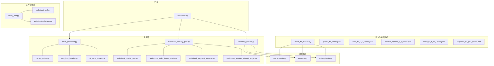
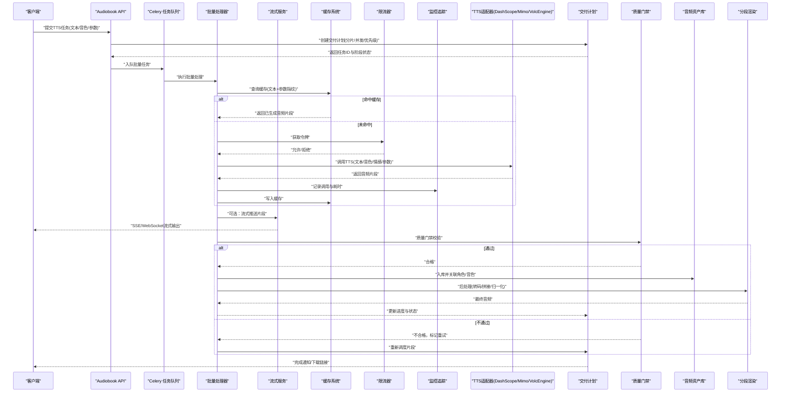
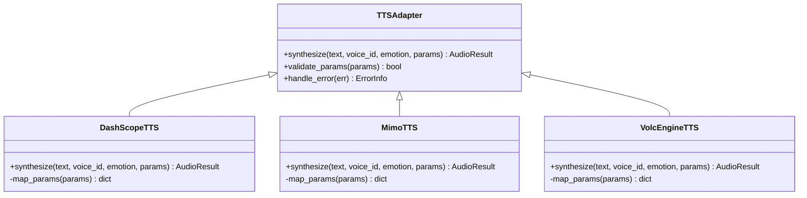
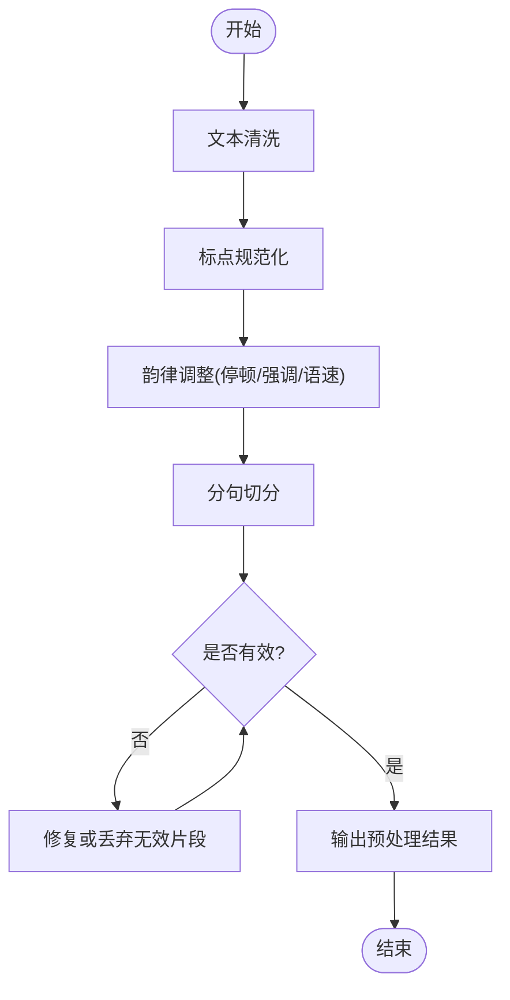
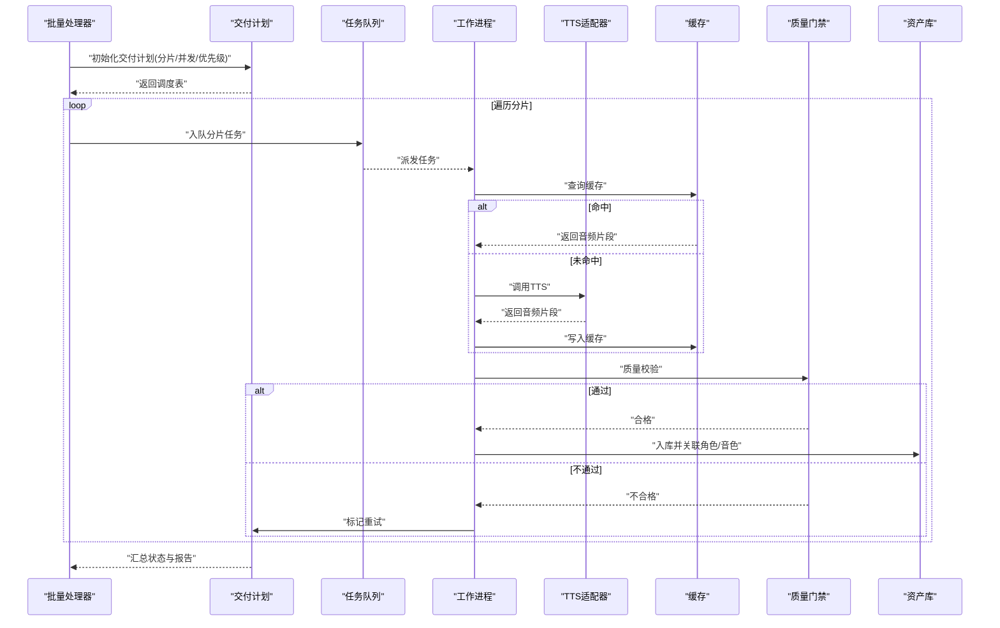
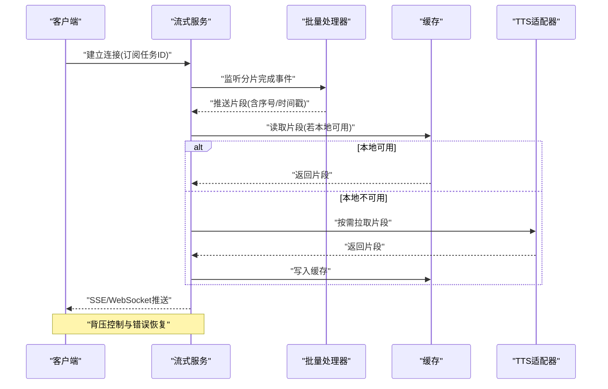
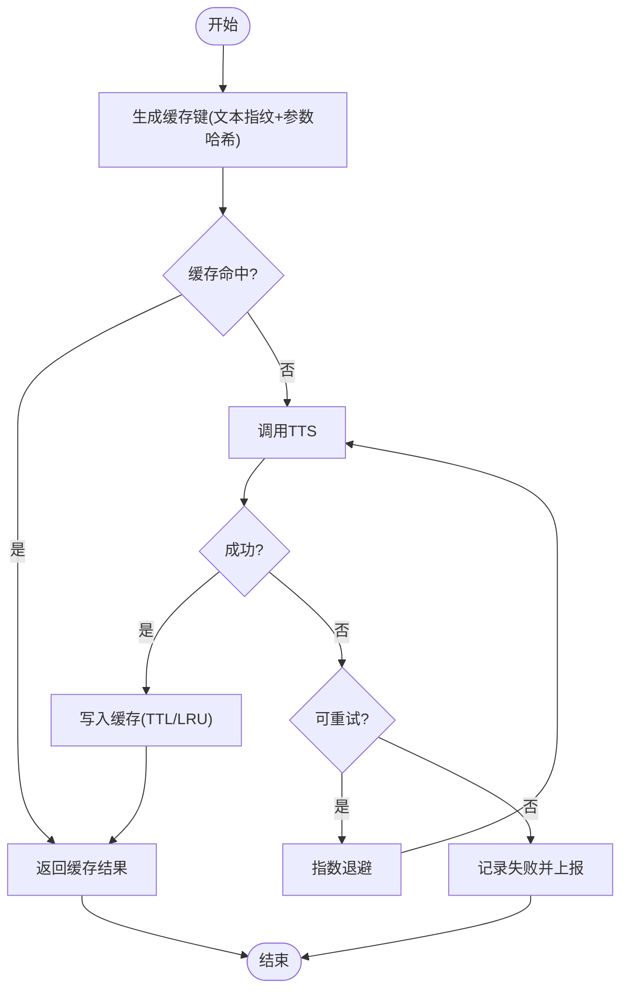
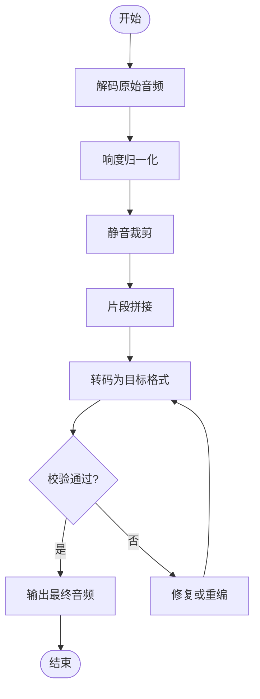
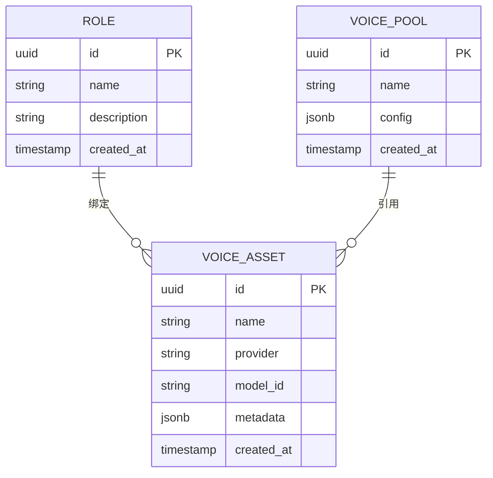
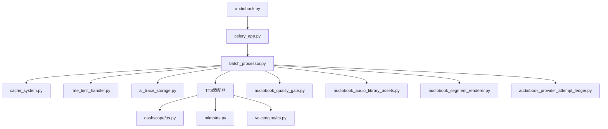

# 语音合成任务

<cite>
**本文引用的文件**   
- [adapters/dashscope/tts.py](file://adapters/dashscope/tts.py)
- [adapters/mimo/tts.py](file://adapters/mimo/tts.py)
- [adapters/volcengine/tts.py](file://adapters/volcengine/tts.py)
- [backend/app/services/streaming_service.py](file://backend/app/services/streaming_service.py)
- [backend/app/services/batch_processor.py](file://backend/app/services/batch_processor.py)
- [backend/app/celery_app.py](file://backend/app/celery_app.py)
- [backend/app/models/audiobook_task.py](file://backend/app/models/audiobook_task.py)
- [backend/app/schemas/audiobook.py](file://backend/app/schemas/audiobook.py)
- [backend/app/api/v1/audiobook.py](file://backend/app/api/v1/audiobook.py)
- [scripts/check_tts_models.py](file://scripts/check_tts_models.py)
- [shared/qwen3_tts_voices.json](file://shared/qwen3_tts_voices.json)
- [shared/seed_tts_2_0_voices.json](file://shared/seed_tts_2_0_voices.json)
- [shared/minimax_speech_2_8_voices.json](file://shared/minimax_speech_2_8_voices.json)
- [shared/mimo_v2_5_tts_voices.json](file://shared/mimo_v2_5_tts_voices.json)
- [shared/cosyvoice_v3_plus_voices.json](file://shared/cosyvoice_v3_plus_voices.json)
- [backend/app/services/cache_system.py](file://backend/app/services/cache_system.py)
- [backend/app/services/rate_limit_handler.py](file://backend/app/services/rate_limit_handler.py)
- [backend/app/services/monitoring/ai_trace_storage.py](file://backend/app/services/monitoring/ai_trace_storage.py)
- [backend/app/services/audiobook/audiobook_delivery_plan.py](file://backend/app/services/audiobook/audiobook_delivery_plan.py)
- [backend/app/services/audiobook/audiobook_quality_gate.py](file://backend/app/services/audiobook/audiobook_quality_gate.py)
- [backend/app/services/audiobook/audiobook_audio_library_assets.py](file://backend/app/services/audiobook/audiobook_audio_library_assets.py)
- [backend/app/services/audiobook/audiobook_segment_renderer.py](file://backend/app/services/audiobook/audiobook_segment_renderer.py)
- [backend/app/services/audiobook/audiobook_provider_attempt_ledger.py](file://backend/app/services/audiobook/audiobook_provider_attempt_ledger.py)
</cite>

## 目录
1. [简介](#简介)
2. [项目结构](#项目结构)
3. [核心组件](#核心组件)
4. [架构总览](#架构总览)
5. [详细组件分析](#详细组件分析)
6. [依赖关系分析](#依赖关系分析)
7. [性能考量](#性能考量)
8. [故障排查指南](#故障排查指南)
9. [结论](#结论)
10. [附录](#附录)

## 简介
本文件面向“语音合成异步任务”的完整实现，覆盖TTS引擎调用、批量处理与交付计划的核心流程。文档重点说明多模型支持（DashScope、Mimo、VolcEngine等）、文本预处理与标点符号处理、韵律调整、参数优化、缓存策略、失败重试、质量评估、音频格式转换、流式输出，以及与角色管理、音色库、语音池的集成方式。同时给出性能监控、资源限制与扩展性设计建议，帮助读者快速理解并高效使用系统。

## 项目结构
围绕TTS异步任务的关键代码分布在以下模块：
- 适配器层：各TTS提供商的适配实现
- 服务层：流式输出、批量处理、缓存、限流、监控
- 任务与模型：Celery任务、数据库模型与Schema定义
- API层：对外接口路由
- 脚本与共享数据：模型检查、音色清单
- 业务服务：交付计划、质量门禁、资产库、分段渲染、尝试记录

图表来源
- [backend/app/api/v1/audiobook.py](file://backend/app/api/v1/audiobook.py)
- [backend/app/services/streaming_service.py](file://backend/app/services/streaming_service.py)
- [backend/app/services/batch_processor.py](file://backend/app/services/batch_processor.py)
- [backend/app/services/cache_system.py](file://backend/app/services/cache_system.py)
- [backend/app/services/rate_limit_handler.py](file://backend/app/services/rate_limit_handler.py)
- [backend/app/services/monitoring/ai_trace_storage.py](file://backend/app/services/monitoring/ai_trace_storage.py)
- [backend/app/services/audiobook/audiobook_delivery_plan.py](file://backend/app/services/audiobook/audiobook_delivery_plan.py)
- [backend/app/services/audiobook/audiobook_quality_gate.py](file://backend/app/services/audiobook/audiobook_quality_gate.py)
- [backend/app/services/audiobook/audiobook_audio_library_assets.py](file://backend/app/services/audiobook/audiobook_audio_library_assets.py)
- [backend/app/services/audiobook/audiobook_segment_renderer.py](file://backend/app/services/audiobook/audiobook_segment_renderer.py)
- [backend/app/services/audiobook/audiobook_provider_attempt_ledger.py](file://backend/app/services/audiobook/audiobook_provider_attempt_ledger.py)
- [backend/app/celery_app.py](file://backend/app/celery_app.py)
- [backend/app/models/audiobook_task.py](file://backend/app/models/audiobook_task.py)
- [backend/app/schemas/audiobook.py](file://backend/app/schemas/audiobook.py)
- [adapters/dashscope/tts.py](file://adapters/dashscope/tts.py)
- [adapters/mimo/tts.py](file://adapters/mimo/tts.py)
- [adapters/volcengine/tts.py](file://adapters/volcengine/tts.py)
- [scripts/check_tts_models.py](file://scripts/check_tts_models.py)
- [shared/qwen3_tts_voices.json](file://shared/qwen3_tts_voices.json)
- [shared/seed_tts_2_0_voices.json](file://shared/seed_tts_2_0_voices.json)
- [shared/minimax_speech_2_8_voices.json](file://shared/minimax_speech_2_8_voices.json)
- [shared/mimo_v2_5_tts_voices.json](file://shared/mimo_v2_5_tts_voices.json)
- [shared/cosyvoice_v3_plus_voices.json](file://shared/cosyvoice_v3_plus_voices.json)

章节来源
- [backend/app/api/v1/audiobook.py](file://backend/app/api/v1/audiobook.py)
- [backend/app/celery_app.py](file://backend/app/celery_app.py)
- [backend/app/models/audiobook_task.py](file://backend/app/models/audiobook_task.py)
- [backend/app/schemas/audiobook.py](file://backend/app/schemas/audiobook.py)

## 核心组件
- 多模型TTS适配器：统一抽象不同提供商的TTS能力，包括文本输入、音色选择、情感控制、采样率与编码格式等参数映射。
- 流式服务：提供SSE/WebSocket流式输出，降低首包延迟，提升交互体验。
- 批量处理器：将长文本切分为片段，并行或串行调用TTS，合并结果，支持断点续传与重试。
- 缓存系统：基于内容指纹与参数哈希进行结果缓存，避免重复生成。
- 限流器：对TTS请求进行速率限制，保护下游服务。
- 监控与追踪：记录请求链路、耗时、错误码与资源消耗。
- 交付计划：按章节/段落规划生成顺序、并发度与优先级，协调质量门禁与资产入库。
- 质量门禁：对生成音频进行客观指标校验与主观抽检，不达标则触发重生成。
- 资产库与音色库：统一管理音色元数据、克隆样本与公共语音池。
- 分段渲染：对音频进行后处理（转码、拼接、静音裁剪、响度归一化）。
- 尝试记录：记录每次调用的提供商、模型、参数、结果与失败原因，便于审计与回退。

章节来源
- [adapters/dashscope/tts.py](file://adapters/dashscope/tts.py)
- [adapters/mimo/tts.py](file://adapters/mimo/tts.py)
- [adapters/volcengine/tts.py](file://adapters/volcengine/tts.py)
- [backend/app/services/streaming_service.py](file://backend/app/services/streaming_service.py)
- [backend/app/services/batch_processor.py](file://backend/app/services/batch_processor.py)
- [backend/app/services/cache_system.py](file://backend/app/services/cache_system.py)
- [backend/app/services/rate_limit_handler.py](file://backend/app/services/rate_limit_handler.py)
- [backend/app/services/monitoring/ai_trace_storage.py](file://backend/app/services/monitoring/ai_trace_storage.py)
- [backend/app/services/audiobook/audiobook_delivery_plan.py](file://backend/app/services/audiobook/audiobook_delivery_plan.py)
- [backend/app/services/audiobook/audiobook_quality_gate.py](file://backend/app/services/audiobook/audiobook_quality_gate.py)
- [backend/app/services/audiobook/audiobook_audio_library_assets.py](file://backend/app/services/audiobook/audiobook_audio_library_assets.py)
- [backend/app/services/audiobook/audiobook_segment_renderer.py](file://backend/app/services/audiobook/audiobook_segment_renderer.py)
- [backend/app/services/audiobook/audiobook_provider_attempt_ledger.py](file://backend/app/services/audiobook/audiobook_provider_attempt_ledger.py)

## 架构总览
下图展示从API到TTS适配器与后端服务的整体调用链，以及任务调度与交付计划的协作关系。

图表来源
- [backend/app/api/v1/audiobook.py](file://backend/app/api/v1/audiobook.py)
- [backend/app/celery_app.py](file://backend/app/celery_app.py)
- [backend/app/services/batch_processor.py](file://backend/app/services/batch_processor.py)
- [backend/app/services/streaming_service.py](file://backend/app/services/streaming_service.py)
- [backend/app/services/cache_system.py](file://backend/app/services/cache_system.py)
- [backend/app/services/rate_limit_handler.py](file://backend/app/services/rate_limit_handler.py)
- [backend/app/services/monitoring/ai_trace_storage.py](file://backend/app/services/monitoring/ai_trace_storage.py)
- [adapters/dashscope/tts.py](file://adapters/dashscope/tts.py)
- [adapters/mimo/tts.py](file://adapters/mimo/tts.py)
- [adapters/volcengine/tts.py](file://adapters/volcengine/tts.py)
- [backend/app/services/audiobook/audiobook_delivery_plan.py](file://backend/app/services/audiobook/audiobook_delivery_plan.py)
- [backend/app/services/audiobook/audiobook_quality_gate.py](file://backend/app/services/audiobook/audiobook_quality_gate.py)
- [backend/app/services/audiobook/audiobook_audio_library_assets.py](file://backend/app/services/audiobook/audiobook_audio_library_assets.py)
- [backend/app/services/audiobook/audiobook_segment_renderer.py](file://backend/app/services/audiobook/audiobook_segment_renderer.py)

## 详细组件分析

### 多模型TTS适配器
- 统一接口：所有适配器遵循一致的输入输出契约，包括文本、音色ID、情感标签、采样率、编码格式、语速与音量等参数。
- 多模型支持：DashScope、Mimo、VolcEngine等提供商的差异化参数被映射为内部标准字段，确保上层逻辑无需关心具体实现。
- 语音克隆：支持基于参考音频或音色库中的样本进行克隆，参数包含相似度阈值与风格迁移强度。
- 情感控制：通过情感标签或数值向量驱动语气变化，如高兴、悲伤、平静等。
- 错误处理：网络异常、鉴权失败、配额耗尽等错误被捕获并转换为统一错误码，便于重试与降级。

图表来源
- [adapters/dashscope/tts.py](file://adapters/dashscope/tts.py)
- [adapters/mimo/tts.py](file://adapters/mimo/tts.py)
- [adapters/volcengine/tts.py](file://adapters/volcengine/tts.py)

章节来源
- [adapters/dashscope/tts.py](file://adapters/dashscope/tts.py)
- [adapters/mimo/tts.py](file://adapters/mimo/tts.py)
- [adapters/volcengine/tts.py](file://adapters/volcengine/tts.py)

### 文本预处理与标点符号处理
- 文本清洗：去除多余空白、标准化换行、过滤非法字符。
- 标点规范化：将口语化标点替换为标准标点，确保TTS正确断句与停顿。
- 韵律调整：根据上下文插入停顿标记、强调标记与语速调节指令，提升自然度。
- 分句策略：按语义边界切分，避免跨句融合导致的情感失真。

[此图为概念流程图，不直接映射具体源码文件]

### 批量处理与交付计划
- 分片策略：按句子/段落切分，控制每片长度与时长上限。
- 并发控制：根据资源与限流策略动态调整并发度。
- 断点续传：记录已完成的片段索引，支持中断恢复。
- 交付计划：定义生成顺序、优先级、重试次数与超时策略。

图表来源
- [backend/app/services/batch_processor.py](file://backend/app/services/batch_processor.py)
- [backend/app/services/audiobook/audiobook_delivery_plan.py](file://backend/app/services/audiobook/audiobook_delivery_plan.py)
- [backend/app/services/cache_system.py](file://backend/app/services/cache_system.py)
- [backend/app/services/audiobook/audiobook_quality_gate.py](file://backend/app/services/audiobook/audiobook_quality_gate.py)
- [backend/app/services/audiobook/audiobook_audio_library_assets.py](file://backend/app/services/audiobook/audiobook_audio_library_assets.py)

章节来源
- [backend/app/services/batch_processor.py](file://backend/app/services/batch_processor.py)
- [backend/app/services/audiobook/audiobook_delivery_plan.py](file://backend/app/services/audiobook/audiobook_delivery_plan.py)

### 流式输出功能
- SSE/WebSocket：服务端主动推送音频片段，客户端实时播放。
- 背压控制：根据客户端消费速度动态调整发送速率。
- 错误恢复：网络抖动时自动重连与片段补发。

图表来源
- [backend/app/services/streaming_service.py](file://backend/app/services/streaming_service.py)
- [backend/app/services/batch_processor.py](file://backend/app/services/batch_processor.py)
- [backend/app/services/cache_system.py](file://backend/app/services/cache_system.py)
- [adapters/dashscope/tts.py](file://adapters/dashscope/tts.py)

章节来源
- [backend/app/services/streaming_service.py](file://backend/app/services/streaming_service.py)

### 缓存策略与失败重试
- 缓存键：由文本指纹与参数哈希组成，确保相同输入与参数命中同一缓存。
- 存储介质：内存缓存与持久化存储结合，兼顾速度与可靠性。
- 失效策略：基于TTL与LRU淘汰，避免内存膨胀。
- 重试机制：指数退避与最大重试次数，区分可重试与不可重试错误。

[此图为概念流程图，不直接映射具体源码文件]

### 音频格式转换与后处理
- 转码：统一输出为常用格式（如MP3、WAV），支持采样率与比特率配置。
- 拼接：按顺序拼接片段，保持无缝过渡。
- 静音裁剪：去除首尾静音，提升听感。
- 响度归一化：确保整体音量一致。

[此图为概念流程图，不直接映射具体源码文件]

### 与角色管理、音色库与语音池的集成
- 角色管理：绑定角色ID与音色ID，确保对话一致性。
- 音色库：集中管理音色元数据、克隆样本与公共池。
- 语音池：支持多音色轮询与负载均衡，提升可用性。

[此图为概念ER图，不直接映射具体源码文件]

章节来源
- [shared/qwen3_tts_voices.json](file://shared/qwen3_tts_voices.json)
- [shared/seed_tts_2_0_voices.json](file://shared/seed_tts_2_0_voices.json)
- [shared/minimax_speech_2_8_voices.json](file://shared/minimax_speech_2_8_voices.json)
- [shared/mimo_v2_5_tts_voices.json](file://shared/mimo_v2_5_tts_voices.json)
- [shared/cosyvoice_v3_plus_voices.json](file://shared/cosyvoice_v3_plus_voices.json)

## 依赖关系分析
- 适配器依赖：TTS适配器依赖各自提供商的SDK与认证信息。
- 服务依赖：批量处理器依赖缓存、限流、监控与质量门禁。
- 任务依赖：Celery任务依赖数据库模型与Schema定义。
- 外部依赖：Redis用于缓存与消息队列，PostgreSQL用于持久化。

图表来源
- [backend/app/api/v1/audiobook.py](file://backend/app/api/v1/audiobook.py)
- [backend/app/celery_app.py](file://backend/app/celery_app.py)
- [backend/app/services/batch_processor.py](file://backend/app/services/batch_processor.py)
- [backend/app/services/cache_system.py](file://backend/app/services/cache_system.py)
- [backend/app/services/rate_limit_handler.py](file://backend/app/services/rate_limit_handler.py)
- [backend/app/services/monitoring/ai_trace_storage.py](file://backend/app/services/monitoring/ai_trace_storage.py)
- [adapters/dashscope/tts.py](file://adapters/dashscope/tts.py)
- [adapters/mimo/tts.py](file://adapters/mimo/tts.py)
- [adapters/volcengine/tts.py](file://adapters/volcengine/tts.py)
- [backend/app/services/audiobook/audiobook_quality_gate.py](file://backend/app/services/audiobook/audiobook_quality_gate.py)
- [backend/app/services/audiobook/audiobook_audio_library_assets.py](file://backend/app/services/audiobook/audiobook_audio_library_assets.py)
- [backend/app/services/audiobook/audiobook_segment_renderer.py](file://backend/app/services/audiobook/audiobook_segment_renderer.py)
- [backend/app/services/audiobook/audiobook_provider_attempt_ledger.py](file://backend/app/services/audiobook/audiobook_provider_attempt_ledger.py)

章节来源
- [backend/app/api/v1/audiobook.py](file://backend/app/api/v1/audiobook.py)
- [backend/app/celery_app.py](file://backend/app/celery_app.py)
- [backend/app/services/batch_processor.py](file://backend/app/services/batch_processor.py)

## 性能考量
- 并发与限流：根据CPU、内存与下游QPS限制动态调整并发度，避免过载。
- 缓存命中率：优化缓存键设计与TTL策略，提升命中率。
- 流式传输：减少首包延迟，提升用户体验。
- 资源隔离：为不同任务分配独立工作进程，避免相互干扰。
- 监控告警：关键指标（延迟、错误率、吞吐）实时监控与告警。

[本节为通用指导，不直接分析具体文件]

## 故障排查指南
- 常见问题：鉴权失败、配额耗尽、网络超时、音频损坏。
- 排查步骤：查看尝试记录、监控日志、缓存状态与质量门禁结果。
- 恢复策略：切换提供商、降级参数、重试与回滚。

章节来源
- [backend/app/services/monitoring/ai_trace_storage.py](file://backend/app/services/monitoring/ai_trace_storage.py)
- [backend/app/services/audiobook/audiobook_provider_attempt_ledger.py](file://backend/app/services/audiobook/audiobook_provider_attempt_ledger.py)
- [backend/app/services/rate_limit_handler.py](file://backend/app/services/rate_limit_handler.py)

## 结论
本系统通过多模型TTS适配器、流式输出、批量处理、缓存与限流、质量门禁与资产库集成，构建了高可用、可扩展的语音合成异步任务平台。未来可进一步优化模型路由策略、增强情感控制精度与提升资源利用率。

[本节为总结，不直接分析具体文件]

## 附录
- 模型检查脚本：用于验证各TTS模型的连通性与基本能力。
- 音色清单：集中管理各提供商的音色元数据与版本信息。

章节来源
- [scripts/check_tts_models.py](file://scripts/check_tts_models.py)
- [shared/qwen3_tts_voices.json](file://shared/qwen3_tts_voices.json)
- [shared/seed_tts_2_0_voices.json](file://shared/seed_tts_2_0_voices.json)
- [shared/minimax_speech_2_8_voices.json](file://shared/minimax_speech_2_8_voices.json)
- [shared/mimo_v2_5_tts_voices.json](file://shared/mimo_v2_5_tts_voices.json)
- [shared/cosyvoice_v3_plus_voices.json](file://shared/cosyvoice_v3_plus_voices.json)